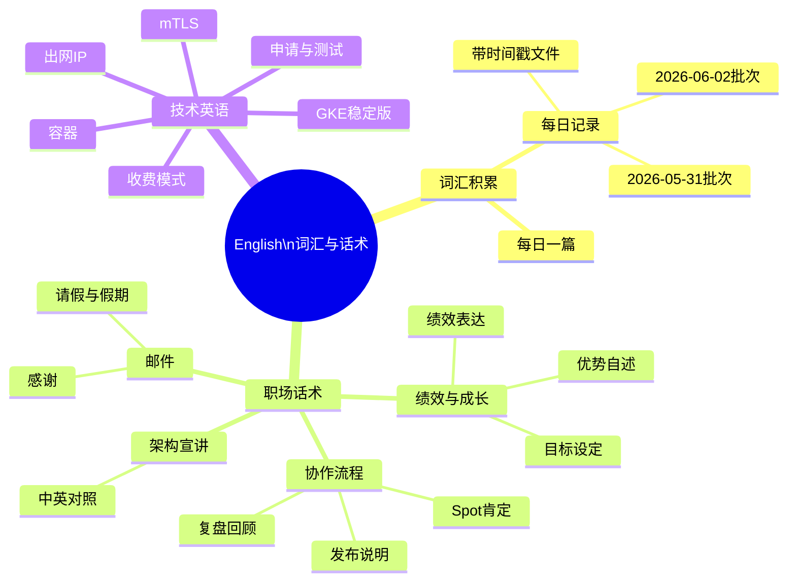

# English 知识点分析

Analyze the `English/` knowledge base. Categorize the vocabulary / workplace-template documents by technical domain, summarize the key knowledge points, and present everything as a Markdown document with a Mermaid mindmap.

本文档覆盖 `English/` 下的 **35 篇文档 / 1 个子目录 `docs/`**。

> **一句话结论**
> ★ 这个目录分两类：
> ① **每日词汇积累**（20 篇带时间戳的 `english-words-YYYY-MM-DD-HH.md`）——
> 这是一种"每天记一点"的长期主义机制；
> ② **职场英语模板**（邮件、假期、绩效、发布说明、架构宣讲）——
> 把"要写的话"直接给出可抄的版本。
> 另有几篇技术英语：`mTLS.md`、`egress-ip.md`、`gke-stable.md`、`container2.md`。

---

## 文档体系分析

1. **词汇积累（20 篇）** — `english-words-2026-05-31-*.md`、`english-words-2026-06-02-*.md`
2. **职场话术模板** — `mail.md`、`holiday.md`、`thanks.md`、`performance.md`、`strengh.md`、
   `Release.md`、`retrospective.md`、`spot.md`、`goals.md`、`policy.md`
3. **技术英语** — `mTLS.md`、`egress-ip.md`、`gke-stable.md`、`container2.md`、`apply-testing.md`、
   `charge-mode-eg.md`、`talk-architecture.md`

---

## 知识点 MindMap



---

## 主要知识领域详解

### 1. 词汇积累（20 篇）
文件名带时间戳（`english-words-2026-05-31-19.md` … `english-words-2026-06-02-19.md`），
每天一篇。**这是一种机制而不是一批资料**——
它的价值在于"可持续的最小单位"：每天 10 分钟，一年就是一本词汇书。
`English/docs/english-words-2026-06-02-09.md` 起的文件名改成了
`english-vocabulary-`，说明中途做过一次格式统一。

### 2. 职场话术模板
这一组非常实用，因为**它给的是可抄的成品**，不是"要表达友好一点"这种建议：
- `mail.md`：邮件写法；`thanks.md`：感谢；
- `holiday.md`：**外企常见假期回复模板**；
- `performance.md`：**工作绩效**如何表达；`strengh.md`：优势自述；
- `goals.md`：目标设定；`retrospective.md`：回顾；
- `Release.md`：发布说明；`spot.md`：同事间的肯定；
- `policy.md`：政策类沟通；
- `talk-architecture.md`：**Architecture Talk Guide — English & Chinese 对照**——
  这是技术英语里最有价值的一篇，因为它把"架构宣讲"这种高难度场景的句子给了对照。

### 3. 技术英语
`mTLS.md`、`egress-ip.md`、`gke-stable.md`、`container2.md`、
`apply-testing.md`、`charge-mode-eg.md`——
在专业语境下怎么把技术概念讲清楚（比通用词汇表有用得多）。

---

## 三条阅读路线

```
路线 A · 今天就用得上（30 分钟）
  docs/mail.md → docs/holiday.md → docs/talk-architecture.md

路线 B · 建自己的词汇机制（1 小时）
  docs/english-words-2026-06-02-19.md → 挑一篇你最喜欢的格式
  → 设一个固定时间

路线 C · 技术表达专项（1 小时）
  docs/mTLS.md → docs/egress-ip.md → docs/talk-architecture.md
```

---

## 结论

1. **这个目录的真正资产是"机制"**：20 篇按天累积的词汇记录，
   说明作者把学习拆成了可持续的最小单元——这比任何词表都有用。
2. **话术模板的价值在于可抄**：`holiday.md`、`performance.md`、
   `talk-architecture.md` 都能直接改两三个词就用。
3. **`talk-architecture.md` 是"技术英语"里最稀缺的一篇**：
   架构宣讲需要同时懂技术、懂听众、懂英语，
   中英对照句式几乎无法自己造出来。

---

## 关联文档

- [../knowledge-mindmap.md](../knowledge-mindmap.md) ·
  [../ai/ai-mindmap.md](../ai/ai-mindmap.md) ·
  [../skills/skills-mindmap.md](../skills/skills-mindmap.md)
- [README.md](./README.md) ·
  [docs/talk-architecture.md](./docs/talk-architecture.md) ·
  [docs/holiday.md](./docs/holiday.md) ·
  [docs/performance.md](./docs/performance.md) ·
  [docs/english-words-2026-06-02-19.md](./docs/english-words-2026-06-02-19.md)
