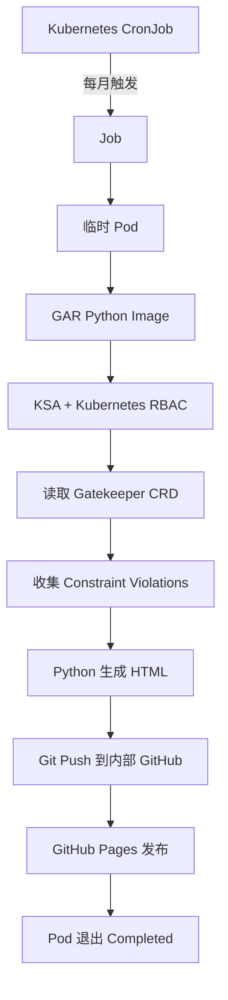
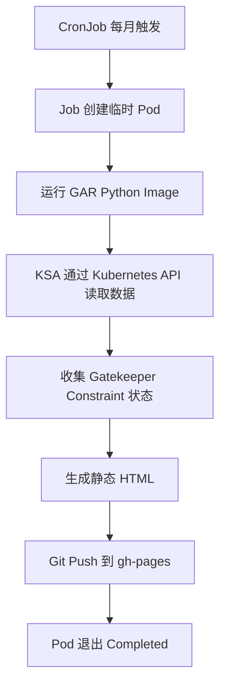

# GKE OPA Gatekeeper 月度报告 CronJob：完整会话记录

> **会话来源**: https://chatgpt.com/share/6ae89dfa-5a58-83e8-b7ca-22a4f9f9cb92
> **会话标题**: GKE OPA方案评估
> **抓取日期**: 2026-11-02
> **抓取方式**: 直接解析共享页面内嵌的会话数据（React Router 单次拉取数据），非人工复制
> **最终产物**: [`opa-report-cronjob-design.md`](./opa-report-cronjob-design.md)

---

## 会话结构

| 序号 | 角色 | 内容 |
|---|---|---|
| 1 | User | 需求描述 + 已有探索结果（Markdown 方案与 `opa_report.py`） |
| 2 | Assistant | 方案评估与实现（初版） |
| 3 | Assistant | 对现有设计的技术评估 |
| 4 | Assistant | 生成的完整 Markdown 文档（见 `opa-report-cronjob-design.md`） |
| 5 | Assistant | 最终答复 |
| 6 | Assistant | 推荐文件结构与落地建议 |

---

## 1. 原始需求

### User

我现在有这样一个场景，需要你帮我去设计和解决一下，这个事情是关于 GKE 里边的对应的 OPA 的一个东西。就是说我们现在想写一个对应的 cron job，就比如说我每个月运行一次，然后呢让这个 cron job 能够执行命令，获取我整个集群里边的这个 OPA 的一个报告。然后这个报告其实我已经有对应的脚本或者流程已经跑通了。我的大概的逻辑就是获取完成之后，将这个对应的纯的这个 HTML 的静态页面，也就是转换了一次 HTML 的静态页面，然后把它推送到我们公司内部的 GitHub 上面。 因为这个branch也就是通过pages来发布的，所以说也就直接能打开了。 这个流程和网络应该都是 OK 的。我只是让你帮我去做一些简单的设计和实现，你不要拓展，也不要蔓延，只给一些核心的方案就可以了。比如说我有一个对应的 cron job，然后按照时间来运行，然后运行完成之后，这个任务就等于是终止了。然后它可能是一个定期的任务，就大概是这样一个非常简单的场景。然后呢你帮我探索一下，然后找一个合适的目录来存放，给我生成对应的 Markdown 就可以了。 当然，如果在这个过程中，比如说我这个脚本它是一个 Python 的脚本，比如说我还想着它可能启动的时候是我的一个 GAR 里边的一个 image，它可能依赖于一个比如说第三方的用网络，它可能也需要一些对应的 Python 的 library 库的导入，这个你也可以帮我去简单地罗列一下。然后有这样一个东西出来之后呢，它就能做收集。 比如说我对应的这个 POD，也就是或者说 Deploy 运行的这个 ksa 也就是这个 Service account 是不是要有一些对应的权限等等的，你也可以帮我评估进去。 或者更直白一点的说，我这个运行我这个 deploy的这个账号，它最起码能获取我这个Kube的命令，然后get一些对应的东西，应该是这样一个东西在就行了。 下面部分是一些探索的结果，你帮我确认一下这个结果怎么样。```markdown
# OPA (Gatekeeper) 月度报告 CronJob 方案

## 1. 整体流程

​```mermaid
graph TD
    A[CronJob 每月触发] --> B[Job Pod 启动 GAR 镜像]
    B --> C[Python 脚本通过 KSA 调用 K8S API]
    C --> D[收集 Constraint violations]
    D --> E[渲染静态 HTML]
    E --> F[git push 到 gh-pages 分支]
    F --> G[Pod 退出 Completed]
​```

## 2. 建议目录

​```text
gke/opa-report-cronjob/
├── Dockerfile
├── requirements.txt
├── opa_report.py          # 已有脚本
├── k8s/
│   ├── rbac.yaml          # KSA + ClusterRole + Binding
│   └── cronjob.yaml
└── README.md
​```

## 3. Python 依赖 (requirements.txt)

按你现有脚本为准，常见组合如下：

​```text
kubernetes>=29.0.0     # 调用 K8S API（或改用 kubectl 则不需要）
jinja2>=3.1            # 渲染 HTML
PyYAML>=6.0
​```

| 镜像内需要 | 说明 |
|-----------|------|
| `git` | 推送到内部 GitHub |
| `kubectl`（可选） | 仅当脚本通过 subprocess 调 kubectl 时需要 |
| 内部 CA 证书 | 若内部 GitHub 使用私有 CA，需要 `update-ca-certificates` |

​```dockerfile
FROM python:3.12-slim
RUN apt-get update && apt-get install -y --no-install-recommends git ca-certificates \
    && rm -rf /var/lib/apt/lists/*
WORKDIR /app
COPY requirements.txt .
RUN pip install --no-cache-dir -r requirements.txt
COPY opa_report.py .
USER 65534
ENTRYPOINT ["python", "/app/opa_report.py"]
​```

## 4. KSA 权限（只读即可）

Gatekeeper 的 Constraint 是 CRD，种类（kind）不固定，所以需要 `list` CRD 来发现，再读取 `constraints.gatekeeper.sh` 下所有资源。

​```yaml
apiVersion: v1
kind: ServiceAccount
metadata:
  name: opa-report
  namespace: gatekeeper-report
---
apiVersion: rbac.authorization.k8s.io/v1
kind: ClusterRole
metadata:
  name: opa-report-reader
rules:
  - apiGroups: ["constraints.gatekeeper.sh"]
    resources: ["*"]
    verbs: ["get", "list"]
  - apiGroups: ["templates.gatekeeper.sh"]
    resources: ["constrainttemplates"]
    verbs: ["get", "list"]
  - apiGroups: ["apiextensions.k8s.io"]
    resources: ["customresourcedefinitions"]
    verbs: ["get", "list"]
  - apiGroups: [""]
    resources: ["namespaces"]
    verbs: ["get", "list"]
---
apiVersion: rbac.authorization.k8s.io/v1
kind: ClusterRoleBinding
metadata:
  name: opa-report-reader
roleRef:
  apiGroup: rbac.authorization.k8s.io
  kind: ClusterRole
  name: opa-report-reader
subjects:
  - kind: ServiceAccount
    name: opa-report
    namespace: gatekeeper-report
​```

> 不需要 GCP IAM（Workload Identity）：Pod 在集群内通过 KSA token 访问 K8S API 即可。
> 若报告还要读取 `config.gatekeeper.sh` 或 Mutation 资源，再按需追加 `apiGroups`。

## 5. CronJob

​```yaml
apiVersion: batch/v1
kind: CronJob
metadata:
  name: opa-report
  namespace: gatekeeper-report
spec:
  schedule: "0 2 1 * *"            # 每月 1 日 02:00（UTC）
  concurrencyPolicy: Forbid
  successfulJobsHistoryLimit: 3
  failedJobsHistoryLimit: 3
  jobTemplate:
    spec:
      backoffLimit: 1
      activeDeadlineSeconds: 1800
      ttlSecondsAfterFinished: 86400
      template:
        spec:
          serviceAccountName: opa-report
          restartPolicy: Never
          containers:
            - name: report
              image: <REGION>-docker.pkg.dev/<PROJECT>/<REPO>/opa-report:v1
              env:
                - name: GIT_REPO_URL
                  value: "https://<internal-github>/<org>/<repo>.git"
                - name: GIT_BRANCH
                  value: "gh-pages"
                - name: GIT_TOKEN
                  valueFrom:
                    secretKeyRef:
                      name: opa-report-git
                      key: token
              resources:
                requests: { cpu: 100m, memory: 256Mi }
                limits:   { memory: 512Mi }
​```

## 6. 部署前检查清单

| 检查项 | 命令 / 说明 |
|--------|-------------|
| KSA 权限 | `kubectl auth can-i list constraints.constraints.gatekeeper.sh --as=system:serviceaccount:gatekeeper-report:opa-report` |
| GAR 拉取 | 节点 SA 需要 `roles/artifactregistry.reader` |
| Git Token | `kubectl -n gatekeeper-report create secret generic opa-report-git --from-literal=token=<TOKEN>` |
| YAML 校验 | `kubectl apply --dry-run=server -f k8s/` |
| 手动触发测试 | `kubectl -n gatekeeper-report create job --from=cronjob/opa-report opa-report-test` |
```

注意：上面 Markdown 里的 ` ​``` ` 是为了避免嵌套围栏而加了零宽字符，复制到 `.md` 文件后请把代码围栏还原为标准的三个反引号。
然后呢，基于这个里面的内容，比如说还有一个 Python 的脚本，是下面这些内容，你帮我整体评估一下。## 1. 脚本：`opa_report.py`

放在 `gke/opa-report-cronjob/opa_report.py`。

```python
#!/usr/bin/env python3
"""收集集群内 Gatekeeper(OPA) Constraint 违规情况 -> 静态 HTML -> 推送到 gh-pages"""
import datetime as dt
import os
import subprocess
import sys
import tempfile
from collections import Counter
from pathlib import Path

from jinja2 import Template
from kubernetes import client, config

GROUP = "constraints.gatekeeper.sh"

CLUSTER = os.getenv("CLUSTER_NAME", "gke-cluster")
REPO_URL = os.environ["GIT_REPO_URL"]
BRANCH = os.getenv("GIT_BRANCH", "gh-pages")
TOKEN = os.environ["GIT_TOKEN"]
REPORT_DIR = os.getenv("REPORT_DIR", "reports")

REPORT_TPL = Template("""<!doctype html>
<html lang="zh"><head><meta charset="utf-8">
<title>OPA Report - {{ cluster }} - {{ month }}</title>
<style>
 body{font-family:sans-serif;margin:2rem;color:#222}
 table{border-collapse:collapse;width:100%;margin:.5rem 0}
 th,td{border:1px solid #ddd;padding:6px 8px;font-size:13px;text-align:left}
 th{background:#f4f4f4}
 .bad{color:#c00;font-weight:bold}.ok{color:#080}
 details{margin:.6rem 0}summary{cursor:pointer;font-weight:bold}
</style></head><body>
<h1>OPA Gatekeeper Report</h1>
<p>Cluster: <b>{{ cluster }}</b> | Generated: {{ generated }}</p>
<h2>Summary</h2>
<ul>
 <li>Constraints: {{ constraints|length }}</li>
 <li>Total violations: <span class="{{ 'bad' if total else 'ok' }}">{{ total }}</span></li>
 <li>By enforcementAction: {{ k }}={{ v }} </li>
</ul>
<h2>Constraints</h2>
<table><tr><th>Kind</th><th>Name</th><th>Action</th><th>Violations</th><th>Last audit</th></tr>

<tr><td>{{ c.kind }}</td><td>{{ c.name }}</td><td>{{ c.action }}</td>
<td class="{{ 'bad' if c.total else 'ok' }}">{{ c.total }}</td><td>{{ c.audit }}</td></tr>
</table>
<h2>Violation details</h2>

<details><summary>{{ c.kind }} / {{ c.name }} ({{ c.total }}, 仅显示 {{ c.violations|length }} 条)</summary>
<table><tr><th>Kind</th><th>Namespace</th><th>Name</th><th>Message</th></tr>

<tr><td>{{ v.kind }}</td><td>{{ v.namespace }}</td><td>{{ v.name }}</td><td>{{ v.message }}</td></tr>
</table></details>

</body></html>""")

INDEX_TPL = Template("""<!doctype html>
<html lang="zh"><head><meta charset="utf-8"><title>OPA Reports</title></head><body>
<h1>OPA Reports - {{ cluster }}</h1><ul>
<li><a href="{{ dir }}/{{ f }}">{{ f[:-5] }}</a></li>
</ul></body></html>""")


def load_kube():
    try:
        config.load_incluster_config()
    except config.ConfigException:
        config.load_kube_config()  # 本地调试用


def collect():
    ext = client.ApiextensionsV1Api()
    co = client.CustomObjectsApi()
    result = []
    for crd in ext.list_custom_resource_definition().items:
        if crd.spec.group != GROUP:
            continue
        version = next(v.name for v in crd.spec.versions if v.served)
        items = co.list_cluster_custom_object(
            GROUP, version, crd.spec.names.plural
        ).get("items", [])
        for o in items:
            st = o.get("status") or {}
            vs = st.get("violations") or []
            result.append({
                "kind": o["kind"],
                "name": o["metadata"]["name"],
                "action": (o.get("spec") or {}).get("enforcementAction", "deny"),
                "total": st.get("totalViolations", len(vs)),
                "audit": st.get("auditTimestamp", "-"),
                "violations": [{
                    "kind": v.get("kind", ""),
                    "namespace": v.get("namespace", "-"),
                    "name": v.get("name", ""),
                    "message": v.get("message", ""),
                } for v in vs],
            })
    result.sort(key=lambda c: (-c["total"], c["kind"], c["name"]))
    return result


def render(constraints, now):
    return REPORT_TPL.render(
        cluster=CLUSTER,
        month=now.strftime("%Y-%m"),
        generated=now.strftime("%Y-%m-%d %H:%M UTC"),
        constraints=constraints,
        total=sum(c["total"] for c in constraints),
        actions=Counter(c["action"] for c in constraints),
    )


def git(*args, cwd):
    r = subprocess.run(
        ["git", "-c", "user.name=opa-report-bot",
         "-c", "user.email=opa-report-bot@noreply", *args],
        cwd=cwd, capture_output=True, text=True,
    )
    if r.returncode != 0:
        err = (r.stderr or "").replace(TOKEN, "***")  # 避免 token 泄露到日志
        sys.exit(f"git {args[0]} failed: {err}")
    return r


def publish(html_text, now):
    auth_url = REPO_URL.replace("https://", f"https://x-access-token:{TOKEN}@", 1)
    with tempfile.TemporaryDirectory() as tmp:
        git("clone", "--depth", "1", "--branch", BRANCH, auth_url, tmp, cwd=None)
        rdir = Path(tmp) / REPORT_DIR
        rdir.mkdir(exist_ok=True)
        (rdir / f"{now.strftime('%Y-%m')}.html").write_text(html_text, encoding="utf-8")

        files = sorted((p.name for p in rdir.glob("*.html")), reverse=True)
        (Path(tmp) / "index.html").write_text(
            INDEX_TPL.render(cluster=CLUSTER, dir=REPORT_DIR, files=files),
            encoding="utf-8",
        )

        git("add", "-A", cwd=tmp)
        if git("status", "--porcelain", cwd=tmp).stdout.strip() == "":
            print("No changes, skip push")
            return
        git("commit", "-m", f"OPA report {now.strftime('%Y-%m')} ({CLUSTER})", cwd=tmp)
        git("push", "origin", BRANCH, cwd=tmp)
        print("Pushed report")


def main():
    now = dt.datetime.now(dt.timezone.utc)
    load_kube()
    constraints = collect()
    print(f"Collected {len(constraints)} constraints, "
          f"{sum(c['total'] for c in constraints)} violations")
    publish(render(constraints, now), now)


if __name__ == "__main__":
    main()
```

## 2. 依赖

`requirements.txt` 保持之前的三项即可（`kubernetes`、`jinja2`、`PyYAML`）。该脚本不需要镜像里有 `kubectl`，只需要 `git`。

## 3. 需要注意的点

| 点 | 说明 |
|----|------|
| 违规条数上限 | Gatekeeper 的 audit 默认每个 Constraint 只在 `status.violations` 里保存 20 条（`--constraint-violations-limit`）。`totalViolations` 是准确总数，所以报告里写了「仅显示 N 条」。要看全量，需要调大这个 audit 参数 |
| 数据新鲜度 | 报告读的是 audit 的最近一次结果（`auditTimestamp`），默认每 60 秒审计一次，月度任务足够 |
| 分支前提 | 脚本假设 `gh-pages` 分支已存在。如果是空仓库首次使用，需要先手工建好分支 |
| 同月重跑 | 同一个月文件名相同，会覆盖；内容没变就不产生 commit |
| Token | 通过 `GIT_TOKEN` 环境变量传入，脚本在报错日志里会把它替换成 `***` |
| 退出码 | 任意一步失败都会非 0 退出，CronJob 会标记为 Failed，方便告警 |

## 4. 本地测试

```bash
# 本地用你的 kubeconfig 先看采集结果（不推送）
python - <<'EOF'
import os
os.environ.update(GIT_REPO_URL="https://x/x.git", GIT_TOKEN="x")
import opa_report as r
cs = r.collect()
print(len(cs), sum(c["total"] for c in cs))
open("/tmp/test.html", "w").write(r.render(cs, __import__("datetime").datetime.now(__import__("datetime").timezone.utc)))
EOF
```

然后用浏览器打开 `/tmp/test.html` 看效果，没问题再构建镜像、推到 GAR、手动触发一次 Job 验证推送。

---
## 2. 方案评估与实现（初版）

### Assistant

# GKE OPA Gatekeeper 月度报告 CronJob：方案评估与实现

## 1. 整体结论

我认为你目前的方案是合理的，**没有必要引入额外的组件，也不需要设计成长期运行的 Deployment。**

你的场景本质上就是一个 Kubernetes Batch Job：

- 每个月由 CronJob 定时触发。
- 创建一个临时 Pod。
- Pod 使用指定的 KSA 访问 Kubernetes API。
- Python 脚本读取 Gatekeeper Constraint 和违规信息。
- 生成静态 HTML。
- 将 HTML 推送到内部 GitHub 的 `gh-pages` 分支。
- 执行成功后 Pod 退出，Job 进入 `Complete` 状态。
- 下个月由 CronJob 再次创建新的 Job。

推荐架构：



**我的建议是保留你现有的整体设计，只对 Python 脚本、权限和 CronJob 做少量必要修正。**

特别是以下三个方面：

1. Kubernetes CronJob 的时区需要明确指定。
2. HTML 模板需要开启自动转义，避免违规信息中的特殊内容影响页面安全。
3. Git Token 的使用方式建议调整，避免直接把 Token 放进 Git Remote URL。


---
## 3. 对现有设计的技术评估

### Assistant

## 2. 对现有设计的技术评估

| 项目 | 评估 | 处理建议 |
|---|---|---|
| CronJob + Job | <badge color="success">正确</badge> | 保留 |
| GAR 镜像 | <badge color="success">正确</badge> | 保留 |
| Python Kubernetes Client | <badge color="success">正确</badge> | 保留 |
| KSA + ClusterRole | <badge color="success">正确</badge> | 精简权限 |
| GitHub Pages | <badge color="success">正确</badge> | 保留 |
| Git Token | <badge color="warning">建议调整</badge> | 避免直接嵌入 Git URL |
| HTML Template | <badge color="warning">需要修正</badge> | 开启 HTML 自动转义 |
| CronJob 时区 | <badge color="warning">需要修正</badge> | 明确指定 `Etc/UTC` |
| Python 依赖 | <badge color="success">基本正确</badge> | 移除不直接使用的 PyYAML 声明 |

### 2.1 KSA 权限：可以进一步精简

你当前的 RBAC 有一个地方可以优化。

按照目前 Python 脚本的实际行为，它只需要：

1. 获取 Kubernetes CRD 列表，发现 Gatekeeper Constraint 类型。
2. 获取对应 Constraint 资源。
3. 读取 Constraint 的 Status。

所以实际上只需要以下权限：

| API Group | Resource | Verbs | 用途 |
|---|---|---|---|
| `apiextensions.k8s.io` | `customresourcedefinitions` | get, list | 发现 Gatekeeper CRD |
| `constraints.gatekeeper.sh` | `*` | get, list | 读取所有 Constraint |

不需要：

- `namespaces`：当前脚本没有查询 Namespace API。
- `constrainttemplates`：当前脚本没有查询 ConstraintTemplate 对象。
- `create/update/patch/delete`：报告程序完全不需要修改集群资源。

建议使用下面的 RBAC：

```yaml
apiVersion: v1
kind: ServiceAccount
metadata:
  name: opa-report
  namespace: gatekeeper-report
automountServiceAccountToken: true
---
apiVersion: rbac.authorization.k8s.io/v1
kind: ClusterRole
metadata:
  name: opa-report-reader
rules:
  - apiGroups:
      - constraints.gatekeeper.sh
    resources:
      - "*"
    verbs:
      - get
      - list

  - apiGroups:
      - apiextensions.k8s.io
    resources:
      - customresourcedefinitions
    verbs:
      - get
      - list
---
apiVersion: rbac.authorization.k8s.io/v1
kind: ClusterRoleBinding
metadata:
  name: opa-report-reader
roleRef:
  apiGroup: rbac.authorization.k8s.io
  kind: ClusterRole
  name: opa-report-reader
subjects:
  - kind: ServiceAccount
    name: opa-report
    namespace: gatekeeper-report
```

这里有一个重要区别：

**KSA 和 GCP IAM Service Account 不是一回事。**

当前程序访问的是 GKE Kubernetes API，而不是 GCP API。

因此：

- KSA：需要 Kubernetes RBAC。
- GSA：不需要。
- Workload Identity：不需要。
- GAR Image Pull：由 GKE Node 使用的身份负责，需要具备 `roles/artifactregistry.reader`，而不是给报告 Pod 的 KSA 授权。

### 2.2 Python 脚本：两个值得修正的地方

**问题一：Jinja2 默认没有开启 HTML 自动转义。**

当前代码：

```python
from jinja2 import Template

REPORT_TPL = Template("""...""")
```

建议修改成：

```python
from jinja2 import Environment, select_autoescape

JINJA_ENV = Environment(
    autoescape=select_autoescape(
        enabled_extensions=("html", "xml"),
        default_for_string=True,
    )
)

REPORT_TPL = JINJA_ENV.from_string("""...""")
INDEX_TPL = JINJA_ENV.from_string("""...""")
```

这样 Constraint 名称、违规对象名称和 message 中的特殊字符会正确转义，避免破坏 HTML 页面。

**问题二：Git Token 不建议直接放入 Remote URL。**

当前：

```python
auth_url = REPO_URL.replace(
    "https://",
    f"https://x-access-token:{TOKEN}@",
    1
)
```

这个方式能够工作，但 Token 会短暂出现在 Git 进程参数和 Git Remote 配置中。

建议后续使用 `GIT_ASKPASS` 配合环境变量提供认证信息。这样 Git Remote 可以保持原始 URL，减少 Token 暴露面。

如果暂时保留原来的实现，至少要确保：

- 使用专门的 GitHub Bot Token。
- Token 仅具有目标仓库的 Contents Write 权限。
- Secret 不进入 Git 仓库。
- 不打印完整环境变量。
- 确认内部 GitHub 的认证方式支持当前 URL 格式。

### 2.3 Gatekeeper 违规数据：你原来的判断正确

这里你的分析是准确的。

Gatekeeper 默认：

```text
--constraint-violations-limit=20
```

意味着：

- `status.totalViolations`：总违规数量。
- `status.violations`：实际保存的违规详情，默认最多 20 条。

所以你现在的报告逻辑：

```python
total = st.get("totalViolations", len(vs))
```

是合理的。

HTML 中也应该保留：

```text
总违规数量：100
实际展示详情：20
```

这样不会让报告使用者误认为只有 20 个违规。

参考：<Cite refs={["turn872841search4","turn872841search6"]}/>

### 2.4 CronJob 时区

你原来的配置：

```yaml
schedule: "0 2 1 * *"
```

表达的是每月 1 日凌晨 02:00。

但 Kubernetes 没有指定 `timeZone` 时，会使用 kube-controller-manager 的本地时区，不应该直接假定是 UTC。

建议：

```yaml
spec:
  schedule: "0 2 1 * *"
  timeZone: "Etc/UTC"
```

Kubernetes 1.27 起该字段已经稳定支持。<Cite refs={["turn872841search0","turn872841search1"]}/>


---
## 4. 生成的完整 Markdown 文档

### Assistant

> 该轮回复的完整 Markdown 产物已单独保存为 `opa-report-cronjob-design.md`。

# GKE OPA Gatekeeper 月度报告 CronJob 方案

## 1. 目标与设计结论

使用 Kubernetes CronJob 每月执行一次现有 Python 报告程序：

1. CronJob 创建 Job。
2. Job 启动一个使用 GAR 镜像的临时 Pod。
3. Pod 使用 KSA 通过 Kubernetes API 读取 Gatekeeper Constraint 和违规状态。
4. Python 生成静态 HTML 报告。
5. 将报告推送到内部 GitHub 的 `gh-pages` 分支。
6. 程序退出，Pod 进入 `Completed`；下个月由 CronJob 再次触发。

不需要 Deployment、常驻服务、额外调度器或 GCP API 权限。



## 2. 建议目录

建议放在现有 GKE 配置仓库中，使用独立目录：

```text
gke/opa-report-cronjob/
├── Dockerfile
├── requirements.txt
├── opa_report.py
├── k8s/
│   ├── rbac.yaml
│   └── cronjob.yaml
└── README.md
```

如果仓库有统一的 `jobs/` 或 `batch/` 目录规范，可以遵循现有规范；否则以上目录足够，不需要再拆分更多层级。

## 3. 容器镜像

### requirements.txt

脚本直接使用的依赖：

```text
kubernetes>=29.0.0
Jinja2>=3.1.0
```

`PyYAML` 当前没有被脚本直接 import；Kubernetes Python Client 会处理其自身依赖。只有脚本直接读取或生成 YAML 时，才需要将 PyYAML 作为显式依赖。

正式构建建议在验证兼容性后锁定依赖版本，避免每次构建自动获取不同版本。

### Dockerfile

```dockerfile
FROM python:3.12-slim

RUN apt-get update \
    && apt-get install -y --no-install-recommends \
       git \
       ca-certificates \
    && rm -rf /var/lib/apt/lists/*

WORKDIR /app

COPY requirements.txt .
RUN pip install --no-cache-dir -r requirements.txt

COPY opa_report.py .

USER 65534:65534

ENTRYPOINT ["python", "/app/opa_report.py"]
```

说明：

| 组件 | 是否需要 | 原因 |
|---|---|---|
| Python 3.12 | 是 | 执行报告脚本 |
| Kubernetes Python Client | 是 | 访问 Kubernetes API |
| Jinja2 | 是 | 渲染 HTML |
| Git | 是 | Clone、Commit、Push |
| CA certificates | 是 | HTTPS TLS 证书校验 |
| kubectl | 否 | 当前脚本直接使用 Kubernetes Python Client |
| PyYAML | 非必需 | 当前脚本没有直接调用 YAML API |

如果内部 GitHub 使用企业私有 CA，需要将企业 CA 证书加入镜像信任链；不能通过关闭 TLS 校验解决。

## 4. KSA 和 RBAC

脚本只读取 CRD 定义和 Constraint 对象，不修改任何集群资源。

`k8s/rbac.yaml`：

```yaml
apiVersion: v1
kind: Namespace
metadata:
  name: gatekeeper-report
---
apiVersion: v1
kind: ServiceAccount
metadata:
  name: opa-report
  namespace: gatekeeper-report
automountServiceAccountToken: true
---
apiVersion: rbac.authorization.k8s.io/v1
kind: ClusterRole
metadata:
  name: opa-report-reader
rules:
  - apiGroups:
      - constraints.gatekeeper.sh
    resources:
      - "*"
    verbs:
      - get
      - list

  - apiGroups:
      - apiextensions.k8s.io
    resources:
      - customresourcedefinitions
    verbs:
      - get
      - list
---
apiVersion: rbac.authorization.k8s.io/v1
kind: ClusterRoleBinding
metadata:
  name: opa-report-reader
roleRef:
  apiGroup: rbac.authorization.k8s.io
  kind: ClusterRole
  name: opa-report-reader
subjects:
  - kind: ServiceAccount
    name: opa-report
    namespace: gatekeeper-report
```

### 权限说明

| API Group | Resource | Verbs | 用途 |
|---|---|---|---|
| `constraints.gatekeeper.sh` | `*` | `get`, `list` | 读取各类 Constraint |
| `apiextensions.k8s.io` | `customresourcedefinitions` | `get`, `list` | 发现 Constraint CRD |

当前脚本不需要 `namespaces` 或 `constrainttemplates` 的 RBAC，因为它没有调用对应 API。

### KSA、GSA 和 GAR 权限的区别

- **KSA**：Pod 使用的 Kubernetes ServiceAccount，绑定上面的 Kubernetes RBAC。
- **GSA / Workload Identity**：当前脚本不调用 GCP API，因此不需要为脚本配置 GSA 或 Workload Identity。
- **GAR Image Pull**：镜像拉取由 GKE 节点使用的身份完成。节点身份需要具备目标 Artifact Registry 仓库的 `roles/artifactregistry.reader` 权限。

## 5. CronJob

`k8s/cronjob.yaml`：

```yaml
apiVersion: batch/v1
kind: CronJob
metadata:
  name: opa-report
  namespace: gatekeeper-report
spec:
  # 每月 1 日 02:00 UTC
  schedule: "0 2 1 * *"
  timeZone: "Etc/UTC"

  concurrencyPolicy: Forbid
  successfulJobsHistoryLimit: 3
  failedJobsHistoryLimit: 3

  jobTemplate:
    spec:
      backoffLimit: 1
      activeDeadlineSeconds: 1800
      ttlSecondsAfterFinished: 86400

      template:
        spec:
          serviceAccountName: opa-report
          restartPolicy: Never

          containers:
            - name: report
              image: <REGION>-docker.pkg.dev/<PROJECT>/<REPOSITORY>/opa-report:v1

              env:
                - name: CLUSTER_NAME
                  value: "<CLUSTER_NAME>"

                - name: GIT_REPO_URL
                  value: "https://<internal-github>/<ORG>/<REPOSITORY>.git"

                - name: GIT_BRANCH
                  value: "gh-pages"

                - name: REPORT_DIR
                  value: "reports"

                - name: GIT_TOKEN
                  valueFrom:
                    secretKeyRef:
                      name: opa-report-git
                      key: token

              resources:
                requests:
                  cpu: 100m
                  memory: 256Mi
                limits:
                  memory: 512Mi
```

### 关键参数

| 参数 | 作用 |
|---|---|
| `schedule` | 每月 1 日凌晨 02:00 运行 |
| `timeZone` | 明确使用 UTC，避免依赖 Controller Manager 时区 |
| `concurrencyPolicy: Forbid` | 上一次任务未结束时，不并发启动下一次任务 |
| `backoffLimit: 1` | 失败后最多重试一次 |
| `activeDeadlineSeconds: 1800` | 单次 Job 最长运行 30 分钟 |
| `ttlSecondsAfterFinished: 86400` | Job 完成 24 小时后自动清理 |
| `restartPolicy: Never` | 容器失败时由 Job 控制重试，不在同一个 Pod 内重启 |

`timeZone` 需要集群 Kubernetes 版本支持（Kubernetes 1.27 起稳定）。

## 6. Python 脚本评估与必要修正

现有 `opa_report.py` 的整体流程是正确的，可以继续使用。建议做以下小幅修改。

### 6.1 HTML 自动转义

当前使用：

```python
from jinja2 import Template
```

直接创建 `Template` 时，不应假定 HTML 自动转义已经开启。

建议改成：

```python
from jinja2 import Environment, select_autoescape

JINJA_ENV = Environment(
    autoescape=select_autoescape(
        enabled_extensions=("html", "xml"),
        default_for_string=True,
    )
)

REPORT_TPL = JINJA_ENV.from_string("""...原来的报告 HTML 模板...""")
INDEX_TPL = JINJA_ENV.from_string("""...原来的索引 HTML 模板...""")
```

保留原有模板内容即可。这样 Constraint 名称、资源名称和违规 message 中的特殊字符会被正确转义。

### 6.2 Git Token

现有方式：

```python
auth_url = REPO_URL.replace(
    "https://",
    f"https://x-access-token:{TOKEN}@",
    1
)
```

在支持该认证格式的 GitHub 环境中可以工作，但 Token 会短暂出现在 Git 进程参数及临时 Git Remote 配置中。

建议后续改为 `GIT_ASKPASS` 配合环境变量提供认证，避免将 Token 拼入 Remote URL。若暂时保留现有方式：

- 使用专用 Bot Token。
- 只授予目标仓库所需的 Contents Write 权限。
- 确认内部 GitHub Enterprise 支持当前认证格式。
- 不要打印完整环境变量或认证 URL。
- 确保 Token 不进入镜像、Git 仓库或报告 HTML。

### 6.3 CRD 版本发现

现有代码：

```python
version = next(v.name for v in crd.spec.versions if v.served)
```

一般情况下可用。为了避免异常情况下没有 served version 导致 `StopIteration`，可以改为：

```python
served_versions = [
    v.name for v in crd.spec.versions if v.served
]

if not served_versions:
    continue

version = served_versions[0]
```

### 6.4 Violations 数量限制

Gatekeeper 默认：

```text
--constraint-violations-limit=20
```

含义：

- `status.totalViolations`：该次 Audit 的总违规数量。
- `status.violations`：保存的违规详情，默认最多 20 条。

因此现有脚本同时读取 `totalViolations` 和 `violations` 的做法是正确的。

报告应区分总数和实际展示的详情数量。例如总数 100、详情 20，应显示总数 100，并注明只展示 20 条。

### 6.5 Audit 数据新鲜度

脚本读取的是 Gatekeeper 最近一次 Audit 写入 Constraint Status 的结果，而不是在运行报告时主动触发一次新的 Audit。

Gatekeeper 默认 Audit 周期通常为 60 秒，但实际应以集群部署参数为准。

建议报告保留 `auditTimestamp`，让读者能够判断数据的新鲜程度。

### 6.6 其他代码检查

- `git clone --depth 1 --branch gh-pages`：要求目标分支已存在。
- 同一个月份使用相同文件名：重跑会覆盖当月报告。
- `git status --porcelain`：没有变化时跳过 Commit 和 Push，逻辑合理。
- `REPORT_DIR` 下的历史 HTML：当前逻辑会保留，不会自动删除历史报告。
- Git Push 失败时退出码非零：Job 能正确识别失败。
- 当前 `load_kube()` 的本地 kubeconfig fallback：方便本地测试；集群运行时优先使用 InCluster Config。

## 7. Secret 创建

在部署前创建 Git Token Secret：

```bash
kubectl -n gatekeeper-report create secret generic opa-report-git \
  --from-literal=token='<GIT_TOKEN>'
```

注意：不要把真实 Token 写进 YAML 文件并提交到 Git。

生产环境应通过公司现有的 Secret 管理方式注入该 Secret。

## 8. 部署与验证

### 8.1 检查当前身份和集群

执行前先确认当前 kubeconfig、Context 和操作权限：

```bash
kubectl config current-context
kubectl get nodes
```

### 8.2 检查 RBAC

```bash
kubectl auth can-i list customresourcedefinitions.apiextensions.k8s.io \
  --as=system:serviceaccount:gatekeeper-report:opa-report

kubectl auth can-i list constraints.constraints.gatekeeper.sh \
  --as=system:serviceaccount:gatekeeper-report:opa-report
```

两个命令都应该返回：

```text
yes
```

### 8.3 构建并推送镜像

```bash
docker build -t <REGION>-docker.pkg.dev/<PROJECT>/<REPOSITORY>/opa-report:v1 .

docker push <REGION>-docker.pkg.dev/<PROJECT>/<REPOSITORY>/opa-report:v1
```

确认 GKE 节点身份有目标 GAR Repository 的读取权限。

### 8.4 校验并部署 YAML

```bash
kubectl apply --dry-run=server -f k8s/rbac.yaml
kubectl apply --dry-run=server -f k8s/cronjob.yaml

kubectl apply -f k8s/rbac.yaml
kubectl apply -f k8s/cronjob.yaml
```

部署前确认镜像地址、集群名称、Git Repository、Secret 名称和目标分支。

### 8.5 手动触发一次测试

不必等待每月 1 日，可以从 CronJob 手动创建 Job：

```bash
kubectl -n gatekeeper-report create job \
  --from=cronjob/opa-report \
  opa-report-manual-test
```

查看 Job 和 Pod：

```bash
kubectl -n gatekeeper-report get jobs
kubectl -n gatekeeper-report get pods
```

查看执行日志：

```bash
kubectl -n gatekeeper-report logs job/opa-report-manual-test
```

确认：

1. 能够连接 Kubernetes API。
2. 能够发现并读取 Gatekeeper Constraint。
3. 能够生成 HTML。
4. 能够完成 Git Commit 和 Push。
5. GitHub Pages 能够访问新报告。
6. Job 最终状态为 `Complete`。

## 9. 最终建议

这个方案只需要以下几个 Kubernetes / GCP 资源：

| 资源 | 用途 |
|---|---|
| Namespace | 隔离报告任务 |
| KSA | Pod 的 Kubernetes 身份 |
| ClusterRole | 只读 Gatekeeper Constraint 和 CRD |
| ClusterRoleBinding | 绑定 KSA 和 ClusterRole |
| Secret | 保存 Git Token |
| CronJob | 每月调度任务 |
| Job / Pod | 每次执行时动态创建 |
| GAR Image | Python 脚本运行环境 |

不需要 Deployment、Service、Ingress、GSA、Workload Identity 或额外的 GCP API 权限。

**最终运行模式：CronJob → Job → Pod → Python → Kubernetes API → HTML → GitHub Pages → Completed。**

## 10. 参考文档

- [Kubernetes CronJob](https://kubernetes.io/docs/concepts/workloads/controllers/cron-jobs/)
- [Gatekeeper Audit](https://open-policy-agent.github.io/gatekeeper/website/docs/audit/)
- [Gatekeeper API](https://open-policy-agent.github.io/gatekeeper/website/docs/api/)
- [Google Cloud Artifact Registry](https://cloud.google.com/artifact-registry/docs)


---
## 5. 最终答复

### Assistant

# GKE OPA Gatekeeper 月度报告 CronJob：方案评估与实现

## 1. 整体结论

我认为你目前的方案是合理的，**没有必要引入额外的组件，也不需要设计成长期运行的 Deployment。**

你的场景本质上就是一个 Kubernetes Batch Job：

- 每个月由 CronJob 定时触发。
- 创建一个临时 Pod。
- Pod 使用指定的 KSA 访问 Kubernetes API。
- Python 脚本读取 Gatekeeper Constraint 和违规信息。
- 生成静态 HTML。
- 将 HTML 推送到内部 GitHub 的 `gh-pages` 分支。
- 执行成功后 Pod 退出，Job 进入 `Complete` 状态。
- 下个月由 CronJob 再次创建新的 Job。

推荐架构：


**我的建议是保留你现有的整体设计，只对 Python 脚本、权限和 CronJob 做少量必要修正。**

特别是以下三个方面：

1. Kubernetes CronJob 的时区需要明确指定。
2. HTML 模板需要开启自动转义，避免违规信息中的特殊内容影响页面安全。
3. Git Token 的使用方式建议调整，避免直接把 Token 放进 Git Remote URL。

## 2. 对现有设计的技术评估

| 项目 | 评估 | 处理建议 |
|---|---|---|
| CronJob + Job | <badge color="success">正确</badge> | 保留 |
| GAR 镜像 | <badge color="success">正确</badge> | 保留 |
| Python Kubernetes Client | <badge color="success">正确</badge> | 保留 |
| KSA + ClusterRole | <badge color="success">正确</badge> | 精简权限 |
| GitHub Pages | <badge color="success">正确</badge> | 保留 |
| Git Token | <badge color="warning">建议调整</badge> | 避免直接嵌入 Git URL |
| HTML Template | <badge color="warning">需要修正</badge> | 开启 HTML 自动转义 |
| CronJob 时区 | <badge color="warning">需要修正</badge> | 明确指定 `Etc/UTC` |
| Python 依赖 | <badge color="success">基本正确</badge> | 移除不直接使用的 PyYAML 声明 |

### 2.1 KSA 权限：可以进一步精简

你当前的 RBAC 有一个地方可以优化。

按照目前 Python 脚本的实际行为，它只需要：

1. 获取 Kubernetes CRD 列表，发现 Gatekeeper Constraint 类型。
2. 获取对应 Constraint 资源。
3. 读取 Constraint 的 Status。

所以实际上只需要以下权限：

| API Group | Resource | Verbs | 用途 |
|---|---|---|---|
| `apiextensions.k8s.io` | `customresourcedefinitions` | get, list | 发现 Gatekeeper CRD |
| `constraints.gatekeeper.sh` | `*` | get, list | 读取所有 Constraint |

不需要：

- `namespaces`：当前脚本没有查询 Namespace API。
- `constrainttemplates`：当前脚本没有查询 ConstraintTemplate 对象。
- `create/update/patch/delete`：报告程序完全不需要修改集群资源。

建议使用下面的 RBAC：

```yaml
apiVersion: v1
kind: ServiceAccount
metadata:
  name: opa-report
  namespace: gatekeeper-report
automountServiceAccountToken: true
---
apiVersion: rbac.authorization.k8s.io/v1
kind: ClusterRole
metadata:
  name: opa-report-reader
rules:
  - apiGroups:
      - constraints.gatekeeper.sh
    resources:
      - "*"
    verbs:
      - get
      - list

  - apiGroups:
      - apiextensions.k8s.io
    resources:
      - customresourcedefinitions
    verbs:
      - get
      - list
---
apiVersion: rbac.authorization.k8s.io/v1
kind: ClusterRoleBinding
metadata:
  name: opa-report-reader
roleRef:
  apiGroup: rbac.authorization.k8s.io
  kind: ClusterRole
  name: opa-report-reader
subjects:
  - kind: ServiceAccount
    name: opa-report
    namespace: gatekeeper-report
```

这里有一个重要区别：

**KSA 和 GCP IAM Service Account 不是一回事。**

当前程序访问的是 GKE Kubernetes API，而不是 GCP API。

因此：

- KSA：需要 Kubernetes RBAC。
- GSA：不需要。
- Workload Identity：不需要。
- GAR Image Pull：由 GKE Node 使用的身份负责，需要具备 `roles/artifactregistry.reader`，而不是给报告 Pod 的 KSA 授权。

### 2.2 Python 脚本：两个值得修正的地方

**问题一：Jinja2 默认没有开启 HTML 自动转义。**

当前代码：

```python
from jinja2 import Template

REPORT_TPL = Template("""...""")
```

建议修改成：

```python
from jinja2 import Environment, select_autoescape

JINJA_ENV = Environment(
    autoescape=select_autoescape(
        enabled_extensions=("html", "xml"),
        default_for_string=True,
    )
)

REPORT_TPL = JINJA_ENV.from_string("""...""")
INDEX_TPL = JINJA_ENV.from_string("""...""")
```

这样 Constraint 名称、违规对象名称和 message 中的特殊字符会正确转义，避免破坏 HTML 页面。

**问题二：Git Token 不建议直接放入 Remote URL。**

当前：

```python
auth_url = REPO_URL.replace(
    "https://",
    f"https://x-access-token:{TOKEN}@",
    1
)
```

这个方式能够工作，但 Token 会短暂出现在 Git 进程参数和 Git Remote 配置中。

建议后续使用 `GIT_ASKPASS` 配合环境变量提供认证信息。这样 Git Remote 可以保持原始 URL，减少 Token 暴露面。

如果暂时保留原来的实现，至少要确保：

- 使用专门的 GitHub Bot Token。
- Token 仅具有目标仓库的 Contents Write 权限。
- Secret 不进入 Git 仓库。
- 不打印完整环境变量。
- 确认内部 GitHub 的认证方式支持当前 URL 格式。

### 2.3 Gatekeeper 违规数据：你原来的判断正确

这里你的分析是准确的。

Gatekeeper 默认：

```text
--constraint-violations-limit=20
```

意味着：

- `status.totalViolations`：总违规数量。
- `status.violations`：实际保存的违规详情，默认最多 20 条。

所以你现在的报告逻辑：

```python
total = st.get("totalViolations", len(vs))
```

是合理的。

HTML 中也应该保留：

```text
总违规数量：100
实际展示详情：20
```

这样不会让报告使用者误认为只有 20 个违规。

参考：<Cite refs={["turn872841search4","turn872841search6"]}/>

### 2.4 CronJob 时区

你原来的配置：

```yaml
schedule: "0 2 1 * *"
```

表达的是每月 1 日凌晨 02:00。

但 Kubernetes 没有指定 `timeZone` 时，会使用 kube-controller-manager 的本地时区，不应该直接假定是 UTC。

建议：

```yaml
spec:
  schedule: "0 2 1 * *"
  timeZone: "Etc/UTC"
```

Kubernetes 1.27 起该字段已经稳定支持。<Cite refs={["turn872841search0","turn872841search1"]}/>

## 3. 推荐最终文件结构

我建议最终采用下面的结构：

```text
gke/
└── opa-report-cronjob/
    ├── Dockerfile
    ├── requirements.txt
    ├── opa_report.py
    ├── k8s/
    │   ├── rbac.yaml
    │   └── cronjob.yaml
    └── README.md
```

其中 `README.md` 作为整个任务的设计和部署文档，其他文件分别负责镜像、Python 程序和 Kubernetes 资源。

<row align="center" gap={2}>
  <icon name="file-text" color="success" size="xl"/>
  **已经生成完整 Markdown 文档**
  <spacer/>
  <badge color="success">已生成</badge>
</row>

[下载 opa-report-cronjob-design.md](sandbox:/mnt/data/opa-report-cronjob-design.md)

建议将下载后的文件放到：

```text
gke/opa-report-cronjob/README.md
```

**最后一个实施建议：** 先不要急着部署定时任务。先构建镜像，手动创建一次 Job，确认 HTML 成功推送到 GitHub Pages，最后再启用每月调度。

这样整个方案的改动范围很小，也符合你希望的轻量化、一次性任务执行模式。

---

If you want, I can:

- 补充Python脚本完善及安全建议
- 优化CronJob配置细节
- 细化服务账户权限配置

---
## 6. 推荐文件结构与落地建议

### Assistant

## 3. 推荐最终文件结构

我建议最终采用下面的结构：

```text
gke/
└── opa-report-cronjob/
    ├── Dockerfile
    ├── requirements.txt
    ├── opa_report.py
    ├── k8s/
    │   ├── rbac.yaml
    │   └── cronjob.yaml
    └── README.md
```

其中 `README.md` 作为整个任务的设计和部署文档，其他文件分别负责镜像、Python 程序和 Kubernetes 资源。

<row align="center" gap={2}>
  <icon name="file-text" color="success" size="xl"/>
  **已经生成完整 Markdown 文档**
  <spacer/>
  <badge color="success">已生成</badge>
</row>

[下载 opa-report-cronjob-design.md](sandbox:/mnt/data/opa-report-cronjob-design.md)

建议将下载后的文件放到：

```text
gke/opa-report-cronjob/README.md
```

**最后一个实施建议：** 先不要急着部署定时任务。先构建镜像，手动创建一次 Job，确认 HTML 成功推送到 GitHub Pages，最后再启用每月调度。

这样整个方案的改动范围很小，也符合你希望的轻量化、一次性任务执行模式。
