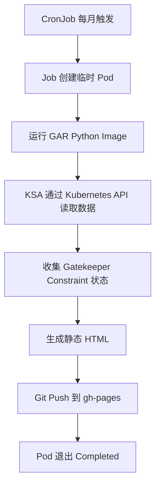

> **文档来源**: ChatGPT 共享会话《GKE OPA方案评估》(https://chatgpt.com/share/6ae89dfa-5a58-83e8-b7ca-22a4f9f9cb92)
> **抓取日期**: 2026-11-02
> **内容说明**: 以下为该会话中生成的最终 Markdown 设计文档（原始产物 `opa-report-cronjob-design.md`，12836 bytes），未做删改。

---

# GKE OPA Gatekeeper 月度报告 CronJob 方案

## 1. 目标与设计结论

使用 Kubernetes CronJob 每月执行一次现有 Python 报告程序：

1. CronJob 创建 Job。
2. Job 启动一个使用 GAR 镜像的临时 Pod。
3. Pod 使用 KSA 通过 Kubernetes API 读取 Gatekeeper Constraint 和违规状态。
4. Python 生成静态 HTML 报告。
5. 将报告推送到内部 GitHub 的 `gh-pages` 分支。
6. 程序退出，Pod 进入 `Completed`；下个月由 CronJob 再次触发。

不需要 Deployment、常驻服务、额外调度器或 GCP API 权限。



## 2. 建议目录

建议放在现有 GKE 配置仓库中，使用独立目录：

```text
gke/opa-report-cronjob/
├── Dockerfile
├── requirements.txt
├── opa_report.py
├── k8s/
│   ├── rbac.yaml
│   └── cronjob.yaml
└── README.md
```

如果仓库有统一的 `jobs/` 或 `batch/` 目录规范，可以遵循现有规范；否则以上目录足够，不需要再拆分更多层级。

## 3. 容器镜像

### requirements.txt

脚本直接使用的依赖：

```text
kubernetes>=29.0.0
Jinja2>=3.1.0
```

`PyYAML` 当前没有被脚本直接 import；Kubernetes Python Client 会处理其自身依赖。只有脚本直接读取或生成 YAML 时，才需要将 PyYAML 作为显式依赖。

正式构建建议在验证兼容性后锁定依赖版本，避免每次构建自动获取不同版本。

### Dockerfile

```dockerfile
FROM python:3.12-slim

RUN apt-get update \
    && apt-get install -y --no-install-recommends \
       git \
       ca-certificates \
    && rm -rf /var/lib/apt/lists/*

WORKDIR /app

COPY requirements.txt .
RUN pip install --no-cache-dir -r requirements.txt

COPY opa_report.py .

USER 65534:65534

ENTRYPOINT ["python", "/app/opa_report.py"]
```

说明：

| 组件 | 是否需要 | 原因 |
|---|---|---|
| Python 3.12 | 是 | 执行报告脚本 |
| Kubernetes Python Client | 是 | 访问 Kubernetes API |
| Jinja2 | 是 | 渲染 HTML |
| Git | 是 | Clone、Commit、Push |
| CA certificates | 是 | HTTPS TLS 证书校验 |
| kubectl | 否 | 当前脚本直接使用 Kubernetes Python Client |
| PyYAML | 非必需 | 当前脚本没有直接调用 YAML API |

如果内部 GitHub 使用企业私有 CA，需要将企业 CA 证书加入镜像信任链；不能通过关闭 TLS 校验解决。

## 4. KSA 和 RBAC

脚本只读取 CRD 定义和 Constraint 对象，不修改任何集群资源。

`k8s/rbac.yaml`：

```yaml
apiVersion: v1
kind: Namespace
metadata:
  name: gatekeeper-report
---
apiVersion: v1
kind: ServiceAccount
metadata:
  name: opa-report
  namespace: gatekeeper-report
automountServiceAccountToken: true
---
apiVersion: rbac.authorization.k8s.io/v1
kind: ClusterRole
metadata:
  name: opa-report-reader
rules:
  - apiGroups:
      - constraints.gatekeeper.sh
    resources:
      - "*"
    verbs:
      - get
      - list

  - apiGroups:
      - apiextensions.k8s.io
    resources:
      - customresourcedefinitions
    verbs:
      - get
      - list
---
apiVersion: rbac.authorization.k8s.io/v1
kind: ClusterRoleBinding
metadata:
  name: opa-report-reader
roleRef:
  apiGroup: rbac.authorization.k8s.io
  kind: ClusterRole
  name: opa-report-reader
subjects:
  - kind: ServiceAccount
    name: opa-report
    namespace: gatekeeper-report
```

### 权限说明

| API Group | Resource | Verbs | 用途 |
|---|---|---|---|
| `constraints.gatekeeper.sh` | `*` | `get`, `list` | 读取各类 Constraint |
| `apiextensions.k8s.io` | `customresourcedefinitions` | `get`, `list` | 发现 Constraint CRD |

当前脚本不需要 `namespaces` 或 `constrainttemplates` 的 RBAC，因为它没有调用对应 API。

### KSA、GSA 和 GAR 权限的区别

- **KSA**：Pod 使用的 Kubernetes ServiceAccount，绑定上面的 Kubernetes RBAC。
- **GSA / Workload Identity**：当前脚本不调用 GCP API，因此不需要为脚本配置 GSA 或 Workload Identity。
- **GAR Image Pull**：镜像拉取由 GKE 节点使用的身份完成。节点身份需要具备目标 Artifact Registry 仓库的 `roles/artifactregistry.reader` 权限。

## 5. CronJob

`k8s/cronjob.yaml`：

```yaml
apiVersion: batch/v1
kind: CronJob
metadata:
  name: opa-report
  namespace: gatekeeper-report
spec:
  # 每月 1 日 02:00 UTC
  schedule: "0 2 1 * *"
  timeZone: "Etc/UTC"

  concurrencyPolicy: Forbid
  successfulJobsHistoryLimit: 3
  failedJobsHistoryLimit: 3

  jobTemplate:
    spec:
      backoffLimit: 1
      activeDeadlineSeconds: 1800
      ttlSecondsAfterFinished: 86400

      template:
        spec:
          serviceAccountName: opa-report
          restartPolicy: Never

          containers:
            - name: report
              image: <REGION>-docker.pkg.dev/<PROJECT>/<REPOSITORY>/opa-report:v1

              env:
                - name: CLUSTER_NAME
                  value: "<CLUSTER_NAME>"

                - name: GIT_REPO_URL
                  value: "https://<internal-github>/<ORG>/<REPOSITORY>.git"

                - name: GIT_BRANCH
                  value: "gh-pages"

                - name: REPORT_DIR
                  value: "reports"

                - name: GIT_TOKEN
                  valueFrom:
                    secretKeyRef:
                      name: opa-report-git
                      key: token

              resources:
                requests:
                  cpu: 100m
                  memory: 256Mi
                limits:
                  memory: 512Mi
```

### 关键参数

| 参数 | 作用 |
|---|---|
| `schedule` | 每月 1 日凌晨 02:00 运行 |
| `timeZone` | 明确使用 UTC，避免依赖 Controller Manager 时区 |
| `concurrencyPolicy: Forbid` | 上一次任务未结束时，不并发启动下一次任务 |
| `backoffLimit: 1` | 失败后最多重试一次 |
| `activeDeadlineSeconds: 1800` | 单次 Job 最长运行 30 分钟 |
| `ttlSecondsAfterFinished: 86400` | Job 完成 24 小时后自动清理 |
| `restartPolicy: Never` | 容器失败时由 Job 控制重试，不在同一个 Pod 内重启 |

`timeZone` 需要集群 Kubernetes 版本支持（Kubernetes 1.27 起稳定）。

## 6. Python 脚本评估与必要修正

现有 `opa_report.py` 的整体流程是正确的，可以继续使用。建议做以下小幅修改。

### 6.1 HTML 自动转义

当前使用：

```python
from jinja2 import Template
```

直接创建 `Template` 时，不应假定 HTML 自动转义已经开启。

建议改成：

```python
from jinja2 import Environment, select_autoescape

JINJA_ENV = Environment(
    autoescape=select_autoescape(
        enabled_extensions=("html", "xml"),
        default_for_string=True,
    )
)

REPORT_TPL = JINJA_ENV.from_string("""...原来的报告 HTML 模板...""")
INDEX_TPL = JINJA_ENV.from_string("""...原来的索引 HTML 模板...""")
```

保留原有模板内容即可。这样 Constraint 名称、资源名称和违规 message 中的特殊字符会被正确转义。

### 6.2 Git Token

现有方式：

```python
auth_url = REPO_URL.replace(
    "https://",
    f"https://x-access-token:{TOKEN}@",
    1
)
```

在支持该认证格式的 GitHub 环境中可以工作，但 Token 会短暂出现在 Git 进程参数及临时 Git Remote 配置中。

建议后续改为 `GIT_ASKPASS` 配合环境变量提供认证，避免将 Token 拼入 Remote URL。若暂时保留现有方式：

- 使用专用 Bot Token。
- 只授予目标仓库所需的 Contents Write 权限。
- 确认内部 GitHub Enterprise 支持当前认证格式。
- 不要打印完整环境变量或认证 URL。
- 确保 Token 不进入镜像、Git 仓库或报告 HTML。

### 6.3 CRD 版本发现

现有代码：

```python
version = next(v.name for v in crd.spec.versions if v.served)
```

一般情况下可用。为了避免异常情况下没有 served version 导致 `StopIteration`，可以改为：

```python
served_versions = [
    v.name for v in crd.spec.versions if v.served
]

if not served_versions:
    continue

version = served_versions[0]
```

### 6.4 Violations 数量限制

Gatekeeper 默认：

```text
--constraint-violations-limit=20
```

含义：

- `status.totalViolations`：该次 Audit 的总违规数量。
- `status.violations`：保存的违规详情，默认最多 20 条。

因此现有脚本同时读取 `totalViolations` 和 `violations` 的做法是正确的。

报告应区分总数和实际展示的详情数量。例如总数 100、详情 20，应显示总数 100，并注明只展示 20 条。

### 6.5 Audit 数据新鲜度

脚本读取的是 Gatekeeper 最近一次 Audit 写入 Constraint Status 的结果，而不是在运行报告时主动触发一次新的 Audit。

Gatekeeper 默认 Audit 周期通常为 60 秒，但实际应以集群部署参数为准。

建议报告保留 `auditTimestamp`，让读者能够判断数据的新鲜程度。

### 6.6 其他代码检查

- `git clone --depth 1 --branch gh-pages`：要求目标分支已存在。
- 同一个月份使用相同文件名：重跑会覆盖当月报告。
- `git status --porcelain`：没有变化时跳过 Commit 和 Push，逻辑合理。
- `REPORT_DIR` 下的历史 HTML：当前逻辑会保留，不会自动删除历史报告。
- Git Push 失败时退出码非零：Job 能正确识别失败。
- 当前 `load_kube()` 的本地 kubeconfig fallback：方便本地测试；集群运行时优先使用 InCluster Config。

## 7. Secret 创建

在部署前创建 Git Token Secret：

```bash
kubectl -n gatekeeper-report create secret generic opa-report-git \
  --from-literal=token='<GIT_TOKEN>'
```

注意：不要把真实 Token 写进 YAML 文件并提交到 Git。

生产环境应通过公司现有的 Secret 管理方式注入该 Secret。

## 8. 部署与验证

### 8.1 检查当前身份和集群

执行前先确认当前 kubeconfig、Context 和操作权限：

```bash
kubectl config current-context
kubectl get nodes
```

### 8.2 检查 RBAC

```bash
kubectl auth can-i list customresourcedefinitions.apiextensions.k8s.io \
  --as=system:serviceaccount:gatekeeper-report:opa-report

kubectl auth can-i list constraints.constraints.gatekeeper.sh \
  --as=system:serviceaccount:gatekeeper-report:opa-report
```

两个命令都应该返回：

```text
yes
```

### 8.3 构建并推送镜像

```bash
docker build -t <REGION>-docker.pkg.dev/<PROJECT>/<REPOSITORY>/opa-report:v1 .

docker push <REGION>-docker.pkg.dev/<PROJECT>/<REPOSITORY>/opa-report:v1
```

确认 GKE 节点身份有目标 GAR Repository 的读取权限。

### 8.4 校验并部署 YAML

```bash
kubectl apply --dry-run=server -f k8s/rbac.yaml
kubectl apply --dry-run=server -f k8s/cronjob.yaml

kubectl apply -f k8s/rbac.yaml
kubectl apply -f k8s/cronjob.yaml
```

部署前确认镜像地址、集群名称、Git Repository、Secret 名称和目标分支。

### 8.5 手动触发一次测试

不必等待每月 1 日，可以从 CronJob 手动创建 Job：

```bash
kubectl -n gatekeeper-report create job \
  --from=cronjob/opa-report \
  opa-report-manual-test
```

查看 Job 和 Pod：

```bash
kubectl -n gatekeeper-report get jobs
kubectl -n gatekeeper-report get pods
```

查看执行日志：

```bash
kubectl -n gatekeeper-report logs job/opa-report-manual-test
```

确认：

1. 能够连接 Kubernetes API。
2. 能够发现并读取 Gatekeeper Constraint。
3. 能够生成 HTML。
4. 能够完成 Git Commit 和 Push。
5. GitHub Pages 能够访问新报告。
6. Job 最终状态为 `Complete`。

## 9. 最终建议

这个方案只需要以下几个 Kubernetes / GCP 资源：

| 资源 | 用途 |
|---|---|
| Namespace | 隔离报告任务 |
| KSA | Pod 的 Kubernetes 身份 |
| ClusterRole | 只读 Gatekeeper Constraint 和 CRD |
| ClusterRoleBinding | 绑定 KSA 和 ClusterRole |
| Secret | 保存 Git Token |
| CronJob | 每月调度任务 |
| Job / Pod | 每次执行时动态创建 |
| GAR Image | Python 脚本运行环境 |

不需要 Deployment、Service、Ingress、GSA、Workload Identity 或额外的 GCP API 权限。

**最终运行模式：CronJob → Job → Pod → Python → Kubernetes API → HTML → GitHub Pages → Completed。**

## 10. 参考文档

- [Kubernetes CronJob](https://kubernetes.io/docs/concepts/workloads/controllers/cron-jobs/)
- [Gatekeeper Audit](https://open-policy-agent.github.io/gatekeeper/website/docs/audit/)
- [Gatekeeper API](https://open-policy-agent.github.io/gatekeeper/website/docs/api/)
- [Google Cloud Artifact Registry](https://cloud.google.com/artifact-registry/docs)
