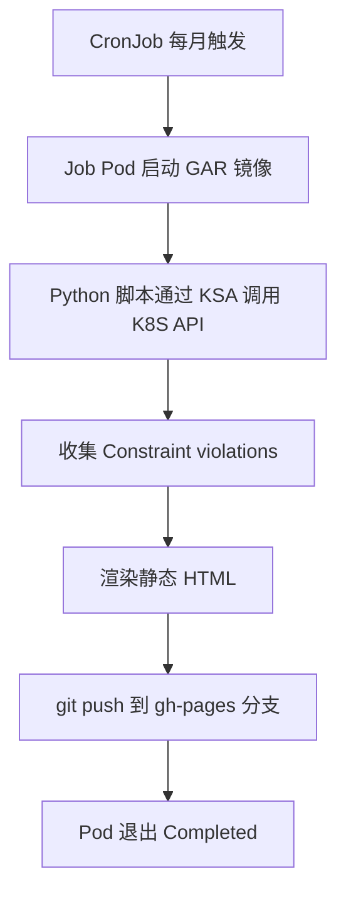

# OPA (Gatekeeper) 月度报告 CronJob 方案

## 1. 整体流程



## 2. 建议目录

```text
gke/opa-report-cronjob/
├── Dockerfile
├── requirements.txt
├── opa_report.py          # 采集 + 渲染 + 推送脚本
├── k8s/
│   ├── rbac.yaml          # KSA + ClusterRole + Binding
│   └── cronjob.yaml
└── README.md
```

## 3. Python 依赖 (requirements.txt)

按你现有脚本为准，常见组合如下：

```text
kubernetes>=29.0.0     # 调用 K8S API（或改用 kubectl 则不需要）
jinja2>=3.1            # 渲染 HTML
PyYAML>=6.0
```

| 镜像内需要 | 说明 |
|-----------|------|
| `git` | 推送到内部 GitHub |
| `kubectl`（可选） | 仅当脚本通过 subprocess 调 kubectl 时需要 |
| 内部 CA 证书 | 若内部 GitHub 使用私有 CA，需要 `update-ca-certificates` |

```dockerfile
FROM python:3.12-slim
RUN apt-get update && apt-get install -y --no-install-recommends git ca-certificates \
    && rm -rf /var/lib/apt/lists/*
WORKDIR /app
COPY requirements.txt .
RUN pip install --no-cache-dir -r requirements.txt
COPY opa_report.py .
USER 65534
ENTRYPOINT ["python", "/app/opa_report.py"]
```

## 4. KSA 权限（只读即可）

Gatekeeper 的 Constraint 是 CRD，种类（kind）不固定，所以需要 `list` CRD 来发现，再读取 `constraints.gatekeeper.sh` 下所有资源。

```yaml
apiVersion: v1
kind: ServiceAccount
metadata:
  name: opa-report
  namespace: gatekeeper-report
---
apiVersion: rbac.authorization.k8s.io/v1
kind: ClusterRole
metadata:
  name: opa-report-reader
rules:
  - apiGroups: ["constraints.gatekeeper.sh"]
    resources: ["*"]
    verbs: ["get", "list"]
  - apiGroups: ["templates.gatekeeper.sh"]
    resources: ["constrainttemplates"]
    verbs: ["get", "list"]
  - apiGroups: ["apiextensions.k8s.io"]
    resources: ["customresourcedefinitions"]
    verbs: ["get", "list"]
  - apiGroups: [""]
    resources: ["namespaces"]
    verbs: ["get", "list"]
---
apiVersion: rbac.authorization.k8s.io/v1
kind: ClusterRoleBinding
metadata:
  name: opa-report-reader
roleRef:
  apiGroup: rbac.authorization.k8s.io
  kind: ClusterRole
  name: opa-report-reader
subjects:
  - kind: ServiceAccount
    name: opa-report
    namespace: gatekeeper-report
```

> 不需要 GCP IAM（Workload Identity）：Pod 在集群内通过 KSA token 访问 K8S API 即可。
> 若报告还要读取 `config.gatekeeper.sh` 或 Mutation 资源，再按需追加 `apiGroups`。

## 5. CronJob

```yaml
apiVersion: batch/v1
kind: CronJob
metadata:
  name: opa-report
  namespace: gatekeeper-report
spec:
  schedule: "0 2 1 * *"            # 每月 1 日 02:00（UTC）
  concurrencyPolicy: Forbid
  successfulJobsHistoryLimit: 3
  failedJobsHistoryLimit: 3
  jobTemplate:
    spec:
      backoffLimit: 1
      activeDeadlineSeconds: 1800
      ttlSecondsAfterFinished: 86400
      template:
        spec:
          serviceAccountName: opa-report
          restartPolicy: Never
          containers:
            - name: report
              image: <REGION>-docker.pkg.dev/<PROJECT>/<REPO>/opa-report:v1
              env:
                - name: GIT_REPO_URL
                  value: "https://<internal-github>/<org>/<repo>.git"
                - name: GIT_BRANCH
                  value: "gh-pages"
                - name: GIT_TOKEN
                  valueFrom:
                    secretKeyRef:
                      name: opa-report-git
                      key: token
              resources:
                requests: { cpu: 100m, memory: 256Mi }
                limits:   { memory: 512Mi }
```

## 6. 部署前检查清单

| 检查项 | 命令 / 说明 |
|--------|-------------|
| KSA 权限 | `kubectl auth can-i list constraints.constraints.gatekeeper.sh --as=system:serviceaccount:gatekeeper-report:opa-report` |
| GAR 拉取 | 节点 SA 需要 `roles/artifactregistry.reader` |
| Git Token | `kubectl -n gatekeeper-report create secret generic opa-report-git --from-literal=token=<TOKEN>` |
| YAML 校验 | `kubectl apply --dry-run=server -f k8s/` |
| 手动触发测试 | `kubectl -n gatekeeper-report create job --from=cronjob/opa-report opa-report-test` |

---

## 7. 脚本：`opa_report.py`

放在 `gke/opa-report-cronjob/opa_report.py`。

```python
#!/usr/bin/env python3
"""收集集群内 Gatekeeper(OPA) Constraint 违规情况 -> 静态 HTML -> 推送到 gh-pages"""
import datetime as dt
import os
import subprocess
import sys
import tempfile
from collections import Counter
from pathlib import Path

from jinja2 import Template
from kubernetes import client, config

GROUP = "constraints.gatekeeper.sh"

CLUSTER = os.getenv("CLUSTER_NAME", "gke-cluster")
REPO_URL = os.environ["GIT_REPO_URL"]
BRANCH = os.getenv("GIT_BRANCH", "gh-pages")
TOKEN = os.environ["GIT_TOKEN"]
REPORT_DIR = os.getenv("REPORT_DIR", "reports")

REPORT_TPL = Template("""<!doctype html>
<html lang="zh"><head><meta charset="utf-8">
<title>OPA Report - {{ cluster }} - {{ month }}</title>
<style>
 body{font-family:sans-serif;margin:2rem;color:#222}
 table{border-collapse:collapse;width:100%;margin:.5rem 0}
 th,td{border:1px solid #ddd;padding:6px 8px;font-size:13px;text-align:left}
 th{background:#f4f4f4}
 .bad{color:#c00;font-weight:bold}.ok{color:#080}
 details{margin:.6rem 0}summary{cursor:pointer;font-weight:bold}
</style></head><body>
<h1>OPA Gatekeeper Report</h1>
<p>Cluster: <b>{{ cluster }}</b> | Generated: {{ generated }}</p>
<h2>Summary</h2>
<ul>
 <li>Constraints: {{ constraints|length }}</li>
 <li>Total violations: <span class="{{ 'bad' if total else 'ok' }}">{{ total }}</span></li>
 <li>By enforcementAction: {{ k }}={{ v }} </li>
</ul>
<h2>Constraints</h2>
<table><tr><th>Kind</th><th>Name</th><th>Action</th><th>Violations</th><th>Last audit</th></tr>

<tr><td>{{ c.kind }}</td><td>{{ c.name }}</td><td>{{ c.action }}</td>
<td class="{{ 'bad' if c.total else 'ok' }}">{{ c.total }}</td><td>{{ c.audit }}</td></tr>
</table>
<h2>Violation details</h2>

<details><summary>{{ c.kind }} / {{ c.name }} ({{ c.total }}, 仅显示 {{ c.violations|length }} 条)</summary>
<table><tr><th>Kind</th><th>Namespace</th><th>Name</th><th>Message</th></tr>

<tr><td>{{ v.kind }}</td><td>{{ v.namespace }}</td><td>{{ v.name }}</td><td>{{ v.message }}</td></tr>
</table></details>

</body></html>""")

INDEX_TPL = Template("""<!doctype html>
<html lang="zh"><head><meta charset="utf-8"><title>OPA Reports</title></head><body>
<h1>OPA Reports - {{ cluster }}</h1><ul>
<li><a href="{{ dir }}/{{ f }}">{{ f[:-5] }}</a></li>
</ul></body></html>""")


def load_kube():
    try:
        config.load_incluster_config()
    except config.ConfigException:
        config.load_kube_config()  # 本地调试用


def collect():
    ext = client.ApiextensionsV1Api()
    co = client.CustomObjectsApi()
    result = []
    for crd in ext.list_custom_resource_definition().items:
        if crd.spec.group != GROUP:
            continue
        version = next(v.name for v in crd.spec.versions if v.served)
        items = co.list_cluster_custom_object(
            GROUP, version, crd.spec.names.plural
        ).get("items", [])
        for o in items:
            st = o.get("status") or {}
            vs = st.get("violations") or []
            result.append({
                "kind": o["kind"],
                "name": o["metadata"]["name"],
                "action": (o.get("spec") or {}).get("enforcementAction", "deny"),
                "total": st.get("totalViolations", len(vs)),
                "audit": st.get("auditTimestamp", "-"),
                "violations": [{
                    "kind": v.get("kind", ""),
                    "namespace": v.get("namespace", "-"),
                    "name": v.get("name", ""),
                    "message": v.get("message", ""),
                } for v in vs],
            })
    result.sort(key=lambda c: (-c["total"], c["kind"], c["name"]))
    return result


def render(constraints, now):
    return REPORT_TPL.render(
        cluster=CLUSTER,
        month=now.strftime("%Y-%m"),
        generated=now.strftime("%Y-%m-%d %H:%M UTC"),
        constraints=constraints,
        total=sum(c["total"] for c in constraints),
        actions=Counter(c["action"] for c in constraints),
    )


def git(*args, cwd):
    r = subprocess.run(
        ["git", "-c", "user.name=opa-report-bot",
         "-c", "user.email=opa-report-bot@noreply", *args],
        cwd=cwd, capture_output=True, text=True,
    )
    if r.returncode != 0:
        err = (r.stderr or "").replace(TOKEN, "***")  # 避免 token 泄露到日志
        sys.exit(f"git {args[0]} failed: {err}")
    return r


def publish(html_text, now):
    auth_url = REPO_URL.replace("https://", f"https://x-access-token:{TOKEN}@", 1)
    with tempfile.TemporaryDirectory() as tmp:
        git("clone", "--depth", "1", "--branch", BRANCH, auth_url, tmp, cwd=None)
        rdir = Path(tmp) / REPORT_DIR
        rdir.mkdir(exist_ok=True)
        (rdir / f"{now.strftime('%Y-%m')}.html").write_text(html_text, encoding="utf-8")

        files = sorted((p.name for p in rdir.glob("*.html")), reverse=True)
        (Path(tmp) / "index.html").write_text(
            INDEX_TPL.render(cluster=CLUSTER, dir=REPORT_DIR, files=files),
            encoding="utf-8",
        )

        git("add", "-A", cwd=tmp)
        if git("status", "--porcelain", cwd=tmp).stdout.strip() == "":
            print("No changes, skip push")
            return
        git("commit", "-m", f"OPA report {now.strftime('%Y-%m')} ({CLUSTER})", cwd=tmp)
        git("push", "origin", BRANCH, cwd=tmp)
        print("Pushed report")


def main():
    now = dt.datetime.now(dt.timezone.utc)
    load_kube()
    constraints = collect()
    print(f"Collected {len(constraints)} constraints, "
          f"{sum(c['total'] for c in constraints)} violations")
    publish(render(constraints, now), now)


if __name__ == "__main__":
    main()
```

## 8. 依赖

`requirements.txt` 保持之前的三项即可（`kubernetes`、`jinja2`、`PyYAML`）。该脚本不需要镜像里有 `kubectl`，只需要 `git`。

## 9. 需要注意的点

| 点 | 说明 |
|----|------|
| 违规条数上限 | Gatekeeper 的 audit 默认每个 Constraint 只在 `status.violations` 里保存 20 条（`--constraint-violations-limit`）。`totalViolations` 是准确总数，所以报告里写了「仅显示 N 条」。要看全量，需要调大这个 audit 参数 |
| 数据新鲜度 | 报告读的是 audit 的最近一次结果（`auditTimestamp`），默认每 60 秒审计一次，月度任务足够 |
| 分支前提 | 脚本假设 `gh-pages` 分支已存在。如果是空仓库首次使用，需要先手工建好分支 |
| 同月重跑 | 同一个月文件名相同，会覆盖；内容没变就不产生 commit |
| Token | 通过 `GIT_TOKEN` 环境变量传入，脚本在报错日志里会把它替换成 `***` |
| 退出码 | 任意一步失败都会非 0 退出，CronJob 会标记为 Failed，方便告警 |

## 10. 本地测试

```bash
# 本地用你的 kubeconfig 先看采集结果（不推送）
python - <<'EOF'
import os
os.environ.update(GIT_REPO_URL="https://x/x.git", GIT_TOKEN="x")
import opa_report as r
cs = r.collect()
print(len(cs), sum(c["total"] for c in cs))
open("/tmp/test.html", "w").write(r.render(cs, __import__("datetime").datetime.now(__import__("datetime").timezone.utc)))
EOF
```

然后用浏览器打开 `/tmp/test.html` 看效果，没问题再构建镜像、推到 GAR、手动触发一次 Job 验证推送。
