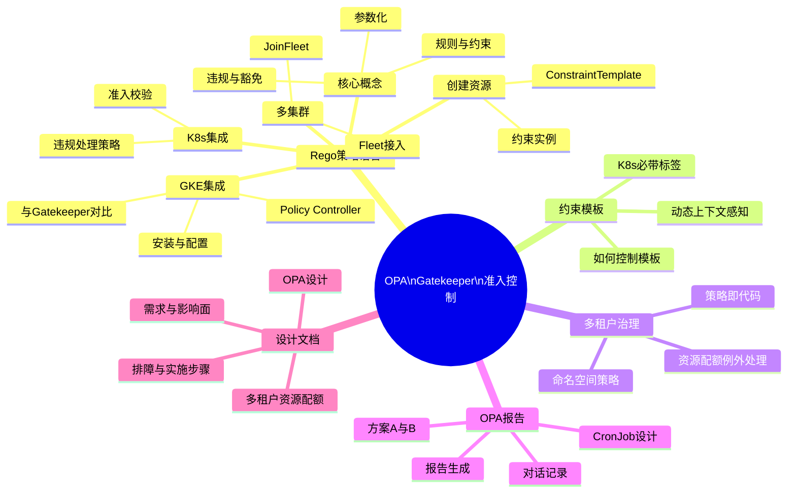

# OPA Gatekeeper 知识点分析

Analyze the `OPA-Gatekeeper/` knowledge base. Categorize the Rego / policy-controller / admission-control documents by technical domain, summarize the key knowledge points, and present everything as a Markdown document with a Mermaid mindmap.

本文档覆盖 `OPA-Gatekeeper/` 下的 **48 篇文档 / 2 个子目录**。

> **一句话结论**
> ★ 这个目录讲的是 **"把平台规矩写成代码，让集群自己拒绝违规 Pod"**：
> `Rego/` 讲策略语言与 K8s 集成，`docs/` 讲 **GKE Policy Controller** 的落地、
> 多租户配额与例外处理、以及一个"**OPA 报告 CronJob**"的完整设计。

---

## 文档体系分析

1. **`Rego/`（7 篇）** — Rego 概念、K8s 集成、创建资源、GKE Policy Controller 配置、Fleet 接入
2. **`docs/`（~40 篇）** — Policy Controller 与 Gatekeeper 对比、约束模板、
   多租户配额与例外、OPA 报告 CronJob 设计、动态上下文感知策略、必带标签策略

---

## 知识点 MindMap



---

## 主要知识领域详解

### 1. Rego 策略语言（`Rego/`）
- `docs/rego-concept.md`：**Rego 核心概念**——
  规则（rule）、约束（constraint）、违规（violation）、豁免（exemption）、参数化；
- `docs/create.md`：**怎么创建这些资源**（ConstraintTemplate + 约束实例）；
- `docs/gke-policy-controller-with-gatekeeper.md`：GKE 上 Policy Controller 与 Gatekeeper 的关系；
- `docs/gke-setup-policy-controller.md`：**GKE 上安装配置 Policy Controller**；
- `docs/JoinFleet.md`：加入 Fleet（多集群统一策略的前提）。

### 2. Gatekeeper 与 Policy Controller 的关系（`docs/`）
- `docs/gke-policy-control-with-tep.md`：在 GKE 上启用
  **Anthos Config Management（含 Policy Controller）** 的完整路径；
- `docs/gke-policy-controller-requirement.md`：前置要求；
- `docs/step-by-step-install.md`：分步安装；
- `docs/setup-log.md`：安装过程日志与踩坑。

> 这一组回答的是最常见的困惑：**Policy Controller 与 Gatekeeper 是什么关系**——
> 前者是 GKE 托管的、由 Anthos Config Management 提供的实现，
> Gatekeeper 是上游开源项目；理解这层，文档里很多重复表述就消失了。

### 3. 约束与策略设计
- `docs/how-to-control-template.md`：**如何控制模板**；
- `docs/k8srequiredlabels.md`：**K8s 必带标签策略**——
  平台给租户 namespace 预置标签的经典实现；
- `docs/Dynamic-context-aware-policy.md`：**动态上下文感知策略**——
  策略能根据请求上下文（用户、namespace、标签）动态判断。

### 4. 多租户治理
- `docs/multi-tenant-resource-quota-exception-handling.md`：
  **多租户资源配额与例外处理**——配额之外还要能对特定团队开例外，
  且例外本身要可审计；
- `docs/opa-design.md`：整体设计。

### 5. OPA 报告 CronJob（最完整的一个设计）
- `docs/opa-report-cronjob.md`：**OPA 报告 CronJob** 设计与实现；
- `docs/opa-report-cronjob-design.md`：设计文档；
- `docs/opa-report-cronjob-solution-b.md`：**方案 B**（与方案 A 对照）；
- `docs/opa-report-cronjob-conversation.md`：**推导过程的对话记录**——
  保留了"为什么最后选了 CronJob 而不是别的"，这类记录比结论本身更有价值。

### 6. 其他
`docs/gke-policy-control-with-tep.md`、`docs/step-by-step-install.md`、
`docs/gke-policy-controller-requirement.md`、`docs/setup-log.md`、
`merged-scripts.md`。

---

## 三条阅读路线

```
路线 A · 先分清 Policy Controller 与 Gatekeeper（1 小时）
  docs/gke-policy-controller-requirement.md
  → Rego/docs/gke-policy-controller-with-gatekeeper.md
  → Rego/docs/gke-setup-policy-controller.md

路线 B · 写第一条策略（半天）
  Rego/docs/rego-concept.md → Rego/docs/create.md
  → docs/how-to-control-template.md → docs/k8srequiredlabels.md

路线 C · 做多租户治理与报告（2 天）
  docs/multi-tenant-resource-quota-exception-handling.md
  → docs/Dynamic-context-aware-policy.md
  → docs/opa-report-cronjob-design.md → docs/opa-report-cronjob-solution-b.md
```

---

## 结论

1. **准入控制是"把规矩前移"的唯一手段**：
   靠巡检发现问题永远滞后，靠准入拒绝违规 Pod 才是根治。
2. **Policy Controller 与 Gatekeeper 不冲突**：前者是 GKE 的托管实现，
   后者是上游开源项目；这个区分在本目录被反复澄清，值得记住。
3. **例外机制比策略本身更难设计**：
   `multi-tenant-resource-quota-exception-handling.md` 处理的是
   "如何给某个团队开特例，同时保证特例可审计、可回收"——
   这才是多租户平台的真实难点。
4. **`opa-report-cronjob-conversation.md` 这种"推导过程记录"值得单独保留**：
   它让后来者能质疑结论，而不是只能照抄。

---

## 关联文档

- [../knowledge-mindmap.md](../knowledge-mindmap.md) ·
  [../gcp/gke/gke-mindmap.md](../gcp/gke/gke-mindmap.md) ·
  [../safe/safe-mindmap.md](../safe/safe-mindmap.md) ·
  [../gcp/ucp/argocd-mindmap.md](../gcp/ucp/argocd-mindmap.md)
- [Rego/README.md](./Rego/README.md) ·
  [Rego/docs/rego-concept.md](./Rego/docs/rego-concept.md) ·
  [docs/gke-policy-controller-requirement.md](./docs/gke-policy-controller-requirement.md) ·
  [docs/multi-tenant-resource-quota-exception-handling.md](./docs/multi-tenant-resource-quota-exception-handling.md) ·
  [docs/opa-report-cronjob-design.md](./docs/opa-report-cronjob-design.md) ·
  [docs/k8srequiredlabels.md](./docs/k8srequiredlabels.md)
