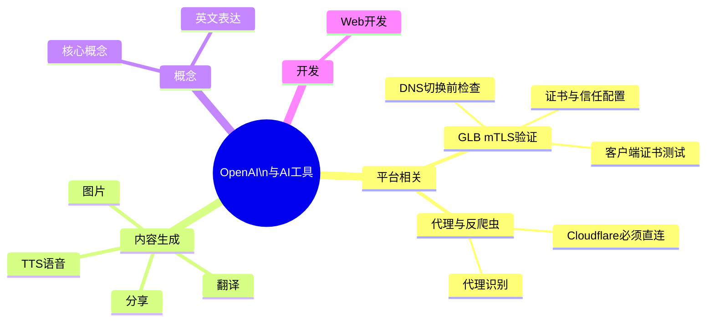

# OpenAI 与 AI 工具知识点分析

Analyze the `OpenAI/` knowledge base. Categorize the AI-tool usage / proxy / verification documents by technical domain, summarize the key knowledge points, and present everything as a Markdown document with a Mermaid mindmap.

本文档覆盖 `OpenAI/` 下的 **11 篇文档 / 1 个子目录 `docs/`**。

> **一句话结论**
> ★ 这个目录虽然小，但有两篇**和平台主线直接相关**：
> `Verifying-GLB.md`（**DNS 切换前如何验证 GLB mTLS 配置**）与
> `claude-cloudflare.md`（**Cloudflare 域名必须直连，否则容易被反爬虫判断**）。
> 其余是 AI 工具的日常用法与图片/分享/翻译。

---

## 文档体系分析

1. **平台相关** — `Verifying-GLB.md`（GLB mTLS 上线前验证）、`claude-cloudflare.md`（代理与反爬虫）
2. **内容生成** — `pic.md`、`Share.md`、`chattts.md`、`trans.md`
3. **概念与语言** — `concept.md`、`English.md`
4. **开发** — `web-development.md`

---

## 知识点 MindMap



---

## 主要知识领域详解

### 1. 平台相关（本目录最有价值的两篇）

#### `docs/Verifying-GLB.md`
**Verifying GCP Global Load Balancer mTLS Configuration Prior to DNS Cutover**——
在**切 DNS 之前**验证 GLB 的 mTLS 配置是否正确。
这是一篇**上线前检查清单**性质的文件，与
`gcp/mtls/glb-verify.md`、`gcp/mtls/glb-verify-curl.md`、
`gcp/mtls/glb-mtls-test-with-known-ip.md` 属于同一条线，
但视角更聚焦：**"切换前我该确认什么"**。

#### `docs/claude-cloudflare.md`
**Cloudflare 自身不要代理（容易被反爬虫判断）所以 Cloudflare 域名必须直连**——
一句话点出"哪些域名必须绕过代理"这条硬规则。
在有全局代理的环境里，这是最容易被忽略、也最容易导致"莫名其妙被拦"的原因。

### 2. 内容生成与日常用法
`docs/pic.md`（图片）、`docs/Share.md`（**How Can AI Transform Our Work?**）、
`docs/chattts.md`（语音）、`docs/trans.md`（翻译）、
`docs/concept.md`（概念）、`docs/English.md`（英文表达）、
`docs/web-development.md`（Web 开发）。

---

## 三条阅读路线

```
路线 A · GLB mTLS 上线前（1 小时）
  docs/Verifying-GLB.md → ../gcp/mtls/glb-verify.md
  → ../gcp/mtls/glb-mtls-test-with-known-ip.md

路线 B · 代理环境排障（30 分钟）
  docs/claude-cloudflare.md → ../linux/network/forward-reverse/curl-request-squid.md
  → ../linux/network/docs/squid-proxy.md
```

---

## 结论

1. **这个目录是"跨目录索引"**：它的两篇核心文档都指向别的目录的深度内容，
   本身是入口而不是终点。
2. **"Cloudflare 域名必须直连"是一条环境级规则**：
   在有代理的机器上，这条规则能解释大量"AI 服务突然不可用"的现象。

---

## 关联文档

- [../knowledge-mindmap.md](../knowledge-mindmap.md) ·
  [../gcp/mtls/mtls-mindmap.md](../gcp/mtls/mtls-mindmap.md) ·
  [../linux/linux-mindmap.md](../linux/linux-mindmap.md) ·
  [../ai/ai-mindmap.md](../ai/ai-mindmap.md)
- [README.md](./README.md) ·
  [docs/Verifying-GLB.md](./docs/Verifying-GLB.md) ·
  [docs/claude-cloudflare.md](./docs/claude-cloudflare.md)
