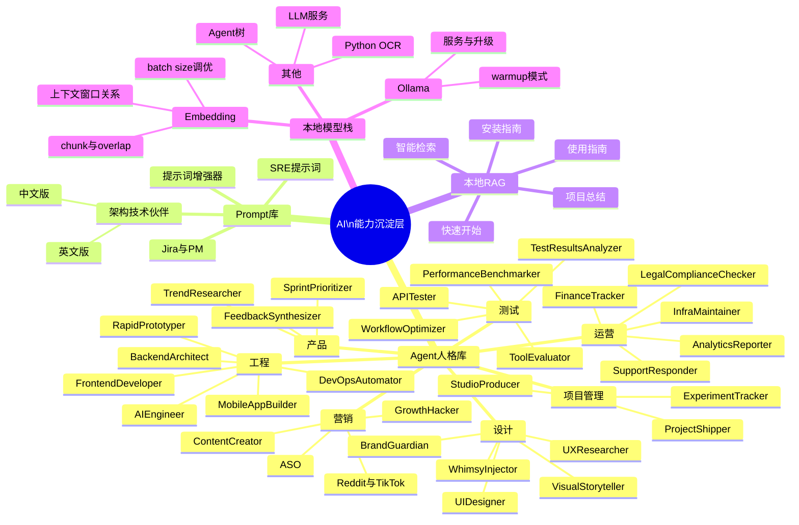

# AI 知识点分析

Analyze the `ai/` knowledge base. Categorize the agent / prompt / local-RAG documents by technical domain, summarize the key knowledge points, and present everything as a Markdown document with a Mermaid mindmap.

本文档覆盖 `ai/` 下的 **58 篇文档 / 4 个子域**：
Agent 人格库、Prompt 库、本地知识库检索系统（本地 RAG）、Ollama 与 Embedding 调优。

> **一句话结论**
> ★ 这个目录回答一个问题：**怎么让 AI 成为"可复用的工程能力"**——
> `agents/` 把专家拆成 30+ 个可调用的角色，`prompt/` 把提示词做成模板，
> `concept/` 把整个知识库变成**本地可检索**的 RAG，
> `docs/` 则记录了在这套本地栈上踩过的性能坑（Ollama 长 Batch 卡死、chunk 与上下文窗口的关系）。

---

## 文档体系分析

1. **Agent 人格库（`/.claude/agents/`，30 篇）** — 按职能分 7 组
2. **Prompt 库（`prompt/`，6 篇）** — 架构技术合作伙伴（中文/英文）、SRE、PM、增强器
3. **本地知识库检索系统（`concept/`，5 篇）** — INSTALL / QUICKSTART / USAGE / PROJECT_SUMMARY
4. **本地模型与 Embedding（`docs/`，9 篇）** — Ollama、batch size 调优、warmup、chunk/overlap、llama-server 自编译

---

## 知识点 MindMap



---

## 主要知识领域详解

### 1. Agent 人格库（`.claude/agents/`）
30 个 Agent，按**职能**而不是按技术栈分组，每个都是一份"角色说明书"：

| 组 | Agent |
|---|---|
| **design** | Brand Guardian、UI Designer、UX Researcher、Visual Storyteller、Whimsy Injector |
| **engineering** | AI Engineer、Backend Architect、DevOps Automator、Frontend Developer、Mobile App Builder、Rapid Prototyper |
| **marketing** | App Store Optimizer (ASO)、Content Creator、Growth Hacker、Instagram Curator、Reddit Community Builder、TikTok Strategist、Twitter Engager |
| **product** | Feedback Synthesizer、Sprint Prioritizer、Trend Researcher |
| **project-management** | Experiment Tracker、Project Shipper、Studio Producer |
| **studio-operations** | Analytics Reporter、Finance Tracker、Infrastructure Maintainer、Legal Compliance Checker、Support Responder |
| **testing** | API Tester、Performance Benchmarker、Test Results Analyzer、Tool Evaluator、Workflow Optimizer |

> 设计意图很清楚：**让"专家"成为一个可复用的调用单元**，
> 而不是每次都重新描述角色、边界和输出格式。

### 2. Prompt 库（`prompt/`）
- `architectrue-cn.md` / `architectrue.md`：**GKE & GCP 架构技术合作伙伴提示词**——
  与 `skills/architectrue/`、`gcp/asm/` 构成同一套方法论的三种形态；
- `sre-prompt.md`：SRE 场景提示词；
- `jira-pm.md`：Jira / PM 场景；
- `enhance-prompt.md`：**提示词增强器**（与 `skills/prompt-refiner/` 呼应）。

### 3. 本地知识库检索系统（`concept/`）
一个完整的 **本地 RAG 项目**：
`INSTALL.md` → `QUICKSTART.md` → `USAGE.md` → `PROJECT_SUMMARY.md`。
即：**把整个 `knowledge/` 仓库变成本地可语义检索的知识库**——
这正是"个人知识库"从"堆文件"变成"能问"的转折点。

### 4. 本地模型栈（`docs/`）—— 性能踩坑记录
- `ollama.md`、`llam-server.md`：服务与升级；
- `llama-server-install-macos.md`：**macOS 上 `llama-server` 装不起来的根因与解法**——
  Homebrew 的 `llama.cpp 1.0.0` bottle 链接了 ggml 已废弃的拆分 dylib（`libggml-cpu.1.dylib` 等），
  `dyld` 直接失败；解法是从上游源码自编译（含两个必须的 cmake 参数）；
- `ollama-warmup-pattern.md`：**Ollama `/v1/embeddings` Hang Bug —— Warmup Pattern（macOS 实战视角）**；
- `embedder-batch-size-tuning.md`：**长 Batch 压力探索**，并给出可调参数；
- `chunk_size_overlap_batch_size_explorer.md`：**Chunk / Batch / Context-Window 三者关系**——
  这篇解释了很多"为什么检索不准"的根因；
- `debug-ollama.md`、`Python-ocr.md`、`agent-tree.md`、`prompt.md`。

---

## 三条阅读路线

```
路线 A · 用 AI 做架构评审（1 小时）
  prompt/architectrue-cn.md → skills/architectrue/SKILL.md
  → .claude/agents/engineering/backend-architect.md
  → ../gcp/asm/asm-mindmap.md

路线 B · 把自己的知识库变成可问的（半天）
  concept/INSTALL.md → concept/QUICKSTART.md → concept/USAGE.md
  → docs/chunk_size_overlap_batch_size_explorer.md

路线 C · 调优本地 Embedding（2 小时）
  docs/ollama-warmup-pattern.md → docs/embedder-batch-size-tuning.md
  → docs/chunk_size_overlap_batch_size_explorer.md
```

---

## 结论

1. **这个目录和 `skills/` 是一对**：`ai/` 提供"零件"（人格 + Prompt），
   `skills/` 把零件组装成"能力包"。
2. **本地 RAG 是这个知识库的第二生命**：9000 个 md 只有被检索到才有价值，
   `concept/` 那套东西就是为此建的。
3. **性能坑集中在三处**：Ollama 的 embedding 接口会 hang（需要 warmup）、
   batch size 太大会压垮（要调）、chunk/overlap 配不对检索就不准（要理解三者关系）。
4. **Agent 人格库的价值在"边界清晰"**：每个 Agent 都有明确的职责和输出格式，
   这让多 Agent 协作成为可能，而不是一群泛泛的助手。

---

## 关联文档

- [../knowledge-mindmap.md](../knowledge-mindmap.md) ·
  [../skills/skills-mindmap.md](../skills/skills-mindmap.md) ·
  [../develop/develop-mindmap.md](../develop/develop-mindmap.md)
- [README.md](./README.md) ·
  [prompt/architectrue-cn.md](./prompt/architectrue-cn.md) ·
  [concept/INSTALL.md](./concept/INSTALL.md) ·
  [concept/QUICKSTART.md](./concept/QUICKSTART.md) ·
  [docs/ollama-warmup-pattern.md](./docs/ollama-warmup-pattern.md) ·
  [docs/chunk_size_overlap_batch_size_explorer.md](./docs/chunk_size_overlap_batch_size_explorer.md) ·
  [docs/llama-server-install-macos.md](./docs/llama-server-install-macos.md)
