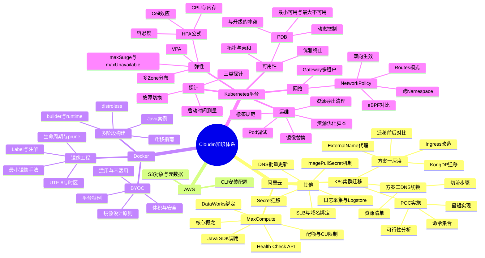

# Cloud 知识点分析

Analyze the `cloud/` knowledge base. Categorize the multi-cloud and container-platform documents by technical domain, summarize the key knowledge points, and present everything as a Markdown document with a Mermaid mindmap.

本文档覆盖 `cloud/` 下的 **343 篇文档 / 4 个子域**：
阿里云、AWS、Docker、Kubernetes 平台侧。

> **一句话结论**
> ★ 这个目录的价值不在"多云"，而在 **对比与迁移**：
> 阿里云那一半几乎全是 **K8s 集群迁移**（POC → 灰度 → DNS 切换 → 资源回收），
> K8s 那一半是 **共享集群的运营手册**（HPA 公式、PDB 与升级、NetworkPolicy、探针）。
> Docker 那一半则是 **镜像工程化**（BYOC / 多阶段 / distroless / 最小镜像）。

---

## 文档体系分析

1. **`ali/`** — 阿里云 K8s 迁移（`migrate-plan/` 方案一/二、`k8s-migration-proxy/`、
   `k8s-cluster-migration/`）、MaxCompute 与 DataWorks、Logstore 加密、DNS 批量更新
2. **`aws/`** — AWS CLI 与 S3（轻量参考）
3. **`docker/`** — BYOC 规范、multi-stage build、distroless、最小镜像、镜像生命周期与 prune
4. **`k8s/`** — 平台侧 K8s 运营：**HPA 公式推导**、**PDB 与升级冲突**、**NetworkPolicy 跨 namespace**、
   **探针最佳实践**、Gateway API、镜像替换、标签规范、资源优化

---

## 知识点 MindMap



---

## 主要知识领域详解

### 1. 阿里云（`ali/`）—— 迁移方法论大全

#### 1.1 集群迁移两套方案（`migrate-plan/`）
| | 方案一：灰度 | 方案二：DNS 切换 |
|---|---|---|
| 核心 | **改现有 Ingress**，用 ExternalName Service 代理到新集群 | 新集群建全量资源，DNS 切过去 |
| 优点 | 灰度可控、可回滚 | 一步到位 |
| 成本 | 改造面大 | 切换窗口风险高 |

- `plan1/poc-rewrite/`：**迁移前后对比图** + `externalname-flow.md`
  （`new-ingress.yaml` 的 backend service ↔ `external-service.yaml` 的 Service name 对应关系）+
  `poc-analysis.md`（最简 POC）+ `poc-implementation.md`。
- `plan2/migrate-all-dns-record-explorer.md`：DNS 切换的**完整步骤清单**。
- `short-domain-gpt.md` / `short-domian-claude.md`：**短域名迁移**的两种思路对比。
- `migrate-kongdp-gemini.md`：Kong DP 从集群 A 迁到 B 的迁移计划与流程图。

#### 1.2 迁移代理架构（`k8s-migration-proxy/`）
Task 1 基础架构 → Task 2 灰度配置管理 → Task 3 ExternalName 配置，
每一步都有独立的 Implementation Summary，可直接当任务清单用。

#### 1.3 MaxCompute 与 DataWorks
`max-computer/` 覆盖：核心概念与 CU 限制、Java SDK 调用三要素、
**Health Check API**、阈值与配额管理、以及「我们是否必须使用 MaxCompute」的技术澄清。

### 2. AWS（`aws/`）
轻量：CLI 安装配置、用 CLI 列出 S3 对象与元数据。作为**多云对照的参照系**存在。

### 3. Docker（`docker/`）—— 镜像工程化

#### 3.1 BYOC（`byoc/`）
- `README.md`：**什么是 BYOC**、适用场景 ✅ / 不适用场景 ❌；
- `best-practices.md`：镜像设计、体积优化、安全三条；
- `platforms.md`：平台特例（Vertex AI / Cloud Run / Cloud Run Jobs）；
- `dockerfile-templates.md`：Python（FastAPI）与 Java 模板，**Stage 1 缓存命中率高**。

#### 3.2 多阶段构建（`multistage-builds/`）
`multi-stage-summary.md` 用 cluster-proxy 的 Dockerfile 做例子，
讲清"多阶段到底带来了哪些好处"；`distroless.md` 给出可用镜像清单；
`multistage-build-analysis.md` 给出 Java 应用的 As-Is → To-Be 方案。

#### 3.3 镜像工程细节
最小镜像的核心手法（**依赖层不变时不重新安装**）、Label/注解、生命周期与 prune、
UTF-8 与时区、`Dockeffile-user-pass-violation.md`（明文口令的安全违规检查）。

### 4. Kubernetes 平台侧（`k8s/`）—— 全库最实用的一组

#### 4.1 HPA 公式推导（`hpa/`，20+ 篇）
`hpa-core.md` / `summary-hpa.md` / `hpa-cpu-and-memory-corrected.md` 把公式讲透，
并反复修正同一个点：
- **容忍度（tolerance）**：目标利用率附近有 **±10% 缓冲**，避免抖动；
- **小副本数的 Ceil 效应**：副本数少时向上取整会让扩容比预期早；
- `kong-spread-ha-review*.md`：把 HPA + PDB + 多 Zone 分布放到一起做**配置评审**。

#### 4.2 PDB 与升级（`pdb*.md`）
两种写法（`minAvailable` vs `maxUnavailable`）、与节点升级的**冲突**、
`temp-stop-pdb.md`（周末关机临时降级）、`Release-pdb.md`（按发布窗口动态控制）。
`pdb-effect.md` 提出核心问题：**既要保高可用，又不能让 PDB 挡住集群升级**。

#### 4.3 NetworkPolicy（`networkpolicy/`）
跨 namespace 通信、**双向生效**（选中的 pod 同时受 ingress + egress 约束）、
Routes-based 模式、eBPF vs iptables 的对比、Gateway namespace 的跨 ns 策略、
以及「NetworkPolicy 匹配的是 Pod 不是 Service」这个核心澄清。

#### 4.4 探针（`custom-liveness/explore-startprobe/`）
一个完整的 **Pod Health Check Library**：先测真实启动时间 → 再配 startupProbe →
最后配 liveness/readiness；含 Nginx 快速启动与 Spring Boot 中等启动时间两个实战例子、
故障排查指南、v5 版本增强。

#### 4.5 其他
- `k8s-gateway/`：Gateway API 深度报告、DestinationRule TLS 模式、cert-manager +
  Let's Encrypt Wildcard（**HTTP-01 vs DNS-01 选错直接死**）、E2E 验证脚本、FQDN 链路探索器；
- `images/`：镜像替换脚本、镜像拉取耗时评估、ImagePullSecret 清理；
- `labels/`：标签最佳实践（**selector label 不该放进 `metadata.labels`**）、批量打标脚本；
- `k8s-scale/`：资源优化脚本（自动识别异常 Deployment 并缩容）；
- `debug-pod/`、`Mytools/`、`lib/`、`vpa/`、`qnap-k8s/`：调试与工具集。

---

## 三条阅读路线

```
路线 A · 要做一次 K8s 集群迁移（2 天）
  ali/migrate-plan/plan1/README.md → poc-rewrite/poc-analysis.md
  → k8s-migration-proxy/README.md → plan2/migrate-all-dns-record-explorer.md

路线 B · 平台侧调优（半天）
  k8s/hpa/hpa-core.md → k8s/hpa/summary-hpa.md
  → k8s/docs/pdb.md → k8s/networkpolicy/network-ns-ns.md
  → k8s/custom-liveness/explore-startprobe/probe-best-practices.md

路线 C · 做镜像治理（2 小时）
  docker/byoc/README.md → docker/multistage-builds/multi-stage-summary.md
  → docker/multistage-builds/distroless.md → docker/docs/how-to-mini-dockerfile.md
```

---

## 结论

1. **这个目录真正的核心是 `k8s/`**——它不是"K8s 教程"，
   而是**共享多租户集群的运营手册**，尤其 HPA 公式推导和 PDB 与升级的冲突这两块，
   属于"不查清楚就会做错"的硬知识。
2. **迁移部分提供了两套完整可复用的范式**：灰度（改 Ingress + ExternalName 代理）
   与 DNS 切换；两者都有 POC、前后对比图和命令集合。
3. **Docker 部分的价值在"约束"而非"命令"**：BYOC 的不适用场景、
   distroless 的代价、多阶段构建的收益边界——这些决定了架构而不是脚本。
4. **阿里云那一半是"对照组"**：用另一种云验证了迁移方法论的普适性。

---

## 关联文档

- [../knowledge-mindmap.md](../knowledge-mindmap.md) ·
  [../gcp/gcp-mindmap.md](../gcp/gcp-mindmap.md) ·
  [k8s/k8s-mindmap.md](./k8s/k8s-mindmap.md) ·
  [../safe/safe-mindmap.md](../safe/safe-mindmap.md) ·
  [../develop/develop-mindmap.md](../develop/develop-mindmap.md)
- [README.md](./README.md) ·
  [docker/README.md](./docker/README.md) ·
  [docker/byoc/README.md](./docker/byoc/README.md) ·
  [docker/multistage-builds/multi-stage-summary.md](./docker/multistage-builds/multi-stage-summary.md) ·
  [k8s/README.md](./k8s/README.md) ·
  [k8s/hpa/hpa-core.md](./k8s/hpa/hpa-core.md) ·
  [k8s/docs/pdb.md](./k8s/docs/pdb.md) ·
  [k8s/networkpolicy/network-ns-ns.md](./k8s/networkpolicy/network-ns-ns.md)
