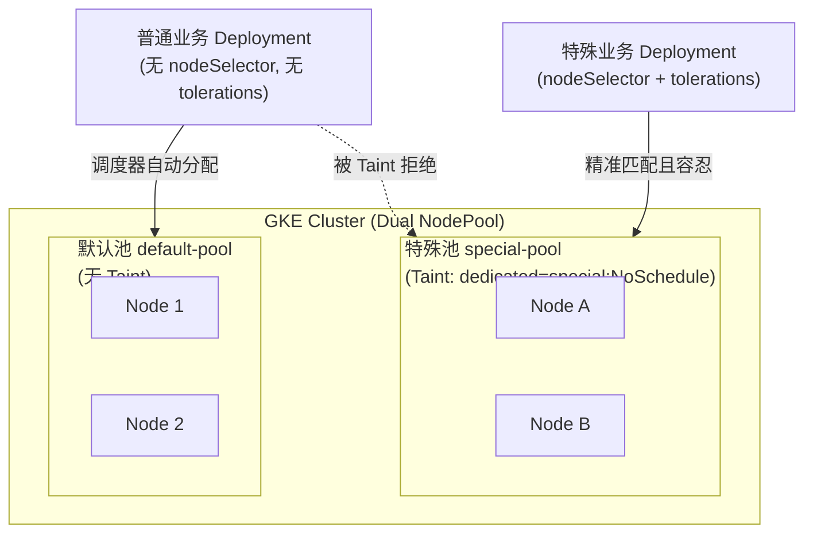
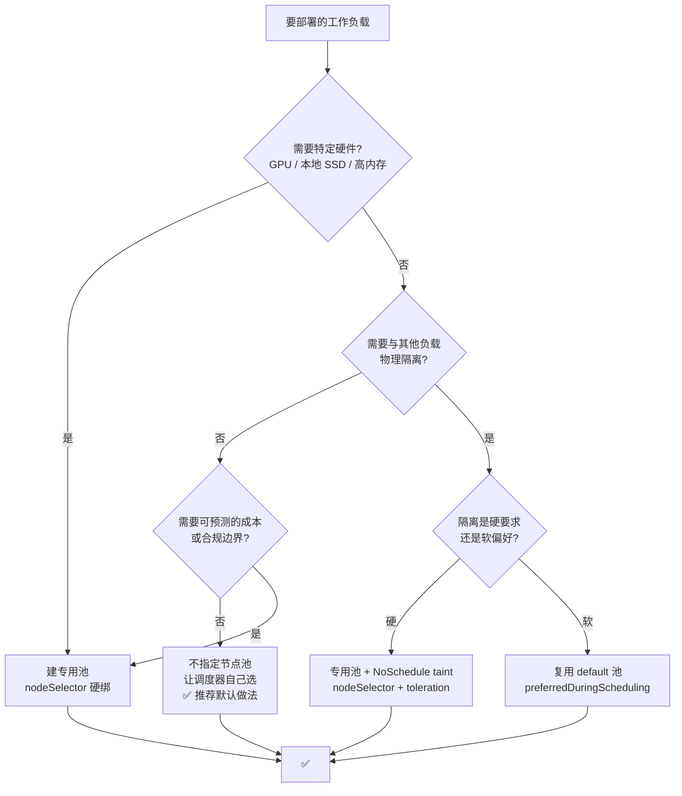

# GKE 多 NodePool 部署选型实践

- [先回答你的问题](#先回答你的问题)
- [双节点池架构：默认策略与最佳实践评估](#双节点池架构默认策略与最佳实践评估)
- [三种调度机制](#三种调度机制)
- [NodePool 的 label 与 taint](#nodepool-的-label-与-taint)
- [选择策略与决策树](#选择策略与决策树)
- [四种典型场景与 Deploy 配置](#四种典型场景与-deploy-配置)
- [排查手册](#排查手册)
- [Autopilot 的差异](#autopilot-的差异)
- [节点池容量陷阱](#节点池容量陷阱)
- [版本控制](#版本控制)
- [反模式](#反模式)
- [速查表](#速查表)

---

## 先回答你的问题

**「同一个集群部署了两个 NodePool，Deploy 怎么写？默认到哪？特殊到哪？怎么评估最佳实践？」**

1. **默认部署到哪里？**
   - **如果你什么都不做（两个池都没有加 taint）**：Kubernetes 调度器会把两个池的所有节点视为均质资源池，根据资源空闲情况做打分（LeastAllocated），**Pod 会随机、混杂地分布在两个池里**，不存在所谓的“默认池”。
   - **生产最佳实践做法**：给特殊/专用池打上 `NoSchedule` taint，默认池保持纯净（无 taint）。此时普通业务 YAML **什么都不用写**，就会因为被特殊池排斥而**100% 自动落到默认池**。

2. **特殊设置部署到哪里？怎么写？**
   - 目标是进入特殊池的业务，必须在 Deployment YAML 中**成对声明**：`nodeSelector`（指定目标池）+ `tolerations`（容忍特殊池的 taint）。
   - 如果希望“优先特殊池，特殊池满时降级回默认池”，则用 `nodeAffinity.preferredDuringScheduling` + `tolerations`。

3. **怎么评估什么是最佳实践？**
   - 最佳实践的核心标准是：**「绝大多数普通业务零心智负担（Zero-Touch），高价值/特殊资源强防护（Blast Radius Control），扩缩容行为可预测（Deterministic Autoscaling）」**。

---

## 双节点池架构：默认策略与最佳实践评估

同一个 GKE 集群划分两个 NodePool 是非常经典的架构，常见组合包括：
- **通用业务池 (General) + 专用隔离池 (Dedicated / High-Spec)**
- **系统基础设施池 (System) + 业务应用池 (App)**
- **稳定按需池 (On-Demand) + 批处理/高性价比池 (Spot)**

针对“指定默认池 vs 特殊池”的需求，业界有以下三种主流方案：

### 三种方案对比与评估矩阵

| 评估维度 | 方案 A：专用池加 Taint（推荐·最佳实践） | 方案 B：双池无 Taint + Helm/模板显式声明 | 方案 C：准入控制器动态注入 (Kyverno/Gatekeeper) |
| --- | --- | --- | --- |
| **默认池机制** | 专用池加 Taint，默认池无 Taint。默认池由 K8s 调度器天然实现。 | 双池均无 Taint。在 Helm/Base YAML 里默认写死默认池 selector。 | 通过 Webhook 自动给无声明 Pod 补上默认池 selector。 |
| **开发者心智负担** | **零负担（Zero-Touch）**。90% 普通应用保持原生简洁 YAML。 | **较高**。必须规范使用统一模板，直接 `kubectl apply` 原生 YAML 会漂移。 | **零负担**。平台自动注入，但研发可能疑惑为何被修改。 |
| **资源防误入保护** | **极高（物理硬隔离）**。普通 Pod 绝无可能占用特殊池资源。 | **极低（软约束）**。一旦研发漏写 selector，普通 Pod 会占满昂贵池。 | **高**。由准入控制强行拦截或改写。 |
| **Cluster Autoscaler 行为** | **清晰可预测**。只有特殊 Pod 会触发特殊池扩容，账单可控。 | **不可预测**。普通应用突发流量可能导致特殊池扩容，成本失控。 | **清晰可预测**。注入后调度明确。 |
| **架构与运维成本** | **极低**。仅依赖 K8s 内置原语（Taint + Toleration），无第三方组件。 | **低**。依赖团队 CI/CD 模板纪律。 | **高**。需长期维护准入控制规则与准入控制器高可用。 |
| **结论建议** | **⭐⭐⭐⭐⭐ 生产首选最佳实践** | ⭐⭐⭐ 仅适合无敏感/高价差的松散环境 | ⭐⭐⭐⭐ 适合平台工程化完善的大型中台团队 |

---

### 最佳实践落地实操（方案 A 详解）



#### 1. 默认业务：怎么写？
**原则：什么都不写，就是最好的写法。**
- 只需要配置好合理的 `requests` / `limits`。
- Pod 无法容忍特殊池的 taint，调度器自动且只能将其调度至默认池。
- 享受 HPA 弹性、避免环境耦合，换集群或多环境部署时 YAML 保持纯净。

```yaml
# 默认部署：落到 default-pool
apiVersion: apps/v1
kind: Deployment
metadata:
  name: standard-service
spec:
  replicas: 2
  selector:
    matchLabels:
      app: standard-service
  template:
    metadata:
      labels:
        app: standard-service
    spec:
      containers:
        - name: app
          image: gcr.io/my-project/standard-service:v1
          resources:
            requests:
              cpu: 500m
              memory: 512Mi
            limits:
              cpu: "1"
              memory: 1Gi
```

#### 2. 特殊业务：怎么写？
**原则：`nodeSelector` 明确指向 + `tolerations` 明确放行。**

```yaml
# 特殊部署：强隔离，落到 special-pool
apiVersion: apps/v1
kind: Deployment
metadata:
  name: dedicated-service
spec:
  replicas: 2
  selector:
    matchLabels:
      app: dedicated-service
  template:
    metadata:
      labels:
        app: dedicated-service
    spec:
      # 1. 目标导向：必须去 special-pool
      nodeSelector:
        cloud.google.com/gke-nodepool: special-pool
      # 2. 通行许可：容忍 special-pool 的 taint
      tolerations:
        - key: dedicated
          operator: Equal
          value: special
          effect: NoSchedule
      containers:
        - name: app
          image: gcr.io/my-project/dedicated-service:v1
          resources:
            requests:
              cpu: "2"
              memory: 4Gi
            limits:
              cpu: "4"
              memory: 8Gi
```

#### 3. 进阶特殊业务：允许溢出（降级回默认池）
如果特殊池是一个性能更高、成本更低的池（例如 Spot 池），但希望在特殊池节点不足时，Pod 能降级回默认池运行，保障可用性：

```yaml
# 弹性部署：优先 special-pool，不足时允许退回默认池
apiVersion: apps/v1
kind: Deployment
metadata:
  name: flexible-service
spec:
  replicas: 3
  selector:
    matchLabels:
      app: flexible-service
  template:
    metadata:
      labels:
        app: flexible-service
    spec:
      # 1. 软亲和：加权优先选 special-pool
      affinity:
        nodeAffinity:
          preferredDuringSchedulingIgnoredDuringExecution:
            - weight: 100
              preference:
                matchExpressions:
                  - key: cloud.google.com/gke-nodepool
                    operator: In
                    values: ["special-pool"]
      # 2. 依然必须配 tolerations，否则打分再高也会被 taint 拦截
      tolerations:
        - key: dedicated
          operator: Equal
          value: special
          effect: NoSchedule
      containers:
        - name: app
          image: gcr.io/my-project/flexible-service:v1
```

---

## 三种调度机制

| 机制 | 字段 | 语义 | 匹配不到时 | 适用 |
| --- | --- | --- | --- | --- |
| **硬绑定** | `nodeSelector` | 只去有这些 label 的节点 | Pod Pending | 池标签稳定、必须落某池 |
| **硬绑定（进阶）** | `affinity.nodeAffinity.requiredDuringScheduling` | 支持 `In`/`Gt`/`Lt`/`Exists` 等运算符 | Pod Pending | 需要「多选一」或按实例类型选 |
| **软偏好** | `affinity.nodeAffinity.preferredDuringScheduling` | 加权打分偏好 | **回退到其他节点** | 有 fallback 的场景 |

```yaml
# 软偏好：尽量去 gpu 池，但 GPU 池满了也能跑
affinity:
  nodeAffinity:
    preferredDuringSchedulingIgnoredDuringExecution:
      - weight: 100
        preference:
          matchExpressions:
            - key: cloud.google.com/gke-nodepool
              operator: In
              values: ["gpu-pool"]
```

**关键区别**：`nodeSelector` 和 `requiredDuringScheduling` 匹配不到就 Pending；
`preferredDuringScheduling` 匹配不到**静默回退**，不会有任何提示。

> ⚠️ 用 `preferred` 时如果本意是「必须在这个池」，会出现「以为在专用池、实际跑在 default 池」
> 的静默错误。**专用池一律用 `nodeSelector` 或 `required`。**

---

## NodePool 的 label 与 taint

### GKE 自动打的 label

GKE 给**每个 NodePool 的每个节点**自动加一个 label：

```
cloud.google.com/gke-nodepool: <node-pool-name>
```

这是官方文档明确的机制 —— [About node pools](https://docs.cloud.google.com/kubernetes-engine/docs/concepts/node-pools)：

> Each node in the pool has a Kubernetes node label, `cloud.google.com/gke-nodepool`,
> which has the node pool's name as its value.

**所以不需要手动打 label，直接用这个官方 label 即可。**

```bash
# 确认某个池的 label 和 taint 现状
kubectl get nodes -l cloud.google.com/gke-nodepool=<POOL_NAME> \
  -o custom-columns='NAME:.metadata.name,TAINTS:.spec.taints,LABELS:.metadata.labels'
```

### 三种效果的 taint

| Effect | 作用 | 现有 Pod 会怎样 |
| --- | --- | --- |
| `NoSchedule` | 阻止**新** Pod 调度上来 | 不影响 |
| `PreferNoSchedule` | 尽量别调度上来，尽量而已 | 不影响 |
| `NoExecute` | 调度上来 + **驱逐现有 Pod** | **现有 Pod 被驱逐** |

**专用节点池用 `NoSchedule`。** `NoExecute` 会驱逐正在跑的 Pod，只在做节点维护/排空时用。

---

## 选择策略与决策树

### 决策树



### 如何评估什么是你当前场景的最佳实践？（4 步评估法）

面对双节点池（或多节点池），切忌一上来就给所有 Deployment 写 `nodeSelector`。请按以下 4 个维度评估：

1. **评估受影响面（Blast Radius）与隔离等级**：
   - 如果特殊池承载的是核心交易、高敏感度业务或批处理高负载，**硬隔离是底线**。必须通过 `NoSchedule` taint 封锁特殊池，防止默认业务把关键池跑满。
2. **评估开发者心智负担（Developer Experience）**：
   - 团队有多少研发？是否要求每个人在发版时都记住写 nodeSelector？
   - 如果答案是“不想让研发关心基础设施细节”，最佳实践一定是**「默认池无感，特殊池白名单制」**。
3. **评估集群弹性与成本风险（Cluster Autoscaler Dynamics）**：
   - 如果特殊池采用高单价机型（如 a2-highgpu、m2-ultramem 等），必须杜绝普通 Pod 混入，否则一个内存泄漏的普通服务就可能拉起数台昂贵节点。
   - 如果特殊池是 Spot 竞价实例，业务必须容忍随时被逐出，并且 Deployment 需考虑 `preferredDuringScheduling` 回退机制。
4. **评估环境可移植性（Portability）**：
   - 是否存在 Dev / Staging / Prod 多个集群？测试环境是否也建了完全同名的两个池？
   - 绑定特定 `cloud.google.com/gke-nodepool: xxx` 会降低 YAML 移植性。如果不同环境池名不同，优先在 Helm `values.yaml` 中抽取节点调度变量，而不是硬编码在 Deployment 基础定义中。

### 什么时候**不该**指定节点池

这是最容易做错的地方。**「不指定」往往是对的**：

| 场景 | 为什么不该指定 |
| --- | --- |
| 普通无状态 API（CPU/内存无特殊要求） | 调度器能选资源最匹配的节点，指定反而限制弹性 |
| 需要水平扩容（HPA） | 池绑定后，HPA 扩容可能因为池已满而 Pending |
| 节点池可能要合并/删除 | 绑定后改池要动所有 Deployment |
| 多环境共用一套模板 | 池名在环境间不一致，YAML 不可复用 |

**官方文档的立场也是这个**：

> Often, you do not need to set any such constraints; the scheduler will automatically
> do a reasonable placement. — [Assigning Pods to Nodes](https://kubernetes.io/docs/concepts/scheduling-eviction/assign-pod-node/)

**先让调度器选，只有当资源形状（硬件/隔离/合规）确实需要时才绑定。**

---

## 四种典型场景与 Deploy 配置

### 场景 1：普通 API，共用 default 池（最常见）

```yaml
apiVersion: apps/v1
kind: Deployment
metadata:
  name: api
spec:
  replicas: 3
  selector:
    matchLabels:
      app: api
  template:
    metadata:
      labels:
        app: api
    spec:
      containers:
        - name: api
          image: REGISTRY/IMAGE:TAG
          ports:
            - containerPort: 8080
          resources:
            requests:
              cpu: 500m
              memory: 512Mi
            limits:
              cpu: "1"
              memory: 1Gi
```

**只写 `resources`，不写 `nodeSelector`。** 调度器自动放到合适的节点，
HPA 扩容也能正常工作。

### 场景 2：专用池 + taint（隔离要求）

**建池时加 taint：**

```bash
gcloud container node-pools create dedicated-pool \
  --cluster=CLUSTER_NAME --region=REGION \
  --node-locations=ZONE_A,ZONE_B \
  --node-count=3 \
  --machine-type=n2-standard-8 \
  --node-taints=dedicated=payments:NoSchedule \
  --labels=workload-tier=payments
```

**部署时必须同时声明 selector 和 toleration：**

```yaml
apiVersion: apps/v1
kind: Deployment
metadata:
  name: payments-api
spec:
  replicas: 3
  selector:
    matchLabels:
      app: payments-api
  template:
    metadata:
      labels:
        app: payments-api
    spec:
      # ① nodeSelector —— 去哪个池
      nodeSelector:
        cloud.google.com/gke-nodepool: dedicated-pool
      # ② toleration —— 允许进这个池（缺了就 Pending）
      tolerations:
        - key: dedicated
          operator: Equal
          value: payments
          effect: NoSchedule
      containers:
        - name: api
          image: REGISTRY/IMAGE:TAG
          resources:
            requests:
              cpu: "2"
              memory: 4Gi
            limits:
              cpu: "4"
              memory: 8Gi
```

> **两个字段必须成对出现。** `nodeSelector` 决定「去哪」，
> `toleration` 决定「能不能进」。只有前者 = Pending。

### 场景 3：GPU 工作负载

GPU 池通常既需要 `accelerator` label 又需要 taint：

```yaml
spec:
  template:
    spec:
      nodeSelector:
        cloud.google.com/gke-accelerator: nvidia-tesla-t4
      tolerations:
        - key: nvidia.com/gpu
          operator: Exists
          effect: NoSchedule
      containers:
        - name: inference
          image: REGISTRY/IMAGE:TAG
          resources:
            limits:
              nvidia.com/gpu: 1
            requests:
              cpu: "4"
              memory: 8Gi
```

**注意**：`nvidia.com/gpu` 是资源名（limit），`nvidia.com/gpu` taint 的 key 也是它，
但两者是不同维度 —— 资源不够会 Pending，taint 不容忍也会 Pending，**错误信息不同**。

### 场景 4：多池择一（用 affinity 而非 nodeSelector）

如果要「GPU 池优先，没有就退回 CPU 池」：

```yaml
spec:
  template:
    spec:
      affinity:
        nodeAffinity:
          requiredDuringSchedulingIgnoredDuringExecution:
            nodeSelectorTerms:
              - matchExpressions:
                  - key: cloud.google.com/gke-nodepool
                    operator: In
                    values: ["gpu-pool", "cpu-pool"]
          preferredDuringSchedulingIgnoredDuringExecution:
            - weight: 100
              preference:
                matchExpressions:
                  - key: cloud.google.com/gke-nodepool
                    operator: In
                    values: ["gpu-pool"]
```

`required` 保证只能落这两个池之一，`preferred` 让 GPU 池优先。

---

## 排查手册

### Pod 一直 Pending

```bash
# 1. 看调度器为什么拒绝（最关键的一条）
kubectl describe pod <POD_NAME> -n <NS> | sed -n '/Events/,$p'
```

常见原因对照：

| Events 里的信息 | 原因 | 修法 |
| --- | --- | --- |
| `node(s) had untolerated taint {dedicated=payments:NoSchedule}` | 缺 toleration | 加 `tolerations` |
| `node(s) didn't match Pod's node affinity/selector` | nodeSelector 与池名不匹配 | `kubectl get nodes -l cloud.google.com/gke-nodepool` 核对真实池名 |
| `Insufficient cpu` / `Insufficient memory` | 目标池资源不够 | 扩池 `gcloud container node-pools resize` 或降 requests |
| `0/N nodes are available` 但池明明存在 | 池有 taint | 同第一行 |

### 确认实际落在哪个池

```bash
# ① 集群里有哪些池，每个池多少节点
kubectl get nodes -L cloud.google.com/gke-nodepool

# ② 某个节点上挂了哪些 Pod + 资源占用
kubectl describe node NODE_NAME | sed -n '/Allocated resources/,$p'

# ③ 一次性导出 Pod → 节点 → 池 的映射（单次 API 调用，比逐 Pod 查询快得多）
kubectl get nodes -o custom-columns='NODE:.metadata.name,POOL:.metadata.labels.cloud\.google\.com/gke-nodepool' --no-headers \
  | awk 'NR==FNR {pool[$1]=$2; next} {print $3, pool[$3]}' - <(kubectl get pods -A -o custom-columns='NS:.metadata.namespace,NAME:.metadata.name,NODE:.spec.nodeName' --no-headers)
```

**不要**为每个 Pod 单独调一次 `kubectl get node` —— N 个 Pod 就是 N 次 API 调用，
大集群上会明显卡顿。用上面第 ③ 条的 `awk` 双输入方式一次性完成映射。

### 池名对不上

```bash
# 集群里真实的 NodePool 列表
gcloud container node-pools list --cluster=CLUSTER_NAME --region=REGION

# 节点上实际的 label 值
kubectl get nodes -L cloud.google.com/gke-nodepool
```

**池名区分大小写，且必须是 label 的值**（不是 display name）。

---

## Autopilot 的差异

Autopilot 集群**没有你创建的 NodePool**，上面的机制不适用：

| 项目 | Standard | Autopilot |
| --- | --- | --- |
| NodePool 归属 | 你建你管 | GKE 建 GKE 管 |
| `nodeSelector` 指 `gke-nodepool` | 有效 | **无效**（无此 label） |
| 用什么做硬件选择 | NodePool label | `nodeSelector` 指 `cloud.google.com/compute-class` |
| 加 taint | 你决定 | GKE 决定 |
| 节点扩容 | 你 resize | 自动 |
| 定价 | 按节点 | 按 Pod 资源请求 |

Autopilot 下的等价写法：

```yaml
spec:
  template:
    spec:
      nodeSelector:
        cloud.google.com/compute-class: BALANCED    # 换成别的 ComputeClass
      resources:
        requests:
          cpu: "2"
          memory: 4Gi
```

**混用是最常见的错误** —— 在 Autopilot 集群里写 `cloud.google.com/gke-nodepool`，
Pod 会 Pending，且错误信息是「didn't match node affinity」，看不出根因。

---

## 节点池容量陷阱

**绑定了节点池，就等于放弃了调度器的弹性。** 这几个坑值得提前知道：

### 坑 1：HPA 扩到池容量上限后 Pending

```bash
# 看池的总容量和已分配
kubectl describe node -l cloud.google.com/gke-nodepool=POOL_NAME \
  | grep -A10 "Allocated resources"
```

池满了 HPA 只能加 Pod，加不了节点（Standard 模式下）。
要么给 HPA 设 `maxReplicas` 上限低于池能容纳的副本数，要么开
[cluster autoscaler](https://docs.cloud.google.com/kubernetes-engine/docs/concepts/cluster-autoscaler)。

### 坑 2：删节点池时 Pod 无法重调度

官方文档明确警告：

> If the Pods have specific node selectors, the Pods might remain in an unschedulable
> condition if no other node in the cluster satisfies the criteria.
> — [About node pools](https://docs.cloud.google.com/kubernetes-engine/docs/concepts/node-pools)

**绑定了节点池的 Pod 在池被删后不会自动迁移**，除非其他池也有匹配的 label。

### 坑 3：Regional 集群的容量是乘积

多可用区集群里，新增节点池会在**每个 zone 各建一份**。
Zonal 单价 × zone 数 = 实际成本。绑定前先确认 zone 分布是否符合预期。

### 坑 4：升级是异步的，版本会短暂不一致

同一集群内可以跑多个 Node 版本，NodePool 之间独立升级。
**升级期间请求可能打到不同版本的节点上** —— 对状态一致性敏感的服务要留意。

---

## 版本控制

绑定节点池时，**用 GKE 官方 label，不要自己造 label**：

```yaml
# ✅ 推荐：官方 label，跨环境一致
nodeSelector:
  cloud.google.com/gke-nodepool: dedicated-pool

# ⚠️ 自己打的 label：换环境/重建池后容易失配
nodeSelector:
  workload-tier: payments
```

自己加 `--labels=workload-tier=payments` 也能工作，但会带来：

- 池重建后 label 可能丢
- 多个池打同一个自定义 label → 失去隔离能力
- 排障时要同时看两套 label

**要用自定义 label 做业务维度标记（比如 `workload-tier`），
但节点归属用官方 `cloud.google.com/gke-nodepool`。**

安全相关的 label 隔离另说 —— Kubernetes 文档建议用
`node-restriction.kubernetes.io/` 前缀防止 kubelet 篡改：

> If you use labels for node isolation, choose label keys that the kubelet cannot modify.
> This prevents a compromised node from setting those labels on itself.

---

## 反模式

| 反模式 | 问题 | 正确做法 |
| --- | --- | --- |
| 专用池只写 `nodeSelector` 不写 `tolerations` | Pod 永远 Pending | 两者成对写 |
| 用 `preferredDuringScheduling` 做硬隔离 | 池不匹配时**静默回退**，以为隔离实际没隔离 | 硬要求用 `nodeSelector` |
| 给普通无状态服务绑池 | 失去弹性，HPA 容易撞顶 | 只在硬件/隔离/合规需要时绑 |
| Autopilot 集群用 `gke-nodepool` label | 永远 Pending | Autopilot 用 `compute-class` |
| 每个微服务一个 NodePool | 池爆炸，升级维护成本高 | 按**硬件形状和隔离边界**分，不是按服务分 |
| 建池时不加 taint，之后再补 | 期间已有 Pod 会被 `NoExecute` 驱逐 | taint 在建池时就决定 |
| 删除绑定了 Pod 的节点池 | Pod 变孤儿无法调度 | 先删 Deployment 或摘掉 selector 再删池 |
| 把自己的 label 当节点归属依据 | 重建池后失配 | 用 `cloud.google.com/gke-nodepool` |

---

## 速查表

### 建池

```bash
# 普通池（不隔离）
gcloud container node-pools create POOL_NAME \
  --cluster=CLUSTER --region=REGION --node-count=3 --machine-type=n2-standard-4

# 专用池（隔离）
gcloud container node-pools create POOL_NAME \
  --cluster=CLUSTER --region=REGION --node-count=3 --machine-type=n2-standard-8 \
  --node-taints=TIER_NAME=TIER_VALUE:NoSchedule

# 看池
gcloud container node-pools list --cluster=CLUSTER --region=REGION

# 扩容
gcloud container node-pools resize POOL_NAME \
  --cluster=CLUSTER --region=REGION --size=5

# 删池（先确认没有绑定的 Pod！）
gcloud container node-pools delete POOL_NAME \
  --cluster=CLUSTER --region=REGION
```

### 部署

```yaml
# 不指定池 —— 默认做法
spec:
  template:
    spec:
      containers:
        - name: app
          resources:
            requests: { cpu: 500m, memory: 512Mi }
            limits:   { cpu: "1",  memory: 1Gi }

# 硬指定池（无 taint 时）
spec:
  template:
    spec:
      nodeSelector:
        cloud.google.com/gke-nodepool: POOL_NAME
      containers: [...]

# 硬指定池（有 taint 时 —— 必须成对）
spec:
  template:
    spec:
      nodeSelector:
        cloud.google.com/gke-nodepool: POOL_NAME
      tolerations:
        - key: TIER_NAME
          operator: Equal
          value: TIER_VALUE
          effect: NoSchedule
      containers: [...]
```

### 排查

```bash
# Pod 为什么没起来
kubectl describe pod <POD> -n <NS> | sed -n '/Events/,$p'

# 集群有哪些池
kubectl get nodes -L cloud.google.com/gke-nodepool

# 每个池挂了哪些 Pod
kubectl get nodes -L cloud.google.com/gke-nodepool -o wide
kubectl describe node <NODE> | sed -n '/Allocated resources/,$p'

# 池容量
kubectl get nodes -l cloud.google.com/gke-nodepool=POOL_NAME \
  -o custom-columns='NAME:.metadata.name,TAINTS:.spec.taints'
```

---

## 参考资料

- [About node pools](https://docs.cloud.google.com/kubernetes-engine/docs/concepts/node-pools) — GKE 官方，节点池 label、删除行为、Autopilot-managed 池
- [Add and manage node pools](https://docs.cloud.google.com/kubernetes-engine/docs/how-to/node-pools) — GKE 官方，建池与部署实操
- [Assigning Pods to Nodes](https://kubernetes.io/docs/concepts/scheduling-eviction/assign-pod-node/) — Kubernetes 官方，nodeSelector / affinity / nodeName / topology spread
- [Taints and Tolerations](https://kubernetes.io/docs/concepts/scheduling-eviction/taint-and-toleration/) — Kubernetes 官方，三种 effect、toleration 匹配规则

> 文档核对时间：2026-10-14。GKE 的 label key 和命令参数如有变化，以官方文档为准。