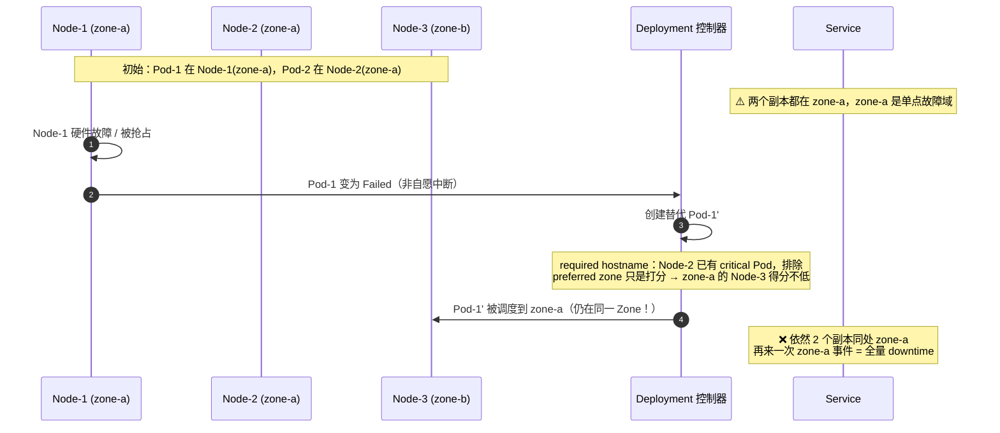
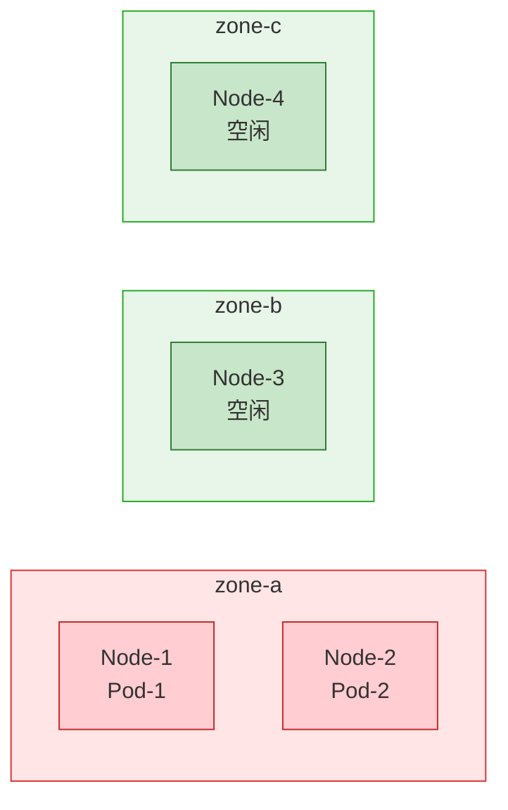
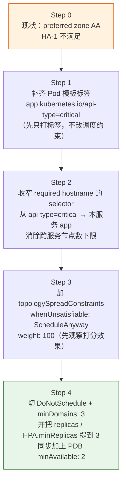
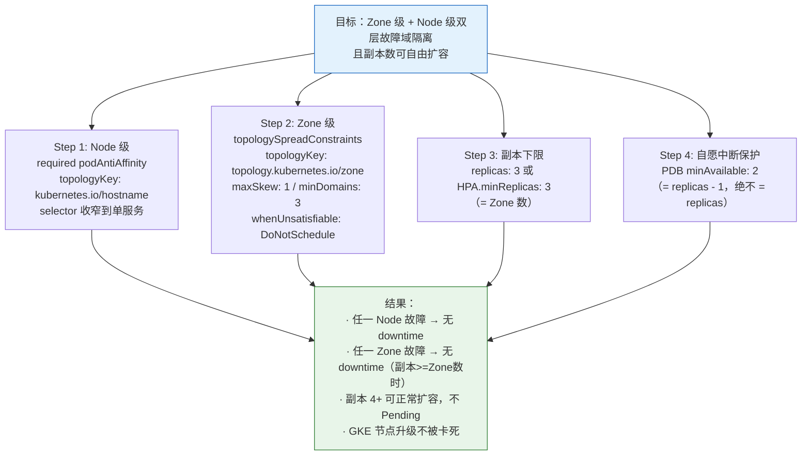

# 多 Zone 高可用设计：Pod 分布约束 + PDB 的正确组合

> 场景来源：GKE 集群跨 3 个 Zone（a/b/c）部署关键 API，现有配置只有「required hostname 反亲和 + preferred zone 反亲和」，
> 结果出现过 **Pod 挂掉后重建的副本又落回同一个 Zone**，两个副本同时暴露在单一 Zone 故障域下，PRD 环境不可接受。
>
> 本文回答三个核心问题：
> 1. 能不能**强制** Pod 既不同 hostname 又不同 Zone？
> 2. 「最少 3 个 Pod 且分布在 3 个 Zone」是不是一个合理的需求？
> 3. 如果只有 3 个 Pod，扩容到第 4 个会不会被调度约束卡死？

---

## 0. 结论先行（TL;DR）

| 问题 | 结论 |
|:---|:---|
| Q1 能否强制「不同 hostname 且不同 Zone」？ | **能**，但必须用 `requiredDuringSchedulingIgnoredDuringExecution` + `topologyKey: topology.kubernetes.io/zone`。代价是**硬约束**：Pod 数一旦超过 Zone 数，第 4 个 Pod 永久 `Pending`。 |
| Q2 「≥3 个 Pod 且分布在 3 个 Zone」是合理需求吗？ | **需求本身合理**，但**不要用无上界的硬约束来表达**。应该表达为「Zone 拓扑约束（可降级）+ 副本数下限 ≥ Zone 数 + PDB 保护」。 |
| Q3 3 个 Pod 扩容到第 4 个会不会失败？ | 用 **required 反亲和实现 → 会失败（死锁，Pod 永远 Pending）**；用 **`topologySpreadConstraints`（`maxSkew:1` + `minDomains`）→ 不会失败**，第 4 个会落在已占用的 Zone 的另一个 Node 上，skew 仍然 ≤ 1。 |
| PDB 能解决「两个 Pod 落在同一 Zone」吗？ | **不能**。PDB 只约束「自愿中断」，且只看 Ready Pod 的**全局数量**，完全不感知 Zone / 拓扑。你遇到的是**非自愿故障（Pod 挂掉）**，PDB 根本不参与。 |
| 现有配置最大的隐患是什么？ | `required` 与 `preferred` 两条规则**用了两套不同的 labelSelector**（`api-type=critical` vs `app=nginx`），管的根本不是同一批 Pod；且 `required` 的 hostname 反亲和是**跨服务**的，隐含「节点总数 ≥ 所有 critical Pod 总数」的下限，容易被低估。 |

**一句话方案**：把「Zone 分布」从 `preferred` 升级为 `topologySpreadConstraints`（带 `minDomains` 的优雅降级），
把「Node 分布」的 `required` 反亲和**收窄到单个服务**，再叠加 `minAvailable` PDB。详见 [§5 推荐落地方案](#5-推荐落地方案prd)。

---

## 1. 现有配置逐行解读

```yaml
spec:
  affinity:
    podAntiAffinity:
      requiredDuringSchedulingIgnoredDuringExecution:
        - labelSelector:
            matchExpressions:
              - key: app.kubernetes.io/api-type
                operator: In
                values:
                  - critical          # ← 所有关键 API 的 Pod 都会被这条规则管住
          topologyKey: kubernetes.io/hostname
      preferredDuringSchedulingIgnoredDuringExecution:
        - weight: 1
          podAffinityTerm:
            labelSelector:
              matchExpressions:
                - key: app
                  operator: In
                  values:
                    - nginx           # ← 只有 nginx 这一类 Pod 会被这条规则管住
            topologyKey: topology.kubernetes.io/zone
```

| 片段 | 语义 | 强制性 |
|:---|:---|:---|
| `required` + `hostname` | 匹配 `api-type=critical` 的 Pod 之间**不能落在同一 Node** | 硬约束，不满足 → `Pending` |
| `preferred` + `zone` + `weight:1` | 匹配 `app=nginx` 的 Pod 之间**尽量不落在同一 Zone** | 软约束，只是打分偏好 |
| `topologyKey: kubernetes.io/hostname` | GKE 上等价于「不同的 GKE Node 实例」 | — |
| `topologyKey: topology.kubernetes.io/zone` | GKE Node 上有该标准标签（同时也有 `topology.gke.io/zone`） | — |

你的理解（「必须落在不同 hostname / 最好落在不同 Zone」）**基本正确**，只有一点要纠正：
**`preferred` 的 zone 规则不是「最好」，而是「完全不可靠」**——它只是给调度器一个打分加成，
其它打分插件（资源均衡 `NodeResourcesBalancedAllocation`、资源适配 `NodeResourcesFit` 等）同权重参与总分，
并列时还有随机 tiebreak。所以「两个 Pod 落在同一 Zone」是**必然可能发生**的正常行为，不是异常。

---

## 2. 三个隐患（这是本文的重点）

### 隐患 1：required 与 preferred 的 labelSelector 根本不是同一批 Pod

- `required` 匹配 `app.kubernetes.io/api-type=critical` → 命中 **api-authn、api-cicd、… 所有关键服务**。
- `preferred` 匹配 `app In [nginx]` → 只命中 **nginx**。

后果：

- 你真正关心的那些 critical Pod（不是 nginx），**zone 分布规则对它们完全不生效**。
- 即使是 nginx，如果 Pod 模板上没打 `app: nginx` 标签，这条 preferred 规则对它就是「空规则」，得分加成恒为 0。
- 规则会随服务增减而**静默漂移**：某天有人把 `app` 标签从 `nginx` 改成别的值，Zone 分布保障无声消失。

> 规则与被保护对象之间的**标签漂移**，是这类配置最常见、也最难在事故复盘时被发现的故障源。
> 修法见 [§5.2 用 `matchLabelKeys` 消除漂移](#52-用-matchlabelkeys-彻底消除标签漂移)。

### 隐患 2：`required` 的 hostname 反亲和是**跨服务**的，节点数存在隐含下限

`podAntiAffinity` 的语义是：**只要存在任何匹配 `api-type=critical` 的 Pod 落在某个 Node 上，该 Node 就不能再放 critical Pod。**

⚠️ 注意作用域：Pod 亲和/反亲和的 `labelSelector` **只在同一个 namespace 内匹配 peer Pod**
（要跨 namespace 需要 1.24+ 的 `namespaceSelector`，且需谨慎使用）。
所以准确的容量公式是**按 namespace 计算**的：

```
需要的 Node 数  ≥  同一 namespace 内所有 critical Pod 的总数
```

举例：4 个关键服务 × 3 副本 = **12 个 critical Pod** → 该 namespace 所在集群必须有 ≥ 12 个 Node，
否则多出来的 Pod 会一直 `Pending`，而且 `kubectl describe pod` 里只会显示一句
`0/N nodes are available: N node(s) didn't match pod anti-affinity rules`，非常容易被误判成「集群资源不足」。

> ⚠️ 这条 `required` 规则跨越服务，其本意（依 [affinity-add-new-logic.md](affinity-add-new-logic.md)）是
> **避免调用链上的不同服务落在同一 Node 上**（防相关性故障）——这个诉求本身是对的。
> 但它必须和「Node 分布」分开表达，不能和「Zone 分布」混在同一个 `required` 列表里互相放大约束强度。

### 隐患 3：Zone 只是 preferred → 复现你遇到的故障

你的事故还原（3 个 Zone，2 副本）：



关键点：

1. **PDB 在这里完全不出场**。Pod 挂掉是**非自愿中断**，PDB 只管 `drain` / 节点升级 / 主动驱逐这类自愿中断。
2. **PDB 就算出场也帮不上忙**。假设配了 `minAvailable: 2`（2 副本），PDB 只看「全局 Ready Pod 数 = 2」，
   满足条件 → 放行。它**不区分这 2 个 Pod 在哪个 Zone**，对「单 Zone 故障」零感知。
3. `required hostname` 只能保证**不共节点**，而 3 个 Zone 通常每 Zone 至少 2 个 Node，
   于是「不同 Node」完全可能 = 「同一个 Zone」。



> 图示：hostname 反亲和**已经满足**（两个 Pod 在不同 Node），
> 但 Zone 级故障域没有隔离——这正是 PRD 环境下不可接受的缺口。

---

## 3. 核心问题一：能不能强制「不同 hostname 且不同 Zone」？

### 3.1 技术上可行

在 `requiredDuringSchedulingIgnoredDuringExecution` 里**再加一条** zone 规则即可：

```yaml
affinity:
  podAntiAffinity:
    requiredDuringSchedulingIgnoredDuringExecution:
      - labelSelector:            # 规则 A：不同 Node
          matchExpressions:
            - key: app.kubernetes.io/api-type
              operator: In
              values: [critical]
        topologyKey: kubernetes.io/hostname
      - labelSelector:            # 规则 B：不同 Zone
          matchExpressions:
            - key: app.kubernetes.io/api-type
              operator: In
              values: [critical]
        topologyKey: topology.kubernetes.io/zone
```

两条规则是**逻辑与**的关系：Pod 必须既不与任何匹配 Pod 同 Node，也不与任何匹配 Pod 同 Zone。

### 3.2 代价：Pod 数超过 Zone 数 = 永久 Pending（硬死锁）

| Zone 数 | 副本数 | 结果 |
|:---:|:---:|:---|
| 3 | 1 / 2 / 3 | ✅ 正常，分布在 3 个不同 Zone 的不同 Node |
| 3 | 4 | ❌ 第 4 个 Pod **永远 Pending**（`FailedScheduling`），因为 3 个 Zone 都已有匹配 Pod |
| 3 | 5+ | ❌ 全部多余 Pod Pending；HPA 扩容会持续堆积 Pending Pod |

**这就是你担心的「3 个 Pod 扩不出第 4 个」——用 required zone 反亲和实现，答案是「对，会卡死」。**

而且这个死锁有几个放大因素：

- **HPA 会把它变成常态**：`maxReplicas > 3` 时，一次流量高峰就能把 Pod 顶到 Pending，
  且 Pending Pod 没有 CPU/metric 数据 → HPA 指标计算失真 → 可能进一步误扩容，形成正反馈。
- **Deployment 永远不 `Available`**：`kubectl rollout status` 卡住，CI/CD 发布流水线被拖死。
- **不可自愈**：Node 扩容也救不了——新 Node 仍然在已有的 3 个 Zone 里，Zone 维度的约束依然不满足。
  唯一解法是**新增一个 Zone**（新建 zonal node pool）。
- **GKE 节点升级会被卡**：升级期间被 drain 的 Zone 暂时不可用，`minDomains` 之类的降级机制在这里不存在（required 规则没有降级语义）。

> 结论：required zone 反亲和适合**副本数固定且 ≤ Zone 数**的静态场景，
> **不适合任何带 HPA 的服务**。PRD 环境的 critical 服务通常都有 HPA，所以这条路子不能直接用。

---

## 4. 核心问题二：「≥3 副本且分布在 3 个 Zone」是不是合理需求？

### 4.1 需求本身：合理，且应该被明确写下来

PRD 环境下，一个跨 3 Zone 的关键服务，「任一 Zone 整体故障时服务不中断」是**标准的可用性目标**，
对应 N-1 的 Zone 级容灾。把它写成需求条目是正确做法：

> **HA-1**：critical 服务在任一单一 Zone 不可用时，可用副本数 ≥ 1，端到端无 downtime。
> **HA-2**：任一单一 Node 不可用时，可用副本数 ≥ 1。
> **HA-3**：任意 2 个 Pod 同时不可用时，服务仍可服务（若业务允许）。

### 4.2 但需求的**表达方式**要改

不要把它表达为「Pod 必须落在不同 Zone」（无上界的硬约束），
而应该拆成三条**可验证、有上界、有降级路径**的约束：

| 约束 | 表达形式 | 验证方式 |
|:---|:---|:---|
| 副本数下限 ≥ Zone 数 | `replicas: 3` 或 `HPA.minReplicas: 3` | `kubectl get deploy -o jsonpath='{.spec.replicas}'` |
| Zone 分布（Zone 故障域隔离） | `topologySpreadConstraints`（Zone）+ `maxSkew: 1` + `minDomains: 3` | 统计各 Zone Pod 数 |
| Node 分布（Node 故障域隔离） | `required` hostname 反亲和（**selector 收窄到单服务**） | 统计各 Node Pod 数 |
| 自愿中断保护 | `PDB.minAvailable: 2`（3 副本时允许同时驱逐 1 个） | `kubectl get pdb` |

这样表达的好处：

- **有上界**：副本数可以自由 > 3（扩容不会死锁）。
- **可降级**：Zone 数量不足时优雅退化，而不是 Pending 死锁。
- **可验证**：每条都能用一条命令核对（见 [§7 验证清单](#7-验证与排查清单)）。
- **不阻塞 GKE 升级**：符合 [pdb-effect.md](pdb-effect.md) 里讨论的「不要让 PDB / 调度约束卡住节点升级」的原则。

### 4.3 「副本数 ≥ 3」这个下限本身有前提

要真的做到「3 个副本落在 3 个 Zone」，**集群必须满足**：

- 3 个 Zone 都有**可调度该 Pod 的 Node**（即对应 Zone 有 node pool，且资源/亲和性允许）。
- 每个 Zone 至少有 1 个 Node 能容纳一个 Pod。
- Node 资源足够（requests 有配额、有节点余量）。

如果只有 2 个 Zone 有 Node，那 `minDomains: 3` 的约束会被**跳过**（降级），Pod 会挤在 2 个 Zone。
这是**期望行为**（避免 Pending），但需要靠监控发现「集群实际上只有 2 个 Zone 可用」。

---

## 5. 推荐落地方案（PRD）

### 5.1 方案对比

| 方案 | Zone 分布 | 副本 > Zone 数 | 资源不足时 | 评价 |
|:---|:---|:---|:---|:---|
| 现状（preferred zone） | 打分偏好，不保证 | ✅ 可以 | 静默降级 | ❌ 达不到 HA-1 |
| required zone 反亲和 | 硬保证 | ❌ **Pending 死锁** | 死锁 | ❌ 与 HPA 冲突 |
| `topologySpread` + `ScheduleAnyway` | 打分偏好（比 preferred AA 信号更强） | ✅ 可以 | 静默降级 | △ 仍是软约束 |
| **`topologySpread` + `DoNotSchedule` + `minDomains: 3`** | **硬保证（Zone 足够时）** | **✅ 可以**（skew ≤ 1） | **优雅降级**（Zone 数不足时跳过约束） | ✅ **推荐** |
| `nodeAffinity` 限定 Zone 白名单 | 只限定「可去的 Zone」 | ✅ 可以 | 不可调度 | △ 只划边界，不做均衡 |

### 5.2 用 `matchLabelKeys` 彻底消除标签漂移

`matchLabelKeys`（1.27 alpha 需特性门控 / 1.28 起 beta 默认开启 / 1.31 GA）让约束**直接引用 Pod 自己的标签值**，
不再手写 selector，从根上消灭隐患 1：

```yaml
topologySpreadConstraints:
  - maxSkew: 1
    topologyKey: topology.kubernetes.io/zone
    minDomains: 3
    whenUnsatisfiable: DoNotSchedule
    matchLabelKeys:
      - app.kubernetes.io/api-type   # 用 Pod 自身的 api-type 标签值作为 peer 选择条件
```

> `matchLabelKeys` 的语义：约束自动使用**待调度 Pod 自身**在该 key 上的标签值来匹配 peer Pod。
> 如果 Pod 模板没有这个标签，这条约束自动失效（而不是匹配不到任何 peer 造成误判）。
> 若集群版本不支持 `matchLabelKeys`，退回用显式 `labelSelector`（务必与 Pod 模板标签严格一致，并写进 CI 校验）。

### 5.3 完整模板（PRD 推荐）

```yaml
apiVersion: apps/v1
kind: Deployment
metadata:
  name: example-apiname1
  namespace: internal
  labels:
    app: example-apiname1
    app.kubernetes.io/api-type: critical
spec:
  replicas: 3                     # 副本下限 = Zone 数（HA-1 的前提）
  strategy:
    type: RollingUpdate
    rollingUpdate:
      maxSurge: 1
      maxUnavailable: 1            # 滚动更新期间最多 1 个不可用
  selector:
    matchLabels:
      app: example-apiname1
  template:
    metadata:
      labels:
        app: example-apiname1
        app.kubernetes.io/api-type: critical
    spec:
      # ── Node 级：不同 Node ────────────────────────────────────────
      affinity:
        podAntiAffinity:
          requiredDuringSchedulingIgnoredDuringExecution:
            - labelSelector:
                matchLabels:
                  app: example-apiname1     # ⚠️ 收窄到「本服务」，不要用跨服务的 api-type
              topologyKey: kubernetes.io/hostname
          # ❌ 删除原来的 preferred zone 规则：已被 topologySpreadConstraints 取代且语义更强

      # ── Zone 级：不同 Zone（可降级）──────────────────────────────
      topologySpreadConstraints:
        - maxSkew: 1
          topologyKey: topology.kubernetes.io/zone
          minDomains: 3                     # 至少 3 个 Zone 可用才强制；否则优雅降级
          whenUnsatisfiable: DoNotSchedule   # Zone 足够时 = 硬保证
          labelSelector:
            matchLabels:
              app: example-apiname1          # 与 Pod 模板标签严格一致（别用 api-type，除非你确实想跨服务均衡）

---
apiVersion: policy/v1
kind: PodDisruptionBudget
metadata:
  name: example-apiname1-pdb
  namespace: internal
spec:
  minAvailable: 2                 # 3 副本时：允许同时驱逐 1 个（自愿中断场景）
  selector:
    matchLabels:
      app: example-apiname1
```

### 5.4 关键参数逐条说明

#### `maxSkew: 1`

允许「任一 Zone 的 Pod 数」与「最少 Pod 数的 Zone」之间的差值上限。

| 副本数 | Zone 分布（3 Zone） | skew | 是否满足 maxSkew:1 |
|:---:|:---|:---:|:---:|
| 3 | 1 / 1 / 1 | 0 | ✅ |
| 4 | 2 / 1 / 1 | 1 | ✅ ← **第 4 个 Pod 落回已占用的 Zone，但不会 Pending** |
| 5 | 2 / 2 / 1 | 1 | ✅ |
| 6 | 2 / 2 / 2 | 0 | ✅ |
| 7 | 3 / 2 / 2 | 1 | ✅ |

> 关键：`maxSkew: 1` 保证了 **Zone 分布永远不会「失衡」**，且**副本数没有上限**。
> 前 3 个 Pod 一定落在 3 个不同 Zone；第 4 个开始才可能出现同 Zone（但一定不同 Node，因为有 hostname 反亲和兜底）。
> 这正好覆盖你「3 副本保 HA-1，扩容到 4+ 不死锁」的全部诉求。

#### `minDomains: 3`

**这是让方案可落地的关键开关。**

- **Zone ≥ 3 且都有可用 Node** → 约束被强制执行（`DoNotSchedule` 生效），Zone 分布是硬保证。
- **可用 Zone < 3**（节点池升级中、某 Zone 节点被全部 drain、集群只部署了 2 个 Zone）→
  约束**自动跳过**，Pod 正常调度，不会 Pending。

也就是说：**它把「Zone 隔离」从「可能死锁的硬约束」变成了「有条件保证 + 优雅降级」**。

> 验证集群是否支持：
> ```bash
> gcloud container clusters describe CLUSTER --region REGION --format='value(currentMasterVersion)'
> # 需要 >= 1.28（特性门控 MinDomainsInPodTopologySpread 自 1.28 起 beta 且默认开启，之后版本转为 GA）
> ```
> 若版本 < 1.28：可以先用 `whenUnsatisfiable: ScheduleAnyway` + `weight: 100` 跑通（软保证），
> 或者先升级集群版本再开启硬保证。

#### `whenUnsatisfiable: DoNotSchedule` vs `ScheduleAnyway`

| | `DoNotSchedule` | `ScheduleAnyway` |
|:---|:---|:---|
| 语义 | 不满足 skew 就**不调度**（Pending） | 不满足也调度，但打分偏好 |
| Zone 足够时 | **硬保证** | 软偏好，可能同 Zone |
| Zone 不足时 | 配合 `minDomains` 自动降级 | 本来就软 |
| 风险 | 配错 selector → 全体 Pending | 达不到 HA-1 |

PRD 推荐 **`DoNotSchedule` + `minDomains`**，把「保证」和「降级」两个诉求分别交给两个参数。

#### `labelSelector` / `matchLabelKeys` 的选择

- **单服务内部均衡** → selector 写服务的 `app` 标签（推荐，最直观）。
- **跨服务按 Zone 均衡**（比如你希望所有 critical 服务整体在 3 个 Zone 上均匀分布，而不是每个服务各自均衡）
  → selector 写 `app.kubernetes.io/api-type: critical`。此时每个服务在每个 Zone 内仍需靠 hostname 反亲和拆开。
- **优先用 `matchLabelKeys`**（见 [§5.2](#52-用-matchlabelkeys-彻底消除标签漂移)），从根上避免 selector 与 Pod 模板不一致。

### 5.5 PDB 该怎么配

| 副本数 | 推荐 PDB | 说明 |
|:---:|:---|:---|
| 3 | `minAvailable: 2` | 允许同时驱逐 1 个；GKE 节点升级逐节点推进时不会卡住 |
| 3 | `maxUnavailable: 1` | 等价写法，`minAvailable` 语义更直白，推荐用它 |
| 4+ | `minAvailable: 2` 或 `maxUnavailable: 1` | 保持「一次只动一个」，配合 `maxSurge: 1` 加速恢复 |

> ⚠️ **不要**把 `minAvailable` 设成等于副本数（`minAvailable: 3` + `replicas: 3`）→
> `disruptionsAllowed` 恒为 0，**GKE 节点升级会被彻底卡死**（详见 [pdb-effect.md](pdb-effect.md)）。
> PDB 还要配合 `startupProbe` / `readinessProbe` 合理设置，
> 否则「Pod 还没 Ready」会被 PDB 视为「不可用」，同样阻塞驱逐（见 [pdb-time.md](pdb-time.md)）。

### 5.6 副本数与 HPA 的配合

```yaml
apiVersion: autoscaling/v2
kind: HorizontalPodAutoscaler
metadata:
  name: example-apiname1-hpa
spec:
  scaleTargetRef:
    apiVersion: apps/v1
    kind: Deployment
    name: example-apiname1
  minReplicas: 3          # ← 副本下限 = Zone 数（HA-1 的前提条件）
  maxReplicas: 10         # ← 可以远大于 Zone 数，topologySpread 保证不死锁
  metrics:
    - type: Resource
      resource:
        name: cpu
        target:
          type: Utilization
          averageUtilization: 70
```

**为什么 `minReplicas` 必须 ≥ 3**：Zone 级容灾的前提是「每个 Zone 至少有 1 个副本」，
而副本下限由 HPA 决定。若 `minReplicas: 2`，即使调度约束完美，也可能出现 2 个 Pod 落在 2 个 Zone、
第 3 个 Zone 空置——此时该 Zone 故障不影响服务，但**容量上少了一个 Zone 的冗余**，
且若恰好 2 个 Pod 落在同一 Zone（见 §2 隐患 3），HA-1 直接失守。

---

## 6. 迁移路径（避免一改就 Pending）

直接把 `required` zone 反亲和加上、或一次性把 `preferred` 换成 `DoNotSchedule`，
在旧 Pod 还在运行的情况下可能触发大面积重建。推荐分 4 步灰度：



每一步的**验收标准**：

| 步骤 | 验收命令 | 通过标准 |
|:---|:---|:---|
| Step 1 | `kubectl get pod -l app.kubernetes.io/api-type=critical` | 目标服务全部 Pod 都带该标签 |
| Step 2 | 见 [§7](#7-验证与排查清单) 的 Node 分布统计 | 无 Pod 因反亲和 Pending |
| Step 3 | Zone 分布统计 | 各 Zone Pod 数差值 ≤ 1 |
| Step 4 | `kubectl get pdb` + `kubectl get deploy` | `disruptionsAllowed ≥ 1`；`replicas ≥ 3` |

---

## 7. 验证与排查清单

```bash
# ── 1. Pod 的 Node / Zone 分布（最常用）─────────────────────────────
kubectl get pod -n <ns> -l app=<app> \
  -o custom-columns='POD:.metadata.name,NODE:.spec.nodeName,ZONE:.metadata.labels.topology\.kubernetes\.io/zone'

# ── 2. 各 Zone 的 Pod 数量统计（验证 HA-1）──────────────────────────
kubectl get pod -n <ns> -l app=<app> \
  -o jsonpath='{range .items[*]}{.metadata.labels.topology\.kubernetes\.io/zone}{"\n"}{end}' \
  | sort | uniq -c
# 期望：3 个 Zone 各 1 个（副本=3），或差值 <= 1（副本>3）

# ── 3. 各 Node 的 Pod 数量（验证无同节点堆积）──────────────────────
kubectl get pod -n <ns> -l app=<app> -o jsonpath='{range .items[*]}{.spec.nodeName}{"\n"}{end}' \
  | sort | uniq -c

# ── 4. critical Pod 总数 vs 节点数（隐患 2 的容量公式，注意按 namespace 算）──
NS=<ns>
kubectl get pod -n $NS -l app.kubernetes.io/api-type=critical --no-headers | wc -l
kubectl get node --no-headers | wc -l
# 期望：同 namespace 内 critical Pod 总数 << 节点数
#（若 required selector 已收窄到单服务，此项仅作趋势观察）

# ── 5. PDB 状态（disruptionsAllowed 必须 >= 1，否则升级会被卡）──────
kubectl get pdb -n <ns>
kubectl describe pdb -n <ns> <pdb-name> | grep -E 'Allowed disruptions|Current|Desired'

# ── 6. 调度失败排查（Pending 时必看）────────────────────────────────
kubectl describe pod -n <ns> <pod-name> | grep -A 20 Events
kubectl get events -n <ns> --field-selector reason=FailedScheduling --sort-by=.lastTimestamp | tail -20
# 关键词：didn't match pod anti-affinity rules  → 反亲和约束太紧（考虑 6. Step 3/4 的降级方案）
# 关键词：didn't match pod topology spread constraints → topologySpread 约束太紧
# 关键词：Insufficient cpu / node(s) had volume node affinity conflict → 真实资源问题

# ── 7. GKE 集群版本（决定 minDomains 是否可用）─────────────────────
gcloud container clusters describe <CLUSTER> --region <REGION> \
  --format='value(currentMasterVersion)'
```

### 7.1 上线后的持续监控（建议做成告警）

| 告警 | PromQL / 逻辑 | 意义 |
|:---|:---|:---|
| Zone 分布失衡 | 统计各 Zone Pod 数，`max - min > 1` | topologySpread 失效 / Zone 节点不足 |
| `disruptionsAllowed == 0` | `kube_poddisruptionbudget_status_disruptions_allowed == 0` | PDB 卡住节点升级 |
| `desiredHealthy > currentHealthy` | `kube_poddisruptionbudget_status_desired_healthy - kube_poddisruptionbudget_status_current_healthy > 0` | 有 Pod 不 Ready |
| Pending Pod 堆积 | `kube_pod_status_phase{phase="Pending"} > 0` | 反亲和 / topologySpread 过紧 |
| 可用 Zone 数 < 3 | 统计有 Node 的 Zone 数 | `minDomains` 已降级，Zone 冗余不足 |

---

## 8. 遗留风险清单（务必记录在 PRD 评审结论里）

| # | 风险 | 缓解 |
|:--|:---|:---|
| R1 | 集群只有 2 个 Zone 有可用 Node | `minDomains` 会自动降级（不 Pending），但**Zone 冗余实际不足** → 用 §7.1 的「可用 Zone 数」告警 |
| R2 | GKE 节点池升级 / drain 期间某 Zone 暂不可用 | `minDomains` 降级让 Pod 迁往其它 Zone；配合 GKE **surge upgrade** 减少影响 |
| R3 | PDB + 非 Ready Pod 组合会把节点升级卡死 | 规范 `startupProbe` / `readinessProbe`；升级前跑 PDB 健康检查（见 [pdb-effect.md](pdb-effect.md)） |
| R4 | `required hostname` 收窄后，跨服务（api-authn ↔ api-cicd）的相关性故障防护减弱 | 若需保留，把「跨服务不共节点」单独提为一个**显式的** anti-affinity 规则，并**按调用链分组**（每组单独评估节点数下限），不要用一个全局 `api-type=critical` 一刀切 |
| R5 | HPA `maxReplicas` 远大于 Zone 数 | 已由 `topologySpread` + `minDomains` 覆盖；但要监控 Pending 数量 |
| R6 | Zone 内 Node 数不足，无法满足「同 Zone 不同 Node」 | `required hostname` 会让 Pod Pending → 确保每 Zone ≥ 2 个 Node，或给 Node 池配置足够 `maxPods` / 资源余量 |
| R7 | 单一 zone 级 node pool 承载全部流量 | 建议 3 个 zonal node pool（每 Zone 一个），或 regional node pool + topology spread |

---

## 9. 一页速查



| 想表达的需求 | ❌ 不要这样写 | ✅ 应该这样写 |
|:---|:---|:---|
| 副本分布到不同 Node | `required` 反亲和 + 全局 `api-type=critical` selector | `required` 反亲和 + **单服务** selector |
| 副本分布到不同 Zone | `required` 反亲和 + `topologyKey: zone`（会死锁）<br/>或 `preferred` 反亲和 + zone（不保证） | `topologySpreadConstraints` + `maxSkew:1` + `minDomains:3` |
| 副本数不低于 Zone 数 | 靠人肉记住 | `replicas` / `HPA.minReplicas: 3` |
| 维护期间不中断 | `Deployment.maxUnavailable`（只管滚动更新） | `PDB.minAvailable: replicas - 1` |

---

## 10. 关联文档

- [pdb-core.md](pdb-core.md) —— PDB 核心机制、GKE 升级中的行为
- [pdb-effect.md](pdb-effect.md) —— PDB 配置不当如何卡住集群升级（`minAvailable == replicas` 的坑）
- [pdb-time.md](pdb-time.md) —— PDB 与探针/启动时间的相互作用
- [pdb-namespace.md](pdb-namespace.md) —— PDB 作用域与 selector 设计、`topologySpreadConstraints` 组合
- [summary-affinity.md](summary-affinity.md) —— 同一问题的基础版：Node 强制 + Zone 软性
- [affinity-add-new-logic.md](affinity-add-new-logic.md) —— `app.kubernetes.io/api-type: critical` 跨服务反亲和的原始设计意图
- [rolling+affinity+pdb.md](rolling+affinity+pdb.md) —— 滚动更新 + 反亲和 + PDB 的协同时序
- [hpa-with-maxunavailable.md](hpa-with-maxunavailable.md) —— HPA 与 maxUnavailable 的配合
