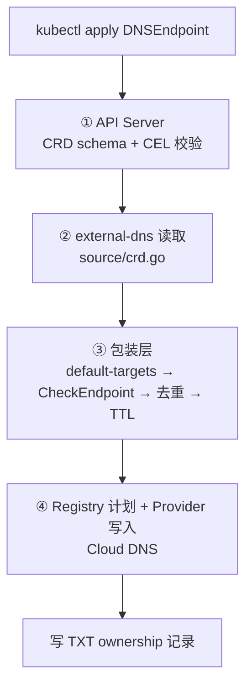

# DNSEndpoint 是什么：原理、边界与在 HGKE 中的用法

> 本文回答三个问题：**它是什么**、**它解决什么问题**、**它内部是怎么工作的**。
> 所有行为描述均对照 external-dns 上游源码（`master`，最新 release **v0.23.0**，2026-09-18）核实，权威链接见第 11 节。
> 上下文沿用本目录 `ar.md` / `ingress.md` / `dns.md` / `dns-endpoint.md`。
>
> 配套流程图：`what-is-dnsendpoint.html`（第 5 节四层校验的可视化版本，含各层拦截点与三张排查卡片）。

---

## 1. 一句话结论

**DNSEndpoint 是 ExternalDNS 的一个 CRD：它让你把"我想要什么 DNS 记录"直接写成 Kubernetes 资源，由 external-dns 控制器 watch 后自动同步到 Cloud DNS。**

它不是 GKE 的东西，也和 SNI 改写、双网卡 MIG 那套转发架构**没有任何关系**。它只解决一件事：**把 DNS 记录的创建/变更从"人在终端敲 `gcloud`"变成"Git 里的一份声明式配置 + `kubectl apply`"**。

---

## 2. 它是什么 / 不是什么

| | 内容 |
|----|------|
| **完整标识** | `apiVersion: externaldns.k8s.io/v1alpha1` / `kind: DNSEndpoint`，CRD 名 `dnsendpoints.externaldns.k8s.io` |
| **作用域** | Namespaced（必须落在某个 namespace 里） |
| **本质** | `Endpoint` 结构的包装器：`spec.endpoints[]` 里每一项 = 一条 DNS 记录 |
| **谁消费它** | external-dns 的 `crd` source（`--source=crd`） |
| **配套组件** | CRD 本身要先安装；external-dns 的 ClusterRole 要放行 `dnsendpoints` |
| **状态** | 有 `status` 子资源，只有 `observedGeneration` 一个字段（记录控制器已处理到第几代） |

**不是：**

- 不是 DNS 服务器，不做递归解析，不缓存
- 不是 GKE/Gateway 的一部分，不会读 Ingress/HTTPRoute 的 status 去填 IP
- 不是服务网格/证书管理/流量转发组件

---

## 3. 它解决什么问题

### 3.1 和现状（手工 `gcloud dns record-sets create`）的对比

`dns.md` 和 `ingress.md` 里的记录目前是这样产生的：

```bash
gcloud dns record-sets create lex.dev-cn-hgke-c1.<project>... \
  --zone=<zone-name> --type=CNAME --ttl=300 \
  --rrdatas=ingress.<project>...dev.aliyun.cloud.cn.caep.
```

这条命令能跑通，但它有四个结构性问题：

| 问题 | 手工方式 | DNSEndpoint 方式 |
|------|---------|-----------------|
| **不可评审** | 命令历史不进版本库，review 不了 | YAML 进 Git，走 MR 审批 |
| **不可复现** | 新环境/灾备重建要重敲一遍 | `kubectl apply -f` 幂等重放 |
| **无所有权标记** | 手工记录不带 TXT 所有权，external-dns 会拒绝接管（见 §5.3） | 自动写 TXT ownership |
| **漂移不可见** | 有人手工改了记录，代码里看不出来 | 控制器持续对账，配置是唯一事实源 |

### 3.2 它带来的核心收益

1. **声明式**：DNS 记录变成集群状态，可以 `kubectl get dnsendpoint` 直接查。
2. **GitOps 友好**：和 Ingress / HTTPRoute 同一套流程（提交 → 评审 → apply）。
3. **自动对账**：external-dns 按 `--policy` 持续把 provider 侧记录拉回来和期望态比对。
4. **所有权隔离**：TXT registry 给每条记录打 owner 标记，多集群共用一个 zone 时互不误删。

### 3.3 它明确不解决什么（HGKE 场景的硬边界）

| 不解决 | 说明 |
|--------|------|
| **Gateway IP 变化** | DNSEndpoint 是**静态声明**，不会去 watch Gateway 的 `status.addresses`。Gateway LB IP 变了而 YAML 没改，记录就是错的 |
| **自动选 Nginx 还是 Envoy** | 走 `.9` 还是 `.10` 仍由 `-proxy` 记录的 CNAME 目标决定，得手工填 |
| **多网卡 VM 的 DNS 视角** | 属于网络设计问题，DNSEndpoint 无感知 |
| **客户端 / Ingress VM 可见性分 zone** | 属于 Cloud DNS zone 的 VPC 可见性配置，不属于 CRD |

> 所以 `dns-endpoint.md` §3.1 才需要强调：Gateway IP 必须用 `spec.addresses` 绑静态预留地址，否则重建后记录失效。**DNSEndpoint 帮不了你，它只会忠实地把一个过期的 IP 同步上去。**

---

## 4. 数据模型：字段全解

权威 schema：`config/crd/standard/dnsendpoints.externaldns.k8s.io.yaml`

```yaml
apiVersion: externaldns.k8s.io/v1alpha1
kind: DNSEndpoint
metadata:
  name: lex-dns
  namespace: testing-namespace
  labels:
    app: lex                      # 可被 --label-filter 使用
spec:
  endpoints:                      # 必填（可空数组），最多 1000 项
    - dnsName: lex.dev-cn-hgke-c1.<project>.dev.aliyun.cloud.cn.caep   # 必填
      recordType: CNAME                                             # 必填
      recordTTL: 300
      targets:                                                       # 可空（见 §5.2）
        - ingress.<project>.dev.aliyun.cloud.cn.caep
```

| 字段 | 必填 | 约束（超出即 `kubectl apply` 被拒） |
|------|------|-----------------------------------|
| `dnsName` | ✅ | ≤253 字符（带结尾点写则 ≤254）；有正则约束；支持 `*.` 前缀和 `_` 前缀标签 |
| `recordType` | ✅ | 枚举：`A AAAA CNAME DNAME MX NAPTR NS PTR SRV TLSA TXT` |
| `targets` | — | 1–1000 个，每个 1–4096 字符 |
| `recordTTL` | — | 0 – 2147483647（RFC 2181 §8）；**0 表示"未设置"，由 provider 用默认值** |
| `setIdentifier` | — | ≤255；用于同名同类型多记录集（Route53 权重路由）。**Google Cloud DNS 不需要，不要填** |
| `labels` | — | `map[string]string`，用于给单条记录打标 |
| `providerSpecific` | — | 最多 100 项，provider 私有配置（见下方警告） |

**CRD schema 层还有三条 CEL 校验**（在 `apply` 时就拦）：

- `SRV` 的 targets 必须以 `.` 结尾（绝对主机名）
- `NAPTR` 的 targets 必须以 `.` 结尾
- `PTR` 的 `dnsName` 必须是 `.in-addr.arpa` / `.ip6.arpa` 结尾，且**不带**结尾点

> ⚠️ **`providerSpecific` 在 HGKE 里不要碰。** 其中 `alias=true` 会让 A 记录接受主机名 target 从而绕过 IP 校验，但 **Cloud DNS 不支持 ALIAS 记录**，写进去 provider 会拒绝。CNAME/A/Aaaa 这三种类型才"支持 alias"（`supportsAlias()`），但支持的是"能声明"，不代表 Google 后端认。

---

## 5. 工作原理：从 `kubectl apply` 到 Cloud DNS

这是本文的核心。整条链路有 **4 层校验**，搞清"错误在哪一层被拦"是排查问题的关键。



### 5.1 阶段①：API Server 准入（结构性错误在这里就挡住了）

CRD 的 OpenAPI schema + CEL 规则在 `kubectl apply` 时同步执行。违反的**整个对象被拒**：

```
The DNSEndpoint "lex-dns" is invalid: spec.endpoints[0].recordType: Unsupported value
```

这一层只管**结构**：必填字段、枚举、长度、格式。它不管语义。

### 5.2 阶段②：控制器读取（`source/crd.go`）

external-dns 用 controller-runtime 的 cache/informer 监听 `DNSEndpoint`：

**a) 作用域裁剪**
- `--namespace`（默认空 = 所有 namespace）
- `--label-filter`

**b) `--annotation-filter` 过滤**

⚠️ **重要陷阱**：`--annotation-filter` 同样作用于 `DNSEndpoint` 对象本身。配了它，DNSEndpoint 的 metadata 必须带上匹配注解，否则被整体忽略：

```yaml
metadata:
  annotations:
    external-dns: public      # 需匹配 --annotation-filter=external-dns=public
```

**c) target 格式检查**（`source/crd.go` 里的 `illegalTarget` 逻辑）

| 记录类型 | 结尾点 `.` 是否合法 | 处理 |
|---------|-------------------|------|
| `CNAME` / `DNAME` | ✅ 两种都收（RFC 1035 §5.1） | 直接放行 |
| `TXT` | 无约束 | 直接放行 |
| `MX` | — | 归一化后放行 |
| `SRV` | — | 跳过此处，交给阶段③ |
| `NAPTR` | **必须**带 `.`，不带即非法 | 非法则丢弃该 endpoint |
| 其他（`A`/`AAAA`/`NS`…） | **带 `.` 即非法** | 非法则丢弃该 endpoint |

丢弃时打日志：

```
WARN Endpoint ns/name with DNSName xxx has an illegal target "10.0.0.1." for A record — use "10.0.0.1" not "10.0.0.1".
```

> 📌 **给 A 记录写 IP 时千万别带结尾点**，这是最常见的低级错误。

**d) 空 targets 的特殊放行**

`A`/`AAAA`/`CNAME` 的 targets 为空时**不报错**，只打 debug 日志，然后放行——因为要留给 `--default-targets` 在下一层填充。

**e) 写 status**

```go
if dnsEndpoint.Status.ObservedGeneration == dnsEndpoint.Generation {
    continue
}
dnsEndpoint.Status.ObservedGeneration = dnsEndpoint.Generation
cs.crWriter.Status().Update(ctx, dnsEndpoint)
```

这就是 RBAC 里 `dnsendpoints/status` 需要写权限的原因。观察这个字段可以判断"external-dns 是否已经处理过我这一版配置"。

**f) 资源内合并**

`MergeEndpoints()`：以 `(DNSName, RecordType, SetIdentifier, RecordTTL)` 为键合并。键完全相同 → **targets 追加合并**；TTL 不同 → 变成两条独立记录 → 到 provider 层冲突。

### 5.3 阶段③：包装层

实测的包装顺序（`source/wrappers/types.go`）：

```go
combinedSource := NewDedupSource(NewMultiSource(sources, defaultTargets, forceDefaultTargets))
// 外层再依次套 nat64 → target-filter → ptr → post-processor → 最小 TTL
```

**a) `multiSource` —— 填 default-targets**

| 配置 | 行为 |
|------|------|
| 无 `--default-targets` | targets 为空 → endpoint 在下一层被丢 |
| 有 `--default-targets`，CRD 写了 targets | **CRD 的值生效**，打一条 warn |
| 有 `--default-targets`，CRD targets 为空 | 用 default-targets 填充 |
| `--force-default-targets` | 无条件覆盖（**已标记 DEPRECATED**） |

> 结论：HGKE 场景**不要配 `--default-targets`**。所有记录的目标都不同，填了只会制造噪音日志和心智负担。

**b) `dedupSource` —— `CheckEndpoint()` + 去重**（这一层最关键）

`CheckEndpoint()` 的判定顺序：

1. `len(Targets) == 0` → **直接 false**（除非已被 default-targets 填上）
2. 声明了 `alias` 但类型不支持（A/AAAA/CNAME 之外）→ false
3. `A`/`AAAA` → `ValidateIPRecord()`：必须是**同族** IP（A 记录不能填 IPv6，反之亦然）；除非 `alias=true`
4. `MX` → 必须是 `<preference> <host>`
5. `SRV` → 必须是 `<priority> <weight> <port> <host>`
6. `PTR` → 至少一个非空 target

不通过就打这行日志并丢弃：

```
WARN Skipping endpoint []:lex.dev-cn-hgke-c1.xxx due to invalid configuration [A:10.88.27.179]
```

> 📌 **关键点：`CNAME` 的 target 不做 IP 校验**（`CheckEndpoint` 的 switch 里没有 CNAME 分支）。也就是说把 IP 写进 CNAME target，external-dns **不会拦**，会在写 Cloud DNS 时被 provider 拒绝。`dns-endpoint.md` 里"CNAME 的 targets 必须是主机名，不能写 IP"这条规则是对的，但**执行者是 Cloud DNS，不是 external-dns**。

**去重键** = `recordType/dnsName/setIdentifier/targets`。完全相同 → 合并为一个。

### 5.4 阶段④：Registry 计划 + 写入

**TXT 所有权**（`--registry=txt`，默认）

每条 CNAME 记录会配一条同名 TXT 作为所有权标记：

| 记录名 | 类型 |
|--------|------|
| `cname-<owner>.lex.dev-cn-hgke-c1.xxx.` | `TXT` |
| `lex.dev-cn-hgke-c1.xxx.` | `CNAME` |

TXT 内容形如 `heritage=external-dns,external-dns/owner=<txt-owner-id>,external-dns/resource=crd/<ns>/<name>`。

**这带来两个实际影响：**

1. **`--managed-record-types` 必须包含 `TXT`**（默认值只有 `A,AAAA,CNAME`），否则所有权记录不会被创建。
2. **手工创建的同名记录接管不了**：没有对应 TXT，external-dns 认为不是自己的记录而拒绝覆盖。要先删手工记录，或补一条 TXT 注册记录。

**`--policy` 决定对账行为**（必填，无默认值）：

| 值 | 行为 | HGKE 建议 |
|----|------|-----------|
| `upsert-only` | 只创建/更新，**不删除** | ✅ 上线初期用这个 |
| `sync` | 完整对账，**会删除**源里已不存在的记录 | ⚠️ 稳定后才切，切之前确认 `domain-filter` 和 `zone-visibility` 正确 |
| `create-only` | 只创建，不更新 | ❌ 不适用 |

**Cloud DNS zone 可见性**

`--google-zone-visibility=private` 通过 `ZoneTypeFilter` 过滤：空值 = 匹配全部 zone；`public`/`private` 精确匹配；**写了无法识别的值 → 一个 zone 都匹配不到**（静默失配，最难查）。

---

## 6. 在 HGKE 里它到底解决什么

结合本目录三份文档，`lex` 的两条记录用 DNSEndpoint 表达后：

| 记录 | 类型 | 目标 | 谁解析 |
|------|------|------|--------|
| `lex.dev-cn-hgke-c1.<project>...` | CNAME | `ingress.<project>...`（A → `10.88.27.179`） | 企业内网客户端 |
| `lex-proxy.dev-cn-hgke-c1.<project>...` | CNAME | `ingress-nginx.dev-cn-hgke-c1.<project>...`（A → `192.168.194.9`） | Ingress VM |

架构链路完全不变——DNS 解析出 IP，Ingress VM 的 Nginx 读 SNI 改写首段，查 `-proxy` 记录选集群内入口。**DNSEndpoint 只是把这两条记录的"产生方式"换成了声明式，链路本身一点没动。**

收益具体体现在：

- 新业务接入时，`myapp` / `myapp-proxy` 两条记录的 YAML 可以进 Git，走同一套评审流程
- 记录与 Ingress/HTTPRoute 在同一个 namespace、同一次 apply 里上线，**顺序可控**
- 平台侧统一入口名（`ingress-gke-gw`）可以先建一次，业务侧只写 CNAME，**LB IP 变了只改一处**

---

## 7. HGKE 场景完整示例

**平台侧**（建一次，不放业务 namespace）：

```yaml
apiVersion: externaldns.k8s.io/v1alpha1
kind: DNSEndpoint
metadata:
  name: ingress-gke-gw
  namespace: platform-dns
spec:
  endpoints:
    - dnsName: ingress-gke-gw.dev-cn-hgke-c1.<project>.dev.aliyun.cloud.cn.caep
      recordTTL: 300
      recordType: A
      targets:
        - <GKE Gateway 内部 LB IP>
```

**业务侧**：

```yaml
apiVersion: externaldns.k8s.io/v1alpha1
kind: DNSEndpoint
metadata:
  name: lex-dns
  namespace: testing-namespace
  labels:
    app: lex
spec:
  endpoints:
    - dnsName: lex.dev-cn-hgke-c1.<project>.dev.aliyun.cloud.cn.caep
      recordTTL: 300
      recordType: CNAME
      targets:
        - ingress.<project>.dev.aliyun.cloud.cn.caep

    - dnsName: lex-proxy.dev-cn-hgke-c1.<project>.dev.aliyun.cloud.cn.caep
      recordTTL: 60
      recordType: CNAME
      targets:
        - ingress-nginx.dev-cn-hgke-c1.<project>.dev.aliyun.cloud.cn.caep
```

**必要的 Deployment 参数**：

```yaml
args:
  - --source=crd
  - --crd-source-apiversion=externaldns.k8s.io/v1alpha1
  - --crd-source-kind=DNSEndpoint
  - --provider=google
  - --google-project=<project>
  - --google-zone-visibility=private        # 私有 zone 必须声明
  - --domain-filter=<project>.dev.aliyun.cloud.cn.caep
  - --managed-record-types=A
  - --managed-record-types=CNAME
  - --managed-record-types=TXT              # 别漏！否则 TXT 所有权不生成
  - --registry=txt
  - --txt-owner-id=hgke-dev-cn-hgke-c1      # 每集群唯一
  - --policy=upsert-only
```

**RBAC**：

```yaml
- apiGroups: ["externaldns.k8s.io"]
  resources: ["dnsendpoints"]
  verbs: ["get", "watch", "list"]
- apiGroups: ["externaldns.k8s.io"]
  resources: ["dnsendpoints/status"]
  verbs: ["*"]
```

> `--crd-source-apiversion` / `--crd-source-kind` 本身有默认值（就是上面这两个），写出来是为了让读者一眼看出 source 类型。
> `--txt-owner-id` 在共用 zone 的场景下**每集群必须唯一**——多个集群都用 `default` 且开了 `policy=sync`，会互删对方记录。

---

## 8. 四层校验速查：你的错误会在哪里被拦

这是排查时最有价值的一张表。

| 错误 | 拦在哪一层 | 你会看到什么 |
|------|-----------|-------------|
| `recordType` 拼错 / `dnsName` 缺失 | ① API Server | `kubectl apply` 直接失败 |
| A 记录 target 写了 `10.0.0.1.`（带点） | ② crd.go | `WARN ... illegal target` 日志，记录**未创建** |
| `targets` 为空且无 `--default-targets` | ③ dedupSource | `WARN Skipping endpoint ... due to invalid configuration` |
| A 记录 target 填了主机名 | ③ dedupSource | 同上（`ValidateIPRecord` 失败） |
| A 记录填了 IPv6 地址 | ③ dedupSource | 同上（族不匹配） |
| CNAME 的 target 填了 IP | ④ **Cloud DNS** | external-dns **不报错**，provider 写入失败 |
| `providerSpecific: [{name: alias, value: "true"}]` | ④ Cloud DNS | Cloud DNS 无 ALIAS 类型，写入失败 |
| 两个对象声明同名同类型 | ② `MergeEndpoints` | TTL 相同→合并 targets；TTL 不同→到 provider 层冲突 |
| 记录已由手工创建 | ④ TXT 校验 | 不覆盖，日志提示所有权不匹配 |
| `--google-zone-visibility` 值拼错 | ④ zone 过滤 | **静默无任何记录被管理** |

---

## 9. 与本目录现有文档的三处更正

核对源码后，发现 `dns-endpoint.md` §5 的建议需要修正：

**① `controller` 注解的语义是反的**

上游 `docs/annotations/annotations.md` 原文：

> If this annotation exists and has a value other than `dns-controller` then the source ignores the resource.

即：值 **等于** `dns-controller` = 不忽略；值 **不等于** `dns-controller` = **忽略该资源**。

`dns-endpoint.md` §5 建议"加上 `controller: dns-controller` 之类的注解让 external-dns 忽略"——这个值恰好是**不忽略**的那个。要忽略，值必须写成别的值。

**② 注解前缀在 v0.22.0 变过**

| 版本 | 前缀 |
|------|------|
| < v0.22.0 | `external-dns.alpha.kubernetes.io/` |
| ≥ v0.22.0 | `external-dns.kubernetes.io/`（当前默认） |

旧注解要继续生效需加 `--enable-legacy-annotation-prefix`（迁移用，会在后续版本移除）。

**③ CRD source 本身不支持这些注解**

上游注解支持矩阵中 **CRD 行的所有格子都是空的**。也就是说 `target` / `ttl` / `hostname` / `controller` 这些注解**对 `DNSEndpoint` 无效**，必须写在 `spec` 里。CRD source 只响应 `--annotation-filter`（整体过滤）和 `--label-filter`。

`controller` 注解对 `ingress` / `gateway-httproute` 等 source 依然有效——所以"避免和 ingress source 抢同一个 hostname"这个思路是对的，只是注解值要反过来写。

---

## 10. 验证清单

```bash
# 1. CRD 已安装
kubectl get crd dnsendpoints.externaldns.k8s.io

# 2. 服务端校验后再应用（能在这一步挡住结构错误）
kubectl apply --dry-run=server -f lex-dnsendpoint.yaml

# 3. 应用后确认状态——observedGeneration == generation 说明控制器已处理
kubectl get dnsendpoint lex-dns -n testing-namespace -o jsonpath='{.metadata.generation} {.status.observedGeneration}{"\n"}'

# 4. 看控制器日志，过滤非法 target 和跳过信息
kubectl logs -n <external-dns-ns> deploy/external-dns --tail=100 | grep -iE 'lex|illegal|Skipping endpoint'

# 5. Cloud DNS 回查（同时确认 TXT 所有权记录已生成）
gcloud dns record-sets list --zone=<zone-name> --filter="name~lex"

# 6. 分视角解析验证
dig lex.dev-cn-hgke-c1.<project>... +noall +answer          # 客户端 → 10.88.27.179
dig lex-proxy.dev-cn-hgke-c1.<project>... +noall +answer    # Ingress VM → 192.168.194.9
```

---

## 11. 权威证据

| 结论 | 来源 |
|------|------|
| CRD schema、必填字段、枚举、CEL 校验 | [`config/crd/standard/dnsendpoints.externaldns.k8s.io.yaml`](https://github.com/kubernetes-sigs/external-dns/blob/master/config/crd/standard/dnsendpoints.externaldns.k8s.io.yaml) |
| 读取逻辑、target 格式检查、`observedGeneration` 写入 | [`source/crd.go`](https://github.com/kubernetes-sigs/external-dns/blob/master/source/crd.go) |
| `CheckEndpoint()` 各类型校验、`ValidateIPRecord` | [`endpoint/endpoint.go`](https://github.com/kubernetes-sigs/external-dns/blob/master/endpoint/endpoint.go) |
| 去重与合并键 | [`source/wrappers/dedupsource.go`](https://github.com/kubernetes-sigs/external-dns/blob/master/source/wrappers/dedupsource.go) |
| default-targets 填充顺序与告警 | [`source/wrappers/multisource.go`](https://github.com/kubernetes-sigs/external-dns/blob/master/source/wrappers/multisource.go) |
| 包装层实际嵌套顺序 | [`source/wrappers/types.go`](https://github.com/kubernetes-sigs/external-dns/blob/master/source/wrappers/types.go) |
| 同名同类型合并、CNAME 唯一性告警 | [`endpoint/utils.go`](https://github.com/kubernetes-sigs/external-dns/blob/master/endpoint/utils.go) |
| 注解前缀变更、`controller` 语义、各 source 支持矩阵 | [`docs/annotations/annotations.md`](https://github.com/kubernetes-sigs/external-dns/blob/master/docs/annotations/annotations.md) |
| CRD source 用法、校验规则、RBAC | [`docs/sources/crd.md`](https://github.com/kubernetes-sigs/external-dns/blob/master/docs/sources/crd.md) |
| `--policy` / `--managed-record-types` / `--google-zone-visibility` | [`docs/flags.md`](https://github.com/kubernetes-sigs/external-dns/blob/master/docs/flags.md) |
| TXT ownership 格式、`txt-owner-id` 唯一性要求 | [`docs/registry/txt.md`](https://github.com/kubernetes-sigs/external-dns/blob/master/docs/registry/txt.md) |
| zone 可见性过滤语义 | [`provider/zone_type_filter.go`](https://github.com/kubernetes-sigs/external-dns/blob/master/provider/zone_type_filter.go) |
| 版本基线 | [v0.23.0](https://github.com/kubernetes-sigs/external-dns/releases/tag/v0.23.0) 发布于 2026-09-18 |

> 注：本文以 `master` 分支源码为准（文中引用的部分行为在 v0.23.0 之后有变更，落地前请对照现场 external-dns 镜像版本）。

---

## 12. 注意事项与待确认项

- **external-dns 版本未确认**：现场跑的是哪个版本？v0.22.0 前后注解前缀不同，`--force-default-targets` 的行为也不同。请用 `kubectl get deploy external-dns -n <ns> -o jsonpath='{.spec.template.spec.containers[0].image}'` 确认。
- **`ingest-gke-gw` 的 IP 来源**：示例 B 里 Gateway IP 需要手工填入 YAML。请确认是用 `spec.addresses` 预留的静态内部地址，且该地址已回收。
- **Envoy 入口名仍未提供**：对应 `192.168.194.10` 的 DNS 名还没有，走 Envoy 的业务无法填 CNAME 目标。
- **两条记录是否同 zone 未确认**：`dns-endpoint.md` §4 指出客户端侧和 Ingress VM 侧可能属于不同 zone。若跨 zone，`--google-zone-visibility` 与 `--domain-filter` 需要按实例拆分。
- **`--policy=upsert-only` 的清理缺口**：该策略不删记录，业务下线时 DNS 记录会残留，需手工清理或确认稳定后切 `sync`。
- **客户端也能解析 `-proxy`**：同一 zone 下 `lex-proxy` 对客户端可见（`ingress.md` §4 已提示），DNSEndpoint 不会改变这一点，需确认可接受。

````
如果需要，我可以继续补充：external-dns 的完整 Deployment + RBAC YAML（可直接 apply）、Cloud DNS 侧的 `gcloud` 与 DNSEndpoint 双轨并存迁移方案，或者把 DNSEndpoint + Ingress/HTTPRoute 合并成一份 lex 的完整接入清单。
````
