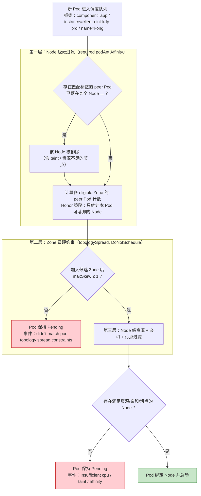
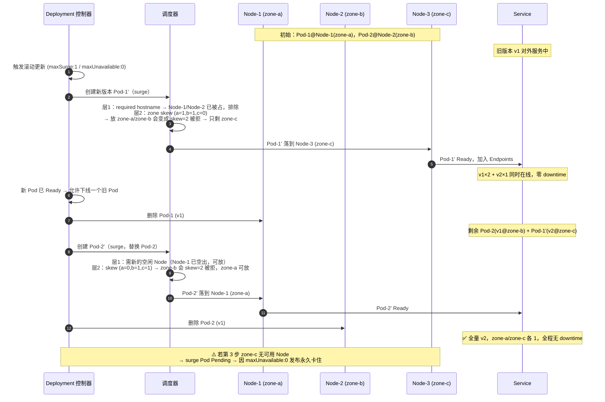

# Kong PRD 高可用配置评审：跨 Zone 分布 / PDB / HPA 协同分析

> **评审对象**：`kong` 网关 Deployment（namespace `clienta-int-kdp`，instance `clienta-int-kdp-prd`）的
> `strategy` + `affinity.podAntiAffinity` + `topologySpreadConstraints` + `HorizontalPodAutoscaler` + `PodDisruptionBudget` 组合配置。
>
> **评审问题**：在「保留至少两个副本」的前提下，当前配置能否实现跨 Zone 分布？
>
> **原始需求**：
> 1. Pod 必须落在不同的 GKE Node（hostname 级隔离，硬要求）
> 2. Zone 尽量满足分布要求（软要求）
>
> ⚠️ 文中内部标识符已按本仓库的公开仓库脱敏约定替换为占位符。

---

## 0. 结论速览

| # | 结论 | 判定 |
|:--|:---|:--|
| 1 | 需求 1「不同 GKE Node」→ **完全达成**。`requiredDuringSchedulingIgnoredDuringExecution` + `topologyKey: kubernetes.io/hostname` 是硬约束，不满足就 Pending。 | ✅ |
| 2 | 需求 2「Zone 尽量分布」→ **实际强度远超需求**：配置用的是 `whenUnsatisfiable: DoNotSchedule`，Zone 分布是**硬保证**而非「尽量」。 | ⚠️ 强度过剩 |
| 3 | 「保留至少 2 个副本时跨 Zone 分布」→ **稳态可以**：`minReplicas=2` 时 2 个 Pod 必然落在 **2 个不同 Zone**（前提：≥2 个可用 Zone）。 | ✅ |
| 4 | 但「保留至少 2 个副本」在 PDB 语义下**不成立**：`maxUnavailable: 1` + `replicas=2` → 自愿中断时只剩 **1 个** Pod，PDB 保的是「≥1」不是「≥2」。 | ❌ 需澄清 |
| 5 | 想让「任一 Zone 故障后容量不降」→ 需要 `minReplicas ≥ 3`（= Zone 数），当前 `minReplicas: 2` 只保证「无 downtime」，不保证「无降容」。 | ⚠️ 需决策 |
| 6 | 最大的落地风险是 **Node 数下限**：`required` hostname 反亲和 + `maxSurge: 1` + `maxUnavailable: 0` 组合下，**滚动更新需要 `replicas + 1` 个空闲 Node**；不足则**发布永久卡住**（不是服务中断，是新版本上不去）。 | 🔴 高危 |
| 7 | 本配置**没有** `minDomains`——这是**正确的**，不要加（加了反而会在可用 Zone 不足时放弃 Zone 分布约束）。 | ✅ |
| 8 | 整体评价：**拓扑约束层（反亲和 + topologySpread）设计正确且严谨**；短板在**副本下限（2）与 PDB 口径**，以及**未验证 Node 数是否满足峰值扩容**。 | — |

> 📌 **想直接看结论表** → 跳到 [§4.1 副本数 × Zone 分布 × hostname 要求 汇总表](#41-汇总表集群有-3-个可用-zoneabc)。

---

## 1. 配置清单与逐项语义

```yaml
# ── Deployment ────────────────────────────────────────────────────────
spec:
  strategy:
    type: RollingUpdate
    rollingUpdate:
      maxSurge: 1            # 更新时最多多起 1 个 Pod
      maxUnavailable: 0      # 更新时不主动减少可用副本（先起新的，再删旧的）
  template:
    spec:
      affinity:
        podAntiAffinity:
          requiredDuringSchedulingIgnoredDuringExecution:
            - topologyKey: kubernetes.io/hostname
              labelSelector:
                matchLabels:
                  app.kubernetes.io/component: app
                  app.kubernetes.io/instance: clienta-int-kdp-prd
                  app.kubernetes.io/name: kong
      topologySpreadConstraints:
        - maxSkew: 1
          topologyKey: topology.kubernetes.io/zone
          whenUnsatisfiable: DoNotSchedule
          nodeAffinityPolicy: Honor
          nodeTaintsPolicy: Honor
          labelSelector:
            matchLabels:
              app.kubernetes.io/component: app
              app.kubernetes.io/instance: clienta-int-kdp-prd
              app.kubernetes.io/name: kong
---
# ── HorizontalPodAutoscaler ───────────────────────────────────────────
spec:
  minReplicas: 2
  maxReplicas: 5
---
# ── PodDisruptionBudget ──────────────────────────────────────────────
apiVersion: policy/v1
kind: PodDisruptionBudget
metadata:
  name: clienta-int-kdp-prd-kong
  namespace: clienta-int-kdp
spec:
  maxUnavailable: 1
  selector:
    matchLabels:
      app.kubernetes.io/component: app
      app.kubernetes.io/instance: clienta-int-kdp-prd
      app.kubernetes.io/name: kong
```

| 约束 | 类型 | 作用维度 | 语义 | 硬/软 |
|:---|:---|:---|:---|:---|
| `podAntiAffinity.required` + `hostname` | 调度期 | **Node** | 匹配标签的 Pod 之间不得共 Node | **硬**（不满足 → Pending） |
| `topologySpreadConstraints` + `zone` | 调度期 | **Zone** | 各 Zone 的 Pod 数差值 ≤ `maxSkew`(=1) | **硬**（`DoNotSchedule`，不满足 → Pending） |
| `nodeAffinityPolicy: Honor` | 调度期 | Node 亲和过滤 | 计算 skew 时**只统计**与本 Pod 的 nodeAffinity 匹配的 Node 上的 peer Pod | 辅助 |
| `nodeTaintsPolicy: Honor` | 调度期 | Node 污点过滤 | 计算 skew 时**只统计**本 Pod 的 tolerations 能容忍的 Node 上的 peer Pod | 辅助 |
| `Deployment.maxUnavailable: 0` | 更新期 | 数量 | 滚动更新期间不主动下线旧 Pod | **硬**（闸门） |
| `Deployment.maxSurge: 1` | 更新期 | 数量 | 允许临时多 1 个 Pod | 配额 |
| `HPA.minReplicas: 2 / maxReplicas: 5` | 弹性期 | 数量 | 副本数区间 [2, 5] | 配额 |
| `PDB.maxUnavailable: 1` | 中断期 | 数量 | 任意时刻最多 1 个 Pod 不可用 | **硬**（拦截 Eviction API） |

### 1.1 两个容易搞混的边界

| | `Deployment.maxUnavailable` | `PDB.maxUnavailable` |
|:---|:---|:---|
| 生效场景 | **Deployment 自己**的滚动更新 | **外部**自愿中断：`kubectl drain`、GKE 节点升级、Cluster Autoscaler 缩容 |
| 作用机制 | Deployment 直接删除 Pod（走 delete，**不经过 Eviction API**） | 拦截 Eviction API（`kubectl drain` / 节点升级） |
| 能否互相替代 | ❌ 不能 | ❌ 不能 |
| 本配置中的角色 | `0` = 发布期间零下线（真正的 rollout 闸门） | `1` = 维护期间一次只动一个 |

> **结论**：PDB **不会**阻止 Deployment 滚动更新。发布不卡靠的是 `maxUnavailable: 0`，不是 PDB。
> PDB 只在 GKE 节点升级 / 人工 drain / CA 缩容时生效。

---

## 2. 三层约束的协作关系



**关键点**：Zone 层的 skew 计算**不是**简单看「该 Zone 有几个 Pod」，
而是按 `nodeAffinityPolicy` / `nodeTaintsPolicy` 过滤后统计——这保证了一个 Pod 不会被
「自己根本落不上去的 Node 上的 peer Pod」挤到 Pending。当前配置这两项都设成 `Honor`，**配置正确**。

> ⚠️ 但要注意：`Honor` 只在 Pod **确实定义了** `nodeAffinity`/`nodeSelector`/`tolerations` 时才有区分度。
> 如果本 Deployment 没有任何 nodeAffinity 与 tolerations，`Honor` 与 `Ignore` 等价。

---

## 3. 用户原始要求 vs 实际达成

| # | 原始要求 | 期望语义 | 配置实际语义 | 达成 | 前置条件 / 说明 |
|:--|:---|:---|:---|:--:|:---|
| 1 | Pod 落在不同 GKE Node | 硬隔离 | `required` + `hostname` = 硬隔离 | ✅ **完全达成** | eligible Node 数 ≥ 副本数（更新期 ≥ 副本数+1） |
| 2 | Zone 尽量分布 | 软偏好（尽量） | `DoNotSchedule` + `maxSkew:1` = **硬保证** | ⚠️ **强度过剩** | ≥2 个 eligible Zone；不满足 → Pending 而非降级 |
| 3 | 保留 ≥2 副本 | 任意时刻 ≥2 可用 | PDB `maxUnavailable:1` → 任意时刻 **≥1** 可用 | ❌ **口径不符** | 副本数=2 时，驱逐 1 个即只剩 1 个 |
| 4 | 跨 Zone 分布（隐含） | Zone 级容灾 | 稳态 2 副本 → 2 个不同 Zone | ✅ **达成** | 前提：≥2 个 eligible Zone 且资源允许 |

> **第 3 行是本次评审最需要对齐的点**：你问的「保留至少两个副本时能否跨 Zone 分布」，
> 严格说当前配置**做不到「保留 2 个」**——PDB `maxUnavailable: 1` 在 2 副本时允许驱逐到只剩 1 个。
> 如果真实目标是「任意时刻至少 2 个 Pod 可用」，那副本数下限必须提到 3，PDB 改 `minAvailable: 2`。

---

## 4. 副本数 × Zone 分布 × hostname 要求 汇总表

> 这是本次评审的核心表：**每一档期望副本数，对应什么样的 Zone 分布、需要多少 Node、以及这意味着什么。**

### 4.1 汇总表（集群有 3 个可用 Zone：a / b / c）

| 期望副本数 | 可达 Zone 分布<br>（a / b / c） | Zone 分布是否保证 | hostname 要求<br>（可调度 Node 数） | 对应含义 |
|:---:|:---|:---:|:---|:---|
| **2**<br>（`HPA.minReplicas`） | `1 / 1 / 0`<br>占用 **2** 个 Zone | ✅ 保证<br>（`maxSkew:1` + `DoNotSchedule`） | 稳态 ≥ **2** 个<br>每 Pod **独占** 1 个 Node | 稳态**无 downtime**；但**第 3 个 Zone 无 Pod 级容量**，单 Zone 故障后仅剩 **1** 个 Pod → **容量减半** |
| **3** | `1 / 1 / 1`<br>占满 **3** 个 Zone | ✅ 保证 | 稳态 ≥ **3** 个 | **Zone 级容灾完整**：任一 Zone 故障仍剩 **2** 个，**容量不降** ← **PRD 推荐目标态** |
| **4** | `2 / 1 / 1` | ✅ 保证（skew=1，未失衡） | 稳态 ≥ **4** 个<br>（其中 1 个 Zone 需 ≥2 个 Node） | 仍**无 downtime**；某个 Zone 落了 2 个 → 该 Zone 故障时**一次损失 2** 个 |
| **5**<br>（`HPA.maxReplicas`） | `2 / 2 / 1` | ✅ 保证（skew=1，未失衡） | 稳态 ≥ **5** 个<br>（其中 2 个 Zone 各需 ≥2 个 Node）<br>**滚动更新期需 ≥6** | 分布始终均衡（skew 恒 ≤1）；任一 Zone 故障仍剩 **3** 个 |
| **4–5**<br>滚动更新中<br>（瞬时 +1） | 参与调度的 Pod = 副本数 + 1 | ✅ 约束仍然生效 | **≥ 6** 个 | ⚠️ Node 数不足 → surge Pod **Pending** → 因 `maxUnavailable:0`，**发布永久卡死**（旧版继续服务，无 downtime，但新版本上不去） |

**读表要点**

| 要点 | 说明 |
|:---|:---|
| **Zone 分布永远是“保证”** | 因为用的是 `whenUnsatisfiable: DoNotSchedule`，不是 `preferred`。不满足就 Pending，而不是“尽量”。 |
| **hostname 永远是“独占”** | `required` 反亲和 = 硬约束，任一 Pod 不可能与另一个 Pod 共 Node。 |
| **副本数 ≤ Zone 数 → 每 Zone 至多 1 个** | 2 个副本 → 必在 2 个不同 Zone；3 个副本 → 必在 3 个不同 Zone。**这就是“Zone 级容灾”的充要条件**。 |
| **副本数 > Zone 数 → 必然出现同 Zone** | 4 个副本 / 3 个 Zone → `2/1/1`；5 个 → `2/2/1`。此时 Zone 故障的损失从「1 个」变成「2 个」，但**服务仍不中断**。 |
| **Node 数是真正的瓶颈** | `required` 反亲和 ⇒ **可调度 Node 数必须 ≥ 副本数**（滚动更新期 ≥ 副本数+1）。Zone 数不够只会降低冗余，**Node 数不够会直接 Pending**。 |

### 4.2 明细展开（3 个可用 Zone）

| 副本数 | zone-a | zone-b | zone-c | 占用 Zone 数 | 单 Zone 故障后剩余 | 判定 |
|:---:|:---:|:---:|:---:|:---:|:---:|:---|
| 2（HPA min） | 1 | 1 | 0 | **2 / 3** | **1** | 无 downtime，但**容量减半** |
| 3 | 1 | 1 | 1 | **3 / 3** | 2 | 容量不降，Zone 级容灾完整 |
| 4 | 2 | 1 | 1 | 3 / 3 | 2 | 最大 skew=1 ✅ |
| 5（HPA max） | 2 | 2 | 1 | 3 / 3 | 3 | 最大 skew=1 ✅ |

> Zone 分配的具体字母顺序不确定（由调度器打分与 tiebreak 决定），**但「每 Zone 最多 1 个（当副本 ≤ Zone 数）」是确定的**。
> 副本数 > Zone 数时，`maxSkew: 1` 保证差值恒为 1，不会出现「一个 Zone 塞 3 个、另一个空着」的失衡。

### 4.3 集群只有 2 个可用 Zone 时

（例如只有 2 个 zonal node pool，或某 Zone 节点全部被 drain）

| 副本数 | zone-a | zone-b | hostname 要求 | 含义 |
|:---:|:---:|:---:|:---:|:---|
| 2 | 1 | 1 | ≥ 2 个 Node | 无 downtime；**只剩 2 个 Zone 冗余** |
| 3 | 2 | 1 | ≥ 3 个 Node | 无 downtime；单 Zone 故障剩 2 |
| 4 | 2 | 2 | ≥ 4 个 Node | 无 downtime |
| 5 | 3 | 2 | ≥ 5 个 Node | 无 downtime；单 Zone 故障剩 3 |

**若只有 1 个可用 Zone**：所有 Pod 落该 Zone，skew=0，**约束不会报错也不会告警**——
这是**静默失去 Zone 冗余**的场景，必须靠监控发现（见 §9.2）。

---

## 5. 各场景下的实际效果

| 场景 | 副本数 | Node 分布 | Zone 分布 | 可用性 | 是否有 downtime | 说明 |
|:---|:---:|:---|:---|:---|:--:|:---|
| 稳态低负载（HPA min） | 2 | 2 个不同 Node ✅ | **2 个不同 Zone** ✅ | 单 Zone 故障 → 剩 1 Pod | ❌ 无 | 但容量减半 |
| 稳态中等负载 | 3–4 | 各自独占 Node ✅ | 1/1/1 或 2/1/1 ✅ | 单 Zone 故障 → 剩 2+ | ❌ 无 | Zone 容灾完整 |
| 稳态峰值（HPA max） | 5 | 5 个不同 Node ✅ | 2/2/1 ✅ | 单 Zone 故障 → 剩 3 | ❌ 无 | 需 ≥5 个 eligible Node |
| **PDB 驱逐 1 个**（节点升级/drain/CA 缩容） | 2→1 | — | 剩 1 个 Zone | **只剩 1 个 Pod** | ❌ 无（但**单点**） | PDB 只保证 ≥1 |
| **单 Node 故障**（非自愿） | 2 | 重建后仍独占 Node | 重建后仍满足 skew | 1 Pod 服务 | ❌ 无 | 非自愿中断，PDB 不参与 |
| **单 Zone 整体故障** | 2 | — | 2 个 Pod 同处该 Zone → **两个一起死** | **0** | ✅ **有 downtime** | ⚠️ **minReplicas=2 的真实风险** |
| **滚动更新** | 3（2 old + 1 surge） | surge 需**第 3 个空闲 Node** | surge 需落在 skew 允许的 Zone | 旧 Pod 全程在线 | ❌ 无 | **Node 数不足 → 发布卡死** |
| **HPA 缩容** | 2→2 | 不变 | 删哪个由 HPA 决定，可能偏离均衡 | — | — | 下次新建时由 skew 自动回正 |

### 5.1 滚动更新时序（3 Zone / 2 副本）



---

## 6. 效果评估矩阵

| 维度 | 评估 | 依据 |
|:---|:--:|:---|
| **Node 级故障隔离** | 🟢 优秀 | `required` 硬约束，100% 保证不同 Node |
| **Zone 级故障隔离（拓扑）** | 🟢 优秀 | `DoNotSchedule` + `maxSkew:1` 硬保证，稳态分布均衡 |
| **Node/Zone 约束的 selector 一致性** | 🟢 优秀 | 反亲和与 topologySpread **使用同一组标签**，无标签漂移风险（对比 [summary-affinity.md](summary-affinity.md) 里 `api-type` vs `app` 不一致的隐患） |
| **跨服务隔离** | 🟢 良好 | selector 含 `instance`，作用域限定在本实例，不会与其他服务抢 Node |
| **自愿中断保护（维护窗口）** | 🟡 达标 | `maxUnavailable:1` 保证一次只驱逐一个；但 2 副本时底线只有 1 |
| **非自愿故障保护** | 🟡 依赖拓扑 | 单 Node 故障无 downtime；单 Zone 故障在 `minReplicas=2` 时**有 downtime** |
| **发布零中断** | 🟢 设计正确 | `maxSurge:1` + `maxUnavailable:0`，前提是 Node 数够 |
| **扩容能力** | 🟢 无死锁 | `maxSkew:1` + `DoNotSchedule` 在副本 > Zone 数时**不会** Pending（对比 required 反亲和会死锁，见 [pdb-multi-zone-spread-ha.md](pdb-multi-zone-spread-ha.md)） |
| **缩容 / 缩节点** | 🟡 依赖 PDB | CA 缩容受 PDB 约束，只缩 1 台；重建时需空闲 Node |
| **PDB 口径与副本下限** | 🔴 需决策 | `minReplicas:2` + `maxUnavailable:1` → 底线只有 1 个 Pod，与「至少 2 副本」的口径不符 |
| **Node 数充足性** | 🔴 未验证 | `required` 反亲和 ⇒ 稳态需 ≥副本数 Node、更新期需 ≥副本数+1 Node；HPA max=5 时更新期需 **6 个** |
| **Zone 容量耦合风险** | 🟡 中等 | `DoNotSchedule` 把调度与 Zone 容量绑定：目标 Zone 无可用 Node 时 Pod Pending，且 `maxUnavailable:0` 会让发布卡死 |
| **可观测性** | 🔴 缺失 | 缺少「Zone 分布」「disruptionsAllowed」「可用 Zone 数」告警，Zone 冗余静默丢失时无人知晓 |

---

## 7. 风险清单

| # | 风险 | 触发条件 | 影响 | 缓解措施 | 优先级 |
|:--|:---|:---|:---|:--:|:--:|
| R1 | **单 Zone 故障导致全量 downtime** | `minReplicas=2` + 2 个 Pod 落在 2 个 Zone + 其中一个 Zone 整体故障 | 该 Zone 的 Pod 全灭；另一 Zone 仅剩 1 个 Pod（容量减半，若单 Pod 扛不住全量流量则仍 downtime） | `minReplicas: 3`（= Zone 数），每 Zone 恒有 1 个 Pod | 🔴 高 |
| R2 | **滚动更新永久卡死** | eligible Node 数 < `replicas + 1`，或 skew 唯一允许的 Zone 无可用 Node | 旧版本继续服务（无 downtime），但**新版本永远上不去**；`kubectl rollout status` 挂起 | ① 保证 Node 数 ≥ 6；② `kubectl rollout status --timeout` + 告警；③ 必要时准备 `maxUnavailable: 1` 的降级预案 | 🔴 高 |
| R3 | **HPA 扩容撞 Node 上限** | HPA 扩到 5，但 eligible Node < 5 | 第 5 个 Pod Pending；`availableReplicas` 永远追不上 `replicas`；HPA 指标失真（Pending Pod 无 metric） | 确认节点池最大容量 ≥ 6 且能扩到；`maxReplicas` 与 Node 上限对齐 | 🔴 高 |
| R4 | **PDB 底线只有 1** | 副本=2 时驱逐 1 个 | 维护窗口内变成单点，此时再来一次非自愿故障即 downtime | 提副本到 3 + `minAvailable: 2`；或明确接受该风险并写入 SLA | 🟡 中 |
| R5 | **Zone 容量耦合导致 Pending** | 目标 Zone 节点满 / 该 Zone node pool 正在升级 / 有 taint | Pod Pending；配合 `maxUnavailable:0` 时发布卡死 | `nodeTaintsPolicy/nodeAffinityPolicy: Honor` 已缓解一半；再配合 GKE **surge upgrade** 减少 Zone 暂空 | 🟡 中 |
| R6 | **可用 Zone 数 < 3 且无告警** | 集群只有 2 个 zonal node pool，或某 Zone 长期无 Node | 约束仍生效（不会报错），但 Zone 冗余实际只有 2 → R1 风险放大 | 监控「有可用 Node 的 Zone 数」，< 3 即告警 | 🟡 中 |
| R7 | **GKE 节点升级被 PDB 拖慢** | PDB `maxUnavailable:1` + 重建 Pod 需要空闲 Node | 升级窗口拉长；若 PDB 与非 Ready Pod 组合会**卡住** drain | 规范 readiness/startup probe；升级前跑 PDB 健康检查（见 [pdb-effect.md](pdb-effect.md)） | 🟡 中 |
| R8 | **HPA 与滚动更新互相干扰** | 发布期间 HPA 正在缩容 | `maxUnavailable:0` + HPA 缩容 → rollout 进度异常甚至挂起 | 发布窗口临时把 HPA `minReplicas` 固定住；或先缩容再发布 | 🟡 中 |
| R9 | **Kong 连接排空** | 网关 Pod 被 drain 时有长连接 | 客户端 502 / 连接被重置 | `terminationGracePeriodSeconds` + `preStop` 排空；确认 Kong 的 graceful shutdown 配置 | 🟡 中 |
| R10 | **跨 AZ 延迟与成本** | Pod 分散到 3 个 Zone | 到 upstream 的跨 AZ RTT 上升、跨 AZ 流量费用 | 评估 upstream 是否同 Zone；必要时对 upstream 加 `nodeAffinity` 偏好同 Zone（注意会影响 R5） | 🟢 低 |

---

## 8. 改进建议（按优先级）

| 优先级 | 改动 | 理由 | 风险 / 注意 |
|:--:|:---|:---|:---|
| **P0** | **补齐 Zone 分布 / PDB / Node 数的监控告警**（§9.2） | 上面所有风险都是「静默」的，没有告警就等于没有保护 | 无 |
| **P0** | **验证并保障 Node 数**：`eligible Node ≥ HPA.maxReplicas + 1 = 6` | 直接决定 R2 / R3 是否会踩 | 成本上升（节点资源） |
| **P1** | **对齐副本下限与 PDB 口径**：`HPA.minReplicas: 2 → 3`，`PDB.maxUnavailable: 1 → minAvailable: 2` | 真正实现「3 Zone 各 1 个副本，任一 Zone 故障容量不降」 | 资源成本 +1 Pod；HPA 缩容阈值需重算 |
| **P1** | **确认集群确实有 3 个可用 Zone**（3 个 zonal node pool 或 regional + 分布） | 拓扑约束只有在 Zone 真实存在时才有意义 | 需新建 node pool |
| **P2** | **保留现状，不要加 `minDomains`** | `minDomains` 的语义是「eligible Zone 数不足时**放弃**该约束」→ 会让 Pod 退化为挤在同一 Zone，反而削弱保护 | 详见 [pdb-multi-zone-spread-ha.md](pdb-multi-zone-spread-ha.md) 的差异说明 |
| **P2** | **不要把 zone 改成 `preferred`/`ScheduleAnyway`** | 当前 `DoNotSchedule` 正是「Zone 级硬保证」的来源，改软就回到了「两个 Pod 落同一 Zone」的老问题 | 需配套缓解 R5 |
| **P2** | **保留 `nodeAffinityPolicy/nodeTaintsPolicy: Honor`** | 避免被 taint/affinity 排除的 Node 上的 peer Pod 虚增 skew | 需 Pod 确有 nodeAffinity / tolerations 才有区分度 |
| **P3** | 发布窗口固定 HPA `minReplicas`，发布前 `kubectl drain --dry-run=server` 预演 | 规避 R2 / R8 | 流程成本 |

### 8.1 三个「不要改」清单

| 配置 | 不要改成 | 原因 |
|:---|:---|:---|
| `topologySpreadConstraints.whenUnsatisfiable: DoNotSchedule` | `ScheduleAnyway` | 会退回「尽量分布」，重现「两个 Pod 同 Zone」事故 |
| `podAntiAffinity.required` + `hostname` | `preferred` | Node 隔离会从硬保证退化为打分偏好 |
| 不设 `minDomains` | 设 `minDomains: 3` | 会让约束在 Zone 不足时被跳过，等于静默放弃 Zone 保护 |

> **与 [pdb-multi-zone-spread-ha.md](pdb-multi-zone-spread-ha.md) 的差异说明**：
> 那篇文档推荐 `minDomains: 3`，是因为它同时讨论了「required zone 反亲和」这种会**真正死锁**的写法。
> 本配置的 Zone 层用的是 `topologySpread + maxSkew:1`，**本身不会因 Zone 数量不足而死锁**
> （Zone 数 ≥1 时永远可调度），所以 `minDomains` 在这里**只有削弱、没有增强**的作用，故不设。

---

## 9. 验证与监控

### 9.1 上线前 / 定期核查

```bash
NS=clienta-int-kdp
SEL='app.kubernetes.io/component=app,app.kubernetes.io/instance=clienta-int-kdp-prd,app.kubernetes.io/name=kong'

# ── 1. Zone 分布（核心验收项）────────────────────────────────────
kubectl get pod -n $NS -l "$SEL" \
  -o jsonpath='{range .items[*]}{.metadata.labels.topology\.kubernetes\.io/zone}{"\n"}{end}' \
  | sort | uniq -c
# 期望（副本=2）：两个 Zone 各 1
# 期望（副本=3）：三个 Zone 各 1
# 期望（副本=5）：2 / 2 / 1

# ── 2. Node 分布（每个 Node 至多 1 个）──────────────────────────
kubectl get pod -n $NS -l "$SEL" -o jsonpath='{range .items[*]}{.spec.nodeName}{"\n"}{end}' \
  | sort | uniq -c
# 期望：每个 Node 计数都是 1

# ── 3. PDB 状态（disruptionsAllowed 必须 >= 1）────────────────────
kubectl get pdb -n $NS clienta-int-kdp-prd-kong
kubectl describe pdb -n $NS clienta-int-kdp-prd-kong | grep -E 'Allowed disruptions|Current|Desired'

# ── 4. Node 数充足性（R2 / R3 的前置检查）─────────────────────────
kubectl get node --no-headers | wc -l                                   # 总 Node 数
kubectl get node -o json | jq '[.items[]|select(.spec.unschedulable==false)]|length'   # 可调度 Node 数
# 期望：可调度 Node 数 >= 6（HPA.maxReplicas 5 + surge 1）

# ── 5. 可用 Zone 数（R6：静默失去 Zone 冗余）───────────────────────
kubectl get node -o jsonpath='{range .items[*]}{.metadata.labels.topology\.kubernetes\.io/zone}{"\n"}{end}' \
  | sort -u | wc -l
# 期望：>= 3

# ── 6. Pending 排查（R2 / R5 的现场证据）──────────────────────────
kubectl get pod -n $NS -l "$SEL" --field-selector=status.phase=Pending
kubectl describe pod -n $NS <pending-pod> | grep -A 20 'Events'
# 关键词 didn't match pod anti-affinity rules → Node 数不足（R2/R3）
# 关键词 didn't match pod topology spread constraints → Zone skew 不满足（R5）

# ── 7. 发布预演（不改任何状态）───────────────────────────────────
kubectl drain <node> --dry-run=server --ignore-daemonsets
```

### 9.2 建议配置的告警

| 告警 | 判定逻辑 | 对应风险 |
|:---|:---|:--:|
| Kong Pod 跨 Zone 分布失衡 | `max(zoneCount) - min(zoneCount) > 1` | R1 / R5 / R6 |
| 可用 Zone 数 < 3 | 统计有可调度 Node 的 Zone 数 | R6 |
| Kong Pod 处于 Pending | `kube_pod_status_phase{phase="Pending", namespace="clienta-int-kdp"} > 0` | R2 / R3 / R5 |
| PDB 无可驱逐额度 | `kube_poddisruptionbudget_status_disruptions_allowed == 0` | R7 |
| PDB 健康度不足 | `desiredHealthy > currentHealthy` | R4 / R7 |
| eligible Node 数逼近上限 | 可调度 Node 数 < `HPA.maxReplicas + 1` | R2 / R3 |
| 单 Node 上 Kong Pod 数 > 1 | 反亲和被绕过（人工改过配置 / 旧 Pod 残留） | 反亲和失效 |

---

## 10. 一页速查

| 想表达的需求 | 本配置的做法 | 结论 |
|:---|:---|:--|
| Pod 不同 Node | `required` podAntiAffinity + `hostname` | ✅ 保留，**这是本配置最强的一项** |
| Pod 跨 Zone 分布 | `topologySpreadConstraints` + `maxSkew:1` + `DoNotSchedule` | ✅ 保留，**硬保证**；但要监控 Node/Zone 容量 |
| 至少 2 个副本 | `HPA.minReplicas: 2` + `PDB.maxUnavailable: 1` | ⚠️ **口径不符**：PDB 语义下底线是 1，不是 2 |
| 维护时不中断 | `PDB.maxUnavailable: 1` | ✅ 一次只驱逐 1 个 |
| 发布时不中断 | `maxSurge: 1` + `maxUnavailable: 0` | ✅ 前提：Node 数 ≥ 副本数 + 1 |
| 扩容不卡死 | `maxSkew: 1`（非 required 反亲和） | ✅ 副本 > Zone 数也不会 Pending |

**最终回答**：
> **在稳态（HPA min=2）下，当前配置确实做到了「2 个副本落在 2 个不同的 GKE Node、且分属 2 个不同的 Zone」，
> 且这是由硬约束保证的，不是概率事件。**
> 但要注意三点：
> ① 「保留至少 2 个副本」在 PDB 中不成立（`maxUnavailable:1` → 底线 1）；
> ② 「跨 2 个 Zone」≠「Zone 级容灾」——单 Zone 故障仍会掉一半容量；
> ③ 真正的落地风险不在拓扑约束，而在 **Node 数是否够（滚动更新需 replicas+1）** 与 **缺少监控**。

---

## 11. 关联文档

- [pdb-multi-zone-spread-ha.md](pdb-multi-zone-spread-ha.md) —— 通用方法论：Zone 分布约束选型、`required` vs `topologySpread`、`minDomains` 语义
- [pdb-core.md](pdb-core.md) —— PDB 核心机制与 GKE 升级中的行为
- [pdb-effect.md](pdb-effect.md) —— PDB 配置不当卡住集群升级的坑
- [pdb-time.md](pdb-time.md) —— PDB 与探针 / 启动时间的相互作用
- [pdb-namespace.md](pdb-namespace.md) —— PDB 作用域、selector 与 topologySpread 组合
- [rolling+affinity+pdb.md](rolling+affinity+pdb.md) —— 滚动更新 + 反亲和 + PDB 的协同时序
- [summary-affinity.md](summary-affinity.md) —— 对比案例：Node 强制 + Zone 软性（selector 不一致的隐患）
- [hpa-with-maxunavailable.md](hpa-with-maxunavailable.md) —— HPA 与 maxUnavailable / PDB 的配合
- [gke-upgrade.md](gke-upgrade.md) —— GKE 升级流程与 surge upgrade
