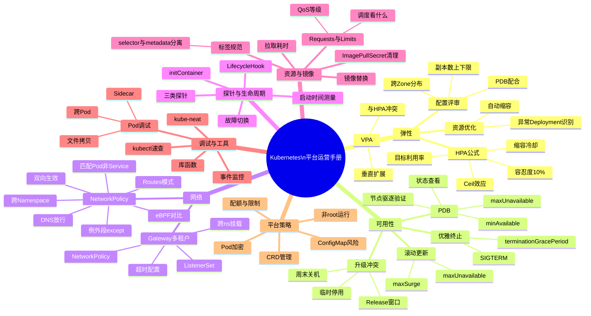

# Kubernetes 平台侧知识点分析

Analyze the `cloud/k8s/` knowledge base. Categorize the platform-side Kubernetes operations documents by technical domain, summarize the key knowledge points, and present everything as a Markdown document with a Mermaid mindmap.

本文档覆盖 `cloud/k8s/` 下的 **~230 篇文档**——这是全库**最"可操作"**的一个目录：
几乎每一篇都对应一个平台日常动作（扩缩容、升级、加策略、换镜像、排障）。

> **一句话结论**
> ★ 这个目录的主线是 **"一个共享多租户 GKE 集群的运营手册"**，
> 四块最硬的知识是：**HPA 的真实算法**（容忍度 + Ceil 效应）、
> **PDB 与升级的冲突**、**NetworkPolicy 的双向语义**、
> **探针必须先测启动时间再配**。

---

## 文档体系分析

1. **弹性** — `hpa/`（20+ 篇，公式推导与配置评审）、`k8s-scale/`、`docs/hpa*.md`、`vpa/`
2. **可用性** — `docs/pdb*.md`、`docs/dynamic-pdb.md`、`docs/rolling+affinity+pdb.md`、`docs/syncloop-status.md`
3. **网络** — `networkpolicy/`（18 篇）、`docs/networkpolicy*.md`、`k8s-gateway/`
4. **探针与生命周期** — `custom-liveness/`、`docs/liveness.md`、`docs/readiness.md`、`docs/pod-sigterm.md`、`deploy/lifecycle.md`
5. **资源与镜像** — `images/`、`labels/`、`docs/k8s-request*.md`、`docs/analyse-memory-cpu.md`
6. **调试与工具** — `debug-pod/`、`Mytools/`、`lib/`、`scripts/`、`docs/kubectl-event.md`
7. **平台策略** — `docs/configmap.md`、`docs/cm.md`、`docs/k8s-feature.md`、`docs/kube-crd.md`

---

## 知识点 MindMap



---

## 主要知识领域详解

### 1. 弹性：HPA 的真实算法（`hpa/`）
`hpa-core.md`、`summary-hpa.md`、`hpa-cpu-and-memory-corrected.md`、`hpa-3-4-memory.md` 是同一结论的多次修订版，
核心结论一致：

- **公式**：`replicas = ceil(currentReplicas × currentMetric / targetMetric)`
- **容忍度（tolerance）**：目标利用率附近有 **±10% 缓冲**，避免小幅波动触发扩缩；
  `hpa-cpu-and-memory-en.md` 特别强调「Important Note: About Tolerance」。
- **Ceil 效应**：副本数少时向上取整，扩容会比预期早发生；
- **缩容更保守**：需要额外冷却期，避免"扩了又缩、缩了又扩"。

`kong-spread-ha-review*.md`（4 个版本）把 **Deployment + HPA + PDB** 放一起做**配置评审**，
是本目录"平台 Review"这种写法的范例。

### 2. 可用性：PDB 与升级的冲突
- `docs/pdb.md`：两种写法（`minAvailable` 保证最小可用 / `maxUnavailable` 允许最大不可用），
  以及**手动驱逐节点验证 PDB 是否生效**的完整实验步骤；
- `docs/pdb-effect.md` 提出核心矛盾：**既要保高可用，又不能让 PDB 挡住集群升级**；
- `docs/temp-stop-pdb.md`：周末关机时临时降级 PDB；
- `docs/Release-pdb.md`：按发布窗口动态控制 PDB；
- `docs/rolling+affinity+pdb.md`：滚动更新 + 亲和 + PDB 三者协同。

### 3. 网络：NetworkPolicy 的三条铁律
1. **双向生效**——选中 Pod 后 ingress 和 egress 同时受约束
   （见 `debug-ns-networkpolicy.md`）；
2. **匹配的是 Pod，不是 Service**——所以 egress 不需要写 Service IP 段，
   但 **Node → Node 必须放行 8443**（见 `networkpolicy-node-pod.md`）；
3. **默认拒绝**——必须显式放行 DNS（`networkpolicy-dns.md`、`gke-ns-networkpolicy.md`）。

其他：`except` 段（动态 IP 列表）、Routes-based 模式、eBPF vs iptables、Gateway namespace 策略。

### 4. 探针与生命周期（`custom-liveness/`）
**正确顺序是：先测真实启动时间 → 再配 startupProbe → 最后配 liveness/readiness**。
`probe-best-practices.md` 把这条写成指南；`explore-startprobe/` 提供了完整的
**Pod Health Check Library**（含 PATH 冲突的 macOS 修复、CHANGELOG、故障排查）。

### 5. 资源与镜像
- `docs/k8s-request*.md`、`docs/k8s-scale/k8s-resouce-autoscale.md`：
  **默认调度只看 requests**；QoS 等级决定 Pod 有多"高贵"；
  给出了"request=4Gi、limit=8Gi、Pod 用到 6Gi 但节点没资源"的场景推演。
- `images/`：镜像替换脚本、镜像拉取耗时评估、ImagePullSecret 清理。
- `labels/labels-best-practices.md`：**不要把 selector label 放进 `metadata.labels`**。

### 6. 调试与工具
`debug-pod/`（Sidecar 调试、跨 Pod 调试、文件拷贝、fake pod 可能性）、
`Mytools/kubectl-cmd.md`（kubectl 核心与进阶技巧）、`lib/`（可 source 的库函数）、
`docs/kubectl-event.md`（跨 namespace 实时监控事件）、`docs/kube-neat.md`。

### 7. 平台策略
- `docs/configmap.md`：**开放用户自定义 ConfigMap 的风险评估**（配额与缓解）；
- `docs/cm.md`：ConfigMap Daemon；
- `docs/kube-crd.md`：用 CRD 做版本管理；
- `docs/no-root-deployment.md`、`docs/non-root.md`：非 root 运行；
- `docs/k8s-tls-Opaque.md`：K8s TLS Secret vs Opaque Secret 完全对比。

---

## 三条阅读路线

```
路线 A · 先把弹性搞对（2 小时）
  hpa/hpa-core.md → hpa/summary-hpa.md → hpa/hpa-cpu-and-memory-corrected.md
  → docs/k8s-request.md → docs/k8s-scale/k8s-resouce-autoscale.md

路线 B · 排网络问题（2 小时）
  networkpolicy/README（目录自述）→ networkpolicy/network-ns-ns.md
  → networkpolicy/networkpolicy-node-pod.md → networkpolicy/debug-ns-networkpolicy.md
  → networkpolicy/networkpolicy-dns.md

路线 C · 做一次平台变更（半天）
  docs/pdb.md → docs/pdb-effect.md → docs/temp-stop-pdb.md
  → k8s-scale/walkthrough.md → images/k8s-img-replace.md
```

---

## 结论

1. **HPA 的两个"反直觉"点必须记住**：**±10% 容忍度**与 **Ceil 效应**。
   不理解这两点，就会出现"明明没到阈值却扩容了"的困惑。
2. **NetworkPolicy 最常见的三个误解**：以为只管 ingress、以为要写 Service IP、
   以为 egress 到 Node 要放行 8443 其实不用——文档里都逐一澄清了。
3. **PDB 是升级的敌人**：它的存在意义是保护可用性，但会直接卡住节点驱逐；
   解法不是删掉它，而是**按窗口动态降级**。
4. **探针的正确姿势是"先测量再配置"**：跳过测量直接抄别人配置，
   是 liveness 误杀的主要来源。

---

## 关联文档

- [../cloud-mindmap.md](../cloud-mindmap.md) ·
  [../../gcp/gke/gke-mindmap.md](../../gcp/gke/gke-mindmap.md) ·
  [../../gcp/asm/asm-mindmap.md](../../gcp/asm/asm-mindmap.md) ·
  [../../safe/safe-mindmap.md](../../safe/safe-mindmap.md)
- [README.md](./README.md) ·
  [hpa/hpa-core.md](./hpa/hpa-core.md) ·
  [hpa/summary-hpa.md](./hpa/summary-hpa.md) ·
  [docs/pdb.md](./docs/pdb.md) ·
  [networkpolicy/network-ns-ns.md](./networkpolicy/network-ns-ns.md) ·
  [networkpolicy/networkpolicy-node-pod.md](./networkpolicy/networkpolicy-node-pod.md) ·
  [custom-liveness/explore-startprobe/probe-best-practices.md](./custom-liveness/explore-startprobe/probe-best-practices.md)
