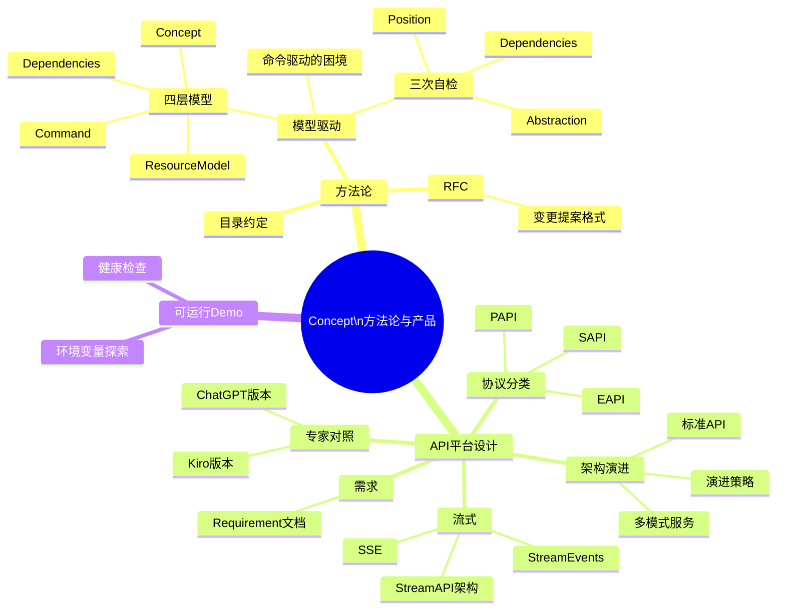

# Concept 方法论知识点分析

Analyze the `concept/` knowledge base. Categorize the methodology / API-service design documents by technical domain, summarize the key knowledge points, and present everything as a Markdown document with a Mermaid mindmap.

本文档覆盖 `concept/` 下的 **15 篇文档 / 2 个子域**：
`docs/`（方法论）与 `api-service/`（API 平台的产品与协议设计）。

> **一句话结论**
> ★ `concept/docs/model-driven-thinking.md` 是**整个知识库的方法论源头**——
> "从命令驱动到模型驱动"、四层模型、三次自检。
> `api-service/` 则把这套方法论用在**产品设计**上：
> 从标准 API 到多模式服务（EAPI / PAPI / SAPI）、流式 API、SSE。

---

## 文档体系分析

1. **方法论（`docs/`，3 篇）** — 模型驱动思考、RFC、目录自述
2. **API 平台产品设计（`api-service/docs/`，9 篇）** — 架构演进、协议分类、
   流式 API、需求文档
3. **可运行 Demo（`api-service/python-api-demo/`）** — 健康检查与环境变量

---

## 知识点 MindMap



---

## 主要知识领域详解

### 1. 方法论（`docs/`）—— 全库的源头
- `model-driven-thinking.md`：**从命令驱动到模型驱动**。
  核心论点：
  ```
  坏路径：找命令 → 改参数 → 执行 → 报错 → 重试
  好路径：理解资源模型 → 映射依赖关系 → 再执行
  ```
  **四层模型**：Concept → Resource Model → Dependencies → Command；
  **三次自检**：Position（架构位置）、Dependencies（前置依赖）、
  Abstraction（命令打的是 REST / Terraform / gcloud / Console 哪一层）。
  > 一句关键论断：**Command 不是设计工具，只是执行工具。**
- `rfc.md`：**Request for Comments**——变更提案的格式约定。
- `README.md`：目录定位说明。

> 几乎每个子目录的文档结构（TL;DR → 事实基线 → 严格定义 vs 简化解释 →
> 决策树 → 实施步骤 → 验证与回滚）都是这篇方法的落地。

### 2. API 平台产品设计（`api-service/docs/`）
- `api.md`：**API 平台演进——从标准 API 到多模式服务支持**；
- `api-kiro.md`：**API 平台架构深度解析与演进策略**；
- `api-ChatGPT.md`：同一问题的另一份分析（模型对照）；
- `EAPI-PAPI-SAPI.md`：**三类 API 的分类**——
  外部 API / 平台 API / 服务 API（或类似划分）；
- `Architecture-Stream-API.md`：**Stream API 的架构**；
- `SSE.md`：**Server-Sent Events**；
- `Stream-Events-apis.md`：**Stream Events API 学习与实践**；
- `Requirement.md`：需求文档范式。

### 3. 可运行 Demo（`api-service/python-api-demo/`）
- `python-health-demo/README.md`：**Python Health Check & Env Var Demo**；
- `explore-deployment-env.md`：**深入探索 Kubernetes Deployment 中的环境变量**。

> 把"设计"落到"能跑起来的最小示例"，是这个目录的一贯做法。

---

## 三条阅读路线

```
路线 A · 建立自己的方法论（1 小时）
  docs/model-driven-thinking.md → docs/rfc.md
  → ../knowledge-mindmap.md

路线 B · 理解 API 平台的产品设计（半天）
  api-service/docs/api.md → api-kiro.md → EAPI-PAPI-SAPI.md
  → Architecture-Stream-API.md → SSE.md

路线 C · 从设计到可跑（2 小时）
  api-service/python-api-demo/explore-deployment-env.md
  → python-health-demo/README.md
  → ../develop/java/spring/controller.md
```

---

## 结论

1. **`model-driven-thinking.md` 值得第一个读**：它解释了为什么这个知识库的文档
   都长成同一个样子——先建模，后命令。
2. **"三次自检"可以直接用作评审清单**：任何一条命令执行前问三句，
   能挡掉大部分"资源建错位置""依赖没建""用错了 API 层"的错误。
3. **API 平台文档体现了"多模型对照"的写作习惯**：
   ChatGPT / Kiro / Gemini 各出一版——这不是冗余，
   而是用**交叉验证**来暴露盲区（同一份模型答案往往在细节上互相矛盾）。

---

## 关联文档

- [../knowledge-mindmap.md](../knowledge-mindmap.md) ·
  [../gcp/gcp-mindmap.md](../gcp/gcp-mindmap.md) ·
  [../develop/develop-mindmap.md](../develop/develop-mindmap.md) ·
  [../skills/skills-mindmap.md](../skills/skills-mindmap.md)
- [README.md](./README.md) ·
  [docs/model-driven-thinking.md](./docs/model-driven-thinking.md) ·
  [docs/rfc.md](./docs/rfc.md) ·
  [api-service/docs/api.md](./api-service/docs/api.md) ·
  [api-service/docs/EAPI-PAPI-SAPI.md](./api-service/docs/EAPI-PAPI-SAPI.md) ·
  [api-service/README.md](./api-service/README.md)
