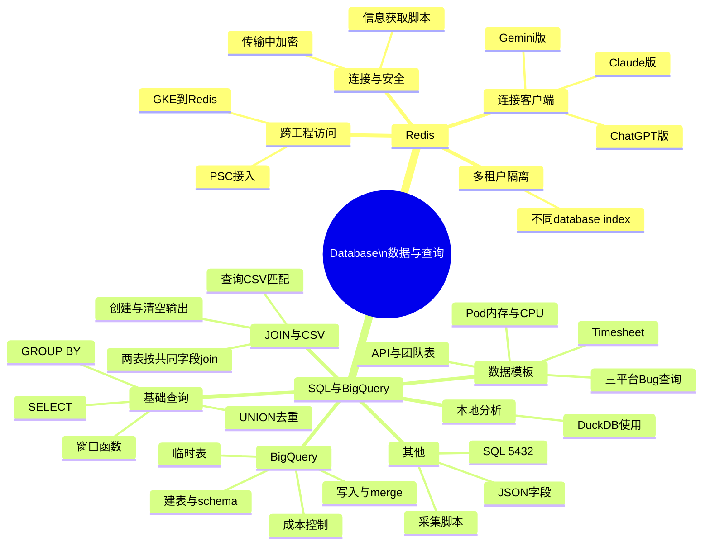

# Database 知识点分析

Analyze the `database/` knowledge base. Categorize the Redis / SQL / BigQuery documents by technical domain, summarize the key knowledge points, and present everything as a Markdown document with a Mermaid mindmap.

本文档覆盖 `database/` 下的 **49 篇文档 / 2 个子域**：Redis（8 篇）与 SQL（30+ 篇）。

> **一句话结论**
> ★ 这个目录回答两个具体的运维问题：
> ① **多租户怎么共用一个 Redis**（用不同的 database index 做隔离）；
> ② **怎么用 SQL 干分析活**（BigQuery 查询技巧、JOIN、GROUP BY、CSV 匹配、成本）。

---

## 文档体系分析

1. **`redis/`（8 篇）** — 多用户访问控制、GKE 跨工程访问、传输中加密、信息获取脚本
2. **`sql/`（30+ 篇）** — 基础查询（SELECT/GROUP BY/UNION）、JOIN 与 CSV 匹配、
   BigQuery 专项（建表、写入、成本）、DuckDB、三平台 Bug 查询模板

---

## 知识点 MindMap



---

## 主要知识领域详解

### 1. Redis（`redis/`）
- `redis.md`：**Redis 多用户访问控制——使用不同的数据库索引**。
  这是多租户共享一个 Redis 实例最简单有效的隔离手段。
- `redis-connect-claude.md` / `-chatgpt.md` / `-gemini.md`：
  **GKE 跨工程访问 Redis 的实现方案**（三个模型版本互为对照）；
- `get-gcp-redis.md`：GCP Redis 信息获取脚本；
- `In-transit-encryption.md`：传输中加密；
- `redis-con.md`：连接相关。

### 2. SQL 与 BigQuery（`sql/`）
#### 2.1 基础查询
`select.md`、`group.md`（GROUP BY 详解）、`union-query.md`（合并三个表并去重）、
`general-view.md`、`json.md`（JSON 字段）、`id-sql.md`。

#### 2.2 JOIN 与 CSV
- `join.md`：**两个表按共同字段（如 `api_name`）关联**的思路；
- `join-csv.md`：创建/清空输出文件；
- `query-csv-match.md`：查询与 CSV 匹配。

#### 2.3 BigQuery
`bigquery-tables.md`、`Bigquery-create-table.md`（用 schema 建表）、
`biqquery-sql-cost.md`、`cost.md`（查询成本）、`bug-query-example.md`、`id-sql-table.md`。

#### 2.4 可复用的"数据模板"
这一组很实用——**同一套 SQL 骨架在不同平台复用**：
- `bug-query-example.md` / `id-sql.md`：**三平台 Bug 查询结果示例**，
  并演示"把结果保存到一张表里"；
- `team-cpu-and-memory.md` / `-api.md`：团队维度的 CPU / 内存；
- `pod-memory-cpu.md`：Pod 维度；
- `timesheet.md`：工时；
- `api-table.md`、`apihistoryonboarding.md`：API 台账。

#### 2.5 其他
`duckdb.md` / `duckdb-usage.md`：**DuckDB 使用指南**（本地分析大 CSV）、
`sql-5432.md`、`collect.md` / `collect-py.md`（从 GKE 采集 Pod 数据送 Bucket）、
`push-sink.md`。

---

## 三条阅读路线

```
路线 A · 立刻能用上的（30 分钟）
  sql/select.md → sql/group.md → sql/union-query.md
  → sql/join.md → sql/query-csv-match.md

路线 B · 多租户 Redis 隔离（1 小时）
  redis/redis.md → redis/redis-connect-claude.md
  → ../gcp/psa-psc/psc-Redis.md

路线 C · 搭一张分析表（半天）
  sql/Bigquery-create-table.md → sql/bug-query-example.md
  → sql/team-cpu-and-memory.md → sql/duckdb-usage.md
```

---

## 结论

1. **Redis 多租户用 database index 隔离**，是最省事的方案——
   但它不是安全边界，跨 index 的误访问仍可能发生。
2. **`sql/` 里最有价值的是"模板"而非语法**：三平台 Bug 查询、团队 CPU/内存、
   Pod 资源统计——这些骨架换个表名就能用在任何新数据源上。
3. **DuckDB 是被低估的**：本地几 GB 的 CSV，用 DuckDB 比拉进 BigQuery 快也便宜。
4. **BigQuery 的成本要提前设计**：`cost.md` 与 `biqquery-sql-cost.md`
   讲的是分区、扫描量与配额——这些在写第一行 SQL 前就该定。

---

## 关联文档

- [../knowledge-mindmap.md](../knowledge-mindmap.md) ·
  [../gcp/gcp-mindmap.md](../gcp/gcp-mindmap.md) ·
  [../develop/develop-mindmap.md](../develop/develop-mindmap.md)
- [README.md](./README.md) ·
  [redis/README.md](./redis/README.md) ·
  [redis/redis.md](./redis/docs/redis.md) ·
  [sql/README.md](./sql/README.md) ·
  [sql/duckdb-usage.md](./sql/docs/duckdb-usage.md) ·
  [sql/bug-query-example.md](./sql/docs/bug-query-example.md)
