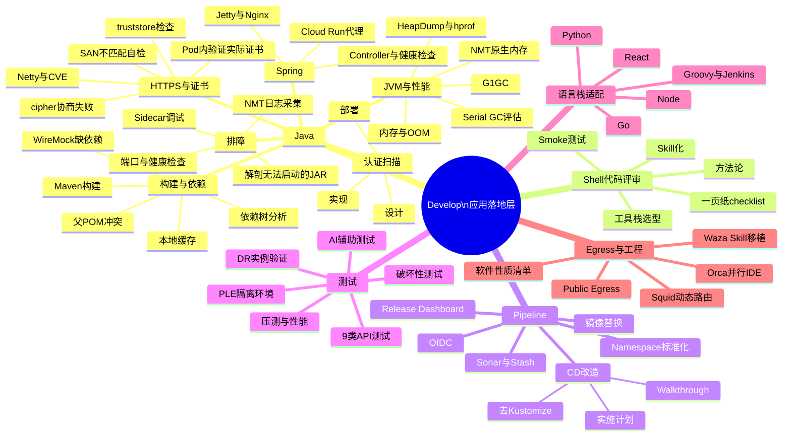

# Develop 应用开发知识点分析

Analyze the `develop/` knowledge base. Categorize the application-development documents by technical domain, summarize the key knowledge points, and present everything as a Markdown document with a Mermaid mindmap.

本文档覆盖 `develop/` 下的 **232 篇文档 / 13 个子目录**——这是全库的**应用侧落地层**：
Java / Go / Node / Python / React 各语言栈如何在多租户平台上跑起来，
以及 CI/CD、测试、Shell 代码评审。

> **一句话结论**
> ★ 这个目录有两个"意外高价值"的子域：
> ① `java/java-auth/`（**在 Pod 里验证 Java 应用实际用的哪张证书**，含 CVE-2026-50010 诊断）
> ② `shell-review/`（**Shell 脚本评审方法论 + 一页纸 checklist + 可复用 Skill**）。
> 其余是各语言栈的平台适配手册。

---

## 文档体系分析

1. **Java（最大子域，~100 篇）** — 构建、Maven 依赖、JVM 调优、HTTPS 证书验证、认证扫描、Spring
2. **Shell 代码评审（`shell-review/`）** — 方法论、checklist、工具栈、smoke test、Skill 化
3. **CI/CD Pipeline（`pipeline/`）** — CD 改造、镜像替换、Namespace 标准化、OIDC、Release Dashboard
4. **测试（`develop-process/test/`）** — 9 类 API 测试、压测、PLE、DR 实例
5. **其他语言栈** — `go/`（ConfigMap 适配）、`node/`、`python/`、`React/`、`groovy/`、`npm/`、`vscode/`
6. **Egress 与工程效率** — `develop-process/ob/`（Public Egress + Squid 动态路由）、`dev-tools/orca.md`、`waza/`
7. **方法论** — `software-properties.md`（**开发者应主动考虑的那几十个"性质"**）

---

## 知识点 MindMap



---

## 主要知识领域详解

### 1. Java（`develop/java/`，本目录主体）

#### 1.1 构建与依赖（`java-pom/`）
- `how-to-build-jar.md` / `how-to-build-jar-cn.md`：从零构建 JAR 的完整指南；
- `parent-pom-debug*.md`（中/英）：**父 POM 依赖版本冲突**调试；
- `pom-depend.md` / `pom-depend-cn.md`：**依赖分析与多版本冲突解决方案**；
- `debug-mav-cache.md`、`java-mvn-cache.md`：本地缓存导致的诡异问题；
- `dependency-issue-checklist.md`、`troubleshooting-flowchart.md`：**依赖问题排查流程图**；
- `wiremock-dependency-troubleshooting.md`：`com.github.tomakehurst.wiremock.client does not exist`。

#### 1.2 JVM 与性能（`java-core/`、`java-appd/`）
- `Java-memory.md`、`Java-lang-OutOfMemoryError.md`、`java-post-memory.md`：内存与 OOM；
- `java-G1GC.md`、`java-serial.md`：**Java 17 + GKE 中 CPU=1000m 会不会用 Serial GC**，以及如何评估；
- `jcmd-appd.md`：用 **NMT（Native Memory Tracking）精准拆分 App vs AppD** 的内存；
- `java-heapdump.md`、`headpdump-hprof.md`：HeapDump 与 hprof 分析；
- `gke-nmt-logging.md`：NMT 日志采集方案。

#### 1.3 HTTPS 与证书（`java-auth/`，本目录最硬的一块）
- `gke-pod-cert-verify/`（5 篇 reference）：**在 GKE Pod 里验证 Java 应用实际启用的 HTTPS 证书**——
  ① 3 种访问权限场景的实战策略 ② `keytool` + `openssl` 命令速查
  ③ **Spring Boot SSL 是怎么挑证书的** ④ **用域名访问报错但绑 IP 能通 → SAN 不匹配自检**
  ⑤ **调第三方 HTTPS 报 `handshake_failure` → cipher 协商失败**；
- `cve-2026-50010-netty-hostname-verification-bypass.md`：Netty TLS 客户端 Hostname 验证绕过；
- `gke-pod-cert-vs-cve-2026-50010-diagnosis.md`：把现象与 CVE 区分开；
- `pod-curl.md`：出站调用第三方 HTTPS 报 `handshake_failure` 的深度分析与修法；
- `p12-decrypt.md`、`java-application-auth.md`：P12 解密与应用认证。

#### 1.4 排障与认证扫描
- `debug/debug-jar.md`：**在 GKE 中"解剖"无法启动的 JAR 包**；
- `debug/debug-java-pod.md`、`debug-java-pod-process.md`：Sidecar 调试（网络-multitool）；
- `java-scan/`：**认证合规扫描器**的完整设计 → 实现 → 部署（这是一个完整的小项目）。

### 2. Shell 代码评审（`shell-review/`）
一个**可直接复用的方法论包**：
- `methodology.md`：评审方法论；
- `checklist.md`：**一页纸 Shell PR Review 清单**；
- `tool-stack.md`：工具栈与选型矩阵；
- `smoke-testing.md`：Shell 脚本的 Smoke Testing；
- `skill/SKILL.md` + `skill/references/`：**把它封装成 Hermes Skill**；
- `audit-public-mtls-global-ingress-scripts.md`、`audit-verify-pub-priv-ip-glm-ipv6.md`：两份真实审计报告。

### 3. CI/CD Pipeline（`pipeline/`）
- `cd-pipeline/implementation_plan.md`：**重构 CD Pipeline（去掉 Kustomize）**；
- `cd-pipeline/image-replace.md`：镜像替换脚本优化；
- `cd-pipeline/Namespace_Ingress_Policy.md`：**Namespace 与 Ingress 标准化策略**；
- `cd-pipeline/PMU_Checklist.md`：PMU（Platform Management Unit）校验清单；
- `docs/`：OIDC、Sonar、Stash、master 分支、PR 创建自动触发 CI、pipeline 分层与流程。

### 4. 测试（`develop-process/test/`）
- `docs/api-testing-types.md`：**9 类 API 测试**；
- `docs/compare-stress-performance-testing.md`：**压力测试 vs 性能测试**；
- `docs/destructive-testing-infra.md`：基础设施破坏性测试；
- `docs/ple.md`：**PLE（Production-Like Environment）隔离架构评估**；
- `dr-instance/`：**GCE 灾备验证**（删除某 zone 的所有实例演练）；
- `docs/hey.md`、`docs/stress.md`：GKE 环境下的 HTTP 压测工具；
- `docs/Why.md`：**服务迁移中 CNAME 切换后证书报错**的问题分析；
- `docs/explorer-ai-test.md`：AI 辅助测试探索。

### 5. 其他语言栈
`go/`、`node/`：**平台 ConfigMap 适配**（独立 ConfigMap vs 共享 ConfigMap 的方案对比），
并给出与 Java 的对照（`JAVA-GOLANG-COMPARISON.md`）；
`python/`：FastAPI/Gunicorn/uvicorn worker、CronJob、BigQuery 导入、pytest；
`React/`：Docker 化 React 应用。

### 6. Egress 与工程效率
- `develop-process/ob/`：**Public Egress Onboarding 架构演进** + **Squid 多上游按目的域名路由**方案；
- `dev-tools/orca.md`：**Orca — Worktree-Native IDE for Parallel AI Coding Agents**；
- `waza/install-plan.md`：Waza Skills 的 Hermes 移植；
- `software-properties.md`：**软件系统的关键性质——开发者应该主动考虑的那几十个"性质"**，
  这是本目录里最"元"的一篇。

---

## 三条阅读路线

```
路线 A · Java 应用在 GKE 上跑不起来（2 小时）
  debug/debug-jar.md → debug/debug-java-pod.md
  → java-auth/gke-pod-cert-verify/README.md
  → java-auth/pod-curl.md

路线 B · 要写/审 Shell 脚本（1 小时）
  shell-review/checklist.md → shell-review/methodology.md
  → shell-review/tool-stack.md → linux/shell-script/docs/default-value.md

路线 C · 改造 CD Pipeline（2 天）
  pipeline/cd-pipeline/Reademe.md → implementation_plan.md
  → Namespace_Ingress_Policy.md → walkthrough.md
```

---

## 结论

1. **`java-auth/` 是整个知识库里"最实战"的一块**：它解决的是
   "**我的 Java 应用到底用了哪张证书、跟谁协商的什么 cipher**"——
   这个问题在云上每天都会遇到，而答案往往不在应用日志里。
2. **`shell-review/` 是唯一被"产品化"的方法论**：checklist + 工具栈 + smoke test + Skill，
   意味着它不只是一篇文档，而是一条可执行的流程。
3. **各语言栈的"平台适配"本质是同一件事**：应用要能消费平台注入的
   ConfigMap / 证书 / 环境变量，`go/` 与 `node/` 给出了**独立 ConfigMap vs 共享**的方案对比，
   同一个决策在两个语言里各写一遍。
4. **测试目录里最有价值的两篇**：**PLE 隔离架构**与 **DR 实例演练**——
   它们讲的是"怎么在不影响生产的前提下验证"。

---

## 关联文档

- [../knowledge-mindmap.md](../knowledge-mindmap.md) ·
  [../safe/safe-mindmap.md](../safe/safe-mindmap.md) ·
  [../cloud/k8s/k8s-mindmap.md](../cloud/k8s/k8s-mindmap.md) ·
  [../gcp/gke/gke-mindmap.md](../gcp/gke/gke-mindmap.md)
- [README.md](./README.md) ·
  [shell-review/README.md](./shell-review/README.md) ·
  [shell-review/checklist.md](./shell-review/checklist.md) ·
  [java/java-auth/gke-pod-cert-verify/README.md](./java/java-auth/gke-pod-cert-verify/README.md) ·
  [java/java-pom/troubleshooting-flowchart.md](./java/java-pom/troubleshooting-flowchart.md) ·
  [pipeline/cd-pipeline/Reademe.md](./pipeline/cd-pipeline/Reademe.md) ·
  [develop-process/test/docs/api-testing-types.md](./develop-process/test/docs/api-testing-types.md)
