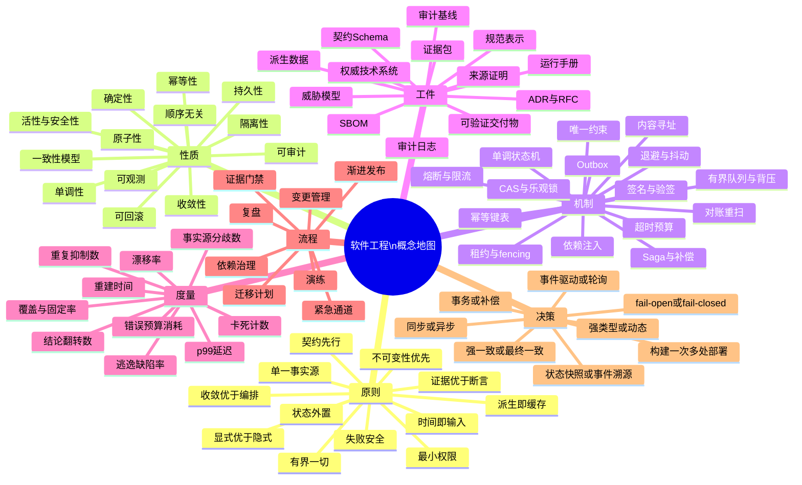
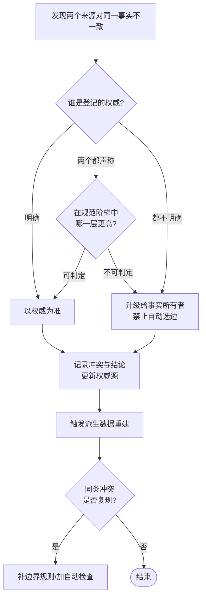
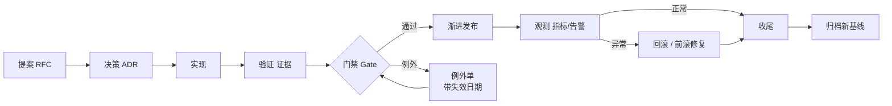
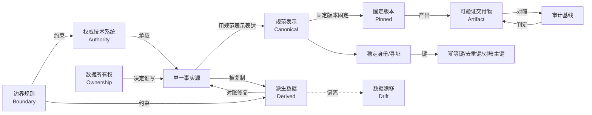

# 软件工程概念地图 · 开发者的高层心智模型

> **副标题**：性质是叶子，概念是枝干。
> [software-properties.md](./software-properties.md) 回答"一个系统应该具备哪些性质"；
> 本文回答更上一层的三个问题：
> **事实以谁为准（单一事实源）→ 用什么当基准（审计基线）→ 凭什么说它合格（可验证交付物）**，
> 并把开发者日常最该内化的核心概念（权威技术系统、数据所有权、规范表示、派生数据、
> 数据漂移、固定版本、内存寻址、边界规则、分布式正确性）编成一张**可查、可背、可用于评审**的地图。

**一句话结论**

> **高质量的工程 = 事实有唯一归属、基线可判定、交付物可验证、边界有规则、失败可收敛。**
> 这五件事都不是"功能"，而是"性质"——它们**静默退化**，所以必须被显式声明并留下证据。

---

## 目录

| 章节 | 内容 |
|---|---|
| [§0](#0-如何使用这份地图) | 如何使用这份地图（三种读法 + 卡片格式 + 与 properties 文档的关系） |
| [§1](#1-概念分类学) | **概念分类学**：7 个类别 × 6 个视角 + 全局思维导图 + 成熟度阶梯 |
| [§2](#2-主线单一事实源--审计基线--可验证交付物) | **主线**：单一事实源 → 审计基线 → 可验证交付物（含冲突仲裁规则、基线判定标准、变更与交付流程） |
| [§3](#3-开发者必备概念地图) | **开发者必备概念地图**：8 张核心卡片（权威技术系统 / 数据所有权 / 规范表示 / 派生数据 / 数据漂移 / 固定版本 / 内存寻址 / 边界规则） |
| [§4](#4-深入a软件工程基础) | **深入 A**：软件工程基础（身份与寻址、类型与不变量、时间、变更、抽象） |
| [§5](#5-深入b设计与正确性) | **深入 B**：设计与正确性（不变量、状态机、边界设计、失败姿态、纯函数） |
| [§6](#6-深入c正确性与分布式行为) | **深入 C（重点）**：正确性与分布式行为（幂等 / 原子 / 隔离 / 一致性模型 / 收敛 / 对账 / 去重 / 补偿） |
| [§7](#7-深入d交付与来源证明) | **深入 D**：交付与来源证明（可复现构建、内容寻址、Provenance、SBOM、证明、门禁） |
| [§8](#8-深入e可靠性工程) | **深入 E**：可靠性工程（SLO、故障模式分析、混沌、恢复演练、爆炸半径） |
| [§9](#9-取舍矩阵) | 取舍矩阵：哪些性质天生互斥，怎么写取舍声明 |
| [§10](#10-概念索引总表) | **概念索引总表**（全量速查） |
| [§11](#11-总自查清单) | 总自查清单（28 问） |
| [§12](#12-与本库其他文档的映射) | 与本库其他文档的映射 |

---

## 0. 如何使用这份地图

### 0.1 三种读法

| 读法 | 场景 | 入口 |
|---|---|---|
| **查卡片** | 正在设计/评审一个具体模块 | 按 [§1.1 类别](#11-七个类别) 或 [§1.2 视角](#12-六个视角) 定位 |
| **走主线** | 从零建立一套规范/治理体系 | 按 [§2](#2-主线单一事实源--审计基线--可验证交付物) 顺序读 |
| **当评审表** | Code Review / 设计评审 / 上线前检查 | 直接用 [§11 总自查清单](#11-总自查清单) |

### 0.2 卡片格式

本文的核心概念用统一格式呈现，四件套：

```
类别归属    → 这个概念属于哪个类别、哪个视角
一句话理解  → 不看解释也能用的一句话
开发落点    → 在代码 / 配置 / 流程上具体怎么做
自查问题    → 在评审时能直接念出来的 2~4 个问题
```

**重点概念**用**展开卡**（表格 + 展开说明）；**次要概念**用**速查表**（一行一概念）。
重点与否与篇幅无关，只与"是否值得单独展开"有关。

### 0.3 与 software-properties.md 的关系

| | software-properties.md | 本文 |
|---|---|---|
| 视角 | **叶子**：一个系统应该具备哪些性质 | **枝干**：这些性质挂在哪些概念上 |
| 典型问题 | "这个操作幂等吗？" | "谁是这个事实的权威？拿什么当审计基线？" |
| 重点 | 幂等/原子/一致/并发/失败/交付 | SSOT/基线/交付物/所有权/边界/寻址 |
| 关系 | 本文是它的**上位索引**，性质类概念的完整展开仍在 properties 文档 | — |

> 读法建议：**先读本文的 §2 与 §3 建立骨架，再去 properties 文档读具体性质的完整推演**。

---

## 1. 概念分类学

没有分类学的概念清单只是一堆词。分类学的作用是：**让任何一个新概念都能被安放**，从而回答
"这个点我漏了吗？属于哪一类？该由谁负责？"

### 1.1 七个类别

| 类别 | 英文 | 它回答的问题 | 典型形态 | 判定方式 |
|---|---|---|---|---|
| **原则** | Principle | 应该追求什么 | 一句话判据，可被违反 | 这句话能指导决策吗？ |
| **性质** | Property | 系统在什么条件下成立 | 可证伪的陈述 | 能写出反例与证据吗？ |
| **机制** | Mechanism | 怎么实现 | 代码 / 配置 / 中间件 | 有明确的失效模式吗？ |
| **工件** | Artifact | 拿什么当证据与交付 | 有版本的文件 / 包 | 不可变、可寻址、可复现吗？ |
| **度量** | Metric | 怎么知道做得好不好 | 指标 / 计数器 / 告警 | 它能触发行动吗？ |
| **流程** | Practice | 谁在什么时候做什么 | 步骤 / 角色 / 门禁 | 有明确输入输出吗？ |
| **决策** | Decision | 冲突时选哪个 | 取舍声明 | 写明代价与适用边界了吗？ |

**类别的常见误用**（评审时最值得挑的毛病）：

```
❌ 把"性质"写成"功能"      → "系统支持幂等" 是性质；"提供幂等接口" 是功能
❌ 把"原则"当口号          → 原则必须能推出至少一条具体决策
❌ 把"度量"当 KPI           → 度量是为了**发现退化并行动**，不是为了好看
❌ 把"机制"当目的          → 熔断不是目的，"下游挂掉时不拖垮自己"才是
❌ 把"决策"当结论          → 决策必须带"什么时候不适用"
```

### 1.2 六个视角

同一个概念常常同时属于多个类别；视角则用来**检查覆盖面**——六个视角都过一遍，概念地图才不漏。

| 视角 | 核心问题 | 代表概念 |
|---|---|---|
| **身份与寻址** | "这是不是同一件事？" | 身份、寻址、内容寻址、幂等键、去重键、对账主键 |
| **状态与变更** | "现在是什么状态？怎么变的？" | 状态机、单调性、版本、迁移、收敛、漂移 |
| **边界与契约** | "谁和谁之间传什么？谁负责？" | 边界规则、契约、数据所有权、隔离、租户边界 |
| **时间与并发** | "什么时候发生？谁先发生？" | 超时、重试、时钟、因果、租约、fencing token |
| **证据与责任** | "凭什么说它对？谁负责？" | 审计基线、可验证交付物、审计日志、度量、例外记录 |
| **分布与故障** | "部分失败时怎么活下来？" | 幂等、原子、隔离、一致性模型、对账、补偿、降级 |

### 1.3 全局思维导图



### 1.4 概念的成熟度阶梯

同一个团队对同一个概念，认知深度通常差 4~6 级。**评审时不要问"你知不知道幂等"，要问"你到第几级"。**

| 级别 | 状态 | 典型表现 | 推进动作 |
|---|---|---|---|
| **L0 不知道** | 概念不存在 | "重试一下应该就好了" | 命名：在设计文档里写出这个词 |
| **L1 知道** | 听过名词 | "这个要幂等" | 落点：指出**具体在哪一行/哪个表**保证 |
| **L2 声明** | 写进了文档 | 设计文档里有一行"本操作幂等" | 证据：写明**用什么证明**（测试/指标/演练） |
| **L3 有证据** | 有可复现的证据 | 有一条重放测试 | 度量：上线后有**探针指标**盯着它 |
| **L4 可度量** | 能观测退化 | 有 duplicate_suppressed 之类的指标 | 审计：定期检查**证据仍然有效**（不是一次性的） |
| **L5 可审计** | 外部可复核 | 审计基线 + 可验证交付物能重放出结论 | — |

> **绝大多数团队卡在 L1~L2**："知道要幂等，但既没有证明它的测试，也没有盯它的指标"。
> 从 L2 到 L3 的一步（加一条重放测试），是投入产出比最高的提升动作。

---

## 2. 主线：单一事实源 → 审计基线 → 可验证交付物

### 2.1 为什么这条主线是骨架

其余所有概念（幂等、对账、补偿、签名、门禁）都是这条主线上的**具体零件**。
把主线抽出来，剩下的概念就有了归属：

```
① 事实以谁为准？        → 单一事实源 / 权威技术系统 / 数据所有权
② 事实怎么被固定下来？  → 规范表示 / 固定版本 / 审计基线
③ 事实怎么被复制出去？  → 派生数据（副本）/ 数据漂移（副本跑偏）
④ 怎么判定"符合要求"？ → 判定规则集 / 可判定性 / fail-closed
⑤ 凭什么让别人信？      → 可验证交付物 / 来源证明 / 证据包
⑥ 事实变了怎么办？      → 变更管理 / 门禁 / 渐进发布 / 归档新基线
```

**三段式的心智模型**：

| 段 | 关注 | 失败的样子 | 关键概念 |
|---|---|---|---|
| **事实层** | 唯一权威在哪 | 两个系统各说各话，谁也说服不了谁 | SSOT、数据所有权、权威技术系统、规范表示 |
| **基准层** | 用哪个冻结版本做比较 | 拿"最新"当基准 → 结论永远在漂 | 审计基线、固定版本、内容寻址、判定规则集 |
| **证据层** | 凭什么说它合格 | 只有作者口头保证 | 可验证交付物、来源证明、SBOM、可复现验证 |

> 三段都要**显式建模**：事实层回答"谁说了算"，基准层回答"跟什么比"，证据层回答"凭什么信"。

---

### 2.2 C-01 · 单一事实源（Single Source of Truth, SSOT）

| 项 | 内容 |
|---|---|
| **类别归属** | **原则** · 视角「证据与责任」「身份与寻址」 |
| **一句话理解** | 同一个事实只允许有一个权威来源（唯一可写点），其余系统都只是它的读者或派生副本。 |
| **开发落点** | ① 维护一份**事实清单**：把项目里每个关键事实（依赖版本、镜像 tag、配置项、接口契约、数据口径、权限模型、策略）列出，并标注它**唯一的权威位置**。<br>② **写操作只发生在权威系统**；其他系统通过读取 / 订阅 / 派生来使用，不允许第二写点。<br>③ 权威系统必须支持**版本化读取**（commit SHA / ETag / resourceVersion / digest），否则消费方无法判断"我读到的是不是最新"。<br>④ 派生副本必须**可删除可重建**；不能把副本当权威（"以配置文件为准"往往就是这条没做）。 |
| **自查问题** | ① 这个配置项的权威来源是哪里？两个系统值不一样时以谁为准，**为什么**？<br>② 谁有写权限？如果两处都能写，冲突由谁裁决（人还是机器）？<br>③ 派生数据删掉能重建吗？重建一次要多久、要花多少钱？<br>④ 消费方**怎么知道**自己读到的是最新版？ |

**"伪 SSOT"的三种典型形态**（评审时优先拆穿）：

```
❌ 并列双权威：文档与代码各写一份规则，冲突时"看情况"
❌ 伪权威：权威系统写着 X，但实际生效的是 Y（配置被环境覆盖）
❌ 权威不明：没人说得出"谁能改它"，于是谁都能改
```

**判定 SSOT 成立的三问**：
`事实是什么` → `唯一权威在哪` → `其余副本如何被派生、如何被发现过期`。
第三问答不上来，说明只是"名义上的单一事实源"。

---

### 2.3 单一事实源冲突时的仲裁规则

冲突不是异常，是**常态**（多团队、多环境、多代系统并存）。仲裁规则必须**先于冲突存在**。

| # | 规则 | 说明 | 反例 |
|---|---|---|---|
| **R1** | **所有权优先于时间** | 仲裁看"谁是权威"，不看"谁写得晚"。新 ≠ 对 | ❌ "配置中心刚被更新过，用配置中心的" |
| **R2** | **一事一源** | 同一事实只能有一个写入权威；第二个写入点要么消除，要么降级为派生 | ❌ 代码默认值 + 配置中心都可写 |
| **R3** | **规范阶梯** | 法律/合规 > 安全策略 > 架构决策(ADR) > 契约(Schema) > 配置 > 代码默认值 > 运行时推断 | ❌ 运行时探测结果覆盖了合规策略 |
| **R4** | **显式声明优先** | 两份都自称权威时，优先"被**登记**为权威"的那份；登记本身必须是工件（登记表 / ADR） | ❌ 谁嗓门大谁赢 |
| **R5** | **不可判定则升级** | 无法自动判定时**升级给事实所有者**，不自动选边、不取"最新" | ❌ 自动取 last-write-wins |
| **R6** | **解决要留痕并回灌** | 冲突解决必须产出一份记录，更新权威源，触发派生数据重建，并复查是否引入新的漂移 | ❌ 口头结论 + 私改副本 |
| **R7** | **复盘而非静默** | 同一类冲突第二次出现 → 补一条边界规则或加一条自动检查 | ❌ 每次都靠人拍板 |

**常见冲突场景与仲裁结论**：

| 冲突场景 | 仲裁结论 | 依据 |
|---|---|---|
| 两份 CI 配置说同一个镜像 tag | 以**发布清单 / 制品库登记**为准；CI 配置是派生 | R1 + R3 |
| 代码默认值 vs 配置中心 | 配置中心为准（除非明确声明代码为权威） | R3 |
| 文档写 A，代码是 B | 代码是**运行事实**，文档是派生 → 必须修文档，或让文档**由代码生成** | R3 + R2 |
| 两个团队各有一份"标准 API" | 由**契约登记表**指定的一份为规范表示，另一份对齐或废弃 | R4 |
| 线上行为与设计文档不符 | 线上是当前事实，文档是提案 → 触发变更管理补齐或回滚实现 | R5 |
| 安全扫描结果 vs 依赖锁定文件 | 以**扫描器规则集版本**为判定依据，锁定文件是对象 | R3 |

**仲裁决策流**：



> **仲裁结论必须是工件**：一次冲突解决产出一份"事实裁定记录"（包含：事实、候选值、适用规则、结论、生效范围、失效条件、责任人）。
> 否则半年后没人知道当初为什么这么定。

---

### 2.4 C-02 · 审计基线（Audit Baseline）

| 项 | 内容 |
|---|---|
| **类别归属** | **工件** · 视角「证据与责任」「状态与变更」 |
| **一句话理解** | 审计基线 = 某一时刻被**冻结**的权威事实快照 + 判定规则集 + 适用范围，用来作为符合性的**唯一比较基准**。 |
| **开发落点** | ① 基线必须**内容寻址**（commit SHA / 制品 digest / 策略包 hash），**禁止**浮动引用（latest / main / v1）。<br>② 基线必须**可获取**：N 年后仍能取回**同一字节**的内容（需要归档与保留策略）。<br>③ 基线的"符合"必须**可判定**：给定基线与对象，判定结果是确定的函数，不是"看情况"。<br>④ 判定输入必须是**同一时刻的快照**，不能拿"当前状态"去比历史基线。<br>⑤ 基线变更 = 规范变更，必须走**更严的变更流程**，并保留旧基线以便追溯。 |
| **自查问题** | ① 基线用什么标识？能被唯一确定吗？半年后还能取到同一个吗？<br>② 判定用的是**哪一版规则**？规则和基线是同一版吗？<br>③ "无法判定"时怎么办？我是不是偷偷把它算作通过了？<br>④ 基线升级时，旧基线下的历史结论还作数吗？ |

**基线的三件套**（缺一件就不是基线）：

| 组成 | 内容 | 常见错误 |
|---|---|---|
| **冻结的快照** | 权威事实的不可变内容 + 摘要 | 只记了名字不记摘要（v1.2.3 会被重打） |
| **判定规则集** | 判定所依据的规则与规则版本 | 规则是"人"，无法复现 |
| **适用范围与有效期** | 适用对象、例外、起止时间 | 基线永不过期 → 陈年规则套新系统 |

**基线 vs 快照 vs 文档**：基线是**判定用的**，不是给人读的说明；文档是给人读的，可以滞后。
把基线当文档 → 判定不可复现；把文档当基线 → 判定不可执行。

---

### 2.5 审计基线的版本判定标准

**如何判断"符合要求"**：基线 B 与被审对象 O 之间的判定，应是一个**确定性函数**
`judge(B, O) → {符合, 不符合, 无法判定}`。

| # | 判定条件 | 怎么验 | 不满足的后果 |
|---|---|---|---|
| **1 唯一性** | 能用**一个不可变标识**唯一确定基线 | 取摘要，看是否唯一 | 基线被覆盖，结论不可追溯 |
| **2 可获取性** | 保留期内能取回**同一字节**内容 | 定期做 restore drill | 审计时基线消失，无法复核 |
| **3 完备性** | 包含判定所需的**全部输入** | 拿基线离线跑一遍判定 | 判定依赖外部环境，结果不可复现 |
| **4 可判定性** | 同样输入必得同样结论 | 重复判定两次比对 | 判定"看人"，不可审计 |
| **5 闭包性** | 判定**不依赖未冻结的外部状态**（当前时间、浮动依赖、网络、随机数） | 断网/改时钟重跑 | 结论随时会变，不可复现 |
| **6 版本化** | 快照与规则集**一起版本化**，能说清"哪版规则判哪版基线" | 看元数据 | 无法解释结论依据 |
| **7 范围性** | 明确适用对象与例外 | 看适用范围字段 | 越界适用，误判 |
| **8 有效期** | 明确何时失效、新版何时生效 | 看生效/失效时间 | 拿旧标准判新系统 |
| **9 可复核性** | 第三方用同样输入能得到同样结论 | 让第二个人独立判定 | 审计只能信作者 |
| **10 留痕性** | 判定过程与结论可追溯（谁、何时、依据什么） | 看审计日志 | 无法追责 |

**判定状态机（fail-closed）**：

```
符合          → 通过，记录证据
不符合        → 阻断，记录差异清单
无法判定      → 按"不符合"处理（fail-closed），并生成例外申请
                 ※ 绝不能默认算通过
```

**基线升级策略**：

| 问题 | 建议做法 |
|---|---|
| 新旧基线并存期 | 明确并存窗口与"以哪版为准"的切换点 |
| 追溯性 | 新基线生效后，是否**回溯重判**历史对象？回溯会改变历史结论 → 需决策声明 |
| 废弃 | 旧基线**只读归档**，保留期与合规要求对齐 |
| 差异公告 | 基线升级要发布差异清单（新增/修改/删除的规则），供被审方自查 |
| 例外 | 例外必须**有范围、有理由、有失效日期、有责任人**，不能是永久白名单 |

---

### 2.6 C-03 · 可验证交付物（Verifiable Deliverable）

| 项 | 内容 |
|---|---|
| **类别归属** | **工件** · 视角「证据与责任」「分布与故障」 |
| **一句话理解** | 一个交付物如果能被**第三方独立复核**"它符合某个基线"，那它才是可验证交付物 = **内容 + 证据 + 溯源链**。 |
| **开发落点** | ① 交付物必须带**内容摘要（digest）**；部署与校验一律用 digest，不用 tag。<br>② 随交付物附带**证据包**：SBOM、构建证明（provenance）、判定结果、测试报告、例外单。<br>③ 证据要**可重跑**：给出重跑命令与期望输出，别人跑一遍得到同样结论。<br>④ 随交付物附带**溯源链**：源码 commit → 构建 → 制品 digest → 部署环境 → 生效配置。<br>⑤ 例外必须**显式且带失效日期**，不能是隐式白名单。 |
| **自查问题** | ① 我能不能**只凭交付物 + 证据、不问作者**，就判定它合规？<br>② 证据是一次性生成的还是**可重跑**的？<br>③ digest 被替换会怎样？谁在部署前校验它？<br>④ 这批交付物缺哪一类证据？如果缺了，我是否**默认放行**了？ |

**可验证交付物的四件套**：

| 件 | 回答什么 | 典型形态 |
|---|---|---|
| **内容** | 交付的是什么 | 不可变制品 + digest |
| **成分** | 它由什么组成 | SBOM（依赖、许可证、已知漏洞） |
| **来源** | 它怎么来的 | provenance / attestation（源码、构建器、参数） |
| **结论** | 它符不符合 | 对基线的判定结果 + 例外 + 审计记录 |

> **判据**：四件套里少"结论"，交付物就只是"东西"；少"来源"，交付物就只是"黑盒"。

---

### 2.7 变更管理与交付流程

**主流程**（左→右，每一步都有明确输入/输出工件）：



**变更分级**（不同级别，审批与证据强度不同，但**都要有证据**）：

| 级别 | 例子 | 审批 | 证据要求 | 发布方式 | 回滚要求 |
|---|---|---|---|---|---|
| **紧急** | 生产故障止损 | 事后追认 + 记录 | 最小集（原因 + 影响 + 验证） | 直发 | 必须有回滚路径 |
| **重大** | 数据模型变更、基线变更、契约破坏 | 事实所有者 + 评审 | 全套（含演练） | 渐进 | 数据可逆或向前兼容 |
| **常规** | 常规功能/缺陷 | 同行评审 + 自动检查 | 常规证据（测试 + 扫描） | 常规 | 可回滚 |
| **仅配置** | 参数、开关、阈值 | 授权人 | 配置 diff + 影响评估 | 按开关灰度 | 开关可关 |

**角色分离（SoD）**：作者 ≠ 评审者 ≠ 发布者 ≠ 审计者。
同一个人既写代码又批门禁又宣布合规，等于**没有审计基线**——因为基线成了自证的。

**四种门禁形态**：

| 形态 | 说明 | 风险 |
|---|---|---|
| **人工门禁** | 靠人点"同意" | 疲劳点击、无法规模化、无证据 |
| **自动门禁** | 靠 CI 检查 | 检查项可能测不到真实风险 |
| **证据门禁** | 门禁**校验证据是否存在且有效**（而不是重新实现检查） | 证据本身造假 → 需配合签名 |
| **紧急通道（break-glass）** | 允许绕过，但**必须留痕 + 事后审计 + 自动回收** | 常态化即失效 |

> **经验法则**：门禁里凡是"人肉确认"的检查项，最终都会被批量点过。
> 要么自动化，要么把人工确认的结果**变成可审计的工件**（谁、何时、依据什么）。

**归档新基线**：一次变更被接受并稳定运行后，**新的权威快照**成为下一版基线。
基线的推进节奏 = 规范的演进节奏；没有基线归档 = 规范永远停在第一版。

---

### 2.8 主线速查：从概念到落地件

| 概念 | 落地件 | 失效症状 | 一句话自查 |
|---|---|---|---|
| SSOT | 事实清单 + 权威登记表 | 两个系统各说各话 | 这个事实谁能写？ |
| 数据所有权 | Owner 表 + 变更审批 | 出事找不到人 | 谁对这个事实负责？ |
| 规范表示 | 规范文档 + Schema + 生成器 | 同一概念三种写法 | 有没有"标准写法"？ |
| 派生数据 | 副本 + 重建脚本 + 漂移检测 | 副本与源不一致 | 副本能重建吗？多久？ |
| 审计基线 | 冻结快照 + 规则集 + 适用范围 | 判定无法复现 | 判定是确定函数吗？ |
| 可验证交付物 | 制品 + digest + 证据包 + 溯源 | 只能口头担保 | 第三方能独立判定吗？ |
| 变更管理 | RFC/ADR + 分级 + 门禁 + 例外 | 变更绕过流程 | 这次变更是哪一级？ |
| 固定版本 | lock 文件 + digest 引用 | 今天构建与明天构建不同 | 依赖是锁死的吗？ |
| 边界规则 | 契约 + 校验 + 权限模型 | 跨边界数据无人负责 | 数据进出了谁的边界？ |

---

## 3. 开发者必备概念地图

这一节是全文**最该贴在工位上**的部分：8 个概念，每个都有明确的类别、落点与自查问题。
它们互相咬合，构成一条"从事实到交付"的完整链路。

### 3.1 八概念的协作关系



> 一句话：**权威系统决定"谁说了算"，规范表示决定"怎么说"，固定版本决定"说的是哪一版"，
> 派生数据决定"怎么传出去"，边界规则决定"谁能传"，寻址决定"怎么认出是同一件事"。**

---

### 3.2 C-04 · 权威技术系统（Authoritative Technical System）

| 项 | 内容 |
|---|---|
| **类别归属** | **工件**（兼原则） · 视角「证据与责任」「边界与契约」 |
| **一句话理解** | 每类技术事实都有一个"说了算"的系统——它是 SSOT 的**物理载体**：代码仓是源码的权威，制品库是镜像的权威，Schema 注册中心是契约的权威，配置中心是配置的权威，策略引擎是合规判定的权威。 |
| **开发落点** | ① 按**事实类型**划分权威系统，而不是按"团队"划分；一个事实类型只对应一个权威系统。<br>② 权威系统必须提供五项能力：**不可变寻址**（digest / commit SHA）、**版本化读取**（ETag / resourceVersion）、**历史保留**、**变更审计**、**旁路读取**（便于对账与重建副本）。<br>③ 权威系统之间也遵守边界规则：A 的输出可以成为 B 的输入，但 **B 不能覆盖 A 的事实**。<br>④ 任何"绕过权威系统的写路径"都是架构缺陷，要显式关闭或登记为例外。 |
| **自查问题** | ① "依赖版本"这件事，权威系统是哪一个？我能拿到它的**不可变标识**吗？<br>② 别人能不能绕过权威系统直接改？改了怎么发现？<br>③ 权威系统挂了，我的数据还在吗？在谁那里？<br>④ 这个系统里保存的，是**事实**，还是别人的**副本**？ |

**常见权威系统与它们承载的事实**：

| 事实类型 | 典型权威系统 | 不可变标识 | 常见伪权威 |
|---|---|---|---|
| 源码 | 代码仓库 | commit SHA | 本地未提交的修改 |
| 构建产物 | 制品库 | digest (sha256) | 浮动 tag |
| 依赖版本 | lock 文件 + 仓库 | 版本 + 摘要 | pom 里写浮动版本 |
| 接口契约 | Schema 注册中心 | schema 版本 | 口头约定的字段 |
| 运行时配置 | 配置中心 | resourceVersion / ETag | 代码里的默认值 |
| 服务拓扑 | 服务目录 / 注册中心 | 注册版本 | 人工维护的架构图 |
| 合规判定 | 策略引擎 | 策略包 hash + 规则版本 | 人工在报告上打勾 |
| 审计记录 | 审计日志库 | 事件序列 + 哈希链 | 散落在各人本地 |

---

### 3.3 C-05 · 数据所有权（Data Ownership）

| 项 | 内容 |
|---|---|
| **类别归属** | **原则** · 视角「边界与契约」「证据与责任」 |
| **一句话理解** | 每个数据对象有且只有一个**主人**：他对这份数据的定义、质量、生命周期与变更负责；使用方只读，不负责。 |
| **开发落点** | ① **数据契约**：owner 定义 schema、字段语义、单位、时区、保留期、可用性目标，并把它**版本化**。<br>② **字段级所有权**：明确"谁能改这个字段"——共享字段要有明确的变更仲裁人。<br>③ owner 负责**变更通知与兼容期**（N-1 / N-2 兼容窗口）；消费方只消费。<br>④ 团队拆分、人员离岗时要有**交接工件**（数据字典 + 值班手册）。<br>⑤ 没有 owner 的数据 = 无人负责的数据 = 迟早成为事实源冲突的源头。 |
| **自查问题** | ① 这张表 / 这个字段谁负责？我要改它需要谁同意？<br>② 它坏了谁值班、谁被通知？<br>③ 我依赖它，它**变更**时我怎么知道？兼容期是多久？<br>④ 我是不是在**偷偷改别人的数据**（直连库写、改他人配置）？ |

> **所有权 vs 权威性**：所有权是**人的责任**，权威性是**系统的位置**。
> 一个系统可以权威但无主（没人负责 → 事实冻结），也可以有主但不权威（负责的人在旁路修数据 → 漂移）。

---

### 3.4 C-06 · 规范表示（Canonical Representation）

| 项 | 内容 |
|---|---|
| **类别归属** | **工件** · 视角「边界与契约」「身份与寻址」 |
| **一句话理解** | 一个概念在组织内只有**一种规范写法**；其他写法都是它的派生或变体，且能被自动、无损地映射过去。 |
| **开发落点** | ① 明确规范表示包含什么：**命名、格式、版本、单位、时区、编码、空值语义**。<br>② 其他表示必须能**无损映射**到规范表示（提供转换表或生成器，并测试往返一致 round-trip）。<br>③ 优先**生成**而不是"翻译"：从规范表示生成 OpenAPI / SDK / 文档 / 校验规则。<br>④ 规范表示本身要**版本化**，且与审计基线保持一致（基线里的"规范表示"就是它的那一版）。<br>⑤ 同一概念的不同叫法要登记**别名表**，避免"订单状态 / orderState / order_status"三套词汇。 |
| **自查问题** | ① 这个概念有几种写法？哪一种是规范表示？<br>② 转换是**无损**的吗？往返一次还一样吗？<br>③ 谁维护规范表示？它变了，下游自动收到通知吗？<br>④ 我写的这份，是**规范表示**还是又一种方言？ |

**规范表示 vs 派生数据**：规范表示是**权威**的表达形式（人应该用它写）；
派生数据是从它生成的**具体形态**（SDK、文档、报表）。
规范表示变一个，所有派生形态必须一起变——这正是"生成"优于"翻译"的原因。

---

### 3.5 C-07 · 派生数据（Derived Data）

| 项 | 内容 |
|---|---|
| **类别归属** | **工件** · 视角「状态与变更」「身份与寻址」 |
| **一句话理解** | 派生数据 = 从权威事实**计算出来的副本**（索引、缓存、报表、生成代码、文档、清单、搜索结果）；它的正确性由源保证，不由它自己保证。 |
| **开发落点** | ① 派生数据必须**可删除可重建**，且**重建过程本身是工件**（脚本 / 作业 / 声明），可重复执行。<br>② 每个副本必须带**源版本戳**（源快照 digest / commit SHA）——没有版本戳，就无法判断自己是否过期。<br>③ **禁止直接修改副本**：本地手改是漂移的头号来源；需要修正就修源，再重建。<br>④ 派生延迟要有**预算与监控**（stale_age），延迟超预算要能告警。<br>⑤ 副本不可用时，系统要能**降级为读源**或明确拒绝，而不是给出过期答案冒充最新。 |
| **自查问题** | ① 这份数据是**源**还是**副本**？<br>② 删掉它，重建要多久、要多少资源？重建命令在哪？<br>③ 它记录了"基于源的哪个版本生成"吗？<br>④ 我在副本上做的修改，重建后会丢吗？（会丢 → 我改错了地方） |

**判定"这是不是派生数据"的四问**：
`能否从某个源完全重新计算出来` → `是` → `重建后结果是否完全一致` → `一致` → `是派生数据`。
回答"是"但重建结果不一致，说明重建过程本身有**隐藏状态**（缓存污染 / 非确定性）——这是最隐蔽的一类 bug。

---

### 3.6 C-08 · 数据漂移（Data Drift）

| 项 | 内容 |
|---|---|
| **类别归属** | **性质** · 视角「状态与变更」「证据与责任」 |
| **一句话理解** | 副本与源随时间推移而**不一致**的趋势；漂移是必然的，问题不是"会不会漂"，而是**漂多快、多久能发现、发现后怎么修**。 |
| **开发落点** | ① 漂移检测靠**对账**：定期把副本与源做差异比对，差异要能**自动定位到字段**。<br>② 处置策略要预先决定：**自动重建**（安全）/ **阻断**（合规敏感）/ **降级**（标注过期后继续用）。<br>③ 漂移要**有度量**：drift_rate（差异副本占比）、stale_age（副本落后多久）、rebuild_time（修复耗时）。<br>④ 高风险字段（金额、权限、合规结论）的漂移要有**独立探针**，不依赖通用对账。<br>⑤ 漂移的**根因分析**比修复更重要：多数漂移来自"有人在副本上改了东西"或"源变了但没通知"。 |
| **自查问题** | ① 我怎么知道副本已经过期？多久能发现？<br>② 发现差异后，谁负责修？修多久？<br>③ 漂移会影响**哪个决策**？影响面多大？<br>④ 这个副本的漂移率是多少？它在拖垮别的指标吗？ |

**漂移的四个来源**（排查时按这个顺序看）：

| 来源 | 现象 | 对策 |
|---|---|---|
| **源变了、副本没跟上** | 副本落后 | 事件通知 + 定期对账 + 重扫 |
| **有人在副本上改** | 副本内容"凭空多出" | 只读权限 + 重建即恢复 + 权限收敛 |
| **重建过程有隐藏状态** | 重建两次结果不同 | 清理中间态、确定性重建、自检幂等 |
| **两源并存** | 两个权威各改各的 | 回到 SSOT 仲裁（见 §2.3） |

---

### 3.7 C-09 · 固定版本（Pinned Version）

| 项 | 内容 |
|---|---|
| **类别归属** | **机制** · 视角「身份与寻址」「证据与责任」 |
| **一句话理解** | 引用外部依赖时绑定到**不可变标识**（digest / commit SHA / 精确版本），而不是会悄悄移动的标签。 |
| **开发落点** | ① 生产依赖一律用**内容摘要**引用：镜像用 digest、库用 lock 文件 + 校验和、包用 commit SHA。<br>② 禁止浮动引用进入生产：latest / main / v1 / ^1.2 这类"会动"的引用。<br>③ 固定版本**不等于永不升级**：配套机制是"定期自动升级 PR + 扫描 + 灰度"，而不是锁死。<br>④ 固定版本是**可复现构建的前提**：输入全部固定 → 输出才可能固定 → 才谈得上来源证明。<br>⑤ 开发环境可以宽松（便利），**生产必须固定**；但要在流水线里显式区分，避免把开发配置带到生产。 |
| **自查问题** | ① 这次构建的**全部输入**是否固定（含基础镜像、构建器版本、时区、工具链）？<br>② 今天构建和下周构建，结果一样吗？<br>③ 谁负责升级这些依赖？多久升一次？<br>④ 有没有"为了方便"留下的浮动引用？ |

**浮动引用的真实代价**（不只"可能拿到不同版本"）：

```
❌ 不可复现：同一份源码，两个时间构建出两个不同的制品
❌ 不可审计：出了 CVE，无法说清"生产跑的是哪一版"
❌ 不可回滚：回滚到"昨天的镜像"，但昨天那个 tag 已经指向新内容
❌ 供应链缺口：中间被篡改无从察觉（没有期望摘要可比对）
```

---

### 3.8 C-10 · 内存寻址与显式寻址（Addressing / Identity）

| 项 | 内容 |
|---|---|
| **类别归属** | **机制**（兼原则） · 视角「身份与寻址」 |
| **一句话理解** | 进程内用**内存地址**就能表达"这是同一个东西"；一旦跨进程、跨时间、跨系统，地址立刻失效——必须换成**显式的稳定身份**（ID / 内容摘要）。 |
| **开发落点** | ① **一切跨边界传递的对象都要有稳定标识**：业务 ID、请求 ID、幂等键、事件 ID。<br>② **不要拿内存地址、数组下标、文件路径、行号当身份**：它们随重建、迁移、重排、扩容而失效。<br>③ 身份要**不可变**且**可从源重建**：从源能重新算出同一个身份（内容寻址）。<br>④ 身份是**幂等、去重、对账**的共同地基：没有稳定身份，"这是不是同一件事"根本无法判断。<br>⑤ 身份的**生成规则**必须写进规范表示（谁生成、格式、作用域、唯一性保证、是否全局唯一）。 |
| **自查问题** | ① 我传过去的这个 ID，**下周还指向同一个东西**吗？<br>② 它是从源**算出来**的，还是随手生成的（随机 UUID / 时间戳）？<br>③ 同一个逻辑对象在不同系统里的 ID 一样吗？映射关系由谁维护？<br>④ 这个身份被删除了会怎样？还能被找到吗（软删 vs 硬删）？ |

**"寻址三律"**：

| 律 | 含义 | 违反后果 |
|---|---|---|
| **地址律** | 进程内可寻址即可，跨边界必须显式 | 序列化后身份丢失，对不上账 |
| **恒久律** | 身份不随位置、顺序、部署而变 | 重启后"找不到原来那条" |
| **可重建律** | 身份可从源内容重新计算 | 副本无法自证是哪份源的衍生物 |

> **最常见的事故**：把 `internalId`（自增主键 / 内存地址 / 文件路径）当作对外身份。
> 数据迁移后所有 ID 平移 → 历史记录、审计链、幂等键**集体失效**。
> 正确做法：对外用**业务键或内容摘要**，内部自增 ID 只用于存储。

---

### 3.9 C-11 · 边界规则（Boundary Rules）

| 项 | 内容 |
|---|---|
| **类别归属** | **原则** · 视角「边界与契约」「分布与故障」 |
| **一句话理解** | 边界上必须写清"**什么能过、谁负责校验、越界会怎样**"；没有规则的边界 = 数据泄漏 + 责任真空。 |
| **开发落点** | ① 识别边界类型（见 §3.11），为**每一条边界**写一份边界规则：契约、校验点、错误语义、审计、幂等与超时约定。<br>② 边界上的一切都是**不可信输入**：先校验（schema + 语义 + 权限）后使用。<br>③ 跨边界传递要携带**溯源信息**：来源系统、来源版本、请求/追踪 ID——否则出问题时无法定位是哪一侧的问题。<br>④ 边界的**数量要可控**：每加一条边界就多一份验证、监控、限流、文档与运维成本。<br>⑤ 边界规则要**版本化**，与契约一起演进；破坏性变更要走迁移计划。 |
| **自查问题** | ① 这条边界上有哪些数据流？每条流的**校验点**在哪？<br>② 越界会发生什么：被拒绝、被降级，还是**静默通过**？<br>③ 出问题时，我能分清是边界哪一侧的问题吗？<br>④ 这条边界有契约吗？契约**版本化**了吗？谁负责兼容？ |

**边界的通用规则模板**（每个边界都套一遍）：

```
契约     传什么格式、什么语义、什么版本
准入     谁可以进（认证/授权/配额），什么条件下进
校验     在哪校验（结构/语义/业务不变量），失败返回什么
时限     超时预算是多少，超时算成功还是失败
重复     允许重复吗？幂等键是什么？
背压     对方慢了我怎么办（拒绝/排队/降级）
审计     记什么（谁、何时、依据哪版、结论）
回滚     出事怎么退，越界数据怎么清理
```

---

### 3.10 贯穿示例：一个镜像 tag 的全生命周期

把八个概念串到一条真实链路上：

| 阶段 | 概念 | 产物 | 常见失败 |
|---|---|---|---|
| 1. 声明依赖 | 规范表示 + 固定版本 | lock 文件、`image: repo@sha256:...` | 用 latest / 浮动 tag |
| 2. 固化事实 | 权威技术系统 | 制品库登记 digest、签名、SBOM | 制品库里 tag 可被覆盖 |
| 3. 交付 | 可验证交付物 | 制品 + digest + 证据包 + 溯源链 | 只有"构建成功"的日志 |
| 4. 判定 | 审计基线 | 基线含"允许的 digest 集合 + 规则版本" | 拿当前状态比历史基线 |
| 5. 部署 | 派生数据 | 集群里的实际运行版本 | 有人手改 Deployment 镜像 |
| 6. 漂移检测 | 数据漂移 + 对账 | 期望 digest vs 实际 digest 差异告警 | 只看 Pod Running，不看镜像 |
| 7. 修复 | 收敛 + 幂等 | 重复 apply 回到期望状态 | 手工 patch，绕过期望状态 |
| 8. 留痕 | 审计日志 | 谁在何时把哪个 digest 换成了什么 | 只有变更单，无实际生效记录 |

> 这条链路上的**每一环都对应本文的一个概念**。
> 概念地图的作用就是：设计新系统时，**沿着链路逐环问"这一环的概念落点在哪"**。

---

### 3.11 边界类型速查

| 边界类型 | 跨越什么 | 典型规则 | 失效后果 |
|---|---|---|---|
| **信任边界** | 可信区 ↔ 不可信区 | 认证、验签、限流、默认拒绝 | 越权、伪造请求 |
| **模块边界** | 模块 ↔ 模块 | 契约先行、只暴露窄接口、禁止跨层直访 | 改动半径失控 |
| **组织边界** | 团队 ↔ 团队 | 数据所有权、变更通知、兼容期 | 隐性依赖、单点阻塞 |
| **变更边界** | 旧版本 ↔ 新版本 | 向前/向后兼容、迁移顺序、双写双读 | 升级时数据错乱 |
| **租户边界** | 租户 ↔ 租户 | 隔离级别、行级安全、独立凭据 | 跨租户数据泄漏 |
| **版本边界** | 制品 ↔ 消费者 | 内容寻址、签名、兼容性声明 | 拿到被篡改的制品 |
| **时间边界** | 过去 ↔ 现在 | 时钟来源、有效期、TTL、时钟漂移 | 误判过期、提前失效 |

---

### 3.12 本节反模式速查

```
❌ 事实无处不在：配置散落在 7 个地方，谁也不知道哪份生效
❌ 文档即事实：文档与代码冲突时靠"看情况"
❌ 副本可写：有人直接改生产的 ConfigMap / Deployment
❌ 影子规范表示：同一概念两套字段名，没人知道哪套算数
❌ 浮动依赖：生产用 latest，出问题无法定位版本
❌ 内部 ID 外泄：把自增主键当对外身份，迁移后历史全乱
❌ 无边界规则：跨团队调用只靠口头，字段含义靠猜
❌ 漂移不可见：副本烂了三个月没人发现，直到出事
```

---

## 4. 深入 A：软件工程基础

> 这一节的概念不针对"分布式"，它们在任何规模的项目里都成立，是**一切上层概念的地基**。

### 4.1 抽象（Abstraction）

| 项 | 内容 |
|---|---|
| **类别归属** | **原则** · 视角「边界与契约」 |
| **一句话理解** | 把"会变的"和"不会变的"分开：抽象是**为变化预留的接缝**，不是为优雅预留的仪式。 |
| **开发落点** | ① 抽象的代价是**间接层**：多一次跳转、多一层测试、多一个出错点。<br>② 只在两种情况下引入抽象：**第二个实现已经出现**（真实替换需求），或**边界确实需要被替换**（依赖倒置）。<br>③ 抽象一旦引入，**接口的稳定性就是承诺**：接口变更要走与被替换物同级的流程。<br>④ 命名要表达"是什么"（What），而不是"怎么做"（How）。 |
| **自查问题** | ① 这个抽象是为了什么存在的？如果它永远只有一个实现，我是不是在写仪式代码？<br>② 这个接口我愿意承诺多久不变？<br>③ 调用方绕过抽象直接依赖实现了吗？ |

### 4.2 命名与语义（Naming）

| 项 | 内容 |
|---|---|
| **类别归属** | **原则** · 视角「边界与契约」 |
| **一句话理解** | 名字就是**契约的一部分**：同一个概念在不同地方叫不同名字，等于把同一个事实切成了多个。 |
| **开发落点** | ① 同一概念全仓统一命名（这正是"规范表示"在代码层的落地）。<br>② 名字要能区分**同形不同义**（如 userId vs customerId）与**同义不同形**。<br>③ 避免缩写与领域黑话；外部领域词要建**术语表**并与规范表示对齐。<br>④ 名字要带单位与语义：`timeoutMs` 而非 `timeout`，`createdAt`（UTC）而非 `time`。 |
| **自查问题** | ① 这个名字在**另一个团队**的人看来会理解成什么？<br>② 同一个概念我在代码里用了几个名字？<br>③ 这个字段的单位、时区、空值语义写在哪？ |

### 4.3 时间与因果（Time & Causality）

| 项 | 内容 |
|---|---|
| **类别归属** | **原则**（兼性质） · 视角「时间与并发」 |
| **一句话理解** | 分布式世界里"什么时候发生"**不等于**本地时钟读数；顺序要靠**因果与版本**表达，而不是靠时间戳比较。 |
| **开发落点** | ① 墙上时间只用于**展示与粗粒度窗口**，不用于**判定先后**。<br>② 判定顺序用**版本号 / 逻辑时钟 / 单调计数器 / 序列号**。<br>③ 所有依赖时间的逻辑**注入时钟**（`now func() time.Time`），保证可测、可重放。<br>④ 跨节点租约**不要**依赖本地时钟；用中心化租约或 fencing token。<br>⑤ 需要"时序正确"的场景，先问"我需要的是**因果**还是**物理时间**"。 |
| **自查问题** | ① 我的时间判断依赖节点本地时钟吗？时钟漂移 30 秒会怎样？<br>② 两个节点各自打了时间戳，我能判断谁先谁后吗？<br>③ 换时区、跨夏令时，我的逻辑还成立吗？ |

### 4.4 类型与不变量（Types & Invariants）

| 项 | 内容 |
|---|---|
| **类别归属** | **机制** · 视角「边界与契约」 |
| **一句话理解** | 类型系统是最便宜的**不变量检查器**：能用类型表达的约束，就不要留到运行时。 |
| **开发落点** | ① 用类型消除非法状态：密封类型 / 枚举 + 穷尽匹配；新增枚举值让**编译失败**而不是走 default 兜底。<br>② 用类型表达**单位**（金额用最小货币单位整数、时长用 `Duration`）、**可空性**、**所有权**。<br>③ 关键不变量在**存储层**用约束强制（唯一键、外键、check），应用层只是前置检查。<br>④ 运行时校验（外部输入）用**同一份 Schema**，避免"两套规则"。 |
| **自查问题** | ① 这个函数有几种合法输入？我能让非法输入**编译不过**吗？<br>② 我新增一个枚举值，所有 switch 都会报错吗？<br>③ 这条不变量在应用层被绕过（直连数据库）后还成立吗？ |

### 4.5 状态与状态外置（State Externalization）

| 项 | 内容 |
|---|---|
| **类别归属** | **原则** · 视角「状态与变更」「分布与故障」 |
| **一句话理解** | 状态应该住在**持久化、可重建、多副本共享**的地方，而不是进程内存里。 |
| **开发落点** | ① 关键状态一律入库/入对象存储；进程内存只放**缓存**（且必须能重建）。<br>② 状态外置是**幂等与对账的前提**：状态在库里，重启后能接着干；状态在内存里，重启就失忆。<br>③ 无状态服务才能**水平扩容、滚动升级、随时重启**。<br>④ 内存缓存要考虑**多副本不一致**：缓存必须带 TTL + 版本戳，且失效时能回源。 |
| **自查问题** | ① 进程重启后我的状态还在吗？在哪？<br>② 副本 A 和副本 B 看到的是同一份状态吗？<br>③ 我把缓存清掉，系统会**变慢**还是**变错**？ |

### 4.6 依赖与依赖方向（Dependencies）

| 项 | 内容 |
|---|---|
| **类别归属** | **原则** · 视角「边界与契约」 |
| **一句话理解** | 依赖要指向**更稳定的一侧**；框架会变，领域不会。 |
| **开发落点** | ① 领域核心**不依赖**框架与基础设施（依赖倒置）。<br>② 依赖分层：稳定内核 ← 可替换外围；升级节奏不同的依赖不要混在一个模块里。<br>③ 禁止**循环依赖**；工具层面用构建检查卡死。<br>④ 依赖数量本身是度量：核心逻辑依赖了几十个三方库 → 升级成本与供应链风险都会被放大。 |
| **自查问题** | ① 框架大版本升级会改我的业务代码吗？<br>② 我的核心逻辑直接依赖了几个外部库？<br>③ 有循环依赖吗？是谁引入的？ |

### 4.7 认知复杂度与变更半径

| 项 | 内容 |
|---|---|
| **类别归属** | **度量** · 视角「状态与变更」 |
| **一句话理解** | 代码的成本不取决于行数，而取决于**读懂它需要的脑力**和**改它要碰的地方**。 |
| **开发落点** | ① 度量：**认知复杂度**、模块耦合度、**变更半径**（一次改动触及的文件数）、扇入扇出。<br>② 控制手段：小函数、窄接口、显式数据流、少用隐式全局状态。<br>③ 变更半径是**最贴近业务价值**的指标：它直接决定"改需求要多久"。 |
| **自查问题** | ① 新人第一次读懂这个模块要多久？<br>② 上次改这个需求，动了几个文件？<br>③ 这个模块的 public 接口有几个？ |

### 4.8 软件熵与维护成本

| 项 | 内容 |
|---|---|
| **类别归属** | **性质** · 视角「状态与变更」 |
| **一句话理解** | 熵只增：系统越用越乱，除非**主动投入**去偿还（重构、删除、收敛）。 |
| **开发落点** | ① 把"临时方案"登记为**技术债条目**（有金额、有责任人、有偿还计划）。<br>② **删除**比新增更难：定期做"死代码与废弃资产清理"。<br>③ 重构要**独立提交**，不要与功能混在一起（否则不可回滚、不可评审）。<br>④ 熵的可见指标：模块平均修改次数、废弃代码占比、文档与代码的漂移率。 |
| **自查问题** | ① 这个模块最近三次改动，每次都加了"临时方案"吗？<br>② 我今天加的代码，有多少是永久的？<br>③ 我们多久做一次主动清理？ |

---

## 5. 深入 B：设计与正确性

> 上一节讲"地基"，这一节讲"怎么把东西做对"：不变量、状态机、边界、失败姿态。

### 5.1 不变量（Invariant）

| 项 | 内容 |
|---|---|
| **类别归属** | **性质** · 视角「边界与契约」 |
| **一句话理解** | 不变量是**任何时刻都必须成立的业务约束**——它是"正确性"的最小单位。 |
| **开发落点** | ① 把业务不变量显式写成一句话（"同一 PR 在同一策略版本下只能有一个结论"），并标注它**在系统哪一层被强制**。<br>② 强制层只有一个（通常是最靠近数据的一层）；其余层只做**前置检查**（早失败、给友好错误）。<br>③ 不变量要能被**直接断言**（写成测试或数据库约束），而不是靠业务代码"顺便保证"。<br>④ 不变量被破坏时，系统要能**发现并报警**，而不是继续在坏状态上运行。 |
| **自查问题** | ① 这条不变量在系统哪一层被强制？<br>② 如果有人绕过应用层直连数据库，它还成立吗？<br>③ 这条不变量有对应的测试或约束吗？ |

**常见不变量清单**（每个系统至少想一遍）：

```
唯一性   同一业务键只能有一条（一个订单一次扣款、一个 PR 一个结论）
守恒     总量不变（转账前后总额相等、库存不会凭空增加）
单调     版本只增、状态不回退、额度只减不增
引用完整 被引用对象存在且有效（外键、引用完整性）
非负     余额、库存、配额不能为负
范围     状态、金额、时间在合法区间内
```

### 5.2 状态机（State Machine）

| 项 | 内容 |
|---|---|
| **类别归属** | **机制**（兼工件） · 视角「状态与变更」 |
| **一句话理解** | 把"有哪些状态、哪些迁移合法"**显式画出来**；非法迁移直接拒绝，而不是"改回去"。 |
| **开发落点** | ① 画一张状态图（状态集 + 迁移表 + 终态），作为**设计工件**随代码更新。<br>② 所有状态变更走**同一个入口**（一个函数 / 一个方法），便于加校验与审计。<br>③ 迁移要带**前置条件**与**副作用清单**（写库、发消息、调外部）。<br>④ 状态用**枚举/密封类型**表达，让非法状态在编译期暴露。 |
| **自查问题** | ① 状态图在哪份文档里？和代码一致吗？<br>② 有几个地方能改状态？<br>③ 终态之后还能再迁移吗？ |

### 5.3 单调状态机（Monotonic State Machine）

| 项 | 内容 |
|---|---|
| **类别归属** | **性质** · 视角「状态与变更」 |
| **一句话理解** | 状态**只朝一个方向走**，不回退；如果需要"撤销"，那是一个**独立的补偿流程**，不是把状态改回去。 |
| **开发落点** | ① 终态不可回退；"重判"表现为**新版本结论覆盖**（用版本戳比较），不是状态回退。<br>② 回退若确实需要，必须**显式建模**为一条新的合法迁移，并写清语义与审计。<br>③ 单调性让"最终一致"变成"**最终收敛到一个结论**"，而不是来回抖动。<br>④ 与幂等键配合：同一目标重复处理时，靠**版本比较**决定覆盖还是忽略。 |
| **自查问题** | ① 有没有"从终态回到中间态"的代码路径？<br>② 同一个目标连续判定两次，结论会不会翻转？<br>③ 用户看到的结论顺序是稳定的吗？ |

### 5.4 边界设计五律

在 §3.9 模板之上，把边界设计成**可评审的对象**：

| 律 | 做法 | 反模式 |
|---|---|---|
| **① 契约先行** | 先定 Schema 与语义，再写实现 | 先写实现，后补文档 |
| **② 单向数据流** | 数据只从权威侧流向派生侧 | 双向同步、无主副本互写 |
| **③ 错误可归因** | 两侧的错误语义一致，能分清是谁的问题 | 统一抛 500，边界上丢上下文 |
| **④ 每次跨越都有身份** | 携带来源、版本、请求 ID | 只传裸数据，无法追踪 |
| **⑤ 边界可独立演化** | 兼容期 + 版本化 + 迁移计划 | "下个迭代一起改" |

### 5.5 纯函数与副作用隔离

| 项 | 内容 |
|---|---|
| **类别归属** | **原则** · 视角「边界与契约」「分布与故障」 |
| **一句话理解** | 把"**计算**"和"**做**"分开：计算部分纯 → 可测、可重放、可并发、可推理。 |
| **开发落点** | ① 核心逻辑写成纯函数：输入 → 输出，无 I/O、无全局状态、无当前时间。<br>② 副作用集中在**边缘**：入口做参数解析与校验，末尾做落库与通知。<br>③ 纯函数里的时间/随机/外部数据也**注入**，保持纯。<br>④ 纯函数是幂等与确定性之友：它天然支持重放与对账。 |
| **自查问题** | ① 我的核心逻辑里有 I/O 吗？能脱离环境单测吗？<br>② 这个函数跑两次，输入相同结果一定相同吗？<br>③ 我在函数里读了当前时间吗？ |

### 5.6 输入不可信（Untrusted Input）

| 项 | 内容 |
|---|---|
| **类别归属** | **原则** · 视角「边界与契约」 |
| **一句话理解** | 边界上的一切都是**不可信输入**——包括"内部服务"的返回值、包括自己三分钟前写进队列的数据。 |
| **开发落点** | ① 三层校验：**结构**（schema/类型）→ **语义**（取值范围、引用存在）→ **授权**（能不能操作这个对象）。<br>② 解析要防注入与资源耗尽（大小限制、深度限制、超时）。<br>③ 错误信息不泄露内部结构（栈、SQL、内部主机名）。<br>④ 校验失败的**默认动作**要显式（拒绝 + 记录），不能是"忽略非法字段继续跑"。 |
| **自查问题** | ① 如果我绕过前端直接调这个接口，它会怎样？<br>② 队列里的旧消息格式变了，会怎样？<br>③ 校验失败有记录吗？能从日志看出被拒了多少？ |

### 5.7 失败姿态（Failure Posture）

| 项 | 内容 |
|---|---|
| **类别归属** | **性质**（兼决策） · 视角「分布与故障」 |
| **一句话理解** | 判定不出来时往哪边倒，是**设计决定**，不是默认行为。 |
| **开发落点** | ① 为每条关键链路**显式声明**失败姿态，并写进设计文档。<br>② 默认取 **fail-closed**（拦住），fail-open 必须**登记为例外**并说明理由与风险。<br>③ **异常路径只允许写安全结论**：只允许显式写"通过"，任何异常都落到"未判定/失败"。<br>④ fail-safe（失败不造成额外损害）与 fail-fast（参数错误立刻报错）是**局部**姿态，可以叠加使用。 |
| **自查问题** | ① 把所有异常路径列一遍，每条路上我写了什么结论？<br>② 依赖挂掉时，系统是"拦住"还是"放行"？谁定的？<br>③ 这个姿态写进文档了吗？还是只在代码里"碰巧"如此？ |

**四种姿态对照**：

| 姿态 | 语义 | 适用 | 风险 |
|---|---|---|---|
| **fail-closed** | 判不出 → 拦住 | 门禁、合规、资金 | 可用性下降（可接受） |
| **fail-open** | 判不出 → 放行 | 展示类、推荐类 | 安全/合规失守 |
| **fail-safe** | 失败不造成额外损害 | 写操作、限流 | 需要显式设计最小爆炸半径 |
| **fail-fast** | 立刻报错不重试 | 参数非法、编程错误 | 需区分错误类型 |

### 5.8 优雅降级（Graceful Degradation）

| 项 | 内容 |
|---|---|
| **类别归属** | **性质** · 视角「分布与故障」 |
| **一句话理解** | 故障时系统能用**更少的能力**继续提供价值，而且降级状态**对外可见**。 |
| **开发落点** | ① 维护一份**降级矩阵**：依赖不可用时，用什么替代、牺牲什么功能。<br>② 降级路径必须**被演练过**（否则线上一定第一次用）。<br>③ 降级状态要**显式标注**：返回"降级结果 / 数据截至某时刻"，不能伪装成正常结果。<br>④ 降级**不能破坏幂等**：降级期间"不写结论"通常比"写个假结论"安全。<br>⑤ 降级要有**自动回切**条件与上限，防止长期停留在降级态。 |
| **自查问题** | ① 这条链路挂了，系统还有价值吗？<br>② 降级后用户看到的是什么？他知道吗？<br>③ 降级多久算异常？有没有自动回切？ |

### 5.9 唯一性与互斥（Uniqueness & Mutual Exclusion）

| 项 | 内容 |
|---|---|
| **类别归属** | **性质** · 视角「身份与寻址」 |
| **一句话理解** | 有些业务事实"**只能有一个**"（一个 PR 一个结论、一个用户一个主账号、一次扣款只发生一次）；互斥必须由**存储层**强制。 |
| **开发落点** | ① 用**唯一约束 / 条件唯一索引**表达互斥，让数据库替你解决并发。<br>② 用"**插入冲突即已存在**"代替"先查后写"（后者是 TOCTOU 竞态）。<br>③ 跨资源互斥（分布式唯一）用**业务唯一键 + 幂等写**，不要用分布式锁（锁会失效）。<br>④ 互斥键要选**稳定业务键**，不要用自增 ID（迁移即失效）。 |
| **自查问题** | ① 这个"只能有一个"是数据库强制的，还是我祈祷没人并发？<br>② 两个请求同时到达，会产生两条吗？<br>③ 互斥键在数据迁移后还成立吗？ |

### 5.10 穷尽性与非法状态消除

| 项 | 内容 |
|---|---|
| **类别归属** | **机制** · 视角「状态与变更」 |
| **一句话理解** | 把所有可能的状态**枚举出来**，让编译器或测试**强制你处理每一个**——让非法状态无法被表示。 |
| **开发落点** | ① 枚举 + 穷尽 `switch`（不加 default 兜底）；新增枚举值 → 编译失败。<br>② 用**密封类型**建模互斥状态（"要么 A 要么 B，且携带各自的数据"）。<br>③ 外部输入的未知枚举值要**显式处理**（拒绝或降级），不能静默走 default。<br>④ 状态数量要有上限：状态爆炸通常意味着**职责没拆开**。 |
| **自查问题** | ① 新增一个状态值，编译会失败吗？<br>② 有没有 `default` 分支在悄悄吞掉未知情况？<br>③ 这个枚举有多少个值？超过 10 个是不是该拆？ |

### 5.11 契约测试与不变式测试

| 项 | 内容 |
|---|---|
| **类别归属** | **机制** · 视角「边界与契约」「证据与责任」 |
| **一句话理解** | 用**同一份契约**同时约束提供方与消费方，防止"我以为的"和"你实现的"不一致。 |
| **开发落点** | ① 消费方驱动契约（consumer-driven contract）：消费方定义期望，提供方验证。<br>② 契约**破坏性变更检测**在 CI 里做（字段删除/改类型/改必填）。<br>③ 不变量要能被**直接断言**：把不变量写成测试，而不是"业务代码顺便保证"。<br>④ 契约版本化 + 兼容期，与变更管理打通（§2.7）。 |
| **自查问题** | ① 提供方删掉一个我依赖的字段，我多久会知道？<br>② 我的不变量有测试吗？<br>③ 契约变更走的是正常的变更流程吗？ |

### 5.12 设计层的常见取舍

| 取舍 | A | B | 判断依据 |
|---|---|---|---|
| 抽象时机 | 早抽象 | 晚抽象 | 第二个实现出现 / 边界需替换 |
| 状态管理 | 集中式（有状态） | 无状态 + 外部存储 | 扩缩容、滚动升级、重启恢复 |
| 数据一致性 | 强一致 | 最终一致 | 是否需要"读到最新"（读己之写） |
| 失败姿态 | fail-closed | fail-open | 错误代价 vs 可用性代价 |
| 错误处理 | 显式错误类型 | panic / 异常 | 错误是否可恢复、是否需分类重试 |
| 契约方向 | 提供方定义 | 消费方定义 | 谁变化更快、谁更强势 |
| 迁移策略 | 大爆炸切换 | 渐进双写 | 数据量、停机窗口、回滚要求 |

---

## 6. 深入 C：正确性与分布式行为（重点）

> 这一节是全文密度最高的部分。八个概念经常被混用，先用一张表把它们**分开**，
> 再逐个展开：**幂等 / 原子 / 隔离 / 一致性模型 / 收敛 / 对账 / 去重 / 补偿**。

### 6.0 八概念的分工（先分清，再深入）

| 概念 | 一句话 | 它回答的问题 | 不做会怎样 | 详见 |
|---|---|---|---|---|
| **幂等性** | 做一次 = 做 N 次 | 重复执行安全吗？ | 重试制造重复副作用 | §6.1 |
| **原子性** | 全成或全不成 | 崩在半路会怎样？ | 半成品状态污染后续所有判定 | §6.2 |
| **隔离性** | 并发事务互不干扰 | 两个并发操作会怎样？ | 写偏斜、超卖、丢更新 | §6.3 |
| **一致性模型** | 你读到的值有多"新" | 跨副本读到什么？ | 读到旧值 → 误判 → 抖动 | §6.4 |
| **收敛** | 偏离后最终一定对 | 持续偏离会怎样？ | 永远不一致，无自愈 | §6.5 |
| **对账** | 定期比对并修复 | 偏离了谁发现？ | 漂移长期存在无人知晓 | §6.6 |
| **去重** | 认出"这是同一个"并跳过 | 怎么识别重复？ | 重复处理；或误去重丢数据 | §6.7 |
| **补偿** | 撤销已完成的业务动作 | 跨系统部分失败怎么办？ | 钱/库存/状态错乱 | §6.8 |

**它们的关系链**：

```
投递语义（至少一次）
   ↓ 带来"重复"
去重（识别重复） ＋ 幂等（重复无害）   ← 这两个是"防重复"的两条腿
   ↓
原子性（不产生半成品）＋ 隔离性（并发不互相破坏）
   ↓
一致性模型（决定你"看到什么"）
   ↓
收敛（持续把实际拉回期望）＋ 对账（发现收敛没发生的那些点）
   ↓
补偿（跨系统部分失败时的逆向动作）
```

> **一句话记法**：**幂等与去重防"重复"，原子与隔离防"半成品"，收敛与对账防"漂移"，补偿防"错账"。**

---

### 6.1 C-12 · 幂等性（Idempotency）

| 项 | 内容 |
|---|---|
| **类别归属** | **性质** · 视角「分布与故障」「身份与寻址」 |
| **一句话理解** | 执行一次与执行 N 次（N≥1），对系统的**可观测状态**与**对外副作用**的影响相同。 |
| **开发落点** | ① **幂等键**必须落在**存储层唯一约束**上（唯一索引 / `ON CONFLICT DO NOTHING`），不能只靠应用层判重。<br>② 幂等键要选**稳定业务键**（见 §3.8 寻址三律），不要用随机 ID、自增 ID、时间戳。<br>③ 副作用（发通知、打标签、调外部）也要幂等：优先用"**设置状态**"而不是"**发送动作**"表达结果。<br>④ 同键**不同载荷** → 报冲突，不能静默覆盖（否则等于丢了幂等性）。<br>⑤ 占位要有**短 TTL**、完成标记要**长 TTL**：否则崩溃后坑永久占死。 |
| **自查问题** | ① 重复执行会怎样？幂等键是什么？<br>② 同键不同载荷会怎样？<br>③ 幂等键的唯一约束在**数据库**层吗？<br>④ 占位写完就崩了，重启后能补完吗？ |

**三层幂等键（通用范式）**：

| 层 | 键 | 挡什么 | 例子 |
|---|---|---|---|
| **L1 传输层** | 投递 / 请求 ID | 同一事件重复到达 | `X-GitHub-Delivery`、消息 ID、请求 UUID |
| **L2 业务层** | 目标实体的业务唯一键 | 同一目标被重复处理 | `(repo, check_name, head_sha)`、`order_id` |
| **L3 版本层** | 内容版本指纹 | 内容变了要能被区分 | `policy_version`（blob SHA）、`resourceVersion` |

**幂等 ≠ 去重**：幂等是"**系统能承受重复**"，去重是"**系统能识别重复**"。
最好的实现里两者同时存在：靠幂等键**识别**，靠幂等设计**无害**。

**HTTP 语义对照**：

| 方法 | 幂等 | 说明 |
|---|---|---|
| GET / HEAD | ✅ | 只读 |
| PUT | ✅ | 覆盖式写入，重复 PUT 等价 |
| DELETE | ✅ | 删第二次仍返回成功 |
| PATCH | ⚠️ | 追加型补丁不幂等 |
| POST | ❌ | 天然不幂等 → 用 `Idempotency-Key` 补 |

**幂等反模式**：

```
❌ 累加型写入：UPDATE t SET n = n + 1        → 重复执行会多加
❌ 每次生成新 ID 写入                          → 产生两个"不同"实体，业务上等于没幂等
❌ 先删后建：DELETE old; INSERT new          → 中途崩溃数据就没了
❌ 只在应用层判重，不加唯一约束                → 并发下两个请求同时通过判重
❌ 用"读到的版本"当幂等键                      → 读写之间内容变了
❌ 副作用不幂等（处理幂等了，通知没幂等）        → 重复发通知
```

**判据（怎么证明）**：
重放测试（同键打 5 次，副作用只发生 1 次）、并发测试（N 个同键并发只有 1 行 1 副作用）、
崩溃注入（写完占位即 kill，重启后能补完或安全重做，**不能既不重做也不算完**）。

---

### 6.2 C-13 · 原子性（Atomicity）

| 项 | 内容 |
|---|---|
| **类别归属** | **性质** · 视角「分布与故障」 |
| **一句话理解** | 一个操作要么完整生效，要么完全不生效；**中间状态对外不可见**。 |
| **开发落点** | ① 区分**存储原子性**（写文件 `tmp + fsync + rename`、单库事务）与**业务原子性**（跨系统动作的等价实现）。<br>② 业务原子性的三大武器：**状态机**（两段式：先写"进行中"，再写终态）、**幂等**、**补偿**。<br>③ 副作用要**原子化**：用 Outbox（业务数据与"要发的事件"同一事务落库，投递器异步发送）。<br>④ 分布式**没有全局原子性**：只能"本地原子 + 全局最终等价"。<br>⑤ 中间态必须**对外可见且有意义**（`in_progress` 不是"通过"，只是"未判定"）。 |
| **自查问题** | ① 执行到一半崩了会怎样？中间态是什么？<br>② 有没有"部分成功但对外说成功"的状态？<br>③ 副作用（发消息/调外部）跟数据写入是同一个事务吗？<br>④ 用户能看到中间态吗？他会误解吗？ |

**原子性 vs 幂等性（必须分清）**：

| | 原子性 | 幂等性 |
|---|---|---|
| 解决 | "做一半"的问题 | "做多次"的问题 |
| 崩溃在中间 | 原子性保证不出现半成品 | 幂等性保证重做结果一致 |
| 需要对方吗 | 不需要 | 需要（重复执行路径存在） |
| 实现 | 事务 / 状态机 / 补偿 | 唯一键 / 幂等设计 |

> 二者**互补**：一个操作常常既需要"不会做一半"，也需要"重做无害"。

**两段式状态（最实用的业务原子性范式）**：

```
① 先写"进行中"（in_progress）——这一步之后崩溃，系统知道"这件事未完成"
② 做真正的业务动作（外部调用等）
③ 再写终态（completed / failed / action_required）
```

这样任何时刻崩溃，都能从状态判断"要不要重做"，而不是靠记忆。
注意 ① 与 ③ 都要**幂等**，且 ③ 的写入要**允许覆盖**（用版本戳判断是否被更新）。

---

### 6.3 C-14 · 隔离性（Isolation）

| 项 | 内容 |
|---|---|
| **类别归属** | **性质** · 视角「分布与故障」「边界与契约」 |
| **一句话理解** | 并发事务**互不干扰**：每个事务看到的是某个一致的世界，且不产生丢失更新或写偏斜。 |
| **开发落点** | ① 明确你**需要哪一级隔离**，而不是默认"数据库很强"。<br>② 业务不变量要落到**数据库约束**（唯一键 / check）或**原子条件更新**（`UPDATE ... WHERE status = 'pending'`）。<br>③ 最易被忽略的是**写偏斜**：两个事务各读同一快照、各自判断"没有别人做"，然后各写各的 → 违反业务不变量（超卖、两人同时认领同一名额）。<br>④ 用**原子原语**替代"先查后写"（TOCTOU）：唯一约束冲突、`SETNX`、`INSERT ... ON CONFLICT`。<br>⑤ 乐观锁要有**明确的失败分支**（重试 / 报错 / 走别的路径），不能假设"不会冲突"。 |
| **自查问题** | ① 两个并发操作同时到达，会产生两条吗？靠什么互斥？<br>② 我的业务不变量在并发下还成立吗（尤其是"读—判断—写"型）？<br>③ 我有裸的"先查后写"吗？<br>④ 乐观锁失败时走哪条路？ |

**隔离级别与典型问题**：

| 级别 | 脏读 | 不可重复读 | 幻读 | 写偏斜 |
|---|---|---|---|---|
| Read Uncommitted | 可能 | 可能 | 可能 | 可能 |
| Read Committed | ✗ | 可能 | 可能 | 可能 |
| Repeatable Read | ✗ | ✗ | 可能（DB 各异） | 可能 |
| Serializable / Snapshot | ✗ | ✗ | ✗ | ✗ |

**写偏斜的对策**（三选一）：
唯一约束（最省事）/ 悲观锁（`SELECT ... FOR UPDATE`）/ 把不变量改写成**单行原子更新**。

**锁、租约与 fencing token**：

| 机制 | 语义 | 失效模式 |
|---|---|---|
| **互斥锁** | 同一时刻一个持有者 | 死锁、持有者崩溃 → 永久占死 |
| **租约 Lease** | 带 TTL 的锁，过期自动释放 | **时钟漂移**导致提前释放 → 双持有 |
| **fencing token** | 每次持锁发单调递增号，存储侧拒绝旧号 | 需存储侧配合校验 |

> 分布式环境**不要用本地墙上时间**做租约判断。要么用中心化租约服务，要么用 fencing token，
> 要么**干脆不用锁**（改成幂等 + 单调收敛）。

---

### 6.4 C-15 · 一致性模型（Consistency Model）

| 项 | 内容 |
|---|---|
| **类别归属** | **性质** · 视角「分布与故障」 |
| **一句话理解** | 一致性模型是"**你读到的值有多新、多一致**"的**分级契约**；强一致最贵，最终一致最便宜。 |
| **开发落点** | ① **先声明你需要哪一级**，把它写进契约；不要靠"数据库默认很强"蒙混过关。<br>② 门禁/判定类系统通常只需要：**读己之写 + 单调读 + 结论单调收敛**。<br>③ 读己之写用**会话级粘滞 / 版本戳**实现（写后读自己写的那个版本）。<br>④ 强一致需要"单一权威副本 + 共识"，代价最高；能不用就不用。<br>⑤ **PACELC**：不在分区时也要在**延迟与一致性**之间选——这条常被忽略。 |
| **自查问题** | ① 我对外承诺的一致性级别是几级？写下来了吗？<br>② 用户刚提交完就刷新，能看到自己的提交吗？<br>③ 我依赖的副本有**几个**？读到的可能是旧的吗？<br>④ 一致性级别和延迟目标冲突时，我选了什么？ |

**一致性光谱（从强到弱）**：

| 级别 | 保证 | 典型实现 | 代价 |
|---|---|---|---|
| **线性一致** | 全局实时序 | 单主 + Raft/共识 | 高延迟、低可用 |
| **顺序一致** | 所有进程看到相同顺序 | 共享内存锁 | 局部可用 |
| **因果一致** | 有因果关系的操作顺序一致 | 版本向量 / 混合逻辑时钟 | 中 |
| **读己之写** | 写完立刻读到自己的写 | 会话粘滞 / 版本戳 | 低 |
| **单调读** | 读到的版本不倒退 | 会话缓存版本戳 | 低 |
| **最终一致** | 最终收敛到唯一正确值 | 异步复制 + 对账 | 最低 |
| **无保证** | 随便 | — | 不可用 |

**一致性 ≠ 收敛**：一致性说的是"**读到的那次**有多新"；收敛说的是"**最终会不会对上**"。
最终一致系统可以在一段时间内读到旧值，但保证最终会一致——**这是两个独立的性质**。

---

### 6.5 C-16 · 收敛（Convergence）

| 项 | 内容 |
|---|---|
| **类别归属** | **性质** · 视角「状态与变更」「分布与故障」 |
| **一句话理解** | 系统持续把"**实际状态**"拉向"**期望状态**"的过程；好的收敛系统**自带自愈能力**。 |
| **开发落点** | ① 用**声明式**表达期望状态（不是一串命令），并持续对比校正。<br>② **Level-based（声明期望 + 持续比对）** 天然抗丢事件；**Edge-triggered（收到事件才动作）** 天然快但**会永久丢失**。<br>③ 最佳实践：**Level 为主体 + Edge 为加速器**（事件触发快、周期重扫兜底）。<br>④ 收敛动作本身必须**幂等**（反复 apply 结果相同）且**安全**（改 A→B 不能先删 B 再建 A）。<br>⑤ 收敛要**可观测**：期望 vs 实际的差异要能查、能告警（这是漂移检测的落点，§3.6）。 |
| **自查问题** | ① 断开事件源，系统靠周期重扫还能收敛吗？<br>② 收敛到的是"正确状态"还是"最近一次写入的状态"？<br>③ 收敛动作幂等吗？重复 apply 安全吗？<br>④ 收敛失败会重试还是卡死？能被看到吗？ |

**Level-based vs Edge-triggered**：

| | Level-based（声明期望） | Edge-triggered（事件驱动） |
|---|---|---|
| 描述 | 声明"我要什么"，持续比对直到一致 | 收到"发生了什么"，做一次对应动作 |
| 丢事件 | 下次比对会发现并纠正 | **永久丢失** |
| 乱序 | 不影响（比的是当前状态） | 可能得出过时结论 |
| 幂等要求 | 天然需要 | 天然需要（重试同一事件） |
| 经典例子 | Kubernetes / Argo CD | 事件驱动的 CI / Webhook |

**收敛的三要素**：
① 期望状态是**声明式**的；② 比较与校正**幂等**；③ 收敛循环**持续运行**（事件 + 重扫双保险）。

**收敛的证据**：差异指标（期望≠实际的条目数）、收敛延迟（从偏离到一致的时间）、
重扫发现率（靠重扫纠正的条目数——直接度量事件丢失率）。

---

### 6.6 C-17 · 对账（Reconciliation）

| 项 | 内容 |
|---|---|
| **类别归属** | **机制**（兼流程） · 视角「状态与变更」「分布与故障」 |
| **一句话理解** | 定期把**权威侧**与**派生侧**逐项比对，发现偏离并修复——它是漂移的**探测 + 修复机制**。 |
| **开发落点** | ① 对账必须回答三件事：**范围**（对哪些对象）、**基准**（拿什么当真相）、**差异处理**（发现后做什么）。<br>② 权威侧要能**独立重建**受管对象名单——不能依赖进程内存里的名单（重启即失忆）。<br>③ 要有**轮转游标**：不每次从头扫，也不饿死尾部。<br>④ 要有**预算**：一次全扫的配额/时长上限，超了分批；超预算时**降级范围**而不是无限跑。<br>⑤ 对账**本身要幂等**：重复跑不产生额外副作用。<br>⑥ 对账结论要**留痕**：修了什么、依据哪个基线版本、谁触发。 |
| **自查问题** | ① 对账的范围从哪来？会不会漏掉尾部对象？<br>② 基准是**权威快照**还是"当前状态"？<br>③ 发现差异后是自动修，还是只告警？谁负责修？<br>④ 一次全扫要多久？超预算怎么办？<br>⑤ 对账的修复动作本身幂等吗？ |

**事件驱动 vs 对账驱动（两条恢复路径，通常都要有）**：

| 路径 | 机制 | 特点 | 风险 |
|---|---|---|---|
| **事件驱动** | 队列重投 / Webhook 重投 | 快 | 上游不重投 = 永久丢失 |
| **对账驱动** | 定时重扫全量并比对 | 慢 | 需要预算与游标 |
| **自愈** | 检测卡死并接管 | 防止"永远 pending" | 需要超时与检测机制 |

> **"定时重扫是必需品，不是可选项"**——因为上游"不重投"是常态，而不是异常。

**差异处置策略**：

| 策略 | 做法 | 适用 | 风险 |
|---|---|---|---|
| **自动重建** | 用权威源覆盖副本 | 副本纯派生 | 覆盖掉人工修补（通常是好事） |
| **标记过期** | 保留副本但标注"截至某时刻" | 副本有独立价值 | 用户可能误当最新 |
| **阻断** | 发现差异即拒绝服务/拒绝合并 | 合规敏感 | 可用性下降 |
| **只告警** | 记录并通知人工处理 | 改动成本高 | 漂移持续累积 |

**对账的关键度量**：
重扫纠正条目数（**事件丢失率的直接度量**）、差异存量（drift backlog）、对账耗时、修复成功率。

---

### 6.7 C-18 · 去重（Deduplication）

| 项 | 内容 |
|---|---|
| **类别归属** | **机制** · 视角「身份与寻址」 |
| **一句话理解** | 用一把"**指纹**"认出重复的输入并折叠成一次处理——它是幂等性的**识别侧**。 |
| **开发落点** | ① 去重键选**最细的正确粒度**：太粗会吞掉合法的新事件，太细会漏掉重复（见下面的风险表）。<br>② 去重窗口要有 **TTL 与容量上限**：窗口内的重复被折叠，窗口外的重复靠**幂等**兜底。<br>③ 存储选型：唯一索引（永久去重）/ `SET NX` + TTL（窗口去重）/ Bloom filter（超大规模，**允许假阳性**）。<br>④ 去重判断必须发生在**副作用之前**，并与副作用保持原子（唯一约束同事务，或用 Outbox）。<br>⑤ 去重要**可回溯**：谁被去重了、依据哪个键、原始载荷存在哪。<br>⑥ "什么算重复"的语义必须**写进规范表示**，不能只存在于代码里。 |
| **自查问题** | ① "什么算同一个"？这个定义写在哪份文档里？<br>② 去重窗口多长？窗口外的重复靠什么兜底？<br>③ 合法的**新**事件会不会被误判为重复？<br>④ 去重记录丢了会怎样？（→ 系统退化成"不幂等"）<br>⑤ 去重判断与副作用之间有原子性吗？ |

**去重键粒度的风险表**：

| 键粒度 | 漏去重 | 误去重 | 典型例子 |
|---|---|---|---|
| **太粗**（只按目标对象） | 少 | **多**（把不同版本当重复） | 只用 `repo_id` 去重 → 第二次提交被吞 |
| **太细**（每次请求随机 ID） | **多** | 少 | 用随机 UUID 当去重键 → 重复全漏 |
| **恰当**（目标 + 动作 + 版本） | 少 | 少 | `(repo, check_name, head_sha)` |

**去重 vs 幂等 vs 唯一约束**：

| | 回答的问题 | 失效表现 | 兜底 |
|---|---|---|---|
| **去重** | "是不是同一个？" | 重复处理 / 误吞新数据 | 时间窗有限 |
| **幂等** | "重复做会怎样？" | 重复副作用 | 永久有效 |
| **唯一约束** | "能不能有两条？" | 并发下两条都进 | 数据库最终防线 |

> **最佳组合**：唯一约束（永久、防并发）+ 幂等设计（重复无害）+ 去重（减少无谓开销）。
> 三者成本递增、收益递减，**先做唯一约束**。

---

### 6.8 C-19 · 补偿（Compensation）

| 项 | 内容 |
|---|---|
| **类别归属** | **机制** · 视角「分布与故障」 |
| **一句话理解** | 在**无法回滚**的情况下，用一个**逆向的业务动作**把已经发生的部分变更拉回可接受状态。 |
| **开发落点** | ① **补偿 ≠ 回滚**：回滚恢复数据本身；补偿是**再做一次业务动作**（退款、取消、冲正），它本身也改变世界。<br>② 补偿必须**幂等**：补偿可能被执行多次（重试、人工补单）。<br>③ 补偿要**可观测**：用户能看到"部分成功 / 已冲正"状态，不能假装没发生。<br>④ 明确识别**不可补偿**的动作（已发货、已通知外部、已扣款到不可退渠道）→ 把它们**排在流程最后**。<br>⑤ 补偿失败要有**兜底阶梯**：重试 → 转人工工单 → 告警升级；不能静默丢弃。<br>⑥ Saga 的补偿按**逆序**执行（先撤销最后一步）。 |
| **自查问题** | ① 每个跨系统写操作都有补偿路径吗？没有的话是不是被排到最后？<br>② 补偿本身幂等吗？<br>③ 补偿失败了怎么办？谁兜底？<br>④ 用户能看到"部分成功"吗？还是系统假装一切正常？ |

**分布式事务方案对照**：

| 方案 | 机制 | 优点 | 代价 |
|---|---|---|---|
| **2PC / XA** | 协调者 + 资源预留 | 真正的跨资源原子 | 阻塞、吞吐低、协调者是 SPOF |
| **TCC** | Try 预留 / Confirm 确认 / Cancel 取消 | 语义清晰 | 每方都要实现三段 |
| **Saga** | 每步本地事务 + 失败时逆序补偿 | 无中心协调、可长流程 | 中间态对外可见、补偿要幂等 |
| **Outbox** | 业务数据与事件同事务落库，投递器异步发 | 副作用原子化、简单可靠 | 有延迟、投递器要幂等 |
| **状态机 + 对账** | 显式状态 + 定期比对修复 | 可自愈、可观测 | 需要时间收敛 |

**补偿的设计清单**：

```
每一步：动作是什么？是否可逆？逆动作是什么？
逆动作：幂等吗？会失败吗？失败了怎么办？
顺序：不可逆的动作排在第几步？（越靠后越好）
可见性：中间态用户能看到吗？显示什么？
兜底：补偿最终失败 → 工单 → 告警 → 人工决策
审计：每次补偿都留痕（谁、何时、依据什么、结果）
```

---

### 6.9 分布式正确性配套概念速查

| 概念 | 类别 | 一句话 | 开发落点 | 自查问题 |
|---|---|---|---|---|
| **投递语义** | 性质 | 至多一次 / 至少一次 / 恰好一次 | 默认接受"至少一次"，靠幂等收敛 | 上游承诺的投递语义是什么？ |
| **顺序无关性** | 性质 | 结论不依赖事件到达顺序 | 收到事件后**重新读当前快照**再判定 | 乱序到达会改变结论吗？ |
| **超时预算** | 机制 | 每个跨边界调用都有 deadline | 由上游 SLA 推导并向下传播 | 有没有"默认无限等"的调用？ |
| **重试与退避** | 机制 | 失败重试要退避 + 抖动 + 预算 | 指数退避、抖动、重试预算、错误白名单 | 重试总耗时会不会超上游 deadline？ |
| **熔断** | 机制 | 下游持续失败时快速失败 | closed → open → half-open | 熔断打开后我做什么？ |
| **限流 / 配额** | 机制 | 单位时间请求数上限 | 令牌桶 + 分布式配额 | 重试会不会把自己的配额打死？ |
| **背压** | 性质 | 下游慢时让上游减速 | 有界队列 + 阻塞/拒绝 | 队列有界吗？满了怎么办？ |
| **舱壁** | 机制 | 一个依赖故障不拖垮整体 | 独立线程池/连接池/配额分区 | 慢依赖和快依赖共享池吗？ |
| **Outbox** | 机制 | 副作用原子化 | 业务数据与事件同事务落库 | 投递器本身幂等吗？ |
| **选主与租约** | 机制 | 决定谁是权威副本 | 租约 + fencing token | 租约靠本地时钟判断吗？ |
| **多数派 / 共识** | 机制 | R + W > N 才能读到最新写 | Raft/etcd；能不用就不用 | 我真的需要共识吗？ |
| **脑裂** | 性质 | 分区导致两个领导者 | 多数派、租约、fencing | 双写怎么被阻止？ |
| **逻辑时钟** | 机制 | 用因果关系代替墙上时间排序 | 版本向量 / HLC | 我用时间戳比较先后，对吗？ |
| **快照 vs 事件溯源** | 决策 | 当前状态存快照，还是存事件重放 | 快照 + 事件（混合） | 重建状态要多久？ |
| **分布式追踪** | 机制 | 跨服务串起一次请求 | 传播 trace/span 上下文 | 跨边界还带着请求 ID 吗？ |
| **可重入** | 性质 | 同一执行流重入不破坏状态 | 局部变量、无隐藏全局状态 | 递归/重入会改坏共享状态吗？ |

---

### 6.10 分布式正确性反模式

```
❌ 在应用层判重，数据库无唯一约束      → 并发下重复处理
❌ 判定失败写"通过"                    → 门禁被绕过（fail-open）
❌ 结论依赖事件顺序                    → 乱序即错
❌ 只做事件驱动，不做重扫              → 丢事件 = 永久卡死
❌ 重试无退避无抖动                    → 重试风暴雪崩
❌ 重试总耗时超过上游 deadline         → 调用方看到失败，副作用却已生效
❌ 无界队列                            → 过载变 OOM
❌ 状态只存在进程内存                  → 重启丢状态、多副本不一致
❌ 先删后建改配置                      → 中途崩溃 → 服务裸奔
❌ 用本地墙上时间做分布式判定          → 时钟漂移 → 提前过期/误判
❌ 去重键太粗                          → 合法新事件被吞
❌ 补偿不幂等                          → 补偿重复执行造成二次伤害
❌ 不可逆动作排在流程前面              → 失败时无法回退
```

---

### 6.11 分布式正确性测试矩阵（幂等类系统的最小集）

| 用例 | 注入什么 | 期望 |
|---|---|---|
| T1 | 同一投递 ID 重放 5 次 | 只处理 1 次，只产生 1 条结果 |
| T2 | 同业务键、**不同载荷** | 报冲突，不静默覆盖 |
| T3 | 事件乱序到达 | 结论与顺序无关 |
| T4 | 同一目标并发到达 | 只有 1 条结果 |
| T5 | 处理中途 kill -9 | 重启后能补终态，不永久"进行中" |
| T6 | 下游 5xx / 超时 | 退避重试，**绝不写"通过"** |
| T7 | 配额耗尽 | 降级，**绝不写"通过"** |
| T8 | 结论写失败 | 有告警，能被重扫修复 |
| T9 | 事件源完全断开 | 周期重扫仍能收敛 |
| T10 | 派生副本被人手改 | 对账能发现并修复 |
| T11 | 补偿被重复执行 | 结果与执行一次相同 |
| T12 | 跨系统第二步失败 | 第一步被补偿，系统回到一致状态 |

> 这张矩阵可以直接落到 CI：**T1~T12 就是幂等类系统的回归套件**。
> 它同时是 [software-properties.md](./software-properties.md) §10.10 的通用化版本。

---

## 7. 深入 D：交付与来源证明

> 交付层的核心问题只有一个：**你怎么证明"发出去的这个东西，就是你审过的那个东西"？**
> 答案是：**内容寻址 + 固定输入 + 签名 + 证明 + 不可变引用**。

### 7.1 C-20 · 可复现构建（Reproducible Build）

| 项 | 内容 |
|---|---|
| **类别归属** | **性质** · 视角「证据与责任」「身份与寻址」 |
| **一句话理解** | 同样的输入（源码 + 依赖 + 工具链 + 构建参数）构建出**逐字节相同**的制品。 |
| **开发落点** | ① 固定**全部输入**：依赖版本、构建器镜像 digest、时区/locale、编译选项、路径。<br>② 制品里**不要嵌入**构建时间、机器名、随机值、绝对路径（用 `SOURCE_DATE_EPOCH` 之类把时间钉死）。<br>③ 构建环境用**容器 digest** 固定，而不是 `latest` 镜像。<br>④ 文件遍历顺序、locale 排序、时区夏令时是常见的隐性非确定性来源。<br>⑤ 可复现是**来源证明的地基**：不可复现 ⇒ 无法验证"这个制品就是这份源码构建的"。 |
| **自查问题** | ① 在两台不同机器上构建，digest 一样吗？<br>② 差异来自哪里（时间？路径？顺序？工具链？）？<br>③ 制品里有构建时间戳吗？<br>④ 我能在离线环境里重建出同一个 digest 吗？ |

### 7.2 C-21 · 内容寻址与摘要（Content Addressing）

| 项 | 内容 |
|---|---|
| **类别归属** | **机制** · 视角「身份与寻址」 |
| **一句话理解** | 用**内容摘要**作为身份：同样的内容必然得到同样的 ID；内容变了，ID 必变。 |
| **开发落点** | ① 制品、镜像、配置包一律用 **digest** 引用；tag 只是"可移动的指针"。<br>② 部署前校验 digest（拉取后重新计算并比对）。<br>③ 缓存以 digest 为 key（内容寻址存储），做到天然去重与不可变。<br>④ 摘要算法要固定（sha256），并**记录在基线里**，避免算法演进导致历史结论失效。 |
| **自查问题** | ① 我引用的是 digest 还是 tag？<br>② 别人能不能覆盖我的制品？<br>③ 摘要算法与版本记录了吗？ |

### 7.3 C-22 · 一次构建，多处部署（Build Once, Promote）

| 项 | 内容 |
|---|---|
| **类别归属** | **原则** · 视角「证据与责任」 |
| **一句话理解** | 同一份制品在所有环境**流转**，不重新构建——环境差异只体现在**配置**，不体现在**内容**。 |
| **开发落点** | ① 流水线：构建一次 → 签名 → 扫描 → **晋级**（dev → staging → prod），晋级的是**同一 digest**。<br>② 环境差异全部外置为配置（ConfigMap / Secret / 环境变量），且这些配置本身是**受控的派生数据**。<br>③ 禁止"在生产环境现场构建/打补丁"。<br>④ 晋级记录（哪个 digest 到了哪个环境、谁批准、依据哪版基线）要**可审计**。 |
| **自查问题** | ① 生产上跑的制品，是不是测试环境测过的**同一个 digest**？<br>② 环境差异写在哪？会不会有人直接改生产配置？<br>③ 晋级记录能查吗？ |

### 7.4 C-23 · 来源证明（Provenance）

| 项 | 内容 |
|---|---|
| **类别归属** | **工件** · 视角「证据与责任」 |
| **一句话理解** | 记录"这个制品**怎么来的**"的证据链：源码引用 → 构建器 → 构建参数 → 制品摘要。 |
| **开发落点** | ① 用 **SLSA / in-toto** 之类的证明格式，把来源写成**可验证的签名声明**。<br>② 关键：由**构建系统签发**（可信构建器），而不是由构建者本人签（否则等于自证）。<br>③ 证明要绑定 digest + 源码 commit + 构建器身份 + 参数。<br>④ 消费者在**部署前**验证证明：来源可信 ⇒ 才允许部署。 |
| **自查问题** | ① 别人能独立验证这份来源证明吗？<br>② 证明由谁签发？签发者本身可信吗？<br>③ 证明绑定的是 digest 还是 tag？ |

### 7.5 C-24 · 软件物料清单（SBOM）

| 项 | 内容 |
|---|---|
| **类别归属** | **工件** · 视角「证据与责任」 |
| **一句话理解** | 制品的**成分清单**：里面有哪些依赖、什么版本、什么许可证、有无已知漏洞。 |
| **开发落点** | ① 构建时**自动生成**并与制品同存（按 digest 索引）。<br>② 能按 digest 反查"这个制品用了哪些组件"与"哪些制品用了这个组件"。<br>③ 与漏洞情报联动：CVE 一出，能立刻圈定受影响制品清单。<br>④ SBOM 要能**增量更新**（成分变化时重新生成），否则会过期。 |
| **自查问题** | ① 出现一个 CVE，我能在一分钟内列出受影响的制品吗？<br>② SBOM 是构建自动生成还是手工维护？<br>③ 许可证冲突有检查吗？ |

### 7.6 C-25 · 签名与验签（Signing & Verification）

| 项 | 内容 |
|---|---|
| **类别归属** | **机制** · 视角「证据与责任」「边界与契约」 |
| **一句话理解** | 用非对称密钥对**摘要**签名；消费者用公钥验证"这个制品确实是我们（或被授权者）构建的，且未被篡改"。 |
| **开发落点** | ① 签名对象必须是 **digest**（签 tag 等于给了别人换内容的权力）。<br>② 密钥管理：KMS/HSM 托管、定期轮换、可吊销、**签名权限与构建权限分离**（构建服务不能自己签任意制品）。<br>③ **验签在部署前**：验签失败 = 硬阻断，不允许"警告后放行"。<br>④ 验签要**防降级**：明确拒绝"没有证明但看起来像"的制品。 |
| **自查问题** | ① 私钥在哪？谁能用它签东西？<br>② 吊销流程是什么？多久生效？<br>③ 验签失败时系统做什么？会不会只打个日志就放行？ |

### 7.7 C-26 · 证明 / 符合性声明（Attestation）

| 项 | 内容 |
|---|---|
| **类别归属** | **工件** · 视角「证据与责任」 |
| **一句话理解** | provenance 说"**怎么做的**"，attestation 说"**满足什么条件**"（测试通过、扫描无高危、符合某版基线）。 |
| **开发落点** | ① 由 CI / 门禁**签发**：测试通过、扫描结论、策略判定、例外单，绑定 digest + 规则版本。<br>② 有了它，门禁就能从"**重新执行检查**"升级为"**校验证据**"（证据门禁）。<br>③ 证据要**会过期**：规则版本变了，旧证据失效；这正是"基线版本化"的价值所在。 |
| **自查问题** | ① 我能说出"这个制品满足哪一版规则"吗？<br>② 规则升级后，旧证据还被我接受吗？应该接受吗？<br>③ 证据的签发者与被审计者是不是同一个人？ |

### 7.8 C-27 · 不可变标签与发布清单

| 项 | 内容 |
|---|---|
| **类别归属** | **工件**（兼机制） · 视角「证据与责任」 |
| **一句话理解** | tag 一旦指向某个 digest 就**不许再移动**；发布清单登记"哪个 digest、到了哪个环境、谁批准、依据哪版基线"。 |
| **开发落点** | ① 制品库开启**不可变 tag**（immutable），覆盖需新建 tag。<br>② 发布清单（release manifest）是**版本化的工件**，是"这次交付"的权威记录。<br>③ 清单与审计基线对齐：清单里的 digest 集合应能在基线里找到依据。<br>④ 清单要能回答："生产现在跑的是哪个 digest？依据哪版基线获批的？" |
| **自查问题** | ① 有人能覆盖已发布的 tag 吗？<br>② 生产当前版本，我能在一分钟内查到它的批准记录吗？<br>③ 清单和实际运行状态对得上吗（对账过吗）？ |

### 7.9 证据门禁（Evidence-based Gate）

| 项 | 内容 |
|---|---|
| **类别归属** | **流程** · 视角「证据与责任」 |
| **一句话理解** | 门禁**校验证据是否存在、是否有效、是否对应当前 digest**，而不是重新跑一遍检查。 |
| **开发落点** | ① 证据与 **digest + 规则版本**绑定；digest 变了，证据自动失效。<br>② 证据缺失/过期 → **阻断**（fail-closed），并给出可操作的补救路径（"请重跑 X 流水线"）。<br>③ 例外走**例外单**：范围、理由、失效日期、责任人；例外到期自动失效。<br>④ 门禁的判定结果本身也要**留痕**，成为审计证据链的一环。 |
| **自查问题** | ① 门禁检查的是"证据"还是"事实"？证据会不会过期？<br>② 证据缺失时放行还是阻断？<br>③ 例外单到期会自动失效吗？谁盯着？ |

### 7.10 特性开关与渐进发布

| 项 | 内容 |
|---|---|
| **类别归属** | **机制** · 视角「状态与变更」「分布与故障」 |
| **一句话理解** | 用开关把"**部署**"与"**生效**"解耦，从而任何时候都能**秒级回退**。 |
| **开发落点** | ① 开关**默认关**；上线 = 部署 + 开开关。<br>② 灰度维度：按租户、百分比、区域、用户组。<br>③ 每个开关要有**负责人 + 清理日期**（清理是技术债，见 §4.8）。<br>④ 开关本身是**派生数据**，要受控（谁能改、怎么审计）。 |
| **自查问题** | ① 出事时，我能不改代码就关掉新功能吗？<br>② 我知道现在有哪些开关是开着的吗？谁开的？<br>③ 开关有清理计划吗？ |

### 7.11 可回滚与数据迁移

| 项 | 内容 |
|---|---|
| **类别归属** | **性质**（兼机制） · 视角「变更与边界」 |
| **一句话理解** | 能退回去，而且**退回去不破坏数据**——schema 回滚容易，**数据回滚极难**。 |
| **开发落点** | ① 迁移用 **expand / contract**：加新列 → 双写 → 回填 → 切读 → 停写旧列 → 删旧列。<br>② **不可逆迁移必须拆成两次发布**（先让代码兼容新旧，再真正迁移）。<br>③ 回滚**脚本**要存在且**演练过**（不是"到时候手写"）。<br>④ 删除列/表前，先确认没有旧版本代码还在跑（否则回滚即崩）。 |
| **自查问题** | ① 这次上线如果必须回滚，数据会怎样？<br>② 迁移执行到一半崩了怎么办？<br>③ 回滚脚本在哪？演练过吗？<br>④ 旧版本还在跑时，新版本写的旧字段还在维护吗？ |

### 7.12 依赖治理与升级节奏

| 项 | 内容 |
|---|---|
| **类别归属** | **流程** · 视角「证据与责任」 |
| **一句话理解** | 固定版本 + **有节奏的升级** + 自动扫描 + 兼容性测试 = 既安全又不过时的供应链。 |
| **开发落点** | ① 自动升级 PR（每周小批量），把"升级"变成**常规低风险操作**。<br>② 大版本升级单独评估（不混在日常里）。<br>③ 升级失败要能**快速回退**：因为每次只升一个，回退成本低。<br>④ 升级 PR 必须过同一套门禁与扫描（升级 = 变更）。 |
| **自查问题** | ① 我们多久升一次依赖？升级 PR 积压了多少？<br>② 有没有"三年没升"的依赖？它还在收 CVE 吗？<br>③ 升级失败时的回退路径是什么？ |

### 7.13 交付层自检清单

```
□ 制品用 digest 引用，tag 不可移动
□ 构建输入全部固定（依赖 + 工具链 + 参数 + 时区）
□ 同一源码两次构建 digest 一致（可复现）
□ 一次构建多处部署，生产用同一 digest
□ SBOM 自动生成并与制品绑定
□ 来源证明由可信构建器签发，绑定 digest
□ 签名绑定 digest，私钥 KMS 托管且与构建权限分离
□ 部署前强制验签，失败即阻断
□ 符合性证明绑定"规则版本"，规则升级即失效
□ 发布清单可回答"生产跑的是哪个 digest、依据哪版基线"
□ 数据迁移走 expand/contract，回滚脚本已演练
□ 开关有负责人与清理日期
```

---

## 8. 深入 E：可靠性工程

### 8.1 可靠性相关概念的区分

| 概念 | 问的问题 | 度量 |
|---|---|---|
| **可靠性 Reliability** | 给定时间内**不失败**的概率 | 失败率、MTBF |
| **可用性 Availability** | 需要时**能不能用** | SLI 达成率、可用性百分比 |
| **韧性 Resilience** | 故障后**恢复得多快、多好** | RTO、恢复时间、降级程度 |
| **耐久性 Durability** | 数据**会不会丢** | RPO、数据丢失窗口 |
| **安全性 Security** | 会不会被**攻击/越权** | 漏洞、越权事件、密钥合规 |
| **可维护性 Maintainability** | 出事时**能不能修好** | MTTR、变更前置时间 |

> 可靠 ≠ 可用 ≠ 韧性：**一个系统可以 99.9% 一直可用（可用性高），但一旦挂就恢复不了（韧性差）**。

### 8.2 C-28 · SLI / SLO / 错误预算

| 项 | 内容 |
|---|---|
| **类别归属** | **度量**（兼流程） · 视角「证据与责任」 |
| **一句话理解** | 把"可靠"变成**可度量的承诺**，再用**错误预算**决定"还能不能继续冒险"。 |
| **开发落点** | ① SLI 选**用户可感知**的指标（成功率、P99 延迟），不要用 CPU 利用率当 SLI。<br>② SLO 定成**可判定的**目标（"30 天内 99.9% 的请求成功"），并绑定**判定规则版本**。<br>③ 错误预算 = 允许的失败量；预算耗尽 → **冻结发布**、优先修稳定性（这是唯一让 SLO 有牙齿的机制）。<br>④ 预算的**消耗速度**比余额更重要（burn rate），要有多窗口告警。 |
| **自查问题** | ① 我们的 SLO 是用户视角还是资源视角？<br>② 预算耗尽时，谁有权冻结发布？<br>③ SLO 判定用哪一版规则？<br>④ 我们在烧预算吗？烧得快吗？ |

### 8.3 C-29 · 故障模式分析（FMEA）

| 项 | 内容 |
|---|---|
| **类别归属** | **流程** · 视角「分布与故障」 |
| **一句话理解** | 系统性地列出"每个部件的每种失效方式"，评估**影响与可探测性**，并逐条设计对策。 |
| **开发落点** | ① 用表格逐部件列：部件 / 失效模式 / 影响 / **如何发现** / 对策 / 责任人。<br>② 重点审视**可探测性差**的失效（"静默失败"最危险）。<br>③ FMEA 的输出要接进**运行手册**与**告警设计**。<br>④ 新组件上线前补 FMEA；每次事故后补对应条目（事故是 FMEA 的实测）。 |
| **自查问题** | ① 这个部件挂了我怎么知道？<br>② 知道了之后，第一步做什么？<br>③ 有没有"挂了但没人发现"的部件？ |

### 8.4 C-30 · 混沌工程（Chaos Engineering）

| 项 | 内容 |
|---|---|
| **类别归属** | **流程** · 视角「分布与故障」 |
| **一句话理解** | 主动注入故障，验证系统在故障下的行为**符合预期**——是把"假设"变成"已验证"的唯一办法。 |
| **开发落点** | ① 从**最安全的故障**开始：网络延迟 → 依赖 5xx → 依赖超时 → 依赖完全不可用。<br>② 每次演练要写清**假设**（"依赖不可用时，系统应降级为只读且不丢数据"）与**中止条件**。<br>③ 先在生产-like 环境（PLE）演练，再考虑生产小范围。<br>④ 演练结束要有**结论**：假设成立/不成立 → 不成立就变成行动项。<br>⑤ 混沌演练的前提是**可观测**：否则你只能看到"挂了"，看不到"怎么挂的"。 |
| **自查问题** | ① 我们演练过"依赖完全不可用"吗？<br>② 演练有书面假设吗？还是"随便挂挂看"？<br>③ 演练失败后有行动项吗？做完了吗？ |

### 8.5 C-31 · 恢复演练（Restore & DR Drill）

| 项 | 内容 |
|---|---|
| **类别归属** | **流程** · 视角「分布与故障」「证据与责任」 |
| **一句话理解** | **备份只有演练过恢复才有用**——没演练过的备份是安慰剂。 |
| **开发落点** | ① 定期做**真实恢复**（不是只验证备份文件存在）。<br>② 记录**实测** RTO / RPO，与目标对比。<br>③ 演练要覆盖"跨可用区/跨区域"的场景。<br>④ 演练失败必须立项整改，并写进运行手册。<br>⑤ 恢复演练的证据要归档（这是审计基线的一部分）。 |
| **自查问题** | ① 上次真正从备份恢复是什么时候？<br>② 实测 RTO 与目标差多少？<br>③ 恢复步骤有文档吗？**没参与过恢复的人**能照做吗？ |

### 8.6 C-32 · 爆炸半径（Blast Radius）

| 项 | 内容 |
|---|---|
| **类别归属** | **度量** · 视角「分布与故障」 |
| **一句话理解** | 一次故障能影响到**多大范围**——设计的目标是把它压到可接受的大小。 |
| **开发落点** | ① 按**租户 / 区域 / 服务 / 数据集**切分爆炸半径（隔离、分区、独立配额）。<br>② 限流、舱壁、灰度都是缩小爆炸半径的手段。<br>③ 度量：受影响租户数、影响请求占比、影响金额。<br>④ **紧急通道**（break-glass）也要限爆炸半径：只对单个租户/单个对象开放。 |
| **自查问题** | ① 最坏情况下会影响多少用户/多少金额？<br>② 我能主动把影响限制在 1% 流量里吗？<br>③ 紧急操作的影响面有界定吗？ |

### 8.7 C-33 · 容量与瓶颈

| 项 | 内容 |
|---|---|
| **类别归属** | **度量** · 视角「分布与故障」 |
| **一句话理解** | 知道系统在**什么条件下饱和**，以及饱和时的**表现**（先优雅地失败，而不是雪崩）。 |
| **开发落点** | ① 找真正的瓶颈：CPU、内存、连接数、**云 API 配额**、锁竞争、队列长度。<br>② 饱和时的失败模式要**优雅**：限流 / 排队 / 降级，而不是 OOM 或无限延迟。<br>③ **配额是硬上限**：设计重试与扩容时都要把配额算进去。<br>④ 容量规划按峰值 × 增长系数，并留出**降级档位**。<br>⑤ 定期做容量回归：新增功能后，瓶颈可能已经转移。 |
| **自查问题** | ① 我的硬上限是什么（配额、连接池、队列、线程数）？<br>② 到达上限时会发生什么？优雅还是雪崩？<br>③ 上次容量问题是什么触发的？ |

### 8.8 C-34 · 可操作性与运行手册（Operability & Runbook）

| 项 | 内容 |
|---|---|
| **类别归属** | **流程**（兼工件） · 视角「分布与故障」「证据与责任」 |
| **一句话理解** | 出问题时，人能否在**几分钟内**做出正确判断与操作——这是可靠性的人因部分。 |
| **开发落点** | ① 运行手册**按告警组织**：每条告警对应一个明确的处置步骤。<br>② 消灭"无法行动的告警"：要么能行动，要么降级为看板。<br>③ 手册里的命令要**可直接复制执行**，且指向当前环境。<br>④ 值班交接要有固定格式（当前状态、未闭环问题、临时措施）。<br>⑤ 紧急通道账号（break-glass）要**随时可用**且事后审计。 |
| **自查问题** | ① 凌晨被这条告警叫醒，我知道第一步做什么吗？<br>② 手册里的命令上次执行是什么时候？<br>③ 我有权限执行手册里的操作吗？ |

### 8.9 C-35 · 优雅关闭（Graceful Shutdown）

| 项 | 内容 |
|---|---|
| **类别归属** | **机制** · 视角「分布与故障」「时间与并发」 |
| **一句话理解** | 收到终止信号后，**先停止接收新工作**，把手上的做完再退出——滚动发布不掉请求的前提。 |
| **开发落点** | ① 处理 SIGTERM：停止接新流量 → 停止取新任务 → 等待在途任务完成 → 关闭连接。<br>② 关闭要有**总超时**（小于平台的 grace period），超时后强制退出（并保证此时状态可恢复）。<br>③ 长任务要能**保存进度**或保证可重做（否则每次发布都丢一批任务）。<br>④ 负载均衡的**摘流**要早于容器停止（否则仍有新请求打进来）。 |
| **自查问题** | ① 滚动发布时，正在处理的请求会丢吗？<br>② 收到 SIGTERM 后我多久才真正退出？<br>③ 强制 kill -9 时，我的状态能恢复吗？ |

### 8.10 MTTD / MTTR 与无责复盘

| 项 | 内容 |
|---|---|
| **类别归属** | **度量**（兼流程） · 视角「证据与责任」 |
| **一句话理解** | 衡量"**多快发现**"与"**多快恢复**"；复盘要把事故变成**系统改进**，而不是追责。 |
| **开发落点** | ① **MTTD** 反映告警有效性：没人被叫醒 = 监测失败。<br>② **MTTR** 反映可操作性：手册、权限、决策路径。<br>③ **无责复盘**（blameless）：问"系统为什么允许它发生"，而不是"谁写的"。<br>④ 复盘行动项必须**进入变更流程**（有 owner、有截止日期、有验收）；否则复盘只是情绪活动。<br>⑤ 复盘记录本身是**审计工件**：证明组织在持续改进。 |
| **自查问题** | ① 上次事故的第一个动作是什么？谁做的？<br>② 事故的行动项做完了吗？做完后再发生过吗？<br>③ 我们能从**指标**上看出这类问题的早期信号吗？ |

### 8.11 可靠性反模式

```
❌ 只备份不演练恢复                → 备份是安慰剂
❌ 告警没有对应动作                → 告警疲劳，真告警被淹没
❌ 平均值监控                      → P99 问题看不见
❌ 无界队列                        → 过载变 OOM
❌ 没有错误预算概念                → 稳定性永远让位于新功能
❌ 混沌演练无书面假设              → 演练变成随机破坏
❌ 容量只按平均值算                → 峰值即崩溃
❌ 紧急通道无范围无审计            → 一次误操作影响全量
❌ 复盘无行动项                    → 同一个事故发生三次
```

---

## 9. 取舍矩阵

### 9.1 天生互斥的概念对

| 冲突 | A 侧代价 | B 侧代价 | 判断依据 | 怎么写声明 |
|---|---|---|---|---|
| **一致性 ↔ 可用性** | 分区时拒绝服务 | 分区时读到旧值 | 读到旧值会造成不可逆损害吗 | "判定链路要求 fail-closed；读取链路允许最终一致" |
| **一致性 ↔ 延迟** | 多副本确认延迟 | 先返回后修正 | 用户能接受"稍后修正"吗 | "写后 5s 内可能读到旧值，已在 UI 标注" |
| **幂等 ↔ 性能** | 每次查键 + 存储 | 直接写 | 该路径的重复率与 QPS | "高频读路径不做幂等表，仅在写路径去重" |
| **可重试 ↔ 配额/成本** | 流量放大 | 失败率上升 | 下游配额是多少 | "重试预算上限 10%，总重试流量 ≤ 配额 20%" |
| **可观测 ↔ 成本/隐私** | 存储与出网费用 | 排查能力下降 | 哪些字段是敏感的 | "日志只存 ID 与指纹，不存载荷明文" |
| **安全 ↔ 易用性** | 接入成本 | 越权风险 | 失败代价 | "内部系统 mTLS，外部走 OAuth + 短时 token" |
| **可回滚 ↔ 复杂度** | 双版本运行 | 脑裂风险 | 出事频率 | "重大变更保留双版本 24h" |
| **抽象 ↔ 简单** | 间接层 | 理解成本 | 第二个实现何时出现 | "先不抽象，等第二个实现出现" |
| **自动化 ↔ 人的判断** | 误杀 | 漏放 | 误杀代价 vs 漏放代价 | "自动拦截 + 人工 break-glass，事后审计" |
| **事件驱动 ↔ 兜底扫描** | 复杂度/成本 | 收敛延迟 | 事件丢失率 | "事件为主 + 每 10 分钟重扫兜底" |
| **可复现 ↔ 构建速度** | 固定输入与缓存失效 | 慢 | 构建耗时预算 | "发布分支强制可复现，日常分支不强制" |

### 9.2 取舍声明的写法

```
✅ "判定链路要求 fail-closed（一致性优先）；读取链路允许最终一致（延迟优先）"
✅ "本服务不做跨可用区强一致，代价是分区时可能读到旧值，适用场景为只读看板"
✅ "我们接受重试放大 10% 的流量，以换取下游抖动时的自动恢复"
❌ "系统要非常一致，同时也要高可用和高性能"
❌ "我们尽量做到最好"
```

**取舍声明的四个要素**：**选了什么** / **放弃了什么** / **在什么范围内** / **什么时候要重新评估**。

> 每当评审里出现"都要"，把它拆成**按路径 / 按场景 / 按租户**分别声明。

---

## 10. 概念索引总表

### 10.1 核心概念卡（35 张）

| 编号 | 概念 | 类别 | 一句话 | 章节 |
|---|---|---|---|---|
| C-01 | 单一事实源 SSOT | 原则 | 一个事实只允许一个权威来源 | [§2.2](#22-c-01--单一事实源single-source-of-truth-ssot) |
| C-02 | 审计基线 | 工件 | 冻结的权威快照 + 规则集 = 唯一比较基准 | [§2.4](#24-c-02--审计基线audit-baseline) |
| C-03 | 可验证交付物 | 工件 | 第三方能独立复核"符合某基线"的交付物 | [§2.6](#26-c-03--可验证交付物verifiable-deliverable) |
| C-04 | 权威技术系统 | 工件 | 每类技术事实的"说了算"系统 | [§3.2](#32-c-04--权威技术系统authoritative-technical-system) |
| C-05 | 数据所有权 | 原则 | 一个数据对象只有一个主人 | [§3.3](#33-c-05--数据所有权data-ownership) |
| C-06 | 规范表示 | 工件 | 一个概念只有一种规范写法 | [§3.4](#34-c-06--规范表示canonical-representation) |
| C-07 | 派生数据 | 工件 | 从权威事实算出来的副本 | [§3.5](#35-c-07--派生数据derived-data) |
| C-08 | 数据漂移 | 性质 | 副本与源随时间不一致的趋势 | [§3.6](#36-c-08--数据漂移data-drift) |
| C-09 | 固定版本 | 机制 | 绑定不可变标识，而非会移动的标签 | [§3.7](#37-c-09--固定版本pinned-version) |
| C-10 | 显式寻址 | 机制 | 跨边界必须用稳定身份，不能用内存地址 | [§3.8](#38-c-10--内存寻址与显式寻址addressing--identity) |
| C-11 | 边界规则 | 原则 | 边界上写清什么能过、谁校验、越界怎样 | [§3.9](#39-c-11--边界规则boundary-rules) |
| C-12 | 幂等性 | 性质 | 做一次 = 做 N 次 | [§6.1](#61-c-12--幂等性idempotency) |
| C-13 | 原子性 | 性质 | 全成或全不成，中间态不可见 | [§6.2](#62-c-13--原子性atomicity) |
| C-14 | 隔离性 | 性质 | 并发事务互不干扰 | [§6.3](#63-c-14--隔离性isolation) |
| C-15 | 一致性模型 | 性质 | 你读到的值有多新的一致性契约 | [§6.4](#64-c-15--一致性模型consistency-model) |
| C-16 | 收敛 | 性质 | 持续把实际拉向期望，最终一定对 | [§6.5](#65-c-16--收敛convergence) |
| C-17 | 对账 | 机制 | 定期比对并修复漂移 | [§6.6](#66-c-17--对账reconciliation) |
| C-18 | 去重 | 机制 | 认出重复并折叠成一次 | [§6.7](#67-c-18--去重deduplication) |
| C-19 | 补偿 | 机制 | 用逆向业务动作拉回可接受状态 | [§6.8](#68-c-19--补偿compensation) |
| C-20 | 可复现构建 | 性质 | 同样输入 → 逐字节相同的制品 | [§7.1](#71-c-20--可复现构建reproducible-build) |
| C-21 | 内容寻址 | 机制 | 用内容摘要作为身份 | [§7.2](#72-c-21--内容寻址与摘要content-addressing) |
| C-22 | 一次构建多处部署 | 原则 | 同一 digest 在环境间流转 | [§7.3](#73-c-22--一次构建多处部署build-once-promote) |
| C-23 | 来源证明 | 工件 | 制品是怎么来的证据链 | [§7.4](#74-c-23--来源证明provenance) |
| C-24 | SBOM | 工件 | 制品的成分清单 | [§7.5](#75-c-24--软件物料清单sbom) |
| C-25 | 签名与验签 | 机制 | 用摘要签名证明来源与完整性 | [§7.6](#76-c-25--签名与验签signing--verification) |
| C-26 | 符合性声明 | 工件 | 满足什么条件的可验证声明 | [§7.7](#77-c-26--证明--符合性声明attestation) |
| C-27 | 不可变标签与发布清单 | 工件 | tag 不许移动 + 交付的权威记录 | [§7.8](#78-c-27--不可变标签与发布清单) |
| C-28 | SLI/SLO/错误预算 | 度量 | 把可靠变成可度量承诺 | [§8.2](#82-c-28--sli--slo--错误预算) |
| C-29 | 故障模式分析 | 流程 | 逐条列出失效模式与对策 | [§8.3](#83-c-29--故障模式分析fmea) |
| C-30 | 混沌工程 | 流程 | 主动注入故障验证预期 | [§8.4](#84-c-30--混沌工程chaos-engineering) |
| C-31 | 恢复演练 | 流程 | 备份只有演练过才有用 | [§8.5](#85-c-31--恢复演练restore--dr-drill) |
| C-32 | 爆炸半径 | 度量 | 一次故障的影响范围 | [§8.6](#86-c-32--爆炸半径blast-radius) |
| C-33 | 容量与瓶颈 | 度量 | 饱和条件与饱和时的表现 | [§8.7](#87-c-33--容量与瓶颈) |
| C-34 | 可操作性与运行手册 | 流程 | 几分钟内做出正确判断与操作 | [§8.8](#88-c-34--可操作性与运行手册operability--runbook) |
| C-35 | 优雅关闭 | 机制 | 先停接新活，再做完手上的 | [§8.9](#89-c-35--优雅关闭graceful-shutdown) |

### 10.2 配套概念速查

| 概念 | 类别 | 章节 | 一句话 |
|---|---|---|---|
| 抽象 | 原则 | §4.1 | 为变化预留的接缝 |
| 命名与语义 | 原则 | §4.2 | 名字是契约的一部分 |
| 时间与因果 | 原则 | §4.3 | 顺序靠因果与版本，不靠时间戳 |
| 类型与不变量 | 机制 | §4.4 | 最便宜的不变量检查器 |
| 状态外置 | 原则 | §4.5 | 状态不住在进程内存 |
| 依赖方向 | 原则 | §4.6 | 依赖指向更稳定的一侧 |
| 认知复杂度 / 变更半径 | 度量 | §4.7 | 代码成本与业务价值最相关的度量 |
| 软件熵 | 性质 | §4.8 | 熵只增，除非主动偿还 |
| 不变量 | 性质 | §5.1 | 任何时刻都必须成立的约束 |
| 状态机 | 机制 | §5.2 | 显式定义合法迁移 |
| 单调状态机 | 性质 | §5.3 | 状态只朝一个方向走 |
| 边界设计五律 | 原则 | §5.4 | 契约先行 / 单向流 / 错误可归因 / 有身份 / 可独立演化 |
| 纯函数与副作用隔离 | 原则 | §5.5 | 计算与"做"分开 |
| 输入不可信 | 原则 | §5.6 | 边界上的一切都要校验 |
| 失败姿态 | 性质 | §5.7 | 判不出来往哪边倒 |
| 优雅降级 | 性质 | §5.8 | 用更少能力继续提供价值，且可见 |
| 唯一性与互斥 | 性质 | §5.9 | "只能有一个"必须由存储层强制 |
| 穷尽性与非法状态消除 | 机制 | §5.10 | 让非法状态无法被表示 |
| 契约测试 | 机制 | §5.11 | 同一份契约约束两侧 |
| 投递语义 | 性质 | §6.9 | 至少一次是常态，恰好一次是幻觉 |
| 顺序无关性 | 性质 | §6.9 | 结论不依赖到达顺序 |
| 超时预算 | 机制 | §6.9 | 每个跨边界调用都有 deadline |
| 重试与退避 | 机制 | §6.9 | 退避 + 抖动 + 预算 |
| 熔断 / 限流 / 背压 / 舱壁 | 机制·性质 | §6.9 | 把过载挡在系统之外 |
| Outbox / Saga / TCC / 2PC | 机制 | §6.8 | 没有全局事务时的等价手段 |
| 选主 / 租约 / fencing token | 机制 | §6.3, §6.9 | 决定谁是权威副本 |
| 多数派 / 共识 / 脑裂 | 机制·性质 | §6.9 | R + W > N 才能读到最新写 |
| 逻辑时钟 | 机制 | §6.9 | 用因果代替墙上时间排序 |
| 快照 vs 事件溯源 | 决策 | §6.9 | 当前状态还是事件重放 |
| 分布式追踪 | 机制 | §6.9 | 跨服务串起一次请求 |
| 可重入 | 性质 | §6.9 | 重入不破坏状态 |
| 证据门禁 | 流程 | §7.9 | 校验证据而非重跑检查 |
| 特性开关与渐进发布 | 机制 | §7.10 | 部署与生效解耦 |
| 可回滚与数据迁移 | 性质·机制 | §7.11 | 能退且不破坏数据 |
| 依赖治理 | 流程 | §7.12 | 固定 + 有节奏升级 |
| 变更管理 | 流程 | §2.7 | 分级 + 审批 + 门禁 + 例外 |
| 基线判定标准 | 流程 | §2.5 | 10 条可判定条件 |
| 冲突仲裁规则 | 决策 | §2.3 | 7 条仲裁规则 R1~R7 |
| 边界类型 | 原则 | §3.11 | 信任/模块/组织/变更/租户/版本/时间 |

---

## 11. 总自查清单

### 11.1 完整版（28 问）

**A. 事实与归属（1~6）**

```
1.  这条事实的权威在哪？谁有写权限？
2.  两个来源冲突时按哪条规则仲裁？规则写下来了吗？
3.  这个概念有几种写法？规范表示是哪一种？谁维护？
4.  这份数据是源还是副本？删了能重建吗？多久？
5.  副本怎么知道自己过期了？漂移多久能被发现？
6.  依赖与镜像锁死了吗？用 digest 而不是 tag 吗？
```

**B. 设计与正确性（7~13）**

```
7.  这个操作的核心不变量是什么？在哪一层被强制？
8.  状态图在哪？哪些迁移合法？终态能回退吗？
9.  非法状态能编译不过吗？有没有 default 在吞掉未知情况？
10. 边界上的输入都校验了吗？校验失败默认动作是什么？
11. 失败时默认放行还是拦住？把所有异常路径过一遍，我写了什么结论？
12. 核心逻辑是纯函数吗？时间与随机能注入吗？
13. 这个抽象是为谁预留的？第二个实现出现了吗？
```

**C. 分布与故障（14~21）**

```
14. 重复执行会怎样？幂等键是什么？唯一约束在数据库层吗？
15. 同键不同载荷怎么办？副作用（通知/标签/外部调用）也幂等吗？
16. 崩在半路会怎样？中间态对外可见吗？谁来收拾它？
17. 两个并发请求同时到会怎样？靠什么互斥（唯一约束/CAS/锁）？
18. 我承诺的一致性级别是什么？读到旧值会引发什么错误决策？
19. 事件乱序或丢失会怎样？兜底重扫有预算与游标吗？
20. 跨系统第二步失败怎么办？补偿幂等吗？不可逆动作排最后了吗？
21. 每个出站调用有 deadline 吗？重试有退避、抖动与预算吗？
```

**D. 交付与证据（22~25）**

```
22. 生产跑的 digest 和测试过的是同一个吗？tag 允许被覆盖吗？
23. 别人能独立复核"这批交付符合基线"吗？证据可重跑吗？
24. 这次变更是哪一级？审批与证据够吗？例外有失效日期吗？
25. 出事能回滚吗？数据迁移能回滚吗？开关能一键关掉吗？
```

**E. 可靠性与运营（26~28）**

```
26. 出问题我几分钟能定位并恢复？运行手册里的命令上次跑过吗？
27. 备份恢复演练过吗？实测 RTO/RPO 与目标差多少？
28. SLO 的错误预算烧完了会冻结发布吗？谁有这个权限？
```

### 11.2 五分钟版（评审会上先问这 10 个）

```
① 权威在哪？          ② 冲突怎么裁？        ③ 不变量在哪强制？
④ 幂等键是什么？      ⑤ 崩了谁收拾？         ⑥ 并发靠什么互斥？
⑦ 失败了往哪边倒？    ⑧ 兜底重扫有预算吗？   ⑨ 生产 digest 锁死了吗？
⑩ 别人能独立复核吗？
```

### 11.3 设计评审记录模板

```
### <需求名> · 概念自查

**一句话承诺**：<这个功能给用户承诺了什么>

**事实层**
| 事实 | 权威来源 | 所有者 | 副本/派生 | 漂移检测 |
|---|---|---|---|---|
|  |  |  |  |  |

**正确性层**
| 概念 | 本设计如何满足 | 证据（测试/指标/演练） | 失效时的表现 |
|---|---|---|---|
| 幂等性 |  |  |  |
| 原子性 |  |  |  |
| 隔离性 |  |  |  |
| 一致性级别 |  |  |  |
| 收敛与对账 |  |  |  |
| 补偿 |  |  |  |
| 失败姿态 |  |  |  |

**交付层**
| 项 | 内容 |
|---|---|
| 基线版本 |  |
| 交付物 digest |  |
| 证据包 |  |
| 例外 |  |

**明确不做 / 接受的代价**：<例：判定链路不做最终一致，宁可拦住>
```

---

## 12. 与本库其他文档的映射

| 主题 | 文档 |
|---|---|
| **本文的上位/下位关系**：系统性质清单（幂等、原子、并发、失败、交付的完整推演） | [software-properties.md](./software-properties.md) |
| 原子性与幂等性的完整推演（本文 §6.1~§6.3 的场景实例） | [how-to-atomic-idempotency.md](../gcp/ucp/argocd-topics/how-to-atomic-idempotency.md) |
| push 模型下的六个投递契约（本文 §6.9 投递语义） | [git-apps/12-webhook-push-vs-pull.md](../gcp/ucp/argocd-topics/git-apps/12-webhook-push-vs-pull.md) |
| 门禁服务的 Go 工程实践：数据模型、规则引擎、可观测性、安全、测试 | [git-apps/13-cr-check-go-design.md](../gcp/ucp/argocd-topics/git-apps/13-cr-check-go-design.md) |
| 门禁怎么从 check 变成"必须通过"（本文 §2.7 门禁形态） | [git-apps/14-rulesets-and-gitapp-gate.md](../gcp/ucp/argocd-topics/git-apps/14-rulesets-and-gitapp-gate.md) |
| 重试 / 超时 / 幂等在云负载均衡上的实操（本文 §6.9） | [gcp/glb/glb-retry-timeout.md](../gcp/glb/glb-retry-timeout.md) |
| HTTP 客户端侧的重试、幂等、断路器、超时 | [java/java-core/java-post.md](./java/java-core/java-post.md) |
| 系统设计速查（CAP、一致性、分区、扩展——本文 §6.4 的展开） | [system-design-cheatsheet.md](../system-design/system-design-cheatsheet.md) |
| 测试方法论（分层、契约、故障注入——本文 §6.11 矩阵） | [develop-process/test/README.md](./develop-process/test/README.md) |
| 生产 Like 环境 PLE（本文 §8.4 混沌演练的环境） | [develop-process/test/docs/ple.md](./develop-process/test/docs/ple.md) |
| DR 实例演练（本文 §8.5 恢复演练） | [develop-process/test/dr-instance/README.md](../develop-process/test/dr-instance/README.md) |
| 管道脚本的幂等与安全实践 | [safe/docs/pipeline-script.md](../safe/docs/pipeline-script.md) |
| 本目录总览（本文属于"方法论"一节） | [develop-mindmap.md](./develop-mindmap.md) |

---

## 附录 A：一句话速查（概念版）

```
事实    单一事实源：谁说了算；权威技术系统：说在哪；数据所有权：谁负责
基准    规范表示：怎么说；固定版本：说的是哪一版；审计基线：跟什么比
复制    派生数据：怎么传出去；数据漂移：传着传着跑偏了
边界    边界规则：什么能过、谁校验、越界怎样；寻址：怎么认出是同一件事
正确    幂等：做一次=做N次；原子：中间态不可见；隔离：并发不互相破坏
一致    一致性模型：读到多新；收敛：最终一定对；对账：谁发现偏离
失败    去重：认出重复；补偿：撤销已发生的动作；降级：少做事但继续
交付    内容寻址：用摘要当身份；签名：证明来源；SBOM：成分；证明：满足什么条件
可靠    SLO：可度量的承诺；错误预算：还能不能冒险；FMEA：会怎么坏；混沌：主动验证
证据    论证 / 测试 / 观测 / 演练 —— 至少一种，否则只是愿望
```

## 附录 B：从性质到概念的对照（读 software-properties.md 时用）

| software-properties.md 的性质 | 在本文中的上位概念 |
|---|---|
| 幂等性、去重 | C-10 显式寻址 → C-12 幂等 → C-18 去重 |
| 原子性 | C-13 原子性 → C-19 补偿 → Outbox |
| 线性一致 / 最终一致 | C-04 权威系统 → C-15 一致性模型 |
| 收敛 | C-16 收敛 → C-06 规范表示（期望状态的表达） |
| 对账 | C-17 对账 → C-08 数据漂移 |
| 可观测 / 可审计 | C-02 审计基线 → C-03 可验证交付物 → C-28 度量 |
| 可回滚 / 向前兼容 | C-22 一次构建多处部署 → C-09 固定版本 |
| fail-closed | C-11 边界规则 → C-02 基线判定（无法判定按不符合） |

> **用法**：读 properties 文档的某个性质时，顺着这张表往上找它的上位概念，
> 就知道"这个性质服务于哪个更大的目标"——这是从"实现细节"升级到"设计理念"的关键一步。
