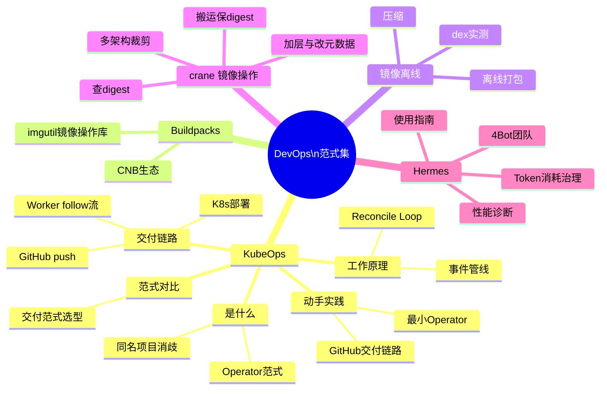

# DevOps 知识点分析

Analyze the `devops/` knowledge base. Categorize the buildpacks / kubeops / image-packaging / hermes documents by technical domain, summarize the key knowledge points, and present everything as a Markdown document with a Mermaid mindmap.

本文档覆盖 `devops/` 下的 **13 篇文档 / 5 个子域**。

> **一句话结论**
> ★ 这个目录只有 13 篇，但每篇都是**一个完整的范式**：
> `kubeops/`（5 篇）把 **Operator 范式**讲透，
> `buildpacks/` 把 **CNB 生态**讲透，
> `docker/` 讲**离线环境怎么搬镜像**。

---

## 文档体系分析

1. **`kubeops/`（5 篇）** — Operator 是什么、Reconcile Loop、GitHub push → K8s 交付、交付范式对比、动手实践
2. **`buildpacks/`（2 篇）** — CNB 生态与 `imgutil` 镜像操作库
3. **`docker/`（2 篇）** — 镜像离线打包与压缩（dexidp/dex 实测）+ **crane 镜像操作 CLI**
4. **`hermes-bot-team/`、`hermes-perf/`（3 篇）** — 4-Bot 团队与性能/Token 消耗治理

---

## 知识点 MindMap



---

## 主要知识领域详解

### 1. KubeOps（`kubeops/`）—— 本目录的主线，5 篇按编号递进
- `01-what-is-kubeops.md`：**KubeOps 是什么**（含**同名项目消歧**——
  先说清楚"我们说的不是那个同名项目"，这是好文档的标志）；
- `02-how-it-works.md`：**工作原理——Reconcile Loop 与事件管线**；
- `03-github-push-to-k8s-flow.md`：**那个场景：GitHub push → Worker follow 流 → K8s 部署**；
- `04-delivery-paradigms.md`：**交付范式对比与选型决策**；
- `05-hands-on.md`：**动手实践——最小可运行 Operator 与 GitHub 交付链路**。

> 五篇连起来正好是"**概念 → 原理 → 场景 → 选型 → 动手**"，
> 是全库少见的完整教学序列。

### 2. Buildpacks / CNB（`buildpacks/`）
- `README.md`：**Buildpacks / CNB 生态**概览；
- `imgutil.md`：**`buildpacks/imgutil`——CNB 生态的镜像操作库**，
  是"用标准方式操作镜像"（而非手搓 Dockerfile）的入口。

### 3. 镜像离线打包与 registry 层操作（`docker/`）
`01-offline-image-packaging.md`：**Docker 镜像离线打包与压缩（dexidp/dex 实测）**——
在无外网环境里把镜像搬过去的完整方案。

`02-crane-cli.md`：**crane 镜像操作 CLI**——不依赖 docker daemon，
直接对着 registry 的 HTTP API 查 digest / 搬镜像（**保留 digest**）/ 多架构裁剪 / 给镜像加层 / 改元数据。
与 01 是互补关系：01 在**文件系统层**压小，02 在**registry 层**做搬运与改写。

### 4. Hermes（`hermes-bot-team/`、`hermes-perf/`）
- `hermes-bot-team/`：**4-Bot 团队使用指南**（把一个 Agent 拆成 4 个角色协作）；
- `hermes-perf/hermes-slow-and-token-burn-solutions.md`：
  **Hermes 性能与 Token 消耗：诊断结论与解决方案**——
  与 `ucp/argocd-topics/session-token-usage.md` 属同一条线。

---

## 三条阅读路线

```
路线 A · 想理解 Operator 范式（2 小时）
  kubeops/docs/01-what-is-kubeops.md → 02-how-it-works.md
  → 04-delivery-paradigms.md → 05-hands-on.md

路线 B · 离线环境搬镜像（1 小时）
  docker/docs/01-offline-image-packaging.md
  → docker/docs/02-crane-cli.md
  → ../cloud/docker/multistage-builds/distroless.md
  → ../safe/fix-cve/how-to-fix-cve-with-base-image-constraints.md

路线 C · 治理 Agent 的 Token 消耗（1 小时）
  hermes-perf/hermes-slow-and-token-burn-solutions.md
  → ../gcp/ucp/argocd-topics/session-token-usage.md
  → ../skills/skills-mindmap.md
```

---

## 结论

1. **`kubeops/` 的五篇递进是全库最好的"教学序列"范例**：
   概念（含消歧）→ 原理 → 场景 → 选型 → 动手，可以直接当模板抄。
2. **Operator 范式的核心是 Reconcile Loop**：
   声明"期望状态"而不是"执行步骤"——这一条理解了，
   Argo CD / Flux / KubeOps 就不再是三个东西。
3. **离线打包与 base image 修复是同一个约束的两面**：
   内网环境拉不到上游镜像，就必须自建并长期维护——这正是 `safe/fix-cve/` 的主题。

---

## 关联文档

- [../knowledge-mindmap.md](../knowledge-mindmap.md) ·
  [../gcp/ucp/argocd-mindmap.md](../gcp/ucp/argocd-mindmap.md) ·
  [../safe/safe-mindmap.md](../safe/safe-mindmap.md) ·
  [../skills/skills-mindmap.md](../skills/skills-mindmap.md)
- [kubeops/README.md](./kubeops/README.md) ·
  [kubeops/README.md](./kubeops/README.md) ·
  [kubeops/docs/01-what-is-kubeops.md](./kubeops/docs/01-what-is-kubeops.md) ·
  [kubeops/docs/02-how-it-works.md](./kubeops/docs/02-how-it-works.md) ·
  [docker/docs/01-offline-image-packaging.md](./docker/docs/01-offline-image-packaging.md) ·
  [docker/docs/02-crane-cli.md](./docker/docs/02-crane-cli.md) ·
  [buildpacks/README.md](./buildpacks/README.md)
