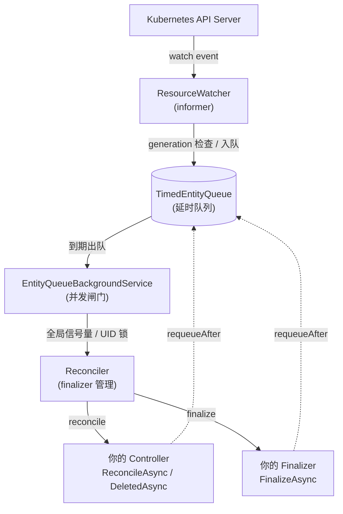

# 02 — 工作原理:Reconcile Loop 与事件管线

> 本篇的机制描述全部来自官方文档
> [Introduction](https://dotnet.github.io/dotnet-operator-sdk/docs/operator/) 与
> [Controllers](https://dotnet.github.io/dotnet-operator-sdk/docs/operator/building-blocks/controllers),
> 并按本仓库的"概念 → 资源模型 → 依赖 → 命令"阅读顺序重组。

---

## 1. 核心思想:Reconciliation Loop

官方定义的四步:

1. **Observe** —— 观察集群当前状态,以及自定义资源里声明的期望状态
2. **Compare** —— 比对当前状态与期望状态
3. **Act** —— 有差异就动手修正
4. **Repeat** —— 无限循环,持续维持期望状态

> The reconciliation loop is a fundamental concept in Kubernetes Operators.

**关键点**:Operator 不是"执行一次部署脚本",而是"永远在等事件、永远在比对"。

这个循环直接来自 Kubernetes 自身的控制面设计——Deployment controller、StatefulSet controller、
Namespace controller 全是这个模式。Operator 只是把这套模式用到你自己的领域对象上。

---

## 2. KubeOps 替你做了什么

官方原文:

> KubeOps implements this loop for you: it **watches** the Kubernetes API for changes to your resources,
> **queues** the events, and **calls your controller code** to reconcile them.
> You implement the business logic in a controller; KubeOps takes care of **watching, deduplication,
> queuing, and parallelism**.

翻译成工程语言:

| 关注点 | 谁做 | 说明 |
|---|---|---|
| 业务逻辑 | **你** | 只写 `ReconcileAsync` |
| Watch / Informer | KubeOps | 自动为每个 controller 建 watcher,带本地缓存,减少 API Server 压力 |
| 去重 | KubeOps | 按 generation 变化过滤,status/label/annotation 更新直接丢掉 |
| 排队 | KubeOps | 支持立即投递和延时投递(`requeueAfter`) |
| 并发控制 | KubeOps | 全局信号量 + per-UID 锁,同一对象绝不并发调谐 |
| Finalizer 生命周期 | KubeOps | 自动 attach / detach,并在删除前调用你的 `FinalizeAsync` |

**这就是"Operator 工程师只写 if/else,平台工程细节全免"的含义。**

---

## 3. 事件管线(Event Pipeline)

一个 watch 事件到达后,固定经过下面这条管线,然后才进你的代码:



| 组件 | 职责 |
|---|---|
| `ResourceWatcher` | 接收原始 watch 事件,**跳过没有 generation 变化的事件**,其余入队 |
| `TimedEntityQueue` | 持有条目直到其调度时间;支持立即投递与延时投递 |
| `EntityQueueBackgroundService` | 通过**全局信号量**和**per-UID 锁**控制并发后交给 Reconciler |
| `Reconciler` | 解析 controller、管理 finalizer 的 attach/detach,决定调用 `ReconcileAsync`/`DeletedAsync` 还是 `FinalizeAsync` |
| 你的 Controller | 期望状态收敛的业务逻辑 |
| 你的 Finalizer | 资源删除前的清理逻辑;需要 finalize 时**替代** controller 被调用 |

虚线是 `requeueAfter` 回流路径:当 controller 返回带非零 `RequeueAfter` 的 `ReconciliationResult` 时触发。

### 3.1 每个 Controller 一条独立管线

官方明确:**KubeOps 会为每个注册的 controller 创建一条完整管线**(watcher + queue + background service)。

- 同一实体类型的多个 controller(例如用不同 label selector)走**完全独立**的管线,互不抑制事件
- 可选开启 `WatchStrategy.SharedPerEntity`:同一实体类型只用一个共享 watcher,再按 label selector 分发
  - 代价:N 个 controller 默认 = N 条 watch 连接,watch 连接多时该考虑共享模式

---

## 4. 调谐触发规则(最容易踩的坑)

### 4.1 什么会触发 `ReconcileAsync`

- 新资源被创建
- 已有资源被修改
- **Operator 启动时发现存量资源**(重启后会补调谐,这是自愈的基础)

### 4.2 什么**不会**触发

> With the default settings, your controller only sees events for **spec changes** (and deletion handling):
> status, label, and annotation updates are deduplicated away before they reach the queue.

也就是说:

- ✅ 改 `spec` → 触发
- ✅ 增删 CR → 触发
- ❌ 改 `status` → **不触发**(所以你可以放心回写状态,不会自激)
- ❌ 改 label / annotation → **不触发**

> **这是最容易出 bug 的地方**:想在 controller 里靠改 annotation 触发自己?不会work。
> 需要的话要改 `Reconcile Strategy`(有 `ByResourceVersion` 备选策略)。

### 4.3 `DeletedAsync` 不可靠

官方警告(warning 级):

> The `DeletedAsync` method is **informational only** and executes asynchronously **without guarantees**.
> While it is called when a resource is deleted, it **cannot ensure proper cleanup**.
> For reliable resource cleanup, use finalizers.

补充的边界条件:

- 同名对象被删除后**重建**时,旧对象的 `DeletedAsync` 与新对象的 `ReconcileAsync` 是**独立**的两次调谐,
  **执行顺序不保证,可能并行**
- 因此**不要**在 `DeletedAsync` 里按 entity 名字推导资源名去清理 —— 重建的对象可能已经接管了这些资源
- 正确做法:用 **owner reference** 或 **finalizer**

### 4.4 Finalizer 是实体全局的

多 controller 匹配同一对象时,finalizer **只 attach 一次**,并在同一把锁下**不会因为多 controller 命中而重复执行**。

但官方也提醒:这**不是通用的 exactly-once 执行**——比如"外部副作用完成后、移除 finalizer 前进程崩溃",重启后清理逻辑仍会重跑。
**所以 finalizer 必须幂等。**

---

## 5. 并发模型

`EntityQueueBackgroundService` 在调用你的 controller 前施加**两层并发控制**:

1. **全局 `SemaphoreSlim`**:限制总并发调谐数,默认 `Environment.ProcessorCount * 2`
2. **per-UID `SemaphoreSlim`**:同一个对象的两次调谐**绝不并发**

同一 UID 的新事件在调谐进行中到达时,按 `ConflictStrategy` 处理,默认 `WaitForCompletion`(等前一次跑完)。

多 controller 场景下,还有一个**按实体类型的协调器**串行化同一对象的调谐,并共享同一个并行预算。

---

## 6. 调谐结果与重入队

所有调谐方法必须返回 `ReconciliationResult<TEntity>`:

```csharp
// 成功
return ReconciliationResult<V1DemoEntity>.Success(entity);

// 失败(带异常 + 重试延迟)
return ReconciliationResult<V1DemoEntity>.Failure(
    entity, "Failed to apply desired state", ex, requeueAfter: TimeSpan.FromMinutes(5));

// 成功但 5 分钟后再看一次(轮询外部依赖、周期检查)
return ReconciliationResult<V1DemoEntity>.Success(entity, TimeSpan.FromMinutes(5));
```

也可以在 controller 内**主动**入队(不通过返回值):

```csharp
public class V1DemoEntityController(EntityQueue<V1DemoEntity> queue) : IEntityController<V1DemoEntity>
{
    public async Task<ReconciliationResult<V1DemoEntity>> ReconcileAsync(
        V1DemoEntity entity, CancellationToken cancellationToken)
    {
        await queue(entity, ReconciliationType.Modified, ReconciliationTriggerSource.Operator,
            TimeSpan.FromSeconds(30), retryCount: 0, cancellationToken);
        return ReconciliationResult<V1DemoEntity>.Success(entity);
    }
}
```

> **队列默认在内存里,Operator 重启会丢队列条目。** 需要持久化队列要用
> `QueueStrategy.Custom` 接外部系统(见 Advanced Configuration → Queue Strategy)。
> 同时注意:自定义队列 + 自定义 leader election 下,**同一实体类型只允许一个 controller**。

---

## 7. 最小 Controller 长什么样

```csharp
public class V1DemoEntityController(
    ILogger<V1DemoEntityController> logger,
    IKubernetesClient client) : IEntityController<V1DemoEntity>
{
    public async Task<ReconciliationResult<V1DemoEntity>> ReconcileAsync(
        V1DemoEntity entity, CancellationToken cancellationToken)
    {
        logger.LogInformation("Reconciling entity {Entity}.", entity);

        var deployment = await client.GetAsync<V1Deployment>(
            entity.Spec.DeploymentName, entity.Namespace(), cancellationToken);

        if (deployment == null)
        {
            await client.CreateAsync(new V1Deployment { /* ... */ }, cancellationToken);
        }

        entity.Status.LastReconciled = DateTime.UtcNow;
        await client.UpdateStatusAsync(entity, cancellationToken);   // 不会再次触发自己

        return ReconciliationResult<V1DemoEntity>.Success(entity);
    }

    public async Task<ReconciliationResult<V1DemoEntity>> DeletedAsync(
        V1DemoEntity entity, CancellationToken cancellationToken)
    {
        logger.LogInformation("Entity {Entity} was deleted.", entity);
        return ReconciliationResult<V1DemoEntity>.Success(entity);
    }
}
```

注册与 RBAC:

```csharp
builder.Services.AddKubernetesOperator()
    .RegisterComponents();

// 用属性声明权限,代码生成器据此生成 RBAC
[EntityRbac(typeof(V1DemoEntity), Verbs = RbacVerb.All)]
public class V1DemoEntityController : IEntityController<V1DemoEntity> { }
```

---

## 8. 资源模型速查

| 资源 | 谁创建 | 说明 |
|---|---|---|
| CRD | `kubeops generate` 或构建期生成器 | `config/crd/` |
| RBAC | `kubeops generate`(从 `[EntityRbac]` 推导) | `config/rbac/` |
| Operator Deployment | `kubeops install` / 生成的 `config/` | `config/deployment.yaml` |
| Namespace | 生成的 `config/namespace.yaml` | 静态指定 namespace 时不生成 |
| Kustomize 配置 | 生成 | `config/kustomization.yaml` |
| CR(用户提交) | 用户 | 期望状态的入口 |
| 业务资源(Deployment/Service/...) | **你的 controller 代码** | 不是 Helm 渲染的 |

---

## 9. 官方最佳实践(踩坑预防)

来自官方 Deployment 文档:

- **镜像**:非 root 用户(生成的 Dockerfile 默认已处理);**绝不部署 `latest`**,用版本 tag
- **RBAC**:最小权限原则
- **Webhook**:必须走 TLS;本地开发注意证书来源
- **可观测性**:配好 resources requests/limits;**调谐队列与 reconciler 的指标是判断 Operator 是否真在干活的最快方式**
- **多副本**:超过 1 个副本必须配 `LeaderElectionType.Single`,否则每个实例都会调谐每个事件,产生重复副作用和写冲突
- **CRD 版本升级**:只**新增**版本,绝不删除或破坏性修改存量对象还在用的字段;跨版本迁移要配 conversion webhook;
  升级 CRD 前用真实对象副本做回归
- **Leader Election**:`LeaderElectionType.Single` 时同一对象只被一个实例处理

---

## 参考

- Introduction:<https://dotnet.github.io/dotnet-operator-sdk/docs/operator/>
- Controllers / 事件管线:<https://dotnet.github.io/dotnet-operator-sdk/docs/operator/building-blocks/controllers>
- Finalizers:<https://dotnet.github.io/dotnet-operator-sdk/docs/operator/building-blocks/finalizer>
- Webhooks:<https://dotnet.github.io/dotnet-operator-sdk/docs/operator/building-blocks/webhooks>
- RBAC:<https://dotnet.github.io/dotnet-operator-sdk/docs/operator/rbac>
- Events:<https://dotnet.github.io/dotnet-operator-sdk/docs/operator/events>
- Deployment:<https://dotnet.github.io/dotnet-operator-sdk/docs/operator/deployment/>
- Troubleshooting:<https://dotnet.github.io/dotnet-operator-sdk/docs/operator/troubleshooting>
