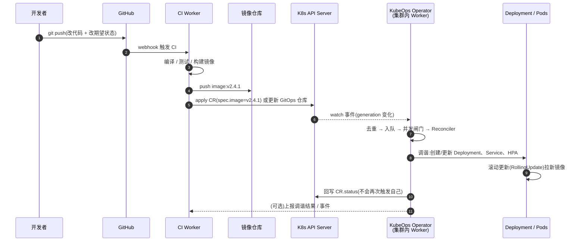
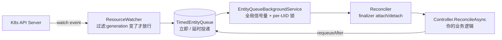
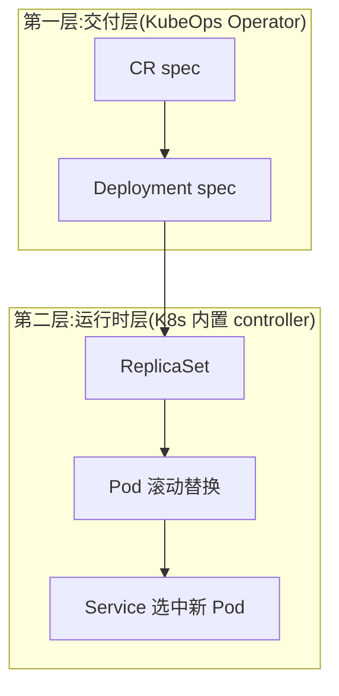

# 03 — 那个场景:GitHub push → Worker follow 流 → K8s 部署

> 本篇把你口述的场景逐字翻译成技术概念,再拆成可落地的链路。
> 原始描述:"通过 GitHub 里边的代码的 push 之后的改动,触发一个 Worker 的 follow 流,
> 然后让 kubeops 到 K8S 里面去部署对应的服务"。

---

## 1. 先把这句话翻译准确

| 你的说法 | 技术对应 | 落在哪个组件 |
|---|---|---|
| "GitHub 里边的代码 push 之后的改动" | Git 提交改变了 **期望状态的载体**(CR 或 Git 里的 YAML) | GitHub / CI |
| "触发一个 Worker" | 触发 **CI Worker(runner)** 干活 | GitHub Actions / Tekton / Argo Workflows |
| "follow 流" | **Watch 事件流** —— Operator 持续 watch K8s API,事件到达后进入调谐管线 | `ResourceWatcher` → `TimedEntityQueue` → `Reconciler` |
| "让 kubeops 到 K8S 里面去部署对应的服务" | Operator 在**集群内**调谐出 Deployment/Service 等实际资源 | KubeOps Controller 代码 |

> ⚠️ **一个高频误解**:"Worker" 在这个场景里**有两个**,别搞混:
>
> | Worker | 在哪 | 干什么 | 生命周期 |
> |---|---|---|---|
> | **CI Worker** | GitHub 侧 / 云上 runner | 构建镜像、推仓库、更新期望状态 | 一次性任务,跑完就结束 |
> | **Operator Worker** | **集群内**(KubeOps Pod) | 持续 watch + 调谐,让实际状态追上期望状态 | **常驻**,永不退出 |

> "follow"这个词在 K8s 语境里对应的就是 `watch`。所以"Worker 的 follow 流"=
> **集群内那个常驻进程 watch 到的变更事件流**,它是被动跟随,不是主动去拉。

---

## 2. 完整链路(Operator 驱动范式)

### 分阶段说明

#### 阶段 0 — 开发者改什么(最容易被忽略)

一次 push 里其实有**两类**改动,职责不同:

| 改动 | 例子 | 谁来消费 |
|---|---|---|
| **制品改动** | 业务代码、Dockerfile | CI Worker → 构建镜像 |
| **期望状态改动** | `deployment.yaml` 里 image tag 改成 `v2.4.1`;或 CR 的 `spec.image` 改成 `v2.4.1` | Operator(直接读 CR)或 GitOps controller(读 Git) |

**如果只改了代码、没改期望状态**,Operator 不会动 —— 它只认期望状态。这是最常见的"推了代码但没部署"的原因。

#### 阶段 1 — GitHub push → CI Worker 被触发

GitHub 通过 **webhook** 通知 CI。CI Worker(runner)拿到代码后:

1. checkout
2. 编译 / 跑测试
3. 构建镜像 → 打上不可变 tag(`v2.4.1` 或 commit SHA,**不要用 `latest`**)
4. 推到镜像仓库
5. **更新期望状态**:改 CR、改 GitOps 仓库里的 YAML,或者直接 `kubectl apply`

> 在 Operator 范式里,第 5 步是"提交/更新一个 CR";
> 在 GitOps 范式里,第 5 步是"往 Git 仓库 push 一个 manifest 改动"。
> 两者都是 **CI 只负责产出制品 + 更新声明,不直接拥有集群的写权限**(这是拉式范式的核心安全属性)。

#### 阶段 2 — Worker 的 follow 流:事件怎么进到 Operator

这一段就是"follow 流"的全部机制,细节见 [02-how-it-works.md](02-how-it-works.md)。

#### 阶段 3 — Operator 把期望状态变成实际资源

Controller 里拿到 CR 后,做三件事:

1. **读实际状态**:`client.GetAsync<V1Deployment>(...)`
2. **对比并修正**:不存在就 `CreateAsync`,存在但字段不一致就 `UpdateAsync`
3. **回写 status**:`client.UpdateStatusAsync(entity, ...)`(不会再次触发自己)

关键设计:**幂等**。同一次调谐跑 5 次和跑 1 次,集群最终状态必须一样。
这让 Operator 可以在任何时候重启、重试、自愈。

#### 阶段 4 — K8s 自己完成滚动更新

Operator 只负责让 Deployment 的 spec 正确;**真正的 Pod 替换是 K8s Deployment controller 做的**
(RollingUpdate:按 `maxSurge`/`maxUnavailable` 逐步换 Pod)。

所以完整链路是**两层控制循环叠加**:

**记住这个分层**:Operator 管"声明什么",K8s 管"怎么变成现实"。
很多人在这里绕晕,以为 Operator 要自己管 Pod 生命周期。

#### 阶段 5 — 结果反馈

| 反馈方式 | 说明 |
|---|---|
| `CR.status` | Operator 回写的状态(`LastReconciled` 等),**人可读** |
| `ReconciliationResult` | 成功/失败 + `requeueAfter` |
| Kubernetes Event | Operator 可发事件(见官方 Events 文档) |
| OpenTelemetry 指标 | 调谐队列深度、reconciler 耗时、watcher 指标 —— 判断"是否真在干活"的最快方式 |
| CI 侧 | Operator 驱动范式下,**部署结果不在 CI 日志里**,这是与 CI 推式最大的体感差异 |

---

## 3. 场景的四种实现形态(同一个需求的四种做法)

同样的"GitHub push → 部署到 K8s",业界有四种做法。**关键差别是"谁拿着集群写权限、在哪执行"。**

```mermaid
flowchart TB
    subgraph P1["① CI 推式(push-based)"]
        d1["开发者"] --> g1["GitHub"] --> c1["CI Worker"] -->|kubectl apply / helm<br/>凭据在 CI 侧| k1["K8s"]
    end
    subgraph P2["② GitOps 拉式(pull-based)"]
        d2["开发者"] --> g2["GitHub"] -.->|轮询 / webhook 通知| c2["集群内 GitOps Controller<br/>(Argo CD / Flux)"] -->|apply| k2["K8s"]
    end
    subgraph P3["③ Operator 驱动"]
        d3["开发者"] --> g3["GitHub"] --> c3["CI Worker<br/>只更新 CR"] -->|apply CR| k3["K8s"] --> o3["集群内 Operator"] -->|调谐出业务资源| k3
    end
    subgraph P4["④ git push 直部署"]
        d4["开发者"] -->|git push 到 gitkube remote| k4["K8s 内 gitkubed<br/>收 push → 构建 → 部署"]
    end
```

| | ① CI 推式 | ② GitOps 拉式 | ③ Operator 驱动 | ④ git push 直部署 |
|---|---|---|---|---|
| 代表 | GitHub Actions + kubectl | Argo CD / Flux | **KubeOps** | gitkube |
| 谁执行部署 | CI 流水线 | 集群内 GitOps controller | 集群内 Operator | 集群内 gitkubed |
| 集群写权限在哪 | **CI 侧**(kubeconfig/SSH key 在 Secrets) | 集群内 | 集群内 | 集群内 |
| Git 是唯一真相源 | 否 | **是** | 部分(CR 在集群里) | 是(代码即配置) |
| 能处理 CRD / 自定义资源编排 | 否 | 一般 | **是** | 部分 |
| 漂移纠正(self-heal) | 无 | 有(selfHeal / prune) | **有** | 有限 |
| 部署结果在哪看 | CI 日志 | Argo CD UI / Flux 状态 | CR.status + 指标 | gitkubed 日志 |
| 多集群 | 需多份凭据 | 一个 controller 管多集群 | 天然按集群部署 | 每集群一套 |
| 适合 | 小团队、单机部署 | **中小团队通用默认** | 平台型、有自定义编排逻辑 | 开发自测、极简 |

> **凭据方向是最重要的分水岭**:
> 推式 = CI 拿着生产钥匙去开门,钥匙容易丢;拉式 / Operator = 生产环境自己看门、自己取快递,CI 永远拿不到生产权限。

---

## 4. 什么场景该选 Operator 驱动

GitOps(Argo CD / Flux)是通用默认,**但以下情况 Operator 更合适**:

| 场景 | 为什么 GitOps 不够 |
|---|---|
| 需要**业务语义**的编排(比如"这个 CR 表示一个多租户 SaaS 实例,Operator 要建 8 个资源 + 调外部 API 开通配额") | Argo CD 只能 apply YAML,做不了"调外部系统" |
| 需要**依赖编排**(B 必须等 A ready) | Argo CD 的 sync wave 只能做粗粒度排序,不能表达"等 A 的 status.ready=true" |
| 需要**自动修复业务资源**(发现 Service 被删了要重建) | Argo CD 的 selfHeal 管 YAML 声明的资源,管不了 Operator 内部逻辑 |
| 需要**对外部系统有生命周期**(开通/回收云资源) | Argo CD 不管外部资源清理,Finalizer 才行 |
| 同一个 CR 触发**跨多集群**的动作 | 需要业务逻辑里的集群路由 |

**混合也很常见**:Argo CD 负责同步 Operator 自己的部署清单,KubeOps Operator 负责业务资源的编排。

---

## 5. 这个场景的常见故障与排查点

| 症状 | 大概率原因 | 查哪 |
|---|---|---|
| push 了,集群毫无反应 | 期望状态没变(只改了代码,没改 CR / manifest) | 对比 CR 的 `spec` 与 `metadata.generation` |
| 改了 CR,Operator 不动 | 改的是 `status`/`metadata`,不是 `spec` | KubeOps 默认按 generation 去重 |
| Operator 日志有 reconcile 但资源没建 | 逻辑条件不满足 / RBAC 缺权限 | Operator 日志 + `kubectl auth can-i` |
| Pod 一直 ImagePullBackOff | 镜像 tag 错,或 imagePullSecret 缺失 | `kubectl describe pod` |
| 删 CR 后资源残留 | 只用了 `DeletedAsync`,没写 Finalizer | 官方明确:清理必须用 Finalizer |
| 多副本 Operator 行为混乱 | 没配 `LeaderElectionType.Single`,多个实例同时调谐 | 官方 Deployment 文档 |
| Operator 重启后队列里的任务丢了 | 默认队列在内存 | 改用 `QueueStrategy.Custom` 接持久化队列 |
| 改 annotation 想触发自己 | 默认策略下无效 | 调整 `Reconcile Strategy` |

---

## 6. 一句话记住整条链路

> **Git push 只改"声明",不改"现实"。**
> CI Worker 负责把声明更新到集群里;集群内的 Operator 负责把声明翻译成实际的 K8s 资源;
> K8s 自己的 controller 负责把资源变成跑起来的 Pod。三层各管一段,谁都不越界。

---

## 参考

- KubeOps Controllers / 事件管线:<https://dotnet.github.io/dotnet-operator-sdk/docs/operator/building-blocks/controllers>
- KubeOps Deployment:<https://dotnet.github.io/dotnet-operator-sdk/docs/operator/deployment/>
- Kubernetes Operator 概念:<https://kubernetes.io/docs/concepts/extend-kubernetes/operator/>
- Argo CD Application / syncPolicy:<https://argo-cd.readthedocs.io/en/stable/user-guide/application-specification/>
- Flux Kustomization:<https://fluxcd.io/flux/components/kustomize/kustomizations/>
- gitkube(范式参考):<https://gitcode.com/gh_mirrors/gi/gitkube>
