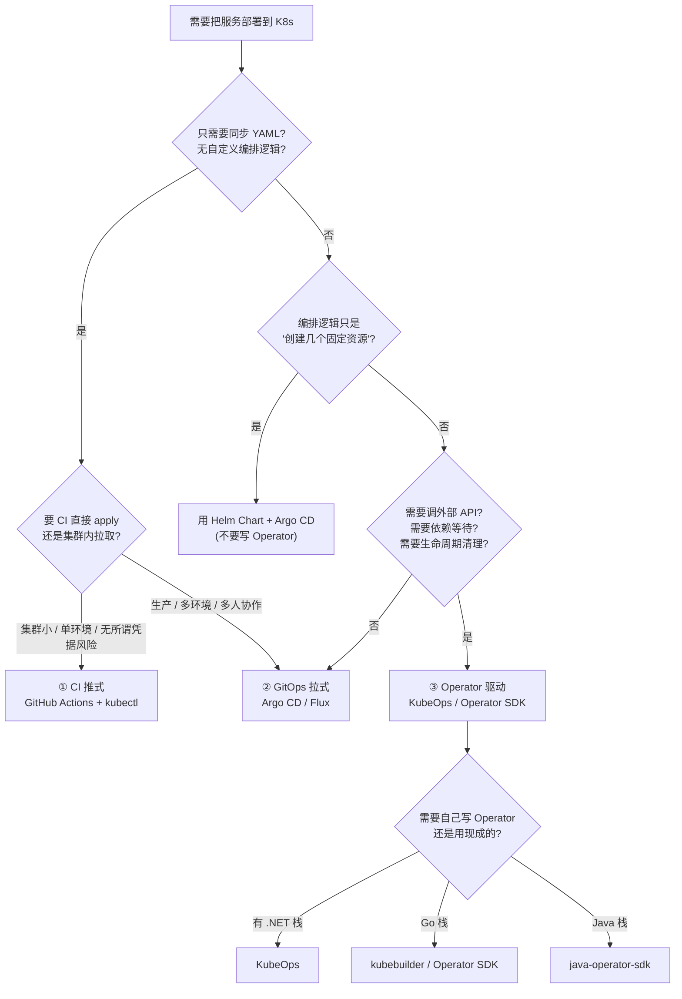
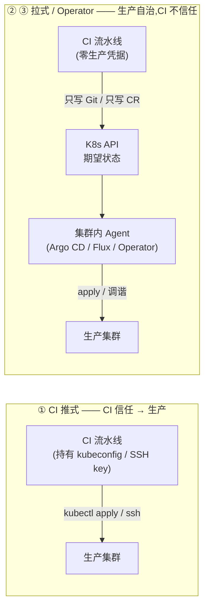
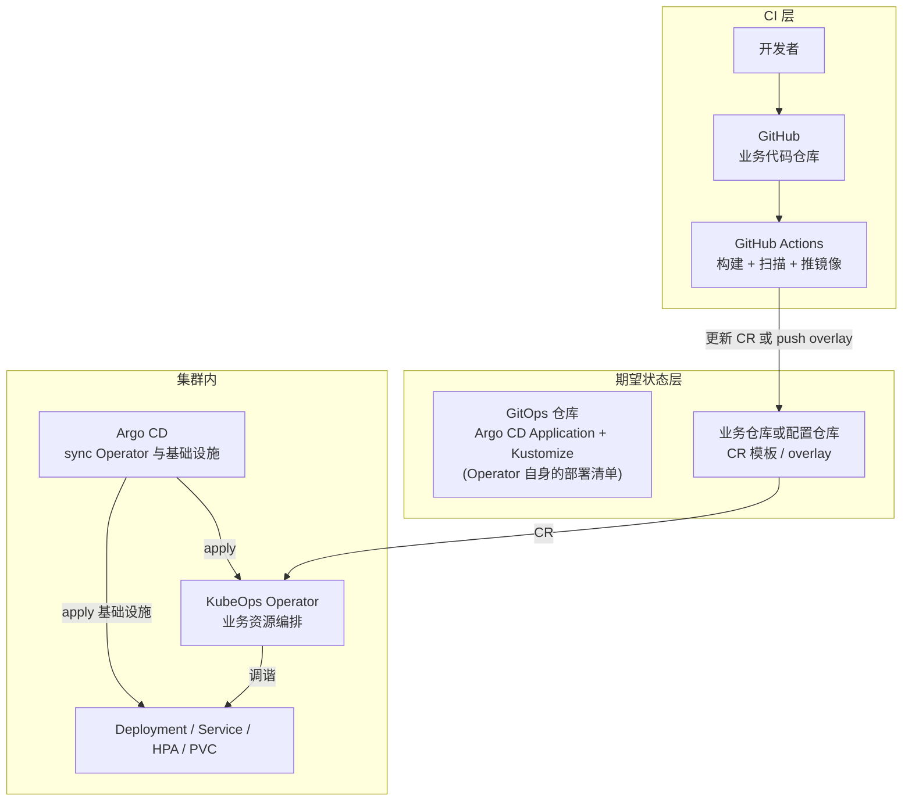

# 04 — 交付范式对比与选型决策

> 场景描述见 [03-github-push-to-k8s-flow.md](03-github-push-to-k8s-flow.md)。
> 本篇解决另一个问题:**面对具体约束,该怎么选**,以及组合使用时的边界在哪。

---

## 1. 决策树

---

## 2. 信任边界与凭据方向

这是三种范式最本质的区别,其他差异基本都由它派生。

| | ① CI 推式 | ② GitOps 拉式 | ③ Operator 驱动 |
|---|---|---|---|
| 生产凭据存放 | **GitHub Secrets / CI 侧** | 集群内(仅拉取仓库所需的读凭据) | 集群内(ServiceAccount) |
| CI 被攻破的后果 | 拿到生产集群完整写权限 | 最多污染 Git(仍需过 PR/审批才能改期望状态) | 最多污染 Git / CR 内容 |
| 攻击者可达的信任边界 | **跨越到生产** | 停在期望状态这一层 | 停在期望状态这一层 |
| 降低风险的手法 | 受限 SSH key(`command="..."`)、Environment 审批 | PR 审批 + 分支保护 + OPA/Gatekeeper | 同左 + CRD schema 校验 + Admission Webhook |

> **推式不是原罪,但它是"CI 凭据泄露 = 生产失守"这种风险结构。**
> 规模一上去(多集群、多环境、多人),几乎必然要往拉式迁。

---

## 3. 能力矩阵

| 能力 | ① CI 推式 | ② GitOps 拉式(Argo CD) | ③ Operator 驱动(KubeOps) |
|---|---|---|---|
| Git 作为唯一真相源 | ❌ | ✅ | ⚠️ 部分(期望状态在 CR 里) |
| 变更可审计 | CI 日志 | Git 历史 + Argo CD 审计 | CR 变更历史 + 调谐指标 |
| 回滚 | 重跑旧流水线 | `git revert` / `argocd app rollback` | 改回 CR spec / 改回 Git |
| 漂移自愈 | ❌ | ✅(`selfHeal` + `prune`) | ✅(每次调谐都对比修正) |
| 删除多余资源 | 手工 | ✅(`prune: true`) | ✅(ownerRef 垃圾回收 + Finalizer) |
| 灰度 / 金丝雀 | 需自己做 | ✅(Argo Rollouts / Flagger) | 需自己做(或集成 Rollouts) |
| 多集群管理 | 多份凭据,痛苦 | ✅ 一个 controller 管多集群 | ✅ 每集群一套 Operator,业务逻辑一致 |
| 复杂条件编排 | ❌ | ❌(sync wave 只是粗排序) | ✅(代码随便写) |
| 调外部系统开通资源 | ❌ | ❌ | ✅ |
| 等待依赖 ready 再继续 | ❌ | ⚠️ 只能靠健康检查+重试 | ✅(读 status,精确等待) |
| 跨版本 CRD 迁移 | ❌ | ❌ | ✅(Conversion Webhook) |
| 部署结果反馈位置 | CI 日志(直观) | Argo CD UI | CR.status + OTel 指标 |
| 上手成本 | 最低 | 中 | 最高 |
| 集群被误删后重建 | 从 Git 重新 apply | 自动恢复 | 自动恢复(Operator 重建后补调谐存量 CR) |

---

## 4. 组合模式(生产环境真正常见的形态)

单一范式很少能覆盖全部需求,实际是拼装:

典型分工:

| 组件 | 范式归属 | 职责 |
|---|---|---|
| GitHub Actions | ① 推式(仅限 CI 内部) | 构建、测试、扫描、推镜像;**不碰生产集群** |
| Argo CD / Flux | ② 拉式 | 管 Operator 自身、Ingress、证书、数据库等**声明式资源** |
| KubeOps Operator | ③ Operator 驱动 | 管**有业务语义**的资源编排与外部系统集成 |
| OPA / Gatekeeper | 横切 | 准入校验,卡住不合规的 CR 和资源变更 |

> 本仓库已有相关素材:`OPA-Gatekeeper/diagrams/04-gitops-pipeline.html`(GitOps 流水线)、
> `gateway/no-gateway/version-control/`(声明式版本控制实践)。

---

## 5. 从 CI 推式迁到拉式的路径

不需要一次性切换,分四步:

1. **只挪清单**:把 `kubectl apply -f` 的 YAML 从 CI 脚本挪到 Git 仓库,CI 仍然 apply(此时还没变拉式,但变更开始有 Git 历史了)
2. **换成 Argo CD**:CI 改为**只更新 Git**(push manifest 改动),删除 CI 里的 apply 步骤和 kubeconfig Secret
3. **收回凭据**:清理 CI Secrets 里的 kubeconfig / SSH key,改为 Argo CD 侧只读凭据
4. **补齐治理**:加 PR 审批、分支保护、准入策略、漂移告警

Operator 驱动是**第 5 步**:当"声明式资源"已经不够用、开始需要业务逻辑时再引入,而不是一上来就写 Operator。

---

## 6. 反模式清单

| 反模式 | 为什么错 | 正确做法 |
|---|---|---|
| CI 里 `kubectl apply` 且持有生产 kubeconfig | 凭据暴露面大,CI 被攻破即失守 | 改拉式;过渡期用受限 SSH key |
| 用 `latest` tag 部署 | 无法回滚、无法确定跑的是哪个版本 | 不可变 tag(版本号或 commit SHA) |
| 镜像 tag 变了但 Git 里没记录期望状态 | 集群状态无法从 Git 重建 | 期望状态必须进 Git 或 CR |
| 手改集群(绕过声明) | 产生漂移,无人知晓 | 靠 selfHeal 纠正,或改完同步回声明 |
| 删 CR 却不做 Finalizer | 残留资源泄漏 | Finalizer + ownerReference |
| Operator 多副本不配 Leader Election | 重复调谐、副作用冲突 | `LeaderElectionType.Single` |
| 调谐里写长耗时同步逻辑 | 占满并发预算,拖慢全部对象 | 短同步 + `requeueAfter` 异步化 |
| 调谐里改 `spec` 触发自己 | 无限循环 | 幂等 + 只改 status(默认不触发) |
| Operator 里 `kubectl exec` 跑命令 | 绕过 API,不可审计、破坏声明式 | 用 K8s API 改资源 |
| 生产用 CI 状态判断"部署成功" | 只能证明 apply 发出去了,不能证明跑起来了 | 查 `status.ready` / Deployment rollout status |

---

## 7. 一句话决策

> **没有业务逻辑 → GitOps;有业务逻辑 → Operator;两者都不难 → 别自己写,用现成的。**

---

## 参考

- Argo CD Application Spec:<https://argo-cd.readthedocs.io/en/stable/user-guide/application-specification/>
- Argo CD 自愈:<https://argo-cd.readthedocs.io/en/stable/user-guide/auto_sync/>
- Flux Kustomization:<https://fluxcd.io/flux/components/kustomize/kustomizations/>
- Flux GitRepository:<https://fluxcd.io/flux/components/source/gitrepositories/>
- KubeOps Deployment 最佳实践:<https://dotnet.github.io/dotnet-operator-sdk/docs/operator/deployment/>
- Kubernetes Operator 概念:<https://kubernetes.io/docs/concepts/extend-kubernetes/operator/>
- OPA Gatekeeper:<https://open-policy-agent.github.io/gatekeeper/>
