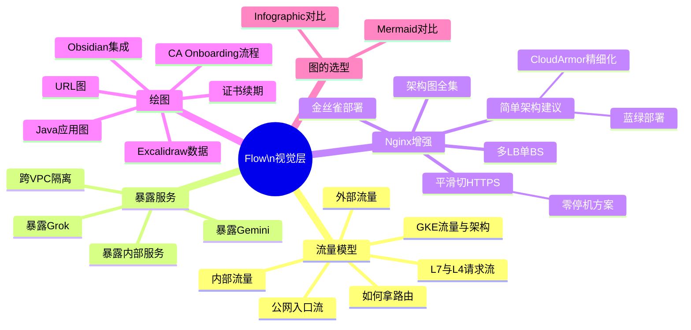

# Flow 流量链路知识点分析

Analyze the `flow/` knowledge base. Categorize the traffic-flow diagrams / Nginx enhancement / drawing documents by technical domain, summarize the key knowledge points, and present everything as a Markdown document with a Mermaid mindmap.

本文档覆盖 `flow/` 下的 **27 篇文档 / 4 个子域**——
这个目录不解释原理，它**画图**：把请求从哪来、经过哪些跳、到哪去画清楚。

> **一句话结论**
> ★ `flow/` 是全库的 **"视觉层"**：
> `docs/` 是四种流量模型（外部 / 内部 / 公网入口 / L7-L4）的链路图，
> `flow-nginx-enhance/` 是把链路图变成**可实施方案**（金丝雀、平滑切 HTTPS），
> `draw/` 与 `Excalidraw/` 则解决"图怎么画、怎么存"。

---

## 文档体系分析

1. **`docs/`（11 篇）** — 外部流、内部流、公网入口流、L7-L4 请求流、GKE 流量与架构、
   "如何暴露某个服务"（Gemini / Grok / 内部服务）、如何拿路由
2. **`flow-nginx-enhance/`（6 篇）** — 架构图全集、金丝雀部署、
   多 LB 单 Backend Service、**平滑切换到外部 HTTPS（零停机）**、方案总结
3. **`draw/`（6 篇）** — Excalidraw 与 Obsidian 集成、CA Onboarding 流程、证书续期、
   Java 应用图、URL 图
4. **`Excalidraw/`（2 篇）** — Excalidraw 数据格式与用法
5. **横向** — `Infographic-with-mermaid.md`：**Infographic 与 Mermaid 的取舍**

---

## 知识点 MindMap



---

## 主要知识领域详解

### 1. 流量模型（`docs/`）—— 这个目录的核心
- `external-flow.md` / `internal-flow.md`：**外部流与内部流**两张基础链路图；
- `pub-ingress-flow.md`：**公网入口流**；
- `L7-L4-request-flow.md`：**L7 与 L4 请求流**的区别——这是排障时最常需要的一张图；
- `gke.md`：**GKE Traffic Flow & Architecture**；
- `How-to-get-route.md`：如何拿到路由（入口 → 规则 → 后端）；
- `How-to-expose-gemini.md` / `How-to-expose-grok.md` / `How-to-expose-internalservice.md`：
  **"如何把某个服务暴露出来"的三种场景**——
  其中 `How-to-expose-gemini.md` 分析了"在 GCP 中隔离 VPC 间通过虚拟机实例暴露内部服务"的方案。

### 2. Nginx 增强（`flow-nginx-enhance/`）
把架构图落成方案的一组：
- `all-flow.md`：**架构流程图集合**；
- `simple-architecture.md`：架构优化建议——**Cloud Armor 精细化控制 + 蓝绿部署**；
- `Summary.md`：HTTPS 负载均衡器 + Cloud Armor + 金丝雀部署的实施方案总结；
- `canary-deployment.md`：**Nginx 金丝雀部署配置详解**；
- `multp-lb-single-backendservice.md`：**多个 LB 共享一个 Backend Service**（HTTPS LB 场景）；
- `swith-https.md`：**平滑切换至外部 HTTPS 负载均衡器（零停机方案）**。

### 3. 绘图（`draw/`、`Excalidraw/`）
- `draw/docs/obsidian-excalidraw.md`：**Obsidian 与 Excalidraw 集成**；
- `draw/docs/ca-onboarding-flow.md`：**CA 证书 Onboarding 流程图**；
- `draw/docs/renew-cert.md`：证书续期流程图；
- `draw/docs/Draw-Java-application.md`、`url.md`：画 Java 应用图、URL 图；
- `Excalidraw/excalidraw-first.md`：**Excalidraw Data**（数据格式解析）。

### 4. 图的选型
`Infographic-with-mermaid.md`：**Infographic vs. Mermaid 的深度解析与实战指南**——
什么场景用信息图、什么场景用 Mermaid，这是本目录最"元"的一篇，
也直接决定了本知识库统一用 Mermaid 的理由。

---

## 三条阅读路线

```
路线 A · 先把流量模型装进脑子（2 小时）
  docs/external-flow.md → docs/internal-flow.md
  → docs/pub-ingress-flow.md → docs/L7-L4-request-flow.md

路线 B · 要落一个零停机方案（半天）
  flow-nginx-enhance/swith-https.md → simple-architecture.md
  → canary-deployment.md → multip-lb-single-backendservice.md

路线 C · 决定用什么方式画图（1 小时）
  Infographic-with-mermaid.md → draw/docs/obsidian-excalidraw.md
  → Excalidraw/excalidraw-first.md
```

---

## 结论

1. **这个目录是"读其他目录的前提"**：不知道流量怎么走，
   `gcp/` `gateway/` `webservice/` 里的架构图就都看不懂。
2. **"平滑切 HTTPS"是本目录最有含量的一篇**：零停机切换是平台变更里最难的一类，
   它把方案、图、配置都凑齐了。
3. **统一用 Mermaid 是有意的选择**：`Infographic-with-mermaid.md` 给了理由——
   Mermaid 适合"跟着代码演进"的图，Infographic 适合"一次性传播"的图。

---

## 关联文档

- [../knowledge-mindmap.md](../knowledge-mindmap.md) ·
  [../gcp/gcp-mindmap.md](../gcp/gcp-mindmap.md) ·
  [../webservice/webservice-mindmap.md](../webservice/webservice-mindmap.md) ·
  [../gateway/gateway-mindmap.md](../gateway/gateway-mindmap.md)
- [README.md](./README.md) ·
  [Infographic-with-mermaid.md](./Infographic-with-mermaid.md) ·
  [docs/L7-L4-request-flow.md](./docs/L7-L4-request-flow.md) ·
  [flow-nginx-enhance/swith-https.md](./flow-nginx-enhance/swith-https.md) ·
  [flow-nginx-enhance/simple-architecture.md](./flow-nginx-enhance/simple-architecture.md)
