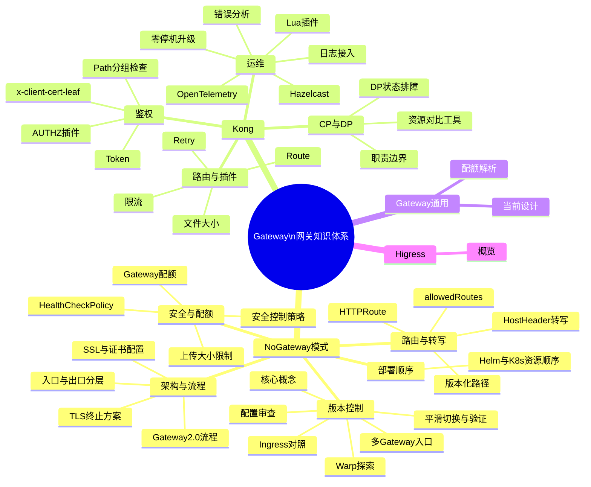

# Gateway 知识点分析

Analyze the `gateway/` knowledge base. Categorize the Kong / Higress / GKE Gateway / No-Gateway documents by technical domain, summarize the key knowledge points, and present everything as a Markdown document with a Mermaid mindmap.

本文档覆盖 `gateway/` 下的 **87 篇文档 / 4 个子域**：
Kong、**No-Gateway 模式**（最大且最有特色）、Higress、GKE Gateway 通用。

> **一句话结论**
> ★ 这个目录真正的主线是 **"No-Gateway 模式"**——
> 把 API 版本控制与平滑切换**下沉到网关的路由层**，
> 用 `HTTPRoute` / URL Map / Ingress 版本标记实现**多入口并存 + 按标签灰度**，
> 而不依赖传统的"改配置 → 滚动发布"。
Kong 与 Higress 部分则是这条主线上的具体实现参考。

---

## 文档体系分析

1. **`no-gateway/`（~35 篇）** — Gateway 2.0 架构、TLS 终止与 Host 转写、
   安全控制、配额、上传限制、**版本控制与平滑切换**（9 篇）
2. **`kong/`（~30 篇）** — CP/DP 职责、插件与鉴权、零停机升级、错误分析、
   OpenTelemetry、Payload 限制、DP 状态排障
3. **`docs/`（5 篇）** — Gateway 通用设计与配额
4. **`higress/`（2 篇）** — Higress 概览

---

## 知识点 MindMap



---

## 主要知识领域详解

### 1. No-Gateway 模式（`no-gateway/`）—— 本目录的主线

#### 1.1 架构与流程（`diagram/`）
- `gateway-2.0-flow.md`：**Gateway 2.0 架构总流程**；
- `gateway-2.0-tls.md`：**TLS / 证书配置方案**；
- `gateway-2.0-terminal.md`：**SSL 终止方案（强制每跳 HTTPS）**；
- `gke-gateway-transcription-header.md` / `-v2.md`：**TLS 终止与 Host Header 转写方案（最终版）**——
  这是这个模式能落地的关键：GLB 终止 TLS 后，后端看到的 Host 变了，
  必须显式转写回去；
- `gke-Gateway-quota.md`、`gke-gateway-todo.md`：配额限制与双入口架构评估。

#### 1.2 概念与配置
- `gke-gateway-concepts.md`：GKE Gateway 概念；
- `Gateway-API-allowedRoutes.md`：**跨命名空间挂载的 allowedRoutes**——多租户隔离的核心开关；
- `HealthCheckPolicy.md`：健康检查策略；
- `gateway-safe-control.md`：安全控制策略；
- `gke-gateway-uploadsize.md`：上传大小限制调研与方案；
- `no-gateway-path.md`：`nogtw/customer-a-api-health.conf` 这类路径级配置；
- `no-gateway-path-flow.md`：GKE Gateway API 版本管理完整流程可视化；
- `explorer-sequence-yaml.md`：**Helm 与 K8s 资源部署顺序**。

#### 1.3 版本控制与平滑切换（`version-control/`，9 篇）—— 最有价值的一组
- `core-concepts.md` / `core-concepts-en.md`：
  **GKE Gateway API 无网关模式下的版本控制与平滑切换**核心概念；
- `no-gateway-version-control.md`（中/英）：**配置审查**；
- `explorer-multi-gateway.md`：**多 Gateway 入口架构**设计与实现分析；
- `no-gateway-version-smoth-switch.md`（中/英）：**平滑切换与验证最佳实践**；
- `verify-no-gateway-version-change.md`：**版本切换实时验证指南**；
- `no-gateway-version-ingress-control.md`、`qwen-ingress-version-control.md`：
  **NGINX Ingress Controller 侧的版本控制与灰度发布**对照；
- `no-gateway-version-control-opensource-ingress.md`：OpenSource Ingress 侧的平滑发布指南；
- `warp-expolorer-nogateway.md`：**Warp Explorer** 对 No-Gateway API 版本管理的分析。

> 这一组回答的是全库一个反复出现的问题：
> **"一个 API 要同时跑 v1 / v2，怎么在不重启、不改业务配置的前提下切流量？"**

### 2. Kong（`kong/`）
#### 2.1 CP 与 DP
- `docs/cp-vs-dp.md`：**控制面与数据面的职责边界**；
- `kongdp/`：**Kong Data Plane** 专题——
  `compare-dp.md`（DP 资源对比工具）、`kongdp-status-troubleshoot.md`（Status 排障）、
  `kongdp-setting-timeout.md`（在 Service 上启用 Retry 插件）。

#### 2.2 路由与插件
`docs/route.md`（Route）、`API-Rate-Limiting.md`（限流）、`kong-retry-and-describe.md`、
`kong-file-size.md` / `payloadsize.md`（请求体大小限制）、`kong-plug-limit.md`、
`kong-log-vault-lua.md`、`kong-lua-ssl.md`、`kong-ipmatcher.lua.md`。

#### 2.3 鉴权
- `kong-auth.md` / `kong-auth-group.md` / `kong-auth-english.md`：
  **AUTHZ 插件的 Path-based Group Check 问题分析**；
- `docs/x-client-cert-leaf.md`：客户端证书叶节点信息透传；
- `docs/kong-token.md`：Token 处理。

#### 2.4 运维
`kong-zero-downtime.md`（**零停机升级**）、`kong-error.md`（数据平面错误分析）、
`capture-kong-log.md`、`kong-opentelemetry.md`（可观测接入）、
`hazelcast.md`、`debug-kong.md` / `-gemini.md`（**Nginx → Kong → GKE 认证流程深度解析**）、
`kong-cluster-secret.md`、`kong-underscores_in_header.md`、`migrate-kong.md`。

### 3. Gateway 通用与 Higress
- `docs/gke-gateway-quota.md`：GKE Gateway API 配额深度解析（与 CCCC 迁移案例对照）；
- `docs/Design.md`、`docs/current-q.md`：当前设计与其演进；
- `higress/Higress.md`：Higress 概览。

---

## 三条阅读路线

```
路线 A · 想搞懂"多版本 API 怎么平滑切"（半天）
  no-gateway/version-control/core-concepts.md
  → no-gateway-version-control.md
  → no-gateway-version-smoth-switch.md
  → verify-no-gateway-version-change.md

路线 B · 排查 Kong 数据面的问题（2 小时）
  kong/docs/cp-vs-dp.md → kong/kongdp/kongdp-status-troubleshoot.md
  → kong/docs/kong-error.md → kong/docs/debug-kong.md

路线 C · 评估"要不要上网关"（半天）
  no-gateway/gke-gateway-concepts.md → Gateway-API-allowedRoutes.md
  → no-gateway/gateway-safe-control.md → docs/gke-gateway-quota.md
```

---

## 结论

1. **`no-gateway/version-control/` 是全库"流量治理"这块最完整的一套**：
   它把"多版本共存、按标签灰度、平滑切换、实时验证"四件事串成了闭环，
   而且给出了 **NGINX Ingress 侧的对照实现**——可以横向比较。
2. **Host Header 转写是 No-Gateway 模式能否落地的技术关键**：
   TLS 在 GLB 终止后，后端看到的 Host 变了，不转写就路由不到。
3. **Kong 的价值在"边界清晰"**：CP 管配置、DP 管流量，
   两者出问题时的排查路径完全不同——`kongdp/` 的排障文档就是为此写的。
4. **配额是这个目录的隐形主角**：GKE Gateway 有配额、Payload 有大小限制、
   插件有数量限制——任何"要做大规模多租户网关"的方案都要先过这一关。

---

## 关联文档

- [../knowledge-mindmap.md](../knowledge-mindmap.md) ·
  [../webservice/webservice-mindmap.md](../webservice/webservice-mindmap.md) ·
  [../gcp/ingress/ingress-control-mindmap.md](../gcp/ingress/ingress-control-mindmap.md) ·
  [../gcp/gke/gke-mindmap.md](../gcp/gke/gke-mindmap.md) ·
  [../safe/safe-mindmap.md](../safe/safe-mindmap.md)
- [README.md](./README.md) ·
  [no-gateway/version-control/core-concepts.md](./no-gateway/version-control/core-concepts.md) ·
  [no-gateway/version-control/no-gateway-version-control.md](./no-gateway/version-control/no-gateway-version-control.md) ·
  [no-gateway/Gateway-API-allowedRoutes.md](./no-gateway/Gateway-API-allowedRoutes.md) ·
  [kong/docs/cp-vs-dp.md](./kong/docs/cp-vs-dp.md) ·
  [kong/kongdp/kongdp-status-troubleshoot.md](./kong/kongdp/kongdp-status-troubleshoot.md) ·
  [docs/gke-gateway-quota.md](./docs/gke-gateway-quota.md)
