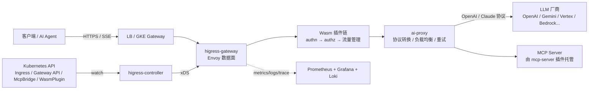

# Higress

> Higress = 基于 Istio + Envoy 的云原生 AI 网关（AI Native API Gateway），CNCF Sandbox 项目。
>
> 资料核对版本：`higress-group/higress` **v2.2.6**（2026-11 发布），官方文档 higress.cn / higress.ai。

---

## 目录

- [1. 一句话理解](#1-一句话理解)
- [2. 项目档案](#2-项目档案)
- [3. 架构](#3-架构)
- [4. 核心优势](#4-核心优势)
- [5. 使用场景](#5-使用场景)
- [6. 插件生态](#6-插件生态)
- [7. 快速上手](#7-快速上手)
- [8. 关键配置模型](#8-关键配置模型)
- [9. 实战示例](#9-实战示例)
- [10. 与其他网关的对比](#10-与其他网关的对比)
- [11. 与本仓库现有内容的选型关系](#11-与本仓库现有内容的选型关系)
- [12. 运维与可观测](#12-运维与可观测)
- [13. 限制与坑](#13-限制与坑)
- [14. 版本路线图](#14-版本路线图)
- [15. 参考链接](#15-参考链接)

---

## 1. 一句话理解

Higress 是一个**开箱即用的 AI 网关 / API 网关**，数据面用 Envoy、内核基于 Istio，控制面用 CRD 驱动，扩展方式是 **Wasm 插件**（Go / Rust / JS）。

它把三件通常分开的东西合并成一套：

| 传统做法 | Higress |
|---|---|
| ingress-nginx 做流量网关 + Kong 做 API 网关 + WAF 独立部署 | 一个 Higress 同时是**流量网关 + 微服务网关 + 安全网关** |
| 自己写代码给每个模型厂商做协议适配 | `ai-proxy` 插件统一 OpenAI / Claude 协议，接 30+ 厂商 |
| AI Agent 要自己搭 MCP Server 网关 | `mcp-server` / `mcp-router` 插件直接托管 MCP Server |

**它解决的核心痛点**（来自官方 FAQ）：

1. Nginx/Tengine reload 会打断长连接 → Higress 基于 xDS 热更新，**配置毫秒级生效、长连接无损**（对 AI 流式场景尤其关键）。
2. Java 类微服务网关对 gRPC/Dubbo 负载均衡能力弱 → Higress 直接用 Envoy 内核。
3. AI 场景下传统网关的"限流/可观测"是按请求数算的，而 AI 要按 **Token** 算 → Higress 有专门的 token 级限流与统计。

---

## 2. 项目档案

| 项 | 值 |
|---|---|
| 仓库 | `https://github.com/higress-group/higress` |
| 官网 / 文档 | <https://higress.ai>（海外）/ <https://higress.cn>（国内） |
| 控制台源码 | `higress-group/higress-console`（Java + React，已开源） |
| 文档源码 | `higress-group/higress-group.github.io` |
| License | Apache 2.0 |
| 治理 | CNCF **Sandbox**（非厂商中立项目，社区共建） |
| 语言 / 内核 | Go（控制面）/ C++ Envoy（数据面）/ Wasm 插件 |
| 出生背景 | 阿里内部产品，2022-10 建仓；已服务阿里云 MSE 云原生网关、百炼、通义 APP 等 |
| 规模（v2.2.6 时点） | ~9.7k Star、1.4k Fork、Apache 2.0 |
| 最新版本 | v2.2.6（2026-11-10） |

**合规身份**（迁移时的重要卖点）：

- Kubernetes 官方 Ingress Controllers 列表收录
- Gateway API **Conformant Implementation**
- Gateway API **Inference Extension (GIE)** 实现（支持 llm-d 等 CNCF AI 基础设施）
- OpenSSF Best Practices 徽章

---

## 3. 架构

### 3.1 组件

| 组件 | 角色 | 说明 |
|---|---|---|
| `higress-controller` | 控制面 | 监听 Ingress / Gateway API / McpBridge / WasmPlugin 等 CRD，翻译成 Istio API 对象，通过 xDS 下发给数据面 |
| `higress-gateway` | 数据面 | Envoy 容器，承担路由、转发、Wasm 插件执行；**无状态**，默认 2 副本 Deployment，支持 HPA |
| `higress-console` | 控制台 | Web 控制台（插件市场、域名/路由管理、服务来源、监控面板），可独立部署 |
| `higress-core`（Istio pilot） | 内嵌控制面 | Higress 自带的 Istio 控制面，Gateway API / Istio CRD 模式需显式开启 |

### 3.2 数据流



### 3.3 Wasm 插件模型

- 插件是 **Wasm 模块**，跑在 Envoy 的 wasm filter 链里，**沙箱隔离、内存安全**，与数据面主进程故障域隔离。
- 支持多语言：Go（tinygo）、Rust、JavaScript。
- 插件镜像遵循 **Wasm Image Spec**（OCI 格式）：镜像里必须有 `spec.yaml`（元数据）、`README.md`、`plugin.wasm`（必须在最后一层）。
- 插件热更新、版本独立升级，**配置变更无 reload、无连接中断**。

---

## 4. 核心优势

| 优势 | 说明 |
|---|---|
| **生产级** | 阿里内部大规模验证，十万级 QPS；消除 Nginx reload 抖动，配置毫秒生效且对业务透明 |
| **流式处理** | 真正支持请求/响应体的**流式处理**，Wasm 插件可自定义 SSE 处理；高带宽 AI 场景显著降低内存开销 |
| **易扩展** | Wasm 沙箱 + 多语言 + 插件独立版本；官方插件覆盖 90%+ 常见场景；插件热更新无损 |
| **安全易用** | 基于 Ingress / Gateway API 标准；开箱 WAF、CC 防护；对接 Let's Encrypt 自动签发续期；**单条 Docker 命令即可脱离 K8s 运行** |
| **三合一** | 流量网关 + 微服务网关 + 安全网关合一，减少部署成本与排障链路 |
| **AI 原生** | Token 级限流、AI 缓存、AI 统计、多模型负载均衡与故障转移、MCP 托管 |

---

## 5. 使用场景

### 5.1 AI Gateway（当前主打的定位）

- 统一协议：对外只暴露 OpenAI (`/v1/chat/completions`)、Claude (`/v1/messages`)、Embeddings (`/v1/embeddings`) 三种路径，`ai-proxy` **自动识别协议**并按需转换成厂商原生协议（零配置）。
- 多模型负载均衡 / 故障转移：`ai-load-balancer`、`ai-endpoint-picker`、`failover`、`retry`。
- Token 级限流与配额：`ai-token-ratelimit`（基于 Redis）、`ai-quota`。
- AI 可观测：`ai-statistics`（input/output token、首 token 延迟、总耗时，按 gateway / route / service / model 四个维度）。
- AI 缓存：`ai-cache`（语义缓存）。
- 安全与合规：`ai-security-guard`、`qwen3guard`、`ai-data-masking`（数据脱敏）。
- Agent 增强：`ai-agent`、`ai-search`、`ai-rag`、`ai-prompt-template`、`ai-json-resp`、`ai-transformer`。

### 5.2 MCP Server 托管（差异化能力）

- 通过 `mcp-server` / `mcp-router` 插件把 MCP Server 挂到网关后面，天然获得：统一鉴权、细粒度限流、全量工具调用审计、可观测。
- `openapi-to-mcpserver` 工具可把 OpenAPI 规范直接转成远程 MCP Server。
- 公共体验环境：<https://mcp.higress.ai/>

### 5.3 Kubernetes Ingress / Gateway API

- 作为 Ingress Controller，兼容大量 ingress-nginx 的 Annotation → 迁移成本低。
- 支持 Gateway API（Conformant），已支持 **Gateway API Inference Extension**。
- 官方给出的对比数据（sealos 案例）：10000 条路由生效 **3 秒**（Ingress Nginx 约 1 分钟）；CPU 成本省 ~50%、内存成本省 ~90%。

### 5.4 微服务网关

- 服务发现：Nacos / Nacos2 / Nacos3、ZooKeeper、Consul、Eureka、Static、DNS（`McpBridge` CRD 配置）。
- **HTTP → Dubbo 协议转换**（把 Dubbo 服务用 HTTP 暴露出去，官方称为"业界最完整的 HTTP-to-Dubbo"）。
- 深度集成 Dubbo / Nacos / Sentinel。

### 5.5 安全网关

- WAF（`waf`）、Bot 检测、IP 黑白名单、CORS、重放防护、请求拦截、请求协议校验。
- 认证体系：Basic / Key / HMAC（含 APISIX 兼容版）/ JWT / OAuth2 / OIDC / 外部认证 / OPA。

---

## 6. 插件生态

### 6.1 官方插件目录（`plugins/wasm-go/extensions`，节选）

**AI Provider（对外提供模型能力）**
`ai-proxy`、`ai-cache`、`ai-prompt-decorator`、`ai-security-guard`

**AI Consumer（调用方治理）**
`ai-token-ratelimit`、`ai-quota`、`ai-data-masking`、`ai-context-limit`

**AI Dev / 其他**
`ai-agent`、`ai-json-resp`、`ai-prompt-template`、`ai-search`、`ai-history`、`ai-intent`、`ai-rag`、`ai-transformer`、`ai-statistics`、`geo-ip`

**流量与协议**
`traffic-editor`、`traffic-tag`、`request-validation`、`key-rate-limit`、`cluster-key-rate-limit`、`jsonrpc-converter`、`de-graphql`、`transformer`、`response-cache`、`cache-control`、`frontend-gray`、`custom-response`、`nginx-rewrite-compatible`、`gw-error-format`

**安全**
`waf`、`bot-detect`、`cors`、`ip-restriction`、`replay-protection`

**认证**
`key-auth`、`basic-auth`、`hmac-auth`、`hmac-auth-apisix`、`jwt-auth`、`oauth2`、`oidc`、`ext-auth`、`opa`

**协议与 AI 路由**
`mcp-server`、`mcp-router`、`model-router`、`model-mapper`、`chatgpt-proxy`、`api-workflow`、`log-request-response`

> 完整清单以仓库 `plugins/` 目录为准；插件的 OCI 镜像地址见 `higress-console/backend/sdk/src/main/resources/plugins/plugins.properties`（官方插件稳定版 tag 为 `1.0.0`，开发版为 `latest`）。

### 6.2 ai-proxy 支持的模型厂商（`type` 值）

`openai`、`azure`（Azure OpenAI）、`moonshot`、`qwen`（通义千问）、`baichuan`、`baidu`（文心）、`yi`（零一）、`zhipuai`（智谱）、`deepseek`、`groq`、`grok`、`openrouter`、`fireworks`、`ai360`（360 智脑）、`mistral`、`minimax`、`claude`（Anthropic）、`ollama`、`hunyuan`（腾讯混元）、`stepfun`（阶跃）、`cloudflare`（Workers AI）、`spark`（讯飞星火）、`gemini`（Google）、`deepl`、`vertex`（Google Vertex AI）、`bedrock`（AWS Bedrock），以及 `cohere`、`coze`、`dify`、`doubao`、`github`、`galadriel`、`kling`、`longcat` 等。

---

## 7. 快速上手

### 7.1 本机 Docker（不依赖 K8s）

```bash
mkdir higress && cd higress

docker run -d --rm --name higress-ai -v ${PWD}:/data -e O11Y=on \
  -p 8001:8001 -p 8080:8080 -p 8443:8443 \
  higress-registry.cn-hangzhou.cr.aliyuncs.com/higress/all-in-one:latest
```

| 端口 | 用途 |
|---|---|
| 8001 | Higress 控制台（首次访问需初始化管理员账号） |
| 8080 | 网关 HTTP 入口 |
| 8443 | 网关 HTTPS 入口 |

也可挂 Nacos 存配置（适合 VM 部署形态）：

```bash
curl -fsSL https://higress.io/standalone/get-higress.sh | bash -s -- -a -c nacos://192.168.0.1:8848 \
  --nacos-username=nacos --nacos-password=nacos
```

### 7.2 Kubernetes（Helm）

```bash
helm repo add higress.io https://higress.io/helm-charts
helm install higress -n higress-system higress.io/higress --create-namespace --render-subchart-notes
```

**关键参数**

| 参数 | 说明 | 默认值 |
|---|---|---|
| `global.ingressClass` | 监听的 IngressClass。`nginx` = 同时监听 `nginx` 与空 class；空 = 监听全部 | `higress` |
| `global.watchNamespace` | 只监听指定 namespace | `""` |
| `global.enableGatewayAPI` | 开启 Gateway API 支持（需先装 gateway-api CRD，最高 1.0.0） | `false` |
| `global.enableIstioAPI` | 开启 Istio CRD 支持（需先装 istio-base） | `false` |
| `global.enableStatus` | 是否回写 Ingress.status（迁移自 Nginx 时可关） | `true` |
| `global.o11y.enabled` | 安装内置监控套件（Prometheus + Grafana + Loki + PromTail） | `false` |
| `global.hub` | 镜像仓库前缀，海外可用 `higress-registry.us-west-1.cr.aliyuncs.com` | `higress-registry.cn-hangzhou.cr.aliyuncs.com` |
| `global.local` | 本地集群（kind 等）安装时置 `true` | `false` |
| `higress-core.gateway.replicas` | 网关副本数 | `2` |
| `higress-core.gateway.kind` | `Deployment` 或 `DaemonSet` | `Deployment` |
| `higress-core.controller.replicas` | 控制面副本数 | `1` |
| `higress-console.replicaCount` | 控制台副本数 | `1` |

**Gateway API 模式**

```bash
kubectl apply -f https://github.com/kubernetes-sigs/gateway-api/releases/download/v1.0.0/experimental-install.yaml
helm upgrade higress -n higress-system --set global.enableGatewayAPI=true higress.io/higress --reuse-values
```

**拿入口地址**

```bash
kubectl get svc -n higress-system higress-gateway -o jsonpath='{.status.loadBalancer.ingress[0].ip}'
```

> 没有 LB IP 说明集群不支持 `LoadBalancer` 类型 Service：可用云厂商 LB、`higress-core.gateway.hostNetwork=true`（监听宿主机端口），或 MetalLB（生产不建议）。

### 7.3 CLI：`hgctl`

发布物自带 `hgctl`（darwin/linux/windows amd64+arm64），用于命令行安装/运维 Higress。

---

## 8. 关键配置模型

### 8.1 插件配置的三个层级与优先级

控制台有三个配置入口：

1. **全局**：插件市场 → 选择插件配置
2. **域名级**：域名管理 → 域名 → 策略
3. **路由级**：路由配置 → 路由 → 策略

**优先级：路由级 > 域名级 > 全局**。全局配置只对未命中具体路由/域名的请求生效。

> 认证类插件（key-auth 等）逻辑不同：全局层配"凭证 + 是否全局开启认证"，路由/域名层用 `allow` 列表指定允许的 Consumer。

### 8.2 `WasmPlugin` CRD

扩展自 Istio 的 `WasmPlugin`，增加 `defaultConfig` 与 `matchRules`：

```yaml
apiVersion: extensions.higress.io/v1alpha1
kind: WasmPlugin
metadata:
  name: request-block
  namespace: higress-system
spec:
  defaultConfig:          # 全局默认
    block_urls:
    - swagger.html
    case_sensitive: false
  matchRules:             # 按 ingress / domain 精确覆盖
  - ingress:
    - default/foo         # 格式：namespace/name
    config:
      block_headers:
      - example-key
  url: oci://higress-registry.cn-hangzhou.cr.aliyuncs.com/plugins/request-block:1.0.0
```

`matchRules` 多条时**按顺序匹配，命中即止**；官方建议把 ingress 匹配放在 domain 匹配之前。

### 8.3 `McpBridge` CRD（服务来源 / 服务发现）

只监听安装命名空间下名为 `default` 的 McpBridge。

```yaml
apiVersion: networking.higress.io/v1
kind: McpBridge
metadata:
  name: default
  namespace: higress-system
spec:
  registries:
  - type: nacos3          # nacos/nacos2/nacos3/zookeeper/consul/eureka/static/dns
    name: my-nacos
    domain: 192.168.1.2
    port: 8848
    nacosNamespaceId: d8ac64f3-xxxx
    nacosGroups: ["DEFAULT_GROUP"]
    enableMCPServer: true
    mcpServerBaseUrl: /mcp-server
    mcpServerExportDomains: ["example.com"]
```

认证信息放在 `higress-system` 下的 Secret（`authSecretName`）：Nacos 用 `nacosUsername`/`nacosPassword`，Consul 用 `consulToken`。

### 8.4 Ingress + Annotation

```yaml
apiVersion: networking.k8s.io/v1
kind: Ingress
metadata:
  name: ingress-example
  annotations:
    higress.io/enable-cors: "true"
spec:
  ingressClassName: higress
  rules:
  - http:
      paths:
      - path: /test
        pathType: Prefix
        backend:
          service:
            name: test
            port:
              number: 80
```

---

## 9. 实战示例

### 9.1 AI 代理到 Google Vertex AI（GCP 场景）

```yaml
apiVersion: extensions.higress.io/v1alpha1
kind: WasmPlugin
metadata:
  name: ai-proxy
  namespace: higress-system
spec:
  defaultConfig:
    provider:
      type: vertex
      apiTokens:
      - "YOUR_GCP_ACCESS_TOKEN"        # 或用 vertexAuthServiceName 做 OAuth2
      vertexProjectId: "my-gcp-project"
      vertexRegion: "us-central1"
      vertexAuthKey: "<base64 SA JSON>"  # service account JSON key
      vertexTokenRefreshAhead: 300
    modelMapping:
      "gpt-4o": "gemini-2.0-flash"
      "*": "gemini-2.0-flash"
  url: oci://higress-registry.cn-hangzhou.cr.aliyuncs.com/plugins/ai-proxy:1.0.0
```

对接 Gemini 直连则是 `type: gemini`，可选 `geminiSafetySetting`、`apiVersion`（`v1`/`v1beta`）、`geminiThinkingBudget`（Gemini 2.5 系列思考预算，`0` 关闭，`-1` 动态）。

### 9.2 Token 级限流（按 Consumer / Header / IP 维度）

```yaml
apiVersion: extensions.higress.io/v1alpha1
kind: WasmPlugin
metadata:
  name: ai-token-ratelimit
  namespace: higress-system
spec:
  defaultConfig:
    rule_name: routeA-global-limit-rule
    global_threshold:
      token_per_minute: 1000
    rejected_code: 429
    rejected_msg: "Too many requests"
    redis:
      service_name: "redis.my-ns.svc.cluster.local"
      service_port: 6379
      password: "xxx"
  url: oci://higress-registry.cn-hangzhou.cr.aliyuncs.com/plugins/ai-token-ratelimit:1.0.0
```

按 key 动态限流可用 `rule_items` + `limit_by_consumer` / `limit_by_header` / `limit_by_param` / `limit_by_cookie` / `limit_by_per_ip` 等。

### 9.3 AI 统计（把 token 打进访问日志）

```yaml
apiVersion: extensions.higress.io/v1alpha1
kind: WasmPlugin
metadata:
  name: ai-statistics
  namespace: higress-system
spec:
  defaultConfig:
    attributes:
    - key: user_tier
      value_source: request_header
      value: x-user-tier
      apply_to_log: true
      apply_to_span: true
  url: oci://higress-registry.cn-hangzhou.cr.aliyuncs.com/plugins/ai-statistics:1.0.0
```

控制面/数据面日志格式里加上 AI 字段：

```yaml
'{"ai_log":"%FILTER_STATE(wasm.ai_log:PLAIN)%"}'
```

### 9.4 模型映射（`modelMapping` 语义）

- 支持前缀通配：`"gpt-4-*"` 匹配所有以 `gpt-4-` 开头的模型名。
- `"*"` 作为兜底映射。
- 映射结果为空字符串 `""` 表示保留原模型名。
- `customSettings` 可跨协议改参数（`max_tokens` → gemini 的 `maxOutputTokens`、qwen 的 `parameters` 子路径、gemini 的 `generation_config` 子路径）；`mode: raw` 时直接改 JSON 不做重命名。

---

## 10. 与其他网关的对比

### 10.1 官方对比表摘要（Higress vs Nginx vs Spring Cloud Gateway）

| 维度 | Higress | Nginx(ingress-nginx) | Spring Cloud Gateway |
|---|---|---|---|
| 内核 | Envoy + Istio | Nginx | Spring Framework |
| 架构 | 流量 + 微服务 + 安全网关三合一 | 流量网关 | 微服务网关 |
| Ingress / Gateway API 标准 | 都支持 | Ingress 支持，Gateway API 有计划 | 暂无公开计划 |
| AI 代理 / 审核 / 统计 / 限流 / 开发插件集 | ✅ | ❌ | ❌ |
| 无损变更 | ✅ | ❌ | ❌ |
| 多注册中心（Nacos/K8s Service 等） | ✅ | ❌（需配合其他组件） | ❌ |
| HTTP → Dubbo | ✅ | ❌ | ❌ |
| 可观测开箱即用 | ✅ | ❌（需自建） | ❌（需自建） |
| 10000 路由生效 | ~3 秒 | ~1 分钟 | — |
| CPU / 内存成本 | 比 ingress-nginx 省 50% / 90% | 基准 | — |
| Wasm 扩展 + 热更新 | ✅ | ❌（Lua，需 reload） | ❌（Java 扩展，需重启） |

### 10.2 vs Envoy Gateway（官方 FAQ 口径）

两者都基于 Envoy 且遵循 Gateway API。Higress 额外提供：

1. **安全插件**：WAF、各类认证。
2. **服务管理插件**：多注册中心、协议转换、限流降级、**HTTP→Dubbo**。
3. **Wasm / Lua 扩展**：Envoy Gateway 生态较弱（Higress 计划支持 out-of-process 插件服务 Java 用户）。

### 10.3 vs Tengine / Kong / APISIX

- **Tengine**：Nginx + Lua，Higress 是 Istio + Envoy + Wasm；技术栈不同，但 Higress 兼容 Nginx Ingress Annotation，可平滑迁移。
- **Kong / APISIX**：内核是 Nginx + Lua（或 OpenResty），插件生态以 Lua 为主；Higress 走 Wasm 多语言路线。APISIX 的 `hmac-auth-apisix` 在 Higress 里有兼容插件，说明存在互迁需求。
- 官方对"定制上游导致生态跟进吃力"的回应：Higress 核心采用可插拔 Filter 扩展，定制点收敛；APISIX/Kong 基于 Nginx 也能持续发展，说明上游跟进不是障碍。

### 10.4 与云厂商产品

- 阿里云 **MSE 云原生网关** = Higress 的商业版（性能、稳定性、易用性、安全能力有差异，核心逻辑一致）。
- 开源版与企业版主次版本号对齐（v2.x），仅 patch 版本可能不一致。

---

## 11. 与本仓库现有内容的选型关系

本仓库已有 `gateway/kong/`（Kong 文档）、`gateway/no-gateway/`（无网关直连方案）、`gateway/docs/Design.md`（平台接入分类）、`gcp/gke/`、`gcp/ingress/` 等。Higress 的定位：

| 场景 | 建议 |
|---|---|
| 已有 Kong 体系、插件以 Lua 为主、治理规则成熟 | 继续用 Kong；Higress 提供 AI 插件补齐 AI 治理缺口 |
| 要做 **AI 网关 / MCP 托管 / Token 级治理** | Higress 明显更合适（Kong 侧对应能力弱） |
| 纯 GCP + GKE + Gateway API 体系 | 优先评估 **GKE Gateway（Cloud Load Balancing 集成）**；Higress 适合需要"AI 网关语义 + 跨厂商模型"或"HTTP→Dubbo / 多注册中心"时 |
| 简单路由、只想少一层组件 | 参考 `gateway/no-gateway/`，很多场景不需要网关 |

**在 GKE 上部署 Higress 的注意事项**：

1. `--set global.hub=higress-registry.us-west-1.cr.aliyuncs.com` 换海外镜像源，避免拉取国内 registry 超时。
2. `global.ingressClass` 与集群里已有 ingress-nginx 共存时注意 IngressClass 冲突（置 `nginx` 可同时接管 nginx class 的 Ingress，做迁移验证很方便）。
3. 开启 Gateway API 需先安装 `gateway-api` CRD（最高 1.0.0），并 `global.enableGatewayAPI=true`。
4. `higress-gateway` Service 默认 `LoadBalancer`，GKE 上会创建云负载均衡（版本/配置相关，需实测确认）；生产更推荐在 Higress 前再放一层 GKE Gateway。
5. 拉取插件镜像需要能访问 `higress-registry.*`，或自建镜像仓库并改 `global.hub`。
6. `--set global.enableStatus=false` 避免迁移期间覆盖 Nginx Ingress 写入的 `Ingress.status`。

---

## 12. 运维与可观测

### 12.1 内置监控套件

```bash
helm install higress -n higress-system higress.io/higress --create-namespace \
  --set global.o11y.enabled=true
```

安装后控制台"监控面板"直接可用（Prometheus + Grafana + Loki + PromTail）。也支持对接自建 Prometheus/Grafana，在控制台填外部 Dashboard URL。

### 12.2 指标维度

- 通用：Envoy 原生指标 + 控制面指标。
- AI（`ai-statistics`）：input token、output token、首 token 延迟（流式）、总请求耗时；按 **gateway / 路由 / 服务 / 模型** 四个维度聚合。
- 插件可扩展自定义 attribute（`fixed_value` / `request_header` / `request_body` / `response_header` / `response_body` / `response_streaming_body`），流式响应可用 `first` / `replace` / `append` 规则提取。

### 12.3 伸缩

网关无状态，基于 K8s HPA 弹性伸缩；`Deployment` / `DaemonSet` 可选。

---

## 13. 限制与坑

| 问题 | 现状 |
|---|---|
| 离线部署包 | **官方不提供**，需自行构建（镜像都可拉取） |
| 虚拟机 / 物理机部署 | 开源版暂不支持（可用 Nacos 存配置，或用阿里云 MSE 商业版托管） |
| Gateway API 版本 | 最高支持 **1.0.0** |
| Istio CRD 依赖 | 开启 `global.enableIstioAPI` 需先装 Istio CRD（或只装 `istio/base`） |
| 插件语言生态 | Java 的 Wasm 支持尚不完善，Higress 计划支持 out-of-process 插件 |
| 镜像拉取 | 默认 registry 在国内，海外需改 `global.hub` |
| 上游跟随 | 定制过的 Envoy 内核不会立刻跟进上游版本，升级需评估 |
| 控制台插件配置 | 优先级顺序敏感（路由 > 域名 > 全局），排查问题先确认命中哪一层 |
| `McpBridge` | 只监听安装命名空间下名为 `default` 的资源 |

---

## 14. 版本路线图

| 版本 | 核心目标 | 预计时间 |
|---|---|---|
| v1.0.0 | GA | 2023-05 |
| v1.4.0 | Wasm 支持 Redis 调用；HTTPS 证书管理简化 | 2024-05 |
| v2.0.0 | 大量新插件带来的更丰富 API 网关能力 | 2024-08 |
| v2.1.0 | 控制台支持 AI 流量入口管理，降低 AI 使用成本 | 2025-02 |
| v2.2.0 | 支持 **GIE**（Gateway API Inference Extension），对接 llm-d 等 CNCF AI 基础设施 | 2025-12 |
| v2.3.0 | 通过 Agent 支持 Higress 的全面 AI-native 运维；支持 WebRTC 实时 AI 场景 | 2026-06 |
| v2.4.0 | 优化 Wasm 插件内存拷贝场景性能；Wasm 内支持 WebRTC / WebSocket 自定义扩展 | 2026-12 |

---

## 15. 参考链接

**官方**

- 官网（国内）：<https://higress.cn/>
- 官网（海外）：<https://higress.ai/>
- 文档总览：<https://higress.cn/docs/latest/overview/what-is-higress/>
- 快速开始：<https://higress.cn/docs/latest/user/quickstart/>
- Helm 部署：<https://higress.cn/docs/latest/ops/deploy-by-helm/>
- Helm 全量参数：<https://higress.cn/docs/latest/user/configurations/>
- FAQ：<https://higress.cn/docs/latest/overview/faq/>
- Roadmap：<https://higress.cn/docs/latest/overview/roadmap/>
- 插件市场：<https://higress.cn/plugin/>
- Wasm 开发电子书：<https://higress.cn/docs/ebook/wasm19/>
- MCP 快速开始：<https://higress.cn/ai/mcp-quick-start/>
- 公共 MCP 平台：<https://mcp.higress.ai/>
- 控制台 Demo：<https://demo.higress.io/>

**源码**

- 主仓库：<https://github.com/higress-group/higress>
- 控制台：<https://github.com/higress-group/higress-console>
- 文档站：<https://github.com/higress-group/higress-group.github.io>
- 社区（ADOPTERS / MEETINGS / ROADMAP）：<https://github.com/higress-group/community>
- OpenAPI → MCP：<https://github.com/higress-group/openapi-to-mcpserver>

**标准与生态**

- Gateway API 实现列表：<https://gateway-api.sigs.k8s.io/implementations/>
- GIE 实现列表：<https://gateway-api-inference-extension.sigs.k8s.io/implementations/gateways/>
- Kubernetes Ingress Controllers：<https://kubernetes.io/docs/concepts/services-networking/ingress-controllers/>
