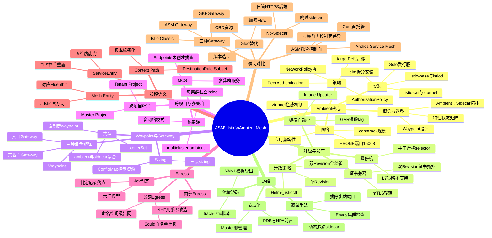

# ASM / Istio / Ambient Mesh 知识点分析

Analyze the `gcp/asm/` knowledge base. Categorize the Cloud Service Mesh / Istio / Ambient documents by technical domain, summarize the key knowledge points, and present everything as a Markdown document with a Mermaid mindmap.

本文档覆盖 `gcp/asm/` 下的 **114 篇文档**——这是全库最"深"的一个目录，
几乎每篇都是**在一个真实生产网格上做过的验证**，而不是文档摘抄。

> **一句话结论**
> ★ 这个目录的真正主题是 **"从 Sidecar 迁到 Ambient"**：
> `k8s-gateway-ambient/` 用 23 篇编号文档把 Ambient 的安装、策略、升级、证书、
> Egress、Waypoint 一条条拆开；其余子目录则是 **ASM 托管控制面 vs 自管 Istio、
> Gloo 替代方案、跨项目 Mesh** 的横向对比。

---

## 文档体系分析

1. **Ambient 深度专题**（`k8s-gateway-ambient/`，23+ 篇，编号 01–23）
   —— 本目录的主线，按"概念 → 安装 → 策略 → 升级 → 证书 → Egress"推进
2. **案例与样本**（`case-lex/`、`case-lex-intra-call/`、`upgrade/`）
   —— 真实 YAML 样本、审计报告、零停机升级方案
3. **Gloo 替代方案**（`gloo/`，13 篇）
   —— Gloo Mesh Enterprise 与 ASM 的对比、Ambient 模式下的 Waypoint
4. **ASM 与 Istio 对照**（`asm.md`、`no-mtls/`、`cloud-service-mesh*.md`）
   —— 托管 vs 自管控制面、三种 Gateway 范式、No-Sidecar 部署
5. **策略与调试工具**（`debug-istio.md`、`trace-istio.md`、`authorizationPolicy-*`、
   `peerAuthentication-*`、`ServiceEntry.md`、`istio-context.md`）
   —— 能力矩阵、故障定位手法、CRD 语义

---

## 知识点 MindMap



---

## 主要知识领域详解

### 1. Ambient 核心（`k8s-gateway-ambient/`）

#### 1.1 概念与选型
- `01-ambient-vs-sidecar.md`：**不是"换个注入方式"，是拓扑变了**——
  Sidecar 是每 Pod 一个 Envoy；Ambient 是节点级 ztunnel（L4）+ 命名空间级 Waypoint（L7）。
  配了一张"本场景要不要迁"的**决策树**。
- `03-waypoint-design.md`：per-namespace vs per-service 怎么选、3 种部署方式。
- `07-feature-status-1.30.3.md`：GA / Beta / Alpha 完整清单 + "1.30 已知会咬人的边界"。

#### 1.2 安装
`02-install-ambient-helm.md` 明确指出**不能再用** `istioctl install --set profile=ambient`，
必须**拆开装**：`istio-base` → `istiod` → `istio-cni` → `ztunnel`，
并且镜像只需要 istiod + ztunnel 两个。

#### 1.3 策略（最容易"不报错但也不生效"的地方）
| 文档 | 关键结论 |
|---|---|
| `06-policy-capabilities.md` | Ambient 下两套策略语义不同；**有些 selector 写法在 ambient 下直接不生效且不报错** |
| `08-ambient-networkpolicy.md` | K8s NetworkPolicy 必须**同时**放行业务端口 **和 15008**（HBONE 隧道口），否则 mesh 流量进不来 |
| `11-l7-zero-downtime-constraint.md` | **L7 策略不支持 zero-downtime handoff**；`selector` → `targetRefs` 必须**手工**迁移 |
| `14-parametersRef-vs-targetRefs-concept-clarity.md` | 两个都叫 "Refs" 但完全不同的东西，配了"出现位置矩阵" |

#### 1.4 网络与兼容性
- `09-ztunnel-redirection-app-compat.md`：ztunnel 在 Pod netns 里重定向
  （出流量 → 127.0.0.1:15001，入流量 → 127.0.0.1:15006；15008 不重定向，那是 HBONE 监听）；
  给出**应用代码兼容性矩阵** + conntrack/iptables 规模上限。
- `22-ztunnel-mtls-and-cert-rotation.md`：L4 mTLS 端到端路径与证书轮转。

### 2. 升级与发布（`upgrade-strategies` / canary）
- `05-upgrade-strategies.md`：**5 种升级路径全表**（单 revision / 双 revision canary × Helm / istioctl）。
- `12-revision-canary-mtls-compat.md`：双 Revision 下的**证书拓扑**——
  istiod 与 istiod-canary 各自的端口与 SA 关系。
- `15-istio-revision-mechanism-explained.md` + `16-revision-like-patterns-cloud-native.md`：
  把 Istio Revision 放回云原生生态，横向对比 **6 种 Revision 机制**（Argo CD、Flux、Helm release、Kustomize…），
  抽出共同模式——这是本目录**方法论含量最高**的一组。
- `17-istio-image-tag-automation-sre-workflow.md`：把"升级 image tag"变成 SRE 常规任务，推荐 ArgoCD Image Updater。

### 3. 跨项目与多集群
- `3-add-mesh.md`、`cross-project-mesh.md`、`master-project-setup-mesh.md`、
  `kilo-minimax-cross-project-mesh.md`：**Master Project 持有 ASM 控制面**，
  Tenant Project 通过 **PSC NEG** 接入；每篇都按
  `Goal and Constraints → Recommended Architecture (V1) → Trade-offs → Implementation → Validation and Rollback` 写。
- `13-multicluster-ambient-status.md`：multicluster ambient 与传统 sidecar 的关键差异
  （ambient east-west gateway、多网络下**每集群独立装 istiod + ambient**、需开环境变量）。

### 4. Egress 与跨项目判定
- `21-solo-ambient-egress.md`：**Ambient 下 Egress 默认"不安全"**；
  内部 Egress（NHF）几乎零改造，公网 Egress（Squid allowlist）需要迁移方案；
  还包含"命名空间级公共出网白名单"。
- `case-lex/jev-egress-explorer.md`：用 Jev 做 Public Egress 策略判定——**六问模型** +
  "配对图的反向覆盖，判定记录落在哪里"。

### 5. 策略语义三件套
- `authorizationPolicy-capabilities-and-use-cases.md`：四种 action 何时用哪个 + 字段全表。
- `peerAuthentication-capabilities-and-use-cases.md`：四种 mode 的语义表 + "workload 监听 8080 但 Service 暴露 80" 这类映射。
- `ServiceEntry.md`：**五维度**拆分"ServiceEntry 到底能控制什么"，并深挖
  `TLS 握手重置 (Connection Reset)` 的成因。
- `istio-context.md`：**Context Path 就是版本标签**——VirtualService 不区分版本，
  靠 DestinationRule 的 Subset + Deployment Label 分组。

### 6. 横向对比（选型时必读）
| 对比 | 文档 | 结论 |
|---|---|---|
| ASM 托管 vs 集群内控制面 | `asm.md` | 两者**不是同一件事**；Anthos Service Mesh for Multi-Cluster 又是第三个概念 |
| 三种 Gateway | `no-mtls/gateways-type.md` | GKE Gateway（K8s API）/ ASM Gateway（Envoy）/ Istio Classic |
| ASM vs Gloo | `gloo/cross-project-gloo-mesh.md` | 跨项目场景下 Gloo 替代 ASM 的**配置迁移清单** |
| No-Sidecar | `no-mtls/How-to-setup-istio-nosidecar.md` | ASM 托管控制面 + 自管 Istio Ingress Gateway，**不用 sidecar** |
| Solo vs 上游 Istio | `18-solo-distribution-vs-upstream-istio-comparison.md` | 镜像名/版本号/安装工具三张对照表 |

### 7. 运维与调试
- `debug-istio.md`：三条并列手法——**动态追踪 sidecar 实时访问日志**、
  **排除 sidecar 干扰**（加 `traffic.sidecar.istio.io/excludeOutboundPorts`）、
  **查 Envoy 眼中的 cluster 与路由**。
- `trace-istio.sh`：从 URL 反向追到 Gateway → VirtualService → DestinationRule → Service → Deployment，
  并导出干净的 YAML 模板供新 API 接入复用。

---

## 三条阅读路线

```
路线 A · 先搞懂 Ambient 是什么（2 小时）
  01-ambient-vs-sidecar.md → 03-waypoint-design.md → 07-feature-status-1.30.3.md
  → 02-install-ambient-helm.md

路线 B · 准备一次真实迁移（1 天）
  11-l7-zero-downtime-constraint.md → 14-parametersRef-vs-targetRefs...
  → 08-ambient-networkpolicy.md → 04-runtime-migration.md
  → 12-revision-canary-mtls-compat.md

路线 C · 做选型决策（半天）
  asm.md → no-mtls/gateways-type.md → gloo/gloo-concepts.md
  → gloo/cross-project-gloo-mesh.md → cross-project-mesh.md
```

---

## 结论

1. **这是全库少见的"从 01 排到 23"的连续编号目录**，说明它是**按实施顺序写下来的**，
   不是零散调研——照着编号读就能走完一次迁移。
2. **最大的价值在"不报错但也不生效"的坑**：Ambient 下策略语义变化、
   NetworkPolicy 漏放 15008、`targetRefs` 不自动迁移——
   这三类问题在文档里都被单独拎出来写了。
3. **方法论含量高**：`16-revision-like-patterns-cloud-native.md` 把 Revision 抽成通用模式，
   `06-policy-capabilities.md` 用"场景化矩阵"代替抽象定义——
   都能直接搬到别的技术选型里用。
4. **ASM 与 Gloo 是两条平行路线**，`gloo/` 提供了完整的对比与迁移清单，
   但要警惕：Gloo Enterprise 的版本选型是**时效性结论**，用前需复核。

---

## 关联文档

- [../gcp-mindmap.md](../gcp-mindmap.md) ·
-   [k8s-gateway-ambient/README.md](./k8s-gateway-ambient/README.md) ·
  [k8s-gateway-ambient/ADR-LOCAL-001-migrate-minimal-to-ambient.md](./k8s-gateway-ambient/ADR-LOCAL-001-migrate-minimal-to-ambient.md) ·
  [k8s-gateway-ambient/case-lex/README.md](./k8s-gateway-ambient/case-lex/README.md) ·
  [no-mtls/gateways-type.md](./no-mtls/gateways-type.md) ·
  [gloo/gloo-concepts.md](./gloo/gloo-concepts.md)
- 相关：[../mtls/mtls-mindmap.md](../mtls/mtls-mindmap.md) ·
  [../ingress/ingress-control-mindmap.md](../ingress/ingress-control-mindmap.md)
