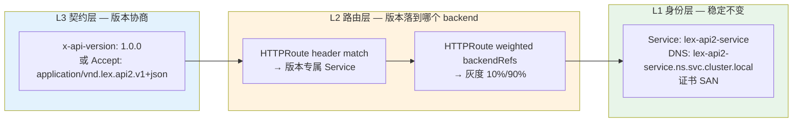
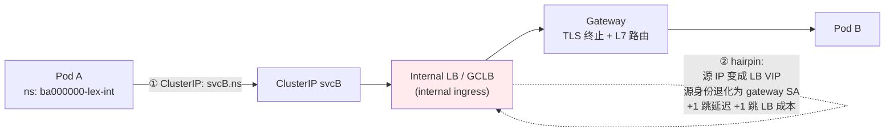
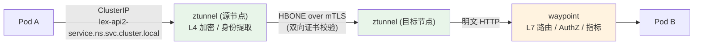
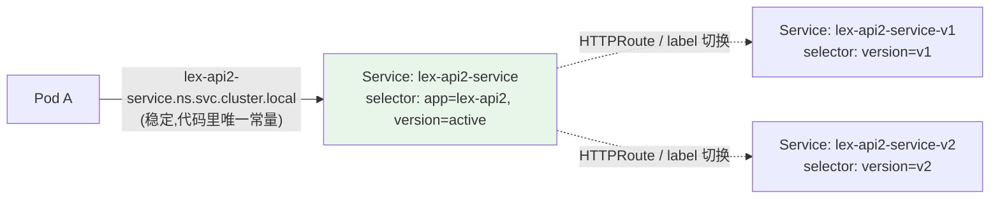
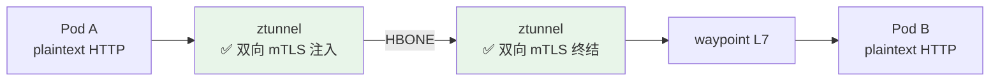
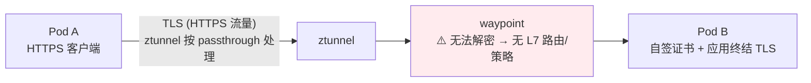
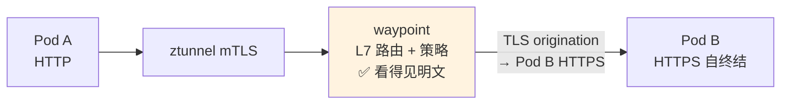
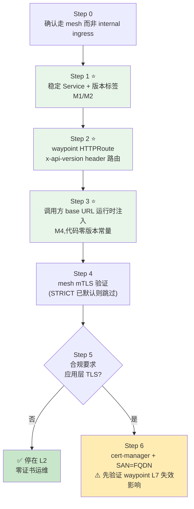
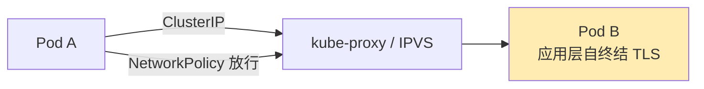

# Intra-Namespace Call:版本解耦 + svc DNS + HTTPS/TLS(GKE + Ambient)

> **TL;DR**:
> - **核心原则**:DNS 名承载「**服务身份**」(稳定、版本无关),版本承载在「**标签/选择器 + 协议协商**」层。调用方代码里**永远不出现版本号**。
> - **不绕路**:Pod A → ztunnel(L4 mTLS/HBONE)→ waypoint(L7)→ Pod B。**ClusterIP 走 waypoint 就是不绕路**,hairpin 只发生在「A → internal ingress(LB)→ Pod B」这条路径上。
> - **三个问题各有标准解**:
>   - ① `svc.local` → **写错**。GKE cluster domain 默认 `cluster.local`,FQDN 是 `<svc>.<ns>.svc.cluster.local`。`svc.local` **不是**合法后缀。
>   - ② 版本写死 → **稳定 Service + 版本标签/HTTPRoute backendRefs + `x-api-version` 头协商** 三层解耦(见 §5 M1–M4)。
>   - ③ HTTPS 证书 → **优先 mesh mTLS(零证书运维)**;必须应用层 HTTPS 时,证书 SAN 只写 FQDN,**绝不自签只写 IP**。
> - **一句话架构**:`稳定 Service 名`(= 身份 + DNS + 证书 SAN)+ `版本专属 Service/权重路由`(= 版本切换)+ `调用方 base URL 运行时注入`(= 代码零版本常量)。

---

## 0. 文档定位

### 0.1 适用前提

| 前提 | 说明 |
|---|---|
| 平台 | GKE(europe-west2 等),集群域默认 `cluster.local` |
| Mesh | Istio **ambient** 模式(ztunnel + waypoint),namespace 已打 `istio.io/dataplane-mode=ambient` |
| 现有链路 | `http.lex.caep.uk` → internal ingress(Gateway)→ waypoint → 业务 Pod,见 `case-lex/` |
| 业务 ns | `ba000000-lex-int`,已配 per-namespace waypoint `waypoint-int` |
| 场景 | **同 namespace 内** API A → API B,要求:不绕 internal ingress、代码不含版本、必须 HTTPS |

### 0.2 来源引用

- [Istio Ambient 概览](https://istio.io/latest/docs/ambient/overview/)
- [Istio Ambient 安全模型](https://istio.io/latest/docs/ambient/security/)
- [Istio Waypoint 文档](https://istio.io/latest/docs/ambient/usage/waypoint/)
- [Istio 双层网关(two-tier gateway)模式](https://istio.io/latest/docs/ambient/usage/deploying-waypoint/#two-tier-gateway-pattern)
- [Gateway API for Mesh(GAMMA)](https://gateway-api.sigs.k8s.io/guides/gateway-api-for-mesh/)
- [Istio DestinationRule reference](https://istio.io/latest/docs/reference/config/networking/destination-rule/)
- [K8s DNS for Services and Pods](https://kubernetes.io/docs/concepts/services-networking/dns-pod-service/)
- [GKE DNS 文档](https://cloud.google.com/kubernetes-engine/docs/concepts/dns)
- [GKE Gateway 文档](https://cloud.google.com/kubernetes-engine/docs/concepts/gateway-api)
- [cert-manager 文档](https://cert-manager.io/docs/usage/)
- [cert-manager CA Injector](https://cert-manager.io/docs/installation/ca-injector/)
- 同仓库 `03-waypoint-design.md` / `06-policy-capabilities.md` / `10-waypoint-gateway-coexistence.md` / `22-ztunnel-mtls-and-cert-rotation.md`
- 同仓库 `case-lex/03-mesh-security.yaml` / `case-lex/08-app-deployment.yaml` / `case-lex/09-01-app-httproute.yaml`

### 0.3 术语约定

| 术语 | 含义 |
|---|---|
| **hairpin** | 流量从集群内 Pod 出发,绕到集群外(ILB/GCLB),再绕回集群内目标 Pod |
| **ingress** | 南北向入口,本文特指 internal ingress(GKE Gateway `gke-l7-rilb`) |
| **waypoint** | ambient 的 L7 代理,per-namespace 或 per-service 部署 |
| **GAMMA** | Gateway API for Mesh,HTTPRoute 通过 `parentRefs: kind: Service` 直接挂到 Service 上 |

---

## 1. 问题拆解

用户提的其实是 **3 个独立子问题**,先拆开再选型,否则会混成一锅。

| # | 原始表述 | 真实诉求 | 归属层 |
|---|---|---|---|
| **P1** | 需要 svc.local 域名 | 调用方需要一个**稳定、可解析、可签证书**的 DNS 名 | **身份层** |
| **P2** | 访问地址是变化的,影响 intra-namespace call | 版本号不能出现在调用方代码 / URL 里 | **路由层 + 契约层** |
| **P3** | Pod 强制 HTTPS,需要 TLS 证书 | 东西向流量要有可验证的加密与身份 | **传输层** |

**关键澄清(必须先对齐认知):**

1. **P2 的"地址变化"不是 DNS 的问题,是"契约"的问���。**
   DNS 名应该**永远不变**。版本变化应该体现在 **Service selector / HTTPRoute backendRefs / 请求头** 上,而不是 DNS 名上。
   → 一旦版本进 DNS 名(`lex-api1-service-1.0.0`),调用方就必然要改代码或改配置,这就是根因。

2. **P1 的 `svc.local` 是个笔误,但方向是对的。**
   GKE 的 cluster domain 默认 `cluster.local`,**合法后缀是 `.svc.cluster.local`**。
   `svc.local` 本身 **不是**合法后缀(CoreDNS 里没有 `svc.local` 这个 zone),查 `xxx.ns.svc.local` 会 NXDOMAIN。
   合法形式见 §6.1。

3. **P3 与 P1 强耦合**:证书 SAN 必须覆盖调用方使用的那个 DNS 名。所以先定 DNS 形式,再定 SAN。

4. **"不绕出去"在 ambient 下已经有现成答案**:
   ClusterIP → ztunnel → waypoint → Pod **本来就不绕**。需要避免的只是**主动去访问 internal ingress**。

---

## 2. 核心解耦原则

> **DNS 名 = 服务身份(Identity),稳定、版本无关、可签证书。
> 版本 = 路由属性(Routing Attribute),随发布变化。
> 契约 = 协议协商(Contract),通过 header / media type 表达。**

三层彻底分离:



**为什么这样分层**:

- L1 稳定 → 证书一年签一次,调用方配置只写一次,发布不影响调用方。
- L2 灵活 → 换版本 = 改 HTTPRoute / 改 selector,不触发任何调用方变更。
- L3 显式 → 同一个 URL 上同时存在 v1.0.0 和 v2.0.0,调用方按需指定,不指定时有默认版本兜底。

---

## 3. 数据流:hairpin vs 直连

### 3.1 反模式 — hairpin(绕 internal ingress)



**代价(务必让业务方理解):**

| 代价 | 说明 |
|---|---|
| 源 IP 丢失 | 后端看到的是 LB VIP 或 gateway 节点 IP,`AuthorizationPolicy` 的 `source.principals` 退化为 gateway SA |
| 绕过 L4 mTLS | 若 ingress 不在 mesh 内(或未 `ingress-use-waypoint`),东西向流量被降级为明文经过 LB |
| 双跳延迟 | A → LB → B,比 A → B 多一个 RTT 量级 |
| 成本 | LB / 流量费 / 配额(LB 后端实例配额) |
| 可观测性割裂 | 一次调用在两套日志系统(LB 日志 + mesh 日志)里对齐困难 |
| 语义混乱 | 内部调用被当成"外部入口请求",绕圈、排障困难 |

### 3.2 推荐 — ambient 直连(不绕路)



**收益:**

- 源身份保留:ztunnel 用 SPIFFE 身份交换,后端/waypoint 能拿到 **调用方的真实身份**(非 gateway SA)。
- 双跳 mTLS 覆盖全程。
- waypoint 承担 L7:版本路由、header 校验、AuthZ、限流、指标,全在集群内。
- 无 LB 成本、无 LB 配额。

### 3.3 重要澄清:ClusterIP 走 waypoint **不需要 hairpin**

`case-lex/09-01-app-httproute.yaml` 已经用 **GAMMA** 模式:

```yaml
parentRefs:
  - kind: Service
    name: lex-api2-service     # 直接挂 Service,不是 Gateway
```

Istio 会为该 Service 自动配置 waypoint 路由。**Pod A 用 ClusterIP 访问时,流量已经走 waypoint**,不存在 hairpin。
**hairpin 只发生在「调用方主动去访问 internal ingress 的 DNS/LB 地址」时。**

> ⚠️ 反模式:调用方配置成 `https://internal-ingress.example.internal/lex-api2/v1/...` —— 这就是 hairpin,应改成 `http://lex-api2-service.<ns>.svc.cluster.local/`(或 mesh 内 HTTPS,见 §6)。

---

## 4. 方案矩阵(整体选型)

| 方案 | 不绕路 | 版本解耦 | TLS 落点 | 运维复杂度 | 可观测性 | 适用阶段 |
|---|---|---|---|---|---|---|
| **L0** 直连 ClusterIP,明文 HTTP | ✅ | Service label + header | 无 | **简单** | 应用日志 | PoC / 非敏感 |
| **L1** 直连 + waypoint L7 路由 | ✅ | HTTPRoute header/weight | 无(明文) | **简单** | ✅ waypoint 指标 | ✅ **V1 推荐** |
| **L2** 直连 + mesh mTLS(ztunnel) | ✅ | 同 L1 | ztunnel 双向 mTLS | **简单** | ✅ | ✅ **V1 推荐** |
| **L3** 直连 + 应用层 HTTPS | ✅ | 同 L1 | 应用自终结 | 中(证书运维) | ⚠️ waypoint L7 失效 | 有合规要求时 |
| **L4** L3 + waypoint TLS origination | ✅ | 同 L1 | waypoint 升级 TLS | 中 | ✅ waypoint 可看明文 | 有合规 + 要 L7 时 |

**推荐路径:`L1 → L2` 起步,确有合规要求再上 `L3/L4`。**

复杂度评估:
- L1/L2 = **Simple**
- L3/L4 = **Moderate**(引入 CA 签发、轮转、renew 失败告警)
- 多集群 / 跨 ns 多域 = **Advanced**

---

## 5. 版本解耦:四种机制(M1–M4)

### 5.1 M1 — 稳定 Service + version label selector(最简单)

**形态**:一个 Service,`selector` 指向带 `version` 标签的 Pod。

```yaml
apiVersion: v1
kind: Service
metadata:
  name: lex-api2-service
  namespace: ba000000-lex-int
spec:
  selector:
    app: lex-api2
    version: v1        # ← 版本在这里,不在 DNS 名里
  ports:
    - name: http
      port: 80
      targetPort: 8080
```

- **优点**:改动最小,调用方零感知。
- **缺点**:Service 的 Endpoints 混了两个版本,无法按版本做 L7 路由、无法按版本灰度、无法在 ambient 下用 subset。
- **适用**:同版本多副本部署,版本切换靠 `Deployment` 滚动更新完成。

### 5.2 M2 — 版本专属 Service + 稳定别名 Service(ambient 推荐)

**形态**:每个版本一个 Service(承载 DNS 名与证书),再有一个**稳定别名 Service** 作为调用方唯一入口。



**关键点**:
- 调用方只认 `lex-api2-service`(稳定名,证书 SAN 就写它)。
- 版本专属 Service 的名字**带版本**没关系,因为**没人直接调用它**——它只作为 HTTPRoute 的 backendRef。
- ambient 下必须这样:ambient **不支持 DestinationRule subset**,版本切流只能靠「**不同 backendRef 指向不同版本 Service**」。

### 5.3 M3 — header / media type 协商(契约层)

调用方不换地址,只改一个头:

```yaml
# waypoint 上的 HTTPRoute
spec:
  parentRefs:
    - kind: Service
      name: lex-api2-service
  rules:
    - matches:
        - headers:
            - name: x-api-version
              value: "1.0.0"
      backendRefs:
        - name: lex-api2-service-v1
          port: 80
    - matches:
        - headers:
            - name: x-api-version
              value: "2.0.0"
      backendRefs:
        - name: lex-api2-service-v2
          port: 80
    # 兜底:不带版本头 → 默认版本
    - backendRefs:
        - name: lex-api2-service-v1
          port: 80
```

**Media type 变体**(更标准,适合对外 API):

```
Accept: application/vnd.lex.api2.v1+json
Accept: application/vnd.lex.api2.v2+json
```

**优点**:同一个 URL 上并行跑多版本,灰度按调用方维度控制,天然支持 API 演进。
**缺点**:调用方代码要能设置头 —— 但这通常由 HTTP client 配置文件/拦截器统一注入,不是业务逻辑。

### 5.4 M4 — 调用方 base URL 运行时注入(代码零版本常量)

**形态**:代码里只有 `{{LEX_API2_BASE_URL}}` 占位,实际值由 ConfigMap / env / Downward API 注入。

```yaml
apiVersion: v1
kind: ConfigMap
metadata:
  name: lex-api2-endpoint
  namespace: ba000000-lex-int
data:
  # 稳定名 —— 代码永远读这个
  BASE_URL: "http://lex-api2-service.ba000000-lex-int.svc.cluster.local"
  API_VERSION: "1.0.0"
```

**代码侧**(以常见技术栈为例):

```java
// Java / Spring Boot
@RestClient
@Value("${lex.api2.base-url}")            // 注入自 env / config
String baseUrl;

@Value("${lex.api2.api-version}")          // 版本号在配置,不在代码
String apiVersion;

@HttpExchange(url = "${lex.api2.base-url}/v1/resource", method = "GET")
Object get(@RequestHeader("x-api-version") String v);
```

```go
// Go
type Client struct {
    BaseURL    string // from cfg.BaseURL
    APIVersion string // from cfg.APIVersion
}
func (c *Client) do(ctx context.Context, r *http.Request) (*http.Response, error) {
    r.Header.Set("x-api-version", c.APIVersion)
    r.URL, _ = url.Parse(c.BaseURL + r.URL.Path)
    return c.http.Do(r)
}
```

```javascript
// Node / axios
const client = axios.create({
  baseURL: process.env.LEX_API2_BASE_URL,
  headers: { 'x-api-version': process.env.LEX_API2_API_VERSION },
});
```

**关键**:`x-api-version` 的值来自配置,不是硬编码常量。**发布新版本 = 改 ConfigMap / 改 Helm values → 自动 rollout**,调用方不需要改代码,也不需要重新编译。

### 5.5 四机制组合建议

| 层 | 用什么 | 谁负责 |
|---|---|---|
| 身份(URL / 证书) | **M2** 稳定 Service 名 | 平台 / SRE |
| 路由(版本落到哪) | **M2 + M3** HTTPRoute header match + backendRefs | 平台 / SRE |
| 契约(声明要哪版) | **M3** `x-api-version` / `Accept` | 业务方(配置) |
| 代码 | **M4** 运行时注入,零版本常量 | 业务方(框架层) |

### 5.6 反模式清单

| ❌ 反模式 | 为什么坏 | ✅ 替代 |
|---|---|---|
| Service 名带版本:`lex-api2-service-1.0.0` | ① DNS 名变 → 证书要重签 → 调用方要改;② **K8s Service 名遵循 DNS-1035 label 规则,不允许含 `.`**,所以 `1.0.0` 根本建不出来,只能写 `1-0-0` —— 既丑又不解决版本漂移 | 稳定 Service 名 + version label / 版本专属 backend Service |
| 代码里硬编码 URL 含版本 | 每次发版改代码 → 重新编译 → 回归成本 | M4 运行时注入 |
| ambient 下用 DestinationRule `subset` 切版本 | ambient **不支持** subset(官方明确限制) | 版本专属 Service + HTTPRoute backendRefs |
| 调用方访问 internal ingress 地址 | hairpin,丢源身份,多一跳 | ClusterIP / FQDN 走 mesh |
| Cloud Armor 保护东西向 | 东西向不经 Cloud Armor,配置无效 | AuthorizationPolicy(waypoint L7)+ ztunnel L4 |
| 自签证书 SAN 只写 IP / ClusterIP | 证书校验失败(ClusterIP 还会漂移) | SAN 写 FQDN |
| 用 `istio.io/dataplane-mode=ambient` 就以为有 mTLS | ambient 默认加密,但 `DISABLE` 不支持,策略语义也不同 | 显式 PeerAuthentication STRICT |

### 5.7 备选:ExternalName Service(不推荐)

用 `type: ExternalName` 让别名 Service CNAME 到版本化 Service:

```yaml
apiVersion: v1
kind: Service
metadata:
  name: lex-api2-service
  namespace: ba000000-lex-int
spec:
  type: ExternalName
  externalName: lex-api2-service-v2.ba000000-lex-int.svc.cluster.local
```

| 维度 | 说明 |
|---|---|
| ✅ | 切版本只改 `externalName` 一行,不用改 selector |
| ❌ | **HTTPS 下 SNI / Host 头 / 证书 SAN 三者容易不一致** —— 客户端连的是 `lex-api2-service`,但代理要往 `lex-api2-service-v2` 发,证书 SAN 必须同时覆盖两个名字 |
| ❌ | ExternalName **不参与 waypoint 的 L7 路由**(`parentRefs: kind: Service` 对 ExternalName 支持有限) |
| ❌ | 失去按版本做 L7 策略 / 权重灰度的能力 |

**结论:能用,但在 ambient + HTTPS 场景下坑多,优先用 M2(版本专属 Service + HTTPRoute backendRefs)。**

---

## 6. TLS 与 svc DNS

### 6.1 Cluster DNS:合法形式全表

GKE cluster domain 默认 `cluster.local`(`--cluster-domain` 可改)。

| 形式 | 示例 | 是否有效 | 备注 |
|---|---|---|---|
| `<svc>` | `lex-api2-service` | ✅ | 仅当调用方与目标同 ns 时(靠 search domain) |
| `<svc>.<ns>` | `lex-api2-service.ba000000-lex-int` | ✅ | 同 ns 有效,跨 ns 也有效 |
| `<svc>.<ns>.svc` | `...svc` | ✅ | |
| `<svc>.<ns>.svc.cluster.local` | 完整 FQDN | ✅ | **推荐** |
| `<svc>.<ns>.svc.local` | — | ❌ **无效** | `svc.local` 不是合法 zone,NXDOMAIN |
| `<svc>.<ns>.svc.cluster.local.` | 带尾点 | ✅ | 绝对 FQDN,等价 |

**规范化 vs 严格:**

| 维度 | 简化解释 | 严格定义 |
|---|---|---|
| cluster domain | "svc 后面那串" | GKE 默认 `cluster.local`;可通过 `--cluster-domain` 自定义,**跨集群时各集群可能不同** |
| `svc` 的角色 | "服务" | 在 FQDN `a.b.svc.cluster.local` 中,`svc` 是 **固定 label**,不是"service"缩写以外的东西;`b` 是 namespace |
| 短名解析 | "ns 里互相叫名字就行" | 由 Pod 的 `dnsConfig.searches` 决定,顺序通常为 `<ns>.svc.cluster.local`、`svc.cluster.local`、`cluster.local`;**跨 ns 调短名会失败** |

> 🔎 **强烈建议:调用方一律写完整 FQDN `<svc>.<ns>.svc.cluster.local`。**
> 理由:① 短名依赖 search domain,跨 ns / 跨集群易失败;② 证书 SAN 只需一张、一个 SAN;③ 日志、metrics、链路追踪里的主机名统一可聚合。
>
> ⚖️ **唯一例外:需要跨集群可移植时,改用 `<svc>.<ns>.svc`。**
> 因为 `cluster.local` 只是 GKE 默认值(`--cluster-domain` 可改),把集群域名写死进配置,换集群就得改配置。
> `<svc>.<ns>.svc` 两种情况都成立 —— **单集群用 FQDN,多集群/多环境统一用 `.svc` 短式**,二选一并写进平台规范。

### 6.2 SAN 必须覆盖的域名清单

如果走应用层 HTTPS(方案 L3/L4),证书 SAN 至少包含:

```text
lex-api2-service.ba000000-lex-int.svc.cluster.local   ← 必填(主用)
lex-api2-service.ba000000-lex-int.svc                   ← 建议(部分客户端拼接时用)
lex-api2-service.ba000000-lex-int                      ← 可选
lex-api2-service                                       ← 可选(同 ns 短名调用)
```

**不要写**:ClusterIP IP、Pod IP、`127.0.0.1`。ClusterIP 在 Service 重建后会变,写了必然过期。

### 6.3 T1 — mesh mTLS(ztunnel / waypoint)⭐ 推荐



| 维度 | 说明 |
|---|---|
| 加密 | A ↔ B 全程 mTLS,**应用无感**,代码不用改 |
| 证书 | Istio 自动签发(SPIFFE),**零运维** |
| 轮转 | istiod/ztunnel 自动后台续期,见 `22-ztunnel-mtls-and-cert-rotation.md` |
| L7 能力 | ✅ waypoint 仍可做版本路由 / AuthZ / 限流 |
| 身份 | ✅ 保留调用方真实身份(非 waypoint SA) |
| 代价 | 应用层看不到"TLS"这件事;若要求"应用自己终结 TLS",则不适用 |

**结论**:除非合规明确要求"应用层 TLS",**否则 T1 就是答案**。它同时解决了 P3 和 §6.2 的 SAN 问题(应用根本不碰证书)。

### 6.4 T2 — 应用层 HTTPS(应用自终结)



**必须接受的代价**:

| 代价 | 说明 |
|---|---|
| waypoint L7 失效 | ztunnel 检测到应用层 TLS 时按 **passthrough** 处理,waypoint 解不开 → **HTTPRoute 版本路由不生效**、L7 AuthZ 不生效 |
| 降级到 L4 策略 | AuthorizationPolicy 只能在 ztunnel 的 L4 层按 `source.principals` 判定,**无法按 header / path** |
| 证书运维 | 你要自己管 CA、签发、轮转、过期告警 |
| 证书轮转抖动 | 应用热加载证书时,长连接可能报错,需要双证书 / reload 策略 |
| 应用代码改动 | HTTP client 需关闭证书校验或挂载 CA bundle |

> ⚠️ **需在目标集群实测确认**:ztunnel 对「应用层 TLS 端口」的 passthrough 判定的确切行为(是否仍对 HBONE 内层做 mTLS、L4 AuthZ 是否仍生效)。这是 ambient 的实现细节,不同版本可能不同。

**这条路只有在下面这些情况才值得走**:
- 合规明确要求"应用层 TLS 终结"(如 PCI-DSS 场景要求应用持有密钥)。
- 服务**不在** mesh 内(比如调用方在另一个集群/裸机,mesh mTLS 覆盖不到)。
- 需要对外暴露且要复用同一套证书体系。

### 6.5 T3 — waypoint TLS origination(app 发 HTTP,waypoint 升级 TLS)



用 `DestinationRule` 让 waypoint 在转发时做 TLS 升级:

```yaml
apiVersion: networking.istio.io/v1beta1
kind: DestinationRule
metadata:
  name: lex-api2-tls-origination
  namespace: ba000000-lex-int
spec:
  host: lex-api2-service.ba000000-lex-int.svc.cluster.local
  trafficPolicy:
    tls:
      mode: SIMPLE
      sni: lex-api2-service.ba000000-lex-int.svc.cluster.local
      caCertificates: /etc/certs/mesh-ca.crt   # 或用 credentialName
```

| 维度 | 说明 |
|---|---|
| ✅ | waypoint 保留 L7 能力(版本路由 / header 策略 / AuthZ) |
| ✅ | 应用侧只发 HTTP,不用管证书挂载 |
| ⚠️ | Pod B 仍要自己终结 TLS → **证书运维没省掉**,只是从 A 侧挪到了 B 侧 |
| ⚠️ | `caCertificates` 指向的 CA 必须在 waypoint 中可见 |

**判断**:T3 = T2 的运维成本 + T1 的复杂度。**除非 B 服务在 mesh 外,否则不推荐**。

### 6.6 三方案对照

| 维度 | T1 mesh mTLS | T2 应用层 HTTPS | T3 waypoint origination |
|---|---|---|---|
| 应用改代码 | ❌ 不用改 | ✅ 要改 | ❌ 调用方不用改 |
| 证书运维 | ✅ 零 | ❌ 要管 | ❌ 要管(后端) |
| waypoint L7 路由 | ✅ | ❌ | ✅ |
| waypoint L7 AuthZ | ✅ | ❌ | ✅ |
| 源身份保留 | ✅ | ⚠️ 看 ztunnel passthrough 行为 | ✅ |
| 复杂度 | Simple | Moderate | Moderate |
| **推荐** | ⭐⭐⭐ | 有合规要求时 | 少用 |

---

## 7. 落地步骤(V1 / V2 / V3)

### V1 — 版本解耦(不碰 TLS)【推荐先做】

| 步骤 | 动作 | 验证 | 回滚 |
|---|---|---|---|
| V1-1 | Deployment 加 `version: v1` 标签 | `kubectl get pod -l app=lex-api2 --show-labels` | `kubectl label pod --overwrite` / 改 Helm values |
| V1-2 | 建稳定 Service `lex-api2-service` | `kubectl get svc lex-api2-service` | `kubectl delete svc` |
| V1-3 | 建版本专属 Service `lex-api2-service-v1` | `kubectl get endpoints lex-api2-service-v1` | 删除 |
| V1-4 | waypoint HTTPRoute:header match → backendRefs | `kubectl describe httproute` + 实际请求 | `kubectl delete httproute` |
| V1-5 | 调用方改为 FQDN + `x-api-version` 头(配置注入) | curl 对比两个版本响应 | 改回 ConfigMap |

**V1 完成后,调用方代码里不再出现任何版本号。**

### V2 — 打开 mesh mTLS(L2 方案)

| 步骤 | 动作 | 验证 | 回滚 |
|---|---|---|---|
| V2-1 | 确认 ztunnel 已接管 | `istioctl ztunnel-config workloads` | — |
| V2-2 | PeerAuthentication STRICT(已默认则跳过) | `istioctl x authz check` | 删 PeerAuthentication |
| V2-3 | 确认 waypoint L7 仍生效 | `curl -H 'x-api-version: 1.0.0'` 看响应差异 | — |
| V2-4 | 确认无 hairpin | `istioctl proxy-config` / ztunnel 指标 | — |

### V3 — 如必须应用层 HTTPS

| 步骤 | 动作 | 验证 | 回滚 |
|---|---|---|---|
| V3-1 | 建内部 CA(自建或 Google CAS) | `openssl` 验链 | — |
| V3-2 | cert-manager Issuer + Certificate(SAN=FQDN) | `kubectl get certificate -o yaml` 观察 Ready | 删 Issuer |
| V3-3 | 应用挂载证书 + 改听 443 | `curl --cacert https://FQDN/healthz` | 回滚 Deployment |
| V3-4 | **评估 waypoint L7 失效的影响** | 对比 V1 的 header 路由是否还生效 | — |
| V3-5 | 调用方改用 `https://FQDN` + CA bundle | 全链路 curl | 改回 http |

> 🚨 **V3-4 是 go/no-go 检查点**。如果 header 版本路由失效,说明被迫退回 L4 策略 + 应用内版本判断,复杂度会显著上升。**先做 V1/V2,V3 只在合规明确要求时才启动。**

---

## 8. YAML 模板(可直接 copy)

> 全部以 `ba000000-lex-int` 为例,按需替换。

### 8.1 Deployment:版本标签

```yaml
apiVersion: apps/v1
kind: Deployment
metadata:
  name: lex-api2
  namespace: ba000000-lex-int
spec:
  replicas: 2
  selector:
    matchLabels:
      app: lex-api2
      version: v1                 # ← 版本标签
  template:
    metadata:
      labels:
        app: lex-api2
        version: v1               # ← Service selector 命中这个
        app.kubernetes.io/part-of: ba000000-lex-int
    spec:
      serviceAccountName: lex-api2-ksa
      containers:
        - name: app
          image: registry.example.com/lex/lex-api2:1.0.0   # 镜像 tag 可以带版本
          ports:
            - name: http
              containerPort: 8080
          env:
            # 方式 A:ConfigMap 注入(推荐,改完自动 rollout)
            - name: LEX_API2_BASE_URL
              valueFrom:
                configMapKeyRef:
                  name: lex-api2-endpoint
                  key: BASE_URL
            - name: LEX_API2_API_VERSION
              valueFrom:
                configMapKeyRef:
                  name: lex-api2-endpoint
                  key: API_VERSION
```

### 8.2 稳定 Service(调用方唯一入口)

```yaml
apiVersion: v1
kind: Service
metadata:
  name: lex-api2-service
  namespace: ba000000-lex-int
  labels:
    app: lex-api2
    # 关键:让该 Service 纳入 waypoint 管理(GAMMA parentRef 前提)
    istio.io/use-waypoint: waypoint
spec:
  type: ClusterIP
  selector:
    app: lex-api2
    version: active                # ← 指向"当前生效版本"这一组 Pod
  ports:
    - name: http
      port: 80
      targetPort: 8080
      protocol: TCP
      appProtocol: http
```

> 说明:`selector: version=active` 表示"当前生效版本"的 Pod 会被打上 `version=active` 标签(由发布流水线同步)。也可以直接把稳定 Service 的 selector 指向具体版本,灰度时用 HTTPRoute 覆盖。

### 8.3 版本专属 Service(HTTPRoute backendRef 用)

```yaml
apiVersion: v1
kind: Service
metadata:
  name: lex-api2-service-v1
  namespace: ba000000-lex-int
  labels:
    app: lex-api2
    istio.io/use-waypoint: waypoint
spec:
  type: ClusterIP
  selector:
    app: lex-api2
    version: v1
  ports:
    - name: http
      port: 80
      targetPort: 8080
      protocol: TCP
      appProtocol: http
---
apiVersion: v1
kind: Service
metadata:
  name: lex-api2-service-v2
  namespace: ba000000-lex-int
  labels:
    app: lex-api2
    istio.io/use-waypoint: waypoint
spec:
  type: ClusterIP
  selector:
    app: lex-api2
    version: v2
  ports:
    - name: http
      port: 80
      targetPort: 8080
      protocol: TCP
      appProtocol: http
```

### 8.4 waypoint HTTPRoute(header 版本路由 + 权重灰度)

```yaml
apiVersion: gateway.networking.k8s.io/v1
kind: HTTPRoute
metadata:
  name: lex-api2-version-route
  namespace: ba000000-lex-int
  labels:
    app: lex-api2
spec:
  # GAMMA:直接挂 Service,不是 Gateway
  parentRefs:
    - kind: Service
      group: ""
      name: lex-api2-service
  rules:
    # ① 显式版本头 → 精确匹配
    - matches:
        - headers:
            - name: x-api-version
              value: "2.0.0"
      backendRefs:
        - group: ""
          kind: Service
          name: lex-api2-service-v2
          port: 80
    - matches:
        - headers:
            - name: x-api-version
              value: "1.0.0"
      backendRefs:
        - group: ""
          kind: Service
          name: lex-api2-service-v1
          port: 80
    # ② 兜底:加权灰度(无版本头 → 90% v1 / 10% v2)
    - backendRefs:
        - group: ""
          kind: Service
          name: lex-api2-service-v1
          port: 80
          weight: 90
        - group: ""
          kind: Service
          name: lex-api2-service-v2
          port: 80
          weight: 10
```

> ⚠️ 规则顺序:`matches` 更具体的规则应排在前面,Gateway API 会按"最具体匹配优先"处理,但保持书写顺序清晰更利于维护。

### 8.5 AuthorizationPolicy(waypoint L7,允许 A 调 B)

```yaml
apiVersion: security.istio.io/v1beta1
kind: AuthorizationPolicy
metadata:
  name: allow-caller-a-to-api2
  namespace: ba000000-lex-int
spec:
  targetRefs:
    - kind: Service
      group: ""
      name: lex-api2-service
  action: ALLOW
  rules:
    - from:
        - source:
            principals:
              # ambient 下 source principal = 调用方的 SPIFFE 身份
              - "cluster.local/ns/ba000000-lex-int/sa/lex-api1-ksa"
      to:
        - operation:
            methods: ["GET", "POST"]
            paths: ["/v1/*", "/v2/*"]
```

> **注意**:若前面存在一条 `DENY` 全匹配策略,ALLOW 必须先于它生效(ambient 下按 targetRefs 评估,详见 `case-lex/03-mesh-security.yaml` 的 `deny-all` 写法)。
> 若走 waypoint 且采用"waypoint 代发"模式,后端看到的 principal 可能是 **waypoint SA** —— 这时授权要绑 waypoint SA(见 `case-lex/03-mesh-security.yaml` §AuthZ-3)。**需在目标集群实测确认 waypoint 后的调用方身份保留情况。**

### 8.6 PeerAuthentication(mesh mTLS)

```yaml
apiVersion: security.istio.io/v1beta1
kind: PeerAuthentication
metadata:
  name: default-strict
  namespace: ba000000-lex-int
spec:
  mtls:
    mode: STRICT        # ambient 语义:必须走 mesh(明文直连被拒)
```

> ambient 下 `DISABLE` 不支持;`portLevelMtls` 不生效。

### 8.7 cert-manager(仅 V3 需要)

```yaml
# ---- 自建 CA ----
apiVersion: cert-manager.io/v1
kind: Issuer
metadata:
  name: lex-internal-ca
  namespace: ba000000-lex-int
spec:
  selfSigned: {}
---
apiVersion: cert-manager.io/v1
kind: Certificate
metadata:
  name: lex-internal-ca
  namespace: ba000000-lex-int
spec:
  isCA: true
  commonName: lex-internal-ca
  secretName: lex-internal-ca-tls
  privateKey:
    algorithm: RSA
    size: 2048
---
# ---- 用 CA 签发叶子证书 ----
apiVersion: cert-manager.io/v1
kind: Issuer
metadata:
  name: lex-ca-issuer
  namespace: ba000000-lex-int
spec:
  ca:
    secretName: lex-internal-ca-tls
---
apiVersion: cert-manager.io/v1
kind: Certificate
metadata:
  name: lex-api2-tls
  namespace: ba000000-lex-int
spec:
  secretName: lex-api2-tls
  dnsNames:
    - lex-api2-service.ba000000-lex-int.svc.cluster.local   # 必填
    - lex-api2-service.ba000000-lex-int.svc                 # 建议
  issuerRef:
    name: lex-ca-issuer
    kind: Issuer
  duration: 8760h        # 1 年
  renewBefore: 720h      # 提前 30 天续期
```

### 8.7.1 CA 分发到调用方(trust-manager)

调用方要信任内部 CA,用 [trust-manager](https://cert-manager.io/docs/trust/trust-manager/) 的 `Bundle` 同步成 ConfigMap:

```yaml
apiVersion: trust.cert-manager.io/v1alpha1
kind: Bundle
metadata:
  name: lex-internal-ca-bundle
  namespace: ba000000-lex-int
spec:
  sources:
    - secretName: lex-internal-ca-tls
      key: "ca.crt"
  target:
    configMap:
      key: "ca.crt"
```

**调用方挂载并信任**(按语言/运行时调整变量名,Java 用 `javax.net.ssl.trustStore`):

```yaml
env:
  - name: SSL_CERT_FILE
    value: /etc/ca/ca.crt
volumeMounts:
  - name: internal-ca
    mountPath: /etc/ca
    readOnly: true
```

> 🔁 **证书轮转**:Pod 内的 TLS 库需要能热加载证书,否则轮转时要靠 Reloader 之类的工具滚动重启。
> mesh mTLS 方案(T1)完全没这个问题 —— 这是 T1 最大的运维优势。

**告警(必须配)**:

```promql
certmanager_certificate_expiration_timestamp_seconds{namespace="ba000000-lex-int"} - time() < 30 * 24 * 3600
```

> ⚠️ **风险**:cert-manager 的 `google-cas-issuer` / `gcp-public-certificates-issuer` 目前处于 **maintenance mode**(仅接受 bug 修复,不再加新功能)。内部 CA + `ca-injector` 是更可控的路径。
> GKE 内建 Certificate Manager 适合**对外域名**,不适合 `.svc.cluster.local` 这类集群内部名。

### 8.8 调用方 ConfigMap + 注入

```yaml
apiVersion: v1
kind: ConfigMap
metadata:
  name: lex-api2-endpoint
  namespace: ba000000-lex-int
data:
  BASE_URL: "http://lex-api2-service.ba000000-lex-int.svc.cluster.local"
  API_VERSION: "1.0.0"
```

**发布新版本时**:改 `API_VERSION` → 触发调用方 Deployment rollout(Helm `checksum/config` 或 ArgoCD 自动 sync)。

```yaml
# Deployment 里挂 ConfigMap,改 ConfigMap 触发重启
envFrom:
  - configMapRef:
      name: lex-api2-endpoint
```

### 8.9 curl 验证脚本

```bash
NS=ba000000-lex-int
FQDN=lex-api2-service.${NS}.svc.cluster.local

# ① DNS 解析
kubectl run dnscheck --rm -it --image=busybox:1.36 --restart=Never -- \
  nslookup ${FQDN}

# ② 直连 ClusterIP,不带版本头(走兜底规则)
kubectl run curlcheck --rm -it --image=curlimages/curl:8.10.1 --restart=Never -- \
  curl -sS -D- http://${FQDN}/healthz

# ③ 指定版本 v1
kubectl run curlcheck --rm -it --image=curlimages/curl:8.10.1 --restart=Never -- \
  curl -sS -D- -H 'x-api-version: 1.0.0' http://${FQDN}/v1/resource

# ④ 指定版本 v2
kubectl run curlcheck --rm -it --image=curlimages/curl:8.10.1 --restart=Never -- \
  curl -sS -D- -H 'x-api-version: 2.0.0' http://${FQDN}/v1/resource

# ⑤ 确认没走 hairpin:从 Pod 内看连接的远端地址
kubectl exec -n ${NS} deploy/lex-api2 -- \
  sh -c 'nslookup lex-api2-service; cat /etc/resolv.conf'
```

---

## 9. 验证与排障

### 9.1 快速诊断表

| 现象 | 可能原因 | 排查命令 |
|---|---|---|
| DNS NXDOMAIN | 用了 `svc.local`;或 ns 名错 | `nslookup <svc>.<ns>.svc.cluster.local` |
| 短名解析失败 | 跨 ns 用了短名 | 改用 FQDN |
| 版本路由不生效 | HTTPRoute 没挂对 parentRef;或走了 ingress(绕 waypoint) | `kubectl describe httproute -n $NS` |
| 版本路由不生效(有 HTTPS) | 应用层 TLS → ztunnel passthrough → waypoint 看不到明文 | `kubectl get svc -n $NS -o yaml \| grep appProtocol` |
| 401/403 | AuthZ principal 不匹配(waypoint SA vs 调用方 SA) | `istioctl x authz check -n $NS` |
| TLS 证书校验失败 | SAN 不含 FQDN;或 CA 不匹配 | `openssl s_client -connect ${FQDN}:443 -servername ${FQDN}` |
| 证书过期 | 没配续期告警 | `kubectl get certificate -n $NS` |
| mTLS 握手失败 | PeerAuthentication 与实际流量路径不符 | `istioctl ztunnel-config workloads` |

### 9.2 关键排查命令

```bash
# ① 确认该 Service 是否纳入 waypoint
kubectl get svc -n ba000000-lex-int \
  -o jsonpath='{range .items[*]}{.metadata.name}{"\t"}{.metadata.labels.istio\.io/use-waypoint}{"\n"}{end}'

# ② 确认 ztunnel 接管了哪些 workload
istioctl ztunnel-config workloads | grep -i lex-api2

# ③ 看 waypoint 的实际路由配置
istioctl proxy-config route deploy/waypoint-int -n ba000000-lex-int --name 8080

# ④ 看 HTTPRoute 状态(GAMMA 会填 status.parents)
kubectl get httproute lex-api2-version-route -n ba000000-lex-int -o yaml | yq '.status'

# ⑤ 认证与授权检查
istioctl x authz check -n ba000000-lex-int

# ⑥ 确认没有在访问 internal ingress
kubectl get cm -n kube-system istio -o yaml | grep -i proxy-config || true
```

### 9.3 证书链与 SAN 验证(V3 场景)

```bash
NS=ba000000-lex-int
FQDN=lex-api2-service.${NS}.svc.cluster.local

# ① 验证 TLS,SNI 必须与证书 SAN 一致
kubectl exec -n ${NS} deploy/lex-api1 -- curl -sv --cacert /etc/ca/ca.crt https://${FQDN}/healthz

# ② 查看服务端实际出示的证书 SAN(核对是否覆盖全部 4 种 DNS 形式)
kubectl exec -n ${NS} deploy/lex-api1 -- openssl s_client -connect ${FQDN}:443 -servername ${FQDN} </dev/null 2>/dev/null | openssl x509 -noout -ext subjectAltName

# ③ 证书状态与有效期
kubectl get certificate -n ${NS} lex-api2-tls -o jsonpath='{.status.conditions}'

# ④ Endpoints 是否命中期望版本
kubectl get endpoints lex-api2-service-v1 -n ${NS} -o wide
```

---

## 10. 风险登记

| ID | 风险 | 影响 | 缓解 |
|---|---|---|---|
| R1 | ambient 下 **DestinationRule subset 不支持**,版本切流只能靠独立 Service | 中 | 用版本专属 Service + backendRefs(已在模板中) |
| R2 | **应用层 TLS → waypoint L7 失效** | **高** | 默认走 mesh mTLS;V3 前先做 go/no-go 验证 |
| R3 | waypoint 后的**调用方身份**保留行为需实测 | 中 | 同时准备 "调用方 SA" 与 "waypoint SA" 两套 AuthZ 规则,灰度切换 |
| R4 | cert-manager **GoogleCAS issuer 处于 maintenance mode** | 中 | 用自建 CA + ca-injector |
| R5 | GKE Gateway `networking.gke.io/client-verification` 的**适用范围未确认** | 中 | 本方案不依赖它;如需,先在测试集群验证 |
| R6 | `svc.local` 误用 | 中 | 代码评审清单 + §6.1 表格 |
| R7 | 版本进 Service 名 → 证书 SAN 频繁变 | 中 | 稳定 Service 名(M2) |
| R8 | 多集群 cluster domain 不一致 | 低 | 统一 `--cluster-domain`,或统一用 `<svc>.<ns>.svc` 短式 + 每集群 CA |
| R9 | waypoint 单点/容量 | 中 | replicas ≥ 2 + PDB,见 `03-waypoint-design.md` |

---

## 11. 给 Lex 的落地顺序建议



**Step 1–3 做完,你最初提的三个问题就都解决了:**

| 原始问题 | 解决方式 |
|---|---|
| 需要 svc.local 域名 | `lex-api2-service.<ns>.svc.cluster.local`(稳定 FQDN,`svc.local` 作废) |
| 地址变化影响通用性 | DNS 名永不变;版本在 **label + HTTPRoute + header**;代码零版本常量 |
| 必须 HTTPS,需要证书 | 默认 **mesh mTLS(零证书运维)**;确需应用层 HTTPS 时 SAN=FQDN + cert-manager |

---

## 12. 与 case-lex 的关系(现状对照)

| 现状 | 评价 |
|---|---|
| ns `ba000000-lex-int` 已打 `istio.io/dataplane-mode=ambient` + `istio.io/use-waypoint` | ✅ 已具备直连条件 |
| waypoint `waypoint-int` replicas 2 + PDB | ✅ |
| `09-01-app-httproute.yaml` 用 `parentRefs: kind: Service`(GAMMA) | ✅ **版本路由的基础已经在** |
| Service 名 `plat-abjx-lex-testing-0-0-0-service` 把版本/修订编进名字 | ⚠️ **反模式**:调用方一旦直连该名字,证书 SAN 与代码都会被锁死。建议拆成「稳定 Service + 版本专属 Service」 |
| `08-app-deployment.yaml` 里 app 只监听 8080 plaintext,Gateway TLS 终止 | ✅ 东西向若也走 mesh mTLS,应用层无需 TLS;若要求应用层 HTTPS,需 §8.7 + 改监听 443 |

**建议下一步(在 case-lex 里做一次最小 PoC)**:
1. 建 `lex-api2-service`(稳定)+ `lex-api2-service-v1` / `-v2`。
2. 挂 `x-api-version` header 路由的 HTTPRoute。
3. 用 `nslookup` + `curl -H 'x-api-version: ...'` 验证。
4. 确认 ztunnel mTLS 生效、waypoint L7 生效。

---

## 13. 附录:非 Mesh 环境(纯 K8s 原生)的等价方案

如果目标集群**没有装 ambient / 不想引入 mesh**,本篇的**版本解耦部分(M1–M4)完全照用**,只有 TLS 与隔离手段不同。



| 维度 | 纯 K8s 原生 | ambient |
|---|---|---|
| 东西向加密 | ❌ 应用层自终结(自己管证书) | ✅ ztunnel 自动 mTLS(**零证书运维**) |
| 版本路由 | Service label / 切 selector | Service + HTTPRoute(header/权重) |
| 灰度比例 | 需多 Service + 客户端侧权重 | HTTPRoute weighted backendRefs |
| 源身份识别 | 无(只有 IP) | SPIFFE principal,可做细粒度 AuthZ |
| 隔离 | K8s NetworkPolicy(podSelector) | AuthorizationPolicy(L4/L7) |
| 证书运维 | **要管**(签发/轮转/过期告警) | **不用管** |
| 复杂度 | Simple(但证书是额外负担) | Simple(前提是已有 mesh) |

**纯 K8s 下的最小落地:**

```yaml
# ① 稳定 Service
apiVersion: v1
kind: Service
metadata:
  name: lex-api2-service
  namespace: my-ns
spec:
  selector:
    app: lex-api2
    version: v1
  ports:
    - name: https
      port: 443
      targetPort: 8443
---
# ② 网络隔离:只允许 api1 访问 api2 的 8443
apiVersion: networking.k8s.io/v1
kind: NetworkPolicy
metadata:
  name: allow-api1-to-api2
  namespace: my-ns
spec:
  podSelector:
    matchLabels:
      app: lex-api2
  policyTypes: ["Ingress"]
  ingress:
    - from:
        - podSelector:
            matchLabels:
              app: lex-api1
      ports:
        - protocol: TCP
          port: 8443
```

**注意**:纯 K8s 下没有 mesh mTLS,`NetworkPolicy` 只管 IP + 端口,**管不了"谁是 api1"这种身份语义**(只能靠 podSelector 近似)。这正是引入 ambient 的主要收益。

**跨 namespace 调用**:必须写 `<svc>.<other-ns>.svc`,证书 SAN 要包含该形式,NetworkPolicy 的 `namespaceSelector` 也要放行。

> 📌 纯 K8s 版本的完整可 copy 模板见同仓库 `../../gke/docs/intra-namespace-call.md`。

---

## 14. 参考资料

**Istio / Ambient**
- Ambient Overview — https://istio.io/latest/docs/ambient/overview/
- Ambient Security Model — https://istio.io/latest/docs/ambient/security/
- Waypoint — https://istio.io/latest/docs/ambient/usage/waypoint/
- Deploying a waypoint / two-tier gateway — https://istio.io/latest/docs/ambient/usage/deploying-waypoint/
- DestinationRule reference — https://istio.io/latest/docs/reference/config/networking/destination-rule/
- AuthorizationPolicy reference — https://istio.io/latest/docs/reference/config/security/authorization-policy/
- PeerAuthentication reference — https://istio.io/latest/docs/reference/config/security/peer_authentication/

**Gateway API**
- Gateway API for Mesh(GAMMA) — https://gateway-api.sigs.k8s.io/guides/gateway-api-for-mesh/
- HTTPRoute — https://gateway-api.sigs.k8s.io/api-types/httproute/

**Kubernetes / GKE**
- DNS for Services and Pods — https://kubernetes.io/docs/concepts/services-networking/dns-pod-service/
- GKE DNS — https://cloud.google.com/kubernetes-engine/docs/concepts/dns
- GKE Gateway — https://cloud.google.com/kubernetes-engine/docs/concepts/gateway-api
- GKE NetworkPolicy — https://cloud.google.com/kubernetes-engine/docs/concepts/network-policy

**证书**
- cert-manager — https://cert-manager.io/docs/usage/
- cert-manager CA Injector — https://cert-manager.io/docs/installation/ca-injector/
- cert-manager Google CAS issuer — https://cert-manager.io/docs/configuration/acme/issuers/google-cas/

**同仓库**
- `03-waypoint-design.md` — waypoint 部署形态
- `06-policy-capabilities.md` — ambient 下 AuthorizationPolicy / PeerAuthentication 能力矩阵
- `10-waypoint-gateway-coexistence.md` — ingress 走 waypoint 的两段式模式
- `22-ztunnel-mtls-and-cert-rotation.md` — ztunnel mTLS 机制与证书轮转
- `case-lex/` — 实际落地配置
- `case-lex-intra-call/` — **本篇的配套可运行 PoC**(独立 ns,含 00~09 全部 YAML、验证脚本、清理脚本、应用层 HTTPS 可选目录)
- `../../gke/docs/intra-namespace-call.md` — 纯 K8s(无 mesh)环境的等价方案
