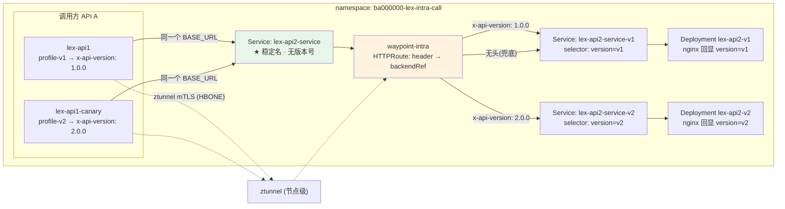

# case-lex-intra-call —— Intra-Namespace Call 可运行 PoC

> **TL;DR**:
> - **完全独立**:新 namespace `ba000000-lex-intra-call` + 自己的 waypoint,`case-lex/` 的老配置一行不动
> - **演示目标**:同一个 URL 上并存两个 API 版本,调用方**代码零版本常量**,换版本只改一个 ConfigMap
> - **不绕路**:调用方走 ClusterIP → ztunnel → waypoint → 被调方,全程 mesh mTLS,**零证书运维**
> - **一条命令回滚**:`bash 90-teardown.sh`(删 ns 即回滚干净)
> - 理论依据 → [`../23-intra-namespace-call-versioning-and-mtls.md`](../23-intra-namespace-call-versioning-and-mtls.md)

---

## 0. 文档定位

这是 `../23-intra-namespace-call-versioning-and-mtls.md` 的**落地配套** —— 那篇讲"为什么这么做",本目录是"照着做一遍"。

| 维度 | 本目录 |
|---|---|
| 目标 | 用最小可运行配置验证 4 个机制,不是生产模板 |
| 隔离性 | 独立 namespace + 独立 waypoint,与 `../case-lex/` 零交集 |
| 镜像 | 只用公共镜像(`nginxinc/nginx-unprivileged` / `curlimages/curl`),不需要私有仓库 |
| 预期 | 一次 `kubectl apply` + 一次 `bash 09-verify.sh` 就能看到结果 |

---

## 1. 这个 PoC 要验证什么

| # | 验证点 | 怎么看 |
|---|---|---|
| **V1** | **不绕 internal ingress** —— 直连 ClusterIP 即可打通东西向 | `09-verify.sh` §3 §8 |
| **V2** | **Service 名与版本解耦** —— 稳定名 `lex-api2-service`,版本只存在于 label | `05-services.yaml` |
| **V3** | **版本路由靠 header 协商** —— 同一 URL,不同 `x-api-version` 头 → 不同版本 | `09-verify.sh` §6 |
| **V4** | **调用方代码零版本常量** —— URL 与版本号都来自 ConfigMap | `08-callers.yaml` |
| **V5** | **身份边界仍然存在** —— 只有授权 SA 能调 | `07-authz.yaml` + `09-verify.sh` §9 |
| **V6** | **mesh mTLS 生效** —— 东西向自动加密,应用层仍跑明文 HTTP | `07-authz.yaml` 的 PeerAuthentication |

---

## 2. 架构



**数据流(和 hairpin 的区别)**:

```
Pod A → ztunnel(加密)→ waypoint(L7 路由)→ Pod B
       ← 全程在集群内,不过 ILB / internal ingress →
```

---

## 3. 文件清单与 apply 顺序

| 顺序 | 文件 | 内容 | 关键点 |
|---|---|---|---|
| 1 | `00-namespace.yaml` | 独立 ns + ambient 标签 | `istio.io/dataplane-mode=ambient` |
| 2 | `01-waypoint.yaml` | waypoint Gateway(2 副本)+ PDB | `istio.io/waypoint-for: all` |
| 3 | `02-network-policies.yaml` | default-deny + DNS + 同 ns + 探针 | **15008 HBONE 必须放行** |
| 4 | `03-api2-workloads.yaml` | 被调方 v1 / v2 Deployment + nginx ConfigMap | 回显 version 与收到的 header |
| 5 | `04-serviceaccounts.yaml` | 两个 KSA | SA 名会被 AuthZ 引用,别乱改 |
| 6 | `05-services.yaml` | **稳定 Service + 版本专属 Service** | ★ 核心解耦点 |
| 7 | `06-httproute-version.yaml` | waypoint HTTPRoute | ★ header → backendRef 路由 |
| 8 | `07-authz.yaml` | AuthorizationPolicy + PeerAuthentication | **不写 ns 级 deny-all** |
| 9 | `08-callers.yaml` | 两个调用方 Deployment + ConfigMap | ★ 配置注入,代码零常量 |
| — | `09-verify.sh` | 验证脚本 | `bash 09-verify.sh` |
| — | `90-teardown.sh` | 清理脚本 | `bash 90-teardown.sh` |
| opt | `optional/` | 应用层 HTTPS(cert-manager) | **默认不 apply**,见其 README |

### 跑起来

```bash
cd case-lex-intra-call

# 0) 先干跑校验(强烈建议)
for f in 0*.yaml; do kubectl apply --dry-run=server -f "$f" || break; done

# 1) 按顺序 apply
kubectl apply -f 00-namespace.yaml
kubectl apply -f 01-waypoint.yaml
kubectl apply -f 02-network-policies.yaml
kubectl apply -f 04-serviceaccounts.yaml
kubectl apply -f 03-api2-workloads.yaml
kubectl apply -f 05-services.yaml
kubectl apply -f 06-httproute-version.yaml
kubectl apply -f 07-authz.yaml
kubectl apply -f 08-callers.yaml

# 2) 等 waypoint 与业务 pod 就绪
kubectl wait --for=condition=Ready pod -l gateway.networking.k8s.io/gateway-name=waypoint-intra -n ba000000-lex-intra-call --timeout=180s
kubectl wait --for=condition=Available deploy -n ba000000-lex-intra-call --all --timeout=180s

# 3) 验证
bash 09-verify.sh
```

### 回滚

```bash
bash 90-teardown.sh          # 删 ns,全部资源随之消失
```

---

## 4. 关键设计决策

### 4.1 Service 名与版本解耦(对应 V2)

```
lex-api2-service        ← 稳定入口。DNS 名、证书 SAN、调用方配置只认这一个
├── lex-api2-service-v1 ← 版本专属,只当 HTTPRoute 的 backendRef,没人直接调
└── lex-api2-service-v2 ← 同上
```

**反例**(不要这么干):

```
lex-api2-service-1.0.0   ← ① DNS 名变 → 证书要重签 → 调用方要改
                          ← ② K8s Service 名是 DNS-1035 label,不允许含 "."
                          ←    所以 "1.0.0" 根本建不出来,只能写 "1-0-0"
```

**稳定 Service 的 selector 两种写法**(`05-services.yaml` 里有注释):

- (a) `app=lex-api2` —— 两个版本都在 endpoints,真实去向由 HTTPRoute 决定 ← **本 PoC 用这个**
- (b) `app=lex-api2` + `version=v1` —— 钉死"当前生效版本",改一行切版本(不需要 L7 路由时够用)

### 4.2 版本路由走 HTTPRoute header 匹配(对应 V3)

`06-httproute-version.yaml` 用的是 **GAMMA(Gateway API for Mesh)**:

```yaml
parentRefs:
  - kind: Service      # ← 直接挂 Service,不是 Gateway
    name: lex-api2-service
```

**为什么不用 DestinationRule subset**:ambient 下 subset 切流**不支持**,版本切换只能靠
「不同 backendRef 指向不同版本 Service」—— 这就是 §4.1 要建两个版本 Service 的原因。

规则顺序(具体在前、兜底在后):

| 规则 | 匹配 | 去向 |
|---|---|---|
| 1 | `x-api-version: 1.0.0` | `lex-api2-service-v1` |
| 2 | `x-api-version: 2.0.0` | `lex-api2-service-v2` |
| 3 | (可选,注释掉)`Accept: application/vnd.lex.api2.v1+json` | v1 |
| 4 | 兜底:不带版本头 | v1(weight 100) |
| 5 | (可选,注释掉)灰度 90/10 | v1 / v2 |

### 4.3 调用方配置注入(对应 V4)

`08-callers.yaml` 里,调用方的 URL 和版本号**都来自 ConfigMap**:

```yaml
env:
  - name: LEX_API2_BASE_URL
    valueFrom:
      configMapKeyRef: { name: lex-api2-endpoint,   key: BASE_URL }
  - name: LEX_API2_API_VERSION
    valueFrom:
      configMapKeyRef: { name: lex-api1-profile-v1, key: API_VERSION }
```

两个调用方(`lex-api1` / `lex-api1-canary`)**URL 完全相同、代码完全相同**,
唯一差别是 profile ConfigMap 里的 `API_VERSION` 值 → 一个走 v1,一个走 v2。

真实业务接入时,把 `08-callers.yaml` 里的 curl 循环换成 HTTP client 调用即可,
关键是**这两个值从 env 读,不是代码里的常量**。

### 4.4 TLS:mesh mTLS 优先(对应 V6)

本 PoC **应用层跑明文 HTTP**,东西向加密由 ztunnel 自动完成:

```
Pod A --明文--> ztunnel --mTLS/HBONE--> ztunnel --明文--> waypoint --> Pod B
```

- **零证书运维**:istio 自动签发、自动轮转(见 [`../22-ztunnel-mtls-and-cert-rotation.md`](../22-ztunnel-mtls-and-cert-rotation.md))
- **waypoint L7 能力完整保留**:版本路由、AuthZ、指标全部可用
- 代价:应用层看不到 TLS(合规若不接受,走 `optional/`)

`optional/` 是**应用层 HTTPS 的备选路径**(cert-manager 自建 CA + SAN 覆盖 4 种 DNS 形式)。
⚠️ 启用前必读它的 README —— **应用层 TLS 会让 waypoint 的 L7 版本路由失效**,是 go/no-go 决策点。

### 4.5 为什么不复用 `ba000000-lex-int`(老 ns)

| 原因 | 说明 |
|---|---|
| **老 ns 有一条 ns 级 DENY-all** | `../case-lex/03-mesh-security.yaml` 里 `action: DENY` + `rules: [{}]`,Istio 的 DENY 优先级高于 ALLOW —— 它会把整个 ns 的流量(连同那些 ALLOW 策略一起)全挡掉 |
| **老 ns 的 ALLOW 绑的是老 waypoint 的 SA** | `waypoint-int` ≠ `waypoint-intra`,principal 不匹配 |
| **回滚要干净** | 独立 ns → 删 ns 即回滚,老场景零风险 |

> 📌 **顺带提醒**:上面第 1 条值得单独在老集群验证一下。用
> `istioctl x authz check -n ba000000-lex-int` 看策略评估结果。
> 如果确实被 deny-all 覆盖,老场景的 ingress 通路可能也是不通的 —— 这个我**没有改动**任何老文件,只是提示。

---

## 5. 预期结果

`09-verify.sh` §6 应该看到:

```text
  x-api-version: 1.0.0               →  {"service":"lex-api2","version":"v1","api_version_header":"1.0.0", ...}
  x-api-version: 2.0.0               →  {"service":"lex-api2","version":"v2","api_version_header":"2.0.0", ...}
  无版本头(兜底 → 默认版本)           →  {"service":"lex-api2","version":"v1","api_version_header":"", ...}
```

§7 调用方日志应该看到两个调用方分别稳定命中 v1 / v2。

§8 应该确认 ztunnel 已接管 `lex-api2-*` 的 workload —— 这是"没走 hairpin"的直接证据。

---

## 6. 常见问题

| 现象 | 原因 | 处理 |
|---|---|---|
| Pod 一直 `NotReady` | NetPol 没放行 kubelet 探针的 link-local `169.254.7.127/32` | 检查 `02-network-policies.yaml` 的 NP-4 |
| mesh 流量整体不通 | NetPol 没放行 HBONE 端口 15008 | 检查 NP-3(同 ns 放行已覆盖 15008) |
| DNS 解析失败 | NetPol 挡了 CoreDNS 53 端口 | 检查 NP-2 |
| 版本路由不生效 | HTTPRoute 没被接受 | `kubectl get httproute -o yaml` 看 `status.parents[].conditions` |
| 版本路由不生效(全打到 v1) | header 名字/大小写不对 | 确认发的是 `x-api-version`;nginx 侧变量是 `$http_x_api_version` |
| 调用返回 403 | AuthZ principal 不匹配 | `istioctl x authz check -n ba000000-lex-intra-call`;必要时启用 `07-authz.yaml` 里注释掉的 waypoint SA 兜底规则 |
| `waypoint-intra` 一直没 ready | `istio-waypoint` GatewayClass 没注册 | `kubectl get gatewayclass` 确认 ambient 组件已装 |
| 镜像拉不下来 | 集群有镜像白名单 | 换成你 registry 里的 nginx / curl 镜像 |

---

## 7. 已知限制与待验证项

| ID | 内容 | 状态 |
|---|---|---|
| L1 | waypoint 后的**调用方身份**是否透传到 L7 策略评估点 | 🟡 **待实测** —— 403 时启用 `07-authz.yaml` 里注释掉的 waypoint SA 兜底 |
| L2 | ambient 下 ztunnel 对**应用层 TLS 端口**的 passthrough 确切行为 | 🟡 **待实测** —— 走 `optional/` 时验证 |
| L3 | waypoint → 版本 Service 的转发是否会二次进入 waypoint | 🟢 Istio 标准行为为"不二次进入",但本 PoC 未在真实集群验证 |
| L4 | 稳定 Service 的 selector 写 (a) 时,若客户端绕过 waypoint 会随机命中版本 | ⚠️ 已知取舍 —— 生产上若要严格,改用 (b) 或确保全部客户端在 mesh 内 |
| L5 | 老 ns 的 deny-all 是否真的覆盖了 ALLOW | 🟡 **待实测** —— 见 §4.5 提示 |

---

## 8. 相关文档

**理论 / 选型**
- [`../23-intra-namespace-call-versioning-and-mtls.md`](../23-intra-namespace-call-versioning-and-mtls.md) — 版本解耦 M1–M4、T1/T2/T3 TLS 方案、SAN 清单、风险登记
- [`../03-waypoint-design.md`](../03-waypoint-design.md) — waypoint 部署形态与 HA
- [`../06-policy-capabilities.md`](../06-policy-capabilities.md) — ambient 下 AuthZ / PeerAuthentication 能力矩阵
- [`../08-ambient-networkpolicy.md`](../08-ambient-networkpolicy.md) — NetPol 与 ztunnel 协同规则(15008 / 探针 link-local)
- [`../10-waypoint-gateway-coexistence.md`](../10-waypoint-gateway-coexistence.md) — ingress 与 waypoint 的两段式模式
- [`../22-ztunnel-mtls-and-cert-rotation.md`](../22-ztunnel-mtls-and-cert-rotation.md) — mesh mTLS 机制与证书轮转

**老场景**
- [`../case-lex/`](../case-lex/) — 南北向 ingress + waypoint 的实际落地配置
- [`../../gke/docs/intra-namespace-call.md`](../../gke/docs/intra-namespace-call.md) — 纯 K8s(无 mesh)环境的等价方案
