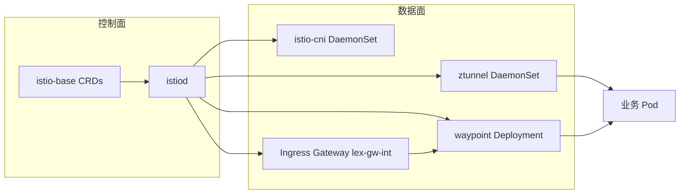
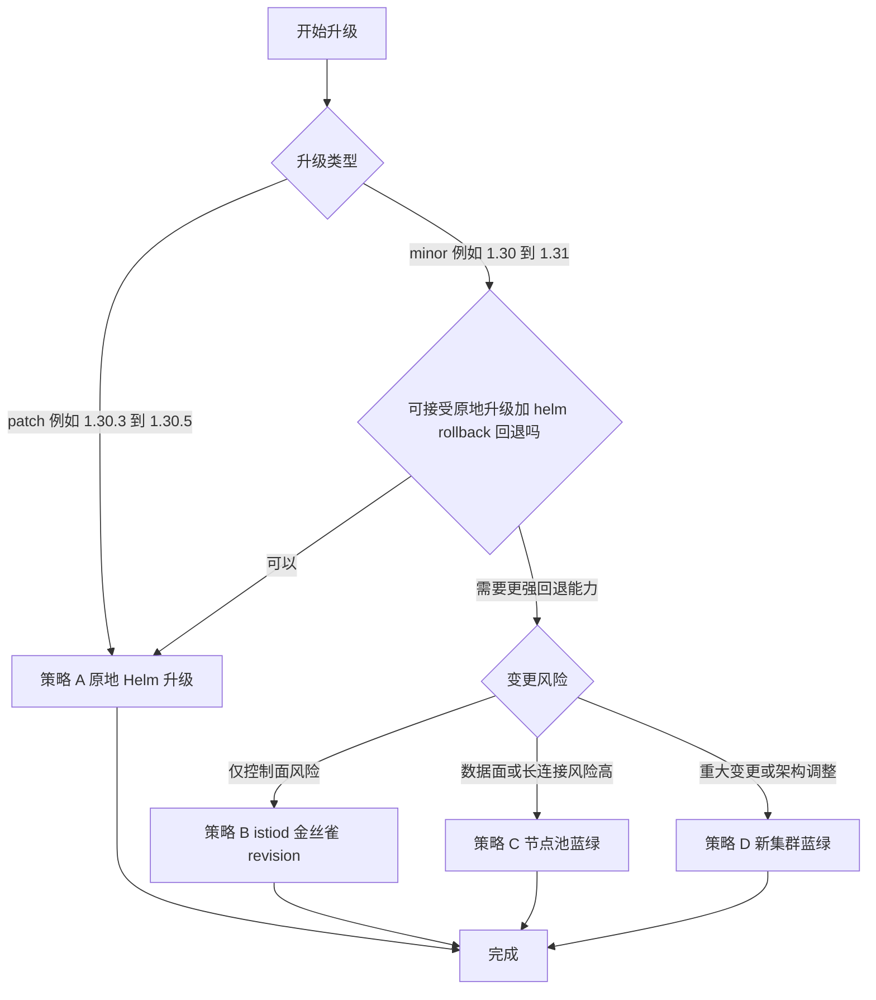
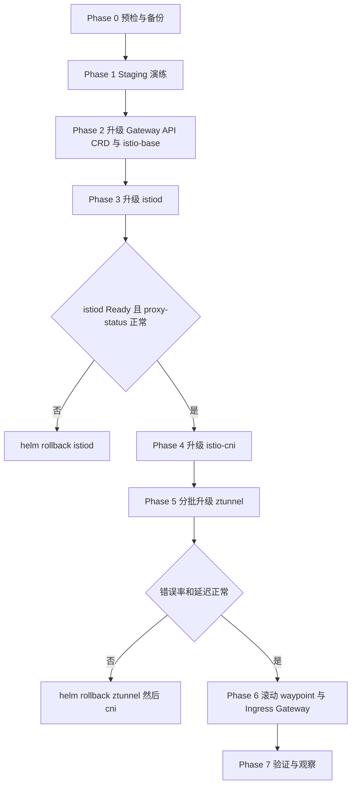
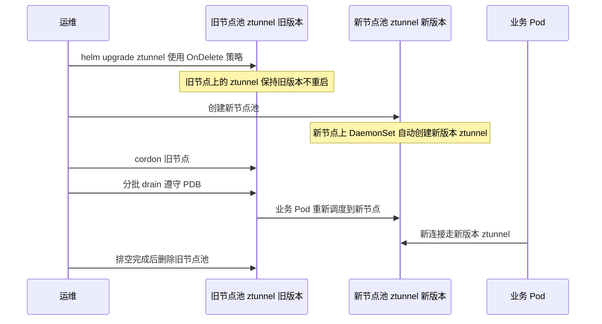

# Solo Istio Ambient（1.30.3-distroless）长期维护与零停机升级方案

> 适用环境：GKE + Solo 分发版 Istio ambient（`us-docker.pkg.dev/soloio-img/istio`，tag `1.30.3-distroless`，无 license）
> 依据：Solo 官方 1.30.x 文档（In-place upgrades with Helm / Canary upgrades with the Gateway API / Tune ztunnel performance）+ Istio 通用运维实践
> 标注 `【需验证】` 的内容表示官方文档未明确覆盖，上线前请在 staging 实测。

---

## 1. 结论（TL;DR）

| 问题 | 结论 |
|------|------|
| 需要蓝绿或金丝雀吗？ | **默认不需要。** Solo 官方推荐 **in-place（原地）Helm 升级**。ambient 下 `ztunnel` 与 `istio-cni` 不支持 revision 金丝雀，只能原地升级 |
| 用 Helm 方便吗？ | **是，推荐 Helm。** 官方升级文档就是 4 个独立 Helm release：`istio-base`、`istiod`、`istio-cni`、`ztunnel` |
| 真正的 downtime 风险在哪？ | ① **ztunnel 重启会断开所在节点上的长连接**（最大风险）；② 入口 Gateway 与 waypoint 版本对齐时的滚动重启；③ 使用 revision tag 金丝雀时的 tag-flip 黑洞（1.30.2+ 已修复） |
| 什么时候才用金丝雀？ | 仅 **istiod 控制面** 在 **跨 minor 升级**（如 1.30 → 1.31）且想要“可快速回退”时可选；patch 升级不需要 |
| 什么时候用蓝绿？ | **节点池蓝绿** 用来保护 ztunnel 长连接；**整集群蓝绿** 用于重大风险变更（成本最高） |

**推荐默认路径：** `Helm 原地升级 + 严格顺序 + ztunnel 分批/节点池蓝绿 + 持续流量探测`。

---

## 2. 组件与升级影响面



| 组件 | 升级方式 | 升级期间影响 | 保护措施 |
|------|----------|--------------|----------|
| `istio-base`（CRD） | `helm upgrade` | 无流量影响，CRD 为增量变更 | 升级前备份 values；先升级 Gateway API CRD（见 §6） |
| `istiod` | `helm upgrade`，滚动 | 已建立的数据面使用缓存配置继续转发；新 Pod 的证书签发/配置下发会短暂受影响 | `replicas >= 2`、PDB、topologySpread、readiness 通过后再继续 |
| `istio-cni` | `helm upgrade`，DaemonSet 滚动 | 官方内置保护：卸载时会在节点上放置 **stub CNI 插件**，新调度的 Pod 会被挂起直到新 `istio-cni` 就绪，不会出现无网络的 Pod | 无需额外处理；等待全部节点 Ready |
| `ztunnel` | `helm upgrade`，DaemonSet 滚动 | **该节点上长连接被断开**（官方明确说明）。短连接依赖客户端重试 | 调大 `terminationGracePeriodSeconds`、分批升级、节点池蓝绿（见 §5） |
| waypoint | 重启 Deployment 对齐版本 | 若只有 1 副本会中断 L7 流量 | 副本 ≥ 2、PDB、逐个 namespace 滚动 |
| Ingress Gateway（lex-gw-int） | 重启 Deployment 对齐版本 | 同上 | 副本 ≥ 2、PDB、LB 健康检查与连接排空 |

> 说明：waypoint 与 Gateway 的 Pod 由 istiod 注入/生成，istiod 升级后需要滚动重启才会使用新版本镜像。该步骤官方升级页未单独列出，属于通用做法【需验证】。

---

## 3. 策略对比与选型



| 策略 | 做法 | 优点 | 缺点 / 限制 | 适用场景 |
|------|------|------|-------------|----------|
| **A. 原地 Helm 升级（推荐默认）** | 按 base → istiod → cni → ztunnel 顺序 `helm upgrade` | 官方推荐、步骤少、易自动化 | ztunnel 重启会断长连接，需配合 §5 措施 | 所有 patch 升级；多数 minor 升级 |
| **B. istiod 金丝雀（revision + tag）** | 并行安装新 revision istiod，按 namespace 迁移，最后翻转 `default` tag | 控制面可逐 namespace 验证与回退 | **ambient 下 ztunnel / CNI 不支持 revision**，只能覆盖控制面；使用 Gateway API 时有 tag-flip 黑洞风险（见下） | 跨 minor 且想逐 namespace 验证控制面 |
| **C. 节点池蓝绿** | 新建节点池（新节点自动拿到新版 ztunnel/CNI），逐批 drain 旧节点池 | 长连接可随 Pod 迁移而不是被强杀 | 需要额外节点资源；依赖 DaemonSet 更新策略【需验证】 | 长连接多（gRPC 流、数据库连接、WebSocket） |
| **D. 新集群蓝绿** | 新建 GKE 集群安装新版本，用 LB / DNS 切流 | 回退最快、隔离最彻底 | 成本和复杂度最高，涉及证书、DNS、数据同步 | 大版本跨越、架构变更 |
| E. Gloo Operator | 官方也支持 Operator 原地升级 | 声明式、少步骤 | 你们已使用 Helm 部署，切换会引入新的管理面 | 新集群可评估；存量不建议切换 |

### 关于策略 B 的 tag-flip 风险（官方说明）

- 金丝雀升级最后一步是把 `default` revision tag 指向新 revision。若运行中的 istiod **不含修复**，旧 istiod 会向所有 Gateway Pod 推送空 xDS，造成约 **15–30 秒** 路由配置为空、流量黑洞。
- 修复包含在上游 Istio **1.29.5+、1.30.2+、1.31.x**。**修复必须存在于“当前正在运行”的 istiod 中才生效。**
- 你们当前是 **1.30.3**，已包含修复，可以安全使用金丝雀；1.30.0 / 1.30.1 则不安全，需先原地升级到 1.30.2+。
- 使用金丝雀期间 **不要** 在旧 istiod 上设置 `PILOT_ENABLE_GATEWAY_API=false`，否则尚未迁移 namespace 中的 HTTPRoute 会丢失 status。
- 你们的 namespace 使用了 `istio.io/use-waypoint` 与 `istio.io/ingress-use-waypoint`，金丝雀按 namespace 打 `istio.io/rev=<revision>` 标签时，请同时核对 waypoint Gateway 与 HTTPRoute 的 status 是否被新 istiod 正常接管【需验证】。

---

## 4. 推荐流程：原地 Helm 升级（策略 A）



### Phase 0：预检与备份

```bash
# 1. 确认目标版本在 Solo 支持矩阵内，并阅读 Release Notes 的 Breaking changes
#    https://docs.solo.io/istio/1.30.x/ambient/about/images/versions/
#    https://docs.solo.io/istio/1.30.x/reference/changelog/release-notes/

# 2. 确认镜像仓库中目标 tag 存在（免 license 的 distroless 版本，不带 -solo）
gcloud artifacts docker images list us-docker.pkg.dev/soloio-img/istio --include-tags \
  | grep -E "distroless" | head -50

# 3. 确认 Helm chart 版本命名【需验证】
#    官方文档中 chart --version 使用 ${ISTIO_VERSION}-solo；
#    免 license 的 distroless 对应的 chart 版本与 hub/tag 写法需实际确认
helm show chart oci://us-docker.pkg.dev/soloio-img/istio-helm/istiod --version <candidate-version>

# 4. 备份当前 values（回滚与对比的基线）
mkdir -p upgrade-backup && cd upgrade-backup
for r in istio-base istiod istio-cni ztunnel; do
  helm get values $r -n istio-system -o yaml > $r.values.yaml
  helm history $r -n istio-system
done
kubectl get gatewayclass,gateway,httproute -A -o yaml > gwapi-backup.yaml
```

升级前检查清单：

| 检查项 | 要求 |
|--------|------|
| istiod | `replicas >= 2`，配置 PDB 与 `topologySpreadConstraints` |
| waypoint / Ingress Gateway | 副本 ≥ 2，PDB `minAvailable` 生效，跨可用区分布 |
| GKE 节点升级 | 避开 GKE 自动升级/维护窗口，不要与 Istio 升级同时进行（节点驱逐同样会重启 ztunnel） |
| Gateway API CRD | 确认当前版本与目标版本要求（见 §6） |
| 监控基线 | 记录升级前 5xx 比例、P99 延迟、ztunnel 内存/CPU、连接数 |

### Phase 1：Staging 演练

- 用与生产一致的 values 在 staging 集群完整走一遍 Phase 2–7。
- 升级过程中持续打流量（见 §7），记录是否有失败请求，作为生产放行依据。

### Phase 2：升级 Gateway API CRD 与 istio-base

```bash
export ISTIO_VERSION=<目标 patch 版本>          # 例如 1.30.5
export ISTIO_IMAGE=<chart 版本>                 # 官方示例为 ${ISTIO_VERSION}-solo；distroless 写法需验证
export HELM_REPO=us-docker.pkg.dev/soloio-img/istio-helm

helm upgrade istio-base oci://${HELM_REPO}/base \
  --namespace istio-system \
  --version ${ISTIO_IMAGE} \
  -f upgrade-backup/istio-base.values.yaml
```

> 若出现 `Rendered manifests contain a resource that already exists`，参考 Istio 社区文档中 Helm 升级 base 的处理方式。

### Phase 3：升级 istiod

```bash
# 编辑 istiod values：如果升级 minor 版本，需同时更新 hub 与 global.tag
cp upgrade-backup/istiod.values.yaml istiod.yaml && vi istiod.yaml

helm upgrade istiod oci://${HELM_REPO}/istiod \
  -n istio-system \
  --version ${ISTIO_IMAGE} \
  -f istiod.yaml \
  --atomic --timeout 10m

kubectl -n istio-system rollout status deploy/istiod
istioctl proxy-status
```

> `--atomic` 在 Helm 失败时自动回滚，适合控制面。

### Phase 4：升级 istio-cni

```bash
cp upgrade-backup/istio-cni.values.yaml cni.yaml && vi cni.yaml   # 同样更新 hub / tag

helm upgrade istio-cni oci://${HELM_REPO}/cni \
  -n istio-system --version ${ISTIO_IMAGE} -f cni.yaml

kubectl -n istio-system rollout status ds/istio-cni-node
```

> 官方内置 stub CNI 保护新调度的 Pod，升级期间不会出现“没有网络”的 Pod。

### Phase 5：升级 ztunnel（风险最高，见 §5）

```bash
cp upgrade-backup/ztunnel.values.yaml ztunnel.yaml && vi ztunnel.yaml

helm upgrade ztunnel oci://${HELM_REPO}/ztunnel \
  -n istio-system --version ${ISTIO_IMAGE} -f ztunnel.yaml

kubectl -n istio-system rollout status ds/ztunnel
```

> 官方强调：**升级版本时必须先升级 istiod，再升级 CNI 与 ztunnel**，否则这些组件可能使用过期镜像。

### Phase 6：对齐 waypoint 与 Ingress Gateway 版本【需验证】

```bash
# 逐个 namespace 滚动 waypoint（Deployment 名称以实际为准，你们 label 的值为 waypoint）
for ns in <ns1> <ns2>; do
  kubectl -n $ns rollout restart deploy/waypoint
  kubectl -n $ns rollout status deploy/waypoint --timeout=5m
done

# Ingress Gateway
kubectl -n <gateway-ns> rollout restart deploy/lex-gw-int
kubectl -n <gateway-ns> rollout status deploy/lex-gw-int --timeout=5m
```

### Phase 7：验证

```bash
istioctl proxy-status
kubectl -n istio-system get pods -o wide
kubectl get pods -A -o jsonpath='{range .items[*]}{.metadata.namespace}{"\t"}{.metadata.name}{"\t"}{range .spec.containers[*]}{.image}{" "}{end}{"\n"}{end}' \
  | grep -E "ztunnel|pilot|proxyv2|install-cni"
```

### 回滚

```bash
# 与升级顺序相反：先数据面，后控制面
helm rollback ztunnel   <REVISION> -n istio-system
helm rollback istio-cni <REVISION> -n istio-system
helm rollback istiod    <REVISION> -n istio-system
# CRD 为增量变更，一般不回滚；如需回退按 Release Notes 评估
```

---

## 5. ztunnel 零中断专项

### 5.1 问题本质

ztunnel 是每节点一个 DaemonSet，负责该节点上所有 ambient Pod 的 HBONE/mTLS 流量。Pod 重启时会进入 drain，**超过 `terminationGracePeriodSeconds`（Kubernetes 默认 30 秒）仍未结束的 TCP 连接会被直接断开。**

类比：ztunnel 像每栋楼的总机，换总机时正在通话的电话会掉线；能做的是 ① 等通话结束再换（加大 grace period）② 一栋一栋换（分批）③ 把住户搬到新楼再拆旧楼（节点池蓝绿）。

### 5.2 措施一：调大 grace period（官方文档）

```bash
helm upgrade ztunnel oci://${HELM_REPO}/ztunnel \
  --version ${ISTIO_IMAGE} \
  --namespace istio-system \
  --reuse-values \
  --set terminationGracePeriodSeconds=300
```

| 注意 | 说明 |
|------|------|
| 值如何选 | 取业务最长“可接受等待”的长连接时长，官方示例为 300 秒 |
| 副作用 | 节点升级/驱逐时间会变长，需同步评估 GKE 节点池升级窗口 |

### 5.3 措施二：分批升级（降低同时受影响的节点数）

官方建议通过 **cordon 节点** 或 **节点池蓝绿** 限制同时被升级的 ztunnel 数量。一种可操作的做法：

```bash
# 查看 DaemonSet 更新策略
kubectl -n istio-system get ds ztunnel -o jsonpath='{.spec.updateStrategy}'

# 查看 chart 是否暴露 updateStrategy / maxUnavailable【需验证】
helm show values oci://${HELM_REPO}/ztunnel --version ${ISTIO_IMAGE} | grep -n -i -E "updateStrategy|maxUnavailable"
```

- 默认 `RollingUpdate` 的 `maxUnavailable` 为 1，即逐节点滚动，但整体速度由 Kubernetes 控制，无法按业务窗口暂停。
- 如果 chart 支持 `OnDelete`，可 `helm upgrade` 后手动逐节点删除 ztunnel Pod，每个节点完成后检查指标再继续【需验证】。

### 5.4 措施三：节点池蓝绿（长连接最多时推荐）



要点：

- 新节点上创建的 DaemonSet Pod 使用 **当前模板**，所以前提是 DaemonSet 更新策略为 `OnDelete`（或旧节点暂时不被滚动）【需验证 chart 是否支持】。
- 业务 Pod 在被 drain 时按自身 `terminationGracePeriodSeconds` 优雅退出，连接随 Pod 迁移，而不是被 ztunnel 强行切断。
- 需要保证业务 PDB 合理，且新节点池容量足够承接。

### 5.5 配套：TCP keepalive 调优（官方建议，大规模场景）

```yaml
# ztunnel-keepalive.yaml
socketConfig:
  keepaliveEnabled: true
  userTimeoutEnabled: true
  keepaliveTime:
    secs: 90
    nanos: 0
  keepaliveInterval:
    secs: 90
    nanos: 0
  keepaliveRetries: 4
```

用于缓解 `FIN_WAIT2` 连接累积导致 ztunnel 内存上涨甚至 OOM，与升级本身无直接关系，但升级后建议观察：

```bash
# 在节点上执行
ss -tnH state fin-wait-2 | wc -l
```

---

## 6. GKE 与版本相关注意事项

| 项目 | 说明 |
|------|------|
| **Gateway API CRD** | Solo 1.30 官方升级文档要求先 `kubectl apply` Gateway API **1.5.0** standard-install。**GKE 在启用 Gateway 控制器时会自行管理 `gateway.networking.k8s.io` CRD**，直接 apply 可能被覆盖或冲突。升级前务必核对集群当前 CRD 版本及 GKE 的支持版本【需验证】 |
| `XListenerSet` | Solo 1.30 起不再监听 `XListenerSet`（`gateway.networking.x-k8s.io/v1alpha1`）；Gateway API ≥ 1.5 提供 `ListenerSet`；固定在 1.5 以下的平台可使用 `EnterpriseListenerSet`（需 1.30.3-patch0+，istiod 设置 `SOLO_ENABLE_ENTERPRISE_LISTENER_SET=true`）。如果你们用到该资源，升级前需评估 |
| 版本跨度 | 每次只升一个 minor（1.30 → 1.31），不跨 minor。官方文档同时列出 1.31.x 为 stable，1.30 系列已发布到 1.30.5-solo |
| 免 license 的 distroless | 官方升级示例使用 `-solo` 后缀；你们使用不带 `-solo` 的 distroless 镜像，**务必确认目标 patch 版本的 distroless tag 与 chart 版本确实已发布**，不要假设与 `-solo` 同步【需验证】 |
| GKE 节点升级 | 节点驱逐会重启该节点 ztunnel，同样会断长连接；Istio 升级与 GKE 升级错开，并使用维护窗口与 surge upgrade 配合 PDB |
| 多集群 | 如后续使用 multicluster，官方说明升级时无需升级东西向网关等多集群组件，逐集群重复 istiod 与 CNI/ztunnel 步骤即可 |

---

## 7. 零 downtime 验证：升级期间持续探测

升级前启动持续流量，**以失败请求数作为放行与回滚依据**。

```bash
# 示例：在集群内用 fortio 对目标服务持续打流量（通过 Ingress 与 mesh 内部两条路径各一份）
kubectl run fortio --image=fortio/fortio --restart=Never -- \
  load -qps 50 -t 30m -c 8 -allow-initial-errors \
  http://<your-service>.<ns>.svc.cluster.local:<port>/

# 观察结果
kubectl logs -f fortio | grep -E "Code|Ended"
```

| 指标 | 放行标准（示例，按 SLO 调整） |
|------|------------------------------|
| 5xx / 连接失败 | 升级窗口内无新增（或 < SLO 预算） |
| P99 延迟 | 相对基线涨幅 < 20% |
| ztunnel 重启次数 / OOM | 升级外无异常重启 |
| `istioctl proxy-status` | 所有 Gateway / waypoint 为 SYNCED |
| HTTPRoute / Gateway status | `Accepted` / `Programmed` 为 True |

---

## 8. 长期维护建议

### 8.1 版本节奏


| 类型 | 建议 |
|------|------|
| patch | 跟随 Solo 发布节奏（含安全修复），staging 验证后原地升级，一次一个环境 |
| minor | 在目标 minor 出现若干 patch 后再升（降低踩坑概率），并在 staging 完整演练；每次仅升一个 minor |
| 例外 | 遇到 CVE 或必须修复的缺陷时走加急 patch 流程 |

### 8.2 配置治理（让升级可重复）

- 将 4 个 Helm release 的 values 放入 Git，使用 **Argo CD / Flux / helmfile** 管理，固定 chart 版本，禁止手工 `helm upgrade`。
- GitOps 顺序（sync-wave）：`istio-base` → `istiod` → `istio-cni` → `ztunnel`，ztunnel 的升级建议单独审批、单独窗口。
- 升级 Runbook 固化为脚本，包含 §4 的预检、验证命令和回滚命令。
- 为 `istiod`、waypoint、Ingress Gateway 常态配置 PDB 与多副本，避免升级时才发现单点。
- 维护“已知问题清单”，每次升级对照官方 Known restrictions（例如 1.30.0/1.30.1 的 multicluster waypoint 缺陷，需使用 1.30.2+）。

### 8.3 持续监控（升级与日常共用）

| 监控对象 | 关注点 |
|----------|--------|
| ztunnel | 内存/CPU、重启次数、`FIN_WAIT2` 数量、连接断开数 |
| istiod | xDS 推送延迟与错误、证书签发错误 |
| waypoint / Gateway | 5xx、上游连接失败、副本可用数 |
| 业务 | 成功率、P99、重试次数 |

---

## 9. 最终建议

1. **日常 patch 升级：** 原地 Helm 升级，严格顺序 `base → istiod → cni → ztunnel → waypoint/Gateway 滚动`，每步验证再继续。
2. **长连接多的业务：** 在 ztunnel 步骤加上 `terminationGracePeriodSeconds` 调大 + 分批，必要时使用节点池蓝绿。
3. **minor 升级：** 先 staging 演练；需要更强回退能力时再考虑 istiod 金丝雀（你们当前 1.30.3 已含 tag-flip 修复，可安全使用），但要清楚 ztunnel / CNI 仍然只能原地升级。
4. **先确认三件事：** ① 免 license distroless 目标版本的 chart 与镜像 tag 是否存在；② GKE 管理的 Gateway API CRD 与 Solo 要求的版本是否兼容；③ chart 是否暴露 ztunnel `updateStrategy` 配置。
5. **长期：** GitOps 固化 + 每次升级带流量探测，把“零 downtime”变成可度量的发布门禁，而不是靠经验。

---

## 参考（Solo 官方文档）

- In-place upgrades with Helm：https://docs.solo.io/istio/1.30.x/ambient/operations/upgrade/manual/
- Canary upgrades with the Gateway API：https://docs.solo.io/istio/1.30.x/ambient/operations/upgrade/gwapi-canary/
- Tune ztunnel performance：https://docs.solo.io/istio/1.30.x/ambient/operations/ztunnel-tuning/
