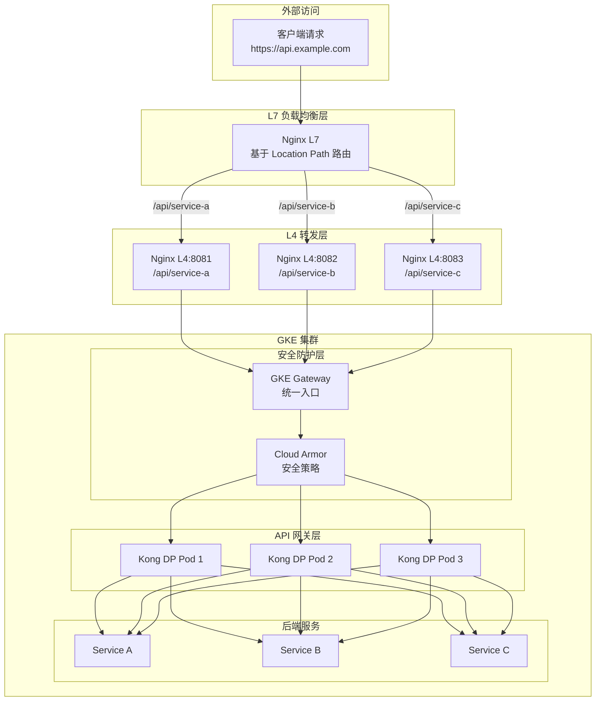

# 流程分析与验证

## 问题分析

您的架构是一个多层负载均衡和安全防护方案：
1. **外部访问层**：独立域名 → Nginx L7（基于 API path 路由）
2. **内部转发层**：Nginx L4（端口映射 8081/8082/8083）
3. **云原生网关层**：GKE Gateway（集成 Cloud Armor 安全策略）
4. **API 网关层**：Kong Data Plane（实际处理 API 请求）

## 架构流程图



## 架构验证与建议

### 潜在问题
1. **双层负载均衡的必要性**：Nginx L4 层在 Nginx L7 和 GKE Gateway 之间的作用需要明确
2. **路由复杂度**：三层路由（L7 path → L4 port → GKE Gateway）可能增加维护复杂度
3. **Cloud Armor 位置**：应该在 GKE Gateway 前端，而非后端

### 优化建议

**方案 1：简化架构（推荐）**
```
Client → Nginx L7 → GKE Gateway (+ Cloud Armor) → Kong DP → Services
```

**方案 2：保留 L4 层（特殊需求）**
```
Client → Nginx L7 → Nginx L4 → GKE Gateway (+ Cloud Armor) → Kong DP → Services
```

## 配置示例

### 1. Nginx L7 配置

```nginx
# /etc/nginx/conf.d/api-gateway.conf

upstream backend_8081 {
    server nginx-l4-service-a:8081 max_fails=3 fail_timeout=30s;
    keepalive 32;
}

upstream backend_8082 {
    server nginx-l4-service-b:8082 max_fails=3 fail_timeout=30s;
    keepalive 32;
}

upstream backend_8083 {
    server nginx-l4-service-c:8083 max_fails=3 fail_timeout=30s;
    keepalive 32;
}

server {
    listen 443 ssl http2;
    server_name api.example.com;

    ssl_certificate /etc/nginx/ssl/cert.pem;
    ssl_certificate_key /etc/nginx/ssl/key.pem;
    ssl_protocols TLSv1.2 TLSv1.3;
    ssl_ciphers HIGH:!aNULL:!MD5;

    # 访问日志包含 API Path
    log_format api_log '$remote_addr - $remote_user [$time_local] '
                       '"$request" $status $body_bytes_sent '
                       '"$http_referer" "$http_user_agent" '
                       'upstream: $upstream_addr path: $request_uri';
    
    access_log /var/log/nginx/api_access.log api_log;

    # Service A API
    location /api/service-a/ {
        proxy_pass http://backend_8081;
        proxy_http_version 1.1;
        proxy_set_header Connection "";
        proxy_set_header Host $host;
        proxy_set_header X-Real-IP $remote_addr;
        proxy_set_header X-Forwarded-For $proxy_add_x_forwarded_for;
        proxy_set_header X-Forwarded-Proto $scheme;
        proxy_set_header X-Original-URI $request_uri;
        
        # 超时配置
        proxy_connect_timeout 60s;
        proxy_send_timeout 60s;
        proxy_read_timeout 60s;
    }

    # Service B API
    location /api/service-b/ {
        proxy_pass http://backend_8082;
        proxy_http_version 1.1;
        proxy_set_header Connection "";
        proxy_set_header Host $host;
        proxy_set_header X-Real-IP $remote_addr;
        proxy_set_header X-Forwarded-For $proxy_add_x_forwarded_for;
        proxy_set_header X-Forwarded-Proto $scheme;
        proxy_set_header X-Original-URI $request_uri;
    }

    # Service C API
    location /api/service-c/ {
        proxy_pass http://backend_8083;
        proxy_http_version 1.1;
        proxy_set_header Connection "";
        proxy_set_header Host $host;
        proxy_set_header X-Real-IP $remote_addr;
        proxy_set_header X-Forwarded-For $proxy_add_x_forwarded_for;
        proxy_set_header X-Forwarded-Proto $scheme;
        proxy_set_header X-Original-URI $request_uri;
    }

    # 健康检查端点
    location /health {
        access_log off;
        return 200 "healthy\n";
        add_header Content-Type text/plain;
    }
}
```

### 2. Nginx L4 配置 (Stream 模式)

```nginx
# /etc/nginx/nginx.conf

stream {
    log_format proxy '$remote_addr [$time_local] '
                     '$protocol $status $bytes_sent $bytes_received '
                     '$session_time "$upstream_addr"';

    access_log /var/log/nginx/stream_access.log proxy;

    # Service A - Port 8081
    upstream gke_gateway_8081 {
        server gke-gateway.example.internal:80 max_fails=3 fail_timeout=30s;
        # 如果 GKE Gateway 有多个 IP
        # server 10.0.1.10:80;
        # server 10.0.1.11:80;
    }

    server {
        listen 8081;
        proxy_pass gke_gateway_8081;
        proxy_timeout 60s;
        proxy_connect_timeout 10s;
        
        # 保留原始客户端 IP (需要 GKE Gateway 支持 PROXY Protocol)
        # proxy_protocol on;
    }

    # Service B - Port 8082
    upstream gke_gateway_8082 {
        server gke-gateway.example.internal:80;
    }

    server {
        listen 8082;
        proxy_pass gke_gateway_8082;
        proxy_timeout 60s;
        proxy_connect_timeout 10s;
    }

    # Service C - Port 8083
    upstream gke_gateway_8083 {
        server gke-gateway.example.internal:80;
    }

    server {
        listen 8083;
        proxy_pass gke_gateway_8083;
        proxy_timeout 60s;
        proxy_connect_timeout 10s;
    }
}
```

### 3. GKE Gateway 配置

```yaml
# gke-gateway.yaml
apiVersion: gateway.networking.k8s.io/v1beta1
kind: Gateway
metadata:
  name: kong-gateway
  namespace: kong
  annotations:
    # 关联 Cloud Armor 安全策略
    networking.gke.io/security-policy: "api-security-policy"
spec:
  gatewayClassName: gke-l7-global-external-managed
  listeners:
  - name: http
    protocol: HTTP
    port: 80
    allowedRoutes:
      namespaces:
        from: All
  - name: https
    protocol: HTTPS
    port: 443
    allowedRoutes:
      namespaces:
        from: All
    tls:
      mode: Terminate
      certificateRefs:
      - kind: Secret
        name: gateway-tls-cert
---
apiVersion: gateway.networking.k8s.io/v1beta1
kind: HTTPRoute
metadata:
  name: kong-route
  namespace: kong
spec:
  parentRefs:
  - name: kong-gateway
  rules:
  # 所有流量转发到 Kong DP
  - matches:
    - path:
        type: PathPrefix
        value: /
    backendRefs:
    - name: kong-dp-service
      port: 8000
```

### 4. Cloud Armor 安全策略

```bash
# 创建 Cloud Armor 安全策略
gcloud compute security-policies create api-security-policy \
    --description "API Gateway Security Policy"

# 规则 1: 限制请求速率 (每分钟 100 请求)
gcloud compute security-policies rules create 1000 \
    --security-policy api-security-policy \
    --action "rate-based-ban" \
    --rate-limit-threshold-count 100 \
    --rate-limit-threshold-interval-sec 60 \
    --ban-duration-sec 600 \
    --conform-action "allow" \
    --exceed-action "deny-403" \
    --enforce-on-key "IP"

# 规则 2: 阻止特定国家/地区
gcloud compute security-policies rules create 2000 \
    --security-policy api-security-policy \
    --action "deny-403" \
    --expression "origin.region_code == 'CN' || origin.region_code == 'RU'"

# 规则 3: 允许特定 IP 白名单
gcloud compute security-policies rules create 3000 \
    --security-policy api-security-policy \
    --action "allow" \
    --src-ip-ranges "203.0.113.0/24,198.51.100.0/24"

# 规则 4: SQL 注入防护
gcloud compute security-policies rules create 4000 \
    --security-policy api-security-policy \
    --action "deny-403" \
    --expression "evaluatePreconfiguredExpr('sqli-stable')"

# 规则 5: XSS 攻击防护
gcloud compute security-policies rules create 5000 \
    --security-policy api-security-policy \
    --action "deny-403" \
    --expression "evaluatePreconfiguredExpr('xss-stable')"

# 规则 6: 针对特定 API 路径的强制规则
gcloud compute security-policies rules create 6000 \
    --security-policy api-security-policy \
    --action "deny-403" \
    --expression "request.path.matches('/api/service-a/admin/.*') && !inIpRange(origin.ip, '10.0.0.0/8')" \
    --description "Block admin API from public access"

# 默认规则: 允许所有其他流量
gcloud compute security-policies rules create 2147483647 \
    --security-policy api-security-policy \
    --action "allow"
```

### 5. Kong DP Service 配置

```yaml
# kong-dp-service.yaml
apiVersion: v1
kind: Service
metadata:
  name: kong-dp-service
  namespace: kong
  labels:
    app: kong-dp
spec:
  type: ClusterIP
  ports:
  - name: proxy
    port: 8000
    targetPort: 8000
    protocol: TCP
  - name: proxy-ssl
    port: 8443
    targetPort: 8443
    protocol: TCP
  selector:
    app: kong-dp
---
apiVersion: apps/v1
kind: Deployment
metadata:
  name: kong-dp
  namespace: kong
spec:
  replicas: 3
  selector:
    matchLabels:
      app: kong-dp
  template:
    metadata:
      labels:
        app: kong-dp
    spec:
      containers:
      - name: kong
        image: kong/kong-gateway:3.5
        env:
        - name: KONG_DATABASE
          value: "off"
        - name: KONG_DECLARATIVE_CONFIG
          value: /kong/declarative/kong.yml
        - name: KONG_PROXY_LISTEN
          value: "0.0.0.0:8000"
        - name: KONG_PROXY_LISTEN_SSL
          value: "0.0.0.0:8443"
        - name: KONG_ADMIN_LISTEN
          value: "0.0.0.0:8001"
        - name: KONG_REAL_IP_HEADER
          value: "X-Forwarded-For"
        - name: KONG_TRUSTED_IPS
          value: "0.0.0.0/0,::/0"
        ports:
        - containerPort: 8000
          name: proxy
        - containerPort: 8443
          name: proxy-ssl
        - containerPort: 8001
          name: admin
        volumeMounts:
        - name: kong-config
          mountPath: /kong/declarative
        livenessProbe:
          httpGet:
            path: /status
            port: 8001
          initialDelaySeconds: 30
          periodSeconds: 10
        readinessProbe:
          httpGet:
            path: /status
            port: 8001
          initialDelaySeconds: 10
          periodSeconds: 5
      volumes:
      - name: kong-config
        configMap:
          name: kong-declarative-config
```

### 6. Kong 声明式配置示例

```yaml
# kong-configmap.yaml
apiVersion: v1
kind: ConfigMap
metadata:
  name: kong-declarative-config
  namespace: kong
data:
  kong.yml: |
    _format_version: "3.0"
    
    services:
    - name: service-a
      url: http://service-a.default.svc.cluster.local:8080
      routes:
      - name: service-a-route
        paths:
        - /api/service-a
        strip_path: true
      plugins:
      - name: rate-limiting
        config:
          minute: 100
          policy: local
      - name: request-transformer
        config:
          add:
            headers:
            - X-Service-Name:service-a
      - name: correlation-id
        config:
          header_name: X-Request-ID
          generator: uuid
    
    - name: service-b
      url: http://service-b.default.svc.cluster.local:8080
      routes:
      - name: service-b-route
        paths:
        - /api/service-b
        strip_path: true
      plugins:
      - name: rate-limiting
        config:
          minute: 200
          policy: local
    
    - name: service-c
      url: http://service-c.default.svc.cluster.local:8080
      routes:
      - name: service-c-route
        paths:
        - /api/service-c
        strip_path: true
      plugins:
      - name: ip-restriction
        config:
          allow:
          - 10.0.0.0/8
          - 172.16.0.0/12
```

## 部署流程

### 步骤 1: 部署 Kong DP 到 GKE

```bash
# 创建命名空间
kubectl create namespace kong

# 应用 Kong 配置
kubectl apply -f kong-configmap.yaml
kubectl apply -f kong-dp-service.yaml

# 验证 Kong DP 状态
kubectl get pods -n kong
kubectl logs -n kong -l app=kong-dp --tail=50
```

### 步骤 2: 创建并关联 Cloud Armor

```bash
# 执行上面的 Cloud Armor 创建命令

# 验证策略
gcloud compute security-policies describe api-security-policy

# 查看规则列表
gcloud compute security-policies rules list api-security-policy
```

### 步骤 3: 部署 GKE Gateway

```bash
# 创建 TLS 证书 Secret
kubectl create secret tls gateway-tls-cert \
  --cert=/path/to/cert.pem \
  --key=/path/to/key.pem \
  -n kong

# 部署 Gateway
kubectl apply -f gke-gateway.yaml

# 等待 Gateway 就绪
kubectl wait --for=condition=Programmed gateway/kong-gateway -n kong --timeout=300s

# 获取 Gateway 外部 IP
kubectl get gateway kong-gateway -n kong -o jsonpath='{.status.addresses[0].value}'
```

### 步骤 4: 配置 Nginx L4

```bash
# 更新 nginx.conf 中的 GKE Gateway IP
# 将 gke-gateway.example.internal 替换为实际 IP

# 重载 Nginx 配置
nginx -t && nginx -s reload

# 验证端口监听
netstat -tlnp | grep -E '8081|8082|8083'
```

### 步骤 5: 配置 Nginx L7

```bash
# 部署 SSL 证书
mkdir -p /etc/nginx/ssl
cp cert.pem /etc/nginx/ssl/
cp key.pem /etc/nginx/ssl/

# 应用配置
nginx -t && nginx -s reload

# 验证监听
netstat -tlnp | grep :443
```

## 验证测试

### 端到端测试

```bash
# 测试 Service A
curl -i https://api.example.com/api/service-a/health

# 测试 Service B
curl -i https://api.example.com/api/service-b/health

# 测试 Service C
curl -i https://api.example.com/api/service-c/health

# 测试 Cloud Armor 速率限制
for i in {1..150}; do
  curl -s -o /dev/null -w "%{http_code}\n" https://api.example.com/api/service-a/test
done
# 预期: 前 100 个返回 200, 之后返回 403
```

### 链路追踪测试

```bash
# 使用 X-Request-ID 追踪请求
curl -H "X-Request-ID: test-12345" \
     -i https://api.example.com/api/service-a/test

# 检查各层日志
# Nginx L7
tail -f /var/log/nginx/api_access.log | grep "test-12345"

# Nginx L4
tail -f /var/log/nginx/stream_access.log

# Kong DP
kubectl logs -n kong -l app=kong-dp --tail=50 | grep "test-12345"
```

## 注意事项

### 性能考虑
1. **连接复用**: Nginx L7 使用 `keepalive` 减少连接开销
2. **超时配置**: 各层超时需要协调一致,避免请求中断
3. **资源限制**: Kong DP 需要根据流量配置合适的副本数

### 安全加固
1. **TLS 终止**: 建议在 Nginx L7 层终止 TLS,内网使用 HTTP
2. **IP 白名单**: Cloud Armor 配置管理员 API 的 IP 限制
3. **请求验证**: Kong 添加 JWT/OAuth2 插件进行身份认证

### 监控告警
1. **Cloud Armor 日志**: 启用日志记录,监控拦截情况
2. **Nginx 指标**: 监控连接数、请求延迟、错误率
3. **Kong 指标**: 使用 Prometheus 插件导出指标

### 故障排查
1. 检查各层连接状态: `netstat -an | grep ESTABLISHED`
2. 验证 DNS 解析: `dig gke-gateway.example.internal`
3. 测试各层连通性: `telnet <ip> <port>`
4. 查看 Cloud Armor 拦截日志: Cloud Console → Network Security → Cloud Armor


下面按你的真实架构目标来做一次技术校验 + 风险点确认 + 可落地配置示例，确保这个方案在 GCP / GKE / Cloud Armor / Kong 维度是成立且可控的。

---

一、问题分析（你这个设计是否“成立”）

你描述的真实意图其实是 3 件事：
	1.	对外只暴露一个独立域名
	2.	基于 API name（location path）做流量分流
	3.	对“部分 API”强制启用 Cloud Armor，而不是全部
	4.	后端 Kong DP 是同一组实例（逻辑一致，策略差异）

从 GCP 官方能力来看：

✅ 成立
	•	Cloud Armor 绑定在 Load Balancer / Backend Service 上
	•	只要你能把 “不同 API path” → 不同 Backend Service
	•	就可以做到 “同一域名，不同 API 使用不同 Cloud Armor Policy”

⚠️ 关键前提

Cloud Armor 不能直接基于 path 生效
必须通过 URL Map → 不同 Backend Service 间接实现

你现在的方案，本质是：

“在 GKE Gateway 这一层完成安全策略分流”

这是 目前 GCP 官方推荐 + 可运维的方式。

---

二、整体请求流程验证（逐跳拆解）

你现在的设计链路：

Client
  ↓ HTTPS
Nginx L7（统一域名 / path 路由）
  ↓ TCP / HTTP
Nginx L4（按端口区分 8081 / 8082 / 8083）
  ↓
GKE Gateway（HTTPRoute + BackendPolicy）
  ↓
Kong DP（同一组 Pod）
  ↓
Upstream Service

技术上是否有问题？

层级	作用	是否合理
Nginx L7	域名 + API path 聚合	✅
Nginx L4	TCP 隔离 / 端口解耦	✅（偏保守，但没问题）
GKE Gateway	安全策略分流点（Cloud Armor）	✅ 核心价值
Kong DP	API 管理 / Auth / Rate Limit	✅

👉 结论：你的架构是“安全优先型、企业级可运维设计”，不是过度设计。

---

三、关键设计点（Cloud Armor 如何“只保护部分 API”）

正确做法（你已经走在正确方向上）

不要在 Nginx 上做 Armor
要在 GKE Gateway → Backend Service 上做

核心手段：

不同 API path
   ↓
不同 HTTPRoute rule
   ↓
不同 BackendService
   ↓
不同 Cloud Armor Policy
   ↓
同一组 Kong DP Pod


---

四、完整流程图（Mermaid）

⚠️ 所有带括号的 label 已用引号包裹，避免 Mermaid 解析错误

graph TD
    A["Client HTTPS Request"] --> B["Nginx L7<br/>Single Domain + Path Routing"]

    B --> C1["Nginx L4<br/>Port 8081"]
    B --> C2["Nginx L4<br/>Port 8082"]
    B --> C3["Nginx L4<br/>Port 8083"]

    C1 --> D1["GKE Gateway<br/>HTTPRoute API-A"]
    C2 --> D2["GKE Gateway<br/>HTTPRoute API-B"]
    C3 --> D3["GKE Gateway<br/>HTTPRoute API-C"]

    D1 --> E1["BackendService API-A<br/>Cloud Armor ENFORCED"]
    D2 --> E2["BackendService API-B<br/>Cloud Armor ENFORCED"]
    D3 --> E3["BackendService API-C<br/>NO Armor"]

    E1 --> F["Kong DP Pods"]
    E2 --> F
    E3 --> F


---

五、关键配置示例（最小可行）

1️⃣ HTTPRoute：按 API path 分流

apiVersion: gateway.networking.k8s.io/v1
kind: HTTPRoute
metadata:
  name: api-a-route
  namespace: gateway
spec:
  parentRefs:
  - name: external-gateway
  rules:
  - matches:
    - path:
        type: PathPrefix
        value: /api-a
    backendRefs:
    - name: kong-api-a-svc
      port: 80


---

2️⃣ BackendPolicy：绑定 Cloud Armor（重点）

apiVersion: networking.gke.io/v1
kind: BackendPolicy
metadata:
  name: api-a-armor
  namespace: gateway
spec:
  targetRef:
    group: ""
    kind: Service
    name: kong-api-a-svc
  securityPolicy:
    name: api-a-cloud-armor-policy

👉 只有这个 Service 后面的 API 会被 Armor 强制保护

---

3️⃣ 不需要 Armor 的 API（对照）

# 仅 HTTPRoute，不创建 BackendPolicy


---

六、为什么不建议在 Nginx L7 / L4 做 Armor？

位置	问题
Nginx L7	没有 Cloud Armor 能力，只能自己写规则
Nginx L4	无法感知 HTTP path
Kong	安全规则和平台安全耦合，不利于合规
GKE Gateway	✅ 原生支持 Armor / WAF / Bot / L7 DDoS


---

七、你这个架构的“隐藏优势”

✔ 同一 Kong DP
✔ 不同 API 安全等级
✔ 可审计（Cloud Armor logs）
✔ 不破坏现有 Nginx / Kong 体系
✔ 后期可以无痛引入：
	•	reCAPTCHA
	•	Adaptive Protection
	•	Preconfigured WAF

---

八、注意事项（非常关键）
	1.	确认 GKE Gateway 是 External Managed LB
	2.	BackendPolicy 只能绑定 Service，不能绑 HTTPRoute
	3.	Cloud Armor 日志建议打开
	4.	避免在 Kong 再重复实现 WAF

---

九、一句话结论（可以直接拿去跟人解释）

我们通过 GKE Gateway 将不同 API path 映射到不同 Backend Service，
并在 Backend Service 级别绑定 Cloud Armor Policy，
实现 同一域名、同一 Kong DP、但不同 API 强制不同安全策略。

如果你愿意，下一步我可以帮你：
	•	🔍 画一张“Cloud Armor 生效判断决策图”
	•	🧪 给你一套 curl / 日志验证方法
	•	🧩 把 Nginx L4 是否还能继续保留做一次架构瘦身评估