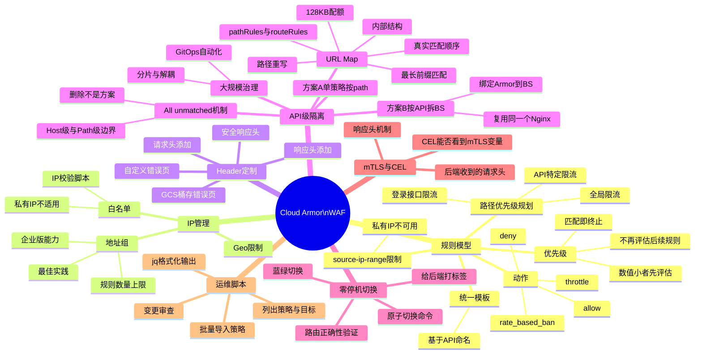

# Cloud Armor 知识点分析

Analyze the `gcp/cloud-armor/` knowledge base. Categorize the Cloud Armor / WAF documents by technical domain, summarize the key knowledge points, and present everything as a Markdown document with a Mermaid mindmap.

本文档覆盖 `gcp/cloud-armor/` 下的 **33 篇文档**。这是全库少数
**「把一个产品的行为规则彻底钉死」** 的目录——规则优先级、匹配终止、地址组限制、
CEL 能否看到 mTLS 变量，全都用实测或官方原话钉过。

> **一句话结论**
> ★ Cloud Armor 的全部复杂度集中在**两个问题**：
> ① **规则怎么排序、什么时候停止评估**（优先级数值小者先评估，**一旦匹配即终止**）
> ② **一个策略怎么拆到多个 API 上**（推荐：**按 API 拆 Backend Service，但复用同一个 Nginx**）。
> 其余文档都是围绕这两点的规则手册与落地脚本。

---

## 文档体系分析

1. **规则模型与优先级** — `cloud-armor-priority.md`、`path-priority.md`、`cloud-armor-path-priority.md`、`cloud-armor-path.md`
2. **匹配动作** — `rate_based_ban.md`（速率封禁 vs 节流）、`summary-ban.md`、`cloud-armor-range.md`、`content-length.md`
3. **IP 管理** — `cloud-armor-ip-limition.md`、`cloud-group.md`、`cloud-armor-address-group.md`、`ip-py.md`
4. **Header 定制** — `cloud-armor-header.md`、`define-header.md`
5. **API 级隔离方案**（`dedicated-armor/`）— `explorer.md`、`glb-api-cloudarmor.md`、`url-map.md`、`URLmapMatch.md`、`how-to-manage-url-map.md`
6. **零停机切换与配额** — `how-to-switch-zerodowntime.md`、`gcloud-compute-url-maps.md`
7. **运维脚本** — `import-armor.md`、`cloud-armor-targets.md`、`cloud-armor-change.md`、`armor-python/ip_validator.md`
8. **mTLS × CEL 调研** — `mtls-armor-cel-research/REPORT.md`

---

## 知识点 MindMap



---

## 主要知识领域详解

### 1. 规则模型与优先级（本目录的第一性原理）

#### 1.1 评估顺序与终止条件
`cloud-armor-priority.md` 给出核心规则：
- **优先级数值小的先评估**；
- **任何规则（包括 rate-based ban）一旦匹配成功，评估即终止**，后续规则**不再评估**。

这条直接决定了规则顺序的写法：**兜底规则必须放在最后**，
一旦前面某条 allow 命中，后面的 deny 永远不会执行。

#### 1.2 优先级规划表
`path-priority.md` 与 `cloud-armor-path-priority.md` 给出**统一模板（基于 API 名）**：

```
priority 100  → 全局基础限流
priority 101  → API 特定限流
priority 103  → 登录接口限流
```

并强调 `source-ip-range` 的限制（见下）。

#### 1.3 匹配动作
- `rate_based_ban.md`：**速率封禁（ban）vs 节流（throttle）** 的选择，
  以及「没达到 ban 条件会不会继续评估后续规则」这个高频问题的答案。
- `content-length.md`：请求体长度上限的语义、影响与调整注意事项。

### 2. IP 管理
- `cloud-armor-ip-limition.md`：**私有 IP（RFC 1918）无法用于 Cloud Armor 的 IP 白名单**，
  并解释了原因（LB 看到的源 IP 不是内网地址）。
- `cloud-group.md` / `cloud-armor-address-group.md`：**地址组是 Enterprise 版能力**，
  用于管理大规模 IP 列表；给出了「规则限制 → 为什么需要地址组 → 实施步骤 → 企业部署最佳实践」。
- `ip-py.md` / `armor-python/ip_validator.md`：IP 段校验脚本。

### 3. Header 定制
`cloud-armor-header.md` 给三种做法（gcloud CLI 加 deny 规则 + 响应头 / Console / **Terraform 推荐自动化**），
`define-header.md` 专门处理 **Cloud Armor 响应头限制**——
响应头定制可以用 **Cloud Storage bucket 作为错误页面存储**来解决。

### 4. API 级隔离（`dedicated-armor/`，本目录最有价值的一组）

`explorer.md` 先讲清 **Cloud Armor 的关键约束**（必须先认清），
再给出从「最小改造」到「最强隔离」的方案总览：

| 方案 | 做法 | 代价 |
|---|---|---|
| A | 单 Cloud Armor Policy，按 API Path 区分规则 | 最小改造，但规则表爆炸 |
| **B（推荐）** | **按 API 拆 Backend Service，但复用同一个 Nginx** | 每个 API 一个 BS + 一个 Armor |

#### 4.1 URL Map 机制（`url-map.md` / `URLmapMatch.md`）
- URL Map 的**内部结构**与**真实匹配顺序**（这两节是全文最有价值的部分）；
- **最长前缀匹配（Longest Prefix Match）** 与 **URL Rewrite** 如何解决「路径后缀」问题；
- `pathRules` vs `routeRules` 的区别与常见问题排查。

#### 4.2 「All unmatched」的安全边界（`create-backendservice.md`）
- **Host-level vs Path-level** 两层防护的界限；
- 为什么「删除 All unmatched」**不是**方案；
- 一句话结论：你的「安全绳」。

#### 4.3 大规模治理（`how-to-manage-url-map.md` / `gcloud-compute-url-maps.md`）
- 挑战（大规模 API + 频繁变更）→ 方案对比决策矩阵 → **GitOps 自动化模式**（CI 里校验 YAML 合法性）；
- **URL Map 128KB 配额**与 Path Rules 限制详解；
- 进阶架构：**多 GLB 分片**与 **Team-based 分层分片（多租户）**。

### 5. 零停机切换（`how-to-switch-zerodowntime.md`）
- 核心策略：**蓝绿切换（Blue/Green Switch）**，配**原子切换命令**；
- 变更后如何验证路由正确性：**给 Payment 后端加标签 → 预期输出中包含该标签**。

### 6. mTLS × CEL 调研（`mtls-armor-cel-research/REPORT.md`）
带着**前置声明**回答三个问题：
① Cloud Armor 的 CEL 表达式**能否看到 mTLS 变量**；
② Backend 实际收到的 Request / Response Header；
③ 官方占位符与后端变量的对应关系。

### 7. 运维脚本
- `import-armor.md`：从模板 JSON 创建新安全策略并导入所有规则（带颜色输出与参数检查）；
- `cloud-armor-targets.md`：列出策略、关联目标、关联 Backend Service、规则，并用 `jq` 格式化；
- `cloud-armor-change.md`：多模型（ChatGPT / Grok / Gemini）对同一变更方案的对比。

---

## 三条阅读路线

```
路线 A · 第一次配 Cloud Armor（1 小时）
  cloud-armor-priority.md → cloud-armor-path.md
  → cloud-armor-ip-limition.md → import-armor.md

路线 B · 要做 API 级隔离（半天）
  dedicated-armor/explorer.md → dedicated-armor/url-map.md
  → dedicated-armor/URLmapMatch.md → dedicated-armor/glb-api-cloudarmor.md
  → dedicated-armor/how-to-manage-url-map.md

路线 C · 要做一次零停机变更（2 小时）
  dedicated-armor/how-to-switch-zerodowntime.md
  → dedicated-armor/gcloud-compute-url-maps.md（配额先查）
```

---

## 结论

1. **只有一条规则必须背死**：**优先级小者先评估，一旦匹配即终止**。
   后面所有的「我的 deny 没生效」类问题，答案几乎都是「它上面有一条 allow 命中了」。
2. **API 级隔离的正确姿势是拆 Backend Service，而不是堆规则**——
   拆 BS 但复用同一个 Nginx，既拿到隔离性，又不用改业务配置。
3. **URL Map 是被低估的一环**：它的**匹配顺序**和 **128KB 配额**
   直接决定方案能不能规模化。
4. **私有 IP 不能进白名单**、**地址组是 Enterprise 能力**——
   这两条限制不查文档就会走弯路。
5. **零停机靠标签验证，不靠肉眼看**：切换后给后端打标签，
   检查访问日志里是否出现该标签——这是一个可以直接抄的验证范式。

---

## 关联文档

- [../gcp-mindmap.md](../gcp-mindmap.md) ·
  [../mtls/mtls-mindmap.md](../mtls/mtls-mindmap.md) ·
  [../cross-project/cross-project-mindmap.md](../cross-project/cross-project-mindmap.md) ·
  [../../safe/ssl/docs/claude/routeaction/url-map-quota.md](../../safe/ssl/docs/claude/routeaction/url-map-quota.md)
- [cloud-armor-priority.md](./cloud-armor-priority.md) ·
  [cloud-armor-path.md](./cloud-armor-path.md) ·
  [cloud-armor-ip-limition.md](./cloud-armor-ip-limition.md) ·
  [dedicated-armor/explorer.md](./dedicated-armor/explorer.md) ·
  [dedicated-armor/url-map.md](./dedicated-armor/url-map.md) ·
  [dedicated-armor/how-to-switch-zerodowntime.md](./dedicated-armor/how-to-switch-zerodowntime.md) ·
  [mtls-armor-cel-research/REPORT.md](./mtls-armor-cel-research/REPORT.md)
