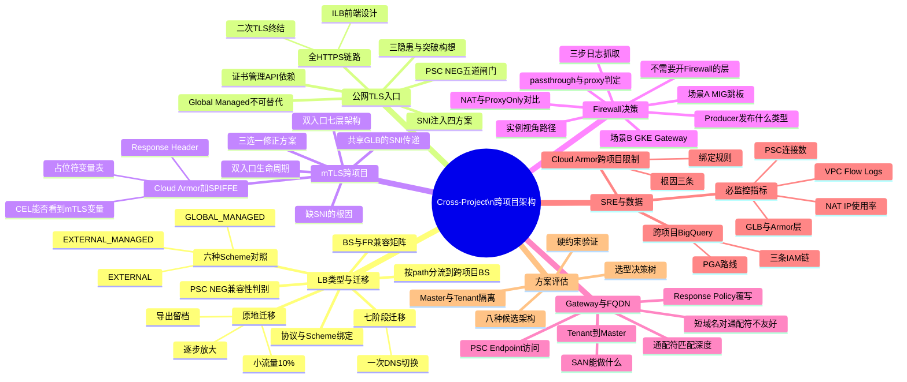

# Cross-Project 跨项目架构 知识点分析

Analyze the `gcp/cross-project/` knowledge base. Categorize the cross-project PSC / multi-tenant ingress documents by technical domain, summarize the key knowledge points, and present everything as a Markdown document with a Mermaid mindmap.

本文档覆盖 `gcp/cross-project/` 下的 **61 篇文档**——这是全库**最像"架构方案书"**的目录：
每篇都保留着"原始问题（Lex 原话 verbatim）"、方案对比矩阵、实施步骤与回滚。

> **一句话结论**
> ★ 跨项目暴露一个内部 API，本质是同时解决 **4 个独立问题**：
> ① **LB 类型**（必须 Managed，不能 Classic）② **连接通道**（PSC NEG，且 SA 必须在第三个 VPC）
> ③ **域名与 SNI 语义**（5 跳里域名在哪儿被消费）④ **防火墙**（哪层本来就不需要你开）。
> 这个目录把 4 条线各自做成了决策树。

---

## 文档体系分析

1. **LB 类型与迁移**（`public-tls-basingpath-cross/`）
   —— 6 种 `loadBalancingScheme` 对照、BS↔FR 兼容矩阵、Classic → Global external ALB 的 7 阶段迁移
2. **公网 TLS 入口落地**（`public-tls-ingress/`）
   —— PSC NEG 的 5 道闸门、为什么必须用 `GLOBAL_EXTERNAL_MANAGED_HTTP_HTTPS`、全 HTTPS 链路
3. **mTLS 跨项目**（`public-mtls-ingress/`）
   —— 共享 GLB 的 SNI 传递性、Cloud Armor + SPIFFE 边缘校验、双入口架构
4. **Firewall 与 NetworkPolicy**（`cross-project-firewall-netpol/`）
   —— "哪些层本来不需要 firewall"、PSC NAT Subnet vs Proxy-Only Subnet 速查、3 步日志抓取法
5. **Gateway 与 FQDN**（`cross-project-gateway/`、`explorer-2-0-fqdn.md`）
   —— Tenant → Master GKE Gateway、Response Policy 覆写解析、SAN 与通配符
6. **SRE 与数据**（`cross-project-sre*.md`、`cross-project-bigquery*.md`、`cross-project-cloud-armor.md`）
   —— 必监控指标、跨项目 BigQuery 联邦、Cloud Armor 跨项目绑定限制

---

## 知识点 MindMap



---

## 主要知识领域详解

### 1. LB 类型与迁移（`public-tls-basingpath-cross/`）

#### 1.1 6 种 `loadBalancingScheme`（`bs-type.md`）
文档给出**一句话结论 + 6 种 scheme 完整对照表**，并澄清两件事：
- **`protocol` 与 scheme 的绑定关系**（不能随意组合）；
- **PSC NEG 兼容性是决定性判别**——只有 Managed 类能接 PSC NEG。

> 记忆锚点：`EXTERNAL_HTTP_HTTPS` = 经典 L7，只能挂 Instance Group；
> `EXTERNAL_MANAGED_HTTP_HTTPS` = 区域级 Managed；
> `GLOBAL_EXTERNAL_MANAGED_HTTP_HTTPS` = 全球级 Managed。

#### 1.2 迁移路径
- `migration-classic-lb-to-glb-external-managed-lb.md`：**7 个阶段 + 1 次 DNS 切换**的完整计划。
- `in-situ-migration.md` / `in-situ-migration-gemini.md`：原地迁移执行计划——
  **PREPARE（导出 URL Map / target proxy / SSL policy / backend service 全量留档）→
  小流量验证（10%）→ 逐步放大（50% → 100%）**。
- `baseing-path-cross-project.md`：同域名按 path 分流到不同 cross-project Backend Service 的可行性。
- `class-application-loadbalancer-cross-project.md`：Classic ALB 跨 project 方案探索，
  附 **4 个候选方案的决策矩阵** + Google 官方原话佐证。

### 2. 公网 TLS 入口（`public-tls-ingress/`）

#### 2.1 PSC NEG 的 5 道闸门（`psc-neg-requirements.md`）
这是本目录**最该背下来的一张清单**——跨项目 + L7 managed LB 的必备条件：
1. Backend Service 必须是 `EXTERNAL_MANAGED` scheme；
2. Consumer 的 LB 服务账号要有权限访问 Producer 的 SA / MIG；
3. Service Attachment 指向的 ILB FR 必须 `allowGlobalAccess=true`；
4. **SA 必须在第三个 VPC**（不能与 Consumer 的 NEG 同 VPC）；
5. PSC NEG 后端**没有健康检查**，多区域 failover 靠 outlier detection。

#### 2.2 为什么必须是 Global Managed（`why-using-global-external-managed-http-https.md`）
把 GCP Load Balancing Scheme 全景铺开后，**从 4 个维度逐项拆解它为什么不可替代**，
并给出关键洞察：**PSC NEG 必须挂在 managed LB 上**。

#### 2.3 全 HTTPS 链路
- `tenant-tls-setup-https.md`：Producer ILB **二次终结 TLS** 的完整命令与输出，
  并正面回答"为什么要从 HTTP backend 升级到全 HTTPS"。
- `certificate-manager-api.md`：`certificatemanager.googleapis.com` 的**依赖关系模型**——
  直接消费者 / 传递消费者（IaC、自动化路径）/ 什么时候必须 enable。

#### 2.4 SNI 注入（`sni-nginx-solution.md`）
4 个候选方案对比，并**强烈推荐不要选方案 A（裸 Nginx）**。

### 3. mTLS 跨项目（`public-mtls-ingress/`）
- `shared-glb-cn-a-sni.md`：把业务方的问题做**协议层分解**，
  引 GCP 官方关于 backend SNI 行为的证据，再对照"合并方案（a+b）里 SNI 原本的设计意图"。
- `Why-missing-sni.md`：为什么 GLB 跟 backend 建 TLS 时**默认不发 SNI**，以及三选一修正方案。
- `explorer-cloud-armor-spiffe.md`：**Cloud Armor CEL 表达式能否看到 mTLS 变量**、
  Backend 实际收到的 HTTP Header、mTLS 占位符变量表（`customRequestHeaders` 用）、Response Header 机制。
- `flow/`：三份 HTML 图——Sequence Flow、Lifecycle State Machine、Architecture Topology。

### 4. Firewall 决策树（`cross-project-firewall-netpol/`）
这是本目录**最实用的一份**：
- `README.md`：一句话结论 + **哪些层"不需要" firewall** + 总路线图（每个组件的 ingress/egress 要求）。
- `references/psc-firewall-cheatsheet.md`：**一句话判定原则** +
  `Producer LB 类型 × Backend source` 速查表 + "怎么判断你的 LB 是 passthrough 还是 proxy"
  （看 Service Attachment 的 target service → 用 target service URI 找 forwarding rule）。
- `references/psc-nat-vs-proxy-only-subnet-index.md`：**30 秒判定**。
- `references/scenario-a-via-mig-jumphost.md` / `scenario-b-via-gke-gateway.md`：
  两个 packaging 变体的**组件 × firewall / NetworkPolicy 矩阵**。
- `references/log-capture-by-3-step-method.md`：**3 步法**抓 PSC 跨项目日志。

### 5. Gateway 与 FQDN
- `cross-project-gateway/rt-psc-gateway.md`：`PSC + GKE Gateway 跨 Project 私网访问 POC 操作手册`，
  含"先拿 Gateway 分配的 IP → 再用 IP 反查 forwarding rule"这个实用技巧。
- `rt-cross-project-fqdn.md`：推荐 **Response Policy**（生产级）在 Consumer VPC 里把 Producer 域名覆写为 PSC Endpoint IP。
- `cross-project-san.md` + `explorer-2-0-fqdn.md`：**SAN 到底解决什么、不能单独解决什么**，
  以及"你的短域名格式对 wildcard 很不友好"这个现实。

### 6. SRE、数据与评估
- `cross-project-sre-summary.md` / `cross-project-sre-enhance.md`：
  **必监控指标**分 Must-Have（GLB/Cloud Armor 层、PSC 连接数、PSC NAT IP 使用率）与 Recommended（VPC Flow Logs，注意计费）。
- `cross-project-bigquery.md` / `cross-project-bigquery-master-to-tenant.md`：
  为什么 BigQuery 走 **PGA** 而不是 PSC；"三条独立可配的 IAM 链"与"命令栈拆解"。
- `cross-project-cloud-armor.md`：**Cloud Armor 跨项目绑定的限制**——
  有 Lex 亲手做的实验证据 + Google 官方原话 + 根因 3 条。
- `cross-project-exploration-tenant-master-isolation-gemini.md`：
  **8 种候选架构**的可行性深度探索 + 综合对比矩阵 + 选型决策树。

---

## 三条阅读路线

```
路线 A · 只想搞懂"为什么 Classic 不行"（1 小时）
  public-tls-basingpath-cross/bs-type.md
  → public-tls-ingress/why-using-global-external-managed-http-https.md
  → public-tls-ingress/psc-neg-requirements.md

路线 B · 要在生产上开一条跨项目入口（2 天）
  cross-project-firewall-netpol/README.md
  → cross-project-firewall-netpol/references/psc-firewall-cheatsheet.md
  → public-tls-basingpath-cross/in-situ-migration.md
  → public-tls-ingress/tenant-tls-setup-https.md

路线 C · 做方案评审（半天）
  cross-project-exploration-tenant-master-isolation-gemini.md
  → public-mtls-ingress/flow/README-flow.md
  → cross-project-sre-summary.md
```

---

## 结论

1. **"跨项目"不是一个技术问题，是四个问题的叠加**：LB 类型、连接通道、域名语义、防火墙。
   任何一环没想清楚，落地时就会返工。
2. **五条硬约束要背下来**：Managed scheme、LB SA 权限、`allowGlobalAccess=true`、
   SA 在第三个 VPC、**PSC NEG 无健康检查**。
3. **SNI 是最容易翻车的一环**：GLB 与 backend 建 TLS 时默认不发 SNI，
   域名在 5 跳里出现 5 次，必须先画图再动手。
4. **Firewall 决策树的价值高于规则本身**：先判断"这层本来就不需要你开 firewall"，
   再决定要不要加规则——省掉的是一整轮排障。
5. **所有文档都保留了"原始问题 verbatim"**：这让方案能被后来者重新质疑，
   而不是只能照抄——这是这个目录最好的写法。

---

## 关联文档

- [../gcp-mindmap.md](../gcp-mindmap.md) ·
  [../mtls/mtls-mindmap.md](../mtls/mtls-mindmap.md) ·
  [../cloud-armor/cloud-armor-mindmap.md](../cloud-armor/cloud-armor-mindmap.md) ·
  [../network/psc-subnet/psc-nat-vs-proxy-only-subnet.md](../network/psc-subnet/psc-nat-vs-proxy-only-subnet.md)
- [public-tls-basingpath-cross/bs-type.md](./public-tls-basingpath-cross/bs-type.md) ·
  [public-tls-ingress/psc-neg-requirements.md](./public-tls-ingress/psc-neg-requirements.md) ·
  [public-tls-ingress/why-using-global-external-managed-http-https.md](./public-tls-ingress/why-using-global-external-managed-http-https.md) ·
  [cross-project-firewall-netpol/README.md](./cross-project-firewall-netpol/README.md) ·
  [cross-project-firewall-netpol/references/psc-firewall-cheatsheet.md](./cross-project-firewall-netpol/references/psc-firewall-cheatsheet.md) ·
  [cross-project-sre-summary.md](./cross-project-sre-summary.md)
