# 跨 Project PSC：域名 / SNI 语义模型澄清

> **本文档回答三个问题**(围绕 [cross-project-psc-architecture-archify.html](./cross-project-psc-architecture-archify.html) 这张图):
> 1. **Service Attachment 到底有没有域名 / SNI 概念?**
> 2. **为什么 GLB 跟 backend(含 PSC NEG)建 TLS 时默认不发 SNI?** 以及"必须有 Nginx MIG"这个说法到底准不准确。
> 3. **如果用 CNAME 做解析,为了不产生 CWE 类问题,各层到底应该"侦听"哪些域名?**
>
> **状态**:Draft · Date: 2026-09-10 · Author: **architect-gcp** · Reviewers: **infra-gcp** / **qa-gcp**
>
> **配套文档(必读)**:
> - 架构图源文件(本图的数据源):[cross-project-psc-architecture-archify.json](./cross-project-psc-architecture-archify.json)
> - SNI 专题(官方原文级):[glb-sni.md](file:///Users/lex/git/gcp/ingress/public-mtls-global-ingress/glb-sni.md) — GLB 为什么不发 SNI
> - SNI 注入方案(Nginx / Envoy Gateway / NGF / Cilium 对比):[sni-nginx-solution.md](./public-tls-ingress/sni-nginx-solution.md)
> - DNS 解析流程(CNAME → A):[cname-dns-resolution-flow.html](file:///Users/lex/git/gcp/ingress/public-tls-ingress/cname-dns-resolution-flow.html)
> - 域名归属与共享入口两种模式:[cross-domain-fqdn.md](./cross-domain-fqdn.md)
> - 通配符证书匹配深度:[about-wildcard-depth.md](./about-wildcard-depth.md)
> - PSC 五道闸门:[psc-neg-requirements.md](./public-tls-ingress/psc-neg-requirements.md)
> - Passthrough vs Proxy 判断:[psc-firewall.md](./psc-firewall.md)

---

## 0. TL;DR(8 条结论)

| # | 结论 |
|---|---|
| 1 | **Service Attachment(SA)没有域名 / SNI 概念。** 它是 L3.5/L4 的隧道 + **项目级连接审批**,只回答"哪个 project 可以连",不回答"要哪个 hostname"。 |
| 2 | **域名语义只存在于 3 个地方**:① DNS 解析层;② Consumer 侧 GLB 的 **frontend TLS**(证书选择 + URL Map host rule);③ Producer 侧**第一个会终止 TLS 的 L7**。中间所有环节(SA / PSC tunnel / passthrough NLB)对 hostname 完全无感。 |
| 3 | **GLB → backend 是一条全新的 TLS 连接**(frontend TLS 已在 GLB 终止),这条连接默认**不带 SNI**、也**不透传** client 的原始 SNI。官方原文: *"load balancers don't use the Server Name Indication (SNI) extension for connections to the backend"*(internet NEG 除外,PSC NEG 不在例外内)。 |
| 4 | **hostRewrite 永远只改 HTTP Host / :authority 头**,发生在 backend TLS 握手**之后**,所以它**改不了** GLB→backend 这一跳的 SNI。 |
| 5 | **"必须有 MIG"这个说法不精确。** 精确表述是:**Producer 侧必须存在一个"能终止 TLS + 能按 hostname 分流"的 L7**。这个 L7 可以是 Nginx MIG / internal ALB / GKE Gateway——甚至在 `Backend Service protocol=HTTP` 时**根本不需要 TLS 终结点**(见 §5.4 方案 0)。 |
| 6 | **SNI 为空 ≠ 请求失败。** TLS 层选不中按域名匹配的证书/监听器(落到 `default_server`),但 **HTTP 请求级的 Host 匹配仍然工作**。这就是"很多场景看起来能跑"的原因,也是"多租户共享入口"最容易串租户的地方。 |
| 7 | **CNAME 只是 DNS 指针,不是别名。** 客户端发出的 SNI / `Host` 永远是**原始业务域名**;CNAME 目标(别名)**不允许**出现在 SNI、`Host`、证书 SAN 里。 |
| 8 | **CWE 防线不在 DNS 层,在 L7 入口层。** 关键动作是:**GLB 侧拒绝未知 Host + Producer 侧 `default_server` 直接 444/421 + 别名域名一律不进证书 SAN**。 |

---

## 1. 角色与术语约定

本文统一使用以下命名(与图中 A/B Project 对齐):

| 本文用词 | 图中节点 | 职责 | 域名职责 |
|---|---|---|---|
| **Tenant Project(Consumer)** = A Project | `client` / `glb` / `armor` / `bs-a` / `psc-neg` | **用户入口**:公网 DNS、公网 IP、TLS 终结、Cloud Armor、URL Map 路由 | **域名的唯一"主人"**:公网 DNS + 客户端证书 |
| **Master Project(Producer)** = B Project | `nat-subnet` / `sa` / `ilb` / `backend` | **主服务**:GKE / Gateway / MIG,通过 SA 对外发布 | **默认不关心公网域名**(共享入口模式下仅把 Host 当"路由标签") |

示例命名(占位符,勿直接替换成真实资源):

- 租户对外业务域名:`api1.team1.example.com`
- 平台统一 CNAME 别名:`tenant-lb.platform.example.com`
- GLB 公网静态 IP:`203.0.113.10`(TEST-NET-3,示例用)

---

## 2. 架构全景:域名语义到底在哪几跳出现

```mermaid
graph LR
    subgraph Client["外部调用方"]
        C["curl api1.team1.example.com"]
    end

    subgraph DNS["公共 DNS (权威 zone)"]
        D1["CNAME: api1.team1.example.com → tenant-lb.platform.example.com"]
        D2["A: tenant-lb.platform.example.com → 203.0.113.10"]
    end

    subgraph TP["A Project · Tenant (Consumer) · Shared VPC"]
        GLB["GLB / Global HTTPS LB<br/>frontend TLS 终结 #1"]
        CA["Cloud Armor<br/>(看 Host 头)"]
        UM["URL Map<br/>host rule + path rule"]
        BS["Backend Service<br/>protocol = HTTPS / HTTP"]
        NEG["PSC NEG<br/>PRIVATE_SERVICE_CONNECT"]
    end

    subgraph Tunnel["PSC 私有通道 (Google backbone)"]
        T["PSC tunnel<br/>+ PSC NAT (SNAT)"]
    end

    subgraph MP["B Project · Master (Producer) · Private VPC"]
        SA["Service Attachment<br/>ACCEPT_MANUAL + consumer allowlist"]
        ILB["Internal LB<br/>passthrough NLB (L4) 或 proxy 型 (L7)"]
        L7["Producer L7<br/>Nginx MIG / internal ALB / GKE Gateway"]
        APP["K8s Pods"]
    end

    C -->|"① DNS"| DNS
    DNS -->|"② TCP + TLS#1 SNI=api1.team1.example.com"| GLB
    GLB --> CA --> UM --> BS --> NEG
    NEG -->|"③ TLS#2 新连接 SNI = 空 (默认)"| T --> SA --> ILB --> L7
    L7 -->|"④ TLS#3 SNI 由 L7 决定"| APP
```



**把上图翻译成"哪一跳认识域名"**:

| 跳 | 组件 | 认不认 hostname? | SNI 从哪来 | Host 头是什么 |
|---|---|---|---|---|
| ① | 公共 DNS | ✅ 唯一权威 | — | — |
| ② | Client → GLB | ✅ **认识** | **client 自己填**(原始业务域名) | 原始业务域名 |
| ③ | GLB(GFE) → URL Map → BS | ✅ 认识(但**只认 HTTP 头**) | backend TLS **不填**(默认) | 原始域名(可被 hostRewrite 改写) |
| ④ | GLB → PSC NEG → PSC tunnel | ❌ **完全不认识** | **空**(默认) | 透传 HTTP 头 |
| ⑤ | SA → passthrough NLB | ❌ **完全不认识**(纯 L4 字节流) | 透传 | 透传 |
| ⑥ | Producer L7(Nginx / ALB / Gateway) | ✅ **这里才第一次"按域名"分流** | **空**(TLS 选不中 vhost) | **原始域名 / rewrite 后的域名** |
| ⑦ | Producer L7 → Pod | ✅ | **L7 自己填**(如 proxy_ssl_name) | L7 决定 |

> **一句话**:域名语义在 **DNS → GLB(frontend) → Producer L7** 这三处"复活",中间的 PSC 段是**纯粹的 IP 管道**。

---

## 3. 澄清一:Service Attachment 有没有域名 / SNI 概念?

### 3.1 答案:没有。而且这是**特性**,不是缺陷

Service Attachment 的语义只有三项:

| 维度 | SA 提供什么 | 不提供什么 |
|---|---|---|
| **可达性** | 一个 IP:Port 的连接点(consumer 侧表现为 PSC endpoint / NEG) | ❌ 任何 hostname 语义 |
| **身份** | **项目级连接审批**(connectionPreference + consumerAcceptLists 里写 project ID) | ❌ 请求级 / 路径级的身份 |
| **地址转换** | 绑定 PSC NAT 子网,producer 侧看到的是 NAT 段的源地址(SNAT) | ❌ 原始 client IP(除非关掉 NAT) |

官方口径:SA 是 *publishing a service* 的机制,本质是 *producer 的一台内部 LB 前挂了一个跨项目可达的端点*。它跑在 Google backbone 上,**不解密、不解析、不看 HTTP 头**。

### 3.2 为什么"SA 没有域名"很重要:它决定了 Producer 侧必须自己长出 L7

SA 的 `targetService` 指向 Producer 内部的 LB。**这个 LB 是 passthrough 还是 proxy,决定了 Producer 侧有没有域名语义**——这是整张图里最关键的分叉点(图中 `ilb` 节点标注的 "L4 / L7 forwarding rule" 就是这个分叉):

| Producer 发布形态 | SA 透传后到达谁 | Producer 侧第一个"认识 hostname"的组件 | backend 看到的源地址 | 是否需要额外的 L7(MIG) |
|---|---|---|---|---|
| **Internal passthrough NLB**(L4) | MIG / Pod 的 443 | **MIG 上的 Nginx(或 Pod 里的 Gateway)** | **PSC NAT subnet CIDR** | **需要**(否则没人终结 TLS) |
| **Regional internal Application LB**(L7,proxy 型) | Envoy(proxy-only subnet) | **Envoy 本身** | **proxy-only subnet CIDR** | **不需要** |
| **GKE internal Gateway**(gke-l7-rilb) | Envoy | **Envoy 本身** | proxy-only subnet CIDR | **不需要** |

> 判断方法(工程实操):看 Producer 侧 forwarding rule 指向的 target 类型,以及有没有 target proxy / URL map / proxy-only subnet。详见 [psc-firewall.md](./psc-firewall.md) §17。

### 3.3 推论:SA 只能做"租户级"隔离,做不了"请求级"隔离

- **能**:每个租户一个 SA → 流量从哪个 SA 进来 = 哪个租户,**物理隔离**,Producer 零域名知识。
- **不能**:共享一个 SA → 所有租户流量在 Producer 侧源地址都是同一个 PSC NAT 段,**无法用源 IP 区分租户** → 只能靠 **Host 头 / 路径前缀 / GLB 注入的自定义头**。

这正是 [cross-domain-fqdn.md](./cross-domain-fqdn.md) 里"模式 A(物理隔离)/ 模式 B(共享入口)"的分界。

---

## 4. 澄清二:GLB 跟 backend 建 TLS 时,为什么默认不发 SNI?

### 4.1 前提:这是**两条不同的 TLS 连接**

```
client ──TLS#1(SNI = api1.team1.example.com,client 决定)──▶ GLB GFE
                                                                  │ frontend TLS 在这里终结
                                                                  │ GLB 解密 → 解析 HTTP → URL Map 路由 → hostRewrite
                                                                  ▼
                                              GLB ──TLS#2(SNI = 空,GLB 自己决定)──▶ PSC NEG
```

| 维度 | client → GLB(frontend TLS) | GLB → backend(backend TLS) |
|---|---|---|
| 谁是 TLS client | 外部 client | **GLB 自己** |
| 携带的 SNI | client 决定的原始 hostname | **GLB 自行决定 → 默认空** |
| 验证方向 | GLB 验 client cert(mTLS) | 反向:GLB 验 backend cert(**默认只做最低验证**) |

### 4.2 官方原文(三条独立证据)

1. [encryption-to-the-backends](https://cloud.google.com/load-balancing/docs/ssl-certificates/encryption-to-the-backends):
   > *"With the exception of HTTPS load balancers with internet NEG backends, load balancers **don't use the Server Name Indication (SNI) extension for connections to the backend**."*

2. [backend-authenticated-tls-backend-mtls](https://cloud.google.com/load-balancing/docs/backend-authenticated-tls-backend-mtls) § Limitations:
   > *"The load balancer **doesn't pass the client's SNI hostname** from the frontend TLS connection when connecting to a backend. However, backends can access the client's SNI hostname using a custom request header."*

3. [negs/internet-neg-concepts](https://cloud.google.com/load-balancing/docs/negs/internet-neg-concepts):
   > *"The SSL Server Name Indication (SNI) extension is only supported with INTERNET_FQDN_PORT endpoints."*

> **PSC NEG 的类型标识是 private-service-connect,是独立 NEG 类别,不继承 internet NEG 的 SNI 例外。**

### 4.3 hostRewrite 的能力边界(常见误解)

hostRewrite / hostHeaderRewrite 是 **HTTP 七层动作**,发生在 **URL Map 路由决策之后、backend TLS 握手之后**(因为要先有明文 HTTP 才能改头)。
→ **它可以改变 Producer 侧 L7 看到的 Host,但永远不能改变 GLB→backend 这一跳的 SNI。**

### 4.4 tlsSettings.sni / subjectAltNames 的能力边界

| 能力 | tlsSettings.sni | tlsSettings.subjectAltNames |
|---|---|---|
| 设置 backend TLS ClientHello 的 SNI | ✅ 固定字符串 | — |
| 按请求 / 租户动态切换 SNI | ❌ **backend service 级固定值**,全 BS 共享 | — |
| 校验 backend 证书的 SAN | ✅(SNI 必须命中 SAN) | ✅ **与 SNI 解耦**,最多 5 条 ← **推荐** |
| 配合 Backend Authenticated TLS / backend mTLS | ✅ | ✅ |

> **给多租户共享入口的实用结论**:
> **不要**指望 tlsSettings.sni 做动态 SNI 分流(做不到);
> **要**用 subjectAltNames 钉住 Producer 侧证书的 SAN(与 SNI 无关,可精确锁定),把"校验"和"分流"两件事分开:
> **校验** → subjectAltNames(安全);**分流** → Host 头 / 路径(路由)。

### 4.5 三个真实场景(PSC NEG backend)

| 场景 | GLB 发出的 SNI | 结果 |
|---|---|---|
| A. 不配 tlsSettings.sni(默认) | **空 / 不带 SNI extension** | Producer 侧按 hostname 匹配的 listener **永远命中不了**,落到 default server |
| B. 配 tlsSettings.sni = "svc.internal.example.com" | **固定值**(所有请求都一样) | 证书能选中,但**无法按租户区分** |
| C. backend service protocol = HTTP | **根本没有 TLS#2** | 隧道内跑明文 HTTP,Producer 直接看到原始 Host —— **SNI 问题整体消失** |

> 场景 C 是被低估的选项,见 §5.4。

### 4.6 副作用(安全):backend 证书只做"最低验证"

官方原文:
> *"When a load balancer connects to backends that are within Google Cloud, the load balancer accepts any certificate your backends present. In this case, the load balancer performs only minimum certificate validation."*

→ **CN / SAN 与 Host 不匹配,GLB 也认。** 这一跳是"**加密但不一定可信**",属于 CWE-295 风险面(§8.4)。

---

## 5. 澄清三:"必须有 Nginx MIG" 这句话准确吗?

### 5.1 精确表述

> ❌ 不准确:"必须有一个 MIG"。
> ✅ 准确:**"Producer 侧必须存在一个能终结 TLS、并且能按 hostname 分流的 L7 实体"**。

如果 Producer 发布的是 **proxy 型 LB**(internal ALB / GKE Gateway),**这个 L7 已经存在**,不需要额外起 MIG。
如果 Producer 发布的是 **passthrough NLB**,流量会被原样送到 backend 的 443,此时 **backend 自己必须会 TLS**(这就是你观察到的"必须有 Nginx MIG")。

### 5.2 SNI 为空,对 Producer 侧 L7 的三条实际影响

| # | 影响 | 细节 | 风险 |
|---|---|---|---|
| 1 | **证书选择失效** | TLS 握手时按 SNI 选证书 / 选 vhost;SNI 空 → 选中 default_server 的证书 | 客户端看到的证书错误 → **CWE-295/297** |
| 2 | **mTLS 可能被静默降级** | Nginx 的 ssl_verify_client 是**绑定在 server 块**上的;SNI 空 → 落到 default server → 若 default server 没开 ssl_verify_client,**客户端证书校验被整体跳过** | **CWE-295 / TLS 降级攻击** |
| 3 | **HTTP Host 路由仍然工作** | Nginx 按请求的 Host 头匹配 server_name 是 **HTTP 级行为**,与 TLS 握手时的 SNI 无关 | 无(这也是"看起来能跑"的原因) |

> **第 3 条是整篇文档最关键的一句话**:
> **SNI 空不会让请求 404,但会让"按域名选证书 / 按域名选 listener"静默退化成"落到默认站点"。**
> 在多租户共享入口下,这种退化 = **串租户**。

### 5.3 Producer 侧三种 L7 实现的对比

| 实现 | SNI 空时的行为 | 按 hostname 分流的方式 | 动态注入 SNI | 运维负担 |
|---|---|---|---|---|
| **裸 Nginx MIG** | 落 default_server | server_name 匹配 Host | ✅ proxy_ssl_name / proxy_ssl_server_name on | ⚠️ 高(自维护二进制 / Lua / reload) |
| **Envoy Gateway / NGINX Gateway Fabric / Cilium** | 同上,但可编程 | Gateway API HTTPRoute(header/path) | ✅ 声明式配置 | ✅ 低(Operator / CRD) |
| **internal ALB / GKE Gateway(proxy 型)** | Envoy 自己终结,**由 proxy 层决定** | URL map host rule | ✅(Envoy 配置) | ✅ 低 |

> 详细对比与配置示例见 [sni-nginx-solution.md](./public-tls-ingress/sni-nginx-solution.md) §2(四方案矩阵)。

### 5.4 四种可选架构(按"要不要在 Producer 侧终结 TLS"排序)

| 方案 | Consumer Backend Service | Producer 发布形态 | Producer 侧 L7 | SNI 问题 | 适用 |
|---|---|---|---|---|---|
| **方案 0(推荐,最简)** | protocol = HTTP | passthrough NLB → Nginx MIG / Gateway | 需要(但**不终结 TLS**,只路由 HTTP) | **不存在** | PSC 隧道本身在 Google backbone 上加密;Tenant 侧 GLB 已完成 TLS + mTLS |
| **方案 1** | protocol = HTTPS | passthrough NLB → Nginx MIG | 需要,且**终结 TLS** | 存在(落 default_server) | 需要 backend mTLS / backend 证书固定 |
| **方案 2** | protocol = HTTPS | internal ALB / GKE Gateway(proxy 型) | 已有(Envoy) | 存在(由 proxy 层承接) | 需要 host rule 路由 |
| **方案 3** | protocol = HTTPS + tlsSettings.sni 固定值 | 任意 | 任意 | **缓解**(固定 SNI,非动态) | 单租户 / 单 SA 场景 |

> ⚠️ 方案 0 的代价:**Producer 侧看到的流量是明文 HTTP**,源地址是 PSC NAT 段 → **无法用源 IP 识别租户**,必须靠 SA 隔离(一租户一 SA)或 Host / 路径。

---

## 6. 完整 Follow 流程(简化文字版)

> **L0 → L9**,每一跳只回答四个问题:**谁发起?什么协议?SNI 是什么?Host 是什么?**

### L0 · DNS 解析(公共 DNS)

```
client 问 api1.team1.example.com (type=A)
  → 权威 zone 回 CNAME: api1.team1.example.com → tenant-lb.platform.example.com
  → resolver 继续追 CNAME 目标: tenant-lb.platform.example.com → A 203.0.113.10
  → client 拿到 203.0.113.10,按 TTL 缓存
```

- **要点**:CNAME 与 A **不能共存于同一 hostname** → A 挂在别名上。
- **要点**:**客户端只认原始域名**;CNAME 目标**不进入**后续任何 TLS / HTTP 语义。

### L1 · TCP + TLS#1(client → GLB)

```
client --TCP 3wh--> 203.0.113.10:443
client --TLS#1--> GLB GFE
     ClientHello: SNI = api1.team1.example.com   ← client 自己填,平台无法干预
     Host 头:      api1.team1.example.com
```

- **证书校验**:client 用**原始域名**校验 GLB 证书(SAN 必须覆盖 api1.team1.example.com 或 *.team1.example.com)。
- **GLB 侧**:按 SNI 从 Certificate Map 选证书;若配了 mTLS,在此验 client cert。

### L2 · Cloud Armor(在 GLB 的 URL Map 之前)

- 看到的是**解密后的 HTTP**,因此**能**看到 Host 头。
- 可用 Host 做 WAF 规则 / 限流 / 黑白名单。

### L3 · URL Map 路由(Consumer 侧 L7 决策点)

```
host rule: api1.team1.example.com  →  Backend Service: bs-a
           *.team1.example.com      →  Backend Service: bs-a
default action                     →  404 / 固定响应(见 §8.3,必须配!)
path rule:  /example-apiname1/*    →  hostRewrite: svc.internal.example.com
```

- **这是 Consumer 侧唯一能"按域名分流"的地方**。
- **必须**配 default action 拒绝未知 Host(否则任何人用 IP + 任意 Host 都能进来)。

### L4 · GLB → PSC NEG:新建 TLS#2(★ SNI 丢失点)

```
GLB --TLS#2--> PSC NEG endpoint IP:443
     ClientHello: SNI = (空)     ← 默认不发送;除非配了 tlsSettings.sni(固定值)
     Host 头:      api1.team1.example.com  (或 hostRewrite 后的值)
```

- GLB 对 GCP 内部 backend **只做最低证书验证**。

### L5 · PSC 隧道 + PSC NAT(SNAT)

```
GLB(GFE) ──PSC tunnel(Google backbone,加密)──▶ SA
source 被 SNAT 成 PSC NAT 子网地址
```

- Producer 侧看到的源 IP = **PSC NAT 段**(passthrough 型)/ **proxy-only 段**(proxy 型)。
- **重叠网段可用**:两侧 IP 空间可以完全一样,PSC 隧道天然隔离。

### L6 · Service Attachment 准入(项目级)

```
consumer project 提交 connection request(带 pscConnectionId / SA URI)
  → producer 侧检查 consumerAcceptLists(项目 ID 白名单)
  → ACCEPT_MANUAL: 需人工/自动接受; 状态 ACCEPTED 后隧道打通
```

- **这是唯一的安全闸门**:项目级,不是域名级。
- 白名单写错项目 ID = 串租户(且**零 IAM 交叉**,所以没有第二道防线)。

### L7 · Producer 侧转发 + 第一次"按域名"分流

```
passthrough NLB: 原样转发 L4 字节流到 MIG:443
proxy 型 LB    : Envoy 终结 TLS(有 SNI 概念,但此时 SNI 仍是空的)
```

- **passthrough 型** → 字节流原样到 Nginx MIG。
- **proxy 型** → Envoy 终结 TLS,拿到明文 HTTP。

### L8 · Producer 侧 L7 终结 TLS#3 + 路由

```
Nginx: 握手时 SNI 为空 → 选中 default_server 的证书
       请求级: 用 Host 头匹配 server_name → 命中正确的 location / upstream
       再向 Pod 发 TLS#3: proxy_ssl_name <upstream 域名>; proxy_ssl_server_name on
```

- **这一步是"域名语义第二次复活"的地方**。
- **坑**:SNI 为空 → default_server 的证书 ≠ 按域名应有的证书;若 default_server 没开 ssl_verify_client,mTLS 校验被跳过(§5.2 第 2 条)。

### L9 · 应用

- K8s Gateway HTTPRoute / Ingress / 应用层鉴权(JWT、mTLS 身份、租户上下文)。
- **纵深防御**:网络层(SA 白名单)+ 应用层(租户身份)必须**两套独立**。

### 流程速查表

| 跳 | 协议 | SNI | Host | TLS 终结点 | 认识域名? |
|---|---|---|---|---|---|
| L0 DNS | DNS | — | — | — | ✅ 权威 |
| L1 client→GLB | HTTPS | api1.team1.example.com | 同左 | **GLB** | ✅ |
| L2 Cloud Armor | HTTP | — | 同左 | (GLB 之前) | ✅(看头) |
| L3 URL Map | HTTP | — | 同左 / rewrite 后 | — | ✅(路由) |
| L4 GLB→PSC NEG | HTTPS | **空** | 同左 | (GLB 是 client) | ❌ |
| L5 PSC tunnel | TCP(加密) | 透传 | 透传 | — | ❌ |
| L6 SA | — | — | — | — | ❌(只认 project) |
| L7 Producer LB | L4 / L7 | 透传(空) | 透传 | proxy 型则在此 | ⚠️ |
| L8 Producer L7 | HTTPS | **空**(选证书失败) | **原始域名** | **Producer L7** | ✅ |
| L9 Pod | HTTPS | L7 填的值 | L7 决定 | Pod / Gateway | ✅ |

---

## 7. 域名所有权矩阵:谁必须知道哪些域名

| 层 | **必须知道** | **不应该知道 / 必须拒绝** | 理由 |
|---|---|---|---|
| 公共 DNS(权威 zone) | 原始业务域名 → CNAME;别名 → A | — | CNAME 链是唯一的 IP 解耦手段 |
| Consumer GLB 证书 | **原始业务域名**(api1.team1.example.com / *.team1.example.com) | **别名 tenant-lb.platform.example.com** | 别名不是"业务身份",进 SAN 会让平台域名与租户域名共享同一张证书 → 串租户 |
| Consumer URL Map | 原始业务域名(host rule) | 未知 Host(走 default action 拒绝) | 防止 IP 直连 + 任意 Host |
| Consumer Backend Service | Producer 侧证书 SAN(若做 backend mTLS) | — | 用 subjectAltNames 钉住 |
| Service Attachment | **什么都不该知道**(只有 project ID) | 任何 hostname | SA 是网络闸门,不是路由闸门 |
| Producer passthrough NLB | 什么都不该知道 | — | 纯 L4 |
| **Producer L7**(Nginx / ALB / Gateway) | **该租户自己的业务域名**(或按路径/头路由) | **其它租户域名、平台别名域名** | 这一层是"最后的路由闸门" |
| Producer 应用 | 租户上下文(JWT / 客户端证书身份) | — | 纵深防御 |

> **一句话**:**域名的"主权"在 Tenant;域名的"路由责任"落在 Producer 的 L7;SA 只负责"网络准入"。**

---

## 8. CNAME 的正确用法,以及 CWE 防线

### 8.1 CNAME 的本质:DNS 指针,不是 HTTP 别名

```
api1.team1.example.com            ← 业务身份(client 用它做 SNI / Host / 证书校验)
        │  CNAME (纯 DNS)
        ▼
tenant-lb.platform.example.com     ← 平台路由别名(指向哪一个 LB)
        │  A
        ▼
203.0.113.10                       ← 入口 IP
```

**三条铁律**:

1. **SNI / Host 永远是原始业务域名**——CNAME 目标**永远不会**出现在应用层。
2. **别名不进任何证书 SAN**(见 §8.2)。
3. **别名不可用于鉴权**——DNS 解析结果不是身份凭据(CWE-350 / CWE-441)。

### 8.2 "必须侦听"的域名清单(按层)

| 层 | ✅ 必须接受(SNI + Host) | ❌ 必须拒绝 | 拒绝时的响应 | 关联 CWE |
|---|---|---|---|---|
| **Consumer GLB(证书)** | api1.team1.example.com、*.team1.example.com | tenant-lb.platform.example.com(别名)、其它租户域名 | 握手失败(证书不匹配) | CWE-295/297 |
| **Consumer URL Map** | 上述 host rule | 未知 Host / 别名域名 | **default action → 404**(必须显式配) | CWE-346 / CWE-441 |
| **Consumer Cloud Armor** | 同上 | 别名域名 + 未知 Host | 拦截 / 限流 | CWE-16 |
| **Producer L7(Nginx 等)** | 该租户业务域名(server_name api1.team1.example.com;) | **其它租户域名**、**平台别名域名** | default_server { return 444; } 或 421 | **CWE-346 / CWE-441** |
| **Producer L7(mTLS)** | — | 未认证 client | ssl_verify_client on; + ssl_verify_error | **CWE-295** |

> **重点**:default_server **不能**是一个"正常工作"的站点。
> 它必须是**拒绝器**。否则任何未被 server_name 命中的 Host 都会落到一个真实后端上——在多租户场景里,这就是串租户。

### 8.3 为什么"别名域名"特别危险

别名 tenant-lb.platform.example.com 是**所有租户共用的一个名字**,而且它是**公开可解析的**(否则 CNAME 链断掉)。因此:

- 任何人可以直接 `curl -H 'Host: tenant-lb.platform.example.com' https://203.0.113.10/` 打到共享入口;
- 如果 GLB 的 default action 是"转发",这个请求会落到**某一个租户**的 backend 上 → 该租户变成平台域名的**开放代理**;
- 如果别名的证书 SAN 覆盖了通配符 *.platform.example.com,客户端会看到一个"平台级"证书,却拿到某个租户的内容。

**正确做法**:

1. 别名**只存在于 DNS**,**不进证书 SAN**,**不作为 SNI 被接受**;
2. GLB URL Map **显式拒绝**别名 Host(default action 兜底);
3. Producer L7 的 server_name 里**绝不出现**别名;
4. 如果业务上必须允许用别名访问(通常没必要),则把它当作**独立业务域名**处理:独立证书、独立 URL Map、独立 vhost、独立鉴权。

### 8.4 CWE 映射表(CNAME / SNI 场景)

| CWE | 名称 | 在本架构中的触发条件 | 缓解措施 |
|---|---|---|---|
| **CWE-295** | Improper Certificate Validation | ① GLB 对内部 backend 只做最低证书验证;② Producer 侧 SNI 空 → 落 default_server 证书;③ mTLS 因 default server 未开 ssl_verify_client 被跳过 | ① backend mTLS + subjectAltNames 钉住 SAN;② default_server 用统一"拒绝证书"或至少不承载业务;③ 在**所有** server 块显式 ssl_verify_client on; |
| **CWE-297** | Improper Validation of Certificate with Host Mismatch | 证书 SAN 与请求域名不匹配仍被接受(通配符过宽 / 别名进 SAN) | SAN 精确化;通配符只用一层(§8.5);别名不进 SAN |
| **CWE-346** | Origin Validation Error | 共享入口下,请求 Host 未校验 → 被路由到别的租户 | URL Map host rule + default deny;Producer server_name 白名单 + default_server return 444 |
| **CWE-441** | Unintended Proxy or Intermediary | 共享入口 + Host 未校验 → 某租户变成平台域名的开放代理 | 同上;Cloud Armor 拦别名 Host;应用层鉴权兜底 |
| **CWE-350** | Reliance on Reverse DNS for a Security-critical Action | 用 DNS / CNAME 链 / PTR 反查来判断"请求来自哪个租户" | **禁止**;租户身份只来自 ① SA 白名单 ② 显式 Host / 路径 ③ 应用层 token |
| **CWE-16** | Configuration | 未显式配置 default action / default_server / URL Map 兜底 | §10 检查清单 |

### 8.5 通配符证书的深度规则(与 CNAME 组合时的常见坑)

> 摘自 [about-wildcard-depth.md](./about-wildcard-depth.md)(RFC 2818 / RFC 6125):

| 证书 SAN | api1.team1.example.com | 更深一层 | 说明 |
|---|---|---|---|
| *.team1.example.com | ✅ 匹配 | ❌ v1.api1.team1.example.com | 单个 * **只覆盖一层** |
| *.example.com | ❌(跨了两层) | ❌ | 单个 * **只覆盖一层** |

**结论**:*.team1.example.com 覆盖 api1.team1.example.com ✅,但**不覆盖** v1.api1.team1.example.com ❌。
→ **CNAME 设计时就要把域名层级拍平**,否则一张通配证书盖不住,GLB 与 Producer 侧都要多套证书。

### 8.6 反例 vs 正例

| ❌ 反例 | ✅ 正例 |
|---|---|
| 证书 SAN = *.platform.example.com(覆盖别名域) | 证书 SAN 只覆盖**租户业务域**(*.team1.example.com) |
| URL Map 无 default action | URL Map default action = 404 / deny |
| Nginx default_server 指向真实 upstream | Nginx default_server { return 444; } |
| 用 Host: tenant-lb.platform.example.com 判断租户 | 用 SA(项目级)+ Host 业务域 / 路径 / GLB 注入头判断租户 |
| Producer L7 server_name 写 *.example.com | server_name api1.team1.example.com;(精确到租户) |
| proxy_ssl_verify off; 一把梭 | proxy_ssl_verify on; + trust store;或用 subjectAltNames 在 GLB 侧钉住 |
| 靠 PTR / 反向 DNS 判断来源租户 | 靠 SA 白名单 + 应用层 token |

---

## 9. 三种落地模式对比与推荐

| 维度 | 模式 A:一租户一 SA(物理隔离) | 模式 B:共享 SA + 路径路由 | 模式 C:共享 SA + Host 路由(需 L7) |
|---|---|---|---|
| Producer 侧域名知识 | **0** | 0(靠 path prefix) | 需要 Host 白名单 |
| Producer 侧 L7 | 不需要(直连专属后端) | 需要(路由) | 需要(终结 TLS + vhost) |
| 串租户风险 | **最低**(网络层隔离) | 低(prefix 冲突风险) | **高**(SNI 空 + default server ⇒ 高危) |
| 规模成本 | 高(N 个 SA / N 个 NLB) | 中(1 个 SA + path) | 低(1 个 SA + 1 套证书) |
| CWE 暴露面 | 小 | 中 | **大**(必须配齐 §8.2 全部拒绝项) |
| 推荐 | ✅ **强隔离场景首选** | ✅ **同租户多 API 首选** | ⚠️ 跨租户共享入口,需配齐防御 |

**推荐路径**:

1. **先选模式**(A / B),因为它决定了 SA 数量、证书数量、以及是否需要共享 L7;
2. **再选 TLS 终结点**(Consumer GLB 终结 vs Consumer GLB + Producer L7 双终结);
3. **最后配 CWE 防线**(default deny / default_server 拒绝 / SAN 精确化 / mTLS 全开);
4. **强烈建议**:Tenant 侧 GLB 终结 TLS + 校验 client 身份,**并把租户身份以自定义头(如 X-Client-Cert-URI-SANs)透传给 Producer**(官方明确说明 backend 可以通过 custom request header 拿到原始 client SNI / 证书信息),Producer 侧据此做**请求级**租户判定——**这比依赖 SNI 更可靠**。

---

## 10. 落地检查清单

**Consumer(Tenant)侧**

- [ ] GLB 证书 SAN 覆盖**原始业务域名**,**不包含** CNAME 别名
- [ ] 通配符只跨一层(*.team1.example.com 不覆盖 a.b.team1.example.com)
- [ ] URL Map 有**显式 default action**(404 / deny),不留"默认转发"
- [ ] URL Map 显式拒绝别名 Host
- [ ] Cloud Armor 有 Host 维度的规则(拦截别名 / 未知 Host)
- [ ] Backend Service protocol 与 Producer 侧能力对齐(HTTPS 需 Producer 侧能终结 TLS)
- [ ] 若做 backend mTLS:用 subjectAltNames 钉住 Producer 证书 SAN(**不要**指望 SNI)
- [ ] 需要动态 SNI 时,才引入 tlsSettings.sni(固定值,**非**动态)

**Producer(Master)侧**

- [ ] SA connectionPreference = ACCEPT_MANUAL + consumerAcceptLists 写**正确的 project ID**
- [ ] 确认 producer 发布形态(passthrough vs proxy)→ 决定 firewall 放 PSC NAT 段还是 proxy-only 段
- [ ] 若 passthrough:backend 必须能终结 TLS(Nginx MIG / Gateway)
- [ ] Producer L7 server_name **精确到租户业务域名**,**不含**别名、**不含**其它租户
- [ ] default_server = **拒绝器**(return 444;),不承载业务
- [ ] 所有 server 块**都**显式 ssl_verify_client on;(防 SNI 空导致的 mTLS 静默降级)
- [ ] proxy_ssl_verify on; + trust store(**不要** off)
- [ ] 向 Pod 的 TLS#3 显式设 SNI(proxy_ssl_server_name on; + proxy_ssl_name <upstream>)
- [ ] 应用层做租户鉴权(JWT / 客户端证书),**不依赖**源 IP 或 DNS

**DNS 侧**

- [ ] CNAME 与 A 不共存于同一 hostname
- [ ] 别名只在 DNS 层存在,不进任何证书 / vhost / URL Map
- [ ] TTL 合理(切 IP 只改 A 记录)

---

## 11. 参考与权威依据

| # | 来源 | 用途 |
|---|---|---|
| 1 | [encryption-to-the-backends](https://cloud.google.com/load-balancing/docs/ssl-certificates/encryption-to-the-backends) | GLB 对 backend **不发 SNI**;对 GCP 内部 backend **只做最低证书验证** |
| 2 | [backend-authenticated-tls-backend-mtls](https://cloud.google.com/load-balancing/docs/backend-authenticated-tls-backend-mtls) | 不透传 client SNI;backend 可通过 **custom request header** 拿到 client SNI |
| 3 | [negs/internet-neg-concepts](https://cloud.google.com/load-balancing/docs/negs/internet-neg-concepts) | SNI 例外**仅限** INTERNET_FQDN_PORT |
| 4 | [private-service-connect-backends](https://cloud.google.com/vpc/docs/private-service-connect-backends) | PSC NEG 是**独立 NEG 类别**,不继承 internet NEG 例外 |
| 5 | [backendServices REST API](https://cloud.google.com/compute/docs/reference/rest/v1/backendServices/get) | tlsSettings.sni / subjectAltNames 的准确语义 |
| 6 | [Publish services by using Private Service Connect](https://cloud.google.com/vpc/docs/configure-private-service-connect-producer) | SA 生产者侧模型、NAT 子网、连接审批 |
| 7 | RFC 2818 / RFC 6125 | 通配符证书**只覆盖一层** |
| 8 | CWE-295 / 297 / 346 / 350 / 441 / 16 | §8.4 映射表 |

**本仓库内配套文档**

- [cross-project-psc-architecture-archify.json](./cross-project-psc-architecture-archify.json) — 本文档对应的图数据源
- [cross-domain-fqdn.md](./cross-domain-fqdn.md) — 域名归属:模式 A / 模式 B
- [about-wildcard-depth.md](./about-wildcard-depth.md) — 通配符匹配深度
- [sni-nginx-solution.md](./public-tls-ingress/sni-nginx-solution.md) — SNI 注入四方案
- [psc-neg-requirements.md](./public-tls-ingress/psc-neg-requirements.md) — PSC NEG 五道闸门
- [psc-firewall.md](./psc-firewall.md) — passthrough vs proxy 判断、放通哪一段
- [why-using-global-external-managed-http-https.md](./public-tls-ingress/why-using-global-external-managed-http-https.md) — 为什么用 GLOBAL_EXTERNAL_MANAGED_HTTP_HTTPS
- [glb-sni.md](file:///Users/lex/git/gcp/ingress/public-mtls-global-ingress/glb-sni.md) — GLB SNI 专题(官方原文级)

---

> **本文档完成时间**:2026-09-10 · **作者**:architect-gcp
> **写作约束**:每个 GCP 行为断言都标注官方文档出处;概念澄清与工程建议分栏呈现;所有资源名使用占位符。
