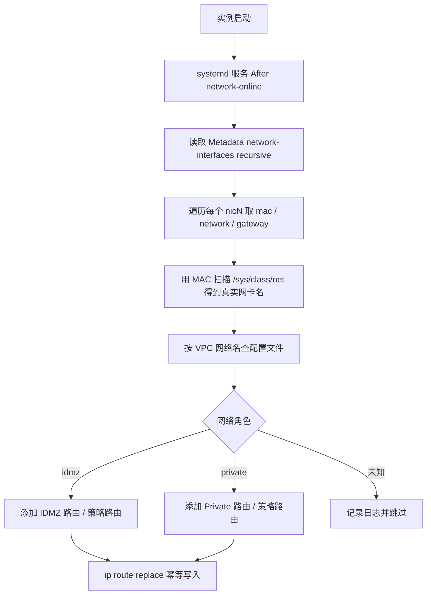
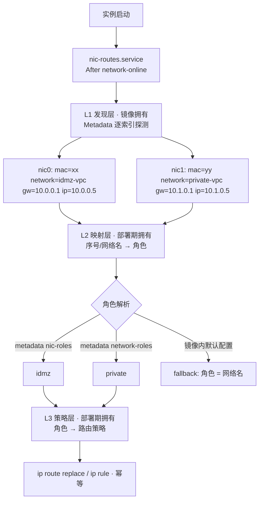

# GCE 多网卡：与网卡名解耦的最佳实践

## 1. 问题分析

`ens3` / `ens4` 是 systemd 的 **Predictable Network Interface Names**，按 PCI 槽位（或驱动、固件拓扑）生成，**并不稳定**。换机型（n1 → n2、C3 等）后，虚拟化平台、网卡驱动（virtio-net / gVNIC）、PCI 拓扑都可能变化，名字就会变。

真正稳定的标识有三个：

| 标识 | 稳定性 | 来源 |
|------|--------|------|
| 网卡序号 `nic0` / `nic1` | 稳定（由创建实例时的顺序决定） | Metadata |
| **MAC 地址** | 稳定（实例生命周期内） | Metadata + `/sys/class/net` |
| **VPC 网络名称** | 稳定，且是你要的"语义" | Metadata |

**核心思路：** 用 Metadata Server 拿到「网络名 → MAC → gateway」，再用 MAC 反查本机真实网卡名，最后按「网络名」决定路由策略。代码里不再出现 `ens3` / `ens4`，也不依赖 IP。

## 2. 方案对比

| 方案 | 说明 | 评价 |
|------|------|------|
| **A. Metadata + MAC 反查（推荐）** | 启动时动态解析 | 无需认证、本地调用、无 API 配额，最通用 |
| B. Compute API `instances.get` | 通过 API 查询 | 需要 SA 权限和网络出口，有延迟，**不必要** |
| C. 固定网卡名（udev / systemd `.link` 按 MAC 命名） | 把名字固定成 `idmz0` / `priv0` | 可行，但需在 udev 阶段完成，调试复杂，可作为补充 |
| D. systemd-networkd 按 MAC 匹配 | `[Match] MACAddress=` 写路由 | 声明式，但 MAC 要启动时生成，仍需脚本 |
| E. 路由下沉到 VPC（Custom Static Route + Tag） | 路由由 GCP 控制面管理 | 能下沉就优先下沉，镜像里只保留必须的主机路由 |

> Metadata 的 `network-interfaces` 里有 `ip`、`mac`、`network`、`gateway`、`subnetmask`、`mtu`、`forwardedIps`、`ipAliases` 等字段，**没有 subnetwork 字段**，所以用 `network` 名称做角色判断最合适。

## 3. 推荐架构



## 4. 代码示例

### 4.1 配置文件：网络名 → 路由（与代码解耦）

```bash
# /etc/nic-routes.conf
# 格式: <VPC网络名>|<目的网段>|<下一跳: gateway 或具体IP>
idmz-vpc|10.100.0.0/16|gateway
idmz-vpc|10.101.0.0/16|gateway
private-vpc|172.16.0.0/12|gateway
```

镜像中只放脚本，路由内容通过配置文件、模板，甚至实例自定义 metadata（见 5.2）下发，换环境不用重做镜像。

### 4.2 启动脚本

```bash
#!/usr/bin/env bash
# /usr/local/sbin/setup-nic-routes.sh
set -euo pipefail

MD="http://metadata.google.internal/computeMetadata/v1"
CONF="/etc/nic-routes.conf"

md() { curl -sf --retry 5 --retry-delay 1 -H 'Metadata-Flavor: Google' "$MD/$1"; }
log() { logger -t nic-routes "$*"; echo "$*"; }

# 通过 MAC 反查本机网卡名
dev_by_mac() {
  local mac="${1,,}" p
  for p in /sys/class/net/*; do
    [[ -r "$p/address" ]] || continue
    [[ "$(<"$p/address")" == "$mac" ]] && { basename "$p"; return 0; }
  done
  return 1
}

ifaces_json="$(md 'instance/network-interfaces/?recursive=true')"
count="$(jq 'length' <<<"$ifaces_json")"

for ((i = 0; i < count; i++)); do
  mac="$(jq -r ".[$i].mac" <<<"$ifaces_json")"
  net="$(jq -r ".[$i].network | split(\"/\") | last" <<<"$ifaces_json")"
  gw="$(jq -r ".[$i].gateway" <<<"$ifaces_json")"

  if ! dev="$(dev_by_mac "$mac")"; then
    log "WARN nic$i mac=$mac 找不到对应网卡，跳过"
    continue
  fi
  log "nic$i -> dev=$dev network=$net gw=$gw"

  # 匹配配置并写入路由
  while IFS='|' read -r cfg_net dest via; do
    [[ -z "${cfg_net// }" || "$cfg_net" == \#* ]] && continue
    [[ "$cfg_net" == "$net" ]] || continue
    [[ "$via" == "gateway" ]] && via="$gw"
    # onlink: GCE 的子网掩码常为 /32，网关不在直连网段内
    ip route replace "$dest" via "$via" dev "$dev" onlink
    log "route replace $dest via $via dev $dev"
  done < "$CONF"
done
```

### 4.3 systemd 单元

```ini
# /etc/systemd/system/nic-routes.service
[Unit]
Description=Setup static routes by GCE network metadata
After=network-online.target google-guest-agent.service
Wants=network-online.target

[Service]
Type=oneshot
ExecStart=/usr/local/sbin/setup-nic-routes.sh
RemainAfterExit=yes

[Install]
WantedBy=multi-user.target
```

```bash
# Build Image 阶段
apt-get update && apt-get install -y jq curl
chmod +x /usr/local/sbin/setup-nic-routes.sh
systemctl enable nic-routes.service
```

### 4.4 验证命令

```bash
# 查看 Metadata 中的网卡信息
curl -s -H 'Metadata-Flavor: google' \
  'http://metadata.google.internal/computeMetadata/v1/instance/network-interfaces/?recursive=true' | jq

# 对照本机网卡与 MAC
ip -br link
ip route show
```

## 5. 进阶建议

### 5.1 需要策略路由时（多网卡防止非对称路由）

只加静态路由有时不够，多网卡常见问题是回包从错误的网卡出去。可以按网卡建独立路由表：

```bash
TABLE=$((100 + i))
ip route replace default via "$gw" dev "$dev" onlink table "$TABLE"
ip rule add from "$ip" lookup "$TABLE" priority "$TABLE" 2>/dev/null || true
```

这里 `$ip` 来自 metadata 的 `.[i].ip`。注意它是**用来建 source rule，而不是用来判断网卡角色**，角色判断仍然只依赖网络名。

### 5.2 路由配置也走 Metadata（完全免改镜像）

创建实例或模板时加自定义 metadata，例如 `nic-routes=<内容>`，脚本里读取：

```bash
md 'instance/attributes/nic-routes' > /run/nic-routes.conf
```

这样镜像里只保留通用逻辑，路由表由 Terraform / Instance Template 管理，不同环境差异也一目了然。

### 5.3 可选：固定网卡名

如果运维和监控又强依赖固定名字，可以在镜像里用 udev 规则或 systemd `.link` 文件按 MAC 命名，但 MAC 是实例级的，无法写进镜像，需要在启动早期动态生成。这会增加复杂度，一般不建议作为主方案。

## 6. 注意事项

- **幂等**：用 `ip route replace`，不要用 `add`，服务重启或重复执行都不会报错。
- **时序**：脚本放在 `network-online.target` 之后，Metadata 调用加 `--retry`，防止启动早期网络未就绪。
- **网络名要明确**：`network` 字段格式为 `projects/<PROJECT_NUMBER>/networks/<NAME>`，Shared VPC 下 project 部分是宿主工程，只取最后一段名称比较。
- **持久化**：`ip route` 重启后失效，所以每次启动都执行脚本，不需要写进网络配置文件。
- **Guest Agent 冲突**：`google-guest-agent` 会为 forwarded IP、alias IP 管理本地路由，不要手动覆盖这些条目。
- **上线前验证**：先用新机型（n2）起一台测试实例，对比 `ip -br link` 与脚本日志，确认 MAC 映射正确，再切换生产。
- **优先下沉到 VPC**：能用 VPC Custom Static Route 加 Network Tag 解决的路由，不要放在主机里，镜像更干净，也更易审计。

如果你愿意贴一下现在的启动脚本（脱敏即可），我可以直接帮你改成上面这种基于 MAC + 网络名的版本。

# GCE 多网卡：网卡识别与静态路由的最佳实践（镜像解耦方案）

> 适用场景：自建 Base Image 里写死了 `ens3` / `ens4` 这类网卡名做分支判断，换机型（n1 → n2 / c3 / c3d）后逻辑失效；同时希望同一份镜像能在 IDMZ、Private 等不同网络环境的实例模板里复用。

---

## TL;DR

| 你的问题 | 结论 |
|---|---|
| `ens3`/`ens4` 稳定吗？ | **不稳定**。它是 systemd Predictable Network Interface Names，按 PCI 拓扑生成。换机型、换内核/发行版（udev/netplan 规则差异）都会变 |
| 用什么做稳定标识？ | 三层，优先级从高到低：<br>1. **网卡序号 `nic0`/`nic1`**（由实例创建时的挂载顺序决定，跨机型跨镜像都不变）<br>2. **MAC 地址**（仅实例生命周期内稳定，**不能写进镜像**）<br>3. **VPC 网络名**（创建后不可重命名，是唯一的「语义」标识） |
| 用 Metadata 还是 API？ | **Metadata**。本地 169.254.169.254 调用，零凭据、零配额、零外网依赖。Compute API 需要 SA 权限 + 出网，且拿不到 MAC → 内核网卡名的映射，没有额外价值 |
| 角色判断靠什么？ | **不要靠 IP**。靠「部署期下发的角色映射」，键可以是网卡序号或 VPC 网络名；策略（角色 → 路由）再单独一层。这样换 IP、换机型、换网络都不需要改镜像 |
| 静态路由一定要写进主机吗？ | **不一定**。优先下沉到 VPC / LB / PSC（见 §4）。只有需要「指定出口网卡」或「同主机跨 VPC 出入」时才在主机做路由 |
| 换机型 / 升级 Base Image 后，逻辑要改吗？ | **不需要**。见 §8。核心是：镜像里只放「发现 + 通用逻辑」，不持有任何环境知识 |

**一句话方案**：`Metadata 拿网卡序号/MAC/网络名` → `MAC 反查内核网卡名` → `按序号/网络名查角色` → `按角色查路由策略` → `幂等写入`。三层完全分离。

---

## 1. 根因：为什么写死 `ens3` 一定会出事

`ens3` / `ens4` 来自 systemd 的 predictable naming（`65-persistent-net.rules` / netplan 的 `.link` 生成器），命名依据是 **PCI 槽位 + 驱动 + 固件拓扑**：

| 变量 | n1-standard-1 | n2-standard-2 | 影响 |
|---|---|---|---|
| 虚拟化平台 | KVM + virtio-net | KVM + virtio-net / gVNIC | 驱动不同 → PCI 布局不同 |
| PCI 槽位分配 | 网卡落在 slot 3 | 网卡可能落在 slot 3 / 4 / 其他 | **名字直接变化** |
| 网卡数量 | 单卡也占 `ens3` | 多卡可能变成 `ens3`+`ens4`，也可能变成 `ens4`+`ens5` | **顺序都可能错位** |
| 发行版 / udev 版本 | Debian 12 vs Ubuntu 24.04 命名规则不同 | | 升级 Base Image 就可能变 |

也就是说：**只要脚本里出现字符串 `ens3`，它就已经绑定了某一个具体机型 + 某一个具体发行版版本**。这是架构问题，不是脚本 bug。

> 还有一个更隐蔽的坑：即使某次迁移后 `ens3` 恰好还是 IDMZ 网卡，**顺序错位**也会让脚本把流量送错网卡。名字「看起来对」比「明确错」更危险，因为它不会报错。

---

## 2. 哪些标识真的稳定

### 2.1 GCE Metadata 里可用的网卡字段

官方 predefined metadata keys 中，`instance/network-interfaces/<N>/` 提供（注意官方字段名用**连字符**）：

| 字段 | 内容 | 稳定性 |
|---|---|---|
| `mac` | 该网卡的 MAC 地址 | 实例生命周期内稳定；**每台实例都不同，绝不能进镜像** |
| `network` | `projects/PROJECT_ID/networks/NETWORK_NAME` | **稳定**：VPC 网络创建后名称不可更改 |
| `gateway` / `gateway-ipv6` | 该网卡的默认网关 | 随子网配置 |
| `ip` | 该网卡的内网主 IP | 会变（DHCP / 重建） |
| `subnetmask` | 子网掩码 | 随子网配置 |
| `mtu` | MTU | 随网络配置 |
| `dns-servers` | DNS 服务器 | |
| `forwarded-ips` / `ip-aliases` / `target-instance-ips` | 负载均衡转发 IP、别名 IP | 会变，**不要碰** |
| `access-configs/0/external-ip` | 外部 IP | 会变 |

> **Metadata 里没有 `subnetwork` 字段**，只有 `network`。所以「用网络名做角色判断」是唯一可行的语义化做法（想要子网级精度，只能调 Compute API）。

### 2.2 稳定性排序

| 标识 | 跨机型 | 跨 Base Image 升级 | 跨实例 | 能写进镜像吗 |
|---|---|---|---|---|
| **网卡序号 `nicN`** | 稳定 | 稳定 | 稳定（同一模板内） | 可以（但含义要部署期下发） |
| **VPC 网络名** | 稳定 | 稳定 | 稳定 | 可以（但要部署期下发） |
| **MAC 地址** | 稳定 | 稳定 | 每实例不同 | **绝对不行** |
| **内网 IP** | 稳定 | 稳定 | 会变 | 不行 |
| **内核网卡名 `ensN`** | **会变** | **会变** | 会变 | 不行 |

### 2.3 关键事实：NIC 与网络的绑定由「实例模板」决定，与镜像和机型无关

```
Instance Template
  ├─ nic0 → network: idmz-vpc      ← 这条绑定写在模板里
  ├─ nic1 → network: private-vpc   ← 这条绑定写在模板里
  └─ image: my-base-image          ← 镜像对这条绑定一无所知
```

**网卡和网络是绑定的，但这个绑定属于实例模板，不属于镜像。** 换机型时你换的是 machineType，模板里的 NIC 绑定原封不动，所以 NIC → 网络的映射稳定。你要做的是：**让镜像在运行时去发现这个映射，而不是猜。**

---

## 3. 三层解耦架构（核心）

把「发现」和「策略」彻底分开，任何一层变化都不需要动其他层：



| 层 | 内容 | 归属 | 什么时候变 |
|---|---|---|---|
| **L1 发现** | 读 Metadata、MAC → 内核网卡名 | **镜像** | 几乎不变 |
| **L2 映射** | 网卡序号 / 网络名 → 角色（idmz / private） | **部署期**（实例模板 metadata） | 换网络环境时 |
| **L3 策略** | 角色 → 目标网段、下一跳 | **部署期**（metadata 或配置文件） | 业务网络规划变化时 |

**解耦效果**：

- 换机型（n1 → n2）→ L1 不变，**不需要改任何东西**
- 升级 Base Image（Debian 12 → Ubuntu 24.04）→ L1 不变，**不需要改任何东西**
- 换 VPC（IDMZ → 别的 IDMZ）→ 只改 L2/L3，**镜像不动**
- IP 段全变 → 只改 L3，**镜像不动**

### 3.1 路由模型：一张网卡一张表，两段优先级

这是 §5 脚本的输出形态，理解它才能读懂 `ip rule` 的优先级安排。

每张网卡分配一张独立的路由表（`T = 100 + 网卡序号`）：

| 表内容 | 作用 |
|---|---|
| `default via <该网卡网关> dev <该网卡> table T` | 该网卡的默认出口 |
| `<该网卡网关> dev <该网卡> src <该网卡IP> table T` | 带**源地址提示**的主机路由，保证出站流量的源 IP 与出站网卡一致 |
| `<目的网段> via <下一跳> dev <该网卡> table T src <该网卡IP>` | 该角色专属的目的网段路由，`src` 保证回包原路返回 |

`ip rule` 分两段优先级（数字越小越优先）：

| 优先级段 | 规则 | 作用 |
|---|---|---|
| `1000+` | `to <目的网段> lookup T` | **目的优先**：命中该网段的流量，无论源是谁，都从指定网卡出去 |
| `2000+` | `from <网卡IP>/<前缀> lookup T` / `to <网卡IP>/<前缀> lookup T` | **对称性保证**：本网卡 IP 发出的流量走本网卡表；发往本网卡 IP 的流量也走本网卡表。前缀长度由 metadata 的 `subnetmask` 推导 |

为什么目的规则排在源规则前面：源规则是「按网卡身份兜底」，目的规则是「按业务要求强制指定出口」。业务要求的优先级必须更高，否则会被兜底规则抢先匹配。

> 官方文档的多网卡教程只做了 `from` / `to`（网卡自身 IP）两个规则，用于解决「回包走错网卡」的**对称性**问题。本方案在此之上增加 `to <目的网段>` 规则段，用于解决「这个网段必须从这张网卡出去」的**出口选择**问题——这正是 IDMZ / Private 双网卡场景的实际诉求。

```
表格化理解

  优先级 1001  to 10.0.0.0/8      lookup 100   → 目的网段强制走 idmz 网卡
  优先级 1002  to 10.1.0.0/16    lookup 101   → 目的网段强制走 private 网卡
  优先级 1003  to 172.16.0.0/12  lookup 101   → 同上，多条目的网段各自独立优先级
  ─────────────────── 分界 ───────────────────
  优先级 2000  from 10.0.0.5/20   lookup 100   → idmz 网卡自身流量兜底
  优先级 2001  to   10.0.0.5/20   lookup 100   → 回包对称
  优先级 2002  from 10.1.0.5/24   lookup 101
  优先级 2003  to   10.1.0.5/24   lookup 101
```

---

## 4. 先回答：真的需要在主机里写静态路由吗？

这是最容易做过头的地方。**主机静态路由是「没有办法时的办法」**，很多场景有更原生的解法。按优先级排：

| 你的实际需求 | 首选方案 | 复杂度 | 主机还要写路由吗 |
|---|---|---|---|
| IDMZ 和 Private 两个 VPC 之间的**东西向**互通 | **VPC Peering**（可选 Cloud Router / BGP） | Simple | 不需要 |
| 只允许某些来源访问 Private 里的服务 | **VPC firewall rules + network tags**（按标签而非 IP 授权） | Simple | 不需要 |
| 对外暴露 Private 里的 L4/L7 服务 | **Private Service Connect** 或 **内网 LB**（Internal ALB / passthrough NLB） | Moderate | 不需要 |
| 单台主机**同时**接入两个 VPC，且要让不同出向流量走不同网卡 | **主机策略路由**（本文方案） | Moderate | 需要 |
| 同主机上做「网卡间转发」/ 软路由 | 主机策略路由 + `ip_forward=1` | Moderate | 需要 |

> **L4 判断的正解**：你说「不能用 IP 去做第四层判断」——**防火墙规则应该用 network tag 授权，而不是 IP**；L4 服务的暴露应该交给 LB / PSC，它们的 frontend IP 是稳定的，backend 落在哪张网卡由 LB 的 network / subnetwork 配置决定。这一层完全不需要主机脚本参与。
>
> 主机静态路由真正解决的是**出口路径选择（egress steering）**，它本身不做任何四层判断，只决定「这个目的网段从哪张网卡出去」。

**判断准则**：如果你的路由是为了「两个 VPC 互联」→ 别在主机做，用 Peering。如果是「同一台机器上有两个 IP，要让不同目的网段走不同网卡」→ 主机策略路由是对的解法。

---

## 5. 实现

### 5.1 配置文件格式（镜像内默认值，L2/L3 的 fallback）

```bash
# /etc/nic-routes.conf
# 纯空格分隔，# 开头为注释。镜像里只放默认行为，真实环境用实例 metadata 覆盖。
#
# 方式 1：按网卡序号映射角色（最稳定，与网络名无关）
0 idmz
1 private
#
# 方式 2：按 VPC 网络名映射角色
# @network private-vpc private
#
# 方式 3：角色 -> 路由策略（角色名 / 目的CIDR / 下一跳）
# 下一跳写 gateway 表示用该网卡自己的网关；也可写具体 IP
idmz 10.0.0.0/8 gateway
private 10.1.0.0/16 gateway
private 172.16.0.0/12 10.1.0.254
```

### 5.2 实例 Metadata 覆盖（推荐的生产用法）

在 **Instance Template / MIG** 上设置，让同一份镜像适配不同网络环境：

```bash
# 角色映射：网卡序号 -> 角色
--metadata="nic-roles=0=idmz,1=private"

# 角色 -> 路由策略：目的=下一跳，多条用 ; 分隔
--metadata="route-private=172.16.0.0/12=gateway;10.20.0.0/16=10.1.0.254"
```

优先级：**实例 metadata > 镜像内 `/etc/nic-routes.conf`**。metadata 缺失时脚本不会报错，而是回落到配置文件；两者都没有时，**角色默认等于网络名**（所以你也可以直接把 `idmz-vpc` 当角色名来写路由）。

> Metadata 有 512KB 总配额、单 value 256KB、单 key 128 bytes，路由表规模正常远小于此。
> 项目级 metadata 会下发给该 Project 全部 VM，**不要把路由映射放项目级**。

### 5.3 启动脚本

```bash
#!/usr/bin/env bash
# /usr/local/sbin/setup-nic-routes.sh
#
# GCE 多网卡实例：为每张网卡建立独立的策略路由表，按角色下发静态路由。
#
# 设计原则：
#   1. 绝不出现 ens3/ens4 等内核网卡名常量
#   2. 绝不基于 IP 判断网卡角色
#   3. 发现逻辑属于镜像；角色与策略属于部署期（实例 metadata）
#
# 路由模型（两张表 + 两段优先级）：
#   每张网卡一张独立路由表 T = RT_BASE + nicIndex
#     T 内含：default via 该网卡网关（带 src 提示）、该网卡自身的网关主机路由
#   优先级分段（数字越小越优先）：
#     [TO_RULE_BASE,   )  目的地址规则  to <dest>      -> 强制把该目的网段的流量从指定网卡出去
#     [FROM_RULE_BASE, )  源地址规则    from <nic_ip>   -> 保证本网卡出站与回包对称
#                                 to   <nic_ip/subnet> -> 同上（对端访问本机该网卡时用）
set -euo pipefail

MD="http://metadata.google.internal/computeMetadata/v1"
CONF="${NIC_ROUTES_CONF:-/etc/nic-routes.conf}"
RT_BASE=100          # 路由表编号基数
TO_RULE_BASE=1000    # 目的地址规则优先级基数（最高优先级段）
FROM_RULE_BASE=2000  # 源地址规则优先级基数
MAX_NIC=16

md_get() {
  curl -sf --max-time 5 --retry 8 --retry-delay 1 --retry-connrefused \
       -H 'Metadata-Flavor: Google' "${MD}/$1"
}

# 探测用：404 立即返回，不做重试（否则每张网卡边界会白等数秒）
md_probe() {
  curl -sf --max-time 5 -H 'Metadata-Flavor: Google' "${MD}/$1"
}

log() { logger -t nic-routes -- "$*" >/dev/null 2>&1 || true; echo "[nic-routes] $*"; }

dev_by_mac() {
  local want="${1,,}" p addr
  for p in /sys/class/net/*; do
    [[ -r "$p/address" ]] || continue
    addr="$(<"$p/address")"
    if [[ "${addr,,}" == "$want" ]]; then basename "$p"; return 0; fi
  done
  return 1
}

wait_for_ip() {
  local dev="$1" want_ip="$2" i
  [[ -z "$want_ip" ]] && return 0
  for (( i = 0; i < 30; i++ )); do
    ip -4 addr show dev "$dev" 2>/dev/null | grep -qF "$want_ip" && return 0
    sleep 1
  done
  return 1
}

route_replace() {
  local dest="$1" gw="$2" dev="$3" table="$4" src="$5"
  local args=(route replace "$dest")
  [[ -n "$gw"    ]] && args+=(via "$gw")
  args+=(dev "$dev")
  [[ -n "$table" ]] && args+=(table "$table")
  [[ -n "$src"   ]] && args+=(src "$src")
  if ! ip "${args[@]}" 2>/dev/null; then
    # 网关不在本机直连前缀内时（GCE 常见的 /32 主机路由场景）需要 onlink
    ip "${args[@]}" onlink 2>/dev/null || true
  fi
}

# 幂等写入一条 ip rule：先按优先级删除再添加，保证重复执行结果一致
rule_upsert() {
  local prio="$1"; shift
  ip rule del prio "$prio" 2>/dev/null || true
  ip rule add prio "$prio" "$@" 2>/dev/null || true
}

# ---------- L1 发现层：逐索引探测，顺序即网卡序号 ----------
declare -a N_IDX N_MAC N_NET N_GW N_IP N_MASK

# 由 metadata 的 subnetmask 推导前缀长度（255.255.240.0 -> 20）
mask2prefix() {
  local m="$1" o n=0 i
  IFS='.' read -r -a oct <<<"$m"
  for (( i = 0; i < 4; i++ )); do
    o="${oct[$i]:-0}"
    while (( o > 0 )); do
      n=$(( n + (o & 1) ))
      o=$(( o >> 1 ))
    done
  done
  printf '%s' "$n"
}

discover() {
  local i=0 mac
  while (( i < MAX_NIC )); do
    mac="$(md_probe "instance/network-interfaces/${i}/mac" 2>/dev/null || true)"
    [[ -z "$mac" ]] && break
    N_IDX+=("$i")
    N_MAC+=("$mac")
    N_NET+=("$(md_get "instance/network-interfaces/${i}/network" 2>/dev/null | awk -F/ '{print $NF}' || true)")
    N_GW+=("$(md_get "instance/network-interfaces/${i}/gateway" 2>/dev/null || true)")
    N_IP+=("$(md_get "instance/network-interfaces/${i}/ip" 2>/dev/null || true)")
    N_MASK+=("$(md_get "instance/network-interfaces/${i}/subnetmask" 2>/dev/null || true)")
    # 注意：不能写 (( i++ ))，当 i=0 时该表达式返回退出码 1，
    # 在 set -e 下会直接终止脚本。必须用赋值形式。
    i=$(( i + 1 ))
  done
  (( ${#N_IDX[@]} > 0 )) || { log "FATAL 未发现任何网卡"; exit 1; }
}

# ---------- L2 映射层：网卡序号 / 网络名 -> 角色 ----------
resolve_role() {
  local idx="$1" net="$2" raw r

  raw="$(md_get 'instance/attributes/nic-roles' 2>/dev/null || true)"
  if [[ -n "${raw//[[:space:]]/}" ]]; then
    r="$(printf '%s' "$raw" | tr ',' '\n' | awk -F= -v i="$idx" \
          'NF==2 && $1+0==i {gsub(/[[:space:]]/,"",$2); print $2}')"
    [[ -n "$r" ]] && { printf '%s' "$r"; return; }
  fi

  raw="$(md_get 'instance/attributes/network-roles' 2>/dev/null || true)"
  if [[ -n "${raw//[[:space:]]/}" ]]; then
    r="$(printf '%s' "$raw" | tr ',' '\n' | awk -F= -v n="$net" \
          'NF==2 && $1==n {gsub(/[[:space:]]/,"",$2); print $2}')"
    [[ -n "$r" ]] && { printf '%s' "$r"; return; }
  fi

  [[ -r "$CONF" ]] || { printf '%s' "$net"; return; }
  r="$(awk -v i="$idx" -v n="$net" '
        $1 ~ /^[0-9]+$/ && NF==2 { if ($1+0==i) {gsub(/[[:space:]]/,"",$2); print $2} }
        $1=="@network" && NF==3 { if ($2==n) {gsub(/[[:space:]]/,"",$3); print $3} }
     ' "$CONF")"
  # 兜底：角色 = 网络名，保证永远有可用的默认行为
  printf '%s' "${r:-$net}"
}

# ---------- L3 策略层：角色 -> 目的网段 / 下一跳 ----------
role_routes() {
  local role="$1" raw
  raw="$(md_get "instance/attributes/route-${role}" 2>/dev/null || true)"
  if [[ -n "${raw//[[:space:]]/}" ]]; then
    printf '%s' "$raw" | tr ';' '\n' | awk -F= 'NF==2 {gsub(/[[:space:]]/,""); print $1, $2}'
    return
  fi
  [[ -r "$CONF" ]] || return 0
  awk -v r="$role" '$1==r && NF>=3 {print $2, $3}' "$CONF"
}

# ---------- 主流程 ----------
discover
log "发现 ${#N_IDX[@]} 张网卡"

# 多网卡下回包源地址与入接口不在同一条路由上，strict rp_filter 会静默丢包
sysctl -qw net.ipv4.conf.all.rp_filter=2
sysctl -qw net.ipv4.conf.default.rp_filter=2

to_seq=0

for (( k = 0; k < ${#N_IDX[@]}; k++ )); do
  idx="${N_IDX[$k]}"; mac="${N_MAC[$k]}"; net="${N_NET[$k]}"
  gw="${N_GW[$k]}";  addr="${N_IP[$k]}"

  if ! dev="$(dev_by_mac "$mac")"; then
    log "WARN nic${idx} mac=${mac} 未找到对应内核网卡，跳过"
    continue
  fi
  if ! wait_for_ip "$dev" "$addr"; then
    log "WARN nic${idx} dev=${dev} 30s 内未拿到 IP ${addr}，跳过"
    continue
  fi

  role="$(resolve_role "$idx" "$net")"
  log "nic${idx} dev=${dev} network=${net} ip=${addr} gw=${gw} role=${role}"

  table=$(( RT_BASE + idx ))
  # 用斜杠路径形式，避免 VLAN 子接口名里的点被 sysctl 当成路径分隔符
  # （如 eth0.100 必须写成 net/ipv4/conf/eth0.100/rp_filter）
  sysctl -qw "net/ipv4/conf/${dev}/rp_filter=2" || true

  # 该网卡的专属路由表：默认路由 + 带源地址提示的网关主机路由
  ip route replace default via "$gw" dev "$dev" table "$table" 2>/dev/null \
    || ip route replace default via "$gw" dev "$dev" table "$table" onlink 2>/dev/null || true
  ip route replace "$gw" dev "$dev" src "$addr" table "$table" 2>/dev/null || true

  # 源地址规则：本网卡 IP 发出的流量走本表，保证回包对称
  # 前缀长度取自 metadata 的 subnetmask，与 Google 官方教程的 from IP/PREFIX 形式一致
  prefix="$(mask2prefix "${N_MASK[$k]:-255.255.255.255}")"
  [[ "$prefix" =~ ^[0-9]+$ ]] || prefix=32
  rule_upsert $(( FROM_RULE_BASE + idx * 2 ))     from "$addr/$prefix" lookup "$table"
  rule_upsert $(( FROM_RULE_BASE + idx * 2 + 1 )) to   "$addr/$prefix" lookup "$table"

  # 目的地址规则：命中该角色路由策略的流量强制从本表（本网卡）出去
  while read -r dest via; do
    [[ -z "${dest// }" ]] && continue
    if [[ -z "${via// }" ]]; then
      log "WARN 角色 ${role} 的路由 ${dest} 缺少下一跳，跳过"
      continue
    fi
    [[ "$via" == "gateway" ]] && via="$gw"
    # src 提示强制使用本网卡的源 IP，保证对端回包走回同一张网卡
    route_replace "$dest" "$via" "$dev" "$table" "$addr"
    to_seq=$(( to_seq + 1 ))
    rule_upsert $(( TO_RULE_BASE + to_seq )) to "$dest" lookup "$table"
  done < <(role_routes "$role")
done

ip route flush cache 2>/dev/null || true
log "完成"
```

### 5.4 systemd 单元

```ini
# /etc/systemd/system/nic-routes.service
[Unit]
Description=Configure policy routing for GCE multi-NIC instances
After=network-online.target google-guest-agent.service
Wants=network-online.target

[Service]
Type=oneshot
ExecStart=/usr/local/sbin/setup-nic-routes.sh
RemainAfterExit=yes

[Install]
WantedBy=multi-user.target
```

```bash
# ---- Build Image 阶段（注意：只 enable，不 start）----
apt-get update && apt-get install -y curl iproute2
install -m 0755 setup-nic-routes.sh /usr/local/sbin/setup-nic-routes.sh
install -m 0644 nic-routes.conf /etc/nic-routes.conf
systemctl enable nic-routes.service          # 只创建开机链接，不在构建期执行

cat >/etc/sysctl.d/99-nic-routes.conf <<'EOF'
net.ipv4.conf.all.rp_filter=2
net.ipv4.conf.default.rp_filter=2
EOF
```

> **构建期绝对不要 `systemctl start`**。构建期的实例没有你的多网卡拓扑，跑一次要么报错要么写脏路由。`enable` 即可，逻辑在目标实例开机时才执行。

### 5.5 验证

```bash
# 1) Metadata 视角：网卡序号 / MAC / 网络名 / 网关
for i in 0 1; do
  echo "--- nic$i ---"
  curl -s -H 'Metadata-Flavor: Google' \
    "http://metadata.google.internal/computeMetadata/v1/instance/network-interfaces/${i}/?recursive=true" | jq
done

# 2) 内核视角：MAC -> 网卡名
ip -br link
for d in /sys/class/net/*; do echo "$(basename "$d") $(< "$d/address")"; done

# 3) 路由与规则视角
ip rule show
ip route show table 100
ip route show table 101

# 4) 策略命中验证：从指定网卡发起，看实际走哪条
ip route get 172.16.1.1 from 10.1.0.5
ip route get 10.20.1.1 from 10.0.0.5
```

---

## 6. 生产注意事项（每一条都踩过坑）

| # | 事项 | 说明 |
|---|---|---|
| 1 | **`rp_filter` 必须设为 2（loose）** | GCE 默认可能是 strict(1)。多网卡下回包源地址与入接口不在同一条路由上，strict 会**静默丢包**，表现就是「ping 不通但没有任何报错」。Google 官方多网卡文档同样要求这项 |
| 2 | **源地址必须显式指定** | `ip route add default via GW dev NIC` 不带 `src` 时，内核可能给流量选 nic0 的源 IP，导致对端回包走错网卡。`ip route replace $GW dev $NIC src $IP table T` 是关键一步 |
| 3 | **`ip rule` 需要 `from` 和 `to` 两个方向** | 只有 `from` 规则 → 本机作为客户端访问别人正常，但别人访问本机该网卡的 IP 时回包走错。只有 `to` 规则 → 本机主动访问正常，对端回包走错。**两个都要有** |
| 4 | **`ip rule` 幂等** | `ip rule add` 同优先级重复添加会报 `File exists`。用 `ip rule del prio N` 后再 `add`（见 `rule_upsert`） |
| 5 | **每条规则的优先级必须唯一** | 如果同一张网卡配了多个目的网段却共用一个 `prio`，后写的 `ip rule del prio N` 会把前一条删掉，最终只有最后一个目的网段生效（而且不报错）。脚本用全局递增的 `to_seq` 分配优先级 |
| 6 | **`ip rule` 分两段优先级** | 目的地址规则（`to <dest>`）用 1000 段，源地址规则（`from <nic_ip>`）用 2000 段。目的规则优先级更高，保证「指定网段必须从指定网卡出去」不会被源地址规则抢先匹配 |
| 7 | **`ip route replace` 而非 `add`** | 重复执行不报错，服务重启 / 脚本重跑都安全 |
| 8 | **`onlink` 兜底** | 当网关不在本机直连前缀内时 `via` 会失败（`Nexthop has invalid gateway`）。脚本里做了自动降级：先不带 `onlink` 试，失败再加 |
| 9 | **不要碰 guest agent 管理的路由** | `google-guest-agent` 会为 forwarded IP、alias IP、target instance IP 维护本地路由。覆盖这些条目会导致 LB / IP 转发异常 |
| 10 | **不要给 nic0 之外的网卡抢默认路由** | GCE 只在 nic0 上装默认路由。多网卡实例的正确形态是「每张网卡一张独立表 + 源/目的规则」，不是往 main table 塞多个 default |
| 11 | **metadata 逐索引探测，不要用 `?recursive=true` 数组下标** | 递归列表返回的是数组，其顺序不保证等于网卡序号。逐个 `network-interfaces/$i/mac` 探测，404 才停止，才是可靠的 |
| 12 | **探测与读取要分开** | 探测用**不带重试**的请求（404 立刻返回），否则每张网卡边界都要白等数秒；读取具体值才加重试 |
| 13 | **等待网卡拿到 IP** | 脚本跑在 `network-online.target` 之后，但 guest agent 配置网卡可能更慢。`wait_for_ip` 轮询 30s，避免「网卡名找到了但还没有 IP」导致路由写一半 |
| 14 | **`set -e` 下不能用 `(( i++ ))`** | `(( i++ ))` 在 `i=0` 时表达式结果为 0，退出码为 1，会被 `set -e` 当成失败并终止脚本。必须写 `i=$(( i + 1 ))` |
| 15 | **`sysctl` 用斜杠路径写接口名** | VLAN 子接口名带点（如 `eth0.100`），写成 `net.ipv4.conf.eth0.100.rp_filter` 会被当成多层路径而失败。用 `net/ipv4/conf/eth0.100/rp_filter` |
| 16 | **下一跳为空要跳过而不是硬写** | 策略里目的网段缺少下一跳时，跳过并告警。否则会生成一条没有下一跳的 throw 路由，表现为该网段直接不可达 |
| 17 | **规则优先级数值要唯一且小于 32766** | main table 默认优先级 32766，你的规则必须更小才会优先生效 |
| 18 | **首次上线前做机型矩阵验证** | 至少覆盖 n1 / n2 / c3 各一台，确认「角色解析正确」且「策略命中正确」，再切生产 |

---

## 7. 方案选型对照

| 方案 | 说明 | 评价 |
|---|---|---|
| **A. Metadata 逐索引发现 + MAC 反查 + 角色映射**（本文） | 启动时动态解析，三层解耦 | **推荐**。无凭据、无配额、无外网依赖，跨机型跨镜像稳定 |
| B. Compute API `instances.get` | 查接口配置 | 拿不到 MAC → 内核网卡名映射；还需 SA 权限与出网。多网卡下 `networkInterfaces[].name` 是 `nic0`/`nic1`，**不是** `ens3` |
| C. 固定网卡名（udev / systemd `.link` 按 MAC 命名） | 把名字固定成 `idmz0`/`priv0` | MAC 是实例级的，无法预置进镜像；只能在启动早期动态生成 `.link`。复杂度显著上升，一般不需要 |
| D. 脚本里读配置文件里的网卡名 | 现状 | 就是当前出问题的做法 |
| E. 路由下沉到 VPC（Peering / Custom Route / LB / PSC） | 由 GCP 控制面管理 | **能下沉就优先下沉**。镜像更干净、更易审计、无需启动脚本 |

---

## 8. 稳定性论证：为什么换机型 / 升级镜像都不需要改

| 变更 | 影响哪一层 | 是否需要改镜像 |
|---|---|---|
| **换机型**（n1 → n2 / c3 / c3d） | 改变 PCI 拓扑 → 改变 `ensN` 命名；**不改变** NIC 序号与网络绑定 | **不需要** |
| **升级 Base Image**（Debian 12 → Ubuntu 24.04） | 改变 udev / netplan 命名规则 → 改变 `ensN`；**不改变** Metadata 契约 | **不需要** |
| **换 VPC / 网络名** | 改变 L2 / L3 | 不需要（改 metadata 或部署配置） |
| **IP 段变更 / 实例重建** | 改变 L3 | 不需要 |
| **新增一张网卡** | 增加一个序号 → 需要告知 L2 映射 | 改 metadata（`nic-roles` 加一项），不改镜像 |
| **Metadata 契约变更** | GCE 侧契约，极少发生 | 需要（但只在 GCP 变更契约时发生） |

**核心不变式**：

> 只要脚本遵守三条约束——
> 1. 代码里不出现任何具体网卡的**名字或 IP**
> 2. 网卡的**发现**在运行时完成
> 3. 网卡与角色的**映射**在部署期下发
>
> 那么「Base Image 升级」和「机型变更」这两件事，对这段逻辑的影响是**零**。因为这段逻辑从头到尾没有假设过任何具体的硬件形态。

唯一需要「随着镜像一起走」的东西，是**读取 metadata 的那段通用代码**——它依赖 `curl` 和 metadata server 的 HTTP 契约，这两个都是跨发行版跨机型的稳定接口。

### 8.1 离线验证：不用真的起三种机型

这套逻辑的正确性可以在本地用 mock 直接验证，不必每次都去申请 n1 / n2 / c3 实例。做法是伪造 `/sys/class/net` 下的 MAC 与 metadata 响应，然后观察生成的 `ip route` / `ip rule`：

| 模拟场景 | 内核网卡名 | 期望结果 |
|---|---|---|
| 机型 A | `ens3`=idmz, `ens4`=private | 角色与路由正确 |
| 机型 B（名称整体错位） | `ens5`=idmz, `ens6`=private | 角色与路由**完全不变** |
| 机型 C（名称与角色对调） | `ens3`=private, `ens4`=idmz | 角色仍按 MAC 正确识别，路由随之正确 |

场景 C 是关键用例：它证明脚本判定的依据是 **MAC → 网络** 的映射，而不是网卡名或名字顺序。任何「按名字猜」的实现在这个用例下都会把 idmz 和 private 弄反。

> 上表已在本机用 mock 环境实测通过，同时验证了：重复执行输出完全一致（幂等）、每条 `ip rule` 优先级唯一、`add` 与 `del` 一一配对。

---

## 9. 什么时候**不要**用这个方案

| 情况 | 更好的做法 |
|---|---|
| 两个 VPC 之间只是要互相访问 | **VPC Peering**（+ 可选 Cloud Router / BGP）。主机零配置 |
| 想让某个网段只能被特定主机访问 | **Firewall rules + network tags**，不要用主机路由实现访问控制 |
| 要把 Private 里的服务暴露给 IDMZ | **Private Service Connect** 或 **内网 LB**（frontend IP 稳定，backend 用 network / subnetwork 指定网卡） |
| 应用需要绑定特定源 IP 才能工作 | 仍然用本方案，但应用侧要显式 bind 到该网卡的 IP |
| 主机只接一张网卡 | 单网卡不需要策略路由，GCE 默认路由已足够，别加脚本 |

---

## 10. 参考

- [Predefined metadata keys](https://docs.cloud.google.com/compute/docs/metadata/predefined-metadata-keys) — `instance/network-interfaces/<N>/` 字段清单
- [Configure routing for an additional network interface](https://docs.cloud.google.com/vpc/docs/configure-routing-additional-interface) — Google 官方的多网卡策略路由教程（含 `src` 提示路由与 `from`/`to` 双规则）
- [Multiple network interfaces overview](https://docs.cloud.google.com/vpc/docs/multiple-interfaces-concepts) — 非对称路由与规格限制
- [Patterns for using multiple host NICs](https://docs.cloud.google.com/compute/docs/gpus/multi-host-nic) — `rp_filter=2` 的官方要求
- [Create VMs with multiple network interfaces](https://docs.cloud.google.com/compute/docs/instances/create-instance-multiple-nics) — NIC 与网络绑定关系

