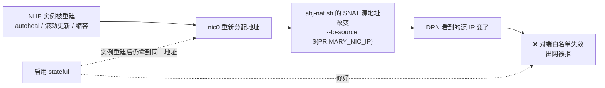

# Stateful MIG 与 Autoscaling:两个概念、为什么互斥、以及 stateful 如何解决静态 IP 问题

> **一句话结论**:这两个东西解决的是**完全相反**的问题,所以官方不允许共存。
> - **Autoscaling** 管的是"**该有几台**" —— 按负载自动增删实例,前提是实例**可互换、无身份**。
> - **Stateful MIG** 管的是"**这台是谁**" —— 在实例被重建时保住它的名字、磁盘、IP、metadata,前提是实例**不可互换、有身份**。
>
> **为什么互斥**:官方限制原文 —— "You cannot use autoscaling with the following instance groups, which don't allow the autoscaler to create or delete VMs according to demand: … **MIGs with stateful configuration**";并且 "**You cannot create VM instances with specific names while autoscaling is turned on.**"[1]
>
> **为什么 stateful 能解决你的静态 IP 问题**:NHF 的出局源地址就是实例 nic0 的地址(`--to-source ${PRIMARY_NIC_IP}`),实例重建 → 地址重分配 → 白名单失效。stateful 让实例**重建后仍是同一台、仍是同一个地址**,且**不需要改任何脚本、路由或防火墙**。
>
> **关键澄清(最容易搞错的一点)**:stateful **不关闭 autoheal、不关闭多可用区、不关闭滚动更新**。你只失去"按负载自动增减实例数"这一件事。

---

## 1. 为什么单独写这篇

在 NHF(Shared VPC 上的 iptables NAT MIG)的落地过程里,`stateful` 与 `autoscaling` 这两个配置反复出现,且它们的关系是**硬约束**而不是可选项。本篇把两个概念讲清楚,并把 "为什么 stateful 正好解决 NHF 的静态 IP 问题" 这条因果链完整走一遍。

相关文档:

| 文档 | 覆盖范围 |
| --- | --- |
| `linux/network/nhf-static-egress-ip.md` | **NHF 场景的具体落地方案**(预留静态 IP + per-instance 绑定、地址数量决策、运维纪律) |
| `gcp/gce/mig-static-ip-options.md` | **让 MIG/Instance 获得静态 IP 的全路径评估**(双网卡 MIG 按网卡固定、7 条路径对比、UIG 评估) |
| `linux/network/nhf-egress-ip.md` | 出局 IP 的定位与白名单口径 |
| `gcp/gce/instance-groups.md` | 实例组滚动替换脚本 |
| `gcp/gce/static-ip.md` | 静态 IP 与 Cloud NAT 配置 |

---

## 2. 概念一:Autoscaling(自动扩缩)

### 2.1 它到底在做什么

Autoscaling 是挂在 MIG 上的一个**反馈控制器**,它只做一件事:**算出"我应该有几台实例",然后让 MIG 增删实例去达到这个数**。


### 2.2 关键机制(摘自官方文档)

> "When you configure an autoscaler for a MIG, the autoscaler constantly monitors the group and calculates a **recommended size**—the number of VMs required to serve the observed load. The MIG then uses this recommendation to set the group's target size."[2]

| 机制 | 说明 |
| --- | --- |
| **recommended size** | 每个信号各算一个"需要几台",**取最大值**;多信号不取平均 |
| **min / max 上下限** | 最终结果被夹在 `minNumReplicas` / `maxNumReplicas` 之间 |
| **scale-in control** | 限制"一次最多缩掉几台",防止容量骤降 |
| **模式** | `ON`(跟随推荐值)/ `ONLY_SCALE_OUT`(只扩不缩)/ `OFF`(只算不执行) |
| **scale in 慢、scale out 快** | 缩容要等稳定期,扩容立即执行 |

### 2.3 它隐含了一个前提

Autoscaling 的整个模型建立在 **"实例是同质的、可互换的"** 之上:

> "You treat VMs with stateless workloads as interchangeable"[3]
> "An autoscaler adds or deletes instances from a managed instance group (MIG) based on the group's autoscaling policy."[4]

扩容 = **凭空多出几台**;缩容 = **随便少掉几台**。**没有"哪一台"的概念** —— 被删掉的是哪台,扩出来的是哪台,autoscaler 不关心,也不应该关心。

### 2.4 官方对 autoscaling 的限制清单

> "You cannot use autoscaling with the following instance groups, **which don't allow the autoscaler to create or delete VMs according to demand**:
> - Unmanaged instance groups
> - **MIGs with stateful configuration**
> - MIGs with VM repairs turned off
>
> **You cannot create VM instances with specific names while autoscaling is turned on.**"[1]

---

## 3. 概念二:Stateful MIG(有状态实例组)

### 3.1 它到底在做什么

Stateful MIG 让 MIG 在**实例被重建时保留每台实例独有的状态**。

> "A stateful managed instance group (stateful MIG) preserves the unique state of each virtual machine (VM) instance—including **VM name, attached persistent disks, IP addresses, and/or metadata**—on machine restart, recreation, auto-healing, or update."[3]

**关键:什么叫"stateful"?** 官方定义非常明确 —— 不是"你的应用有状态",而是**"你创建了 stateful 配置"**:

> "A MIG is considered stateful if you have created a stateful configuration. You create a stateful configuration by setting a non-empty **stateful policy** and/or one or more non-empty **per-instance configurations**:
> - A **stateful policy** defines items that you want to preserve for **all instances** in your MIG.
> - A **per-instance configuration** defines items to preserve for a **specific VM instance**."[5]

→ 也就是说,**光有 statefulPolicy 就算 stateful MIG**,autoscaler 立刻就不能用了。这是很多人在控制台看到"配了 autoscaler 后 MIG 变成有状态"的原因。

### 3.2 两种配置方式

| | **statefulPolicy(组级)** | **per-instance config(实例级)** |
| --- | --- | --- |
| 作用范围 | 组内**所有**实例 | **指定**实例 |
| 典型内容 | `--stateful-internal-ip=interface-name=nic0` | `--stateful-internal-ip=address=10.72.x.y,interface-name=nic0` |
| 地址来源 | 自动分配 / 把在用临时地址提升为静态 | **显式指定**某个预留地址 |
| 应用方式 | **自动**应用到新建和已有实例[5] | 可选立即应用,或下次重建时应用 |
| 存储位置 | `preservedStateFromPolicy` | `preservedStateFromConfig` |

**优先级**:

> "A managed instance's **per-instance configuration takes priority** over conflicting configuration in the instance template or in a stateful policy."[5]

**回退规则**:

> "If you remove the stateful configuration of a resource from a per-instance configuration, and you configured the same resource in the stateful policy, then the resource remains stateful according to the stateful policy."[5]

→ **组合起来用的正确姿势**:组级 statefulPolicy 保证"**所有**实例的 nic0 都是 stateful";per-instance config 把**指定的几台**钉在**你预留的具体地址**上。组级兜底 + 实例级精确,两层都不冲突。

### 3.3 stateful IP 的两个具体限制

> "A MIG with stateful IP addresses has the following limitations:
> - IPv6 addresses are not supported.
> - Internal IP addresses are not supported in networks that have no subnetworks—for example, legacy networks."[6]

(与 Shared VPC 无冲突 —— Shared VPC 走的是普通子网。)

### 3.4 stateful MIG **保留**哪些能力(重要)

Stateful 不是"什么都不自动化",它是**有选择地自动化**:

| 能力 | stateful MIG 是否保留 | 说明 |
| --- | --- | --- |
| **autoheal(自愈重建)** | ✅ **保留** | 官方原文:"you can improve the uptime and resiliency of such stateful applications with **autohealing (automatic recovery of failed workloads), multi-zone deployments, and automated rolling updates**."[3] |
| **多可用区部署** | ✅ 保留 | regional MIG 照常跨 AZ 分布 |
| **滚动更新** | ✅ 保留 | 且因为保留实例名与状态,更新后**地址不变** |
| **按负载自动增减实例数** | ❌ **失去** | 这正是与 autoscaling 互斥的部分 |

> 💡 **这是最容易搞错的一点**:stateful 并不等于"失去高可用"。NHF 场景下你会保留 autoheal + 多 AZ + 滚动更新,**只失去"按 CPU 负载弹性伸缩"**。对 NHF 这种**固定规模的出网转发组件**来说,失去弹性扩缩几乎不痛 —— 出网容量本来就该按"最大并发 + 单点故障"来固定规划,而不是跟着 CPU 抖。

---

## 4. 为什么官方禁止两者共存

把上面两个概念拼起来,冲突点就很清楚了 —— **四个层面**:

### 4.1 冲突一:scale in = 删除实例 = 销毁身份

> "Subsequent changes to your MIG's stateful configuration **or size** (for example, **decreasing the MIG's size, or deleting or abandoning instances from the MIG**) can affect the preserved states of the instances."[5]

Autoscaler 缩容做的正是"decreasing the MIG's size"和"deleting instances"。对一个有身份的实例来说,**删掉它 = 它的名字、磁盘、IP 预留、metadata 全部离场**。autoscaler 不知道哪台该留、哪台该删,它只是按推荐值删掉"随机若干台"。

### 4.2 冲突二:scale out = 新实例 = 新身份、新地址

扩容出来的新实例**没有 per-instance config**,因此:

- 它没有绑定地址 → 拿到随机临时 IP;
- 官方文档描述得很直白:stateful 配置里"Creates an instance from the instance template using the provided instance name and IP addresses"—— **IP 是随实例配置一起给的**,没配置就没有;
- 对 NHF 来说:这个新实例的出口 IP **不在对端白名单里** → **它的出网全部被拒**。

### 4.3 冲突三:autoscaler 无法创建指定名字的实例

这条在 NHF 场景下**尤其致命**:

> "**You cannot create VM instances with specific names while autoscaling is turned on.**"[1]

而 per-instance config 是**按实例名**绑定的。也就是说:

- 有了 autoscaler → 新实例的名字由 autoscaler 决定 → **你无法预先把某个预留地址绑到一个你事先知道名字的实例上**;
- 没有 autoscaler → 你可以用 `create VMs with specific names`,名字完全可控 → **绑定关系成立**。

→ **"指定实例名"和"自动扩缩"在官方层面就是互斥的**,这不是配置技巧问题。

### 4.4 冲突四:有状态负载本身就不适合水平伸缩

> "You treat VMs with stateful workloads like custom-built machinery: you care about VM identity (name), IP address, metadata, and data on each individual machine. **You cannot easily scale stateful workloads horizontally because scaling could require data replication, creation or deletion of data shards, or changing the overall application configuration.**"[3]

→ stateful 的设计哲学本身就和"按需增删"相抵触。

### 4.5 官方给出的替代方案

限制的完整表述还给出了出路:

> "**You cannot use autoscaling or scaling schedules if your MIG has stateful configuration.** To schedule start and stop operations for stateful MIGs, you can use an **external automation workflow**."[6]

→ **注意 `scaling schedules` 也在禁列**。想按时间表调整容量,官方建议改用**外部自动化**(Cloud Scheduler + Cloud Run / Function 调 `resize` 或 `set-autoscaling`),而不是用 autoscaler 的 schedule。

第三方工具也印证了这一点:CloudKeeper 的 Resource Scheduler 明确"**Only Stateless MIGs are currently supported. Stateful MIGs … are not eligible for scheduling.**"

### 4.6 一句话总结互斥关系

| | Autoscaling | Stateful MIG |
| --- | --- | --- |
| 关心的问题 | **几台** | **这台是谁** |
| 对实例的态度 | 可互换、无身份 | 不可互换、有身份 |
| 典型操作 | 随机增删实例 | 按名字重建同名实例 |
| 前提 | 实例无状态 | 实例有身份 |

**一个要随机增删,一个要按名字保住 —— 同一时刻不可能都成立。**

---

## 5. 核心:为什么 stateful 正好能解决 NHF 的静态 IP 问题

### 5.1 问题的因果链



关键代码(`/opt/abj-nat.sh`,`nhf.md` §4.4):

```bash
PRIMARY_NIC_IP=$(curl -H "Metadata-Flavor: Google" \
                    http://metadata.google.internal/computeMetadata/v1/instance/network-interfaces/0/ip)

iptables -t nat -A POSTROUTING -d 128.0.0.0/2 -o $primary_nic -j SNAT --to-source ${PRIMARY_NIC_IP}
```

**注意这个取值方式**:`PRIMARY_NIC_IP` 从 **metadata 实时读取**。这意味着:

> **只要让 nic0 在实例重建后仍然是同一个地址,SNAT 的源地址就自动固定 —— 脚本一个字都不用改。**

### 5.2 stateful 是怎么做到的

官方原文:

> "By configuring stateful IP addresses in a managed instance group (MIG), you ensure that IP addresses are preserved when VM instances in the group are **autohealed, updated, and recreated**."[6]

> "For existing instances, the MIG **promotes in-use ephemeral internal or external IP addresses to static addresses** by reserving the corresponding static IP addresses."[6]

拆成两个动作:

| 动作 | 解决什么 |
| --- | --- |
| **① 提升**:把在用的临时地址原地转成静态预留(地址**不变**) | 立刻拿到一份稳定的当前地址清单 → **马上就能提交给对端做白名单** |
| **② 保持**:实例重建时按配置把同一个地址绑回去 | 地址不再随重建漂移 → **白名单长期有效** |

### 5.3 为什么这个方案"改动面极小"

这是 stateful 方案在 NHF 场景下最大的优势 —— **它只动实例的 IP 绑定,不动网络**:

| 环节 | 是否需要改 | 原因 |
| --- | --- | --- |
| `abj-nat.sh` 的 SNAT 规则 | ❌ **不改** | 源地址从 metadata 取,实例地址固定了它自然就固定 |
| VPC 静态路由(`128/2`、`10/8` → ILB) | ❌ **不改** | 路由按**目的**网段匹配,与源地址无关 |
| ILB forwarding rule | ❌ **不改** | VIP 是 FR 资源属性,与后端实例地址无关 |
| 防火墙规则 | ❌ **不改** | 按目的网段放行,不按源 IP |
| Cloud Router / BGP 广告 | ❌ **不改** | 预留地址仍在原共享子网 `10.72.0.0/18` 内,该网段本来就在广告 |
| 办公网侧回程路由 | ❌ **不改** | 同上,回程路径完全不变 |
| **实例的 nic0 地址绑定** | ✅ **改这里** | 全部变更集中在这一个点上 |

> **对比**:如果走"新建专用子网"路线,上述网络侧全部要动。**stateful 路线只动最后一个格子。**

### 5.4 在 NHF 上落地(摘要)

完整方案见 `linux/network/nhf-static-egress-ip.md` §6,这里只列骨架:

```bash
# 1) 先看现状:autoscaler 有没有、实例地址是多少
gcloud compute instance-groups managed describe <NHF_MIG> --region=europe-west2 \
  --format="value(autoscaler)"

# 2) stateful 与 autoscaler 互斥 → 若有 autoscaler,先删
gcloud compute instance-groups managed delete-autoscaler <NHF_MIG> --region=europe-west2

# 3) 改为固定规模
gcloud compute instance-groups managed resize <NHF_MIG> --region=europe-west2 --size=4

# 4) 组级 stateful:现有临时地址原地提升为静态(零中断)
gcloud compute instance-groups managed update <NHF_MIG> --region=europe-west2 \
  --stateful-internal-ip=interface-name=nic0,auto-delete=never

# 5) 实例级:把预留的具体地址钉到具体实例
gcloud compute instance-groups managed instance-configs create <NHF_MIG> --region=europe-west2 \
  --instance=<INSTANCE_NAME> \
  --stateful-internal-ip=address=10.72.x.y,interface-name=nic0,auto-delete=never
```

### 5.5 这个取舍在 NHF 上划算吗

| 失去的 | NHF 的实际情况 | 结论 |
| --- | --- | --- |
| 按负载弹性扩缩 | 出网转发组件的容量取决于**峰值并发连接数**,不取决于 CPU;且上游 ILB 有健康检查与分发 | ✅ 不痛 |
| 定时计划扩缩 | NHF 是常驻基础组件,不存在"夜间缩容"的成本诉求 | ✅ 不痛 |
| 自动伸缩带来的自愈 | **没丢** —— autoheal 独立于 autoscaling,stateful MIG 照样用 | ✅ 不丢 |

| 得到的 | 价值 |
| --- | --- |
| 出口源 IP 长期固定 | **对端白名单可以精确到单个 IP** —— 这就是你要的 |
| 实例重建不换地址 | autoheal / 滚动更新不再打断白名单 |
| 保留 autoheal + 多 AZ + 滚动更新 | 高可用能力一点没少 |
| 变更面最小 | 不碰路由/防火墙/脚本/网络团队 |

→ **对 NHF 这种"固定规模、只做转发、按 IP 授权"的组件,stateful 是明显划算的取舍。**

---

## 6. 关键决策速查

| 你的诉求 | 该怎么配 | 代价 |
| --- | --- | --- |
| **IP 必须固定(白名单)** | statefulPolicy + per-instance config,删 autoscaler,固定 size | 失去弹性扩缩 |
| IP 可以漂移,但**不能超出某个范围** | 专用子网 + 保留 autoscaler | 需要新建子网 + 改 BGP(审批) |
| IP 可以漂移,范围无所谓 | 什么都不改 | 白名单只能按网段授权 |
| 想要"固定 IP"**又**要"自动扩缩" | ❌ **平台不支持** | 只能二选一,或用外部自动化替代 autoscaler |

---

## 7. 常见误区

| 误区 | 事实 |
| --- | --- |
| "stateful MIG 就不能用 autoheal 了" | ❌ autoheal 独立于 autoscaling,stateful MIG 照常自愈[3] |
| "stateful MIG 不能滚动更新" | ❌ 可以,而且因为保留实例名与状态,更新后地址不变[3] |
| "只要用了 per-instance config 就是 stateful MIG" | ✅ 是的 —— "A MIG is considered stateful if you have created a stateful configuration"[5],**哪怕只配 per-instance config**,autoscaler 也会被禁 |
| "配了 stateful 之后地址会变" | ❌ 现有地址是**原地提升**为静态,地址不变[6] |
| "autoscaler 只是把实例换掉,名字会保留" | ❌ "You cannot create VM instances with specific names while autoscaling is turned on."[1] |
| "可以既 stateful 又用 autoscaler 的 schedule" | ❌ "You cannot use autoscaling **or scaling schedules** if your MIG has stateful configuration."[6] |
| "stateful 和 autoscaling 是性能问题" | ❌ 是**身份模型**层面的冲突,平台直接不支持 |
| "stateful MIG 配好就万事大吉" | ❌ **regional MIG 还必须关掉 proactive redistribution** —— 它默认开启,会为均衡 AZ 分布而**主动删除实例**,连带销毁 stateful 绑定[12][13] |

### 7.1 stateful regional MIG 的两个必做项(易漏)

官方限制原文:

> "You cannot use autoscaling if your MIG has stateful configuration. **If you want to use automated rolling updates, you must set the replacement method to RECREATE. For stateful regional MIGs, you must disable proactive redistribution (set the redistribution type to NONE) to prevent deletion of instances with stateful workloads.**"[13]

| 必做项 | 命令 | 不做的后果 |
| --- | --- | --- |
| **关闭 proactive redistribution** | `gcloud compute instance-groups managed update <MIG> --instance-redistribution-type NONE --region <REGION>` | regional MIG **默认开启**主动再分布,会为均衡 AZ 分布**删除并重建**多出来的实例 —— 删掉的正是你绑定好的那台 → 地址预留被释放 |
| **滚动更新用 RECREATE** | `--update-policy=...,replacement-method=RECREATE` | `substitute` 换新名 → per-instance config 按名绑定失效 → 地址漂移 |

> `proactive redistribution` 的官方定位:"Proactive instance redistribution is turned on by default for regional MIGs." / "Turning off proactive instance redistribution is useful if you need to: … **Protect VMs with stateful workloads from unwanted automatic deletion due to proactive redistribution.**"[12]

> 详细展开(含 NHF 的完整参数组合)见 `gcp/gce/mig-static-ip-options.md` §6。

---

## 8. 命令速查

```bash
# ── 现状排查 ───────────────────────────────────────────
# autoscaler 配置(空 = 没有)
gcloud compute instance-groups managed describe <MIG> --region=<REGION> \
  --format="yaml(autoscaler)"

# statefulPolicy
gcloud compute instance-groups managed describe <MIG> --region=<REGION> \
  --format="yaml(statefulPolicy)"

# 每台实例的 preserved state(地址绑定是否生效)
gcloud compute instance-groups managed list-instances <MIG> --region=<REGION> \
  --format="table(name,instanceStatus,preservedStateFromConfig)"

# per-instance config 清单
gcloud compute instance-groups managed instance-configs list <MIG> --region=<REGION>

# ── autoscaling ────────────────────────────────────────
# 创建(会因 stateful 配置被拒)
gcloud compute instance-groups managed autoscaler create <MIG> --region=<REGION> \
  --min-nodes=2 --max-nodes=6 --target-cpu-utilization=0.7

# 删除(切到固定 size 的第一步)
gcloud compute instance-groups managed delete-autoscaler <MIG> --region=<REGION>

# 固定规模
gcloud compute instance-groups managed resize <MIG> --region=<REGION> --size=4

# ── stateful ───────────────────────────────────────────
# 组级:nic0 变 stateful(现有地址原地提升为静态)
gcloud compute instance-groups managed update <MIG> --region=<REGION> \
  --stateful-internal-ip=interface-name=nic0,auto-delete=never

# 实例级:把具体地址钉到具体实例
gcloud compute instance-groups managed instance-configs create <MIG> --region=<REGION> \
  --instance=<INSTANCE_NAME> \
  --stateful-internal-ip=address=10.72.x.y,interface-name=nic0,auto-delete=never

# 删除某个实例的 stateful 配置(会回退到 statefulPolicy;若无则变回 stateless)
gcloud compute instance-groups managed instance-configs delete <MIG> --region=<REGION> \
  --instances=<INSTANCE_NAME>

# 立即把配置应用到实例(不等到下次重建)
gcloud compute instance-groups managed apply-updates-to-instances <MIG> --region=<REGION> \
  --instances=<INSTANCE_NAME>
```

> `auto-delete` 语义:`never` = 实例永久删除时**保留**预留(白名单清单不失效);`on-permanent-instance-deletion` = 实例永久删除时自动释放预留。**白名单场景用 `never`。**

---

## 9. 待确认项

| # | 待确认 | 为什么重要 | 怎么查 |
| --- | --- | --- | --- |
| 1 | NHF MIG 当前是否配了 autoscaler | 决定是否要先删 autoscaler 才能开 stateful | §8「现状排查」第一条 |
| 2 | MIG 的 target size 与实际容量规划 | 决定预留几个静态 IP(建议 = 上限 + 1) | `describe` 的 `targetSize` |
| 3 | 实例名在滚动更新后是否稳定 | per-instance config 按名绑定,名字变了绑定就失效 | `describe` 的 `updatePolicy.replacementMethod` |
| 4 | 静态内网 IP 配额 | 预留 5 个地址是否超配额 | `gcloud compute regions describe <REGION> --format="value(quotas)"` |
| 5 | 对端白名单是否支持多 IP 条目 | 决定要不要用 CIDR 聚合写法 | 问 DRN 侧 |

---

## 10. 权威证据 / 最终定型依据

### 10.1 GCP 官方原文

**① Autoscaling 的限制清单 —— 决定"互斥"这一事实**:[1]

> "You cannot use autoscaling with the following instance groups, which don't allow the autoscaler to create or delete VMs according to demand:
> - Unmanaged instance groups
> - **MIGs with stateful configuration**
> - MIGs with VM repairs turned off
>
> **You cannot create VM instances with specific names while autoscaling is turned on.**"

**② Autoscaler 的决策机制**:[2]

> "When you configure an autoscaler for a MIG, the autoscaler constantly monitors the group and calculates a recommended size—the number of VMs required to serve the observed load. The MIG then uses this recommendation to set the group's target size."

**③ Stateful MIG 的定位与保留能力**:[3]

> "A stateful managed instance group (stateful MIG) preserves the unique state of each virtual machine (VM) instance—including VM name, attached persistent disks, IP addresses, and/or metadata—on machine restart, recreation, auto-healing, or update."

> "You treat VMs with stateful workloads like custom-built machinery: you care about VM identity (name), IP address, metadata, and data on each individual machine. You cannot easily scale stateful workloads horizontally because scaling could require data replication, creation or deletion of data shards, or changing the overall application configuration."

> "With stateful MIGs, you can improve the uptime and resiliency of such stateful applications with **autohealing (automatic recovery of failed workloads), multi-zone deployments, and automated rolling updates**."

**④ Autoscaling 的适用前提**:[4]

> "An autoscaler adds or deletes instances from a managed instance group (MIG) based on the group's autoscaling policy." / "You treat VMs with stateless workloads as interchangeable"

**⑤ 什么让一个 MIG 成为 stateful —— 以及配置应用与优先级**:[5]

> "A MIG is considered stateful if you have created a stateful configuration. You create a stateful configuration by setting a non-empty stateful policy and/or one or more non-empty per-instance configurations."

> "A managed instance's per-instance configuration takes priority over conflicting configuration in the instance template or in a stateful policy."

> "Subsequent changes to your MIG's stateful configuration or size (for example, decreasing the MIG's size, or deleting or abandoning instances from the MIG) can affect the preserved states of the instances."

> "If you remove the stateful configuration of a resource from a per-instance configuration, and you configured the same resource in the stateful policy, then the resource remains stateful according to the stateful policy."

**⑥ Stateful IP 的能力与限制**:[6]

> "By configuring stateful IP addresses in a managed instance group (MIG), you ensure that IP addresses are preserved when VM instances in the group are autohealed, updated, and recreated."

> "For existing instances, the MIG promotes in-use ephemeral internal or external IP addresses to static addresses by reserving the corresponding static IP addresses."

> "You cannot use autoscaling or scaling schedules if your MIG has stateful configuration. To schedule start and stop operations for stateful MIGs, you can use an external automation workflow."

### 10.2 内部资料

- **`~/git/gcp/linux/networking/nhf.md`** —— NHF 的 SNAT 规则(`--to-source ${PRIMARY_NIC_IP}`,取自 metadata `network-interfaces/0/ip`)、回程机制(依赖同机 conntrack)、路由表(按目的网段匹配)。本文 §5 的因果链基于此。
- **`linux/network/nhf-static-egress-ip.md`** —— NHF 场景的完整落地步骤、地址数量决策与运维纪律。

### 10.3 本文档的核验方式

| 结论 | 核验手段 |
| --- | --- |
| autoscaler 与 stateful 互斥 | 引用 GCP 官方 autoscaling 与 stateful 两份文档原文[1][6] |
| autoscaler 不能创建指定名字的实例 | 引用 GCP 官方 autoscaling 文档原文[1] |
| 配了 stateful 配置即成为 stateful MIG | 引用 GCP 官方 "How stateful MIGs work" 原文[5] |
| stateful MIG 保留 autoheal / 多区 / 滚动更新 | 引用 GCP 官方 stateful MIGs 概览原文[3] |
| per-instance config 优先级高于 statefulPolicy | 引用 GCP 官方原文[5] |
| **stateful 能让 NHF 的 SNAT 源地址固定** | **架构推导** —— 基于 `nhf.md` §4.4 的 metadata 取址方式与 §4.2 的路由匹配规则;**尚未实测**,见 `nhf-static-egress-ip.md` §8.2 的 tcpdump 验证步骤 |
| **NHF 场景下失去弹性扩缩的代价可接受** | **判断**,依据 NHF 的转发组件定位(容量取决于峰值并发而非 CPU) |

---

## Sources

[1] https://cloud.google.com/compute/docs/autoscaler/scaling-cpu-load-balancing — Autoscaling groups of instances
    > "You cannot use autoscaling with the following instance groups, which don't allow the autoscaler to create or delete VMs according to demand: … MIGs with stateful configuration …" / "You cannot create VM instances with specific names while autoscaling is turned on."

[2] https://cloud.google.com/compute/docs/autoscaler/understanding-autoscaler-decisions — Understand autoscaler decisions
    > "the autoscaler constantly monitors the group and calculates a recommended size—the number of VMs required to serve the observed load. The MIG then uses this recommendation to set the group's target size."

[3] https://cloud.google.com/compute/docs/instance-groups/stateful-migs — Stateful managed instance groups
    > "A stateful managed instance group (stateful MIG) preserves the unique state of each virtual machine (VM) instance—including VM name, attached persistent disks, IP addresses, and/or metadata—on machine restart, recreation, auto-healing, or update." / "you can improve the uptime and resiliency of such stateful applications with autohealing (automatic recovery of failed workloads), multi-zone deployments, and automated rolling updates." / "You cannot easily scale stateful workloads horizontally because scaling could require data replication, creation or deletion of data shards, or changing the overall application configuration."

[4] https://cloud.google.com/compute/docs/autoscaler/scaling-cpu-load-balancing — Autoscaling groups of instances
    > "An autoscaler adds or deletes instances from a managed instance group (MIG) based on the group's autoscaling policy." / "You treat VMs with stateless workloads as interchangeable"

[5] https://cloud.google.com/compute/docs/instance-groups/how-stateful-migs-work — How stateful MIGs work
    > "A MIG is considered stateful if you have created a stateful configuration." / "A managed instance's per-instance configuration takes priority over conflicting configuration in the instance template or in a stateful policy." / "Subsequent changes to your MIG's stateful configuration or size (for example, decreasing the MIG's size, or deleting or abandoning instances from the MIG) can affect the preserved states of the instances."

[6] https://cloud.google.com/compute/docs/instance-groups/configuring-stateful-ip-addresses-in-migs — Configuring stateful IP addresses in MIGs
    > "By configuring stateful IP addresses in a managed instance group (MIG), you ensure that IP addresses are preserved when VM instances in the group are autohealed, updated, and recreated." / "For existing instances, the MIG promotes in-use ephemeral internal or external IP addresses to static addresses by reserving the corresponding static IP addresses." / "You cannot use autoscaling or scaling schedules if your MIG has stateful configuration. To schedule start and stop operations for stateful MIGs, you can use an external automation workflow."

[12] https://cloud.google.com/compute/docs/instance-groups/regional-mig-enable-disable-proactive-redistribution — Disable and re-enable proactive VM redistribution in a regional MIG
    > "Proactive instance redistribution is turned on by default for regional MIGs." / "Turning off proactive instance redistribution is useful if you need to: … Protect VMs with stateful workloads from unwanted automatic deletion due to proactive redistribution."

[13] https://cloud.google.com/compute/docs/instance-groups/configuring-stateful-disks-in-migs — Configuring stateful persistent disks in MIGs (Limitations)
    > "You cannot use autoscaling if your MIG has stateful configuration. If you want to use automated rolling updates, you must set the replacement method to RECREATE. For stateful regional MIGs, you must disable proactive redistribution (set the redistribution type to NONE) to prevent deletion of instances with stateful workloads."
