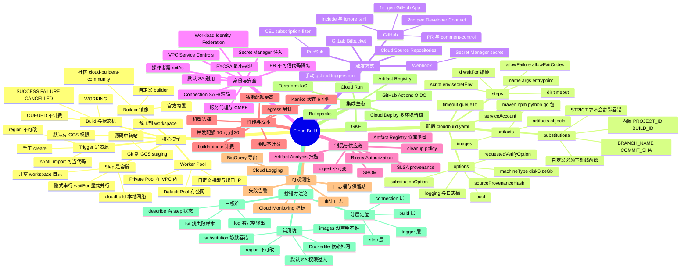

# Cloud Build 知识地图（MindMap）

> **一句话定位**
> ★ Cloud Build 是 GCP 的「容器化 CI 执行引擎」——它本身不做 CI 的**编排决策**，
> 只负责把「一段 YAML」变成「一串容器在一台临时机器上的执行」。
> 真正在工程里决定成败的，不是会不会写 `cloudbuild.yaml`，
> 而是**制品不可变、身份最小权限、缓存与成本、供应链可追溯**这四件事。

本文档做三件事：

1. **盘点**——现有 6 篇文档已经覆盖了什么、深度到哪；
2. **补缺**——列出现有文档**没覆盖但工程上必会**的知识点，标注优先级与验证方式；
3. **导航**——给出一张完整的知识地图 + 一条 3 阶段学习路径 + 8 个可动手的实验。

> 文中所有 CLI 事实均在 **gcloud SDK 526.0.1** 上实测过（`gcloud <cmd> --help`），
> 与官方文档冲突时以 `--help` 与官方 pricing 页为准。

---

## 目录

- [1. 心智模型：一个 Cloud Build 构建到底发生了什么](#1-心智模型一个-cloud-build-构建到底发生了什么)
- [2. 现有文档覆盖矩阵](#2-现有文档覆盖矩阵)
- [3. 缺口清单：20 个待补知识点](#3-缺口清单20-个待补知识点)
- [4. 知识地图（Mermaid MindMap）](#4-知识地图mermaid-mindmap)
- [5. 三阶段学习路径](#5-三阶段学习路径)
- [6. 八个动手实验（Lab 0 – Lab 8）](#6-八个动手实验lab-0--lab-8)
- [7. 官方文档地图](#7-官方文档地图)
- [8. 建议新增的本目录文档](#8-建议新增的本目录文档)

---

## 1. 心智模型：一个 Cloud Build 构建到底发生了什么

先把「一张图」记住，后面所有知识点都是它的注脚：

```
Git push
   │
   ├─ Trigger 命中（branch / tag / PR / PubSub / Webhook）
   │      └─ 决定：哪份 cloudbuild.yaml / 哪些 substitution / 用哪个 SA / 哪个 region
   ▼
Cloud Build API 收到 build 请求
   │
   ├─ ① 拉源码：Git → gs://<P>_cloudbuild/source → 解压到 /workspace
   ├─ ② 选 worker：Default Pool（公网）或 Private Pool（VPC 内）
   │      └─ 临时 Compute Engine VM，构建结束即销毁
   ├─ ③ 逐步跑 steps：每个 step = 一个容器，共享 /workspace + docker 网络 cloudbuild
   ├─ ④ 出产物：
   │      images[]      → Artifact Registry / GCR
   │      artifacts{}   → GCS
   │      maven/npm/python/goPackages → Artifact Registry
   ├─ ⑤ 出证据：provenance、SBOM、扫描报告
   └─ ⑥ 出日志：Cloud Logging（默认）+ gs://<PN>.cloudbuild-logs.../
```

**四条推论**（这四条决定了后面 80% 的工程决策）：

| 推论 | 后果 |
| :--- | :--- |
| 每个 step 都是独立容器 | 不能假设上一个 step 的进程/环境还在；只能靠 `/workspace` 和 `results` 传值 |
| 构建机是临时的 | **构建机没有本地缓存**，docker layer 缓存默认不存在（见缺口 #2） |
| 源码经 GCS 中转 | 构建默认有 GCS 权限；源码在 `gs://<P>_cloudbuild/source` 留有副本 |
| 产物是唯一的"交付物" | 部署应基于 **digest** 而非 tag；否则 tag 可被覆盖，审计链断裂 |

---

## 2. 现有文档覆盖矩阵

本目录现有 6 篇文档 + 10 个 `cloudbuild.yaml` 模板：

| 文档 | 定位 | 已覆盖的深度 |
| :--- | :--- | :--- |
| [`cloudbuild-guide.md`](cloudbuild-guide.md) | 主文档 | ★★★★★ 概念/生命周期/schema/CLI/成本配额/安全/排错/相邻产品分工 |
| [`how-to-github-trigger-cloud-build.md`](how-to-github-trigger-cloud-build.md) | GitHub 打通 | ★★★★★ 1st/2nd gen 选型、GHE、内网打通、IAM 全景、产物落地 |
| [`how-to-autofix-cve-with-cloud-build.md`](how-to-autofix-cve-with-cloud-build.md) | CVE 闭环 | ★★★★★ 三种落地形态、差分判定、12 个特有坑 |
| [`how-to-explore-go-modules.md`](how-to-explore-go-modules.md) | Go 依赖探索 | ★★★★ 与 Cloud Build 的结合点（构建前 tidy / 构建中审计 / 构建后核对） |
| [`gcp-cloud-build-concepts.md`](gcp-cloud-build-concepts.md) | 英文概念全景 | ★★★☆ 适合快速过一遍术语，偏罗列 |
| [`examples/`](examples/) | 10 个 YAML 模板 | ★★★☆ 通用 6 个 + CVE 4 个 |

**覆盖得非常好的领域**（可以只当参考手册，不必重读）：

- 概念与生命周期、`cloudbuild.yaml` schema 全字段、内置 substitution
- GitHub 1st gen / 2nd gen（Developer Connect）选型与配置、GHE 场景
- IAM 角色清单、API 启用清单、成本与配额数值、排错对照表
- CVE 自动修复闭环（Verify-then-Promote、digest 一致性）

**明显偏薄的领域**（本文档 §3 逐条补）：

- 构建**性能与缓存**（几乎空白）
- **Worker Pool 深度**（只提了"Private Pool"这个名词）
- **可观测性**（只到"日志在 Cloud Logging"这一层）
- **供应链证据**（provenance / SBOM / Binary Authorization 只在概念文档里被点名）
- **Trigger 即代码**（trigger 目前是"手工 create 出来的资源"，没有 IaC 路径）
- **成本工程**（只有单价表，没有"怎么把账单打下来"的手段）

---

## 3. 缺口清单：20 个待补知识点

优先级：**🔴 P0 工程必会**（不掌握会在生产环境出事） / **🟡 P1 进阶**（决定流水线质量与成本） / **🟢 P2 了解**（选型与谈资）。

### 🔴 P0 —— 生产流水线的及格线

| # | 知识点 | 为什么工程上重要 | 最小验证方式 |
| :-- | :--- | :--- | :--- |
| 1 | **Substitution 的三档语义**（`ALLOW_LOOSE` / `ALLOW_MISSING` / `STRICT`） | 默认 `ALLOW_LOOSE` 会把拼错的变量**静默替换成空串**——镜像 tag 变成 `.../app:` 也能推上去 | 在 yaml 里写 `$TYPO_VAR`，用 `substitutionOption: STRICT` 跑一次，看是否 fail fast |
| 2 | **构建缓存（Kaniko）** | Cloud Build 默认**不缓存 docker layer**；不开缓存则每次构建都从零拉 base 镜像，构建时长与 egress 成本翻倍 | `gcloud config set builds/use_kaniko true` + `gcloud config set builds/kaniko_cache_ttl 21600`（默认 6h），同仓连提两次对比耗时 |
| 3 | **源码打包规则 / `.gcloudignore`** | `gcloud builds submit` 默认按 `.gcloudignore` 过滤；**不写就会把 `.git`、`node_modules` 一起打包** → 上传超时、包超限、账单异常 | `gcloud builds submit --ignore-file=.gcloudignore`；或 `--git-source-dir` 只取子目录 |
| 4 | **多 step 编排语义**（`id` + `waitFor` / `allowFailure` / `allowExitCodes` / `dir` / `timeout`） | 默认 step 之间是**隐式串行**（等所有前序完成）；想并行必须显式声明，否则会白白多花 build-minute | 写两个 step 共用 `id: build` 与 `waitFor: ['build']`，观察日志里的并发 |
| 5 | **跨 step 传值**（`/workspace` 文件 / `results` / `outputs`） | 镜像 digest、测试报告如何在 step 之间流转，是所有"构建+扫描+部署"链路的骨架 | step1 写 `/workspace/out/digest.txt`，step2 `cat` 出来 |
| 6 | **Worker Pool（自定义私池）** | 内网 registry / 内网 Git / 固定出口 IP 的唯一解；也是"构建不出公网"的合规要求 | `gcloud builds worker-pools create wp1 --region=us-central1 --peered-network=projects/123/global/networks/default --peered-network-ip-range=192.168.0.0/28 --no-public-egress` |
| 7 | **五类身份边界**（默认 SA / BYOSA / connection SA / 服务代理 / 人工操作者） | 混用是最常见的越权来源；尤其"人工操作者要能 actAs BYOSA"这一点，缺了 trigger 建不出来 | 画一张表：谁能调 API、谁能读源码、谁能推镜像、谁能部署 |
| 8 | **制品不可变（digest 晋级）** | tag 可被任何人 `docker push` 覆盖；审计与回滚都依赖 digest | 构建后 `gcloud artifacts docker images describe` 取 digest，部署一律用 `@sha256:` |
| 9 | **PR / 不可信代码的安全隔离** | 跑不可信 PR 的 Dockerfile = 以 build SA 权限执行攻击者代码 | PR trigger 用**独立的低权 SA**，只能写 staging 仓库；生产 trigger 与 PR trigger 物理分离 |
| 10 | **敏感值走 Secret Manager**（`availableSecrets` / `secretEnv`） | substitution 会进日志、进 build metadata，**不是密钥通道** | `availableSecrets.secretManager` + step 的 `secretEnv`，确认日志里看不到值 |

### 🟡 P1 —— 决定流水线质量与成本

| # | 知识点 | 为什么工程上重要 | 最小验证方式 |
| :-- | :--- | :--- | :--- |
| 11 | **Trigger 即代码（YAML import/export）** | trigger 现在是手工 create 的资源，**会漂移、无法 code review**；生产上必须能审计"谁在什么条件下能部署" | `gcloud builds triggers import --source=trigger.yaml`（GA）；导出目前仅 `gcloud alpha builds triggers export` |
| 12 | **SLSA provenance / Binary Authorization** | 没有 provenance，"这个镜像是我们构建的"这件事无法证明；开 BinAuth 后才闭环 | `options.sourceProvenanceHash: SHA256`；对照 `gcloud artifacts docker images describe --format` 看 attestation |
| 13 | **SBOM 与持续扫描**（Artifact Analysis） | 一次性扫描只能管"构建那一刻"；持续扫描才能发现 base 镜像新出的 CVE | `gcloud artifacts docker images scan` + `gcloud artifacts repositories describe` 看 continuous scanning 状态 |
| 14 | **Cloud Build × Cloud Deploy 分工** | Cloud Build 只该产出制品；多环境晋级（dev→staging→prod）+ 审批 + 验证是 Cloud Deploy 的活 | `gcloud deploy targets create` + rollout 审批；build 侧只推 digest |
| 15 | **可观测性三层**（Logging / Monitoring / 审计） | 出事时能回答"谁在什么时候构建了什么、用了什么身份、改了哪些文件" | 日志落 GCS → BigQuery；`roles/auditviewer` 拉 Cloud Audit Logs |
| 16 | **成本工程** | build-minute + egress + 日志存储是三笔隐形账；排队**不计费**但会拖长交付 | 机型选择表、缓存、`queueTtl`、并发配额（默认 10 → 可调 30）、私池配额更高 |
| 17 | **Buildpacks（无 Dockerfile 出镜像）** | 遗留 Java/Node 应用没有 Dockerfile 时，比现写 Dockerfile 快得多 | `gcloud builds submit --pack=builder=gcr.io/buildpacks/builder,image=<pkg.dev>/<proj>/<repo>/`（image 必须落在 `pkg.dev` / `gcr.io` 命名空间） |
| 18 | **触发器精细化**（`--included-files` / `--ignored-files` / `--comment-control` / `--require-approval`） | 只有改 docs 不该触发构建；PR 要 owner 敲 `/gcbrun` 才跑；生产必须人工批 | `gcloud builds triggers create github --included-files='app/**' --comment-control=requireApproval --require-approval` |
| 19 | **事件驱动构建**（Pub/Sub CEL / Webhook secret） | "制品变更""配置变更""外部系统状态变更"触发的构建，Git push 模型表达不了 | `gcloud builds triggers create pubsub --topic=... --subscription-filter='attributes.type="x"'` |
| 20 | **Workload Identity Federation（外部 CI 调 Cloud Build）** | GitHub Actions 直连 GCP 时，**不要用长期 SA key**，用 OIDC 换短时 token | 配 WIF pool + attribute condition，SA 上绑 `roles/iam.workloadIdentityUser` |

### 🟢 P2 —— 选型与谈资

| # | 知识点 | 一句话 |
| :-- | :--- | :--- |
| 21 | **区域模型** | `global` region 只对 1st gen / CSR 有意义；2nd gen 必须落到具体 region，且**region 创建后不可改** |
| 22 | **与 Tekton / Argo / GitHub Actions 的对比** | Cloud Build 的差异化是「与 GCP  IAM / GAR / Binary Authorization / Cloud Deploy 的原生闭环」，不是功能更全 |
| 23 | **CMEK 与日志保留** | 构建临时盘用一次性密钥加密；日志桶的保留期与清理策略会直接影响账单 |

---

## 4. 知识地图（Mermaid MindMap）



---

## 5. 三阶段学习路径

### 阶段一：会用（0.5 天）—— 先跑通，再谈概念

1. 读 [`cloudbuild-guide.md`](cloudbuild-guide.md) §1–§5（概念 + 生命周期 + 上手全流程）
2. 跑 **Lab 0**（5 分钟最小可跑闭环）
3. 跑 **Lab 1 / Lab 2**（substitution 语义、多 step 编排）
4. 读 [`how-to-github-trigger-cloud-build.md`](how-to-github-trigger-cloud-build.md) §1–§5（选型 + 2nd gen 配置）

> 阶段一产出：你能独立把「push → 镜像进 GAR」跑通，并且知道每个参数为什么这么填。

### 阶段二：能用好（1–2 天）—— 生产化的四件事

1. **身份收敛**：BYOSA + 人工卡点 + Secret Manager（Lab 4 / §3 #7、#9、#10）
2. **缓存与成本**：Kaniko、机型选择、并发配额（Lab 3 / §3 #2、#16）
3. **不可变制品**：digest 晋级 + GAR cleanup policy（§3 #8）
4. **触发器即代码**：trigger YAML 化，进 code review（Lab 4 / §3 #11）

同时补：私池（§3 #6）、供应链证据（§3 #12、#13）、可观测性（§3 #15）。

### 阶段三：能设计（持续）—— 从"能跑"到"可信"

- 供应链闭环：provenance → Binary Authorization → Cloud Deploy 准入
- 事件驱动：Pub/Sub / Webhook 触发构建
- 跨 CI 协作：外部 CI 用 WIF 调 Cloud Build
- 与组织内其他系统（Terraform / Cloud Run / GKE）的职责边界

---

## 6. 八个动手实验（Lab 0 – Lab 8）

> 全部命令在 `gcloud` 526.0.1 上验证过语法；执行前先 `gcloud config set project <PROJECT_ID>`。

### Lab 0：最小可跑闭环（5 分钟）

```bash
gcloud services enable cloudbuild.googleapis.com compute.googleapis.com \
  artifactregistry.googleapis.com --project=<PROJECT_ID>

gcloud artifacts repositories create my-app \
  --repository-format=docker --location=asia-northeast1 \
  --description="app images" --project=<PROJECT_ID>

cat > cloudbuild.yaml <<'EOF'
steps:
  - name: 'gcr.io/cloud-builders/docker'
    args: ['build', '-t', 'asia-northeast1-docker.pkg.dev/$PROJECT_ID/my-app/app:$COMMIT_SHA', '.']
images:
  - 'asia-northeast1-docker.pkg.dev/$PROJECT_ID/my-app/app:$COMMIT_SHA'
EOF

gcloud builds submit --config cloudbuild.yaml --region=asia-northeast1
gcloud builds log <BUILD_ID> --region=asia-northeast1
```

**要观察的**：源码被中转到 `gs://<P>_cloudbuild/source`；build 结束后 worker 被销毁；镜像进了 GAR。

### Lab 1：substitution 三档语义（10 分钟）

```bash
# 故意写一个未定义的变量
cat > /tmp/loose.yaml <<'EOF'
substitutionOption: ALLOW_LOOSE
steps:
  - name: 'gcr.io/cloud-builders/gcloud'
    args: ['version']
    env: ['TAG=$MY_TYPO']
EOF
gcloud builds submit --config /tmp/loose.yaml --region=asia-northeast1 --no-source
# → 构建成功，但 MY_TYPO 被替换成空串（静默吞错）

sed -i '' 's/ALLOW_LOOSE/STRICT/' /tmp/loose.yaml
gcloud builds submit --config /tmp/loose.yaml --region=asia-northeast1 --no-source
# → 构建失败并明确报出未定义变量
```

**结论**：生产流水线一律 `substitutionOption: STRICT`。

### Lab 2：多 step 编排（15 分钟）

```bash
cat > /tmp/steps.yaml <<'EOF'
steps:
  - id: build
    name: 'gcr.io/cloud-builders/docker'
    args: ['build', '-t', 'asia-northeast1-docker.pkg.dev/$PROJECT_ID/my-app/app:$COMMIT_SHA', '.']
  - id: push
    name: 'gcr.io/cloud-builders/docker'
    args: ['push', 'asia-northeast1-docker.pkg.dev/$PROJECT_ID/my-app/app:$COMMIT_SHA']
    waitFor: ['build']
  - id: scan
    name: 'gcr.io/cloud-builders/gcloud'
    args: ['artifacts', 'docker', 'images', 'scan',
           'asia-northeast1-docker.pkg.dev/$PROJECT_ID/my-app/app:$COMMIT_SHA',
           '--format=value']
    waitFor: ['push']
    allowExitCodes: [0, 1]     # 扫描有漏洞也继续，让门禁在最后一步做
  - id: gate
    name: 'gcr.io/cloud-builders/gcloud'
    args: ['artifacts', 'docker', 'images', 'list-tags',
           'asia-northeast1-docker.pkg.dev/$PROJECT_ID/my-app',
           '--format=value']
    waitFor: ['scan']
EOF
gcloud builds submit --config /tmp/steps.yaml --region=asia-northeast1
gcloud builds describe <BUILD_ID> --region=asia-northeast1 --format='value(steps)'
```

**要观察的**：每个 step 的 `status` / `exitCode`；`waitFor` 如何形成依赖；`allowExitCodes` 如何让"发现问题"和"卡住流程"解耦。

### Lab 3：缓存对比（20 分钟，结论最直观）

```bash
# 关闭缓存（默认）
gcloud builds submit --tag asia-northeast1-docker.pkg.dev/<P>/my-app/app:v1 --region=asia-northeast1
# 打开 Kaniko 缓存
gcloud config set builds/use_kaniko true
gcloud config set builds/kaniko_cache_ttl 21600      # 6 小时
gcloud builds submit --tag asia-northeast1-docker.pkg.dev/<P>/my-app/app:v1 --region=asia-northeast1
# 对比两次的 build 时长与是否出现 "cached" 层
```

**注意**：缓存 key 包含 base 镜像与指令序列；**改任何一行 Dockerfile 都会让后续层失效**。

### Lab 4：Trigger 即代码（30 分钟）

```bash
cat > trigger.yaml <<'EOF'
name: my-app-build
github:
  owner: <OWNER>
  name: <REPO>
  push:
    branch: '^main$'
serviceAccount: projects/<P>/serviceAccounts/<BUILD_SA>
includeFiles: ['app/**']
requireApproval: false
substitutions:
  _ENVIRONMENT: 'prod'
EOF

gcloud builds triggers import --source=trigger.yaml --region=asia-northeast1
gcloud builds triggers describe my-app-build --region=asia-northeast1
gcloud alpha builds triggers export my-app-build --destination=trigger.yaml --region=asia-northeast1
```

**要点**：导出目前只有 alpha 通道；因此实践上建议**手写 trigger YAML 存在仓库里**，用 import 幂等下发。

### Lab 5：私池与内网构建（1 小时）

```bash
gcloud builds worker-pools create wp-internal \
  --region=asia-northeast1 \
  --peered-network=projects/<NET_P>/global/networks/<NET> \
  --peered-network-ip-range=192.168.0.0/28 \
  --worker-machine-type=e2-standard-4 \
  --worker-disk-size=200GB \
  --no-public-egress

# 在 cloudbuild.yaml 里指定 pool
#   options:
#     pool:
#       name: projects/<P>/locations/asia-northeast1/workerPools/wp-internal
```

**注意**：`--peered-network-ip-range` 前缀长度必须在 **1–29** 之间（默认 `/24`）；私池的并发 CPU 配额远高于 Default Pool。

### Lab 6：供应链证据（1 小时）

```bash
# 1) 构建时生成 provenance
#    options:
#      sourceProvenanceHash: SHA256
# 2) 查看镜像的 attestation
gcloud artifacts docker images describe \
  asia-northeast1-docker.pkg.dev/<P>/my-app/app@<DIGEST> \
  --project=<P> --format=json | grep -i -A5 provenance
# 3) SBOM
gcloud artifacts docker images list-tags \
  asia-northeast1-docker.pkg.dev/<P>/my-app --project=<P>
# 4) 部署侧准入
#    gcloud artifacts repositories describe <REPO> --format=json | grep -i cleanup
```

### Lab 7：可观测性（45 分钟）

```bash
# 日志落到自己的桶（默认桶有保留期限制）
gcloud builds submit --config cloudbuild.yaml --region=asia-northeast1 \
  --gcs-log-dir=gs://<LOG_BUCKET>/build-logs
# 拉全部日志到本地
gcloud builds log <BUILD_ID> --region=asia-northeast1 > build.log
# 找出所有失败的 build
gcloud builds list --filter='status=FAILURE' --region=asia-northeast1 --limit=50
```

进阶：把 `projects/<P>/logs/builds` 做成 Log Sink → BigQuery，就能做"构建成功率 / 耗时 P95 / 失败原因 Top N"的看板。

### Lab 8：成本与配额（30 分钟）

```bash
# 排队中的构建不计费，但会拖长交付
gcloud builds list --filter='status=QUEUED' --region=asia-northeast1
# 触发器上的并发上限在项目配额里看
gcloud builds worker-pools list --region=asia-northeast1
# 典型优化顺序：先开缓存 → 再选机型 → 再看日志存储 → 最后才考虑私池
```

---

## 7. 官方文档地图

| 主题 | 链接 |
| :--- | :--- |
| 总览 | https://cloud.google.com/build/docs/overview |
| Build config schema | https://cloud.google.com/build/docs/build-config |
| 内置 Cloud Builders | https://cloud.google.com/build/docs/cloud-builders |
| 触发器（自动化） | https://cloud.google.com/build/docs/automate-builds |
| 触发器 YAML 格式 | https://cloud.google.com/build/docs/automate-builds#yaml_format |
| 区域 | https://cloud.google.com/build/docs/locations |
| 配额 | https://cloud.google.com/build/quotas |
| 定价 | https://cloud.google.com/build/pricing |
| 私池 / Worker Pool | https://cloud.google.com/build/docs/private-pools |
| Worker Pool 配置 schema | https://cloud.google.com/build/docs/private-pools/worker-pool-config-file-schema |
| 缓存（Kaniko） | https://cloud.google.com/build/docs/kaniko |
| 安全最佳实践 | https://cloud.google.com/build/docs/security-best-practices |
| 密钥与 Secret Manager | https://cloud.google.com/build/docs/securing-builds/using-secret-manager |
| 部署 Cloud Run | https://cloud.google.com/build/docs/deploying-builds/deploy-cloud-run |
| 部署 GKE | https://cloud.google.com/build/docs/deploying-builds/deploy-gke |
| Cloud Deploy 集成 | https://cloud.google.com/build/docs/deploying-builds/cloud-deploy |
| Binary Authorization | https://cloud.google.com/binary-authorization/docs/overview |
| Artifact Analysis / 漏洞扫描 | https://cloud.google.com/artifact-analysis/docs/overview |
| Workload Identity Federation | https://cloud.google.com/iam/docs/workload-identity-federation |

---

## 8. 建议新增的本目录文档

按 ROI 排序，建议后续补齐：

| 优先级 | 建议文件名 | 覆盖缺口 |
| :-- | :--- | :--- |
| 🔴 | `how-to-speed-up-cloud-build.md` | #2 缓存、#4 编排、#16 成本、机器型选择表、并行构建 |
| 🔴 | `how-to-private-pool-and-network.md` | #6 私池、出口 IP、VPC peering、无公网构建、与 PSC/内网 Git 的关系 |
| 🔴 | `how-to-secure-build-identity.md` | #7 五类身份、#9 PR 隔离、#10 Secret Manager、#20 WIF（一份统一的身份模型表） |
| 🟡 | `how-to-trigger-as-code.md` | #11 trigger YAML、#18 精细化触发、与 Terraform 的组合 |
| 🟡 | `how-to-supply-chain-cloud-build.md` | #12 provenance、#13 SBOM/扫描、#14 Cloud Deploy 准入闭环 |
| 🟡 | `how-to-observe-cloud-build.md` | #15 日志/指标/审计/告警、BigQuery 看板 |
| 🟢 | `cloudbuild-concepts-cheatsheet.md` | 术语中英对照表（承接 `gcp-cloud-build-concepts.md`） |

---

## 交叉引用

- 上级导航：[`gcp/gcp-mindmap.md`](../gcp-mindmap.md)（GCP 全域地图）
- 相关领域：[`gcp/artifact-registry/`](../artifact-registry/)、[`gcp/sa/`](../sa/)、[`gcp/secret-manage/`](../secret-manage/)、[`gcp/cloud-run/`](../cloud-run/)、[`gcp/gke/`](../gke/)、[`gcp/cost/`](../cost/)
- 本目录：[`README.md`](README.md)、[`cloudbuild-guide.md`](cloudbuild-guide.md)、[`how-to-github-trigger-cloud-build.md`](how-to-github-trigger-cloud-build.md)、[`how-to-autofix-cve-with-cloud-build.md`](how-to-autofix-cve-with-cloud-build.md)、[`how-to-explore-go-modules.md`](how-to-explore-go-modules.md)
