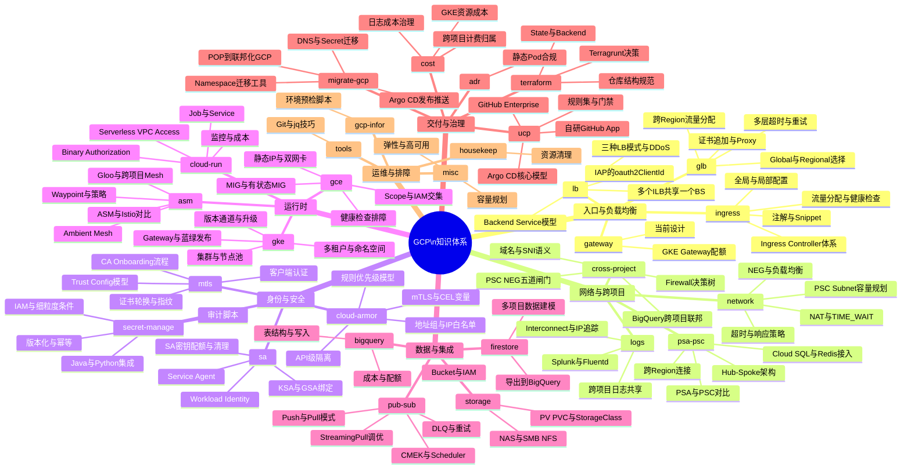

# GCP 知识点分析

Analyze the `gcp/` knowledge base. Categorize the GCP documents by technical domain, summarize the key knowledge points, and present everything as a Markdown document with a Mermaid mindmap.

本文档覆盖 `knowledge/gcp/` 下的 **938 篇文档 / 40+ 子目录**——这是整个知识库的主线，
也是最贴近日常工作的一篇导航。

> **一句话结论**
> ★ 这个目录本质在回答一个问题：**怎么在 GCP 上把一个企业级 API 平台稳稳地暴露出去**——
> 公网入口用哪种 LB、跨项目怎么连、身份怎么验、流量怎么限、成本怎么控、交付怎么自动化。
> 全部子域都围绕这条主线展开。

---

## 文档体系分析

按"**资源类型**"而不是"产品名"重组，可得八个板块：

1. **入口与负载均衡** — `glb/` `lb/` `ingress/` `gateway/`
2. **网络与跨项目连接** — `network/` `psa-psc/` `cross-project/` `logs/`
3. **身份、加密与安全** — `mtls/` `cloud-armor/` `secret-manage/` `sa/` `recaptcha/`
4. **运行时** — `gke/` `cloud-run/` `gce/` `asm/`
5. **数据与集成** — `bigquery/` `pub-sub/` `firestore/` `storage/` `sql/` `buckets/`
6. **交付、迁移与治理** — `ucp/` `migrate-gcp/` `cost/` `terraform/` `adr/` `dashboard/`
7. **运维与排障** — `misc/` `housekeep/` `tools/` `gcp-infor/`
8. **架构决策记录（ADR）** — `adr/008-static-pod-no-secret-configmap-k8s-137.md`

---

## 知识点 MindMap



---

## 主要知识领域详解

### 1. 入口与负载均衡

| 子目录 | 核心问题 | 关键结论 |
|---|---|---|
| `glb/` | Global vs Regional 怎么选？ | 跨 Region 流量分配靠 **4 层机制**（Anycast IP → 全球 VIP → 后端选择 → outlier detection）；多层超时要**逐层**设，不能只调 BS timeout |
| `lb/` | 经典 ALB / Managed ALB / Proxy NLB 区别？ | `EXTERNAL_HTTP_HTTPS`（经典）**只能挂 Instance Group**；Managed 系列才支持 NEG/PSC NEG；IAP 一开就会冒出 `oauth2ClientId` |
| `ingress/` | Ingress Controller 配置怎么分层？ | **全局 ConfigMap + 局部注解 + Snippet** 三层；Snippet 只在标准注解表达不了时才用；配置加载顺序决定最终生效值 |
| `gateway/` | GKE Gateway 配额够吗？ | 配额是硬约束，需按 `gke-gateway-quota.md` 逐项核对 |

### 2. 网络与跨项目连接

- `network/`：`NEG` 是 LB 与后端之间的解耦层；**PSC NAT Subnet vs Proxy-Only Subnet** 是最容易搞混的一对
  （前者决定 PSC 连接数，后者是 LB 的代理面）；Cloud NAT 的 `TIME_WAIT` 从 120s 调 30s 有明确收益与代价。
- `psa-psc/`：**PSA（Private Service Access）vs PSC** 是本目录最核心的一对概念——
  PSA 是"给 Google 托管服务用网段"，PSC 是"服务生产者发布、消费方连接"。
  附带 Hub-Spoke、跨 Region、Cloud SQL/Redis 接 PSC 的完整示例。
- `cross-project/`：**PSC NEG 的"5 道闸门"**（scheme 类型、SA 权限、subnet 归属、SA 必须第三个 VPC、无健康检查）
  是跨项目落地的判据清单；域名/SNI 语义在 5 跳里各出现一次，必须先画清"域名到底在哪跳被消费"。
- `logs/`：跨项目日志共享有两条路——**Log Scopes（逻辑聚合，推荐）** vs **Log Sink（物理导出）**；
  Shared VPC 下定位 IP 来源靠 Interconnect Attachment → Cloud Router IP → BGP 状态。

### 3. 身份、加密与安全

- `mtls/`（61 篇，见 `mtls/mtls-mindmap.md`）：Trust Config 的 5 步链验证、
  `allowlistedCertificates` 比 `trustStores` **更严格**（纯白名单模式）、CA Onboarding 自动化、证书轮换。
- `cloud-armor/`（33 篇，见 `cloud-armor/cloud-armor-mindmap.md`）：
  规则是**优先级数值小者先评估，一旦匹配即终止**；API 级隔离推荐"**按 API 拆 Backend Service，但复用同一个 Nginx**"。
- `secret-manage/`：版本化即幂等（用版本号做"目标状态"）；IAM 支持 Conditions 做细粒度授权；
  `list-secret/` 提供了从"10 行"到"50 行并发"的三个版本演进。
- `sa/`：**KSA 必须绑定 GSA** 才能在 GKE 里代表 GCP 身份；
  `iam.serviceAccountUser` 是"能冒充这个 SA"的高危权限；SA key 有 **10 个配额上限**，要有 housekeep。

### 4. 运行时

- `gke/`（见 `gke/gke-mindmap.md`）：版本通道（Rapid/Regular/Stable/Extended）、节点池 Location Policy、
  拓扑分布约束与 PDB 的组合、蓝绿/金丝雀、Workload Identity 与 Namespace 标注。
- `cloud-run/`：Serverless VPC Access Connector 的两种模式；Job 的网络行为与 Service 不同；
  Binary Authorization 三种签名方案（Cloud KMS / OpenPGP / cosign）。
- `gce/`：MIG 的 `target-distribution-shape`（EVEN→BALANCED）与 `Instance Redistribution`；
  有状态 MIG 与 Autoscaling **互斥**；Access Scopes 与 IAM Roles 取**交集**。
- `asm/`（见 `asm/asm-mindmap.md`）：ASM 托管控制面 vs 自管 Istio、
  **Ambient vs Sidecar** 的拓扑级差异、Waypoint 承担 L7 策略、Revision 机制横向对比。

### 5. 数据与集成

- `pub-sub/`（52 篇）：Pull vs Push 的本质区别（看客户端实现，或看 Monitoring 的
  `open_streaming_pulls` 指标）、`unacked_messages_by_region` 的排查顺序、
  `ackDeadlineSeconds` 的时间窗口包含哪些环节、CMEK + Cloud Scheduler 的 `NOT_FOUND` 权限陷阱。
- `bigquery/` `firestore/` `storage/` `sql/` `buckets/`：
  表结构设计、批量写入、查询成本、导出与生命周期策略、多租户数据建模（按 project_id 分区）。

### 6. 交付、迁移与治理

- `ucp/`（见 `ucp/argocd-mindmap.md`）：Argo CD 的三层权限边界（RBAC → AppProject → K8s RBAC）、
  GitHub-first 的"三个开关"、自研 GitHub App（CR Check）做 PR 门禁。
- `migrate-gcp/`：DNS 迁移三步（目标发现 → 新记录 → 切换）、Secret Manager 迁移、
  Namespace 批量提取与统计工具、POP → 联邦化 GCP 的 HLD。
- `cost/`：**日志成本是最大头**——`WORKLOADS` 日志可关闭、Log Bucket 的 `_Default` vs `_Required`、
  自定义桶分环境保留；跨项目 TLS/mTLS 的计费归属要看 **Forwarding Rule + Envoy + 数据处理费**三块。
- `terraform/`：模块放公共 registry 而不是 vendor 进私有仓；GCS backend 一项目一桶 + CMEK + 版本控制；
  **20 个环境以内纯 Terraform 仍然更优**。
- `adr/`：**ADR-008** —— K8s v1.37 起 Static Pod 禁止引用 Secret/ConfigMap，
  自管 kubeadm / bare-metal / attached cluster **必跑**审计脚本。

### 7. 运维与排障

- `misc/`：API 平台弹性增强、Cloud Armor 配合、高资源节点池评估（e2-highmem-8 / n2-highmem-8）。
- `gcp-infor/`：环境预检（`gcp-preflight.sh`、`gcpfetch.sh`）、Linux 侧注意事项、脚本审查报告。
- `housekeep/`：按依赖顺序删 FR → BS → IP 的清理流程。

---

## 三条阅读路线

```
路线 A · 搞清楚"公网入口怎么选"（2 小时）
  lb/lb.md（三种模式）→ glb/glb-gtm.md（Global 机制）
  → glb/glb-retry-timeout.md（超时）→ ingress/ingress-control-mindmap.md

路线 B · 搞清楚"跨项目怎么连"（半天）
  psa-psc/psc-psa-compare.md → network/psc-subnet/psc-nat-vs-proxy-only-subnet.md
  → cross-project/public-tls-basingpath-cross/bs-type.md
  → cross-project/public-tls-ingress/psc-neg-requirements.md

路线 C · 搞清楚"身份与安全怎么叠"（半天）
  mtls/CA.md → mtls/trust-config/trust-config-flow.md
  → cloud-armor/cloud-armor-priority.md
  → safe/ssl/certificate-truststore.md → sa/gke-ksa-iam-authentication-flow.md
```

---

## 结论

1. **`gcp/` 不是"GCP 产品手册"，而是一套"企业级 API 平台"的完整设计论证**。
   几乎每一篇都在回答"这个资源在整条链路里处于什么位置、依赖什么、失败了怎么定位"。
2. **「入口」 是全库的重心**：`glb` `lb` `ingress` `gateway` `cross-project` `mtls` `cloud-armor`
   七个目录反复讨论同一件事——**流量怎么进来、身份怎么验、规则怎么配**。
3. **有一批"反直觉"的结论值得单独记住**（散落在各子目录的 TL;DR 里）：
   - 经典 ALB **不能**挂 PSC NEG；
   - PSC NEG 后端**没有健康检查**；
   - Cloud Armor 规则**一旦匹配即终止**后续评估；
   - 有状态 MIG 与 Autoscaling **互斥**；
   - Service Attachment **必须**在第三个 VPC；
   - Access Scopes 与 IAM Roles 取**交集**。
4. **「ADR」 目录虽小但很重**：它是唯一带"blast radius / 严格定义 / 应对模式"结构的目录，
   适合当作**架构决策写作模板**来抄。

---

## 关联文档

- 已有：[ingress/ingress-control-mindmap.md](./ingress/ingress-control-mindmap.md) ·
  [ucp/argocd-mindmap.md](./ucp/argocd-mindmap.md)
- 子域：[asm/asm-mindmap.md](./asm/asm-mindmap.md) ·
  [mtls/mtls-mindmap.md](./mtls/mtls-mindmap.md) ·
  [cross-project/cross-project-mindmap.md](./cross-project/cross-project-mindmap.md) ·
  [cloud-armor/cloud-armor-mindmap.md](./cloud-armor/cloud-armor-mindmap.md) ·
  [gke/gke-mindmap.md](./gke/gke-mindmap.md)
- 上级：[../knowledge-mindmap.md](../knowledge-mindmap.md)
- 同构参考（Go 仓库按同一命名与六段式结构组织）：[../../go/go-mindmap.md](../../go/go-mindmap.md)
