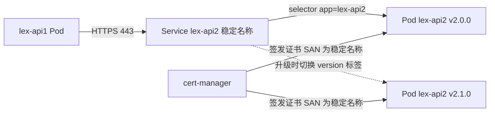

# GKE 同 Namespace 内部调用（Intra Namespace Call）方案

> **TL;DR**:
> - **Service 名称不带版本** —— 版本只存在于 Deployment / Label / 证书 SAN 之外的路由层
> - **证书签发给稳定名称**（`<svc>.<ns>.svc.cluster.local`），SAN 覆盖 4 种 DNS 形式
> - **代码里的上游地址通过环境变量/ConfigMap 注入**，业务代码零版本常量
> - **不绕 Internal Ingress**：直接用 ClusterIP + kube-dns，`NetworkPolicy` 限制来源
> - 集群若已装 **ambient/ASM**，请改用 → [`../../asm/k8s-gateway-ambient/23-intra-namespace-call-versioning-and-mtls.md`](../../asm/k8s-gateway-ambient/23-intra-namespace-call-versioning-and-mtls.md)

## 1. 问题分析

| 痛点 | 根因 | 解决方向 |
|------|------|------|
| 不想绕 Internal Ingress | 出口再入口，多了 ILB/Gateway 跳数、延迟和成本 | 直接用 ClusterIP Service，走 kube-dns |
| 地址带版本号，代码不通用 | Service 名称绑定了版本 | **Service 名称与版本解耦**，用稳定别名 |
| Pod 强制 HTTPS | 证书 SAN 必须匹配客户端访问的主机名 | 证书 SAN 签在**稳定名称**上，不签版本名 |
| 需要 `svc.local` 域名 | 需要集群内可解析的 FQDN | 同 Namespace 可直接用短名，证书覆盖全部形式 |

> ⚠️ **Service 名称不允许包含 `.`**（DNS-1035 标签规则），`lex-api2-service-2.0.0` 作为 Service 名会创建失败，只能写成 `2-0-0`。这也是不要把版本放进 Service 名的另一个理由。

## 2. 核心思路：版本放在 Deployment 和 Label，Service 名称保持稳定



- Deployment 可以带版本，例如 `lex-api2-2-0-0`。
- Service 名称固定为 `lex-api2`，selector 只匹配 `app=lex-api2`，版本切换由 label 控制。
- 代码里永远调用 `https://lex-api2`，升级版本不用改代码。

## 3. 方案对比

| 方案 | 做法 | 优点 | 缺点 | 推荐度 |
|------|------|------|------|------|
| **A. 稳定 Service 别名** | Service 名不带版本，selector 用 `app` 标签 | 最简单，无额外组件 | 同一时刻通常只指向一个版本 | ⭐⭐⭐⭐⭐ |
| **B. 环境变量或 ConfigMap 注入 URL** | 代码读 `UPSTREAM_API2_URL` | 灵活，可指向任意版本 | 需要发布流程配合 | ⭐⭐⭐⭐ |
| **C. 版本 Service 加稳定别名 Service** | 每版本一个 Service，别名 Service 用 `version` 标签做蓝绿 | 可灰度，可回滚 | 需要维护两层 | ⭐⭐⭐⭐ |
| **D. ExternalName Service** | 别名 CNAME 到版本化 Service | 不用改 selector | HTTPS 下 SNI、SAN 容易踩坑 | ⭐⭐ |
| **E. Service Mesh（Istio/ASM）** | 应用调 HTTP，Sidecar 做 mTLS 和版本路由 | 证书自动轮转，支持按权重路由 | 引入 Sidecar 开销和复杂度 | ⭐⭐⭐⭐（已有 mesh 时） |

**推荐组合：A + B，需要灰度时叠加 C；已有 ASM 时优先考虑 E。**

## 4. 配置示例

### 4.1 稳定 Service 加版本化 Deployment

```yaml
apiVersion: v1
kind: Service
metadata:
  name: lex-api2              # 稳定名称，不带版本
  namespace: my-ns
spec:
  type: ClusterIP
  selector:
    app: lex-api2             # 只匹配 app，不匹配 version
  ports:
    - name: https
      port: 443
      targetPort: 8443
---
apiVersion: apps/v1
kind: Deployment
metadata:
  name: lex-api2-2-0-0        # 版本放在 Deployment 名称里
  namespace: my-ns
spec:
  replicas: 2
  selector:
    matchLabels:
      app: lex-api2
      version: "2.0.0"
  template:
    metadata:
      labels:
        app: lex-api2
        version: "2.0.0"
    spec:
      containers:
        - name: app
          image: asia-docker.pkg.dev/PROJECT/repo/lex-api2:2.0.0
          ports:
            - containerPort: 8443
          readinessProbe:
            httpGet:
              scheme: HTTPS
              path: /healthz
              port: 8443
          volumeMounts:
            - name: tls
              mountPath: /etc/tls
              readOnly: true
      volumes:
        - name: tls
          secret:
            secretName: lex-api2-tls
```

### 4.2 蓝绿或灰度（方案 C，可选）

```yaml
# 别名 Service 通过 version 标签切流量，切换只需改一行
spec:
  selector:
    app: lex-api2
    version: "2.1.0"   # 回滚时改回 2.0.0
```

### 4.3 证书：cert-manager 签发，SAN 覆盖稳定名称

```yaml
apiVersion: cert-manager.io/v1
kind: Certificate
metadata:
  name: lex-api2-tls
  namespace: my-ns
spec:
  secretName: lex-api2-tls
  duration: 2160h
  renewBefore: 360h
  issuerRef:
    name: internal-ca-issuer
    kind: ClusterIssuer
  dnsNames:
    - lex-api2
    - lex-api2.my-ns
    - lex-api2.my-ns.svc
    - lex-api2.my-ns.svc.cluster.local
  usages:
    - server auth
    - client auth
```

### 4.4 客户端：地址配置化，并信任内部 CA

```yaml
env:
  - name: UPSTREAM_API2_URL
    value: "https://lex-api2"      # 同 Namespace 短名即可
  - name: SSL_CERT_FILE            # 按语言和运行时调整
    value: /etc/ca/ca.crt
volumeMounts:
  - name: internal-ca
    mountPath: /etc/ca
    readOnly: true
```

CA 分发可用 [trust-manager](https://cert-manager.io/docs/trust/trust-manager/) 的 `Bundle` 资源同步到各 Namespace 的 ConfigMap。

### 4.5 验证命令

```bash
# 检查 DNS 解析
kubectl exec -n my-ns deploy/lex-api1-1-0-0 -- nslookup lex-api2

# 检查 Endpoints 是否命中
kubectl get endpoints lex-api2 -n my-ns

# 验证 TLS，SNI 要与证书 SAN 一致
kubectl exec -n my-ns deploy/lex-api1-1-0-0 -- \
  curl -sv --cacert /etc/ca/ca.crt https://lex-api2/healthz

# 查看服务端实际出示的证书 SAN
kubectl exec -n my-ns deploy/lex-api1-1-0-0 -- \
  openssl s_client -connect lex-api2:443 -servername lex-api2 </dev/null 2>/dev/null \
  | openssl x509 -noout -ext subjectAltName
```

## 5. 若已使用 Istio/ASM（方案 E）

应用侧只调用 `http://lex-api2`，由 Sidecar 自动做 mTLS，并通过 DestinationRule 加 VirtualService 做版本路由。**Pod 自身若强制 HTTPS，需要用 DestinationRule 的 `tls.mode: SIMPLE` 做 TLS 发起**，否则会出现双重 TLS。

```yaml
apiVersion: networking.istio.io/v1
kind: DestinationRule
metadata:
  name: lex-api2
  namespace: my-ns
spec:
  host: lex-api2.my-ns.svc.cluster.local
  subsets:
    - name: v2-0-0
      labels: { version: "2.0.0" }
    - name: v2-1-0
      labels: { version: "2.1.0" }
---
apiVersion: networking.istio.io/v1
kind: VirtualService
metadata:
  name: lex-api2
  namespace: my-ns
spec:
  hosts: [lex-api2]
  http:
    - route:
        - destination: { host: lex-api2, subset: v2-0-0 }
          weight: 90
        - destination: { host: lex-api2, subset: v2-1-0 }
          weight: 10
```

## 6. 注意事项

- **证书 SAN 是 HTTPS 成功的关键。** 客户端用什么主机名访问，SAN 就必须包含它。短名、`.ns`、`.svc`、FQDN 四种写法都建议覆盖。
- **不要硬编码 `cluster.local`**，集群域名可能被自定义，优先用短名或 `<svc>.<ns>.svc`。
- **ExternalName 加 HTTPS 容易出问题**，主要是 SNI、Host 头与证书不一致，非必要不用。
- **证书轮转**：Pod 内的 TLS 库需要能热加载证书，否则要靠 Reloader 之类的工具滚动重启。
- **加 NetworkPolicy 限制来源**，只允许 `lex-api1` 访问 `lex-api2` 的 8443 端口。
- **跨 Namespace 访问**需使用 `lex-api2.<other-ns>`，SAN 要包含对应形式，NetworkPolicy 也要放行。
- 上线前建议先用 `kubectl apply --dry-run=server -f` 校验 YAML，并确认 cert-manager 的 ClusterIssuer 已就绪。

## 7. 结论

> **Service 名称不带版本，版本只存在于 Deployment 和 Label 中。证书签发给稳定的 Service 名称，代码里的上游地址通过环境变量注入。**
> 这样既不绕出集群，也不用关心版本变化，HTTPS 校验也始终通过。


> 📌 **如果你的集群已装 ASM / ambient(Istio 或 Gloo):**
> 直接看 → [`../../asm/k8s-gateway-ambient/23-intra-namespace-call-versioning-and-mtls.md`](../../asm/k8s-gateway-ambient/23-intra-namespace-call-versioning-and-mtls.md)
> 那篇覆盖了 hairpin 代价分析、waypoint L7 版本路由(header 协商 + 权重灰度)、mesh mTLS vs 应用层 HTTPS 三方案选型,以及本篇方案 A/B/C 与 ambient 的对照表。

---

## 8. 与 Ambient 方案的对照

| 维度 | 本篇(纯 K8s) | Ambient |
|---|---|---|
| 东西向加密 | 应用层自终结,自己管证书 | ztunnel 自动 mTLS,零证书运维 |
| 版本路由 | Service label / 切 selector | Service + HTTPRoute(header 协商 / 权重) |
| 源身份识别 | 只有 IP | SPIFFE principal,细粒度 AuthZ |
| 隔离 | K8s NetworkPolicy | AuthorizationPolicy(L4/L7) |
| 引入成本 | 低 | 中(需装 istio-cni + ztunnel + waypoint) |

**选型建议**:平台已经在跑 ambient → 用 ambient 那篇;新集群且只有一两个内部调用 → 本篇足够。

---

## 9. 参考

- [Kubernetes DNS for Services and Pods](https://kubernetes.io/docs/concepts/services-networking/dns-pod-service/)
- [Kubernetes NetworkPolicy](https://kubernetes.io/docs/concepts/services-networking/network-policies/)
- [cert-manager 文档](https://cert-manager.io/docs/usage/)
- [cert-manager trust-manager(CA 分发)](https://cert-manager.io/docs/trust/trust-manager/)
- [Istio Ambient 文档](https://istio.io/latest/docs/ambient/overview/)


# chatgpt 
GKE 同一 Namespace 内部 API 调用：问题分析与架构探索

你的问题本质上不是简单的 Kubernetes Service 如何互相访问，而是：如何在 GKE 中建立一套稳定、通用、安全，并且与 API 版本及部署地址解耦的 Intra-Namespace Service-to-Service 调用机制。

结合你描述的 API 平台场景，我建议从三个层面分析：服务寻址、HTTPS/TLS、安全通信。这三个问题相互关联，但不应该通过同一个机制全部解决。

一、先把你的问题重新定义清楚

假设同一个 GKE Namespace 中部署了两个 API：

API A — Consumer

调用方：需要请求 API B

运行在 Pod A，通过 HTTP Client 发起请求

同一个 Namespace 内的服务调用

API B — Provider

被调用方：提供业务 API

运行在 Pod B，通过 Kubernetes Service 暴露

目前，你的 API 平台可能为 API B 提供一个内部入口，例如 Internal Ingress：

API A 访问这个入口当然可以工作，但请求可能经过内部负载均衡器、Ingress、Gateway 或其他代理组件，再返回集群内部。这条路径虽然可行，却可能引入额外的网络跳转、代理开销和入口层依赖。

你希望的是：API A 直接访问 API B 的 Kubernetes Service，不经过外部或共享的 Internal Ingress，同时保留 HTTPS 和统一的 API 调用规范。

你实际上面临四个问题

问题	具体表现	你希望达到的结果
1. 服务寻址	Kubernetes Service 的名称可能包含 API 版本或部署版本	调用方不依赖具体的 Service 名称
2. 地址变化	API 升级、重新部署或版本切换可能导致地址变化	API A 不需要随 API B 的部署变化而修改代码
3. HTTPS/TLS	Pod 要求 HTTPS，不能简单地用明文 HTTP 访问 Service	内部调用仍然具备 TLS 保护及身份验证
4. 统一治理	不同团队、不同 API 的调用方式不一致	有统一的服务发现、认证、路由和运维标准

这里有一个关键点：Kubernetes Service 的 ClusterIP 通常是稳定的，但 Pod IP 是动态的；真正可能不稳定的是你们将版本和部署信息直接编码进 Service 名称的方式。

因此，不能简单地把问题归结为 Kubernetes DNS 不稳定。你需要设计的是一层稳定的逻辑服务标识，让它与具体的 Service、版本和 TLS 实现解耦。

二、先给出一个核心判断

不要让 API A 直接依赖 API B 的版本化 Kubernetes Service 名称，也不要默认所有内部 API 调用都必须经过 Internal Ingress。

建议将目标架构设计为两层：

1. 逻辑服务寻址层：为 API B 提供稳定的内部服务名称，屏蔽具体部署版本和后端地址。
2. 传输与安全层：根据你们对 HTTPS、TLS 身份验证及安全边界的要求，选择应用自身 TLS，或者由服务网格统一管理 mTLS。

Kubernetes 本身已经提供了第一层的基础能力：Service DNS 将稳定的服务名称解析到 Service 的 ClusterIP，由 Service 将流量转发到后端 Pod。  

但是，稳定的 Service DNS 不会自动解决 HTTPS 证书、API 版本选择或应用层身份认证问题。

三、你提到的三个难点，分别应该怎么解决？

1. 不要把 API 版本直接写进调用方的地址

假设你现在的 Service 名称类似：

如果 API A 的代码直接请求：

那么 API B 一旦从 2-0-0 升级到 2-1-0，调用方就可能需要修改配置甚至重新发布。

这里应该区分三个概念：

概念	示例	是否应该稳定
逻辑 API 名称	orders-api	是
具体部署版本	orders-api-2-0-0	否，允许变化
调用 API 版本	/api/v2/orders	按 API 契约管理

可以通过一个稳定的 Service 作为抽象层：

这里的 orders-api 是逻辑服务名，后端究竟指向哪个版本，由 Kubernetes Service 的 selector、部署配置或流量路由策略决定。

不过要注意：Service 只负责将流量分发到它选中的后端，不会自动根据 URL 中的 /api/v2 选择不同版本。 如果不同版本必须独立路由，就需要为版本路由增加明确的规则，例如 Gateway API 的 HTTPRoute，或者使用独立的版本化 Service 配合稳定入口。

2. svc.local 不一定需要自己创建

Kubernetes 默认提供的 Service DNS 名称通常是：

例如：

同一 Namespace 内也通常可以直接访问：

前提是 Service 确实名为 orders-api，并且客户端和服务端端口配置正确。  

你提到的 svc.local 需要进一步区分：

* 如果你只是希望有一个容易使用的内部服务域名，可以直接使用 Kubernetes Service DNS，不需要另建域名。
* 如果你们的 API 平台要求使用统一的内部域名，例如 orders-api.team-a.internal.example.com，则可以建立内部 DNS 或其他服务发现映射。
* 如果你们希望所有 API 都使用独立于 Kubernetes 的逻辑名称，那么内部 DNS、注册中心或服务网格可以成为额外的抽象层。

我的建议是，先不要因为 svc.local 这个名字而引入额外 DNS 系统。先确定是否真的需要自定义域名，以及它承担的是服务发现、TLS 证书身份，还是平台治理的职责。

3. HTTPS 和 TLS 证书是独立的问题

这一点是整个架构里最值得仔细设计的部分。

假设 API B 的容器只监听 HTTPS：

那么 API A 通过 Service 访问它时，仍然需要解决：

* API B 的证书由谁签发？
* API A 使用什么域名访问 API B？
* API A 如何验证 API B 的证书？
* 是否要求 API A 也提供客户端证书，即 mTLS？
* 证书如何自动轮换？

例如，API A 使用：

那么 API B 的服务器证书必须能够通过客户端使用的主机名校验，通常需要匹配对应的 DNS SAN。仅仅因为两者在同一个 Namespace，TLS 校验并不会自动通过。

如果 Service 的版本化名称变化，且证书 SAN 也绑定了版本化名称，那么版本升级就会进一步影响 TLS 配置。

因此，证书身份应该绑定稳定的逻辑服务身份，而不是随部署版本变化的地址。

四、我建议重点探索的三种实现方式

这三种方案并不是完全互斥的。第一种解决稳定寻址，第二种解决应用自身的 HTTPS，第三种解决平台级的服务间安全通信。

方案 A：Stable Kubernetes Service + Service DNS

(建议作为基础)

保留一个稳定的逻辑 Service 名称，应用直接通过 Kubernetes DNS 访问，不经过 Internal Ingress。版本升级时，由平台维护 Service 与后端的映射关系。

适用：同一集群、常规微服务调用，希望先解决地址变化问题。

⸻

方案 B：Stable Service + 应用层 HTTPS

API B 继续在容器内终止 HTTPS。通过内部 CA 为稳定的 Service DNS 签发证书，并由 API A 验证证书。证书管理与版本部署分离。

适用：安全规范明确要求应用自身必须提供 HTTPS，或需要保留端到端 TLS。

⸻

方案 C：Service Mesh + mTLS

例如使用 GKE 上的 Cloud Service Mesh / Istio，由代理层负责服务间加密、工作负载身份验证和授权。应用可以使用普通的集群内服务地址，而不必自行管理每个服务间连接的客户端证书。

适用：API 数量多、多团队共享平台，希望统一实施身份、安全策略和可观测性。

相关机制可参考  ⁠GKE Service Discovery 官方文档 和  ⁠Istio Security 官方文档。  

方案 A：建立稳定的 Service 名称

这是最容易实施的第一步。

假设 API B 的具体部署资源如下：

你可以再定义一个稳定的 Service：

上述 YAML 仅为架构示例，要求后端 Pod 使用相应的标签，并且应用实际监听 HTTPS 端口 8443。

调用方就可以使用：

当后端切换到新版本时，平台可以调整标签或后端映射，而不必修改 API A 的地址。

需要注意两个细节：

* 如果多个版本同时使用相同的 app: orders-api 标签，稳定 Service 可能同时把流量发送给多个版本。因此，必须明确控制哪些版本属于当前活动后端。
* 如果版本之间需要根据请求路径、Header 或权重进行不同的路由，就不能只依赖 Service selector，需要引入额外的路由机制。

另外，如果你只希望访问稳定的 API 入口，而不要求每个版本都独立暴露一个 Service，那么也可以直接让稳定 Service 选择多个版本的 Pod。这取决于你们的平台部署模型。

方案 B：HTTPS 继续由应用负责

如果你们的安全要求是：

每一个 API Pod 都必须使用 HTTPS，不能通过明文 HTTP 接收请求。

那么可以继续让 API B 在 8443 端口提供 HTTPS，同时将证书身份与稳定 Service 名称绑定。

例如，服务器证书包含：

API A 访问：

这里的证书路径只是示例，需要在容器中实际挂载对应的 CA 证书。

在这个方案下：

1. 平台负责为 API B 签发证书。
2. API B 的 HTTPS 监听配置使用该证书。
3. API A 使用受信任的 CA 验证服务器证书。
4. API B 升级版本时，保持稳定的 Service DNS 不变。
5. 平台负责证书轮换和信任链更新。

如果还要求调用方身份验证，可以进一步使用 mTLS，由 API A 提供客户端证书。

关键区别：HTTPS 不等于 mTLS。 普通 HTTPS 通常只验证服务器身份；mTLS 则还验证客户端身份。

方案 C：由服务网格统一处理安全通信

如果你的 API 平台最终有数十个甚至数百个 API，那么每个应用单独维护服务器证书、客户端证书、CA 信任链和轮换流程，运维成本会逐渐增大。

可以考虑将服务间的安全通信交给 Service Mesh：

以 Istio 为例，代理可以使用工作负载身份建立 mTLS 连接，并在服务端执行授权策略。  

但有一个非常重要的架构前提：

Service Mesh 的 mTLS 不一定等于应用容器本身使用 HTTPS。

例如：

* 应用 A 到本地代理：可能是普通 HTTP。
* 代理 A 到代理 B：使用 mTLS。
* 代理 B 到应用 B：可能是普通 HTTP。

如果你的安全规范要求应用 B 自身必须监听 HTTPS，那么只在代理之间启用 mTLS 还不够，需要额外配置应用层 TLS，或者明确修改并批准安全边界。

另外，你们如果已经使用 ASM，需要先确认现有 ASM 部署模式、TLS 策略和工作负载身份能力，避免再引入一套重复的服务网格。

五、我建议的目标架构

结合你的 API 平台特点，我会优先采用以下分层设计：

这里需要把职责分开：

组件	负责什么	不应该负责什么
API A	业务请求、API 路径及调用契约	感知 API B 的 Pod IP 或部署版本
Kubernetes Service	稳定服务地址和基础负载分发	根据 API 版本自动选择业务版本
平台控制面	服务映射、版本切换、部署编排	让每个应用自行维护全局服务目录
TLS / CA 管理	证书签发、信任和轮换	依赖易变化的部署名称
Service Mesh（可选）	服务身份、mTLS、授权及遥测	自动替代应用必须承担的全部 HTTPS 要求

六、需要特别确认的一个设计选择

你现在说的“版本”，可能实际上有两种含义。

情况一：版本只是部署版本。

例如 2.0.0 升级到 2.1.0，但对调用方来说仍然是同一个兼容的 API。

那么使用稳定 Service，后端通过标签或部署控制进行切换，通常就够了。

情况二：版本代表不同的 API 契约。

例如 /v1/orders 和 /v2/orders 的数据结构、行为不兼容，而且需要同时提供服务。

那么需要明确由谁进行版本路由。可以让不同版本共用一个稳定入口，通过路径路由到对应后端，也可以保留独立的版本 Service，由平台生成稳定的逻辑服务映射。不能简单地把所有版本放到同一个 Service 后面，否则请求可能被发送到不支持该 API 版本的后端。

七、下一步我建议先确认两个问题

这两个选择会直接影响最终设计，不需要现在就决定是否引入新的服务网格。

1. 你们要求的 HTTPS 是哪一种？

每个 API 应用容器本身必须监听 HTTPS，例如 Spring Boot 监听 8443。

只要求服务间链路加密和身份验证，可以由 ASM / Istio 代理处理。

两者都要求：应用自身 HTTPS，同时代理之间还需要 mTLS。

⸻

2. 你们的版本切换属于哪一种？

仅部署版本变化，API 契约不变，例如 2.0.0 升级到 2.1.0。

不同 API 版本需要同时存在，例如 v1 和 v2，调用方需要明确选择。

两种情况都有，既需要部署升级，也需要多 API 版本并存。

[基于我的选择继续设计]

这两个答案明确之后，就可以进一步确定：是否只需要稳定 Service，是否需要独立的逻辑服务注册层，以及你们现有的 ASM 是否应该承担内部 API 调用的安全与路由职责。

1. 目标架构：稳定寻址 + Mesh mTLS + API 版本路由

基于你确认的两个条件：

* HTTPS 模式：由 Service Mesh 负责链路加密和身份验证。
* 版本模式：既有部署版本变化，也有多个 API 契约版本同时存在。

我建议采用 Cloud Service Mesh / Istio + Kubernetes Stable Service + 显式 API 版本路由 的架构。

这里先明确一个重要前提：你说的 HTTPS 是由 Service Mesh 负责加密和身份验证，因此可以将应用容器与服务间传输安全分离。应用在 Mesh 内部可以使用 HTTP，代理之间通过 mTLS 保护通信；如果业务安全标准要求应用容器自己也必须终止 HTTPS，则需要额外设计端到端 TLS。

在这个前提下，不需要让每个 API 自己管理服务间 TLS 证书，也不需要让同 Namespace 的调用经过 Internal Ingress。

1.1 架构示意图

实际数据面中，DNS 查询通常由调用方解析为 Kubernetes Service 的 ClusterIP；随后请求进入调用方代理，由代理根据 Mesh 配置转发到目标工作负载。目标代理验证 mTLS 身份后，再将请求转交给应用容器。

这里有两条相互独立的控制路径：

* 寻址和路由：Kubernetes Service、DNS，以及需要时的应用层路由规则。
* 传输安全：Mesh 控制平面、工作负载身份、mTLS 和授权策略。

Google 的 Cloud Service Mesh 支持通过工作负载身份和授权策略管理 Mesh 内部的服务通信。具体配置能力需要根据你们当前的 Cloud Service Mesh 部署模式确认。  

1.2 DNS 与 Service 命名规范

我建议在 API 平台中，把 逻辑 API 名称、部署版本和 API 契约版本分开管理。

假设 Namespace 为 team-a-runtime，API B 是订单 API。

对象	命名示例	职责
Namespace	team-a-runtime	隔离团队工作负载
Stable Service	orders-api	提供稳定的服务入口
Deployment	orders-api-v1	部署旧版 API
Deployment	orders-api-v2	部署新版 API
Kubernetes DNS	orders-api.team-a-runtime.svc.cluster.local	稳定的服务寻址
API 契约	/api/v1/orders、/api/v2/orders	标识调用方请求的 API 版本

应用 A 的配置可以只保留：

这里特意使用 http://，因为这个设计假设由 Service Mesh 的 sidecar 代理负责服务间 mTLS。应用发出 HTTP 请求，并不意味着代理之间传输的是明文 HTTP。

如果你们的应用统一使用标准 HTTP Client，甚至可以简化为：

这里的 8080 是示例端口，应以实际 Service 端口为准。

需要强调的是：

* orders-api 是稳定的逻辑服务名。
* orders-api-v1、orders-api-v2 是内部部署对象，不应默认暴露给调用方。
* .svc.cluster.local 是 Kubernetes 集群 DNS 的标准域名后缀，通常不需要额外创建 svc.local。
* 如果你们有多集群、跨集群或者统一域名治理需求，再考虑建立平台级的逻辑域名。

对于同 Namespace 的普通调用，Kubernetes DNS 已经足够。不需要为了消除版本化 Service 名称而先引入一个新的 DNS 注册中心。

1.3 API 版本路由：推荐的两种模式

这里需要区分部署版本与 API 契约版本。

模式 A：一个稳定 Service，后端自行处理 API 版本

如果 v1 和 v2 都由同一组应用实例支持，那么请求 /api/v1/... 或 /api/v2/... 可以直接进入应用，由应用处理契约版本。

但如果 v1 Pod 不支持 v2，那么不能将 v1、v2 的 Pod 随意混在同一个 Service 的负载均衡池里。

⸻

模式 B：一个稳定 Service，由 Mesh 按路径路由到不同版本

适合 v1、v2 必须独立部署、独立扩缩容，同时又希望调用方始终使用同一个逻辑服务名的场景。

对你的多租户 API 平台，我倾向于模式 B，前提是你们需要在基础设施层统一管理版本路由。它可以将 API A 的调用地址与 API B 的具体部署版本解耦。

不过，路径路由不是唯一选择。也可以采用不同的稳定逻辑服务名，例如 orders-api-v1 和 orders-api-v2，再由平台维护其后端映射。如果调用方明确依赖特定 API 契约，这种方式有时更容易理解和治理。

⸻

2. Service Mesh 的 TLS 与身份验证设计

2.1 让 Mesh 负责服务间加密

在推荐架构中，API A 和 API B 的 Pod 都注入 Mesh 代理。应用不再单独管理用于服务间通信的客户端证书，Mesh 代理通过工作负载身份和证书建立 mTLS。

需要注意：这张图描述的是典型 sidecar 模式，并不意味着每一种 Cloud Service Mesh 部署模式都使用完全相同的代理拓扑。

在这个设计下，Mesh 的职责包括：

1. 为工作负载提供可验证的身份。
2. 为代理之间的通信建立 mTLS。
3. 校验对端工作负载身份。
4. 按照授权策略决定哪些服务可以相互调用。
5. 提供流量指标、调用日志和故障诊断能力。

Google 将 Cloud Service Mesh 定义为基于 Istio 的托管服务网格，提供统一的服务连接、管理和安全能力。  

2.2 mTLS 不等于授权

即使 API A 和 API B 已经建立 mTLS，也不代表 API A 自动拥有调用 API B 的权限。

我建议采用以下策略：

* Mesh 全局或目标 Namespace 启用严格 mTLS。
* API B 默认拒绝不在允许列表中的工作负载。
* 仅允许指定的 Namespace、ServiceAccount 或工作负载身份调用。
* 必要时进一步限制可调用的 HTTP 方法和路径。
* 如果 API B 还需要业务级认证，例如 OAuth2 Token 或 JWT，继续由应用或 API 层校验。

例如，可以使用 Istio PeerAuthentication 强制工作负载间使用 mTLS。

以下是一个需要根据现有 Mesh 模式和安装版本验证的示例：

这个策略用于要求目标 Namespace 中受其作用范围约束的工作负载使用 mTLS。它本身并不定义哪些调用方有权访问 API B。

然后再通过 AuthorizationPolicy 定义访问权限。例如，只允许特定 ServiceAccount 调用订单 API：

这份策略是一个最小化的身份授权示例。应用之前需要确认：

* 实际的 trust domain 是否为 cluster.local。
* orders-consumer 是否确实是 API A 使用的 Kubernetes ServiceAccount。
* app: orders-api 是否能够准确选中 API B 的所有目标 Pod。
* 该策略与现有的默认拒绝策略、其他 ALLOW 规则之间是否符合预期。

特别注意：Istio 中一旦存在匹配目标工作负载的 ALLOW 策略，就需要仔细审查所有相关策略的组合效果。 不要把单个 ALLOW 规则误认为完整的默认拒绝配置。

参考文档： ⁠Cloud Service Mesh Authorization Policy。 

3. 如何用 Istio 实现 API v1 / v2 路由

如果你们决定由 Mesh 根据 API 路径进行版本路由，可以采用 VirtualService 和 DestinationRule。

这个方案的目标是：

* API A 只认识 orders-api。
* API B 的 v1、v2 可以分别部署。
* Mesh 根据 URL 路径选择后端版本。
* Mesh 代理之间自动使用受控的 mTLS。
* API B 升级部署版本时，API A 不需要修改地址。

3.1 Kubernetes Service

让稳定 Service 选择所有属于订单 API 的 Pod：

这里的 Service 负责提供稳定的 DNS 和服务入口。后端版本选择交由 Mesh 处理。

在这种模式下，两个 Deployment 应当使用相同的应用标签，但使用不同的版本标签：

3.2 定义版本子集

DestinationRule 将 Service 的后端按标签划分为 v1、v2 两个子集，供 Mesh 路由策略引用。

3.3 定义 API 契约版本路由

以上 YAML 需要在你们实际的 Cloud Service Mesh / Istio 环境中验证后才能部署。

有几个容易忽略的地方：

1. 应用请求的 Host 必须与 Mesh 中配置的服务主机名匹配。
2. v1、v2 Pod 必须分别具有正确的标签，并且通过就绪检查。
3. 需要为没有匹配规则的路径定义预期行为，避免未知版本意外进入错误的后端。
4. 不要将不兼容的部署版本同时放进同一个默认负载均衡池。
5. 版本路由配置必须与严格 mTLS 策略共同验证，不能因为路由正常就假设安全策略已经正确。

这里还有一个重要的实现细节：如果你希望 Mesh 根据 URL 路径选择版本，就必须保证请求确实经过能够执行该路由规则的 Mesh 代理。 如果某种客户端、流量路径或部署模式绕过了代理，VirtualService 的路由规则就不会自动生效。

如果不需要 Mesh 层做版本路由，也可以让 API B 自身处理 /api/v1、/api/v2，这样可以减少路由配置复杂度。

⸻

4. 分阶段实施建议

我不建议一开始就把所有 API 改成复杂的版本路由体系。可以先建立稳定寻址和安全基线，再逐步引入路由治理。

Phase 1：验证基础服务发现

(先实施)

* 选取同 Namespace 的两个测试 API。
* 建立稳定的 Kubernetes Service。
* 通过 Service DNS 验证 API A 到 API B 的连通性。
* 确认请求不经过 Internal Ingress。
* 检查 EndpointSlice、Service 端口和 Pod 就绪状态。

验收标准：调用方只依赖稳定 Service 名称，Pod 重建不会导致调用方修改地址。

⸻

Phase 2：验证 Mesh mTLS 与授权

* 确认两个工作负载都正确接入 Mesh。
* 对测试工作负载启用严格 mTLS。
* 验证允许的 ServiceAccount 能够调用 API B。
* 验证未授权的工作负载无法调用 API B。
* 检查代理日志、TLS 握手和授权拒绝记录。

验收标准：服务间流量使用 mTLS，身份和授权行为符合预期。

⸻

Phase 3：引入 API 版本路由

* 同时部署 v1、v2。
* 先验证应用自身的版本路由，再测试 Mesh 层路由。
* 检查错误路径、超时、重试和版本切换。
* 设计回滚流程，并验证切换过程中没有错误版本接收请求。

验收标准：相同的逻辑 Service 地址可以稳定访问不同的 API 契约版本。

⸻

Phase 4：平台化与自动化

* 将逻辑服务名、版本、后端标签和路由规则纳入平台配置。
* 自动生成 Kubernetes Service 与 Mesh 路由配置。
* 加入配置校验、策略冲突检查和发布前验证。
* 统一管理服务身份、访问策略、监控指标和审计记录。

验收标准：新 API 接入和版本升级不再需要手工修改调用方地址。

4.1 部署前验证命令

在测试环境执行以下检查，确认实际资源和网络路径与设计一致。

如果你们的集群未安装 istioctl，可以使用当前 Cloud Service Mesh 部署所支持的诊断方式代替。

验证 mTLS 时，应进一步使用适用于当前 Mesh 版本的认证诊断命令，确认 API A 到 API B 的实际连接确实采用 mTLS，而不是仅仅确认资源存在。

⸻

5. 最后给出我的架构建议

对于你们这种多团队、多 API、多版本的 GKE 平台，我建议将以下约束作为长期标准：

设计维度	建议
服务寻址	优先使用稳定的 Kubernetes Service DNS
版本命名	区分部署版本与 API 契约版本
内部调用	同集群、同 Namespace 的调用默认不经过 Internal Ingress
服务间安全	通过 Cloud Service Mesh / Istio mTLS 保护代理间通信
工作负载授权	使用 ServiceAccount 身份和明确的授权策略
API 版本选择	根据业务需要选择应用层路由或 Mesh 路由
DNS 扩展	只有在跨集群、跨平台或统一域名治理有明确需求时再引入
自动化	由平台控制面生成并校验 Service、路由和安全策略

还有一个与你们现有平台架构密切相关的建议：不要让业务团队在代码里填写版本化 Service 地址，也不要让每个团队自行设计一套 TLS 证书管理机制。 应用依赖逻辑服务名，平台管理后端版本和访问策略，Mesh 负责传输安全，这样才能让 API 生命周期与调用方真正解耦。

实施前，最值得确认的是你们当前 GKE 使用的 Cloud Service Mesh 部署模式、是否已经为所有相关 Namespace 注入代理，以及现有 ASM 的严格 mTLS 和授权策略。这会决定后续配置能否直接复用，而不需要额外部署一套服务网格。

6. 针对 Solo Ambient 的关键调整

你补充的现状改变了架构建议：你们已经部署了 Solo 的 Ambient Mesh，Pod 之间的 mTLS 也已经正常工作。

因此，现在不需要再设计一套 TLS 方案，也不需要仅为 Intra-Namespace Call 引入另一套服务网格。重点应该转向服务寻址、授权边界、版本路由和策略执行路径。

Ambient 模式需要特别注意一个区别：L4 安全能力和 L7 路由能力并不完全相同。

* ztunnel：负责透明流量拦截、mTLS、工作负载身份验证，以及 L4 级别的策略。
* Waypoint：在需要 HTTP 路径、方法、Header 路由或 L7 授权时提供额外的处理能力。

Solo Ambient 的相关文档也将这两层分开说明。  

这对你的场景有三个直接影响。

你的需求	是否只靠现有 mTLS 就够了？	建议
API A 通过 Service DNS 调用 API B	通常可以	使用稳定 Service 名称
限制哪些工作负载可以调用 API B	还需要授权策略	使用基于工作负载身份的 L4 AuthorizationPolicy
根据 /api/v1、/api/v2 选择后端	不够	使用应用层路由，或为目标 Service 配置并强制经过 Waypoint

尤其要注意：已经有 mTLS，并不意味着已经有完整的 API 访问控制。 mTLS 证明连接对端的工作负载身份；是否允许该身份调用 API B，需要通过授权策略决定。

7. 在你们现有环境中，具体还应该做哪些控制？

我建议优先检查以下五项，而不是先增加新的基础设施组件。

7.1 第一项：建立稳定的逻辑 Service

例如：

调用方统一使用：

这里使用 HTTP 是因为假设 Ambient 已经负责传输层 mTLS，而不是因为服务间流量不需要加密。

需要注意：如果 orders-api 是一个 Kubernetes Service，那么它必须有明确的后端选择规则。不要让它无差别地选择所有 v1、v2 Pod。

7.2 第二项：明确工作负载授权策略

建议为每个 API 定义：

* 哪些 ServiceAccount 可以调用它。
* 是否允许同 Namespace 的所有工作负载调用。
* 哪些调用需要跨 Namespace。
* 是否需要进一步限制 HTTP 方法和请求路径。

例如，可以采用以下授权模型：

调用关系	建议
API A → API B	明确允许 API A 的工作负载身份
同 Namespace 的其他 API → API B	默认不自动获得权限
未接入 Mesh 的 Pod → API B	根据安全基线拒绝或隔离
未授权的跨 Namespace 调用	默认拒绝
API B 的外部入口流量	单独定义入口策略

这里有一个容易忽略的细节：同一个 Namespace 不等于同一个安全身份，也不应该天然代表所有服务互相信任。

7.3 第三项：判断是否需要 Waypoint

如果你的目标只是让 API A 安全地调用 API B，并且 API B 自己处理 v1/v2，那么现有 Ambient L4 能力可能已经够用。

但如果你希望由平台统一实现：

* /api/v1/* 路由到 v1 后端；
* /api/v2/* 路由到 v2 后端；
* 基于 HTTP 方法和路径进行授权；
* 统一采集 HTTP 请求级指标；

那么就需要评估 Waypoint。

对于 Ambient 模式，建议优先研究 Gateway API 的 HTTPRoute，不要直接沿用传统 sidecar 模式下的 VirtualService 配置。Istio 当前文档明确指出，Ambient 模式下 VirtualService 路由属于 Alpha，且与 Gateway API 配置混用不受支持。  

如果 L7 路由是强制安全要求，还要验证流量是否能够绕过 Waypoint。官方文档建议通过目标工作负载的授权策略，确保只有指定 Waypoint 身份能够访问目标工作负载。  

7.4 第四项：把版本切换纳入平台控制面

你们的平台应该维护类似这样的逻辑映射：

这只是平台侧配置示例，并非 Kubernetes 原生资源格式。

平台控制面可以据此生成 Stable Service、HTTPRoute 和相应策略，但必须明确每一种版本路由由谁负责，避免同时在应用、Service 和 Mesh 中重复实现。

这样，当 orders-api-v2 从部署版本 2.0.0 升级到 2.1.0 时，只需更新对应版本的后端映射或部署资源，API A 不需要知道具体版本号。

7.5 第五项：建立可以验证的验收标准

建议把以下检查加入 API onboarding 或发布流水线：

最后一条命令要求 API A 的容器中有 getent；如果没有，可以使用专用的诊断容器。

还应该通过实际请求验证：

1. API A 能访问被授权的 API B。
2. 未授权工作负载不能访问 API B。
3. v1 请求不会被错误路由到仅支持 v2 的后端。
4. 后端 Pod 重建和版本升级不会影响稳定 Service 地址。
5. 如果依赖 Waypoint，Way​​point 不可用或流量试图绕过它时，策略不会意外失效。

⸻

我的最终建议

在你们已经部署 Solo Ambient、并确认 mTLS 正常的前提下，我会把实施重点排成以下顺序：

1. 先统一 Stable Service DNS，解决调用方依赖版本化地址的问题。
2. 再落实工作负载身份授权，确保 mTLS 不只是加密，而是与访问控制结合。
3. 明确 v1/v2 的路由责任：如果应用本身能处理版本，就不必额外增加 L7 路由；如果平台必须统一路由，再引入 Waypoint + HTTPRoute。
4. 把 Service、路由和授权策略纳入平台自动化，使版本升级不需要修改调用方代码。
5. 通过负向测试验证策略，尤其是未授权访问和 Waypoint 绕过场景。

如果你们的真实需求仅仅是“同 Namespace 内的 API A 安全调用 API B，地址稳定，版本可变化”，那么很可能只需要稳定 Service、现有 Ambient mTLS 和适当的授权策略，不需要额外增加 Waypoint。

只有当你们明确需要统一的 HTTP 路由、路径级授权或 L7 可观测性时，才值得进一步引入 Waypoint。