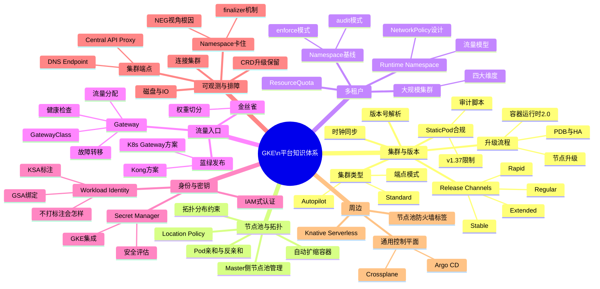

# GKE 知识点分析

Analyze the `gcp/gke/` knowledge base. Categorize the Google Kubernetes Engine documents by technical domain, summarize the key knowledge points, and present everything as a Markdown document with a Mermaid mindmap.

本文档覆盖 `gcp/gke/` 下的 **45 篇文档**——平台侧 K8s 的「运营手册」层：
不写业务代码，只写**集群怎么管、版本怎么升、多租户怎么隔离、流量怎么进**。

> **一句话结论**
> ★ GKE 这个目录回答的是 **「一个多租户共享集群，怎么安全地托管几百个团队」**：
> 版本通道与升级窗口、Namespace 准入与配额、Runtime Namespace 的 NetworkPolicy、
> Gateway 与蓝绿发布，以及 Workload Identity 这条身份链。

---

## 文档体系分析

1. **集群与版本** — `version.md`、`how-node-upgraded.md`、`docs/gke-upgrade.md`、`GKE-upgrade-contained2.md`、`gcp-clock.md`
2. **节点池与拓扑** — `gcp-master-cluster-nodepool.md`、`localpolicy-with-topology.md`、`pod-node-affinity.md`
3. **Namespace 与多租户** — `workload-identify.md`、`runtime-namespace-networkpolicy.md`、`docs/Multi-tenant.md`
4. **流量入口** — `docs/gke-blue-green.md`、`docs/Blue-Green-design.md`、`docs/Kong-canary.md`、`kong-blue-green.md`、`docs/gke-type.md`
5. **身份与密钥** — `workload-with-annotate.md`、`docs/gke-sa-gcp-sa-addbinding.md`、`gke-secret-manager.md`
6. **可观测与排障** — `docs/connect-GKE.md`、`gke-endpoint.md`、`namespace-stuck-terminating-neg-root-cause.md`
7. **周边能力** — `docs/knative-on-gke.md`、`docs/universal-control-plane-argocd-crossplane.md`、`docs/GKE-Pod-Disk.md`

---

## 知识点 MindMap



---

## 主要知识领域详解

### 1. 集群与版本
- `version.md`：**版本号解析 + Release Channel 体系 + 版本控制机制**，
  并解释了 GKE 版本号是怎么从源码生成的。
  通道四档：Rapid（最新，可能不稳定）/ Regular（默认）/ Stable（最稳）/ Extended（延长支持）。
- `docs/gke-upgrade.md`：**Pre-Upgrade 的 Static Pod Manifest 审计**
  （K8s 1.37+ 禁止 Static Pod 引用 Secret/ConfigMap）+ **Post-Upgrade 验证**，
  与 `gcp/adr/008` 呼应。
- `gcp-clock.md`：GKE 时钟同步机制评估——Pod 之间取到的时间是否相同、边界在哪。
- `gke-endpoint.md`：**集群端点**（DNS Endpoint vs Central API Proxy），
  解释了「为什么以前看不到 Endpoint 字段，有的环境突然就有了」。

### 2. 节点池与拓扑
- `gcp-master-cluster-nodepool.md` / `docs/nodepool-describe.md`：
  Master Project 侧的节点池管理，命名规范建议 `{cluster}-{tier}-{region}-{version}`。
- `localpolicy-with-topology.md`：节点池 **Location Policy** 与 Pod 的 **Topology Spread Constraints**
  的关系——**这两者是一套东西的两端**，只在一边配没有效果。
- `pod-node-affinity.md`：自动扩缩器的工作原理，以及**定时任务对 Pod 分布的影响**。

### 3. Namespace 与多租户
- `workload-identify.md`：Namespace 创建脚本详解，区分 **baseline（enforce / audit）**
  两种模式——`enforce` 会拒绝违规 Pod，`audit` 只记录。
- `runtime-namespace-networkpolicy.md`：Runtime Namespace 的 NetworkPolicy **设计与落地**
  （Goal and Constraints → Can It Be Implemented → Principles → Architecture → Traffic Model）。
- `docs/Multi-tenant.md` / `multi-tenant-cluster.md`：大规模集群的四大维度
  （Cluster / Workload / Platform / 值得请教的领域）。

### 4. 流量入口与发布
- `docs/gke-blue-green.md` / `docs/Blue-Green-design.md` / `kong-blue-green.md`：
  蓝绿发布的**资源四件套**（blue-deployment / blue-service / green-deployment / green-service）
  + ingress / ingress-update 的切换。
- `docs/Blue-Green-design.md`：**利用 GKE Gateway 实现蓝绿/金丝雀**的分析，
  含「核心组件与约束」。
- `docs/Kong-canary.md`：Kong 侧的权重切分。

### 5. 身份与密钥
- `workload-with-annotate.md`：**两个动作分别做了什么**——
  ① 给 Namespace 打 label；② 给 ServiceAccount 标注 GSA；
  并明确回答「不打会怎样」。
- `docs/gke-sa-gcp-sa-addbinding.md`：KSA → GSA 的绑定与最小权限授予
  （Cloud SQL / Secret Manager / reCAPTCHA）。
- `gke-secret-manager.md`：GKE 与 Secret Manager 集成——功能、技术架构、前置条件、**安全评估矩阵**，
  以及「与你现有 SMS 平台的对比」。

### 6. 可观测与排障
- `namespace-stuck-terminating-neg-root-cause.md`：**Namespace 卡在 Terminating 的 NEG 视角根因**——
  从 finalizer 机制讲到代码级，再定位「唯一的真凶」是 GCE NEG 删不掉。
- `docs/explorer-gke-type.md`：**CRD 在集群升级后的保留行为**（结论先行 + 原理 + 实操验证方案）。
- `docs/GKE-Pod-Disk.md`：容器「本地磁盘容量」≠ 节点磁盘容量（受 kubelet 管理限制）。

### 7. 周边
- `docs/knative-on-gke.md`：Knative 两个子项目、Serving 的四个核心对象。
- `docs/universal-control-plane-argocd-crossplane.md`：**通用控制平面**概念
  （先搞懂「控制平面」，再看 Argo CD / Crossplane 三件套分工）。
- `script/upgrade-gke-cluster.sh`、`script/update-node-pools-firewall.sh`：
  升级轮询脚本与节点池网络标签管理（**默认 dry-run，不覆盖既有标签**）。

---

## 三条阅读路线

```
路线 A · 平台新人入门（2 小时）
  what-gke.md → version.md → docs/gke-type.md
  → docs/connect-GKE.md → workload-identify.md

路线 B · 要做一次集群升级（半天）
  docs/gke-upgrade.md → GKE-upgrade-contained2.md
  → gcp-master-cluster-nodepool.md → docs/nodepool-describe.md

路线 C · 排查租户问题（1 小时）
  runtime-namespace-networkpolicy.md
  → namespace-stuck-terminating-neg-root-cause.md
  → docs/explorer-gke-type.md
```

---

## 结论

1. **「平台视角」与「业务视角」的差别**：这个目录几乎不写业务代码，
   写的是**「一个共享集群如何被安全地多人使用」**——配额、准入、拓扑分布、身份链。
2. **升级是最危险的动作**：K8s 1.37 的 Static Pod 变更把「升级前审计」变成**必跑项**，
   这一点在 `gcp/adr/008` 与 `docs/gke-upgrade.md` 里都被强调。
3. **两个「看起来独立」的东西其实是一套**：节点池 Location Policy 与 Pod 拓扑分布约束；
   Namespace label 与 SA 注解。只配一半等于没配。
4. **Workload Identity 的正确姿势**：KSA 打注解 + GSA 绑定 + IAM 角色，
   三步缺一不可；本文档把「每一步不做会怎样」都写清楚了。

---

## 关联文档

- [../gcp-mindmap.md](../gcp-mindmap.md) ·
  [../asm/asm-mindmap.md](../asm/asm-mindmap.md) ·
  [../ingress/ingress-control-mindmap.md](../ingress/ingress-control-mindmap.md) ·
  [../../cloud/k8s/k8s-mindmap.md](../../cloud/k8s/k8s-mindmap.md)
- [README.md](./README.md) ·
  [version.md](./version.md) ·
  [workload-identify.md](./workload-identify.md) ·
  [runtime-namespace-networkpolicy.md](./runtime-namespace-networkpolicy.md) ·
  [namespace-stuck-terminating-neg-root-cause.md](./namespace-stuck-terminating-neg-root-cause.md) ·
  [docs/gke-upgrade.md](./docs/gke-upgrade.md)
