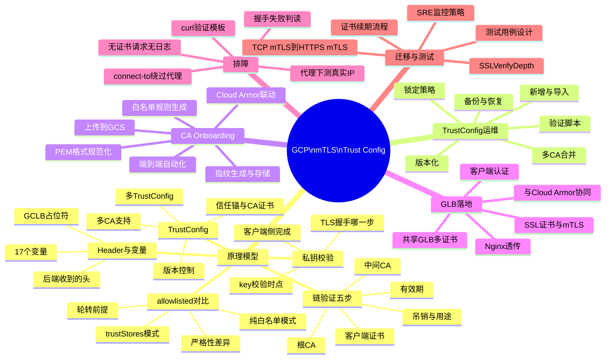

# mTLS / Trust Config 知识点分析

Analyze the `gcp/mtls/` knowledge base. Categorize the mutual-TLS documents by technical domain, summarize the key knowledge points, and present everything as a Markdown document with a Mermaid mindmap.

本文档覆盖 `gcp/mtls/` 下的 **61 篇文档**——它是 GCP 上"客户端证书认证"这件事的
**端到端操作手册 + 原理澄清**合集。

> **一句话结论**
> ★ mTLS 在 GCP 上只有一条正路：**Certificate Manager Trust Config**。
> 其余所有困惑（要不要每个客户端一个 CA、`allowlistedCertificates` 还是 `trustStores`、
> 私钥在哪一步被校验、轮换要不要更新 Trust Config）在这 61 篇里都被逐一回答过。

---

## 文档体系分析

1. **原理与模型** — `CA.md`、`mtls-header.md`、`trust-config/trust-config-flow.md`、
   `trust-config/mtls-key.md`、`compare-allowlisted-with-truststores.md`
2. **Trust Config 运维** — `trust-config/`（15 篇：新增、备份、锁、版本、多 CA、导入更新）
3. **CA Onboarding 自动化** — `onboarding-ca.md`、`onboarding-whitelist.md`、
   `onboarding-automation.md`、`onboarding-ca-with-fingerprint.md`、`onboarding-verify.md`
4. **GLB 落地与排障** — `glb-mtls.md`、`glb-verify.md`、`glb-verify-curl.md`、
   `glb-mtls-test-with-known-ip.md`、`glb-mtls-nginx.md`、`migrate-cloud-armor.md`
5. **与 Nginx / 代理协同** — `mtls-nginx.md`、`migrate-nginx.md`、`chatgpt-nginx.md`、
   `trust-config/mtls-trustconfig-nginx.md`
6. **迁移与测试** — `mtls-test/`（生成 CA、测试用例、SRE 监控）、`renew.md`、`SSLVerifyDepth.md`

---

## 知识点 MindMap



---

## 主要知识领域详解

### 1. 原理模型（先把概念钉死）

#### 1.1 Trust Config 是什么
- `trust-config/trust-config-flow.md`：Trust Config 里存的是**信任锚（Trust Anchor）**——
  根 CA 与中间 CA 证书；GCLB 在客户端连接时用它做**链验证**。
- `trust-config/trustconfig-multip-ca.md` 回答了三个常见问题：
  **一个 TrustConfig 支持多个 CA**、**可以有多个 TrustConfig**、**如何往已有 TrustConfig 里加 CA**。
- `trust-config/trust-config-limit.md`：隐式的证书链深度限制。

#### 1.2 链验证的 5 步
`trust-config/trust-config-client-cert-faq.md` 给出标准 5 步链：
客户端证书 → 中间 CA → 根 CA → 有效期 → 用途/吊销。
并明确 **Trust Config 真正需要更新的只有 4 种场景**——这是日常运维最需要记住的一条。

#### 1.3 `allowlistedCertificates` vs `trustStores`
| 维度 | `allowlistedCertificates` | `trustStores` |
|---|---|---|
| 语义 | **只认白名单里那张/那几张叶证书** | 信任一个 CA 链下的所有证书 |
| 严格性 | **更高** | 较宽 |
| 前提 | 客户端证书数量可控 | 客户端数量大 |

`compare-allowlisted-with-truststores.md` 明确指出：纯白名单模式有三个前提，
并给出"安全的轮转流程"（先加新的、再删旧的）。

#### 1.4 私钥到底在哪一步被校验
`trust-config/mtls-key.md` 拆解 `curl` 命令的每一段，然后回答：
**私钥校验发生在 TLS 握手期间、由客户端侧完成**；
对比表列出各校验点的先后顺序与完成时点。

#### 1.5 Header 与 mTLS 变量的关系
`mtls-header.md`：mTLS 在**协议层**，Header 在**应用层**，两者互不干扰；
并整理了 **GCLB mTLS 完整占位符（官方 2026，共 17 个）**，
以及四种典型架构下的 Header 链路梳理。

### 2. Trust Config 运维（`trust-config/`，15 篇）

| 文档 | 作用 |
|---|---|
| `add-trust-config.md` | 新增：读 PEM → openssl 规范化 → 拼 YAML → 绑定 |
| `trust-config-backup.md` | 备份策略（导出 JSON → 版本控制） |
| `trust-config-lock.md` | 锁定，防止误改 |
| `trust-config-limit.md` | 链深度限制 |
| `explorer-update-cert.md` | 证书更新与存储策略（极简加密方案） |
| `gcloud-certificate-update-with-import.md` | 导入式更新 |
| `analyze-trust-configs.md` / `verify-trust-configs-guide.md` | 解析与校验脚本 |

### 3. CA Onboarding 自动化（本目录最有工程价值的一段）
流程被拆成了 5 个可自动化的步骤：
1. `onboarding-ca-with-fingerprint.md`：CA 证书**指纹存储结构**；
2. `onboarding-ca.md`：新上传 CA 的 PEM 规范化 + 与已有 Trust Config 文件**合并**；
3. `onboarding-whitelist.md`：白名单文件上传 → 生成 Cloud Armor 允许规则（优先级 100）；
4. `onboarding-automation.md`、`onboarding-verify.md`：整体流程优化与验证；
5. `Onboard.md`：一键脚本。

### 4. GLB 落地
- `glb-mtls.md`：GLB 上配置 SSL 证书 + mTLS + Cloud Armor IP 白名单的完整步骤。
- `glb-mtls-nginx.md` / `mtls-nginx.md`：客户端证书如何传到后端 Nginx；
  `mtls-nginx.md` 里有"方案可行性分析 + 导入客户端证书处理模块 + 服务 A 路由配置"。
- `migrate-cloud-armor.md`：把 mTLS 身份与 Cloud Armor 规则联动（按 proxy 路径生成规则）。

### 5. 排障（最容易浪费时间的一段）
- `glb-mtls-test-with-known-ip.md`：**`--resolve` 会被代理忽略**（代理自己再做 DNS 解析），
  正确做法是 `--connect-to` 走代理并强制 CONNECT 到真实 IP；
  文档逐行解读 `curl -v` 输出找 mTLS 标志。
- `glb-verify-curl.md`：请求概要 / 证书信息 / 失败原因 / 解决方案四段式；
  还回答了"为什么启用 mTLS 后，没有客户端证书的请求在 GCP 看不到日志"。
- `verify-user-certificate.md`、`how-to-get-ca-int.md`、`compare-ca-intermediate.md`：
  **从客户端证书反查它的签发 CA**、获取根证书与中间证书、CA 对比。

### 6. 迁移与测试
- `mtls-test/test-case.md`：**TCP mTLS → HTTPS mTLS GLB 迁移**的测试用例设计。
- `mtls-test/sre-mtls-monitor.md`：配套的 SRE 监控策略。
- `renew.md`：证书续期的完整流程图，并回答"Root 或 Intermediate CA 更新了怎么办"。
- `SSLVerifyDepth.md`：**Trust Config 与 `SSLVerifyDepth` 无关**——
  后者是 Nginx 侧的深度设置，常见误区。

---

## 三条阅读路线

```
路线 A · 第一次做 mTLS（半天）
  CA.md → gcp-certificate-manager.md → trust-config/trust-config-flow.md
  → trust-config/add-trust-config.md → glb-mtls.md

路线 B · 排查"握手失败"（1 小时）
  glb-verify-curl.md → glb-mtls-test-with-known-ip.md
  → trust-config/mtls-key.md → trust-config-client-cert-faq.md

路线 C · 做 Onboarding 自动化（1 天）
  onboarding-ca.md → onboarding-ca-with-fingerprint.md
  → onboarding-whitelist.md → onboarding-automation.md → Onboard.md
```

---

## 结论

1. **整条链只有一个"旋钮"：Trust Config**。证书、CA、白名单、轮换问题最终都落到它身上。
2. **"多用户 mTLS"最关键的认知**：不是"每个用户一个 CA"，
   而是 **一个 TrustConfig 放多个 CA**，或者 **多个 TrustConfig + `allowlistedCertificates` 白名单**——
   `mtls/trust-config/trustconfig-multip-ca.md` 与 `why-need-white-list.md` 给出了完整答案。
3. **「严格性」要靠白名单而不是信任库**：`allowlistedCertificates` 严格高于 `trustStores`，
   但前提是客户端证书数量可控。
4. **排障第一条纪律**：**先确认 DNS 没走代理**——`--resolve` 在有代理时会被忽略，
   这是本目录反复强调的最容易踩的一步。

---

## 关联文档

- [../gcp-mindmap.md](../gcp-mindmap.md) ·
  [../../safe/safe-mindmap.md](../../safe/safe-mindmap.md) ·
  [../../safe/ssl/certificate-truststore.md](../../safe/ssl/certificate-truststore.md)
-   [CA.md](./CA.md) ·
  [mtls-header.md](./mtls-header.md) ·
  [compare-allowlisted-with-truststores.md](./compare-allowlisted-with-truststores.md) ·
  [trust-config/trust-config-flow.md](./trust-config/trust-config-flow.md) ·
  [trust-config/mtls-key.md](./trust-config/mtls-key.md) ·
  [glb-mtls.md](./glb-mtls.md) ·
  [glb-mtls-test-with-known-ip.md](./glb-mtls-test-with-known-ip.md) ·
  [onboarding-ca.md](./onboarding-ca.md) ·
  [mtls-test/test-case.md](./mtls-test/test-case.md)
- 相关：[../cloud-armor/cloud-armor-mindmap.md](../cloud-armor/cloud-armor-mindmap.md) ·
  [../asm/asm-mindmap.md](../asm/asm-mindmap.md)
