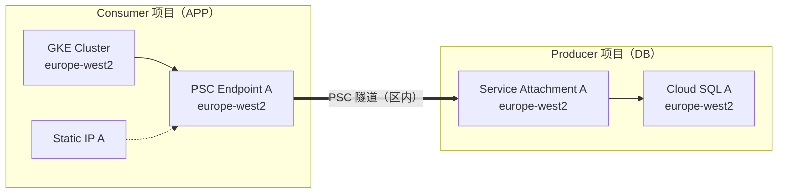
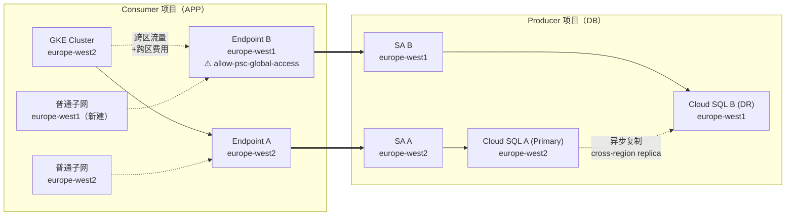
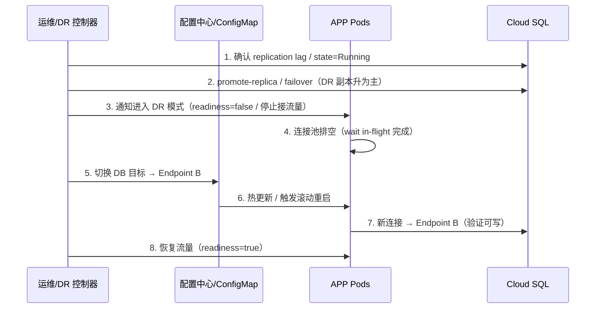

# GCP PSC 跨 Region DR 可行性评估

> 场景：APP 跑在 GKE（`europe-west2`，Consumer 项目），通过 **跨项目 PSC** 访问 Cloud SQL（Producer 项目）。
> 现状单 Region 链路已跑通，现在要补 `europe-west1` 的 DR 链路，并做切换演练。

---

## 0. 结论速览（TL;DR）

**方案可行**，你的架构判断与 GCP 官方约束完全吻合。三句话总结：

1. ✅ **Endpoint B 必须建在 `europe-west1`**（不能建在 `europe-west2`）——官方规定 PSC Endpoint 的 Region 必须与 Producer 的 Service Attachment 同 Region。Cloud SQL 每个实例/副本的 SA 都在自己所在 Region，所以 `SQL B (europe-west1)` 的 SA 只能在 `europe-west1` 被消费。**你的原方案正确。**
2. ✅ **Endpoint B 必须开 `--allow-psc-global-access`**——Endpoint 默认只在自己所在 Region 可达。`europe-west2` 的 GKE 要访问 `europe-west1` 的 Endpoint B，必须给 **consumer 侧 endpoint** 打这个开关（不是 producer 侧的 `--allow-global-access`，Cloud SQL 的 SA 由 Google 托管，用户打不开那个开关）。**你的 "Global Access" 注意事项正确，但要说清是哪一个开关。**
3. ⚠️ **跨 Region 之后，APP 到 DB 的流量变成跨区流量**——延迟 +10~20ms（RTT）、产生跨区数据传输费。这是这套方案的固有代价，想消除就得让 APP 一起切到 `europe-west1`（方案 C）。

**额外要补的 3 件事（你的清单里没提）**：

| # | 补充项 | 为什么必须 |
|---|--------|-----------|
| 1 | Consumer VPC 在 `europe-west1` 需要一个**普通子网**（不是 PSC NAT subnet） | Endpoint 的 IP 地址从这个普通子网里分配，且该子网必须与 SA 同 Region。`europe-west2` 的子网不能给 `europe-west1` 的 Endpoint 分配 IP |
| 2 | Producer 侧 `SQL B` 必须开 `--enable-private-service-connect` + `--allowed-psc-projects=<APP 项目 ID>` | 否则 Endpoint 创建后 `pscConnectionStatus` 停在 `PENDING` 而不是 `ACCEPTED` |
| 3 | MySQL 用户必须是 `'user'@'%'` | PSC 会做 SNAT，Cloud SQL 看到的是 NAT 转换后的源 IP，按主机名/IP 限制用户会直接被拒 |

**推荐落地路径**：

- **先做方案 A**（双 Endpoint + 应用侧配置切换）→ 满足 DR 演练要求，无 edition 门槛，和现有链路风格一致。
- 如果 DB 侧有 **Cloud SQL Enterprise Plus** 许可证，**叠加方案 B**（`--enable-psc-write-endpoint-dns`）：Cloud SQL 会维护一个全局 DNS 写端点，failover 后 DNS 自动指向新 Primary，**应用侧连接串零改动**。
- 延迟/成本敏感再上 **方案 C**（APP 整体切到 `europe-west1`）。

---

## 1. 现状与目标拓扑

### 1.1 现状（已跑通）



### 1.2 目标（DR 链路）



### 1.3 两种 DR 数据拓扑（选一个）

| 变体 | 结构 | 优点 | 代价 |
|------|------|------|------|
| **A1（推荐）** | 同一实例的 **cross-region read replica**：SQL A(europe-west2, primary) + SQL B(europe-west1, replica) | 复制关系由 Cloud SQL 托管；每个实例自带自己 Region 的 SA；`gcloud sql instances promote-replica` 即可提升；参数/备份/PITR 由 Cloud SQL 管 | **异步复制**，failover 会丢最后一小段时间的写入（看 replication lag） |
| **A2** | 两个完全独立的实例，自己配复制（外部复制 / DMS / 自建） | 隔离更彻底，两边可独立演进 | 复制关系、schema 变更、数据一致性全靠自己 → 你原话说的"主备复制关系需要数据库层另外配置"就是这个坑 |

> **强烈建议 A1**。Cloud SQL 原生的 cross-region replica 提供了 `promote-replica` / `failover` / `switchover` 一整套运维语义，比手工维护 A2 省事得多。

---

## 2. 官方硬性约束核对表

这一节是本文档的核心依据，逐条来自 Google 官方文档。

| # | 约束 | 出处 | 对我们的影响 |
|---|------|------|-------------|
| C1 | **PSC Endpoint 的 Region 必须与 Producer 的 Service Attachment 同 Region** | VPC docs · Connect to a published service：*`REGION`: The region for the endpoint. This must be the same region that contains the service producer's service attachment.* | Endpoint B 必须在 `europe-west1` ✅（你的判断正确） |
| C2 | Endpoint 的 IP 地址来自 Consumer 侧的**普通子网**，且该子网必须与被访问的服务同 Region | VPC docs：*The subnet must be in the same region as the service that you want to connect to.* | Consumer VPC 需要在 `europe-west1` 建普通子网 |
| C3 | **Endpoint 默认只在自己 Region 内可达**；`--allow-psc-global-access` 才能被其他 Region 的客户端访问 | VPC docs：*By default, endpoints are available only from their own region.*；Cloud SQL docs：*To access the endpoint from any region in that network, you must configure global access for the endpoint.* | `europe-west2` 的 GKE 访问 Endpoint B **必须**开这个开关 |
| C4 | 不是所有 published service 都支持 consumer global access，不支持时创建 endpoint 会直接报错 | VPC docs：*Private Service Connect global access is not supported for the given forwarding rule, since its producer service does not support consumer global access.* | Cloud SQL 官方文档明确给出该参数 → **Cloud SQL 支持** ✅ |
| C5 | Producer 需要把 Consumer 项目列入允许列表；Cloud SQL 通过 `--allowed-psc-projects` 控制 | Cloud SQL docs | `SQL B` 必须 patch 上 APP 项目 ID |
| C6 | Endpoint 必须真实创建且 `pscConnectionStatus = ACCEPTED` | Cloud SQL docs：*In the response, verify that an ACCEPTED status appears for the pscConnectionStatus field.* | 两条 Policy 不够，要建 endpoint + 校验状态 |
| C7 | 单个 Cloud SQL 实例最多 **20 个** PSC Endpoint | Cloud SQL docs · Limitations | 我们用 2 个，安全 |
| C8 | PSC 会对客户端 IP 做 **SNAT**，Cloud SQL 看到的是 NAT 后的 IP | Cloud SQL docs：*Restricting a MySQL user account by hostname or IP address isn't supported.* | MySQL 用户必须 `'user'@'%'` |
| C9 | 跨 Region 副本是**异步复制**，failover 会丢复制窗口内的事务 | Cloud SQL docs · Promote replicas for DR | 演练前必须读 `Replication Lag` 指标 |
| C10 | `gcloud sql connect` / Cloud Shell / DMS / Datastream **不能**连接 PSC 模式的 Cloud SQL | Cloud SQL docs · Limitations | 测试要走 Pod/VM 内网，不能用 `gcloud sql connect` |

### 2.1 一个必须纠正的误解

> **"Global Access 有两个方向，容易混。"**

| 开关 | 位置 | 作用 | 我们要不要开 |
|------|------|------|-------------|
| `--allow-global-access` | **Producer** 侧 ILB Forwarding Rule | 允许**其他 Region 的 Endpoint** 来连这个 SA | ❌ 用不上。Cloud SQL 的 SA 由 Google 托管，用户无法修改它背后的 ILB FR |
| `--allow-psc-global-access` | **Consumer** 侧 Endpoint Forwarding Rule | 允许**其他 Region 的客户端**（我们的 `europe-west2` GKE）访问这个 Endpoint | ✅ **必须开**，开在 Endpoint B 上 |

你原描述里"Global Access"没有区分方向，实际落地时只有 `--allow-psc-global-access` 是你能操作的。

---

## 3. 方案评估与选型

### 3.1 方案 A：双 Endpoint + 应用侧切流（你的方案）

**机制**：APP 通过配置（env / ConfigMap / DNS）选择连 Endpoint A 还是 Endpoint B。DR 时改配置 + 切流量。

- ✅ 与现有链路完全同构，改造面最小
- ✅ 不依赖 Cloud SQL edition，无 license 门槛
- ✅ Endpoint B 可以**提前建好、提前连上**（连的是 DR 副本，只读），随时可以验证连通性
- ⚠️ 切换动作在应用侧 → 需要连接池管理 + 优雅下线，否则会有一批请求失败
- ⚠️ 跨区延迟 + 跨区费用（仅 DR 期间产生）
- ⚠️ 存在"脑裂"窗口：DB 已 promote，APP 还没切 → 写请求打到还是只读的副本 → 必须处理只读错误并重试

### 3.2 方案 B：Cloud SQL Write Endpoint DNS（Enterprise Plus）

**机制**：Cloud SQL 托管一个全局 DNS 记录（如 `<uid>.<hash>.global.sql-psc.goog`），**始终指向当前 Primary**。failover/switchover 之后 DNS 自动改指向，应用侧连接串一个字都不用改。

官方原文（Cloud SQL · Configure PSC）：

> With write endpoint DNS automation enabled, Cloud SQL provisions a Global DNS record to act as a Write Endpoint in all networks that are configured with Private Service Connect auto-connections. **This global DNS record always points to the current primary instance of the replication cluster, which enables seamless application failover without requiring any client-side connection-string updates** in the case of a replica failover or switchover operation.

**前置条件（全部要满足）**：

| 条件 | 说明 |
|------|------|
| Cloud SQL **Enterprise Plus** edition | 官方：*This feature is only supported for Enterprise Plus instances* |
| `--enable-psc-auto-dns` | 开启 per-instance DNS 自动化 |
| `--enable-psc-write-endpoint-dns` | 开启写端点 DNS |
| `--psc-auto-connections=network=...,project=...` | 开启自动建 endpoint（依赖 **Service Connection Policy**） |
| 实例在 **new network architecture** | 老架构实例需要先升级，否则 failover 后 DNS 不会正确切换 |

**代价**：

- 需要 Enterprise Plus（价格更高）
- 需要引入 Service Connection Policy + 自动建 endpoint 的新模型（和你们现在手工建 endpoint 的风格不一样）
- 切流"零改动"的前提是**客户端能正确处理连接断开重连**（长连接池必须能重建）

> **建议**：A 为主、B 为增强。如果暂时拿不到 Enterprise Plus，A 完全够用。

### 3.3 方案 C：整体 Region Failover（APP 一起切）

APP 侧再部署一套 `europe-west1` 的 GKE，DR 时连同 APP 一起切到 `europe-west1`，此时用**同 Region 的** Endpoint B（不需要 global access）。

- ✅ **没有跨区流量**：延迟最低、跨区费用为 0
- ✅ 端点规则回到最简单：Endpoint 与 SA 同 Region、同 VPC 内 → 不需要 global access
- ✅ 更接近真实的"地域级灾难恢复"形态
- ❌ 要维护两套 GKE，成本/运维翻倍
- ❌ 入口流量切换（Global LB → 两个后端）也要一起设计

> **建议**：DR 演练阶段先做 A；如果是真生产 + 有预算，把 C 作为长期目标（因为跨区延迟对数据库密集型应用影响不小）。

### 3.4 选型对比

| 维度 | 方案 A（双 Endpoint 切流） | 方案 B（Write Endpoint DNS） | 方案 C（整体 failover） |
|------|---------------------------|------------------------------|--------------------------|
| 应用侧改动 | 中（配置化 + 连接池） | **小**（只换 DNS 名字） | 大（两套 GKE + 入口切换） |
| Edition 要求 | 无 | Enterprise Plus | 无 |
| DR 时跨区延迟 | 有（+10~20ms RTT） | 有（除非同时做 C） | 无 |
| DR 时跨区费用 | 有 | 有 | 无 |
| 切换耗时 | 分钟级（滚动重启/改配置） | 秒级（DNS TTL 生效 + 重连） | 分钟级（流量切换） |
| 脑裂风险 | 需自行处理 | 低（DB 自己管指针） | 低 |
| 实现复杂度 | 低 | 中（新模型） | 高 |
| **本次推荐** | ✅ **首选** | ⭐ 增强项 | ⭕ 长期目标 |

---

## 4. Infra 侧变更清单

### 4.1 Producer（DB 项目）

| # | 资源 | 动作 | Region | 说明 |
|---|------|------|--------|------|
| P1 | Cloud SQL B | **新建** | europe-west1 | `--enable-private-service-connect --no-assign-ip`；数据库版本与 A 一致 |
| P2 | Cloud SQL B 的 `allowedConsumerProjects` | patch | europe-west1 | 加入 APP 项目 ID（`--allowed-psc-projects`） |
| P3 | SA B（Service Attachment） | 自动生成 | europe-west1 | Cloud SQL 自动创建；**consumer 项目在 allowed 列表里就自动接受**，不需要手工 `service-attachments update --connection-preference ACCEPT_MANUAL` |
| P4 | 复制关系 | 建立 | 跨区 | A1：把 B 建为 A 的 cross-region replica；或 A2：自建复制 |
| P5 | 备份 / PITR / 参数 | 对齐 | — | DR 副本要有独立的备份计划和保留策略 |
| P6 | Cloud Monitoring 告警 | 新增 | europe-west1 | `cloudsql.googleapis.com/database/replication/replication_lag`、`database/replication/state` |

> ⚠️ **A1 变体注意**：`cross-region replica` 提升（promote）后会变成**独立实例**，原 Primary **不会**自动反向复制回去。回切要么用 Enterprise Plus 的 `switchover`，要么重新配置复制。演练前先确认回切路径。

### 4.2 Consumer（APP 项目）

| # | 资源 | 动作 | Region | 说明 |
|---|------|------|--------|------|
| C1 | **普通子网** | **新建** | europe-west1 | 用途：给 Endpoint B 分配 IP。命名建议 `psc-dr-subnet-europe-west1`，范围如 `10.9.0.0/24`（避开所有已有网段） |
| C2 | PSC NAT subnet | 视现状 | europe-west1 | 如果现有 `europe-west2` 链路在 consumer VPC 里用了 `purpose=PRIVATE_SERVICE_CONNECT` 的 NAT 子网，这里要**对称补齐**；若走 proxy-only 模式则不需要。参照现有 setup 脚本保持一致 |
| C3 | Static IP | 新建 | europe-west1 | `gcloud compute addresses create ... --subnet=C1` |
| C4 | **PSC Endpoint B** | 新建 | europe-west1 | `gcloud compute forwarding-rules create ... --target-service-attachment=<SA B> --allow-psc-global-access` |
| C5 | 出站防火墙规则 | 新增/扩展 | europe-west2 VPC | EGRESS allow `tcp:3306`（或 5432）到 **Endpoint B 的 IP/32**；建议用一条规则同时覆盖 A、B 两个 IP |
| C6 | GKE NetworkPolicy | 新增 | — | **Dataplane V2** 集群必须放通到 Endpoint B IP 的 3306；Dataplane V1 只需防火墙规则 |
| C7 | Service Connection Policy | 可选 | europe-west2 / europe-west1 | 只有走方案 B（自动建 endpoint + write endpoint DNS）才需要 |
| C8 | 配额检查 | 检查 | europe-west1 | PSC endpoints per region per project（默认 50）、每 SA 的 consumer forwarding rules（默认 10）、VPC 每 region 子网数 |

> 💡 **防火墙目标写成 IP 还是网段？**
> 建议**用 Endpoint 的具体 IP/32**，不要用 `10.0.0.0/8` 大网段 —— DR 期间才需要开这条链路，长期挂着大范围放行是安全债。切换前再放行也行，但要写进 runbook。

### 4.3 关键命令（gcloud）

```bash
# ============ 环境变量 ============
export PRODUCER_PROJECT_ID=your-db-project
export CONSUMER_PROJECT_ID=your-app-project
export CONSUMER_VPC=app-vpc

export REGION_A=europe-west2
export REGION_B=europe-west1

export SQL_A=sql-primary-euw2
export SQL_B=sql-dr-euw1

export EP_A_NAME=sql-psc-ep-a
export EP_B_NAME=sql-psc-ep-b
export EP_B_IP_NAME=sql-psc-ip-b
export EP_B_SUBNET=psc-dr-subnet-europe-west1
export DB_PORT=3306

# ============ 1. Producer：建 DR 实例（europe-west1）============
gcloud sql instances create ${SQL_B} \
  --project=${PRODUCER_PROJECT_ID} \
  --region=${REGION_B} \
  --database-version=MYSQL_8_0 \
  --tier=db-n-2 \
  --availability-type=REGIONAL \
  --enable-private-service-connect \
  --allowed-psc-projects=${CONSUMER_PROJECT_ID} \
  --no-assign-ip \
  --enable-bin-log

# ============ 2. Producer：拿 SA B 的 URI ============
export SA_B=$(gcloud sql instances describe ${SQL_B} \
  --project=${PRODUCER_PROJECT_ID} \
  --format="value(pscServiceAttachmentLink)")
echo "SA B = ${SA_B}"   # projects/<prod>/regions/europe-west1/serviceAttachments/<name>

# ============ 3. Consumer：europe-west1 普通子网（放 Endpoint IP）============
gcloud compute networks subnets create ${EP_B_SUBNET} \
  --project=${CONSUMER_PROJECT_ID} \
  --network=${CONSUMER_VPC} \
  --region=${REGION_B} \
  --range=10.9.0.0/24

# ============ 4. Consumer：Static IP ============
gcloud compute addresses create ${EP_B_IP_NAME} \
  --project=${CONSUMER_PROJECT_ID} \
  --region=${REGION_B} \
  --subnet=${EP_B_SUBNET}

# ============ 5. Consumer：Endpoint B（关键：--allow-psc-global-access）============
gcloud compute forwarding-rules create ${EP_B_NAME} \
  --project=${CONSUMER_PROJECT_ID} \
  --region=${REGION_B} \
  --network=${CONSUMER_VPC} \
  --address=${EP_B_IP_NAME} \
  --target-service-attachment=${SA_B} \
  --allow-psc-global-access

# ============ 6. 校验：必须 ACCEPTED ============
gcloud compute forwarding-rules describe ${EP_B_NAME} \
  --project=${CONSUMER_PROJECT_ID} \
  --region=${REGION_B} \
  --format="get(pscConnectionStatus)"   # 期望：ACCEPTED

# ============ 7. Consumer：放行出站到 Endpoint B ============
EP_B_IP=$(gcloud compute addresses describe ${EP_B_IP_NAME} \
  --project=${CONSUMER_PROJECT_ID} --region=${REGION_B} \
  --format="value(address)")

gcloud compute firewall-rules create allow-sql-psc-dr-egress \
  --project=${CONSUMER_PROJECT_ID} \
  --network=${CONSUMER_VPC} \
  --direction=EGRESS \
  --destination-ranges=${EP_B_IP}/32 \
  --action=ALLOW \
  --rules=tcp:${DB_PORT}
```

### 4.4 Terraform 参考片段

```hcl
# ---------- Consumer ----------
locals {
  regions = ["europe-west2", "europe-west1"]
}

resource "google_compute_subnetwork" "psc_dr_euw1" {
  name          = "psc-dr-subnet-europe-west1"
  region        = "europe-west1"
  network       = google_compute_network.app_vpc.id
  ip_cidr_range = "10.9.0.0/24"
}

resource "google_compute_address" "psc_ep_b" {
  name       = "sql-psc-ip-b"
  region     = "europe-west1"
  subnetwork = google_compute_subnetwork.psc_dr_euw1.id
}

resource "google_compute_forwarding_rule" "psc_ep_b" {
  name                  = "sql-psc-ep-b"
  region                = "europe-west1"
  network               = google_compute_network.app_vpc.id
  ip_address            = google_compute_address.psc_ep_b.id
  target_service_attachment = "<从 Cloud SQL 拿到的 SA B URI>"
  allow_psc_global_access  = true          # ← europe-west2 的 GKE 靠它才能访问
}

resource "google_compute_firewall" "allow_sql_psc_dr_egress" {
  name          = "allow-sql-psc-dr-egress"
  network       = google_compute_network.app_vpc.name
  direction     = "EGRESS"
  destination_ranges = ["${google_compute_address.psc_ep_b.address}/32"]
  source_ranges = ["10.0.0.0/8"]          # 收紧到 GKE pod/node 网段
  allow { protocol = "tcp" ports = ["3306"] }
}

# ---------- Producer ----------
resource "google_sql_database_instance" "dr" {
  name                = "sql-dr-euw1"
  region              = "europe-west1"
  database_version    = "MYSQL_8_0"
  deletion_protection = false

  settings {
    tier              = "db-n-2"
    availability_type = "REGIONAL"
    backup_configuration {
      enabled            = true
      binary_log_enabled = true
      start_time         = "02:00"
    }
    ip_configuration {
      ipv4_enabled                                  = false
      enable_private_service_connect = true
      allowed_consumer_projects = [var.consumer_project_id]
    }
  }
}
```

---

## 5. App 侧变更清单

### 5.1 把 DB 目标地址从"硬编码"变成"配置项"

| 方式 | 做法 | 优点 | 缺点 |
|------|------|------|------|
| **环境变量** | `DB_HOST=10.x.x.x`，通过 ConfigMap 注入，切换时改 ConfigMap + 滚动重启 | 最简单、最可控 | 切换需要滚动重启，不是秒级 |
| **ConfigMap 热更新** | 应用 watch ConfigMap，收到变更后重建连接池 | 切换快，不用重启 Pod | 应用要实现 reload 逻辑；连接池必须能整体重建 |
| **私有 DNS** | Cloud DNS 私有 zone：`db.prod.internal` → A 记录指向 Endpoint IP；切换 = 改 A 记录 | 切换最快；客户端零配置改动 | DNS 有 TTL（CoreDNS 默认 30s，JVM 默认 30s 但会缓存）；**已有长连接不会因为 DNS 变化而重连** → 仍需配合连接池回收 |

> ⚠️ **常见误区**：很多人以为改 DNS 就完事了。实际上 DNS 只影响**新建连接**，已有的 keep-alive 连接仍然连着老 Primary。**必须配合"连接池排空 + 重建"**，否则你会看到"切了但没生效"或"一半请求还在老库"。

### 5.2 推荐的切流实现（以配置化 + 优雅切换为例）



**应用侧要实现的 4 个能力**：

1. **优雅下线 / 排空**
   - K8s：`preStop` hook + `readinessProbe` 摘流；或收到 DR 信号后主动进入 draining 状态。
   - 应用层：连接池 `maxIdle` 归零 + 等待 in-flight 请求结束（建议 ≤ 30s）。
2. **只读检测与重试**
   - DR 副本在 promote 前是只读的；切换窗口内可能出现 `read-only` / `ER_OPTION_READS_ONLY` 类错误。
   - 处理方式：识别"只读错误"→ 触发重连到新 Endpoint → **不要**把只读错误当业务失败直接抛给用户。
3. **幂等性**
   - 跨区切换期间 RTT 变高、超时概率上升，客户端可能重试写请求 → 写接口必须带幂等键（request id）。
4. **超时/连接池参数放宽**
   - DR 期间 RTT +10~20ms，连接建立变慢；`connectTimeout` / `readTimeout` 建议留足余量。
   - 连接池最大连接数不用改（受 Cloud SQL 并发连接上限 64,512 约束，实际远低于）。

### 5.3 连接方式建议

| 方式 | 是否推荐 | 说明 |
|------|---------|------|
| 直连 PSC Endpoint IP + 驱动 | ✅ 可行 | 最简单，切换 = 换 host |
| Cloud SQL Auth Proxy（sidecar） | ✅ 推荐 | 支持 `--auto-iam-authn`、自动重连；proxy 需要能同时看到两个 endpoint（配置化 sidecar + ConfigMap） |
| Cloud SQL Language Connector（Java/Go/Python/Node） | ✅ 推荐 | 内置 failover 语义（v1.3.0+ 宣称支持 DR failover），且能接受 DNS 名字 |
| Cloud SQL Auth Proxy + Write Endpoint DNS（方案 B） | ⭐ 最佳组合 | failover 后完全不用动应用配置 |

### 5.4 K8s 侧清单

```yaml
# ConfigMap 示例：DB 目标可切换
apiVersion: v1
kind: ConfigMap
metadata:
  name: app-db-config
  namespace: app
data:
  DB_HOST: "10.8.0.10"        # Endpoint A (europe-west2)
  DB_PORT: "3306"
  # DR 时改为 Endpoint B (europe-west1)
---
# NetworkPolicy（Dataplane V2 必配）
apiVersion: networking.k8s.io/v1
kind: NetworkPolicy
metadata:
  name: allow-db-psc
  namespace: app
spec:
  podSelector:
    matchLabels: { app: my-app }
  policyTypes: [Egress]
  egress:
    - to: [{ ipBlock: { cidr: "10.8.0.10/32" } }]      # Endpoint A
      ports: [{ protocol: TCP, port: 3306 }]
    - to: [{ ipBlock: { cidr: "10.9.0.10/32" } }]      # Endpoint B (DR)
      ports: [{ protocol: TCP, port: 3306 }]
```

> 💡 **GKE 特有检查点**：
> - Dataplane V2 → 出口受 NetworkPolicy 管控（必须加规则）。
> - Dataplane V1 → 出口受 VPC 防火墙管控（必须加 EGRESS 规则）。
> - GKE 节点池缩容/迁移时，**跨区 Endpoint 的可达性不受影响**（Google 网络层面路由），但要注意节点本身所在 region's NAT/路由。
> - 如果 APP 用了 Cloud SQL Auth Proxy sidecar，**每个 pod 的 proxy 都要能切目标** → proxy 的 `--ip_address` 参数无法热改，通常需要改 sidecar 参数并滚动重启。

---

## 6. DR 演练 Runbook

完整步骤见 → [`dr-runbook.md`](dr-runbook.md)

演练前必须确认的 5 件事：

1. Endpoint B `pscConnectionStatus = ACCEPTED`
2. 从 `europe-west2` 的 Pod 内能 `nc -zv <Endpoint B IP> 3306` 通
3. `SQL B` 的 `replication state = Running`，`replication lag` 在可接受范围（建议 < 5s）
4. 应用已支持"切 Endpoint"且有优雅排空逻辑
5. 回切路径已明确（`switchover` 还是重新配复制）

---

## 7. 风险清单

| # | 风险 | 影响 | 缓解 |
|---|------|------|------|
| R1 | **跨区数据丢失**：异步复制，failover 丢最后几秒写入 | 数据丢失 | 演练前读 replication lag；业务侧接受"最多丢 X 秒"；必要时降低写入频率 |
| R2 | **跨区延迟 +10~20ms** | 高频小事务应用性能下降 | 评估；或上方案 C |
| R3 | **跨区数据传输费** | 成本 | 只在 DR 期间产生；量级见 §8 |
| R4 | **脑裂**：DB 已 promote，APP 未切 | 写失败 | 应用做只读错误识别与重连；runbook 明确"先 promote 再切流"的顺序与超时处理 |
| R5 | **global access 开关遗漏** | europe-west2 连不上 europe-west1 | 创建后立即校验；`gcloud compute forwarding-rules describe --format="get(allowPscGlobalAccess)"` |
| R6 | **MySQL 用户带主机限制** | 连上但被拒 | 全部用户改成 `'user'@'%'` |
| R7 | **Subnet IP 冲突** | 新建 europe-west1 子网时 IP 段与已有资源重叠 | 先汇总所有 VPC/区域的网段再规划 |
| R8 | **Endpoint 数量/配额** | 创建失败 | 检查 PSC endpoints per region per project、每 SA 的 consumer FR 配额 |
| R9 | **global access + 健康检查**（若用自建 SA） | 流量可能打到不健康后端 | 只影响自建 published service；Cloud SQL 托管 SA 无此问题 |
| R10 | **promote 后失去反向复制** | 回切麻烦 | Enterprise Plus 用 `switchover`；否则演练后重建复制关系 |

---

## 8. 成本估算

| 成本项 | 单价 | 说明 |
|--------|------|------|
| PSC Endpoint（每个） | ≈ $0.01 / 小时 | 多一个 Endpoint B = 每月约 $7.3 |
| PSC 数据处理 | ≈ $0.01 / GiB | 双向流量 |
| **跨 Region 数据传输** | europe-west2 ↔ europe-west1 | 以官方定价页为准（同洲跨区通常显著低于跨洲；你的现有笔记里记的是 Asia↔US $0.12/GiB 量级） |
| Cloud SQL DR 实例 | 取决于 tier | DR 期间实例按运行计费 + 存储 + 备份 |

**估算公式**：

```
跨区费用 ≈ 业务 QPS × 平均响应大小 × DR 持续秒数 × 单价
例：100 QPS × 4 KB/请求 ≈ 0.4 MB/s ≈ 1.44 GB/天（按 100% 流量估算）
```

> 演练（分钟级）成本可忽略；**真正生产故障持续 1 小时的跨区费用才需要重点评估**。

---

## 9. 参考

**官方文档**

- [Connect to a published service（Consumer 侧 Endpoint 规则）](https://cloud.google.com/vpc/docs/configure-private-service-connect-services) —— 端点同 Region 规则、global access 语义
- [Manage endpoints used to access published services](https://cloud.google.com/vpc/docs/manage-endpoints-published-services) —— 端点 global access 的开关方法
- [Configure Private Service Connect for Cloud SQL（MySQL）](https://cloud.google.com/sql/docs/mysql/configure-private-service-connect) —— Endpoint 创建、`allowedConsumerProjects`、Limitations
- [Overview of Private Service Connect in Cloud SQL](https://cloud.google.com/sql/docs/mysql/about-private-service-connect) —— *To access the endpoint from any region in that network, you must configure global access*
- [Promote replicas for regional migration or disaster recovery](https://cloud.google.com/sql/docs/mysql/replication/cross-region-replicas) —— 跨区副本提升语义与数据丢失窗口
- [Use advanced disaster recovery (DR)](https://cloud.google.com/sql/docs/mysql/use-advanced-disaster-recovery) —— Enterprise Plus advanced DR、`switchover` / replica failover
- [Configure a service connection policy](https://cloud.google.com/vpc/docs/configure-service-connection-policies) —— 自动建 endpoint 的模型（方案 B 前置）

**仓库内相关笔记**

- [psc-cross-region.md](../psc-cross-region.md) —— 两种 Global Access 的区别
- [Kiro-psc-CloudSQL.md](../Kiro-psc-CloudSQL.md) —— Cloud SQL PSC 完整实施步骤
- [psc-eli5.html](../psc-eli5.html) —— PSC 原理图解
- [service-attachment-region.md](../service-attachment-region.md) —— Service Attachment 与 Region 的关系
- [psc-nat-vs-proxy-only-subnet.md](../../network/psc-subnet/psc-nat-vs-proxy-only-subnet.md) —— PSC NAT 子网 vs Proxy-Only 子网
- [psc-subnet.md](../../network/psc-subnet/psc-subnet.md) —— NAT 子网容量与并发连接模型
- [psc-sql-flow-demo](../psc-sql-flow-demo/) —— 现有的 Producer/Consumer 部署脚本

**脚本**

- [`scripts/setup-dr-psc.sh`](scripts/setup-dr-psc.sh) —— 一键创建 DR 链路
- [`scripts/verify-dr-psc.sh`](scripts/verify-dr-psc.sh) —— 一键校验链路
