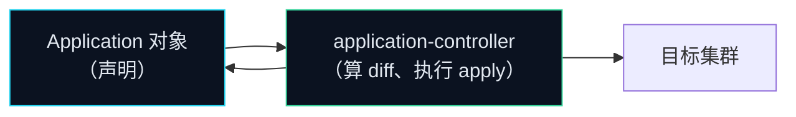

# Argo CD `Application` 资源详解（v3.5.6）

> 面向：在 UCP 项目里创建、理解和维护 Argo CD `Application` 的人
> 版本基准：Argo CD **v3.5.6**（与本目录 `install.yaml`、`argocd-api.md`、`argocd-cli-guide.md` 一致）
> 字段依据：上游 `docs/operator-manual/application.yaml`（v3.5.6 tag）、
> `manifests/crds/application-crd.yaml`（v3.5.6 tag）、
> `docs/user-guide/commands/argocd_app_create.md`（v3.5.6 tag），均已逐条核对。
> 配套阅读：`poc-argocd-integration.md`（控制面分工）、`argocd-admin-guide.md`（通用运维）、
> `poc-argocd-git-to-apply-trigger.md`（触发链路）。

---

## 1. 它到底是什么

`Application` 是 Argo CD 自己的 CRD（`apiVersion: argoproj.io/v1alpha1`），
**一张"从哪拿、放到哪、什么时候放"的工单**。

它**不包含任何执行逻辑**，也不会自己改集群。真正干活的是
`argocd-application-controller`：它 watch 这张工单，去 Git 取清单，和集群里的真实状态做 diff，
然后执行 apply / prune，把结果写回 `status`。



一句话记住分工：**`spec` 是你写的期望态，`status` 是 Argo CD 写回的现实。**

| | 谁写 | 内容 |
|---|---|---|
| `spec` | 你（Git / UI / CLI） | 要同步什么、去哪、怎么同步 |
| `metadata` | 你 | 名字、标签、finalizer（决定删 Application 时要不要连带删资源） |
| `status` | Argo CD | `sync.status`、`health.status`、`resources`、`history`、`operationState` |

> 在 UCP 里额外记一条：**Argo CD 只同步 XR（业务请求），不同步 MR。**
> MR 由 Crossplane Composition 生成，Argo CD 若也去 apply 同一个 MR，双方会抢所有权，
> 结果是持续 OutOfSync。详见 `poc-minimax.md` §3.2。

---

## 2. 最小可用 Application

这是 UCP 里"一个团队一个项目"的标准形态（也是 `poc-argocd-integration.md` §3.3 的那一版）：

```yaml
apiVersion: argoproj.io/v1alpha1
kind: Application
metadata:
  name: team-a-project-a        # Application 名，全局唯一（同一 namespace 内）
  namespace: argocd             # Argo CD 自己的 namespace
  finalizers:
    - resources-finalizer.argocd.argoproj.io   # 删 Application 时连带删掉它创建的资源
spec:
  project: team-a               # 权限边界，指向一个 AppProject
  source:
    repoURL: git@github.com:<org>/ucp-platform.git
    targetRevision: main        # 跟踪哪个分支/标签/commit
    path: teams/team-a/project-a # 仓库里的哪个目录
  destination:
    server: https://kubernetes.default.svc   # 同集群；跨集群改成 name: <cluster-secret>
    namespace: project-a         # 落到哪个 namespace
  syncPolicy:
    automated:
      enabled: true
      prune: false               # 关键：PoC 阶段关闭，见 §7 坑位
      selfHeal: true
    syncOptions:
    - CreateNamespace=true
    - ServerSideApply=true
    - PruneLast=true
```

逐字段解释：

| 字段 | 含义 | 踩坑点 |
|---|---|---|
| `metadata.name` | Application 名 | 重名会创建失败（除非 `argocd app create --upsert`） |
| `metadata.finalizers` | `resources-finalizer.argocd.argoproj.io` = 删 Application 时**级联删除**它管理的资源；不加则资源留在集群里变成孤儿 | 这是"删掉 Application 会不会删掉云集群"的开关，删之前先想清楚 |
| `spec.project` | 指向一个 `AppProject`，决定这个 Application 能读哪些仓库、能写到哪些 namespace、能创建哪些资源 | 不写默认是 `default` project，团队应显式指定 |
| `spec.source.repoURL` | Git 仓库地址（SSH 或 HTTPS）或 Helm chart 仓库 | 私有仓库要在 `argocd-repo-server` 侧配凭据 |
| `spec.source.targetRevision` | 跟踪分支 / tag / commit SHA / semver | **不是** commit SHA 时它会一直跟着分支头走 |
| `spec.source.path` | 仓库内的目录（相对仓库根） | 与 `destination.namespace` 的对应关系由 ApplicationSet 决定 |
| `spec.destination.server` | 目标集群 API 地址 | 与 `destination.name` **互斥**，二选一 |
| `spec.destination.namespace` | 目标 namespace | **只对没有写 `metadata.namespace` 的命名空间级资源生效** |
| `syncPolicy.automated.prune` | Git 里删掉的东西是否也从集群删 | 默认 `false`；打开前先想清楚爆炸半径 |
| `syncPolicy.automated.selfHeal` | 集群里被手工改了，是否拉回 Git 的期望值 | 默认 `false` |
| `syncOptions.CreateNamespace` | 目标 namespace 不存在时自动创建 | 需要目标集群有 create namespace 权限 |
| `syncOptions.ServerSideApply` | 用 SSA 方式 apply | 与 Crossplane 共存时更稳 |
| `syncOptions.PruneLast` | 把删除放到最后一个 wave | 避免"先删旧的再起新的"造成中断 |

---

## 3. 四种创建方式

| 方式 | 命令 | 适合谁 | 备注 |
|---|---|---|---|
| **声明式（推荐）** | `kubectl apply -f application.yaml` 或把 YAML 放进 Git 让 Argo CD 自己管 | 生产 / GitOps | Argo CD 自己管自己的 Application 时，注意不要和 ApplicationSet 双写 |
| **CLI** | `argocd app create <name> --repo ... --path ... --dest-namespace ...` | 手工试点、调试 | 常用 flag 见 §8 |
| **UI** | UI → `NEW APPLICATION` | 一次性试验 | 不适合长期：YAML 拿不出来，也进不了 Git 审计 |
| **ApplicationSet** | 由 generator 批量生成 Application | 多团队多项目 | UCP 的正式做法，见 §6 |

> **UCP 的选择**：平台侧组件（Provider / XRD / Composition）用一个固定的 Application
> 托管在 `platform/` 目录；团队侧的 XR 用 ApplicationSet 按 `teams/<team>/*` 目录批量生成。
> 两者都进 Git，都走 PR 审批。

---

## 4. `spec.source`：要同步什么

`source` 决定"从哪拿、拿什么、怎么展开"。四类来源，同一个应用只选一种。

| 子字段 | 用于 | 关键点 |
|---|---|---|
| `repoURL` | 全部 | Git 仓库地址；也接受 Helm chart 仓库地址 |
| `targetRevision` | 全部 | 分支 / tag / commit / semver；Helm chart 仓库里表示 chart 版本 |
| `path` | Git + 目录型 | 仓库内目录；**Helm chart 仓库时无意义** |
| `chart` | Helm chart 仓库 | 直接从 chart 仓库拉时填；**git 里的 Helm chart 不要填** |
| `helm.*` | Helm | `values` / `valueFiles` / `parameters` / `releaseName` / `version` / `kubeVersion` / `passCredentials` |
| `kustomize.*` | Kustomize | `namePrefix` / `images` / `patches` / `commonLabels` / `components` / `version` |
| `directory.*` | 裸 YAML / Jsonnet | `recurse`、`include` / `exclude` glob、`jsonnet.extVars` / `tlas` |
| `plugin.*` | Config Management Plugin | `name` / `env` / `parameters` |

### 多源应用（`spec.sources`）

一个 Application 可以有多个源，典型是"主仓库 + 另一个仓库的 values 文件"：

```yaml
spec:
  sources:
    - repoURL: https://github.com/my-org/app.git
      targetRevision: main
      path: manifests
      ref: values            # 给别的源引用
      name: app
    - repoURL: https://github.com/my-org/config.git
      targetRevision: main
      ref: values
      name: config
```

`ref` / `name` 是源之间的引用关系；单源时用 `spec.source`，多源时用 `spec.sources`，
两者不能同时用。

### `sourceHydrator`（v3.x 新增）

把"干仓库"渲染后提交到"湿仓库"再同步，用于需要生成物入库的场景：

```yaml
spec:
  sourceHydrator:
    drySource:                # 从这里渲染
      repoURL: https://github.com/my-org/charts.git
      targetRevision: main
      path: guestbook
    syncSource:               # 渲染结果提交到这里再同步
      repoURL: https://github.com/my-org/deployments.git
      targetBranch: env/prod
      path: guestbook-hydrated
```

UCP 暂时用不到，但要知道它存在——以后做"环境晋级"时它是官方给的路径之一。

---

## 5. `spec.destination`：放到哪

```yaml
destination:
  server: https://kubernetes.default.svc   # 或
  name: crossplane-control-plane           # 引用 cluster secret 的 name
  namespace: project-a
```

| 写法 | 含义 |
|---|---|
| `server: https://kubernetes.default.svc` | 同集群（Argo CD 就在目标集群里），用 Argo CD 自己的 SA |
| `server: https://<外部集群 API>` | 跨集群，用 cluster secret 里的 token |
| `name: in-cluster` | 同集群的另一种写法 |
| `name: <secret 名>` | 跨集群，用 `argocd.argoproj.io/secret-type: cluster` 的 Secret |

> `server` 与 `name` **互斥**，同时写会被拒绝。
> 跨集群的完整凭据配置见 `argocd-admin-guide.md` §7.2–7.4。

**namespace 覆盖规则**（最常踩的坑）：

| manifest 里的 `metadata.namespace` | 实际落点 |
|---|---|
| 没写 | 用 `destination.namespace` |
| 写了 | **manifest 里的赢**，`destination.namespace` 被忽略 |

所以同一个 Application 里既有"跟着 destination 走"又有"写死了 namespace"的对象时，
会出现一部分资源在 A namespace、一部分在 B namespace 的情况。统一做法是
**manifest 里一律不写 `metadata.namespace`**。

---

## 6. `spec.syncPolicy`：怎么同步

### 6.1 automated：三个开关

```yaml
syncPolicy:
  automated:
    enabled: true      # 写了这个块且没显式设 enabled:false，即视为开启
    prune: false       # 默认 false：Git 里删掉的，不从集群删
    selfHeal: true     # 默认 false：集群被手工改，不自动拉回
    allowEmpty: false  # 默认 false：应用不允许变成"一个资源都没有"
```

| 开关 | 打开后发生什么 | 什么时候开 |
|---|---|---|
| `prune` | Git 里删掉的文件，对应资源**从集群删除** | 稳态生产（且已确认 Git 是唯一事实源）；PoC 阶段建议关 |
| `selfHeal` | 集群里被手工改了，Argo CD 自动改回 Git 的样子 | 生产建议开；能兜住"有人 kubectl 改了"这类漂移 |
| `allowEmpty` | 允许应用最终没有任何资源 | 几乎不用，除非确实要"清空一个应用" |

### 6.2 syncOptions：常用取值

| 取值 | 含义 | 建议 |
|---|---|---|
| `CreateNamespace=true` | 自动创建目标 namespace | 常用 |
| `ServerSideApply=true` | 用 SSA apply | 与 Crossplane 共存时推荐 |
| `PruneLast=true` | 删除放到最后一个 wave | 常用，避免服务中断 |
| `Validate=false` | 关闭服务端校验 | 极少用 |
| `RespectIgnoreDifferences=true` | 同步时也尊重 `ignoreDifferences` | 见 §7 |
| `ApplyOutOfSyncOnly=true` | 只 apply 处于 OutOfSync 的资源 | 大应用提速 |
| `PrunePropagationPolicy=foreground\|background\|orphan` | 删除时的传播策略 | 跨集群时注意 |
| `Replace=true` | 用 `kubectl replace`/`create` 而不是 apply | 慎用 |
| `SkipDryRunOnMissingResource=true` | 目标不存在时跳过 dry-run | 依赖 CRD 尚未安装的场景 |

### 6.3 retry：失败重试

```yaml
syncPolicy:
  retry:
    limit: 5
    backoff:
      duration: 5s
      factor: 2
      maxDuration: 3m
    refresh: true       # 重试时用最新 revision，而不是最初那个
```

含义：最多重试 5 次，退避 5s → 10s → 20s → 40s → 80s（上限 3m）。
CRD 的描述是 `limit: 0` 表示不重试；默认值以控制器实际行为为准，
建议在 `argocd-cm` / controller 参数里确认一次再写进模板。

### 6.4 ignoreDifferences：忽略"不该管"的差异

集群和 Git 不一致时，Argo CD 会显示 OutOfSync 并尝试"纠正"。
有些差异是**应该忽略**的（比如云厂商回写的字段、其他控制器维护的字段）。

```yaml
syncPolicy:
  ignoreDifferences:
    - group: apps
      kind: Deployment
      jsonPointers:
        - /spec/replicas          # HPA 在管的副本数
    - kind: ConfigMap
      jqPathExpressions:
        - '.data["config.yaml"]' # 别的工具改的配置
    - group: "*"
      kind: "*"
      managedFieldsManagers:
        - kube-controller-manager
```

> **重要**：默认情况下 `ignoreDifferences` **只影响 diff 显示，不影响实际同步**。
> 想让同步也尊重它，必须同时加 `syncOptions: [RespectIgnoreDifferences=true]`。
> 这是最常见的"我明明忽略了怎么还在改"的原因。

---

## 7. 示例集（含逐字段解释）

### 例 1 · 最小 XR 应用（UCP 的日常形态）

见 §2 的完整 YAML。适用：团队提交一个 XR，Argo CD 把它写进集群，Crossplane 接手。
风险：无 `prune`，Git 删 XR 不会删集群里的对象。

### 例 2 · 生产稳态（开 selfHeal，prune 按应用灰度）

```yaml
spec:
  syncPolicy:
    automated:
      enabled: true
      prune: true                 # 确认 Git 是唯一事实源后再开
      selfHeal: true
    syncOptions:
    - CreateNamespace=true
    - ServerSideApply=true
    - PruneLast=true
    - RespectIgnoreDifferences=true
    retry:
      limit: 5
      backoff:
        duration: 5s
        factor: 2
        maxDuration: 3m
```

### 例 3 · Helm chart 来源

```yaml
spec:
  source:
    repoURL: https://charts.helm.sh/stable
    chart: nginx-ingress
    targetRevision: 1.24.3        # 对 Helm 仓库来说这就是 chart 版本
    helm:
      releaseName: nginx-ingress
      valueFiles:
        - values-prod.yaml
      parameters:
        - name: replicaCount
          value: "3"
  destination:
    server: https://kubernetes.default.svc
    namespace: ingress
```

要点：`chart` 填了就不能再有 `path`；`valueFiles` 的路径**相对 `source.path`**（这里没有 path，所以相对仓库根）。

### 例 4 · Kustomize

```yaml
spec:
  source:
    repoURL: git@github.com:<org>/infra.git
    targetRevision: main
    path: envs/dev
    kustomize:
      namePrefix: dev-
      images:
        - my-app=gcr.io/my-repo/my-app:0.1
      replicas:
        - name: my-app
          count: 2
  destination:
    server: https://kubernetes.default.svc
    namespace: my-app-dev
```

要点：环境差异用 Kustomize 的 `namePrefix` + `namespace` 表达，不要复制两份 YAML。

### 例 5 · 多源（values 从另一个仓库来）

```yaml
spec:
  sources:
    - repoURL: https://github.com/my-org/app.git
      targetRevision: main
      path: manifests
      ref: values
      name: app
    - repoURL: https://github.com/my-org/config.git
      targetRevision: main
      ref: values
      name: config
  destination:
    server: https://kubernetes.default.svc
    namespace: my-app
```

要点：用 `ref` 声明"谁可以被引用"，被引用的源不再单独渲染。

### 例 6 · 忽略 Crossplane / 云厂商回写的字段

```yaml
spec:
  syncPolicy:
    ignoreDifferences:
      - group: platform.example.org
        kind: GKECluster
        jqPathExpressions:
          - '.status'              # Crossplane 写的 status 不归 Argo CD 管
      - group: apps
        kind: Deployment
        jsonPointers:
          - /spec/replicas
    syncOptions:
    - RespectIgnoreDifferences=true
```

要点：`status` 本来就不归 Argo CD 管，但显式忽略能避免某些 diff 噪声；
`RespectIgnoreDifferences=true` 必须一起加，否则忽略只停留在 UI 上。

### 例 7 · Hook：把发布门禁挂上去

```yaml
spec:
  syncPolicy:
    automated:
      enabled: true
    syncOptions:
    - CreateNamespace=true
```

```yaml
# 放在仓库目录里，与被管资源同一个 Git
apiVersion: batch/v1
kind: Job
metadata:
  name: smoke-test
  annotations:
    argocd.argoproj.io/hook: PreSync
    argocd.argoproj.io/hook-delete-policy: BeforeHookCreation
spec:
  template:
    spec:
      restartPolicy: Never
      containers:
        - name: smoke
          image: registry.example.org/smoke:latest
```

要点：`PreSync` 失败 → 整个同步不执行；`PostSync` 用于同步后的冒烟/验收。
hook 的 `hook-delete-policy` 决定何时清理，忘了写会堆积 Job。

### 例 8 · 跨集群（Argo CD 在 A 集群，目标是 B 集群）

```yaml
spec:
  destination:
    name: crossplane-control-plane      # cluster secret 的 name
    namespace: team-a-project-a
```

前提三件事，缺一不可（详见 `argocd-admin-guide.md` §7.2–7.5）：
1. 在 Argo CD 所在的 A 集群上创建 cluster secret；
2. B 集群建受限 SA + RBAC；
3. **AppProject 的 `destinations` 必须放行 B 集群**——只放行 namespace 不放行 server 一样会被拒。

### 例 9 · 常见字段组合速查

| 场景 | 关键字段组合 |
|---|---|
| 只想看看 Git 里的清单对不对 | 不写 `syncPolicy`（纯 manual） |
| 自动同步但不许删 | `automated.enabled: true` + `prune: false` |
| 自动同步且允许删 | `automated.enabled: true` + `prune: true` + `PruneLast=true` |
| 允许 HPA 改副本数 | `ignoreDifferences` + `RespectIgnoreDifferences=true` |
| CRD 还没装好就同步 | `SkipDryRunOnMissingResource=true` |
| 跨集群 | `destination.name` + AppProject 放行 + cluster secret |
| 应用级删除要连带删资源 | `metadata.finalizers: [resources-finalizer.argocd.argoproj.io]` |

---

## 8. `status`：Argo CD 回给你的现实

```bash
argocd app get <name> -o yaml          # 看全量
kubectl -n argocd get application <name> -o yaml
argocd app list                        # 一览：SYNC STATUS / HEALTH STATUS
argocd app get <name> --show-operation  # 看正在跑的同步动作
```

要盯的几个字段：

| 字段 | 怎么看 | 含义 |
|---|---|---|
| `status.sync.status` | `Synced` / `OutOfSync` / `Unknown` | Git 期望态与集群现状是否一致 |
| `status.health.status` | `Healthy` / `Progressing` / `Degraded` / `Missing` / `Suspended` | 资源自身状态（XR 的健康检查靠 v3.5.6 内置的 Crossplane lua） |
| `status.operationState` | phase / message / startedAt | 最近一次同步动作的细节 |
| `status.resources` | 逐个资源的 group/kind/namespace/name/status/health | 定位"到底哪个资源不健康" |
| `status.history` | 最近的部署记录 | `argocd app history <name>` |
| `status.reconciledAt` | 时间戳 | 控制器最后一次对比的时间 |
| `status.conditions` | v3.x 的应用级 condition | 应用整体是否被删/是否可变更 |
| `status.controllerNamespace` | v3.x 新增 | 哪个 argocd 控制器在管这个应用（多控制器场景） |

> `OutOfSync` 只说明"有差异"，不代表同步失败；`Health=Healthy` 只说明"资源本身正常"，
> 不代表已经同步。两个维度要分开看——`argocd-admin-guide.md` §12 的速查表按这个思路写。

---

## 9. CLI 创建：常用 flag

```bash
# 目录型应用
argocd app create team-a-project-a \
  --repo git@github.com:<org>/ucp-platform.git \
  --path teams/team-a/project-a \
  --revision main \
  --dest-server https://kubernetes.default.svc \
  --dest-namespace project-a \
  --project team-a \
  --sync-policy automated \
  --sync-option Prune=false \
  --sync-option CreateNamespace=true \
  --auto-prune=false \
  --self-heal

# 从文件创建（多源应用用这个）
argocd app create team-a-project-a -f application.yaml

# 只看 diff，不改集群
argocd app diff team-a-project-a

# 手动触发同步 / 刷新
argocd app sync team-a-project-a
argocd app get team-a-project-a --refresh
```

完整 flag 见 `argocd-cli-guide.md`，或 `argocd app create --help`。

---

## 10. 在 UCP 项目里怎么落地

### 10.1 两种 Application，各管各的

| Application | 同步什么 | 放哪 | 谁改 |
|---|---|---|---|
| `crossplane-platform` | Provider / Function / XRD / Composition / ProviderConfig | `platform/**` | 平台团队 |
| `team-<x>-<project>` | 只有 XR | `teams/<team>/<project>/**` | 开发团队（走 PR + CODEOWNERS） |

### 10.2 命名三处一致（硬约束）

```
Git 目录名  =  ApplicationSet 生成的 Application 的 destination.namespace  =  AppProject.destinations 允许的 namespace
teams/team-a/project-a/          project-a                 project-a
```

不一致 → Argo CD 直接拒同步（`not match any of the allowed destinations`）。
`scripts/ci-validate.sh` 已经在按团队维度自动校验这条。

### 10.3 ApplicationSet 生成 Application（推荐做法）

```yaml
apiVersion: argoproj.io/v1alpha1
kind: ApplicationSet
metadata:
  name: team-a-xr
  namespace: argocd
spec:
  generators:
    - git:
        repoURL: git@github.com:<org>/ucp-platform.git
        revision: main
        directories:
          - path: teams/team-a/*
  template:
    metadata:
      name: 'team-a-{{path.basename}}'
    spec:
      project: team-a
      source:
        repoURL: git@github.com:<org>/ucp-platform.git
        targetRevision: main
        path: '{{path}}'
      destination:
        server: https://kubernetes.default.svc
        namespace: '{{path.basename}}'
      syncPolicy:
        automated:
          prune: false
          selfHeal: true
        syncOptions:
        - CreateNamespace=true
        - ServerSideApply=true
        - PruneLast=true
```

要点：
- ApplicationSet 本身是**生成器**，它只创建/更新 `Application` 对象，不 apply 任何东西；
- `{{path.basename}}` 把目录名变成 namespace 名——这就是"三处一致"的机械保证；
- `revision: main` 写在 generator 上，意味着**只有合进 main 的目录才会生成 Application**；
  PR 未合并前不会部署（见 `poc-argocd-git-to-apply-trigger.md` §0）。

### 10.4 落地的 5 步

```bash
# 1. 先手工建一个，确认字段没问题
kubectl -n argocd apply -f application.yaml

# 2. 看 Argo CD 是否拉到清单（此时不 apply）
argocd app get team-a-project-a --show-operation
argocd app diff team-a-project-a

# 3. 确认 diff 干净后手动同步一次
argocd app sync team-a-project-a

# 4. 确认 XR 真的落到目标 namespace
kubectl get gkeclusters.platform.example.org -A

# 5. 之后再交给 ApplicationSet 自动生成，删掉手工建的那个
```

---

## 11. 常见坑速查

| 症状 | 最可能的原因 | 处理 |
|---|---|---|
| Application 一直 `Unknown` | repo-server 渲染失败 / 仓库凭据缺失 | `argocd app get <name>` 看 render error；查 repo-server 日志；私有仓库要配 repo-creds |
| 一直 `OutOfSync` | 有差异但 diff 里看不出改了啥 | `argocd app diff <name>`；多半是某控制器回写字段 → `ignoreDifferences` |
| `Progressing` 很久 | CRD 缺健康检查 / wave 顺序错 | v3.5.6 已内置 Crossplane health.lua；检查 `sync-wave` 顺序 |
| 同步报 `not permitted` | 目标集群 SA 权限不足 | 补 RBAC；确认 `destination.server` 与 secret 对得上 |
| 报 `not match any of the allowed destinations` | AppProject 没放行 namespace 或集群 | 三处命名一致；AppProject `destinations` 同时要写 server 和 namespace |
| 资源落在错误的 namespace | manifest 里写了 `metadata.namespace`，盖掉了 destination | manifest 里一律不写 namespace |
| 删了 Git 文件，集群里资源还在 | `prune` 默认 false | 确认是否要开；开了就是"删 Git = 删集群" |
| 删了 Application，资源也全没了 | 配了 `resources-finalizer` finalizer | 这是预期行为；不需要级联删除就去掉 finalizer |
| `ignoreDifferences` 没生效 | 只影响 diff 显示 | 同步要加 `RespectIgnoreDifferences=true` |
| 同步慢（>1 分钟） | 走的是 120s 周期 resync 而非 webhook | 配 GitHub webhook → `/api/webhook/github` |
| 应用被别的 Application 抢了 | 同一个资源被两个 Application 管 | 用 `argocd.argoproj.io/tracking-id` 排查；一个资源只归一个 Application |

---

## 12. 字段速查表

```yaml
apiVersion: argoproj.io/v1alpha1
kind: Application
metadata:
  name: <应用名>                      # 必填
  namespace: argocd                  # 惯例
  finalizers:                        # 可选：级联删除
    - resources-finalizer.argocd.argoproj.io
  labels: {}
  annotations: {}
spec:
  project: default                   # 权限边界
  source:                            # 单源（二选一）
    repoURL: <url>
    targetRevision: main
    path: <dir>
    chart: <name>                    # Helm chart 仓库才用
    helm: {}
    kustomize: {}
    directory: {}
    plugin: {}
  sources:                           # 多源（与 source 互斥）
    - repoURL: <url>
      ref: values
      name: app
  destination:
    server: https://kubernetes.default.svc   # 与 name 互斥
    # name: in-cluster
    namespace: <ns>
  info:                              # UI 上显示的说明
    - name: Example
      value: https://example.com
  syncPolicy:
    automated:
      enabled: true
      prune: false
      selfHeal: false
      allowEmpty: false
    syncOptions: []
    retry:
      limit: 5
      backoff: {duration: 5s, factor: 2, maxDuration: 3m}
    ignoreDifferences: []
  revisionHistoryLimit: 10
  sourceHydrator: {}                 # v3.x 新增
```

---

## 附录 · 核实来源

| 结论 | 来源 |
|---|---|
| 全部 spec 字段与默认值（prune/selfHeal/allowEmpty 默认 false） | `argoproj/argo-cd` v3.5.6 `manifests/crds/application-crd.yaml` |
| 字段语义与示例（helm/kustomize/directory/plugin/sources/sourceHydrator） | `argoproj/argo-cd` v3.5.6 `docs/operator-manual/application.yaml` |
| `argocd app create` 全部 flag | `argoproj/argo-cd` v3.5.6 `docs/user-guide/commands/argocd_app_create.md` |
| `status` 字段（sync/health/resources/history/operationState/conditions/controllerNamespace） | 同 CRD 的 `status` 部分 |
| `destination.server` 与 `name` 互斥、in-cluster 写法 | `docs/getting_started.md`、`docs/user-guide/application-specification.md`（v3.5.6） |
| namespace 覆盖规则（manifest 里写了就赢） | 本目录 `poc-argocd-integration.md` §6.2（已核实） |
| 字段所有权（Argo CD 写 spec，Crossplane 写 status） | 本目录 `poc-argocd-integration.md` §6.1（已核实） |
| PR 未合并不触发部署 | 本目录 `poc-argocd-git-to-apply-trigger.md` §0（已核实） |
| 排障对照表 | 本目录 `argocd-admin-guide.md` §12（已核实） |
| 版本基线 v3.5.6 | 本目录 `install.yaml`、`argocd-api.md`、`argocd-cli-guide.md` |

> `retry.limit` 的默认值，CRD 描述为"0 表示不重试"，而上游示例注释写"默认重试 5 次"，
> 两者口径不一致，实际行为以控制器参数为准。本仓库模板里**显式写死 limit: 5**，避免依赖默认值。
