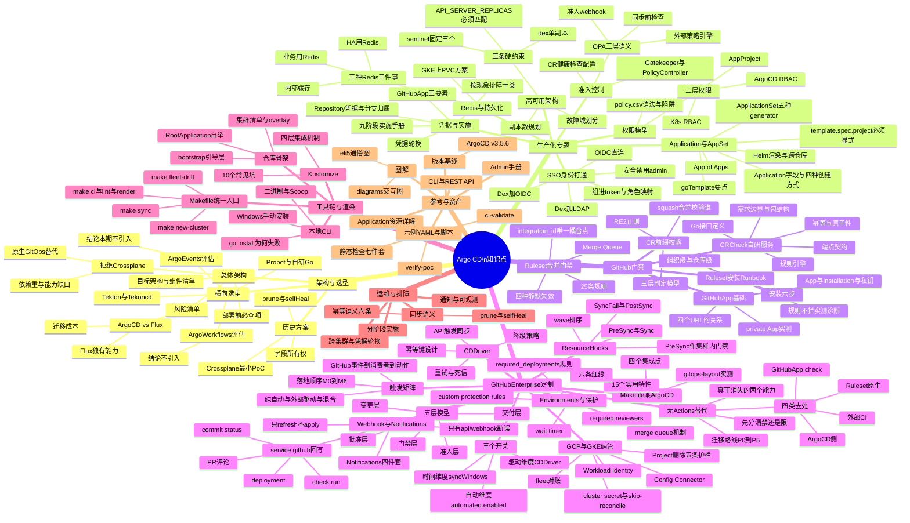

# Argo CD 知识点分析

Analyze the Argo CD knowledge base in this directory. Categorize the documents by technical domain. Summarize the key knowledge points and present everything in a Markdown document with a Mermaid mindmap.

本文档基于本目录（`gcp/ucp/`）中围绕 **Argo CD** 的全部文档，梳理知识体系并展示为一张 Mermaid 思维导图。

> **一句话结论**
> ★ 这是一套围绕 **Argo CD × GitHub Enterprise** 的 **GitOps 控制面**知识库：
> 上游是 **GitHub（门禁与审批）**，下游是 **GKE / GCP（执行与治理）**，
> 中间由 **Argo CD** 收敛。**Crossplane 已停用**（历史文档保留为背景）。
> 最新方向（GitHub-first、禁用 Actions、自动/手动可切）在 `argocd-topics/gh-enterprise/`。

---

## 文档体系分析

按技术领域分类，本目录的文档可以拆成七个板块：

1. **架构与选型**
   - 拒绝 Crossplane 的决策记录、目标架构与组件清单
   - 与 Flux / Tekton / Argo Workflows / Argo Events / Probot 的横向对比

2. **Argo CD 生产化专题**（`argocd-topics/00–10`）
   - Redis 持久化、高可用副本约束、SSO 身份打通
   - AppProject 与三层权限模型、ApplicationSet 批量分发
   - OPA / Gatekeeper 准入影响面、仓库凭据、实施与排障手册

3. **GitHub 门禁专题**（`argocd-topics/git-apps/`）
   - 自研 GitHub App（CR Check，Go）设计与实现评估
   - Ruleset × GitHub App 合并门禁、CR 前缀校验、安装 Runbook

4. **★ GitHub Enterprise 深度定制**（`argocd-topics/gh-enterprise/`）
   - 五层模型 + 三个开关 + GitHub 事件触发矩阵
   - 无 Actions 替代方案、Webhook 与 Notifications 回写
   - Resource Hooks、CD Driver、Environments、Makefile × Argo CD、GCP 纳管

5. **工具链与渲染**
   - Kustomize 四层集成、bootstrap 引导层、仓库统一入口 Makefile

6. **运维与排障**
   - 9 阶段实施手册、按现象索引的排障手册

7. **参考手册与可运行资产**
   - Admin / Application / CLI / API 手册、示例 YAML、静态检查脚本、图解

---

## 知识点 MindMap



---

## 主要知识领域详解

### 1. 架构与选型

#### 拒绝 Crossplane
- **决策**：Crossplane 被严格禁止使用，跨云编排改为 **Kubernetes 原生 GitOps**
  （CRD + Operator + 资源清单）。
- **历史文档定位**：`poc.md`、`poc-minimax.md`、`poc-argocd-integration.md`、
  `next-steps-roadmap.md` 仅作背景记录，不代表当前方向。
- **仍然有效的部分**：字段所有权模型、`prune/selfHeal` 语义、
  Git → Apply 的逐阶段链路（触发路径需按 `20-argocd-webhook-and-notifications.md` 勘误）。

#### 横向选型结论

| 对比对象 | 结论 |
|---|---|
| Flux | Argo CD 没有 Flux 的 3 项能力；迁移成本需评估 |
| Tekton / tektoncd | 仅作认知参考，未引入 |
| Argo Workflows | 概念梳理后 **不引入** |
| Argo Events | EventBus / EventSource / Sensor / Trigger 梳理后 **本期不引入** |
| Probot | Probot 是写 App 的 Node 脚手架；本项目走 Go 自研路线 |

### 2. Argo CD 生产化专题

#### Redis 与持久化（`01`）
- **核心认知**：**三种 Redis 是三件事** —— 内部缓存 / HA 用 / 业务用，各自要不要持久化要分开判断。
- **落地方案**：GKE 上用 StatefulSet + PVC 承接持久化。

#### 高可用（`02`）
- **三条硬约束**（配错即失效）：
  1. `API_SERVER_REPLICAS` 必须与实际副本数匹配；
  2. dex 保持 1 副本（多副本会抖动）；
  3. sentinel 固定 3 个。
- 规划生产部署时同时考虑**故障域**分布。

#### SSO 与身份打通（`03`）
- **三种模式**：OIDC 直连 / Dex+OIDC / Dex+LDAP。
- **组怎么进 token、组怎么映射角色**是排查「登录了但没权限」的主线。
- **安全禁用 admin**：不能靠"不给 admin 组"，要有显式禁用路径。

#### 权限模型（`04`）
- **三层权限**：Argo CD RBAC × AppProject × K8s RBAC，边界必须同时收敛。
- `policy.csv` 语法坑多（角色继承、项目通配、否定规则顺序）。

#### Application 与 ApplicationSet（`05`）
- 五种 generator 的输入输出必须分清；`goTemplate` 要点单独列。
- **`template.spec.project` 必须显式写**，否则会落到 default 项目、突破边界。
- 渐进式同步：先单集群验证再批量铺开。
- 补充模式：App of Apps（父子两层同步）、Helm 渲染与跨仓库渲染原理
  （跨仓库不是 Helm 的能力，依赖 Argo CD 的凭据模型与 broker 心智模型）。

#### 准入控制（`06`）
- **OPA 三层语义**：同步前检查 / 外部策略引擎 / 准入 webhook，职责不同不能混。
- CR 资源需要单独配 **health check**，否则状态永远 Unknown。

#### 凭据、实施与排障（`07`–`09`）
- **"为什么分支不能改"**：分支属于 Application，而不属于 Repository。
- GitHub App 三要素（App / Installation / Private Key）与凭据轮换流程。
- **实施顺序（`08`）**：9 个阶段，每阶段给出「前置条件 → 命令 → 验收标准 → 回滚」。
- **排障（`09`）**：按**现象**索引的 10 类问题，出问题时第一本翻它。

### 3. GitHub 门禁专题（git-apps）

#### GitHub App 与 CR Check
- GitHub App = **App + Installation + Private Key**；四个 URL（Homepage / Webhook / Redirect / API）职责不同。
- **实测发现**：`cr-check` 是 **private App**，安装方式影响仓库可见性。
- CR Check（Go）设计给出 **Go 接口定义 + 端点契约 + 规则引擎**，估算 **M0–M5 ≈ 17–25 人日**。
- 立项评估（`Develop-git-apps.md`）：自研 vs Actions vs 纯配置，R0–R13a 规则表，24 条工程坑。

#### Ruleset × GitHub App 合并门禁
- **唯一耦合点是 `integration_id`**（Ruleset 指向 App 的 check）。
- 四种**静默失效**场景会导致「规则装上了却不拦」，必须靠安装 Runbook 里的实测诊断兜住。
- 25 条规则 + Merge Queue 机制是配置主线。
- **commit message CR 前缀**：三层判定（L1 本地 hook / L2 Ruleset / L3 App），
  RE2 正则，squash merge 到底校验谁有明确答案。

#### Webhook 推送模式
- **push vs pull 量化对比**；push 模式的**六个新契约**：幂等 / 乱序 / 超时 / 不重试 / 暴露面 / 配额。
- 「Git → 生效的完整 8 步」与 K8s 清单见 `webhook-and-backend-service.md`。

### 4. ★ GitHub Enterprise 深度定制（gh-enterprise）

#### 五层模型
变更层 → 门禁层 → 批准层 → 交付层 → 准入层。定位问题先判断它属于哪一层。

#### 三个开关（本系列最重要的结论）
> 「Argo CD 有一个开关」这个说法要**拆成三个**：

| 维度 | 字段 | 作用 |
|---|---|---|
| 时间 | `AppProject.spec.syncWindows` | 允许/禁止同步的时间窗 |
| 自动 | `Application.spec.syncPolicy.automated.enabled` | 要不要自动收敛 |
| 驱动 | 外部 CD Driver | 谁来按下同步按钮 |

只做其中一个，就会退化成「要么全自动、要么全手动」；三个一起用才有
「默认 sync on、需要时手动」的精确语义。

- **事实**：`syncWindows` **只在 AppProject 上**，Application CRD 没有这个字段。
- **判定规则**：deny 覆盖 allow；`manualSync` 决定窗口禁止时人工点同步是否放行；
  `syncOverrun` 决定已在跑的同步能否跨窗完成。
- **时区**：maintenance window 必须与 `syncWindows` **同一时区**。
- `automated` 还有 4 个子开关（prune / selfHeal / allowEmpty / 幂等语义 6 条）。

#### 无 GitHub Actions 的替代（`19`）
- 先分清是「完全禁用」还是「禁托管 runner」。
- **四类去处**：Ruleset 原生能力 / GitHub App check / Argo CD 侧 / 外部 CI，逐条对照。
- **真正消失的两个能力**：`required_workflows`、以及 `merge_group` 事件触发的 CI。
- 迁移路线 P0–P5。

#### Webhook 与 Notifications（`20`）
- ★ **勘误**：v3.5.6 只有 `/api/webhook`，**没有** `/api/webhook/github`
  （依据 upstream `server/server.go:1263`）。
- **webhook 只 refresh，不 apply** —— 这是"推了代码 Argo CD 为什么没同步"的根因。
- Notifications 四件套：trigger / template / subscription / service。
- ★ `service.github` 把结果写回 GitHub：**commit status / check run / deployment / PR 评论**。
- 官方 catalog 的 8 个 trigger：`on-created`、`on-deleted`、`on-deployed`、
  `on-health-degraded`、`on-sync-failed`、`on-sync-running`、
  `on-sync-status-unknown`、`on-sync-succeeded`。

#### Resource Hooks（`22`）
- 四个阶段：**PreSync / Sync / SyncFail / PostSync**；同阶段内用 **sync wave** 排序。
- **PreSync Hook = 集群内门禁**：把校验放到集群里做，而不是只在 GitHub 上做。
- 两种门禁（GitHub 侧 vs 集群侧）有取舍矩阵，别重复设卡。

#### CD Driver（`23`）
- 先确认**真的需要 driver**（三种"压力"来源），不要为写而写。
- **幂等键** = `(app, ns, revision, prune)`。
- 必须设计：RBAC 最小权限、失败重试、死信、**降级策略（driver 挂了怎么办）**。

#### GitHub Environments（`25`）
- 三个 environment 别混；四种保护：required reviewers / wait timer / custom protection rules。
- `required_deployments` ruleset 规则把「部署成功」变成合并前置条件。
- merge queue / merge train 机制与「无 Actions」的可行性需要单独判断。
- 审批链分层：谁批、批什么、批完谁动。

#### Makefile × Argo CD（`26`）
- 最根本差异：**Make 是时间戳驱动的命令式，Argo CD 是实际状态驱动的声明式**。
- **四个集成点**：仓库统一入口 / CMP / Hook / 审批证据。
- 15 个 Make 特性在 GitOps 里的用途、**6 条红线**。
- ★ 已落地并实测：`examples/gitops-layout/Makefile`
  （`make ci | help | lint | render | sync | new-cluster | fleet-drift`）。

#### GCP / GKE 纳管（`24`、`27`）
- Crossplane 停用后的三条路：**Config Connector / Terraform / 手工**。
- ★ **Project 删除风险 + 五条护栏**（纳管 GCP Project 时最危险的动作）。
- 集群注册用 v3 形态 cluster secret + `skip-reconcile`；身份用 **Workload Identity**。
- `fleet.py` 提供 fleet 视角：**集群 × 组件矩阵（list）+ Git 声明 vs Argo CD 实际注册对账（drift）**。
- **纳管 vs 生灭的边界**：Argo CD 当长期 control plane，不负责集群的生灭。

### 5. 工具链与渲染

#### Kustomize
- Argo CD 对 Kustomize 有**四层集成**机制；常见坑集中在 version / buildOptions / 路径写法。

#### 仓库骨架（`examples/gitops-layout/`）
- `bootstrap/` 是**引导层**，只做三件事；`bootstrap/clusters/` 放集群清单（6 个必填字段 + 三层 overlay）。
- **Root Application** 指向 bootstrap 目录，构成自举起点。
- 完整流程图见 `bootstrap-flow.md`（七阶段：PR 门禁 → 点火 → 自举 → 生成 → 同步 → 巡查）。

#### Makefile 统一入口
- 统一入口 + fleet 对账 + 批量 + 干跑，是模板生成之上的 4 个增量。

#### 本地 CLI
- Windows + Git Bash 装 Argo CD CLI：`go install` 为何必然失败、下载官方二进制、Scoop、源码编译 / 离线 vendor / 交叉编译、Pod 内 CLI。

### 6. 运维与排障

- **同步语义**：`prune` 与 `selfHeal` 的取舍；官方**自动同步幂等语义 6 条**是判断"重复下发是否安全"的依据。
- **通知与可观测**：Notifications 触发面 + Argo CD API 观察同步结果。
- **跨集群与凭据轮换**：cluster secret / Repository 凭据的更新路径。

### 7. 参考与资产

| 资产 | 用途 |
|---|---|
| `argocd-admin-guide.md` | 最全的一本，管理员必读 |
| `argocd-application-guide.md` | `Application` 字段逐个解释 + 9 个示例 + 坑位速查 |
| `argocd-cli-guide.md` / `argocd-api.md` | v3.5.6 CLI 实战与 REST/gRPC 参考 |
| `argocd-topics/examples/` | 7 个静态检查工具（YAML 语法、AppSet 模拟、渲染检查、文档链接检查…） |
| `scripts/verify-poc.sh` / `scripts/ci-validate.sh` | 活集群只读验收 / PR 静态门禁 |
| `eli5/` `diagrams/` | 对外沟通与讲课用的图解 |
| `install.yaml` | Argo CD v3.5.6 官方清单（**事实来源**） |

---

## 事实勘误与待验证清单

### 勘误（2 处）

| # | 旧写法 | 正确 | 依据 |
|---|---|---|---|
| **E1** | `/api/webhook/github` | **`/api/webhook`** | upstream v3.5.6 `server/server.go:1263` |
| **E2** | 以为 `syncWindows` 能写在 Application 上 | **只在 `AppProject` 上** | 本仓库 `install.yaml` 实测 |

> ⚠️ 既有多处文档仍写着 `/api/webhook/github`（admin-guide、application-guide、
> poc-argocd-git-to-apply-trigger、git-apps/12、webhook-and-backend-service）。
> **以 `gh-enterprise/20` 为准**，部署前用 `curl` 探一下两个路径。

### 待验证（必须在真实环境核对）

1. Actions 是「完全禁用」还是「禁托管 runner」
2. 企业版 ruleset 能力实测表（探针优先于文档）
3. webhook 路径（`/api/webhook` vs 旧路径）
4. GitHub App 能否订阅 `merge_group`
5. 自定义部署保护规则的接口与计划要求
6. Config Connector 支持的资源清单与版本
7. 目标集群 StorageClass、节点池、是否已装 Policy Controller

---

## 三条阅读路线

```
路线 A · 第一次系统了解（2–3 小时）
  argo-concept-sheet → 00-architecture → 05-appset
  → examples/gitops-layout/README → gh-enterprise/18

路线 B · 落地 GitHub-first 门禁（1–2 周）
  gh-enterprise/18 → 19 → 20 → git-apps/14 → git-apps/16
  → git-apps/cr-check → gh-enterprise/25

路线 C · 生产化交付（2 周）
  argocd-topics/08 → 03 → 04 → 07
  → gh-enterprise/21 → 23 → 24 → argocd-topics/09
```

---

## 结论

这套知识库的主线非常清晰：**用 GitHub 承载变更与门禁，用 Argo CD 承载交付与准入**，
中间靠三个开关（时间 / 自动 / 驱动）把"自动化"调节到可运营的粒度。

真正的知识密度集中在四处：

1. **五层模型 + 三开关**（`gh-enterprise/18`、`21`）—— 整套方案的骨架；
2. **Ruleset × GitHub App 的唯一耦合点与静默失效**（`git-apps/14`、`16`）—— 门禁能不能真正拦住；
3. **幂等与降级设计**（`how-to-atomic-idempotency`、`gh-enterprise/23`）—— 外部驱动者敢不敢上线；
4. **纳管边界与护栏**（`gh-enterprise/24`、`27`）—— 集群与 GCP Project 的生死风险。

配套资产（示例 YAML、静态检查脚本、Makefile、fleet.py、图解）已经把知识从"读懂"
推进到"可跑"，剩下的就是按「待验证清单」在真实集群上逐条核对。

---

## 关联文档

- 入口：[README.md](./README.md) · 全库总览：[SUMMARY.md](./SUMMARY.md)
- 专题索引：[argocd-topics/README.md](./argocd-topics/README.md)
- 新方向专题：[argocd-topics/gh-enterprise/README.md](./argocd-topics/gh-enterprise/README.md)
- 兄弟目录：Gatekeeper [`../gke/opa-gatekeeper/`](../gke/opa-gatekeeper/README.md) · GKE 运维 [`../gke/`](../gke/README.md)
