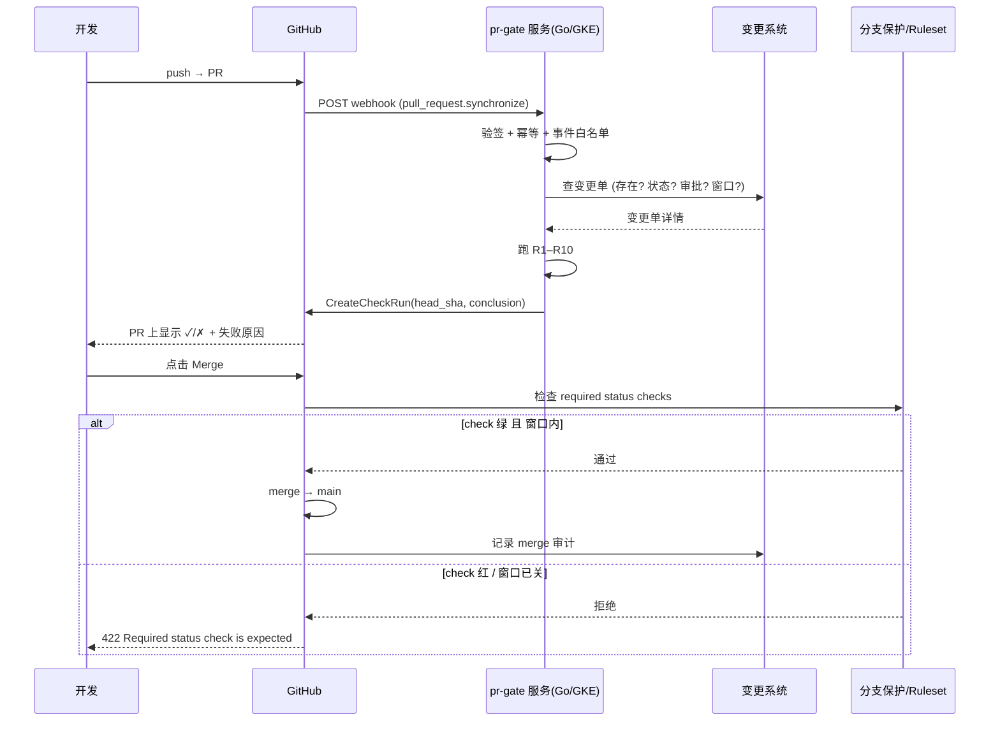

# Develop-git-apps · 自研 GitHub App：可行性评估、运行原理与实现路径

> **场景**：GKE 上跑着 Argo CD 管理的应用（"盛传/生产环境"）。
> 任何合入生产分支的 PR，**必须有一个对应的 Change Request（变更单）**；
> 变更单有**生效时间窗口**，窗口外不允许 merge。
> 此外还可能有语法校验、取值校验等独立规则。
> 团队里已有同事用 **Go** 开发了类似的东西，本文要回答：
> **"GitHub App 到底是个什么东西？装了就有用吗？需要写多少代码？"**

> **一句话结论**
> **GitHub App = "注册在 GitHub 上的一份权限档案" + "你自己服务器上的一个后端服务"。**
> 前者 15 分钟配完（大部分场景零代码），后者才是你同事用 Go 写的那部分。
> **"安装到 Org" 只等于"授予权限"，不等于"逻辑生效"** —— 逻辑生效 = 你的服务在线 + 分支保护要求了这个 check。

> **本文已回填需求方给出的《6.1 合并门禁流程》规格** → 见
> **[§1.4 需求原文与八步映射](./Develop-git-apps.md#14-需求原文61-合并门禁流程回填规格)**；
> 规格与实现之间差异的三点补充见 [§1.4.3](#143-步骤--的-in_progress-模式它解决什么不解决什么)、
> [§8 坑 19–24](#8-工程必知坑清单) 与 [§1.5](#15-步骤--的展开合并后的二次校验)。

---

## 目录

| 章节 | 内容 |
|---|---|
| [§0](#0-tldr) | TL;DR：8 条结论 |
| [§1](#1-先把需求翻译成机器规则) | 需求 → 可编码规则；**§1.4 需求原文「6.1 合并门禁流程」回填与八步映射** |
| [§2](#2-三个必须先拆掉的误解) | "App 装了就有代码" 等误解 |
| [§3](#3-github-app-解剖学) | App 的四块结构 + 三种形态 |
| [§4](#4-你同事那个-go-项目在干什么) | Go 技术栈拆解 + 目录结构 |
| [§5](#5-端到端运行时序) | 从 PR 到"合不了"的完整链路 |
| [§6](#6-评估要不要自研) | 三个候选方案对比 + 结论 |
| [§7](#7-时间窗口这个需求特别难的地方) | 窗口的 3 种建模 + 缓存问题及解法 |
| [§8](#8-工程必知坑清单) | 15 条踩坑点（带解法） |
| [§9](#9-部署形态与凭据管理) | GKE / Cloud Run 对比 + Secret 管理 |
| [§10](#10-go-代码骨架) | 可直接抄的最小实现（含关键片段） |
| [§11](#11-实施路线图) | M0–M7 里程碑 |
| [§12](#12-对现有文档的修正) | 对 doc 11 §13 的事实修正 |
| [§13](#13-需要你确认的问题清单) | 12 个待定项 |
| [§14](#14-参考) | 文档与官方链接 |

---

## 0. TL;DR

1. **要开发，而且值得开发。** 你的需求（CR 存在性 + 时间窗口 + 语法/取值校验）是典型的
   **"GitHub 原生没有的私有规则"**，正是 GitHub App 后端的标准用例。
   纯配置型 App（Argo CD 用的那种）做不到这些事。

2. **"GitHub App"这个词覆盖两件东西：**
   - **注册配置**（GitHub 侧）：权限声明、事件订阅、Webhook URL、回调 URL、私钥。
     在 `Settings → Developer settings → GitHub Apps` 里点几下就完事，**不需要写代码**。
   - **后端服务**（你的服务器）：收 Webhook、查变更单、跑规则、写 Check Run。
     **这才是你同事用 Go 写的部分。**

3. **"装到 Org" 只完成了一半。** Installation = 把 App 的权限（contents:read / checks:write…）
   授给某个组织的某些仓库。**权限拿到了不代表规则生效**，
   还要：① 后端服务在线且能出网访问 `api.github.com`；② 后端 Webhook URL 已被 GitHub 验证通过；
   ③ 分支保护/规则集里把该 check 设为 required。

4. **"App 阻止不了 merge"** —— 真正拦住 merge 的是 **branch protection / ruleset 的
   required status checks**。App 只是那个 check 的生产者。
   搞错这一点，会得到一个"看起来有门禁、其实随便合"的假安全感。

5. **但 Actions 也是合法生产者**（doc 11 §13 里"Actions 无法阻止 merge"的说法**不准确**，见 §12）。
   GitHub Actions 的 job 同样会产生 status check，同样可以设为 required。
   所以真正要选的**不是"App vs Actions"**，而是"规则代码放在哪、谁能改它"。

6. **时间窗口是这套需求里最难的部分**，难点不是"判断当前时间在不在窗口内"，
   而是 **"check 通过后缓存，窗口关掉了还是能合"**（§7）。这决定了你是否需要
   定时重评 / Merge Queue / 变更单过期模型。
   ★ 需求给出的 **in_progress 前置标记**（§1.4.3）是必要但不充分的：它解决了"旧结论冒充新结论"，
   但**没有**解决窗口关闭后仍能合并 —— 仍需一个"重新评估"的触发源。

7. **权限面要小。** 只要 `Metadata: Read` + `Pull requests: Read` + `Checks: Write`。
   **不要给 `Contents: Write`**（能改代码 = 能绕过门禁）。
   给 `Checks: Write` 是必须的，否则写不了 check。

8. **强烈建议：先"只报不拦"（M2）再上强制（M3）。**
   App 一挂就卡住所有人合并，这是最常见的翻车方式。

---

## 1. 先把需求翻译成机器规则

需求原话：

> "对生产环境的每一个 pull request 都必须有一个对应的 Change Request，
> 它有一个时间窗口，我们会对应的时间来做这个 Change Request。
> 如果不在窗口期、时间不对就不能 Merge。"

### 1.1 拆成三个独立的判定

| 编号 | 判定 | 输入 | 输出 |
|---|---|---|---|
| **D1 · 存在性** | 这个 PR 有没有关联的变更单？**有且仅有一个**？变更单存在吗？ | PR label/body/trailer/指定位置 + 中央 API | ✅/❌ |
| **D2 · 状态性** | 变更单是否已批准、审批是否充分、目标环境是否匹配、**其配置项/artifact 是否与本次变更一致**？ | 中央 API + PR diff | ✅/❌ |
| **D3 · 时间性** | **现在**（合并时刻）是否在变更单的允许时间窗口内？ | 中央 API + 当前时间 + 时区 | ✅/❌ |
| **D4 · 系统性** | **判定本身是否成功完成？**（中央 API 不可用 ≠ PR 不合规） | 中央 API 的返回 | ✅/❌（但**原因不同**） |

D1/D2 是"静态"的（合并前判定一次基本够）；**D3 是"动态"的**（同一份代码在不同时刻结论可能相反），
这是后面所有复杂度的来源（§7）。**D4 是必须单独拎出来的第四态** ——
"系统异常不得写成功"这条需求（§1.4.2 步骤⑥）就落在 D4 上。

### 1.2 完整规则表（本文的 Rule ID 沿用 doc 11 的编号，便于对齐）

| ID | 规则 | 数据来源 | 不通过的后果 |
|---|---|---|---|
| **R0** | **触发时机**：只处理 `pull_request` 的 `opened / synchronize / reopened / labeled / unlabeled / ready_for_review`（+ 可选 `pull_request_review`） | GitHub 事件 | 漏订阅 = 漏判 = 门禁缺口 |
| **R0b** | **作用范围**：只对 base 命中**受管生产分支**的 PR 生效；其余分支直接忽略 | 分支映射表 | 非生产分支不应被要求变更单 |
| R1 | PR 必须携带变更单号（label `cr/1234` / body `Change-Request: 1234` / **需求指定的"指定位置"**） | PR 元数据 | check 红，禁 merge |
| **R1a** | **唯一 CR**：PR 中必须且只能解析出**一个** CR 编号（解析出 0 个或多个 → 失败） | PR 元数据 | check 红 |
| R2 | 变更单号在**中央 API** 中真实存在 | 中央 API | check 红 |
| R3 | 变更单状态 = Approved（排除 Draft / Rejected / Expired / Cancelled） | 中央 API | check 红 |
| R4 | 审批充分：审批人 ≥ N（默认 2），审批人 ≠ 提单人，审批人 ∈ 授权组 | 中央 API | check 红 |
| R5 | 目标一致：变更单 targetEnv = PR base 分支映射的环境；targetRefs 覆盖改动范围 | 中央 API + 分支映射表 | check 红 |
| **R5b** | **变更内容一致**：变更单的**配置项 / artifact** 与本次 PR 的实际改动一致（防"张冠李戴"：CR 说改 A，PR 改的是 B） | 中央 API + PR diff | check 红 |
| **R6** | **时效（窗口）**：当前时刻 ∈ 变更单允许窗口；且变更单未过期 | 中央 API + 当前时间 | check 红 |
| **R6b** | **窗口期语义**：见 §7.1，必须先定死是"合并时刻在窗口内"还是"变更单签发时刻在窗口内" | 需求方 | — |
| R7 | 唯一性：同一变更单不能被两个 PR 同时占用（防重复上线） | 中央 API | check 红 |
| R8 | 紧急通道：`emergency/xxx` label + 事后审计（break-glass） | PR label + 中央 API | 放行但强制留痕 |
| R9 | 放行：以上全过 → check 绿（success） | — | — |
| R10 | 反馈可读：check 详情逐条写明**哪条规则**不通过、缺什么；**并明确区分"规则不合规"与"系统异常"** | — | — |
| R11 | 审计留痕：谁/何时/哪个 PR/哪个变更单/命中哪些规则/结论 | 中央 API | — |
| R12 | 部署侧可追溯：合并后由**发布执行器**对**实际发布版本**再校验 CR，部署记录关联 CR 号 | 中央 API + 发布执行器 | — |
| **R13** | **系统异常不得写成功**：中央 API 超时 / 5xx / 解析失败 → 结论必须是**阻断性**的（failure 或 action_required）。**既不得写 success，也不得写 neutral / skipped**（见 §8 坑 19） | — | 阻断合并 + 告警 + 人工介入 |
| **R13a** | **评估前置标记**：每次判定开始时，先在**当前 head SHA** 上把 `cr/prod-validation` 置为 **in_progress**，再写终态 | — | 评估期间正确阻断（in_progress 不算通过） |

### 1.3 "语法校验 / 取值校验" 放哪？

你提到 App 里可能还有语法校验、取值校验 —— 这两类逻辑**性质不同**，建议分开：

| 类型 | 例子 | 建议归属 | 理由 |
|---|---|---|---|
| **内容级校验**（与业务数据相关） | 变更单里 `targetEnv=prod` 但 PR 改的是 dev 分支；变更单里引用的 `appName` 在白名单里不存在 | **GitHub App 后端**（与 CR 校验同一次调用完成） | 都需要读变更系统，合并成一次 check 判定 |
| **制品/配置级校验**（纯技术） | Kustomize/Helm 渲染是否通过；YAML schema 合法性；镜像 tag 是否为不可变 digest；资源 request/limit 是否合规 | **CI（GitHub Actions）或 Argo CD 侧** | 不需要读变更系统；放在 CI 更自然，且已有成熟工具链（kubeconform、helm lint、kustomize build） |
| **策略级校验**（与集群状态相关） | 生产资源是否缺少 `change-request` 注解；是否改了 ClusterRole | **K8s 准入（Gatekeeper / ValidatingAdmissionPolicy）** | 只有集群 API 知道真相 |

> **判断依据**：校验需要访问什么数据源，就放在离数据源最近的地方。
> 读变更系统 → App；读仓库内容 → CI；读集群 → 准入控制器。

---

### 1.4 需求原文：6.1 合并门禁流程（回填规格）

> 以下为需求方给出的规格原文。本节据此把"文字流程"映射为"可实现的规则 + 代码行为"。

```
6.1 合并门禁流程

  ① 开发者提交 PR 到受管生产 basebranch，在指定位置填写 CR。
  ② GitHub App # Webhook 收到 PR 事件。
  ③ 后端验签，读取 GitHub 当前 PR 快照，读取 repository/base/head SHA 等做策略匹配。
  ④ 在当前 SHA 上创建/更新 cr/prod-validation 为进行中，避免旧成功结果继续代表新评估。
  ⑤ 解析唯一 CR，调用中央 API；必要时额外验证 CR 配置项/artifact 与此次变更一致。
  ⑥ 明确允许则写 Success；缺失/不合规则写 failure；系统异常不得写成功。
  ⑦ GitHub 分支保护检查 RequiredCheck、来源 App 与其他评审要求；不满足则阻止合并。
  ⑧ 合并后由现有发布执行器对实际发布版本再校验 CR，然后部署并关联记录。
```

#### 1.4.1 术语对照

| 规格用词 | 本文解释 | 对应章节 | 待确认 |
|---|---|---|---|
| **受管生产 basebranch** | 本门禁管控的生产目标分支集合（如 `main`、`release/prod`）；只有 base 命中该集合的 PR 才进入判定 | §1.4.2 步骤① | Q4 |
| **指定位置** | PR 中填写 CR 的**固定位置**（PR 模板字段 / body marker / label / commit trailer） | §1.2 R1 | Q2、Q17 |
| **中央 API** | 变更单系统的中心查询接口 = **变更单真相源**（已确认是外部 API，不是 CRD） | §10.4 | Q1 ✅ 已确认 |
| **`cr/prod-validation`** | 本门禁 check 的**固定名称**（含斜杠），必须与分支保护里的 required check 名逐字符一致 | §8 坑 1 | 固定 |
| **来源 App** | 分支保护中把该 required check 的**提供者限定为本 App**（防止同名 check 被伪造） | §1.4.2 步骤⑦ | — |
| **发布执行器** | 合并后执行部署的现有组件。按 [`10-argo-workflows-evaluation.md`](./10-argo-workflows-evaluation.md) 的既定结论 = **Argo CD（+ 既有治理组件）**，不引入 Argo Workflows | §1.5 | Q18 |
| **实际发布版本** | 最终被部署的 commit（**可能 ≠ PR head SHA**：squash merge 会产生新 SHA；release 分支推进又是另一个 SHA） | §1.5.1 | Q19 |

#### 1.4.2 八步 → 实现映射

| 步骤 | 实现要点 | 规则 ID | 异常/失败处理 |
|---|---|---|---|
| **①** | 监听 PR 事件；**只对 base 命中"受管生产分支"的 PR 进入判定**；非目标分支直接 200 忽略（不产生 check，避免污染非生产仓库与 check 列表） | R0、R0b | — |
| **②** | HMAC-SHA256 验签 `X-Hub-Signature-256`；事件类型白名单；`X-GitHub-Delivery` 幂等去重 | — | 验签失败 → 401 丢弃；不判定、不写 check |
| **③** | 拉取**当前 PR 快照**（repository / base ref / head SHA / labels / body / changed files）；用 base 分支做"是否生产"策略匹配 | R0、R5 | 拉取失败 → 走系统异常路径（步骤⑥） |
| **④** | 在 **head SHA** 上**创建或更新** check `cr/prod-validation`，`status=in_progress` | R13a | ★ in_progress **不算通过** → 评估期间合并被正确阻断 |
| **⑤** | 解析**唯一** CR（0 个 / 多个 → 失败）；调**中央 API** 取变更单；校验存在性、状态、审批、目标环境、时效、**配置项/artifact 与本次变更一致** | R1、R1a、R2–R6、R5b、R7 | 中央 API 不可用/超时 → 走系统异常路径（步骤⑥） |
| **⑥** | **三态结论**：<br>· 明确允许 → `success`<br>· 缺失 / 不合规 → `failure`（output 逐条列出失败的规则）<br>· **系统异常 → 不得写成功**，写 `failure` 或 `action_required`（**不能写 neutral / skipped**） | R9、R10、R13 | 系统异常同时触发告警；不写"success 骗过门禁" |
| **⑦** | 分支保护三件套：<br>· **required status check = `cr/prod-validation`**（名字逐字符一致）<br>· **来源 App = 本 App**（限定提供者）<br>· **其他评审要求**（review 数、禁止直推等） | — | ★ 任一不满足 → GitHub 阻止合并 |
| **⑧** | 合并后，**发布执行器对实际发布版本再校验 CR** → 再部署 → **部署记录关联 CR 号** | R11、R12 | 见 §1.5 |

#### 1.4.3 步骤 ④ 的 in_progress 模式：它解决什么、不解决什么

这是规格里最有工程价值的一步，也是**唯一必须额外补强的一步**。

| 它确实解决了 ✅ | 它**没有**解决 ❌ |
|---|---|
| 同一个 SHA 重新评估时，**旧的 success 不会冒充新结论**（新结论直接覆盖同名 check） | **窗口关闭后，旧 success 仍然能合并**（§7.2 的缓存问题依旧存在） |
| 评估进行中合并被正确阻断（`in_progress` 不属于 successful/skipped/neutral） | 不解决"变更单被撤销 / 作废，但 PR 已合并"（§8 坑 17） |
| 状态可见：PR 上显示"评估中"，开发者知道不是没人管 | 不解决"中央 API 长时间不可用 → 全员卡住"的熔断问题（§8 坑 15） |

> **结论：in_progress 是必要但不充分的。**
> 它把"评估中"这个中间态表达出来了，但要真正做到"窗口外一律合不了"，
> **还必须有一个"重新评估"的触发源** —— 见 §7.3 的解法 1（定时重评）或解法 2（Merge Queue）。
> 换句话说：**重评触发器 = 步骤④ 的驱动力**；in_progress 只是重评时的第一步动作。

---

### 1.5 步骤 ⑧ 的展开：合并后的"二次校验"

规格要求"合并后由现有发布执行器对**实际发布版本**再校验 CR" —— 这一步不是冗余，它补上了合并门禁的盲区。

#### 1.5.1 为什么必须再校验一次

```
合并门禁校验的是：PR head SHA（= 代码状态）
实际发布的是  ：release SHA（≠ head SHA 时有 gap）
```

| 场景 | PR head SHA | 实际发布 SHA | 是否有 gap |
|---|---|---|---|
| 直接 merge（fast-forward / merge commit） | A | A'（merge commit） | ⚠️ merge commit 引入 base 分支的新内容 |
| **squash merge**（GitHub 默认） | A | B（全新 SHA） | ⚠️ 差异更大 |
| release 分支推进 / cherry-pick | A | C（另一个仓库或分支） | ⚠️ 跨仓库，CR 引用关系可能断 |
| 手动 kubectl apply（绕过 GitOps） | — | 任意 | ❌ 完全绕过 |

#### 1.5.2 实现位置（三种，按成本排序）

| 方式 | 做法 | 优点 | 缺点 |
|---|---|---|---|
| **A. Argo CD PreSync Hook**（推荐起点） | 生产 Application 挂 `syncHooks.preSync` Job，查中央 API 校验"该 commit 的 trailer 里的 CR 号"是否有效 | 机制通用；能拿到渲染结果；失败即 sync 失败、**集群零变更** | 每次 sync 多一个 Pod 启动延迟；Hook 失败会持续重试 |
| **B. Argo CD Extension** | `argocd-cm` 配 `extensions:`，同步前调用门禁服务的 `/gate` | 无额外 Pod；延迟低 | 需确认当前 Argo CD 版本的 Extensions 可用性与 payload 字段（**部署前验证项**） |
| **C. K8s 准入兜底** | 生产资源必须带 `change-request` 注解，Gatekeeper / ValidatingAdmissionPolicy 校验 | 拦所有写入者（含绕过 Argo CD 的 kubectl） | 需先规范注解、评估准入链路的性能与可用性影响 |

> **与既有结论对齐**：doc 11 §14.1 推荐的"Extension（方式 A）"与"PreSync Hook（方式 B）"在 doc 11 中的
> A/B 编号与本表相反，**以本表为准**（PreSync = A、Extension = B）。
> 选型建议：**先用 A（PreSync Hook）**，成熟后再评估 B（Extension）。

#### 1.5.3 "部署并关联记录"的落地

| 关联对象 | 做法 |
|---|---|
| **commit → CR 号** | commit trailer `Change-Request: 1234`（门禁读它、发布执行器读它、`git log` 能追溯）—— **建议 label + trailer 双写** |
| **部署记录 → CR 号** | 部署的 K8s 资源带注解 `changes.example.com/change-request: "1234"`（供 Gatekeeper 校验 + 事后审计） |
| **应用版本 → CR 号** | 镜像 tag / release 命名带 CR 号（如 `app:1.4.2-cr1234`），使线上实例可反查变更单 |
| **审计记录 → CR 号** | 中央 API 里记录"CR-1234 已被 PR #456 合入、发布 commit abc123、部署到 prod/us-east1" |

---

## 2. 三个必须先拆掉的误解

### 误解 1："我开发出这个 App，装到 Org 下就完事了"

```
❌ 你的理解：App = 一个可安装的软件包，装上就有完整功能
✅ 实际情况：App = 权限档案 + 事件订阅 + 你的后端服务
             "安装" 只发生第 1 步；第 3 步的代码必须你自己部署
```

**安装完成后系统里多了什么？**

```
① GitHub 侧多了一条记录：这个 Organization 授权了 App-X
   → 你的服务可以用 installation token 读写这些仓库
② GitHub 侧多了一条路由：发生 pull_request 事件时 POST 到 https://your-service/webhook
③ GitHub 侧多了一把钥匙：你的服务能用私钥换 installation token
❌ 没有任何东西被"安装"到你们的集群
```

**如果你不部署后端服务**：GitHub 会一直往你的 Webhook URL 发 POST，收不到就是一堆 502 投递失败记录，
规则一条都不会跑。**App 处于"存在但无效"状态。**

### 误解 2："GitHub App 是不是就是个配置，没有代码的概念？"

**分三种形态，你的同事做的是第二种：**

| 形态 | 需要写代码？ | 需要公网 HTTPS 地址？ | 长什么样 | 例子 |
|---|---|---|---|---|
| **A. 纯配置型**<br>（manifest / Settings 手填） | ❌ 不需要 | ❌ 不需要（不订阅事件就不用 webhook） | 只有权限声明 + 私钥 | **Argo CD 的 repository credential**（见 [`07-repository-githubapp.md`](./07-repository-githubapp.md)）：它只用 App 换 installation token 去 clone 仓库，**完全不处理 webhook** |
| **B. Webhook 后端型** ★ | ✅ 需要 | ✅ 需要 | 你的 Go 服务 + 一份 App 注册配置 | **你要做的这个**（收 PR 事件 → 写 check） |
| **C. OAuth 用户授权型** | ✅ 需要 | ✅ 需要 | 后端 + OAuth 回调 | 需要"代表某个用户操作 GitHub"的场景（如个人账号导入） |

> **你之前的困惑多半来自 doc 11 的 Part A（讲的是形态 A）和 Part B（讲的是形态 B）混在一篇里。**
> 同一篇里"App 不需要代码"和"App 门禁需要代码"看着矛盾，其实说的是两种形态。
>
> ★ **想彻底搞清楚"Webhook 到底是什么""我的代码怎么才能跑起来""Webhook URL 和我部署的服务什么关系"**
> → 看专题文档 **[`webhook-and-backend-service.md`](./webhook-and-backend-service.md)**（含从 Git 到生效的完整 8 步、配置清单、故障速查）。

### 误解 3："GitHub App 和 GitHub Actions / webhook 机器人有什么区别？"

| 维度 | GitHub App（形态 B） | GitHub Actions | 组织级 Webhook + 你的服务 |
|---|---|---|---|
| 身份 | **installation token**（App 身份，无人） | workflow 内的 `GITHUB_TOKEN`（仓库身份） | 需要 PAT 或 App token |
| 权限粒度 | **按权限项声明**（只读 PR + 写 check） | workflow 权限（`permissions:` 块） | 取决于你用什么 token |
| 事件触发 | App 订阅的事件 | workflow 的 `on:` | 组织级事件订阅 |
| 谁写的代码 | 你的仓库（服务代码） | **同一个仓库的 `.github/workflows/*.yml`** | 你的仓库 |
| 能否写 Check Run | ✅ | ✅（job 天然产生 check） | ✅ |
| 能否作为 required check | ✅ | ✅ | ✅ |
| 谁能绕过它 | 改 App 配置的人 / 改分支保护的人 | **改 workflow 文件的人**（同一 PR 就能改） | 同左 |
| 运行成本 | 你的集群/Cloud Run | Actions 分钟数（私有仓库 2000 分钟/月 免费额度） | 同 App |

> **关键差异**：Actions 的 workflow 文件和被保护的代码在**同一个仓库**。
> 有人提一个 PR 把 workflow 里的校验步骤删掉 → 门禁失效 → 合并 → 上生产。
> **GitHub App 的服务代码在独立仓库/独立部署，且部署物受 CODEOWNERS + 生产分支保护** → 绕过难度高一档。
>
> 这就是"我们要有自己的 App"的**真实价值**，不是"GitHub App 更高级"，而是**隔离**。

---

## 3. GitHub App 解剖学

### 3.1 四块结构

```
┌──────────────────────────────────────────────────────────────────┐
│ ① App 注册配置（GitHub 侧，"档案"）                              │
│    App ID (数字) · Client ID / secret · Homepage URL            │
│    Permissions: Metadata(R) Pull requests(R) Checks(W)          │
│    Subscribe to events: Pull request · Check run · Merge group  │
│    Webhook URL + Webhook secret                                 │
│    ★ 可用 manifest (app.yml) 提交，可自动安装（见 3.4）          │
├──────────────────────────────────────────────────────────────────┤
│ ② Private Key（RSA，GitHub 生成并下载给你）                       │
│    → 用它签 JWT → 换 installation token（1 小时过期）            │
│    ★ 泄露 = 整个 App 的权限泄露，务必进 Secret Manager            │
├──────────────────────────────────────────────────────────────────┤
│ ③ Installation（安装实例，授权边界）                             │
│    装到哪个 Org / 账号；All repos 还是 Selected repos           │
│    每个 Org 下有独立 installation_id                              │
│    ★ 这才是"你装到 Org 下"这一步的产物                          │
├──────────────────────────────────────────────────────────────────┤
│ ④ 后端服务（★ 形态 B 才有 = 你同事写的那部分）                   │
│    收 webhook → 查变更系统 → 跑规则 → 写 Check Run → 记审计     │
│    部署在：GKE / Cloud Run / 任何能出网 + 有公网 HTTPS 的地方     │
└──────────────────────────────────────────────────────────────────┘
```

### 3.2 Argo CD 用的形态 A vs 你要用的形态 B（并排对比）

| 方面 | Argo CD 的 App（形态 A） | 你的 PR 门禁 App（形态 B） |
|---|---|---|
| 订阅事件 | `push` | `pull_request`, `check_run`, `merge_group`（可选） |
| Webhook URL | `https://argocd/api/webhook/github` | `https://pr-gate.example.com/github/webhook` |
| 收到事件后干什么 | 标记 Application 需刷新（不读内容） | **读 PR 元数据 → 查变更系统 → 判定 → 写 check** |
| 用什么 token | installation token（只读 clone） | installation token（读 PR + 写 check） |
| 有没有 check | ❌ | ✅ **这就是它的产出物** |
| 需要分支保护配合吗 | ❌（Argo CD 自己拉仓库） | ✅ **必须**，否则 check 只是一条装饰 |

> ⚠️ **一个 App 只有一个 Webhook URL。**
> 所以 Argo CD 的 App 和你的门禁 App **天然应该是两个 App**（权限面也不同：
> 一个要读仓库内容，一个不能写仓库内容）。这同时解决了 doc 11 §17.3 的"一个 App 两个端点"问题。

### 3.3 Installation 的三个决定性字段

装到 Org 时，Org 管理员要做三个选择，**这三个选择就是你的系统的实际边界**：

| 选择 | 选项 | 影响 |
|---|---|---|
| 装到哪个账号 | 某个 Organization / 个人账号 | 决定 `installation_id` |
| 哪些仓库 | **All repositories** / **Selected repositories** | 决定服务能看到什么；建议 **Selected**（最小权限） |
| 授权哪些权限 | 勾选 App 声明的权限子集 | 决定 installation token 能做什么；建议只给必要的 |

**读法**：`installation_id` + `private_key` → 换 token → token 的权限 = 声明 ∩ 安装时勾选 ∩ 仓库范围。
所以"审 App"要审三处：App 声明的权限、Installation 勾的权限、Installation 选的仓库范围。

### 3.4 Manifest 方式创建 App（可选，但很适合 GitOps）

除了在 UI 点，还可以写一个 `app.yml` 提交给 GitHub 自动注册/更新 App：

```yaml
name: prod-change-gate
description: 生产变更单门禁
# callback_url / setup_url 只在走 OAuth 时需要；形态 B 不需要
default_events:
  - pull_request
  - check_run
default_permissions:
  metadata: read
  pull_requests: read
  checks: write
webhook:
  url: https://pr-gate.example.com/github/webhook
  active: true
```

- 用途：**App 的配置本身也进 Git**，改配置走 PR + CODEOWNERS 审批（可审计、可回滚）。
- 注意：manifest 走 OAuth 授权流程创建 App，需要你用一个有权限的账号跑一次 `gh api` / 浏览器完成授权。
- 私有 App（默认）只能被你指定的 Org 安装；Public App 任何 Org 可安装。

---

## 4. 你同事那个 Go 项目在干什么

假设他们做的是标准形态 B，Go 技术栈几乎必然是下面这套：

### 4.1 技术栈（Go 生态的标准答案）

| 库 | 作用 |
|---|---|
| `github.com/google/go-github/vXX` | GitHub REST API 客户端（含 `ChecksService`） |
| `github.com/bradleyfalzon/ghinstallation/v2` | ★ 核心：**用私钥签 JWT → 换 installation token → 自动续期**；还提供 webhook 验签 `ValidatePayload` |
| `net/http` 或 `chi` / `gin` | Webhook 接收端点 |
| `sigs.k8s.io/controller-runtime` 或 `client-go` | 如果变更单是 CRD，直接读集群 |
| `google.golang.org/api` / `cloud.google.com/go/secretmanager` | 取 Secret Manager 里的私钥与 webhook secret |

**为什么是 ghinstallation 而不是手写 JWT**：
installation token 1 小时过期，ghinstallation 会缓存并在过期前自动换取新 token，
你只管用 `client.Checks.CreateCheckRun(...)`，不用关心 token 生命周期。

### 4.2 典型目录结构（推测）

```
pr-gate/
├── cmd/server/main.go            # 启动 HTTP server，装路由，装 signal handler
├── internal/
│   ├── github/
│   │   ├── client.go             # 按 installation_id 造 client（ghinstallation transport）
│   │   ├── checks.go             # CreateCheckRun / UpdateCheckRun 封装
│   │   └── token.go              # 私钥来源：Secret Manager / 文件 / KMS
│   ├── webhook/
│   │   ├── verify.go             # X-Hub-Signature-256 HMAC-SHA256 验签
│   │   ├── router.go             # 按 X-GitHub-Event 分发
│   │   └── idempotency.go        # X-GitHub-Delivery 去重
│   ├── cr/
│   │   ├── client.go             # 读变更系统（HTTP API 或 CRD）
│   │   ├── rules.go              # R1–R10 判定函数
│   │   └── types.go              # 变更单数据结构
│   ├── policy/
│   │   ├── branches.yaml         # 分支 → 环境映射表
│   │   └── windows.yaml          # 变更窗口表（时段/时区）
│   └── audit/
│       └── sink.go               # 审计写变更系统 / 日志
├── deploy/                       # Deployment / Service / Ingress / ServiceAccount / RBAC
└── config/                       # 规则数据（不放代码里）
```

### 4.3 运行时序（一次 PR 事件）

```
① 开发 push 到 PR 分支
      │  → GitHub 触发 pull_request: synchronize
      ▼
② GitHub POST https://pr-gate/github/webhook
      Headers: X-GitHub-Event: pull_request
               X-GitHub-Delivery: <uuid>       ← 幂等键
               X-Hub-Signature-256: sha256=...  ← 验签
      ▼
③ 你的服务
   3.1 验签（不通过 → 401 丢弃）
   3.2 事件类型白名单（不是 pull_request / pull_request_review → 200 忽略）
   3.3 幂等去重（Delivery ID 见过 → 200 直接返回）
   3.4 取 PR 元数据：head SHA / labels / body / base 分支 / 改动文件
   3.5 解析变更单号（label → body → trailer）
   3.6 调变更系统：存在？状态？审批？窗口？
   3.7 跑 R1–R10，收集失败原因列表
   3.8 写 Check Run（conclusion = success/failure + output 逐条说明）
   3.9 写审计
      ▼
④ GitHub 展示 check → 分支保护规则命中 required status check
      └─ 不绿 → 合并按钮禁用 / API merge 返回 422
```

### 4.4 "App 装上了但什么都没发生"的排查顺序

```
① 后端服务在跑吗？健康检查 / 日志有请求进来吗？
   → 没有请求：Webhook URL 填错 / Ingress 没暴露 / 证书不对 / 服务没监听 443
② 收到请求但 401/403？
   → webhook secret 不一致（GitHub 侧 vs 服务侧）
③ 收到请求但 200 且什么都没做？
   → 事件类型被白名单过滤；或 Delivery ID 被误判为重复
④ check 没出现在 PR 上？
   → 没有 Checks: Write 权限；或 head_sha 传错；或 token 无效（installation 被删/私钥不匹配）
⑤ check 出现了但 merge 不拦？
   → 分支保护里没勾这个 check / 名字不逐字符一致
```

---

## 5. 端到端运行时序



**三条关键分界线（务必分清）：**

| 环节 | 由谁提供 | 能不能被 App 自己绕过 |
|---|---|---|
| **产生 check** | 你的后端服务 | ❌ 不能（只能改代码/停服务） |
| **要求 check 必须绿** | **branch protection / ruleset** | ❌ 不能（只有 repo admin 能改） |
| **真正阻止 merge** | GitHub 平台执行上述规则 | ❌ 不能 |

> 所以：**"App 挂了" ≠ "门禁失效"，而是"门禁失效（check 永远不绿 → 所有人合不了）"**。
> 这是 **fail-closed**，安全但阻塞生产。
> 应急方案：`required status checks` 允许配 **管理员 bypass**，或临时把 check 设为非 required。
> **必须提前约定这个"熔断开关"由谁执行**，否则出事时大家都在等审批。

---

## 6. 评估：要不要自研？三个候选方案

### 6.1 方案对比

| 维度 | **方案 1：自研 GitHub App 后端**（Go） | **方案 2：GitHub Actions** | **方案 3：只做配置（Ruleset / 保护分支）** |
|---|---|---|---|
| 能表达"CR 必须存在且已批准" | ✅ | ✅ | ❌（GitHub 原生只会看 PR 评审，不会查你的变更系统） |
| 能表达"合并时刻在窗口内" | ✅（但见 §7 缓存问题） | ✅（job 里读当前时间） | ❌ |
| 能查外部变更系统 | ✅ | ✅（可用 API / 装 runner） | ❌ |
| 强制力（required check） | ✅ | ✅ | 部分（只能要求评审数） |
| **谁能绕过门禁** | 改 App 后端代码的人（独立仓库 + CODEOWNERS + 双人复核） | **改 `.github/workflows` 的人（同一个 PR 就能改）** ⚠️ | 改规则的管理员 |
| 权限面 | 极小（PR read + checks write） | workflow token 权限 + 可能需要 secrets | 无 |
| 需要公网入口 | ✅ 需要（HTTPS + 证书） | ❌ 不需要（GitHub 托管 runner） | ❌ |
| 运行成本 | 集群资源（近乎为零） | 私有仓库按分钟计费（2000 分钟/月免费额度） | 0 |
| 跨仓库复用 | ✅ 一个 App 装多个仓库 | ✅ | — |
| 出网要求 | 需访问 api.github.com（Cloud NAT / 节点出网） | ❌ | — |
| 与 Argo CD 的关系 | 独立服务（可由 Argo CD 部署自己） | 与 Argo CD 无关 | 与 Argo CD 无关 |
| **代码量（最小可用）** | **~600–1000 行 Go** | ~100 行 YAML + 少量脚本 | 0 |
| **长期可演进性** | ✅ 好（规则引擎、审计、多策略） | ⚠️ 差（YAML 表达复杂逻辑很痛苦） | ❌ |

### 6.2 结论

```
☐ 方案 3 直接排除：GitHub 原生能力表达不了"变更单必须存在且已批准 + 时间窗口"。

☐ 方案 2（Actions）不是"错"，而是"适合做 80% 的事，但有绕过面"：
   · 快速验证需求（几天上线）
   · 语法/取值/渲染类校验（不需要变更系统）→ 天然该放 Actions
   · 但作为"生产变更的唯一门禁"，workflow 文件与被保护代码同仓库是硬伤
   · 缓解：workflow 放独立仓库 + 复用 workflow（reusable workflow）或用 workflow_call 从主仓调用
     ⚠️ 注意：同仓主仓调 reusable workflow 仍可被 PR 改动 → 真正隔离要"从另一个仓库的 workflow 调"，
        而 GitHub 只允许跨仓调用 workflow（workflow_call），不能跨仓触发 on: 事件

☐ 方案 1（自研 App）是"适合长期承载生产变更门禁"的形态：
   · 规则代码在独立部署物里，绕过面小
   · 权限面小、可审计、可扩展（多环境、多策略、SLA、审批编排都能加）
   · 成本：一个 Go 服务 + 一个 Ingress ≈ 一次 POC 的量

★ 推荐路径：M0–M2 用 Actions 或"薄 App"把链路跑通 → 规则稳定后，
  把"变更单门禁"这块迁到自研 App，语法/取值校验留在 Actions/CI。
  ★ 不要一开始就自己造一个 GitHub App 框架 —— 要写的是业务规则，不是 webhook 框架。
```

### 6.3 需要自研的"独立逻辑"到底有多少？

用一句话回答你的原始问题：

> **"我们自己的 GitHub App 里有独立的逻辑"** —— 是的，
> 独立逻辑 = R1–R10 的判定 + 变更系统查询 + check 回写 + 审计。
> 这部分**必须**有代码，但**不需要自己写 GitHub 协议层**：
> webhook 验签、token 换取、check run API 都是现成库（§4.1）。

**工作量粗估（Go，1 人）：**

| 模块 | 规模 | 说明 |
|---|---|---|
| webhook 接收 + 验签 + 幂等 | 150 行 | 有现成库 |
| installation client + check run 封装 | 150 行 | `ghinstallation` + `go-github` |
| 变更系统客户端（HTTP 或 CRD） | 150–300 行 | 取决于对方 API |
| 规则引擎 R1–R10 | 300–500 行 | 主要业务量 |
| 配置（窗口表、分支映射） | 100 行 | YAML |
| 审计 | 100 行 | |
| 部署清单 + CI | 200 行 | YAML + Docker + GitHub Actions |
| **合计** | **~1200–1700 行** | **不是"造轮子"，是写业务规则** |

---

## 7. 时间窗口这个需求特别难的地方

### 7.1 先定死窗口的语义（需求问题，不是技术问题）

"变更单有一个时间窗口"至少有三种可能的含义，**必须先选一种**：

| 语义 | 定义 | 例子 | 实现难度 | 评价 |
|---|---|---|---|---|
| **S1 · 签发窗口** | 变更单**被创建/发起**的时刻必须在允许的窗口内 | "变更单只能在周二 10:00–12:00 发起" | ⭐ 简单 | 与"merge 时机"解耦；但拦不住"周一发起、周三 merge" |
| **S2 · 合并窗口** | **合并动作**发生的时刻必须在窗口内 | "只有周三 02:00–04:00 可以 merge 到 main" | ⚠️ 中等（§7.2） | 最贴近"不在窗口期不能 Merge"的原话 |
| **S3 · 生效窗口** | 变更单声明的 `validFrom~validTo` 覆盖**合并时刻** | "这张变更单的有效期是 03-01 到 03-05" | ⚠️ 中等 | 和变更单系统天然契合（变更单本身带有效期） |

> **建议**：**S1 + S3 并存**。
> S1 管"什么时候可以发起变更"（发起时校验，写在变更系统里更自然）；
> S3 管"这张变更单什么时候还能用"（App 查变更单时直接拿有效期比对 merge 时刻）。
> S2（固定的生产发布窗口表）如果你们业务上确实有"只在某时段允许上生产"，再加。

### 7.2 S2/S3 的真正技术难点：check 的"缓存"问题

**这是整个需求里最容易被忽略、也最容易翻车的点。**

```
10:00  变更单有效，App 判定 → check = success ✅
10:05  窗口关闭 / 变更单过期
10:30  有人点 Merge
       GitHub 看到 head SHA 上已存在一个 conclusion=success 的 check
       → 认为 required check 已通过 → 放行 merge ❌❌❌
```

**原因**：GitHub 的 required status check 是**按 head SHA 查已存在的 check 结论**，
**它不会在 merge 时刻重新执行你的规则**。GitHub 只知道"这个 SHA 上有个叫 `cr/prod-validation` 的 check 是绿的"，
不知道它是 10:00 算的。

> ★ **需求里的 in_progress 标记（§1.4.3）不能解决这个问题。**
> in_progress 解决的是"**同 SHA 重新评估时**旧结论冒充新结论"，
> 而上面的例子是"**根本没有触发重新评估**"——没人 push、没人改 label、窗口自己关了。
> 要解决它，必须有一个**独立于 PR 事件的触发器**（定时器 / merge_queue / 中央 API 推送窗口变更事件）。
> 这是本文对需求规格补充的**最重要的一条工程建议**。

### 7.3 三种解法

| 解法 | 做法 | 优点 | 缺点 | 推荐 |
|---|---|---|---|---|
| **解法 1 · 定时重评** | 服务内起 cron（每 1–5 分钟）扫描"有未合并生产 PR"的重评列表，重算并 `UpdateCheckRun` 把结论从 success 翻成 failure | 改动最小；官方支持更新已完成 check 的 conclusion（**不能改成 stale，只能 GitHub 设 stale**）；与需求里的 in_progress 模式天然配套（重评时先置 in_progress 再写终态） | 有延迟窗口（≤ 轮询间隔）；GitHub API 写量上升；需维护"哪些 PR 需要重评"的索引 | ✅ **先用这个** |
| **解法 2 · Merge Queue** | 分支保护开 merge queue；服务处理 `merge_group` 事件，在 **merge group 的 head SHA** 上创建 check | **在真正的合并时刻重新判定**，语义最正确 | 需处理 `merge_group` 事件（`go-github` 需较新版本）；GitHub 私有仓库需 Enterprise Cloud | ✅ **成熟期升级到它** |
| **解法 3 · 结构性消除** | 让"窗口"不再是**运行时**条件，而是**事前条件**：变更单在窗口内审批通过后，其"可合并"这一事实被物化（见下） | 无缓存问题；可审计 | 需要模型支持 | ✅✅ **最优解** |
| **解法 4 · 中央 API 推送**（规格的自然延伸） | 变更系统（中央 API）在**窗口开启/关闭、变更单状态变更**时主动回调门禁服务 → 服务立即重评受影响 PR | 无轮询延迟；事件驱动 | 需要中央 API 侧提供回调/Webhook 能力（**跨团队协作点**） | ⭐ **若中央 API 支持，值得优先谈** |

**解法 1 的最小实现形态**（与需求里的 in_progress 模式配套）：

```
每 60s：
  for pr in 索引(受管生产分支上未合并的 PR):
      v := evaluate(pr, now)                                    // now = 当前时间（窗口在这里体现）
      writeCheck(pr.headSHA, "cr/prod-validation", in_progress) // 先置进行中
      writeCheck(pr.headSHA, "cr/prod-validation", v.conclusion)// 再写终态（覆盖同一 SHA 的旧结论）
  ★ 索引来源：首次收到 PR 事件时记下；或定期用 GitHub API 列出
    "base 命中受管生产分支 且 state=open" 的 PR 重建
```

**解法 3 的具体形态（强烈推荐）：**

```
❌ 错模型：check = f(变更单当前状态, 当前时间)   ← 时间在动，结论在腐坏
✅ 对模型：check = f(变更单在"签发/审批时刻"的快照) ← 时间被冻结

具体：
· 变更单带 [validFrom, validTo]
· 审批发生在 validFrom 之前 → 审批动作本身触发一次判定并"盖章"
· 结论 = "该变更单在 [validFrom, validTo] 内可用于 merge"
· merge 时刻是否在窗口内 → 交给 merge queue（解法 2）或定时重评（解法 1）复核
```

**换句话说**：

```
把"运行时条件"尽量转成"状态条件"：
  运行时条件（会腐坏）  →  状态条件（稳定）
  "现在在窗口内吗"          "变更单已被批准且未过期"
  "现在是工作时间吗"        "变更单的有效期覆盖了目标时段"
```

**一条重要的实现建议**：

> **check 的结论里必须带上"判定时刻"和"有效期"，并把有效期写进 check 的 output 文本**。
> 这样人工 review 时能看出"这个绿勾是 10:00 打的，有效到 12:00"，
> 审计时也有据可查。

### 7.4 时区问题（必踩）

变更窗口是"北京时间 22:00–02:00"还是 UTC？跨 0 点时 `validFrom <= now <= validTo` 的判断会写错。
**在配置里显式声明时区**，用 IANA 名（`Asia/Shanghai`），
校验用 `time.LoadLocation` 转换，**不要用 `time.FixedZone` 硬编码偏移**（DST 问题）。

---

## 8. 工程必知坑清单

| # | 坑 | 表现 | 解法 |
|---|---|---|---|
| **1** | required check 名字与 App 创建的 check 名字不一致 | 分支保护"永远在等" | **逐字符一致**（含斜杠）。先建 check 再配保护 |
| **2** | PR 又 push 了一次（`synchronize`） | 旧 check 失效但没重跑 | 每次 `synchronize` 重跑并**覆盖同名 check**（`UpdateCheckRun` 或新建同名） |
| **3** | 只在 PR 创建时建了 check | 新 commit 无结论 | 必须监听 `synchronize` / `ready_for_review` / `labeled` / `unlabeled` |
| **4** | **窗口缓存问题**（§7.2） | 窗口关了还能合 | 定时重评 / merge queue / 状态化建模 |
| **5** | GitHub 重投同一 webhook | 重复判定、重复写 check | `X-GitHub-Delivery` 做幂等键（Redis / DB / 内存 TTL） |
| **6** | 把 `push` 事件当 PR 处理 | 误判 / 400 | 事件白名单；只处理 `pull_request` / `pull_request_review` / `merge_group` |
| **7** | 没做 HMAC 验签 | 任何人都能伪造事件触发判定 | 验 `X-Hub-Signature-256`（`hmac.Equal` 防时序攻击） |
| **8** | installation token 过期 | 运行一段时间后 401 | 用 `ghinstallation`（自动续期），别手写 JWT |
| **9** | 私钥写进 Git / 打进镜像 | 整个 App 权限泄露 | Secret Manager + External Secrets；CI 里扫 secret |
| **10** | 给了 `Contents: Write` | 能改代码 = 能绕门禁 | 只要 `Metadata:R` + `Pull requests:R` + `Checks:W` |
| **11** | fork 来的 PR | check 建不出来 / 上下文不同 | 头 SHA 属 fork 仓库，check run 一般仍可建（公开仓）；App 拿不到 fork 的 secrets —— 本服务不需要 secrets，影响小。**私有仓库需实测** |
| **12** | 一个 App 只能一个 Webhook URL | 和 Argo CD 的 App 抢地址 | **建两个 App**（权限面本来就不同，见 §3.2）；或 Argo CD 用形态 A（不订阅事件） |
| **13** | 没处理 `merge_group` 事件 | 开了 merge queue 后卡住 | 开了 queue 就必须处理 `merge_group`，在 merge group SHA 上出 check |
| **14** | 失败信息不具体 | 开发者不知道为什么红 | output 里逐条写"R3 不通过：变更单 cr-1234 状态为 Draft，需要 Approved" |
| **15** | 服务挂了 → 所有人合不了 | 阻塞全团队 | **fail-closed 是对的，但要约定熔断开关**（admin bypass / 临时降级为非 required），并做 HA（≥2 副本 + PDB） |
| **16** | 递归绕过（改门禁代码的 PR） | 门禁形同虚设 | 服务代码仓库独立 + CODEOWNERS + 双人复核 + 生产分支保护；配置数据（例外名单）再受门禁 C 约束（闭环） |
| **17** | 变更单被撤销但 PR 已合 | 生产已变 | 需要"撤销即回滚"机制（doc 11 §19.3） |
| **18** | GitHub API 限流 | 批量回写 403/429 | 串行 + 指数退避；installation 级配额有限，别在高峰期批量刷 |
| **19** | ★ **写了 `neutral` 或 `skipped`** | **门禁形同虚设** —— GitHub 规定 required status check 为 `successful` / `skipped` / `neutral` **都算通过** | 系统异常只能写 `failure` 或 `action_required`（`skipped`/`neutral` **绝对不能用**）。**官方原文**："Required status checks must have a successful, skipped, or neutral status before collaborators can make changes to a protected branch." |
| **20** | required check **没限定来源 App** | 任何人 / 任意 Actions / PAT 都能创建一个同名 `cr/prod-validation` 并置绿 → 伪造门禁 | 分支保护里把该 check 的来源限定为**本 App**（官方支持："you can select an app that has recently set this check as the expected source"）；若设为 any source，合并框里可手动核验作者但不阻断 |
| **21** | 对**非受管生产分支**的 PR 也跑判定并出 check | 污染 PR 列表、消耗配额，且非生产分支本不需要变更单 | 第一步就按 base 分支过滤，**非目标分支直接 200 忽略** |
| **22** | **PR head SHA ≠ 实际发布 SHA** | 合并门禁校验的是 head，部署的是 squash merge / release 推进后的另一个 commit → 发布侧漏校验 | 合并后由发布执行器**对实际发布版本再校验 CR**（§1.5）；并靠 commit trailer 把 CR 号带到发布版本 |
| **23** | 同 SHA 重新评估时只写终态、不先置 in_progress | 旧 success 在评估期间仍被当作"当前结论" | 先 `in_progress` 再写终态（§1.4.3 步骤④）；in_progress 不算通过，天然阻断 |
| **24** | 解析出**多个** CR 号 | 到底以哪个为准？取错就放行了错误的变更单 | R1a：必须且只能解析出**一个**；多个 → 直接 failure 并在 output 里列出全部候选 |

### 8.1 事件订阅清单

| 事件 | action | 为什么需要 |
|---|---|---|
| `pull_request` | `opened`, `synchronize`, `reopened`, `labeled`, `unlabeled`, `ready_for_review` | 主触发。`labeled` 尤其重要——变更单号常用 label 承载 |
| `pull_request_review` | `submitted` | 若"审批人"用 GitHub PR Review 表达而非外部变更系统 |
| `check_run` | `rerequested` | 人工点"重新运行"时重判（官方提供此 API） |
| `merge_group` | `checks_requested` | 用 Merge Queue 时（§7.3 解法 2） |
| `installation` | `created`, `deleted`, `suspend_unsuspend` | 装/卸 App 时清理本地状态（缓存的 token、installation 映射） |
| `installation_repositories` | `added`, `removed` | 仓库范围变化时更新索引 |

> ⚠️ 事件订阅**只影响延迟，不影响是否同步**是 Argo CD 场景的说法；
> 对门禁 App 而言，**漏订阅某个事件 = 漏判 = 门禁出现缺口**，是安全问题。
>
> ★ **再强调一次**：即使事件订阅齐全，**时间窗口的过期仍不会自动触发重评**（§7.2）。
> 事件驱动只能覆盖"有人做了某个动作"，覆盖不了"时间自己过去了"。

---

## 9. 部署形态与凭据管理

### 9.1 三种部署位置

| 形态 | 优点 | 缺点 | 评价 |
|---|---|---|---|
| **A. GKE（与被管应用同集群）** ★ | 变更单若是 CRD → 同集群直读，最短链路；完全 GitOps（Argo CD 部署 Argo CD 之外的自己） | 需要公网 Ingress + TLS + 出网（Cloud NAT） | ✅ **推荐**（与内部全 GKE 的方向一致） |
| **B. Cloud Run** | 公网 HTTPS 零成本，自带扩缩 | 变更单在集群内 → 需出网读 CRD；与"内部自建 GKE"的偏好不符 | 备选 |
| **C. GitHub Enterprise 内部 Runner / Actions** | 无需自建服务 | 就是方案 2，权限面和绕过问题 | 与 §6.2 一致 |

### 9.2 GKE 落地要点

```
① 静态 IP
   gcloud compute addresses create pr-gate-ip --region=asia-east1

② Ingress（GKE）→ Service 80 → Deployment 8080
   ⚠️ GKE Ingress 默认是 Google 负载均衡器；若要真正的 L7 + 自定义证书，
      考虑 GKE Gateway / 独立 LB + IngressClass

③ TLS
   · Google 托管证书：Certificate Manager + ManagedCertificate（需 DNS 验证域）
   · 或 cert-manager + Let's Encrypt
   ⚠️ GitHub 要求 webhook URL 是有效 HTTPS（证书链完整、自签不行）

④ DNS：pr-gate.example.com → 静态 IP

⑤ 出网：节点/Cloud NAT 能访问 api.github.com（写 check run 必需）
   gcloud compute routers create ... --nat-options='nat-ip-allocation-names=...'

⑥ 健康检查：/healthz 与 /readyz 分开；readiness 探测要包含"能拿到 token"，
   否则私钥/网络故障时 Pod 仍 Ready → 请求全失败

⑦ HA：≥2 副本 + PDB + HPA（CPU 或 RPS）

⑧ 超时与超时预算：webhook 必须在 10 秒内返回 2xx
   ⚠️ GitHub 有投递超时，超时会重试并标记 delivery 失败
   → 耗时操作（查变更系统可能慢）要异步化：
     先 200 快速 ACK，判定放到后台队列，再异步写 check
     ★ 这是"判定逻辑可能耗时"时必须做的架构决定
```

### 9.3 凭据管理

| 凭据 | 存哪 | 怎么进 Pod |
|---|---|---|
| App Private Key（RSA） | **Secret Manager** | External Secrets Operator / CSI Driver |
| Webhook Secret | **Secret Manager** | 同上 |
| 变更系统 API Token | **Secret Manager** | 同上 |
| 变更单 CRD 读取权限 | K8s ServiceAccount + ClusterRole（只读） | 标准 RBAC |

> ★ **绝不能**把私钥写进 Git、也不能打进镜像层。
> 轮换：GitHub 后台可生成新私钥（可保留旧的一段时间）→ 同步更新 Secret → 删旧私钥。

---

## 10. Go 代码骨架

### 10.1 依赖

```bash
go get github.com/google/go-github/v62/github
go get github.com/bradleyfalzon/ghinstallation/v2
```

### 10.2 主流程骨架

```go
package main

import (
	"crypto/hmac"
	"crypto/sha256"
	"encoding/hex"
	"fmt"
	"log"
	"net/http"
	"os"
	"strings"

	"github.com/bradleyfalzon/ghinstallation/v2"
	"github.com/google/go-github/v62/github"
)

type Server struct {
	webhookSecret []byte
	// 变更系统客户端（HTTP API 或 CRD client）
	cr Client
	// 幂等去重
	seen IdempotencyStore
	// installation_id → client 缓存（token 1h 过期，ghinstallation 内部续期）
	clients map[int64]*github.Client
}

func main() {
	secret := os.Getenv("WEBHOOK_SECRET")
	keyPath := os.Getenv("APP_PRIVATE_KEY_PATH") // Secret Manager 挂载
	appID := int64(mustEnv("GITHUB_APP_ID"))

	srv := &Server{
		webhookSecret: []byte(secret),
		clients:       map[int64]*github.Client{},
	}

	mux := http.NewServeMux()
	mux.HandleFunc("/github/webhook", srv.handleWebhook)
	mux.HandleFunc("/healthz", func(w http.ResponseWriter, r *http.Request) { w.WriteHeader(200) })
	mux.HandleFunc("/readyz", srv.readyz)

	log.Println("pr-gate listening on :8080")
	log.Fatal(http.ListenAndServe(":8080", mux))
}

// handleWebhook 是唯一入口：验签 → 幂等 → 分发 → 快速 ACK
func (s *Server) handleWebhook(w http.ResponseWriter, r *http.Request) {
	// ① 验签（ghinstallation 提供 ValidatePayload，或自己算 HMAC）
	if err := validateSignature(r, s.webhookSecret); err != nil {
		log.Printf("signature invalid: %v", err)
		w.WriteHeader(http.StatusUnauthorized)
		return
	}

	event := r.Header.Get("X-GitHub-Event")
	delivery := r.Header.Get("X-GitHub-Delivery")

	// ② 幂等：GitHub 会重投
	if s.seen.Exists(delivery) {
		w.WriteHeader(http.StatusOK)
		return
	}
	s.seen.Put(delivery, time.Now().Add(24*time.Hour))

	// ③ 白名单
	switch event {
	case "pull_request", "pull_request_review", "merge_group":
	default:
		w.WriteHeader(http.StatusOK) // 忽略但已 ack
		return
	}

	// ④ 快速 ACK，判定异步做（避免 GitHub 10s 超时 + 重试风暴）
	go s.process(r, event)

	w.WriteHeader(http.StatusOK)
}

func validateSignature(r *http.Request, secret []byte) error {
	sig := r.Header.Get("X-Hub-Signature-256")
	if sig == "" {
		return fmt.Errorf("missing signature")
	}
	body, err := io.ReadAll(r.Body)
	if err != nil {
		return err
	}
	r.Body = io.NopCloser(bytes.NewReader(body)) // 供后续读取

	mac := hmac.New(sha256.New, secret)
	mac.Write(body)
	expected := "sha256=" + hex.EncodeToString(mac.Sum(nil))
	if !hmac.Equal([]byte(expected), []byte(sig)) {
		return fmt.Errorf("signature mismatch")
	}
	return nil
}
```

### 10.3 拿 installation token + 写 check

```go
func (s *Server) clientFor(installationID int64) (*github.Client, error) {
	if c, ok := s.clients[installationID]; ok {
		return c, nil
	}
	key, err := os.ReadFile(os.Getenv("APP_PRIVATE_KEY_PATH"))
	if err != nil {
		return nil, err
	}
	tr, err := ghinstallation.NewKeyFromFile(key, appID, installationID)
	if err != nil {
		return nil, err
	}
	// ghinstallation 内部处理 JWT → installation token 的换取与 1h 过期续期
	client := github.NewClient(&http.Client{Transport: tr})
	s.clients[installationID] = client
	return client, nil
}

// upsertCheck 幂等地创建/覆盖同名 check（关键：同名，覆盖旧结论）
// ★ 两阶段：先 markInProgress=true 置为 in_progress（评估中，合并被阻断），
//   再写终态（completed + conclusion）。对应需求 §1.4.2 步骤④。
func (s *Server) upsertCheck(ctx context.Context, cl *github.Client, owner, repo, name, sha string, ok bool, summary string) error {
	conclusion := "failure"
	if ok {
		conclusion = "success"
	}
	cr := &github.CheckRun{
		Name:        name,             // 必须与 required status check 名字逐字符一致（cr/prod-validation）
		HeadSHA:     sha,              // 必须挂 PR 最新 head SHA
		Status:      "completed",
		Conclusion:  &conclusion,
		CompletedAt: &time.Time{},
		Output: &github.CheckRunOutput{
			Title:   summary,
			Summary: &summary,
		},
	}
	// 先找同名 check（同一 SHA）→ 有则 Update，没有则 Create
	existing, _, err := cl.Checks.ListCheckRunsForRef(ctx, owner, repo, sha, nil)
	if err != nil {
		return err
	}
	for _, r := range existing.CheckRuns {
		if r.GetName() == name {
			_, _, err = cl.Checks.UpdateCheckRun(ctx, owner, repo, r.GetID(), cr)
			return err
		}
	}
	_, _, err = cl.Checks.CreateCheckRun(ctx, owner, repo, cr)
	return err
}

// markInProgress 在当前 SHA 上把 check 置为"评估中"。
// ★ in_progress 不属于 successful/skipped/neutral → GitHub 不认为它通过 → 合并被正确阻断。
// ★ 这一步同时保证"同 SHA 重新评估时，旧 success 不会冒充新结论"。
func (s *Server) markInProgress(ctx context.Context, cl *github.Client, owner, repo, name, sha, summary string) error {
	inProgress := "in_progress"
	cr := &github.CheckRun{
		Name:       name,
		HeadSHA:    sha,
		Status:     "in_progress",
		Conclusion: &inProgress,
		Output: &github.CheckRunOutput{
			Title:   "变更单校验中",
			Summary: &summary,
		},
	}
	existing, _, err := cl.Checks.ListCheckRunsForRef(ctx, owner, repo, sha, nil)
	if err != nil {
		return err
	}
	for _, r := range existing.CheckRuns {
		if r.GetName() == name {
			_, _, err = cl.Checks.UpdateCheckRun(ctx, owner, repo, r.GetID(), cr)
			return err
		}
	}
	_, _, err = cl.Checks.CreateCheckRun(ctx, owner, repo, cr)
	return err
}

// failClosed 系统异常时的结论：绝不能写 success，也绝不能写 neutral/skipped
// （GitHub 把 skipped / neutral 当作"通过"）。
func failClosed(err error) (ok bool, conclusion, summary string) {
	return false, "failure", fmt.Sprintf("⚠️ **门禁系统异常，本次判定未完成**（不是你的 PR 有问题）\n\n%v\n\n"+
		"已告警，请联系平台组。系统恢复后会自动重评。", err)
}
```

> ⚠️ **GitHub 对"同名 check 的取用规则"是"该 SHA + 该名称下最新的 check run"**。
> 所以"覆盖同名"是正确做法；用一次性 `CreateCheckRun` 不覆盖，会导致新旧结论并存、取到旧的。
>
> ⚠️ **绝不写 `neutral` / `skipped`**（§8 坑 19）：GitHub 官方规定 required status check 为
> `successful` / `skipped` / `neutral` **都算通过**，写了等于开门。

### 10.4 规则引擎（业务核心）

```go
type Verdict struct {
	OK      bool
	Failed  []string // 逐条失败原因，直接写进 check output
	CR      string   // 变更单号
	Details string   // 审批人、有效期等摘要
}

func (s *Server) evaluate(pr *github.PullRequest, now time.Time) Verdict {
	v := Verdict{OK: true}

	// R1 + R1a 解析**唯一** CR（label cr/1234 → body marker → trailer）
	candidates := extractCRNumbers(pr) // ★ 返回全部候选，用于检测重复
	if len(candidates) == 0 {
		return fail(v, "R1: PR 未携带变更单号（需要 label `cr/<编号>` 或 body 中 `Change-Request: <编号>`）")
	}
	if len(candidates) > 1 {
		return fail(v, fmt.Sprintf("R1a: 解析出多个变更单号 %v，一个 PR 必须且只能关联一个变更单", candidates))
	}
	crNum := candidates[0]
	v.CR = crNum

	// R2 查中央 API
	cr, err := s.cr.Get(pr.GetBase().GetRef(), crNum)
	if err != nil {
		// ★ 系统异常 ≠ 规则不合规 → 走 fail-closed 路径（不得写 success）
		return failSystem(v, fmt.Sprintf("R2: 调用中央 API 查询变更单 %s 失败：%v", crNum, err))
	}
	if cr == nil {
		return fail(v, fmt.Sprintf("R2: 变更单 %s 不存在", crNum))
	}

	// R3 状态
	if cr.Status != "Approved" {
		return fail(v, fmt.Sprintf("R3: 变更单 %s 当前状态为 %s，需要 Approved", crNum, cr.Status))
	}

	// R4 审批充分
	if len(cr.Approvers) < 2 {
		return fail(v, fmt.Sprintf("R4: 变更单 %s 审批人 %d 位，需要至少 2 位", crNum, len(cr.Approvers)))
	}
	if contains(cr.Approvers, pr.GetUser().GetLogin()) {
		return fail(v, fmt.Sprintf("R4: 提单人 %s 不能审批自己的变更单", pr.GetUser().GetLogin()))
	}

	// R5 目标环境匹配（base 分支 → 环境）
	wantEnv := s.envForBranch(pr.GetBase().GetRef())
	if cr.TargetEnv != wantEnv {
		return fail(v, fmt.Sprintf("R5: 变更单 %s 目标环境为 %s，但本 PR 目标分支对应 %s", crNum, cr.TargetEnv, wantEnv))
	}

	// R5b 变更内容一致：CR 的配置项 / artifact 必须与本次实际改动对应
	if err := s.checkArtifactConsistency(cr, pr); err != nil {
		return fail(v, fmt.Sprintf("R5b: %v", err))
	}

	// R6 时效 / 窗口（★ 注意这里要区分"快照"和"实时"，见 §7.3）
	if err := s.checkWindow(cr, now); err != nil {
		return fail(v, fmt.Sprintf("R6: %v", err))
	}

	v.Details = fmt.Sprintf("变更单 %s，审批人 %v，有效期 %s ~ %s，判定时刻 %s",
		crNum, cr.Approvers, cr.ValidFrom, cr.ValidTo, now.Format(time.RFC3339))
	return v
}

func (s *Server) checkWindow(cr *ChangeRequest, now time.Time) error {
	loc, err := time.LoadLocation(s.policy.Timezone) // IANA 名，如 Asia/Shanghai
	if err != nil {
		return fmt.Errorf("时区配置错误：%w", err)
	}
	n := now.In(loc)
	if n.Before(cr.ValidFrom.In(loc)) {
		return fmt.Errorf("变更单尚未生效（生效时间 %s，当前 %s）", cr.ValidFrom.In(loc).Format(time.RFC3339), n.Format(time.RFC3339))
	}
	if n.After(cr.ValidTo.In(loc)) {
		return fmt.Errorf("变更单已过期（有效期至 %s，当前 %s）", cr.ValidTo.In(loc).Format(time.RFC3339), n.Format(time.RFC3339))
	}
	return nil
}
```

> ⚠️ 上面的 `checkWindow` 是**实时判定**，因此会遇到 §7.2 的缓存问题。
> 三种落地方式：
> 1. **定时重评**：定时器遍历"目标为生产分支且未合并"的 PR，重跑 `evaluate` 并覆盖 check；
> 2. **Merge Queue**：处理 `merge_group` 事件，在 merge group SHA 上出 check → 合并时刻重新判定；
> 3. **状态化**：把"是否在窗口内"在变更单审批时冻结成 `Approved + ValidFrom/ValidTo`，
>    check 只判"变更单状态与有效期是否覆盖**现在**"——**仍然是实时**，
>    所以 (1) 或 (2) 仍需其一兜底。**只有把"过期"做成状态（Expired）由中央 API 主动改，才彻底消除缓存问题。**

### 10.4.1 判定主流程：需求八步 → 代码

```go
// 对应需求 §1.4.2 的八步
func (s *Server) processPullRequest(ctx context.Context, ev *github.PullRequestEvent) {
	pr := ev.GetPullRequest()
	owner, repo := ev.GetRepo().GetOwner().GetLogin(), ev.GetRepo().GetName()
	sha := pr.GetHead().GetSHA()

	// 步骤①：只管受管生产 basebranch，其余直接忽略（不产生 check）
	if !s.policy.IsManagedProductionBranch(pr.GetBase().GetRef()) {
		return
	}

	cl, err := s.clientFor(ev.GetInstallation().GetID())
	if err != nil {
		s.logf("clientFor failed: %v", err)
		return // 连 check 都写不了 → 只能告警，靠 admin bypass 熔断
	}

	// 步骤②：验签 / 幂等 / 事件白名单 已在 handleWebhook 完成

	// 步骤③：读 PR 快照（repository / base / head SHA / labels / body / changed files）
	//         go-github 的事件体已含快照；changed files 需另调 ListFiles

	// 步骤④：先置 in_progress（评估中，合并被正确阻断）
	name := s.policy.CheckName // "cr/prod-validation"
	if err := s.markInProgress(ctx, cl, owner, repo, name, sha, "正在校验变更单…"); err != nil {
		s.logf("markInProgress failed: %v", err)
		return
	}

	// 步骤⑤ + ⑥：判定 + 写终态
	v := s.evaluate(pr, time.Now())
	summary := v.Render() // 逐条列出通过的规则与失败的规则

	if v.SystemError {
		// ★ 系统异常：不得写 success，也不得写 neutral/skipped
		_, conclusion, msg := failClosed(errors.New(v.SystemError))
		_ = s.writeConclusion(ctx, cl, owner, repo, name, sha, conclusion, msg)
		s.alert("门禁系统异常", v.SystemError, pr) // 必须告警！
		return
	}

	conclusion := "success"
	if !v.OK {
		conclusion = "failure"
	}
	_ = s.writeConclusion(ctx, cl, owner, repo, name, sha, conclusion, summary)
}
```

> ⚠️ **注意步骤④与⑥之间的时序**：先 `in_progress` 后 `completed`。
> 如果反过来（先 completed 再 in_progress）或者只写终态，
> 在重评期间会出现"旧的 success 仍然生效"的窗口（§8 坑 23）。
>
> ⚠️ **注意步骤①的过滤位置**：必须在最前面过滤。
> 非生产分支的 PR 如果也被判定，会出现"开发分支的 PR 也必须有变更单"的错误体验。

### 10.5 目录与配置分离

```yaml
# config/policy.yaml（挂 ConfigMap 进 Pod；改规则数据不用重新发版）
timezone: Asia/Shanghai
checkName: cr/prod-validation     # ★ 需求指定的名字；必须与分支保护里的名字逐字符一致
productionBranches:               # ★ 受管生产 basebranch（需求步骤①）
  - main
  - release/prod
branchEnvMap:
  main: prod
  release/prod: prod
  release/staging: staging
  "": dev
cr:
  minApprovals: 2
  approverGroups: ["sre-leads", "platform-oncall"]
  labelPattern: "^cr/[0-9]+$"
  bodyMarker: "Change-Request:"
  trailerKey: "Change-Request"
windows:
  # 若采用 S2（固定合并窗口）
  - env: prod
    days: [Mon, Tue, Wed, Thu, Fri]
    start: "02:00"
    end: "04:00"
  # 紧急通道
  emergencyLabel: "emergency"
  emergencyRequiresAudit: true
```

---

## 11. 实施路线图

| 阶段 | 做什么 | 验收标准 | 回滚方式 |
|---|---|---|---|
| **M0 决策** | 定死：窗口语义（S1/S2/S3）、审批规则、受管生产分支清单、**CR 填写位置**、**artifact 一致性判定口径** | 本文 §13 的问题有明确答案并写入决策记录 | — |
| **M1 中央 API 侧** | 确认/对接变更单**中央 API**（查询变更单、状态、审批、有效期、配置项/artifact）+ 审批权限分离 | 能查询变更单；提单人不能自审批；能取到 artifact 信息 | — |
| **M2 App 侧（只报不拦）** | 建 App（最小权限：`Metadata:R` + `Pull requests:R` + `Checks:W`）+ Go 服务 v0 + 部署到 GKE | 受管生产分支的 PR 上出现 check `cr/prod-validation`（先 in_progress 后终态），**不做任何拦截** | 删 App / 关 webhook |
| **M3 门禁 A（合并门）** | 实现 R1–R13a 判定 + 配分支保护：required check = `cr/prod-validation`，**来源 App 限定为本 App**，+ 评审要求 | 不合规 PR 合不了；合规 PR 能合；**同名 check 伪造被来源 App 限制挡住** | 移除 required check |
| **M4 窗口专项** ★ | 定时重评（解法 1）/ Merge Queue（解法 2）/ 中央 API 推送（解法 4）三者选一 | **窗口关闭后，已有绿勾的 PR 合不了**（这是本需求的核心验收项） | 关定时器 / 关 queue |
| **M5 审计与可观测** | 判定留痕 + 指标（判定耗时、失败率、中央 API 错误率）+ **系统异常告警** | 能回答"上周谁批的 cr-1234"；中央 API 挂时能第一时间告警 | — |
| **M6 部署侧联动** | commit trailer + **发布执行器对实际发布版本再校验 CR**（PreSync Hook / Extension）+ 准入兜底（可选） | 上线版本可回溯到变更单号；绕过合并门禁直接发布会被拦 | 摘掉 Hook / Extension |
| **M7 演练** | 跑绕过路径测试 + 熔断演练 + 私钥轮换演练 + **neutral/skipped 误用测试** | §8 的 24 条坑逐条验证 | — |

> **顺序理由**：M2 必须"只报不拦"。一旦 M3 生效，**服务挂了就卡住全团队合并**，
> 而门禁的价值恰恰是在服务健康时才生效。
>
> ★ **M4 不能省。** M3 做完之后，"窗口外仍然能合并"这个漏洞是**静默存在**的
> —— 没有报错、没有告警，只是门禁没生效。

---

## 12. 对现有文档的修正

### 12.1 修正 doc 11 §13 关于 GitHub Actions 的说法

**原文（`11-github-app-concepts.md` §13，"不推荐/已排除的位置"表）**：

> | **CI 流水线里校验** | 也能做（GitHub Actions），但 **Actions 无法阻止 merge**（required check 必须是 App/Action 创建的同名 check），且与 Argo CD 的部署链割裂，规则会散落两处 |

**这条不准确。** 事实：

| 论断 | 判定 |
|---|---|
| "Actions 无法阻止 merge" | ❌ **不成立**。GitHub Actions 的 job 会自动产生一个 status check（context 名通常为 job 名），**可以在分支保护/Ruleset 里设为 required，从而阻止 merge**。这是业界标准做法。 |
| "required check 必须是 App/Action 创建的同名 check" | ⚠️ 表述混乱。required check 匹配的是 **check 的 name/context**，**任何生产者**（App、Actions、第三方 CI）创建的同名 check 都会被等待。GitHub 官方文档明确提醒："job names should be unique across all workflows"，因为同名会造成歧义。 |

**修正后的表述建议**：

> | **CI 流水线里校验** | ✅ **能做，也能阻止 merge**（Actions job 的 check 可设为 required status check）。
> 它的短板不是"拦不住"，而是 **① workflow 文件与被保护代码同仓库 → 可被同一 PR 绕过**；
> **② 复杂规则用 YAML 表达困难**；**③ 私有仓库按分钟计费**。
> 适合承载 **纯技术校验**（渲染/schema/digest）；
> **生产变更的"变更单 + 时间窗口"判定建议放在独立部署的门禁服务（GitHub App 后端）里。**

**连带影响**：doc 11 §15.2 "check 名称必须与分支保护完全一致"的结论**依然正确**，
只是"谁创建这个 check"可以是 App，也可以是 Actions。

### 12.2 补充：doc 11 §17.3 "一个 App 一个 Webhook URL"

doc 11 给了三个解法（两个 App / 事件路由网关 / 校验器透传）。
**本文的结论：直接选"两个 App"**，理由：

1. Argo CD 的 App 是**形态 A**（只用 token clone 仓库），它其实**根本不需要订阅 webhook 事件**
   —— 如果你们目前 Argo CD 的 App 订阅了 `push` 事件只是为了刷新 Application，
   那可以顺手**取消这个订阅**（Argo CD 有 120s 轮询兜底），彻底腾出 webhook 位置。
2. 权限面本来就该分开：Argo CD 需要 `Contents: Read`（要读代码），
   门禁 App **绝不能有** `Contents: Write`。混在一个 App 里权限面会变大。

---

## 13. 需要你确认的问题清单

这些是**需求问题**，不是技术问题。答案不同 → 架构不同。

```
✅ Q1  变更单现在存哪？→ **已确认：外部「中央 API」**（不是 K8s CRD）
       → 门禁服务走 HTTP 调中央 API；M1 变成"对接已有 API"而不是"建存储"

□ Q2  变更单号长什么样？CR-1234 / 纯数字 / URL？
□ Q2b ★ **需求里的"指定位置"具体是什么？** PR 模板字段 / body marker / label / commit trailer？
       → 建议 body marker（人友好）+ label（机器友好）双写，commit trailer 用于部署侧追溯
□ Q3  变更单的"目标环境"字段叫什么？值域是 dev/staging/prod 还是别的？
□ Q4  **受管生产 basebranch** 是哪几个？main？release/prod？两者都有？
       → 决定步骤①的过滤名单（§1.4.2）
□ Q5  窗口语义选 S1（签发窗口）/ S2（合并窗口）/ S3（有效期）？还是组合？
□ Q6  窗口是固定时段（每周二 02:00-04:00）还是每张变更单自定义有效期？
□ Q7  时区？（建议 Asia/Shanghai，别用 UTC 偏移硬编码）
□ Q8  审批人从哪来？中央 API / GitHub PR Review / K8s RBAC 组？
□ Q9  需要几个审批？能自审批吗？审批人必须在某个组里吗？
□ Q10 紧急通道走不走？走的话谁授权、事后谁复查？
□ Q11 变更单过期后，已合并的 PR 怎么办（要不要回滚）？
□ Q12 变更单能不能被两个 PR 同时用（重复上线）？
□ Q13 现有变更流程里，谁是"审批人"的数据权威源？
□ Q14 这次是只服务一个 Org，还是多 Org / 多集群都要？（影响是否要做 installation 多租户）
□ Q15 语法/取值校验具体是什么？（Kustomize 渲染 / schema / 字段取值范围 / 必填项）
□ Q16 团队现有 Go 服务的那个 App，是否可以复用代码/复用它的中央 API 客户端？
       → 如果能复用，M2 的工作量可能从 1200 行降到 300 行
□ Q17 ★ **"CR 配置项/artifact 与此次变更一致"怎么判定？**
       → 比对什么？CR 里的 artifact 列表 vs PR 改动文件？镜像 digest？
          还是由 CR 侧提供一个"预期变更清单"供比对？
       → 这决定了 R5b 能不能自动化，以及中央 API 要不要提供对应字段
□ Q18 ★ **"现有发布执行器"具体指什么？** Argo CD（当前结论）还是已有流水线？
       → 决定 §1.5 的二次校验挂在 PreSync Hook 还是 Extension
□ Q19 ★ **实际发布版本与 PR head SHA 的对应关系怎么建立？**
       → squash merge 会换 SHA；release 分支推进又是另一个 SHA
       → 靠 commit trailer 携带 CR 号？还是中央 API 里记录"PR → 发布 commit"映射？
□ Q20 ★ **中央 API 能不能提供回调/推送？**（窗口开启/关闭、变更单状态变更时通知门禁服务）
       → 有则用 §7.3 解法 4（无轮询延迟）；无则退到解法 1（定时重评）
```

> **Q16 特别值得先问清楚**：
> 如果同事的 Go 项目已经在访问同一个中央 API，**先看它的代码**，
> 大概率能直接复用 client 层，只重写规则层。
>
> ★ **Q17 / Q19 / Q20 决定的是"能不能自动化"而不是"能不能做"**：
> - Q17 答不上来 → R5b 只能做成"人工确认"，规则退化为半自动；
> - Q19 答不上来 → 步骤⑧ 的二次校验只能对"能追溯到 PR 的发布"生效，其余漏网；
> - Q20 答不上来 → 必须做定时重评（解法 1），且要接受 ≤ 轮询间隔的延迟窗口。

---

## 14. 参考

### 本仓库

| 主题 | 文档 |
|---|---|
| **Webhook 与后端服务专题**（代码怎么跑起来 / Webhook URL 是什么） | [`webhook-and-backend-service.md`](./webhook-and-backend-service.md) |
|---|---|
| GitHub App 三要素 + Repository Secret | [`07-repository-githubapp.md`](./07-repository-githubapp.md) |
| GitHub App 概念 + 三层门禁（本文的前置） | [`11-github-app-concepts.md`](./11-github-app-concepts.md) |
| Gatekeeper / Admission / Extension 对 Argo CD 的影响 | [`06-opa-gatekeeper-impact.md`](./06-opa-gatekeeper-impact.md) |
| Argo CD Extension（门禁 B 的实现） | [`06-opa-gatekeeper-impact.md`](./06-opa-gatekeeper-impact.md) §3.1 |
| 人工审批为什么不引入 Argo Workflows | [`10-argo-workflows-evaluation.md`](./10-argo-workflows-evaluation.md) |
| AppProject / RBAC / sync 语义 | [`04-appproject-rbac.md`](./04-appproject-rbac.md) |

### 官方

| 主题 | 链接 |
|---|---|
| Creating GitHub Apps | https://docs.github.com/en/developers/apps/building-github-apps |
| Using webhooks with GitHub Apps | https://docs.github.com/en/developers/apps/building-github-apps/using-webhooks-with-github-apps |
| Authenticating as a GitHub App installation | https://docs.github.com/en/developers/apps/building-github-apps/authenticating-as-a-github-app-installation |
| REST: Checks — Create / Update a check run | https://docs.github.com/en/rest/checks/runs |
| REST: Rerequest a check run | https://docs.github.com/en/rest/checks/runs#rerequest-a-check-run |
| About protected branches（required status checks / 来源 App 限定） | https://docs.github.com/en/repositories/configuring-branches-and-merges-in-your-repository/managing-protected-branches/about-protected-branches |
| Managing a merge queue（merge_group 事件） | https://docs.github.com/en/repositories/configuring-branches-and-merges-in-your-repository/configuring-pull-request-merges/managing-a-merge-queue |
| `ghinstallation` (Go) | https://pkg.go.dev/github.com/bradleyfalzon/ghinstallation/v2 |
| `go-github` (Go) | https://pkg.go.dev/github.com/google/go-github |

### 标注

| 标注 | 内容 |
|---|---|
| **官方保证** | ① required status checks 阻止 merge；② **"Required status checks must have a successful, skipped, or neutral status before collaborators can make changes to a protected branch."**（→ `skipped`/`neutral` **算通过**，§8 坑 19）；③ **"you can select an app that has recently set this check as the expected source of status updates. If the status is set by any other person or integration, merging won't be allowed."**（→ 来源 App 限定，§8 坑 20）；④ Checks API 需 `Checks: write` 权限；⑤ installation token 1 小时过期；⑥ "You cannot change a check run conclusion to stale, only GitHub can set this"（即允许把 success 改成 failure）；⑦ Rerequest a check run API 存在；⑧ merge queue 要求 CI 在 `merge_group` 事件上回报 check；⑨ GitHub 官方提示 job 名应跨 workflow 唯一 |
| **需求规格（回填）** | §1.4 的「6.1 合并门禁流程」为需求方给出的原文规格；本文对其做了三点补充：**① in_progress 模式不能解决窗口过期（§1.4.3）**；**② 系统异常必须写 failure 而非 neutral/skipped（§8 坑 19）**；**③ 合并后二次校验的实际发布版本 ≠ PR head SHA（§1.5.1）** |
| **本仓库事实** | `argocd-applicationset-controller` 7000/8080 端口；`argocd-server` 8080 容器端口（`install.yaml`）；发布执行器 = Argo CD（doc 10 结论，不引入 Argo Workflows） |
| **推测项（需向同事确认）** | §4 的 Go 技术栈与目录结构是 Go 生态的标准解法，实际项目需对照确认；Q16 的复用可能性 |
| **部署前验证项** | 私有仓库上 merge queue 是否可用（需 Enterprise Cloud）；私有 fork PR 的 check run 行为；Checks API 的具体写限流；GKE Ingress 形态与托管证书签发方式；Go SDK 对 `merge_group` 事件的类型支持版本；分支保护"来源 App"选项在私有仓库 org 下的实际 UI 行为 |
