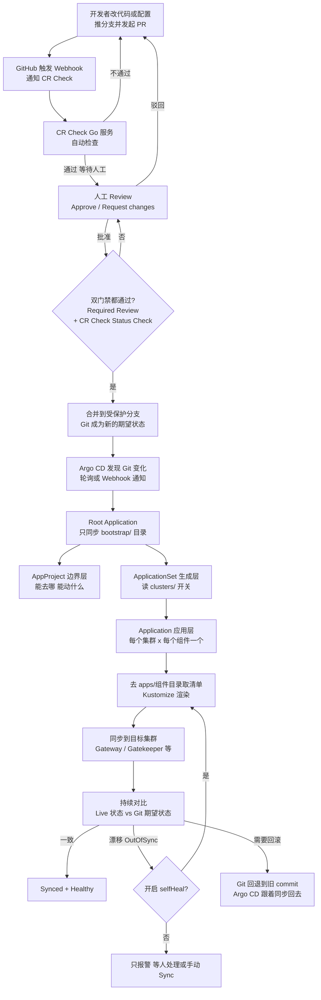
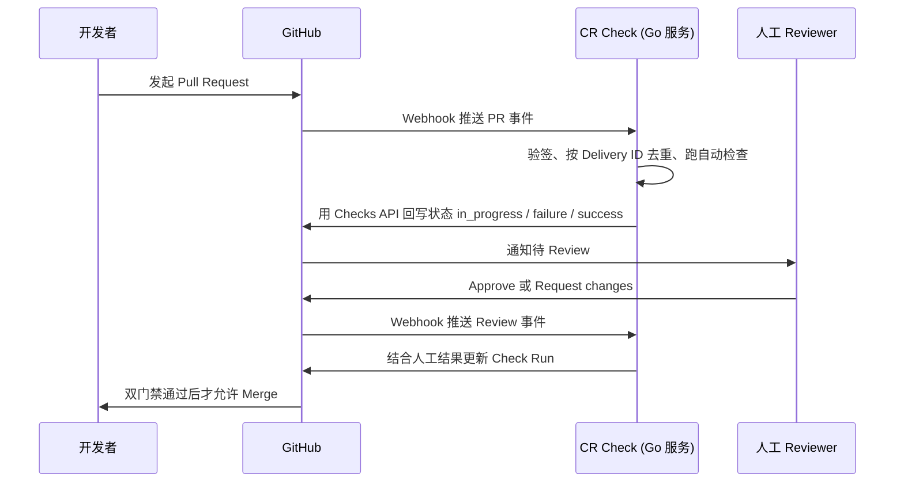
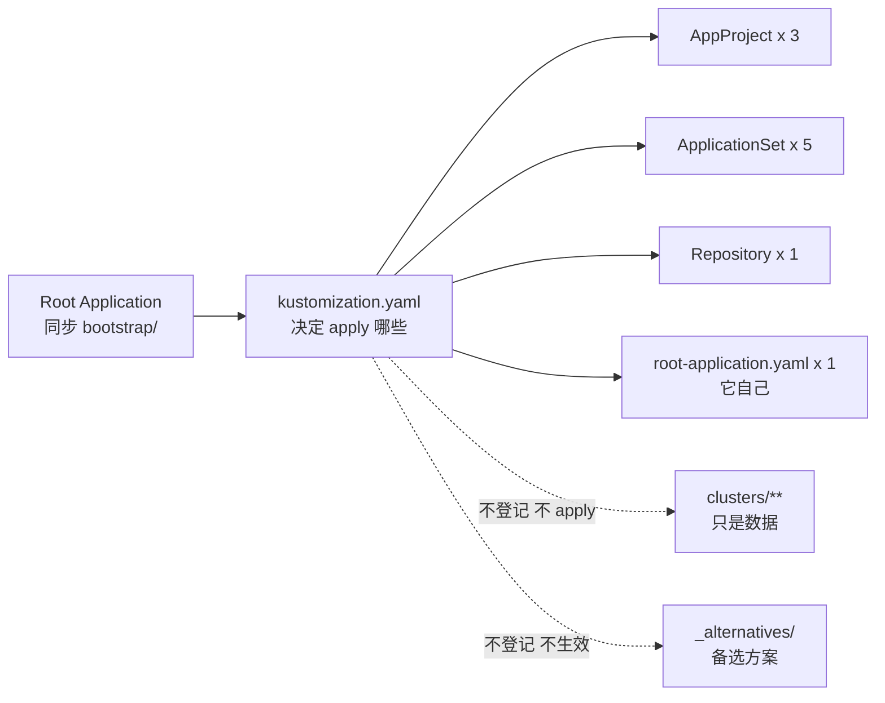
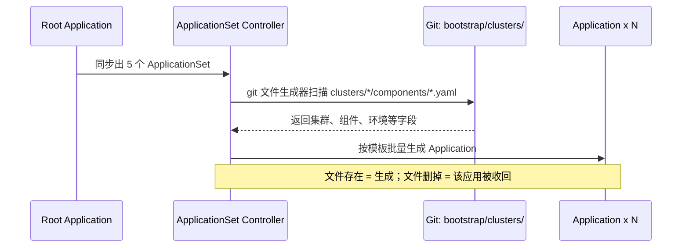

# Argo CD · GitOps 仓库骨架示例（bootstrap + 组件 + 集群清单）

> **用途**：把 [`../../argo-concept-sheet.md`](../../argo-concept-sheet.md) 里的拓扑
> 落成一份**可读的最小仓库**，让你直观看到每个文件长什么样、放在哪、谁读它。
>
> **这是示例，不是可直接 apply 的生产配置**：所有 server 地址、仓库地址、凭据都是假的。

> 📌 **本目录有三个子文档**：
> - [`bootstrap/README.md`](./bootstrap/README.md) —— **引导层**的详细说明
>   （bootstrap 到底是什么、为什么需要它、11 步完整时序、每个文件的作用、常见失败）
> - [`bootstrap/clusters/README.md`](./bootstrap/clusters/README.md) —— **集群清单**的完整说明
>   （命名约定、多 GCP Project、每集群一份独立配置、OPA / Gateway 落位、演进路线）
> - 本文件 —— 整体骨架与操作顺序

---

## 目录结构

```
gitops-layout/
├── bootstrap/                          ← Root Application 只同步这个目录
│   ├── README.md                       ←   ⭐ 引导层详解（先读这份）
│   ├── kustomization.yaml              ←   控制"根应用到底 apply 哪些资源"
│   ├── root-application.yaml           ←   根应用自己（App of Apps 入口）
│   ├── repositories.yaml               ←   Git 凭据（GitHub App / PAT）
│   ├── appprojects/                    ←   边界层：能做什么
│   │   ├── platform.yaml               ←     父项目（公共约束，被继承）
│   │   ├── platform-dev.yaml           ←     dev 环境边界
│   │   └── platform-prod.yaml          ←     prod 环境边界
│   ├── applicationsets/                ←   生成层：生成什么、生成到哪
│   │   ├── component-nginx.yaml        ←     每个组件一个 AppSet
│   │   ├── component-api.yaml
│   │   ├── component-redis.yaml
│   │   ├── component-gatekeeper.yaml   ←     ⭐ 集群级组件（OPA 策略）
│   │   ├── component-gateway.yaml      ←     ⭐ 集群级组件（Gateway）
│   │   └── _alternatives/              ←     备选方案（不 apply）
│   │       └── component-nginx-merge.yaml  ← 规模化后切 Merge 生成器去重
│   └── clusters/                       ←   集群事实来源（不是 K8s 资源）
│       ├── README.md                   ←     ⭐ 本目录的完整说明
│       ├── _templates/                 ←     复制模板（*.example → 生成器读不到）
│       ├── dev-01/                     ←     一个集群 = 一个目录
│       │   ├── cluster.yaml            ←       集群元信息（server/env/project/…）
│       │   └── components/             ←       该集群启用哪些组件
│       │       ├── nginx.yaml          ←         文件存在 = 该集群启用该组件
│       │       ├── api.yaml
│       │       ├── redis.yaml
│       │       ├── gatekeeper.yaml     ←         集群级：OPA 策略
│       │       └── gateway.yaml        ←         集群级：Gateway
│       ├── dev-02/                     ←     同一 GCP project 的第二个集群
│       ├── prod-01/                    ←     第一个 GCP project 的 prod
│       └── prod-02/                    ←     第二个 GCP project 的 prod
│
├── apps/                               ← 组件本体（base + overlay）
│   ├── nginx/
│   │   ├── base/{kustomization.yaml,deployment.yaml,service.yaml}
│   │   └── overlays/{dev,prod}/kustomization.yaml
│   ├── api/
│   │   ├── base/{kustomization.yaml,deployment.yaml}
│   │   └── overlays/{dev,prod}/kustomization.yaml
│   ├── redis/
│   │   ├── base/{kustomization.yaml,statefulset.yaml}
│   │   └── overlays/dev/kustomization.yaml
│   ├── gatekeeper/                     ← ⭐ 集群级组件：OPA 策略
│   │   ├── base/                       ←   策略本体（ConstraintTemplate + Constraint）
│   │   └── overlays/
│   │       ├── env/{dev,prod}/         ←   环境层：强制力度（dryrun / deny）
│   │       └── cluster/{dev-01,…}/     ←   集群层：本集群的豁免名单
│   └── gateway/                        ← ⭐ 集群级组件：Gateway（Solo Mesh）
│       ├── base/                       ←   Gateway + HTTPRoute
│       └── overlays/
│           ├── env/{dev,prod}/
│           └── cluster/{dev-01,…}/
│
├── preview-appset.py                   ← 离线模拟 ApplicationSet 展开
├── validate-clusters.py                ← 校验集群清单的一致性（防手抄漂移）
├── appset-simulator.py                 ← 精确模拟 AppSet + 交叉校验（重名/destination）
├── render-check.py                     ← 渲染全部 overlay + 产物策略检查
├── render-check.policy.yaml            ←   渲染检查的规则级别与已知例外
├── appset-simulator.policy.yaml        ←   模拟检查的规则级别
├── new-cluster.sh                      ← 新增集群的脚手架
├── enable-component.sh                 ← 给已有集群开关组件
├── ci-check.sh                         ← ⭐ 一键跑完全部静态检查（CI 入口）
└── demo.sh                             ← ⭐ 一键 Demo：命令行跑完整套 GitOps 流程
```

> 📌 共享库在上一层：[`../lib/yamlmin.py`](../lib/yamlmin.py) ——
> 一个**零依赖**的 YAML 子集解析器（手写，不要求装 PyYAML）。
> 它在这套工具里被反复使用，并且和 PyYAML 做过逐文件对账。

---

## ⭐ 静态检查工具箱（提交前跑一遍）

```bash
cd examples/gitops-layout
./ci-check.sh          # ⭐ 一键跑完下面全部 7 项
```

| 工具 | 检查什么 | 抓不住的典型错误 |
|---|---|---|
| [`validate-clusters.py`](./validate-clusters.py) | 集群清单字段一致性 | `server` 抄错 → `Unable to connect`；`env` 抄错 → **静默**渲染到别的环境 |
| [`appset-simulator.py`](./appset-simulator.py) | 精确渲染 AppSet 模板 + 交叉校验 | 两个 AppSet 生成**同名** Application；project 不存在；destination 不被允许 |
| [`render-check.py`](./render-check.py) | 每个 overlay 能不能 build、产物对不对 | selector 与 pod labels 对不上（K8s 直接拒绝）；Service 没有后端；镜像没打 tag |
| [`preview-appset.py`](./preview-appset.py) | 展开矩阵（人看） | —— |
| [`../validate-examples.py`](../validate-examples.py) | `examples/` 里配置片段的危险默认值 | `policy.default=role:readonly`；`scopes` 少了 `groups`；明文密码 |
| [`../check-doc-links.py`](../check-doc-links.py) | 文档链接与锚点 | 改了文件名 → 链接 404 |
| `kubectl kustomize bootstrap` | 根应用能 build | —— |

> 各工具的规则级别可用策略文件调：
> [`render-check.policy.yaml`](./render-check.policy.yaml)、
> [`appset-simulator.policy.yaml`](./appset-simulator.policy.yaml)。

### 改集群 / 改组件用脚手架

```bash
# 新增一个集群（自动建目录、写清单、加 AppProject destination）
./new-cluster.sh --name dev-03 --env dev \
    --project acme-platform-dev \
    --server https://dev-03.k8s.example.com \
    --component nginx --component api --component gatekeeper

# 给已有集群开关组件（集群级组件会自动复制一份 overlay）
./enable-component.sh --cluster dev-01 --component redis
./enable-component.sh --cluster dev-01 --component redis --disable
```

### 渲染结果对比（PR 评审用）

```bash
python3 render-check.py --save /tmp/before     # 改之前存一份
# ...改代码...
python3 render-check.py --compare /tmp/before  # 看渲染产物变了什么
```

---

## ⭐ 一键 Demo：`demo.sh`

```bash
cd examples/gitops-layout

./demo.sh plan      # 只打印将要执行的命令（离线，不需要 docker/kind/集群）
./demo.sh apply     # 真跑：建集群 → 装 Argo CD → 建 AppProject/AppSet/App → 同步
./demo.sh verify    # 只做验证与资源清单罗列
./demo.sh cleanup   # 删 kind 集群 / 停后台服务 / 删工作目录
./demo.sh           # = plan + apply + verify
```

它按 **11 个步骤** 把整套体系用命令行跑一遍：

| STEP | 做什么 | 对应的 Argo CD 概念 |
|---|---|---|
| 00 | 环境自检（docker / kind / kubectl / argocd CLI） | —— |
| 01 | kind 建 5 个集群：`argocd`（控制面）+ 4 个业务集群 | 模拟多集群 |
| 02 | 安装 Argo CD 控制面 | —— |
| 03 | 起本地 Git HTTP 服务，把示例仓库**改写**成演示仓库（repoURL / 各集群 server） | Repository 拉取源 |
| 04 | `argocd login` + 端口转发 | —— |
| 05 | 注册 Git 仓库 | **Repository** |
| 06 | 注册被纳管集群（声明式 Cluster Secret） | **Cluster Secret** |
| 07 | `kubectl apply` 三个 AppProject | **AppProject**（边界层，必须先于根应用） |
| 08 | `argocd app create` 根应用 → Argo CD 自己从 Git 拉 AppSet | **Application**（App of Apps 入口） |
| 09 | 等 ApplicationSet 生成 Application 并同步 | **ApplicationSet**（生成层） |
| 10 | 验证：AppProject / AppSet / App 清单 + 集群内真实资源 + 渲染结果抽样 | —— |
| 11 | 清理 | —— |

> ⚠️ 脚本**不会**动你的原始仓库：所有改写都发生在 `$WORKDIR`（默认
> `/tmp/ucp-gitops-demo`）下的副本里。
>
> 依赖：docker、kind、kubectl、argocd CLI、git、python3。
> 缺 kind / argocd CLI 时可以加 `--install-tools` 让脚本自动下载。
> macOS 与 Linux 都跑得起来（脚本处理了两边的 `base64` / `sed -i` / `docker 网关` 差异）。

---

## 三个开关，两层含义

| 开关 | 载体 | 生效动作 | 取消后的结果 |
|---|---|---|---|
| **组件全局启用** | `bootstrap/applicationsets/component-<name>.yaml` 存在 | Root App 同步出该 ApplicationSet → 生成各集群的 Application | AppSet 被 prune → 它生成的 Application 随之删除 → 集群资源被 prune |
| **组件在某集群启用** | `bootstrap/clusters/<cluster>/components/<name>.yaml` 存在 | Git generator 枚举到该文件 → 生成指向该集群的 Application | 该集群的这个 Application 消失 → 该集群资源被 prune |
| **组件整体下线（安全）** | 两者都删 + `preserveResourcesOnDeletion: true` | Application 消失但**保留**集群资源 | 需要人工清理 |

> `preserveResourcesOnDeletion: true` 写在 ApplicationSet 模板里，
> 对**所有**生成的 Application 生效 —— 这是防误删的关键一行。

### ⭐ 还有第四个开关：**组件是"环境级"还是"集群级"**

| | 环境级（nginx / api / redis） | 集群级（gatekeeper / gateway） |
|---|---|---|
| overlay 路径 | `apps/<c>/overlays/{{.env}}` | `apps/<c>/overlays/cluster/{{.cluster}}` |
| overlay 结构 | base → env | base → env → **cluster** |
| 同环境多集群 | 共用一份 | **每集群一份** |
| 典型 | 业务工作负载 | OPA 策略、Gateway、集群 agent |

---

## 一次展开的完整链路（以 nginx 为例）

```
bootstrap/applicationsets/component-nginx.yaml
        │  template.spec.project: '{{.project}}'（由 cluster 清单决定）
        │  source.path: apps/nginx/overlays/{{.env}}
        ▼
git generator: 匹配 bootstrap/clusters/*/components/nginx.yaml
        │  dev-01/components/nginx.yaml  → {cluster: dev-01, server: …, env: dev,  …}
        │  dev-02/components/nginx.yaml  → {cluster: dev-02, server: …, env: dev,  …}
        │  prod-01/components/nginx.yaml → {cluster: prod-01, server: …, env: prod, …}
        │  prod-02/components/nginx.yaml → {cluster: prod-02, server: …, env: prod, …}
        ▼
生成 Application × 4
        ├── nginx-dev-01   → server=dev-01  ns=platform-dev   project=platform-dev
        ├── nginx-dev-02   → server=dev-02  ns=platform-dev   project=platform-dev
        ├── nginx-prod-01  → server=prod-01 ns=platform-prod  project=platform-prod
        └── nginx-prod-02  → server=prod-02 ns=platform-prod  project=platform-prod
```

> 集群级组件（gatekeeper / gateway）走同一条链路，只是 `source.path` 换成
> `overlays/cluster/{{.cluster}}` → 每个集群渲染自己的那份 overlay。

### 离线预览展开结果（不用连集群）

```bash
$ python3 preview-appset.py

清单文件: 17 个   组件: 5 个

ApplicationSet/api  →  生成 4 个 Application
    api-dev-01   project=platform-dev   ns=platform-dev   server=https://dev-01.k8s.example.com
    api-dev-02   project=platform-dev   ns=platform-dev   server=https://dev-02.k8s.example.com
    api-prod-01  project=platform-prod  ns=platform-prod  server=https://prod-01.k8s.example.com
    api-prod-02  project=platform-prod  ns=platform-prod  server=https://prod-02.k8s.example.com

ApplicationSet/gatekeeper  →  生成 4 个 Application
    gatekeeper-dev-01   project=platform-dev   ns=platform-dev   server=https://dev-01.k8s.example.com
    gatekeeper-dev-02   project=platform-dev   ns=platform-dev   server=https://dev-02.k8s.example.com
    gatekeeper-prod-01  project=platform-prod  ns=platform-prod  server=https://prod-01.k8s.example.com
    gatekeeper-prod-02  project=platform-prod  ns=platform-prod  server=https://prod-02.k8s.example.com

ApplicationSet/gateway  →  生成 4 个 Application
    gateway-dev-01   project=platform-dev   ns=platform-dev   server=https://dev-01.k8s.example.com
    gateway-dev-02   project=platform-dev   ns=platform-dev   server=https://dev-02.k8s.example.com
    gateway-prod-01  project=platform-prod  ns=platform-prod  server=https://prod-01.k8s.example.com
    gateway-prod-02  project=platform-prod  ns=platform-prod  server=https://prod-02.k8s.example.com

ApplicationSet/nginx  →  生成 4 个 Application
    nginx-dev-01   project=platform-dev   ns=platform-dev   server=https://dev-01.k8s.example.com
    nginx-dev-02   project=platform-dev   ns=platform-dev   server=https://dev-02.k8s.example.com
    nginx-prod-01  project=platform-prod  ns=platform-prod  server=https://prod-01.k8s.example.com
    nginx-prod-02  project=platform-prod  ns=platform-prod  server=https://prod-02.k8s.example.com

ApplicationSet/redis  →  生成 1 个 Application
    redis-dev-01   project=platform-dev   ns=platform-dev   server=https://dev-01.k8s.example.com

集群视角（组件装在哪些集群）
    dev-01   5 个组件: api, gatekeeper, gateway, nginx, redis
    dev-02   4 个组件: api, gatekeeper, gateway, nginx
    prod-01  4 个组件: api, gatekeeper, gateway, nginx
    prod-02  4 个组件: api, gatekeeper, gateway, nginx

合计应生成 17 个 Application
```

> `redis` 只有 1 个 Application —— 因为只有 `dev-01` 有 `components/redis.yaml`。
> **这就是「文件存在即启用」的直接证据。**

### 本地校验（不连集群）

```bash
# ① YAML 语法 + 根应用到底会 apply 什么（应为 10 个：3 AppProject + 5 ApplicationSet + 1 Repository + 1 Application）
kubectl kustomize bootstrap | grep -E '^kind:|^  name:'

# ② 集群清单一致性（字段齐全 / 与 cluster.yaml 一致 / 渲染路径存在 / destinations 覆盖）
python3 validate-clusters.py

# ③ 组件 overlay 渲染
kubectl kustomize apps/nginx/overlays/prod | grep -E 'replicas:|count:'

# ④ 集群级 overlay 渲染（base → env → cluster 三层叠加）
kubectl kustomize apps/gatekeeper/overlays/cluster/prod-01 | grep enforcementAction   # → deny
kubectl kustomize apps/gatekeeper/overlays/cluster/dev-01  | grep enforcementAction   # → dryrun
```

---

## 谁读哪个文件

| 文件 | 读者 | 读取方式 | 备注 |
|---|---|---|---|
| `bootstrap/**` | Root Application | Argo CD 目录/Kustomize 源 | 只有 `kustomization.yaml` 里列出的才会被 apply |
| `bootstrap/clusters/**` | ApplicationSet controller | `git` 文件生成器 | **不是** K8s 资源，不会被 apply |
| `bootstrap/appprojects/**` | Argo CD 校验器 + Casbin | 资源约束 | 被 `spec.project` 逻辑引用 |
| `bootstrap/applicationsets/**` | ApplicationSet controller | 生成器 | 生成的 Application 带 ownerReference |
| `apps/**` | Argo CD repo-server | `spec.source.path` | 真正被 apply 到集群的内容 |

---

## 应用顺序（本地试跑）

```bash
# 1. 先 apply AppProject（否则 Application 会落到 default 项目）
kubectl apply -f bootstrap/appprojects/

# 2. 再 apply ApplicationSet（会立刻生成 Application）
kubectl apply -f bootstrap/applicationsets/

# 3. 最后 apply 根应用（之后交给 Git 管）
kubectl apply -f bootstrap/root-application.yaml

# 4. 看生成结果
kubectl -n argocd get applications -o wide
kubectl -n argocd get applicationsets
```

> 真实生产里这一步不需要手动 —— Root Application 会做同样的事。
> 但 Root Application 需要**先存在**，所以首次安装走“手动 apply 根应用”这一步。
> 注意顺序：**AppProject 必须先于根应用**，否则根应用引用的 `project: platform`
> 不存在，第一次同步会报 “project not found”。
>
> 还有一步在 Git 之外：**`argocd cluster add` 注册集群**。
> Git 里写了清单但没注册集群 → Application 卡 “Unable to connect”。

---

## 五个必须知道的坑（本示例已规避）

| # | 坑 | 后果 | 本示例怎么规避 |
|---|---|---|---|
| 1 | `bootstrap/` 里混入**非 K8s 资源**的文件（本文的 `clusters/**`） | 目录源会递归扫描并尝试 apply → `failed to generate manifest for source` | 用 `bootstrap/kustomization.yaml` 限定根应用只 apply 10 个资源 |
| 2 | `syncPolicy.automated.prune` / `selfHeal` 在 CRD 里是 **boolean** | 写成 `'{{.prune}}'` 会被 API server 拒掉（schema 校验失败） | 不做环境差异化模板；prod 要人工审批就拆一个 prod 专用 AppSet（用 `selector: 'env == "prod"'`） |
| 3 | Kustomize 的 `commonLabels` 会**改写 selector** | 滚动升级时新旧 Pod 互不匹配 → 滚动更新卡住 | 用 `labels:` + `includeSelectors: false` |
| 4 | 删组件清单文件 → Application 消失 → `prune` 把集群资源也删了 | 误删线上组件 | 模板里统一开 `preserveResourcesOnDeletion: true`，下线组件保留资源待人工确认 |
| 5 | 集群层 overlay 写成 `overlays/<env>/<cluster>/` 且 `resources: [..]` | Kustomize 报 `cycle detected`（父目录包含子目录） | 用**兄弟目录**：`overlays/env/<env>/` + `overlays/cluster/<cluster>/` |

> 坑 #2 的 schema 依据：本仓库 `install.yaml:8015-8017`（v3.5.6 官方清单）
> 中 `automated.prune` / `selfHeal` 的类型是 `boolean`。
> 部署前可用 `kubectl apply --dry-run=server` 在目标集群复核。
>
> 坑 #5 的实测报错：
> ```
> $ kubectl kustomize apps/gatekeeper/overlays/dev/dev-01
> error: accumulating resources: accumulation err='accumulating resources from '..':
> '/…/overlays/dev' must resolve to a file': cycle detected
> ```

---

## 与现有专题的对应

| 本示例 | 详见 |
|---|---|
| **`bootstrap/`（引导层）** | [`./bootstrap/README.md`](./bootstrap/README.md) |
| `appprojects/*` | [`../../04-appproject-rbac.md`](../../04-appproject-rbac.md) |
| `applicationsets/*` | [`../../05-appset.md`](../../05-appset.md) |
| `apps/gatekeeper/*`（OPA） | [`../../06-opa-gatekeeper-impact.md`](../../06-opa-gatekeeper-impact.md) |
| `bootstrap/clusters/**` | [`./bootstrap/clusters/README.md`](./bootstrap/clusters/README.md) |
| `bootstrap/` 与根应用 | [`../../../argocd-admin-guide.md`](../../../argocd-admin-guide.md) §6.1–6.2 |
| 概念速查表 | [`../../argo-concept-sheet.md`](../../argo-concept-sheet.md) |


Argo CD Bootstrap 完整流程图
# Argo CD Bootstrap 完整流程图

> 一句话：Git 是图纸，Argo CD 是住在 GKE 控制面集群（CP）里、照图纸施工并一直巡查的工头。Bootstrap 不是“一键全装”，而是打破死循环的一次手动点火——点火之后，它自己管自己，再按开关批量生成应用、同步到各个业务集群。

这份文档把你的整条链路串在一起：开发者提 PR，经过 CR Check 和人工 Review 才能进 Git；Git 变了之后，Argo CD 才开始工作。每个阶段都标注了调用什么文件、谁来读、做什么、失败时看什么信号。

## 先分清两个误解

- 加一个集群，不等于自动装上所有东西。必须同时满足三个条件：集群已注册、AppProject 允许去那个集群、Git 里那个集群的组件开关已打开。少一个都不会装，详见阶段 6。
- Gateway、OPA / Gatekeeper 不是 Argo CD 自带的。它们是你写在 `apps/` 里的被管组件，Argo CD 只负责把它们发下去、保持同步。

## 全链路主图



读图要点：CR Check 管“什么能进 Git”，Argo CD 管“Git 里的东西怎么变成集群里的现实”。两道门管的是不同阶段，不能互相替代。

## 阶段总览

| 阶段 | 名称 | 驱动方式 | 一句话结果 |
|---|---|---|---|
| 0 | 前置准备 | 手动，一次性 | Argo CD 装好、仓库和集群凭据就位 |
| 1 | PR 门禁 | 事件驱动 | 不合格的变更进不了受保护分支 |
| 2 | Bootstrap 点火 | 手动，仅一次 | 根应用被 apply 进控制面集群 |
| 3 | 根应用自举 | Git 驱动 | AppProject 和 ApplicationSet 被生出来 |
| 4 | 边界层校验 | Git 驱动 | AppProject 划定能去哪、能动什么 |
| 5 | 批量生成应用 | Git 驱动 | 每个集群 × 组件生成一个 Application |
| 6 | 渲染并同步到目标集群 | Git 驱动 | `apps/<组件>/` 渲染后装到业务集群 |
| 7 | 持续巡查 | 常驻对比 | 漂移被发现、自愈或回滚 |

手动只有阶段 0 和阶段 2 的几步。阶段 3 之后改任何东西，都应该走 Git PR，不要再用 `kubectl patch` 直接改集群里的 Argo CD 对象。

## 阶段 0：前置准备——Argo CD 先存在

Bootstrap 不安装 Argo CD 本身。Argo CD 不在自己的管理范围内，必须先用 Helm 或 `kubectl apply` 的安装清单把它装进 GKE 控制面集群，并拿到初始 admin 密码。

这一步还要准备两类不在 Git 里明文保存的东西：

- 仓库凭据：GitHub App 或令牌形式的凭据，用来让 Argo CD 的 repo-server 能拉代码。
- 集群凭据：目标集群的 Cluster Secret，含访问凭据，不适合直接写进普通 Git 文件。

失败信号：Argo CD Pod 起不来时，后面所有阶段都不会开始，先看控制面集群里 `argocd` 命名空间的 Pod 状态。

## 阶段 1：PR 门禁——什么能进 Git

这是 CR Check 所在的位置，也是合并到生产（PRD）前的最后一道人工关。



这一阶段有几个待团队定稿的点，本文不替你编数值：受保护分支到底是哪一条、需要几人批准、谁能批（是否用 CODEOWNERS）、CR Check 具体自动查哪些项、CR Check 服务挂掉时是全部卡住（fail-closed）还是放行（fail-open）。这些在之前的决定单里，定下来后替换到流程配置里即可，图的结构不变。

## 阶段 2：Bootstrap 点火——全流程唯一一次手工

死循环在这里：没有 Application，Argo CD 什么都不同步；而 Application 又要写在 Git 里由它去拉。解法是第一次手工 apply 根应用，之后交给它自己。

首次安装顺序不能颠倒：

```bash
# 1. 仓库凭据先就位
kubectl apply -f bootstrap/repositories.yaml

# 2. 边界层必须先建，否则根应用报 project not found
kubectl apply -f bootstrap/appprojects/

# 3. 根应用点火，全流程唯一一次手工 apply 根应用
kubectl apply -f bootstrap/root-application.yaml
```

| 输入文件 | 谁读它 | 做什么 | 下一步 |
|---|---|---|---|
| `bootstrap/repositories.yaml` | repo-server | 登记去哪拉代码、用什么凭据 | 拉不到仓库就不会有后续同步 |
| `bootstrap/appprojects/` | Argo CD 校验器 | 先建好 `platform` 等项目边界 | 根应用的 `spec.project` 才找得到项目 |
| `bootstrap/root-application.yaml` | Argo CD | 创建名为 `root-bootstrap` 的根应用，只指向 `bootstrap/` | 根应用开始自己同步 `bootstrap/` |

根应用的关键字段：`source.path` 是 `bootstrap`，`destination.server` 是 `https://kubernetes.default.svc`，也就是控制面集群自己。千万不要把根应用的目的地写成某个业务集群，那会形成循环依赖：业务集群又去拉管自己的根应用。

## 阶段 3：根应用自举——`kustomization.yaml` 是开关面板

根应用同步 `bootstrap/` 时，不是把整个目录无脑 apply。它按 `bootstrap/kustomization.yaml` 构建，只 apply 清单里登记的资源。



登记的正好 10 个：3 个 AppProject、5 个 ApplicationSet、1 个 Repository、1 个根应用本身。可以这样验证：

```bash
kubectl kustomize bootstrap | grep -E '^kind:|^  name:'
# 应正好数到 10 个
```

为什么必须用这个清单：`bootstrap/` 里混着两类东西。一类是真正的 Argo CD 资源（CR），另一类是数据文件 `clusters/**`。如果递归扫描整个目录，Argo CD 会把 `clusters/dev-01/components/nginx.yaml` 也当成 Kubernetes 资源去解析，直接报 `failed to generate manifest for source`，整个 Bootstrap 同步失败。

记住一条规则：往 `bootstrap/` 里加新文件时先问“它是 CR 吗？”是，才登记进 `kustomization.yaml`；不是，千万别登记。

自举的含义也在这一阶段：`root-application.yaml` 自己也在清单里，所以以后改根应用的分支或路径，走 Git PR 就行，Argo CD 会自己同步自己，不用再手工 patch。

## 阶段 4：边界层——AppProject 先划好能做什么

| 文件 | 作用 |
|---|---|
| `bootstrap/appprojects/platform.yaml` | 父项目，公共约束 |
| `bootstrap/appprojects/platform-dev.yaml` | dev 环境的边界 |
| `bootstrap/appprojects/platform-prod.yaml` | prod 环境的边界 |

AppProject 规定每个应用能用哪些源仓库、能去哪些目标集群和命名空间、能动哪些资源类型、谁能操作。少了它，应用会落到最宽松的 `default` 项目，任意源、任意目标、任意资源都能动，这是安全风险，不是省事。

引用关系要注意：Application 用 `spec.project` 按名字逻辑引用 AppProject，不是父子所有关系。AppProject 被删，Application 还在，但校验会失败，提示项目不存在。

## 阶段 5：生成层——ApplicationSet 批量生成 Application



5 个 ApplicationSet 在 `bootstrap/applicationsets/` 里，例如 `component-gateway.yaml`、`component-gatekeeper.yaml` 是集群级组件，`component-nginx.yaml`、`component-api.yaml`、`component-redis.yaml` 是环境级组件。`applicationsets/_alternatives/` 里的备选模板不在 `kustomization.yaml` 里，现在不生效，需要时才手工登记。

这里最容易误解的是 `bootstrap/clusters/`：

- 它永远不被 apply 进集群，它是给 ApplicationSet 读的数据。
- `clusters/dev-01/cluster.yaml` 是集群元信息，`clusters/dev-01/components/*.yaml` 是组件开关。
- 开关的规则极简单：文件存在 = 这个集群启用这个组件；文件不存在 = 不启用。
- 已有集群包括 `dev-01`、`dev-02`、`prod-01`、`prod-02`，新集群照 `clusters/_templates/` 复制即可。

危险点：ApplicationSet 删掉，它生成的所有 Application 会因所有权关系被级联删除。模板里统一开 `preserveResourcesOnDeletion: true`，意思是删 Application 时保留集群里的实际资源，靠人工清理，避免一删模板就把线上资源一起 prune 掉。

## 阶段 6：应用层同步——组件真正落到业务集群

每个生成的 Application 做三件事：按 `spec.source.path` 去 `apps/<组件>/` 取清单，按环境或集群选 overlay 并用 Kustomize 渲染，再按 `spec.destination.server` 同步到目标集群。

加集群时“会不会自动装”的答案就在这一阶段，必须同时满足：

| 条件 | 怎么做 | 少了的报错 |
|---|---|---|
| 1. 集群已注册 | `argocd cluster add` 或创建 Cluster Secret | `Unable to connect to server` |
| 2. 边界允许 | AppProject 的 `destinations` 包含该集群 | `not match any of the allowed destinations` |
| 3. 开关已打开 | Git 里有 `clusters/<集群>/components/<组件>.yaml` | 不是报错，是根本不会生成这个 Application |

三个都满足后才是全自动：改 Git 加一个开关文件，ApplicationSet 生成 Application，Application 渲染并同步，组件装上。反过来删开关文件，该集群的这个应用会被收回，但实际资源因保留策略还在，需要人工清理。

同步还有一道反向关：Gatekeeper 本身是门卫。如果 Gatekeeper 的规则拒绝某个配置，Argo CD 的同步会被它的准入 Webhook 挡住，应用停在 `OutOfSync`。这时不要先怀疑 Argo CD，先看应用的 `status.conditions` 里的拒绝信息。

## 阶段 7：持续巡查、自愈与回滚

同步成功不是结束。Argo CD 会常驻对比集群里的真实状态和 Git 里的期望状态：

- 一致：状态是 Synced 且 Healthy。
- 有人手工改了集群：变成 OutOfSync，这叫漂移。开了 `automated` 里的 `selfHeal: true` 会自动改回 Git 的样子；`prune: true` 表示 Git 里删掉的资源，集群里也删掉。
- 出问题要回滚：不需要手工救火，把 Git 回退到上一个正常 commit，Argo CD 会跟着同步回去。回滚的本质是改图纸，不是改工地。

这也是防绕过的关键：CR Check 拦不住有人绕过 Git 直接 `kubectl apply`，但 Argo CD 的自愈可以把这种手工改动改回去，前提是生产只允许 Argo CD 从受保护分支同步，禁止直接 push 到该分支和直接 apply 到生产集群。

## 每阶段调用文件总表

| 阶段 | 输入文件或对象 | 读取者 | 动作 | 输出或下一步 | 失败信号 |
|---|---|---|---|---|---|
| 0 | Argo CD 安装清单 | 人工 / Helm | 装 Argo CD 本身 | 控制面里有 Argo CD | Pod 起不来 |
| 1 | PR、Webhook 事件 | CR Check (Go) | 验签、幂等、自动检查、回写 Checks | 等人工 Review | Check 一直 pending |
| 1 | PR 内容 | 人工 Reviewer | Approve 或驳回 | 双门禁判断 | 未批准时 Merge 被拦 |
| 2 | `bootstrap/repositories.yaml` | repo-server | 登记仓库和凭据 | 能拉 Git 仓库 | `Unknown` / `ComparisonError` |
| 2 | `bootstrap/appprojects/*.yaml` | Argo CD 校验器 | 建项目边界 | 根应用能找到项目 | `project not found` |
| 2 | `bootstrap/root-application.yaml` | Argo CD | 创建根应用 | 开始同步 `bootstrap/` | 目的地写错会成环 |
| 3 | `bootstrap/kustomization.yaml` | Kustomize 构建器 | 只选登记的 10 个 CR | AppProject、AppSet 等被 apply | 混入数据文件会解析失败 |
| 4 | `bootstrap/appprojects/*.yaml` | Argo CD + Casbin | 校验源、目标、资源、白名单 | 应用被允许或被拦 | `not permitted` |
| 5 | `bootstrap/clusters/*/components/*.yaml` | ApplicationSet 的 git 文件生成器 | 读开关和字段生成应用 | Application × N | 路径或字段错时一个都生成不出 |
| 6 | `apps/<组件>/overlays/...` | 对应 Application | Kustomize 渲染后 apply | 组件落到目标集群 | Gatekeeper 拒绝时停在 OutOfSync |
| 7 | Git 期望状态 vs 集群真实状态 | Argo CD 控制器 | 持续对比 | Synced 或自愈、回滚 | 长期 OutOfSync / Degraded |

## 三层引用关系速查

| 关系 | 机制 | 删上游会怎样 |
|---|---|---|
| Application 到 AppProject | `spec.project` 写名字，逻辑引用 | 项目没了，应用校验失败 |
| ApplicationSet 到 Application | 所有权关系 (ownerReference) | AppSet 没了，生成的应用全被级联删除 |
| Application 到 Git 目录 | `spec.source.path` | 目录改名，同步失败 |
| Application 到集群 | `spec.destination.server` | 集群没注册，连不上 |

## 实操例子 1：给 dev-01 加一个 Gateway

只做这一件事，不用新建 Application，也不用改 `kustomization.yaml`：

1. 确认 `dev-01` 已注册为 Cluster Secret，且 `platform-dev` 的 `destinations` 包含它。若没注册，先用 `argocd cluster add` 注册，这一步不走 Git。
2. 在 Git 里新建开关文件 `bootstrap/clusters/dev-01/components/gateway.yaml`，字段照同目录其他组件文件和 `clusters/_templates/` 的模板写。
3. 确认组件本体存在：`apps/gateway/` 里已有对应 overlay，ApplicationSet 模板 `bootstrap/applicationsets/component-gateway.yaml` 已登记并生效。
4. 走正常 PR：CR Check 和人工 Review 通过后合并。
5. 合并后看结果：ApplicationSet 应新生成一个面向 dev-01 的 Gateway Application，它渲染 `apps/gateway/` 后同步到 dev-01。UI 里看它从 OutOfSync 到 Synced、Healthy 即完成。

要停用时反过来：删掉这个开关文件即可，不要去删 ApplicationSet 文件，那会影响所有集群。

## 实操例子 2：新加一个集群

新集群比加组件多三步，缺一不可：

1. 注册集群：用 `argocd cluster add` 或创建 Cluster Secret 把凭据交给 Argo CD。这一步含凭据，不进普通 Git。
2. 放行边界：在 `bootstrap/appprojects/` 对应环境项目里，把新集群加进 `destinations`，并确认资源白名单够用。
3. 建事实目录：照 `bootstrap/clusters/_templates/` 新建 `bootstrap/clusters/<新集群>/cluster.yaml`，再按需放 `components/*.yaml` 开关。只放你想装的组件，不要默认全放。
4. 准备组件配置：每个要装的组件在 `apps/<组件>/overlays/` 里要有这个集群对应的 overlay，否则会静默跑错环境或渲染失败，这是最危险的一类错误。
5. 提交前自检：跑集群清单一致性检查和 ApplicationSet 预览，确认会生成哪些 Application，再走 PR 合并。

提交前可用的检查命令（以你仓库的实际脚本为准）：

```bash
kubectl kustomize bootstrap >/dev/null && echo "bootstrap build OK"
argocd app list -o wide
argocd appset list
```

## 常见失败对照表

| 现象 | 根因 | 处理方向 |
|---|---|---|
| `failed to generate manifest for source` | `bootstrap/` 混进了非资源文件 | 检查 `kustomization.yaml` 只列 CR |
| `project not found` | AppProject 还没建，根应用先同步了 | 先 apply `appprojects/`，再点火 |
| AppSet 在，但一个 Application 都没有 | `clusters/*/components/*.yaml` 路径或字段不对 | 看 AppSet 事件，字段缺失会整片报错 |
| Application 一直 `Unknown` | repo-server 拉不到仓库 | 查 `repositories.yaml` 和 Repository 状态 |
| `Unable to connect to server` | 目标集群没注册 | 注册 Cluster Secret |
| `not match any of the allowed destinations` | AppProject 没覆盖该集群 | 补 `destinations` |
| `not permitted` | 资源类型不在白名单 | 补项目里的资源白名单 |
| 删了 AppSet，所有应用消失 | 所有权级联删除 | 停单个组件改删开关文件，并保留资源保留策略 |
| 应用停在 OutOfSync，集群里没东西 | Gatekeeper Webhook 拒绝 | 看 `status.conditions` 的拒绝信息 |

## 按这个顺序读和查

1. 先看全链路主图，建立“两道门、七个阶段”的整体感。
2. 再看阶段 2 和 3，弄清手动点火和自举只有一次、只在开头。
3. 然后看阶段 5 的开关规则，这是日常加集群、加组件时最常用的部分。
4. 出问题时直接查失败对照表，先查先后顺序和边界，不要先怀疑组件本身。

待定项提醒：受保护分支名称、批准人数、CR Check 的自动检查清单和 fail-closed 还是 fail-open、Webhook 地址，都以团队决定单的最终值为准。本文只画流程结构，不替这些位置填具体数值。
