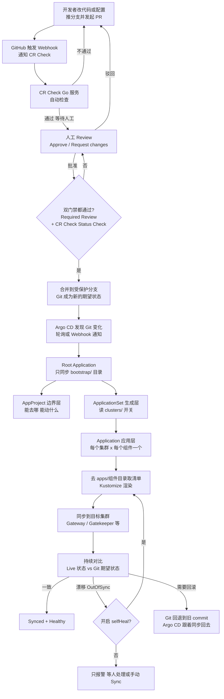
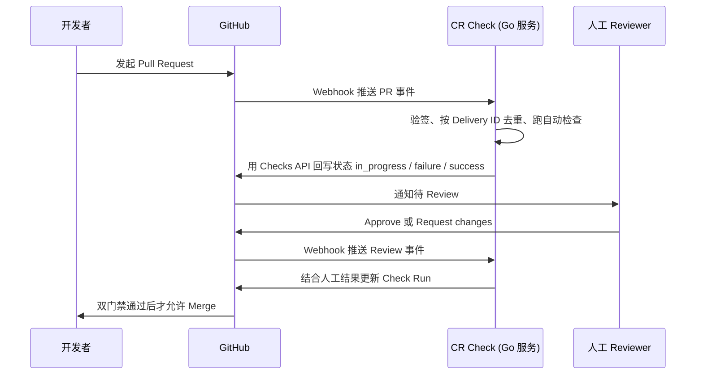
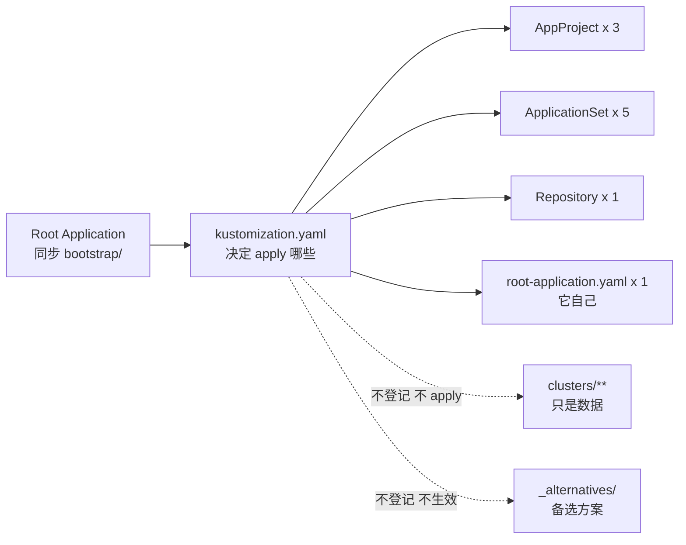
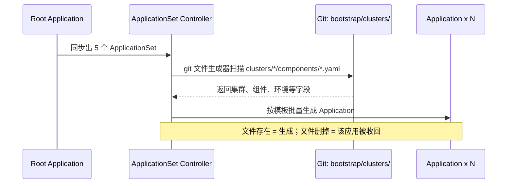

# Argo CD · Bootstrap 完整流程图（从 PR 到集群）

> 📌 这是 [`gitops-layout/README.md`](./README.md) 的**姊妹篇**：
> 那份讲「目录长什么样、每个文件谁读」，这份讲「**整条链路怎么跑**」。
>
> 想直接动手 → 回去看 [README 的工具箱](./README.md#-静态检查工具箱提交前跑一遍)。

> 一句话：Git 是图纸，Argo CD 是住在 GKE 控制面集群（CP）里、照图纸施工并一直巡查的工头。Bootstrap 不是“一键全装”，而是打破死循环的一次手动点火——点火之后，它自己管自己，再按开关批量生成应用、同步到各个业务集群。

这份文档把你的整条链路串在一起：开发者提 PR，经过 CR Check 和人工 Review 才能进 Git；Git 变了之后，Argo CD 才开始工作。每个阶段都标注了调用什么文件、谁来读、做什么、失败时看什么信号。

## 先分清两个误解

- 加一个集群，不等于自动装上所有东西。必须同时满足三个条件：集群已注册、AppProject 允许去那个集群、Git 里那个集群的组件开关已打开。少一个都不会装，详见阶段 6。
- Gateway、OPA / Gatekeeper 不是 Argo CD 自带的。它们是你写在 `apps/` 里的被管组件，Argo CD 只负责把它们发下去、保持同步。

## 全链路主图



读图要点：CR Check 管“什么能进 Git”，Argo CD 管“Git 里的东西怎么变成集群里的现实”。两道门管的是不同阶段，不能互相替代。

## 阶段总览

| 阶段 | 名称 | 驱动方式 | 一句话结果 |
|---|---|---|---|
| 0 | 前置准备 | 手动，一次性 | Argo CD 装好、仓库和集群凭据就位 |
| 1 | PR 门禁 | 事件驱动 | 不合格的变更进不了受保护分支 |
| 2 | Bootstrap 点火 | 手动，仅一次 | 根应用被 apply 进控制面集群 |
| 3 | 根应用自举 | Git 驱动 | AppProject 和 ApplicationSet 被生出来 |
| 4 | 边界层校验 | Git 驱动 | AppProject 划定能去哪、能动什么 |
| 5 | 批量生成应用 | Git 驱动 | 每个集群 × 组件生成一个 Application |
| 6 | 渲染并同步到目标集群 | Git 驱动 | `apps/<组件>/` 渲染后装到业务集群 |
| 7 | 持续巡查 | 常驻对比 | 漂移被发现、自愈或回滚 |

手动只有阶段 0 和阶段 2 的几步。阶段 3 之后改任何东西，都应该走 Git PR，不要再用 `kubectl patch` 直接改集群里的 Argo CD 对象。

## 阶段 0：前置准备——Argo CD 先存在

Bootstrap 不安装 Argo CD 本身。Argo CD 不在自己的管理范围内，必须先用 Helm 或 `kubectl apply` 的安装清单把它装进 GKE 控制面集群，并拿到初始 admin 密码。

这一步还要准备两类不在 Git 里明文保存的东西：

- 仓库凭据：GitHub App 或令牌形式的凭据，用来让 Argo CD 的 repo-server 能拉代码。
- 集群凭据：目标集群的 Cluster Secret，含访问凭据，不适合直接写进普通 Git 文件。

失败信号：Argo CD Pod 起不来时，后面所有阶段都不会开始，先看控制面集群里 `argocd` 命名空间的 Pod 状态。

## 阶段 1：PR 门禁——什么能进 Git

这是 CR Check 所在的位置，也是合并到生产（PRD）前的最后一道人工关。



这一阶段有几个待团队定稿的点，本文不替你编数值：受保护分支到底是哪一条、需要几人批准、谁能批（是否用 CODEOWNERS）、CR Check 具体自动查哪些项、CR Check 服务挂掉时是全部卡住（fail-closed）还是放行（fail-open）。这些在之前的决定单里，定下来后替换到流程配置里即可，图的结构不变。

## 阶段 2：Bootstrap 点火——全流程唯一一次手工

死循环在这里：没有 Application，Argo CD 什么都不同步；而 Application 又要写在 Git 里由它去拉。解法是第一次手工 apply 根应用，之后交给它自己。

首次安装顺序不能颠倒：

```bash
# 1. 仓库凭据先就位
kubectl apply -f bootstrap/repositories.yaml

# 2. 边界层必须先建，否则根应用报 project not found
kubectl apply -f bootstrap/appprojects/

# 3. 根应用点火，全流程唯一一次手工 apply 根应用
kubectl apply -f bootstrap/root-application.yaml
```

| 输入文件 | 谁读它 | 做什么 | 下一步 |
|---|---|---|---|
| `bootstrap/repositories.yaml` | repo-server | 登记去哪拉代码、用什么凭据 | 拉不到仓库就不会有后续同步 |
| `bootstrap/appprojects/` | Argo CD 校验器 | 先建好 `platform` 等项目边界 | 根应用的 `spec.project` 才找得到项目 |
| `bootstrap/root-application.yaml` | Argo CD | 创建名为 `root-bootstrap` 的根应用，只指向 `bootstrap/` | 根应用开始自己同步 `bootstrap/` |

根应用的关键字段：`source.path` 是 `bootstrap`，`destination.server` 是 `https://kubernetes.default.svc`，也就是控制面集群自己。千万不要把根应用的目的地写成某个业务集群，那会形成循环依赖：业务集群又去拉管自己的根应用。

## 阶段 3：根应用自举——`kustomization.yaml` 是开关面板

根应用同步 `bootstrap/` 时，不是把整个目录无脑 apply。它按 `bootstrap/kustomization.yaml` 构建，只 apply 清单里登记的资源。



登记的正好 10 个：3 个 AppProject、5 个 ApplicationSet、1 个 Repository、1 个根应用本身。可以这样验证：

```bash
kubectl kustomize bootstrap | grep -E '^kind:|^  name:'
# 应正好数到 10 个
```

为什么必须用这个清单：`bootstrap/` 里混着两类东西。一类是真正的 Argo CD 资源（CR），另一类是数据文件 `clusters/**`。如果递归扫描整个目录，Argo CD 会把 `clusters/dev-01/components/nginx.yaml` 也当成 Kubernetes 资源去解析，直接报 `failed to generate manifest for source`，整个 Bootstrap 同步失败。

记住一条规则：往 `bootstrap/` 里加新文件时先问“它是 CR 吗？”是，才登记进 `kustomization.yaml`；不是，千万别登记。

自举的含义也在这一阶段：`root-application.yaml` 自己也在清单里，所以以后改根应用的分支或路径，走 Git PR 就行，Argo CD 会自己同步自己，不用再手工 patch。

## 阶段 4：边界层——AppProject 先划好能做什么

| 文件 | 作用 |
|---|---|
| `bootstrap/appprojects/platform.yaml` | 父项目，公共约束 |
| `bootstrap/appprojects/platform-dev.yaml` | dev 环境的边界 |
| `bootstrap/appprojects/platform-prod.yaml` | prod 环境的边界 |

AppProject 规定每个应用能用哪些源仓库、能去哪些目标集群和命名空间、能动哪些资源类型、谁能操作。少了它，应用会落到最宽松的 `default` 项目，任意源、任意目标、任意资源都能动，这是安全风险，不是省事。

引用关系要注意：Application 用 `spec.project` 按名字逻辑引用 AppProject，不是父子所有关系。AppProject 被删，Application 还在，但校验会失败，提示项目不存在。

## 阶段 5：生成层——ApplicationSet 批量生成 Application



5 个 ApplicationSet 在 `bootstrap/applicationsets/` 里，例如 `component-gateway.yaml`、`component-gatekeeper.yaml` 是集群级组件，`component-nginx.yaml`、`component-api.yaml`、`component-redis.yaml` 是环境级组件。`applicationsets/_alternatives/` 里的备选模板不在 `kustomization.yaml` 里，现在不生效，需要时才手工登记。

这里最容易误解的是 `bootstrap/clusters/`：

- 它永远不被 apply 进集群，它是给 ApplicationSet 读的数据。
- `clusters/dev-01/cluster.yaml` 是集群元信息，`clusters/dev-01/components/*.yaml` 是组件开关。
- 开关的规则极简单：文件存在 = 这个集群启用这个组件；文件不存在 = 不启用。
- 已有集群包括 `dev-01`、`dev-02`、`prod-01`、`prod-02`，新集群照 `clusters/_templates/` 复制即可。

> 💡 这一阶段的手工活已经工具化了：`new-cluster.sh` / `enable-component.sh` 会
> 自动建目录、写清单、加 `destinations`，并保证 `server`/`env`/`project`/`namespace`
> 四个字段在 `cluster.yaml` 和各个 `components/*.yaml` 之间**逐字一致**（手抄必漂移）。
> 校验用 `validate-clusters.py`，展开结果用 `appset-simulator.py`。

危险点：ApplicationSet 删掉，它生成的所有 Application 会因所有权关系被级联删除。模板里统一开 `preserveResourcesOnDeletion: true`，意思是删 Application 时保留集群里的实际资源，靠人工清理，避免一删模板就把线上资源一起 prune 掉。

## 阶段 6：应用层同步——组件真正落到业务集群

每个生成的 Application 做三件事：按 `spec.source.path` 去 `apps/<组件>/` 取清单，按环境或集群选 overlay 并用 Kustomize 渲染，再按 `spec.destination.server` 同步到目标集群。

加集群时“会不会自动装”的答案就在这一阶段，必须同时满足：

| 条件 | 怎么做 | 少了的报错 |
|---|---|---|
| 1. 集群已注册 | `argocd cluster add` 或创建 Cluster Secret | `Unable to connect to server` |
| 2. 边界允许 | AppProject 的 `destinations` 包含该集群 | `not match any of the allowed destinations` |
| 3. 开关已打开 | Git 里有 `clusters/<集群>/components/<组件>.yaml` | 不是报错，是根本不会生成这个 Application |

三个都满足后才是全自动：改 Git 加一个开关文件，ApplicationSet 生成 Application，Application 渲染并同步，组件装上。反过来删开关文件，该集群的这个应用会被收回，但实际资源因保留策略还在，需要人工清理。

同步还有一道反向关：Gatekeeper 本身是门卫。如果 Gatekeeper 的规则拒绝某个配置，Argo CD 的同步会被它的准入 Webhook 挡住，应用停在 `OutOfSync`。这时不要先怀疑 Argo CD，先看应用的 `status.conditions` 里的拒绝信息。

## 阶段 7：持续巡查、自愈与回滚

同步成功不是结束。Argo CD 会常驻对比集群里的真实状态和 Git 里的期望状态：

- 一致：状态是 Synced 且 Healthy。
- 有人手工改了集群：变成 OutOfSync，这叫漂移。开了 `automated` 里的 `selfHeal: true` 会自动改回 Git 的样子；`prune: true` 表示 Git 里删掉的资源，集群里也删掉。
- 出问题要回滚：不需要手工救火，把 Git 回退到上一个正常 commit，Argo CD 会跟着同步回去。回滚的本质是改图纸，不是改工地。

这也是防绕过的关键：CR Check 拦不住有人绕过 Git 直接 `kubectl apply`，但 Argo CD 的自愈可以把这种手工改动改回去，前提是生产只允许 Argo CD 从受保护分支同步，禁止直接 push 到该分支和直接 apply 到生产集群。

## 每阶段调用文件总表

| 阶段 | 输入文件或对象 | 读取者 | 动作 | 输出或下一步 | 失败信号 |
|---|---|---|---|---|---|
| 0 | Argo CD 安装清单 | 人工 / Helm | 装 Argo CD 本身 | 控制面里有 Argo CD | Pod 起不来 |
| 1 | PR、Webhook 事件 | CR Check (Go) | 验签、幂等、自动检查、回写 Checks | 等人工 Review | Check 一直 pending |
| 1 | PR 内容 | 人工 Reviewer | Approve 或驳回 | 双门禁判断 | 未批准时 Merge 被拦 |
| 2 | `bootstrap/repositories.yaml` | repo-server | 登记仓库和凭据 | 能拉 Git 仓库 | `Unknown` / `ComparisonError` |
| 2 | `bootstrap/appprojects/*.yaml` | Argo CD 校验器 | 建项目边界 | 根应用能找到项目 | `project not found` |
| 2 | `bootstrap/root-application.yaml` | Argo CD | 创建根应用 | 开始同步 `bootstrap/` | 目的地写错会成环 |
| 3 | `bootstrap/kustomization.yaml` | Kustomize 构建器 | 只选登记的 10 个 CR | AppProject、AppSet 等被 apply | 混入数据文件会解析失败 |
| 4 | `bootstrap/appprojects/*.yaml` | Argo CD + Casbin | 校验源、目标、资源、白名单 | 应用被允许或被拦 | `not permitted` |
| 5 | `bootstrap/clusters/*/components/*.yaml` | ApplicationSet 的 git 文件生成器 | 读开关和字段生成应用 | Application × N | 路径或字段错时一个都生成不出 |
| 6 | `apps/<组件>/overlays/...` | 对应 Application | Kustomize 渲染后 apply | 组件落到目标集群 | Gatekeeper 拒绝时停在 OutOfSync |
| 7 | Git 期望状态 vs 集群真实状态 | Argo CD 控制器 | 持续对比 | Synced 或自愈、回滚 | 长期 OutOfSync / Degraded |

## 三层引用关系速查

| 关系 | 机制 | 删上游会怎样 |
|---|---|---|
| Application 到 AppProject | `spec.project` 写名字，逻辑引用 | 项目没了，应用校验失败 |
| ApplicationSet 到 Application | 所有权关系 (ownerReference) | AppSet 没了，生成的应用全被级联删除 |
| Application 到 Git 目录 | `spec.source.path` | 目录改名，同步失败 |
| Application 到集群 | `spec.destination.server` | 集群没注册，连不上 |

## 实操例子 1：给 dev-01 加一个 Gateway

只做这一件事，不用新建 Application，也不用改 `kustomization.yaml`：

1. 确认 `dev-01` 已注册为 Cluster Secret，且 `platform-dev` 的 `destinations` 包含它。若没注册，先用 `argocd cluster add` 注册，这一步不走 Git。
2. 在 Git 里新建开关文件 `bootstrap/clusters/dev-01/components/gateway.yaml`，字段照同目录其他组件文件和 `clusters/_templates/` 的模板写。
3. 确认组件本体存在：`apps/gateway/` 里已有对应 overlay，ApplicationSet 模板 `bootstrap/applicationsets/component-gateway.yaml` 已登记并生效。
4. 走正常 PR：CR Check 和人工 Review 通过后合并。
5. 合并后看结果：ApplicationSet 应新生成一个面向 dev-01 的 Gateway Application，它渲染 `apps/gateway/` 后同步到 dev-01。UI 里看它从 OutOfSync 到 Synced、Healthy 即完成。

要停用时反过来：删掉这个开关文件即可，不要去删 ApplicationSet 文件，那会影响所有集群。

## 实操例子 2：新加一个集群

新集群比加组件多三步，缺一不可：

1. 注册集群：用 `argocd cluster add` 或创建 Cluster Secret 把凭据交给 Argo CD。这一步含凭据，不进普通 Git。
2. 放行边界：在 `bootstrap/appprojects/` 对应环境项目里，把新集群加进 `destinations`，并确认资源白名单够用。
3. 建事实目录：照 `bootstrap/clusters/_templates/` 新建 `bootstrap/clusters/<新集群>/cluster.yaml`，再按需放 `components/*.yaml` 开关。只放你想装的组件，不要默认全放。
4. 准备组件配置：每个要装的组件在 `apps/<组件>/overlays/` 里要有这个集群对应的 overlay，否则会静默跑错环境或渲染失败，这是最危险的一类错误。
5. 提交前自检：跑集群清单一致性检查和 ApplicationSet 预览，确认会生成哪些 Application，再走 PR 合并。

提交前自检 —— 本仓库**已经把这套检查写成脚本了**，直接跑：

```bash
cd examples/gitops-layout

./ci-check.sh                       # ⭐ 一键跑完全部静态检查（下面每一条都在里面）
./ci-check.sh --fix-hints           # 失败时打印「怎么修」

# 单独跑某一项：
python3 validate-clusters.py        # 集群清单字段一致性
python3 appset-simulator.py         # 精确展开 + 交叉校验（重名 / project / destination）
python3 render-check.py             # 每个 overlay 能不能 build、产物对不对
python3 render-check.py --save /tmp/before   # 存一份渲染快照
python3 render-check.py --compare /tmp/before # 改完对比渲染产物的 diff

# 看根应用到底会 apply 什么（应正好 10 个）
kubectl kustomize bootstrap | grep -E '^kind:|^  name:'
```

跑完之后再走 PR：

```bash
argocd app list -o wide             # 看 Application 的同步/健康状态
argocd appset list                 # 看 ApplicationSet 有没有生成出应用
```

> ⭐ 新增集群/组件有现成脚手架，不用手抄：
> ```bash
> ./new-cluster.sh --name dev-03 --env dev --project acme-platform-dev \
>     --server https://dev-03.k8s.example.com --component nginx --component gatekeeper
> ./enable-component.sh --cluster dev-01 --component redis
> ```

## 常见失败对照表

| 现象 | 根因 | 处理方向 |
|---|---|---|
| `failed to generate manifest for source` | `bootstrap/` 混进了非资源文件 | 检查 `kustomization.yaml` 只列 CR |
| `project not found` | AppProject 还没建，根应用先同步了 | 先 apply `appprojects/`，再点火 |
| AppSet 在，但一个 Application 都没有 | `clusters/*/components/*.yaml` 路径或字段不对 | 看 AppSet 事件，字段缺失会整片报错 |
| Application 一直 `Unknown` | repo-server 拉不到仓库 | 查 `repositories.yaml` 和 Repository 状态 |
| `Unable to connect to server` | 目标集群没注册 | 注册 Cluster Secret |
| `not match any of the allowed destinations` | AppProject 没覆盖该集群 | 补 `destinations` |
| `not permitted` | 资源类型不在白名单 | 补项目里的资源白名单 |
| 删了 AppSet，所有应用消失 | 所有权级联删除 | 停单个组件改删开关文件，并保留资源保留策略 |
| 应用停在 OutOfSync，集群里没东西 | Gatekeeper Webhook 拒绝 | 看 `status.conditions` 的拒绝信息 |

## 按这个顺序读和查

1. 先看全链路主图，建立“两道门、七个阶段”的整体感。
2. 再看阶段 2 和 3，弄清手动点火和自举只有一次、只在开头。
3. 然后看阶段 5 的开关规则，这是日常加集群、加组件时最常用的部分。
4. 出问题时直接查失败对照表，先查先后顺序和边界，不要先怀疑组件本身。

待定项提醒：受保护分支名称、批准人数、CR Check 的自动检查清单和 fail-closed 还是 fail-open、Webhook 地址，都以团队决定单的最终值为准。本文只画流程结构，不替这些位置填具体数值。

---

## 下一步

| 你想做的事 | 去哪 |
|---|---|
| 看目录长什么样、每个文件谁读 | [`README.md`](./README.md) |
| 理解 bootstrap 这一层到底是什么 | [`bootstrap/README.md`](./bootstrap/README.md) |
| 理解集群清单的命名与演进 | [`bootstrap/clusters/README.md`](./bootstrap/clusters/README.md) |
| 提交前跑检查 | [`ci-check.sh`](./ci-check.sh) |
| 真跑一遍（建集群 → 装 Argo CD → 同步） | [`demo.sh`](./demo.sh) |
| 排查同步失败 | [`../../09-troubleshooting.md`](../../09-troubleshooting.md) |
