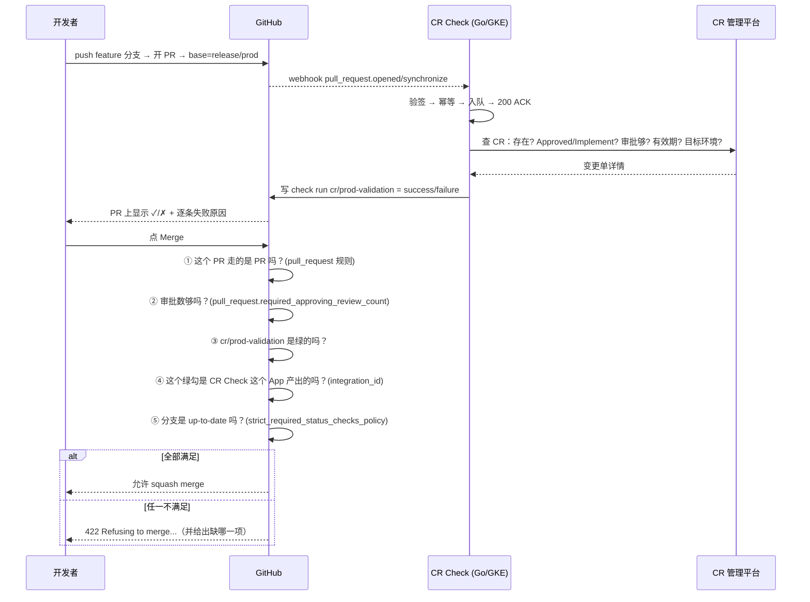

# 14 · GitHub Rulesets × GitHub App：合并门禁怎么落地（零基础 → 最佳实践）

> **副标题**：Ruleset 是什么、怎么配、和我们自研的 CR Check（GitHub App）怎么"咬合"，
> 以及在 Argo CD / GitOps 场景下三层门禁的正确分工。

> **一句话结论**
> **Ruleset 是「锁」，GitHub App 是「钥匙的判定逻辑」。**
> Ruleset 自己不会查 CR、不会跑校验、不会调用任何外部系统；
> 它只做一件事：**在 GitHub 层面强制"某条检查必须是绿的、必须由某个指定 App 产出、且必须走 PR"**。
> 真正算出"绿还是红"的是我们的 CR Check（GitHub App 后端）。
> **两者之间只有一根线：`required_status_checks` 里那个 `integration_id`。**
> 这根线接错了 → 门禁**静默失效**（比不设还危险），接对了 → 三层门禁闭环。

> **本文定位**
> - 面向**完全没碰过 Ruleset** 的人，从"它是什么"讲起；
> - 所有 API 字段名**逐字对齐 GitHub 官方 REST 文档**（已核对，见 §12）；
> - 所有配置都给出**可直接 `gh api` 落地的 JSON**，放在
> [`examples/rulesets/`](../examples/rulesets/)；
> - 并且配了一个**静态检查脚本** [`validate-rulesets.py`](../examples/rulesets/validate-rulesets.py)，
>   把"Ruleset 的 check 名字必须等于 `policy.yaml` 的 `checkName`"这类约束变成 CI 里能跑的断言。

---

## 目录

| 章节 | 内容 |
|---|---|
| [§0](#0-tldr) | TL;DR：10 条结论 |
| [§1](#1-先纠正一下你的心智模型先设规则-→-禁直连-main-→-调用-app) | **你的逻辑对不对**："先设规则 → 禁直连 main → 调用 App 校验" |
| [§2](#2-ruleset-零基础) | Ruleset 零基础：五个组成部分 / 两种 target / 分层叠加 / enforcement / bypass |
| [§3](#3-ruleset-规则清单按我们的用途分类) | 规则清单（25 条 API rule type）+ 三个最关心的规则详解 |
| [§4](#4-ruleset--github-app-的耦合核心章) | **核心章**：Ruleset ↔ App 只有一个耦合点，以及 4 种静默失效 |
| [§5](#5-落地ruleset-分层--你的分支拓扑) | 落地：6 条 ruleset 的完整 JSON + 与 legacy 14 步流程的逐条映射 |
| [§6](#6-argo-cd-场景的三道闸与-ruleset-的落点) | Argo CD 场景：三道闸的落点 / 部署门 / Bot 豁免 / 窗口归谁管 |
| [§7](#7-merge-queue把窗口过期仍能合并彻底解决) | Merge Queue：解决"check 缓存"这个死结 |
| [§8](#8-上线路线图先只报不拦--再强制与熔断) | 上线路线图 + 熔断开关 |
| [§9](#9-坑清单) | 坑清单（20 条） |
| [§10](#10-决策速查表--faq) | 决策速查表 / FAQ |
| [§11](#11-与本仓库既有文档的关系) | 与本仓库既有文档的关系与修正 |
| [§12](#12-关联文档与官方链接) | 关联文档与官方链接 |

---

## 0. TL;DR

1. **你的三句话方向是对的，但"调用"这个词要改。**
   Ruleset **不调用** GitHub App，也**不执行**任何校验逻辑。
   它只是**要求**："`cr/prod-validation` 这个 check 必须是绿的，而且必须由 CR Check 这个 App 产出"。
   App 是**独立运行的结论生产者**，Ruleset 是**结论的消费者**。

2. **正确的因果链是"先算后卡"，不是"先设后调"。**
   ```
   PR 事件 → App 判定 → 写 check run（绿/红） → Ruleset 要求它绿 → GitHub 阻止 merge
   ```
   Ruleset 配得再漂亮，App 没跑起来 = check 永远不绿 = **全员合不了**（fail-closed）。

3. **Ruleset 强制的是"流程与来源"，App 强制的是"业务合规"。**
   前者（禁直推、禁删分支、必须走 PR、必须 squash、几个 reviewer）是 Ruleset 的活；
   后者（有没有 CR 号、CR 是不是 Approved、审批够不够、是不是在维护窗口内）是 App 的活。
   **两边不要互相越界**（详见 §5.8）。

4. **Ruleset 与经典 branch protection 不是二选一**：官方明确——**两者同时命中同一分支时，规则聚合生效，最严格的那条为准**。
   所以"我已经有 branch protection 了，迁不迁 Ruleset"不是阻塞问题，可以并行跑。

5. **一个仓库可以有 75 条 ruleset**（组织级同理）。我们的做法是**分层**：
   组织级兜底 + 仓库级 feature 规范 / dev / release / main + 仓库级 push 规则，共 6 条。

6. **Ruleset 有一条极其危险的静默失效路径**：
   `required_status_checks` 的 `context`（check 名字）或 `integration_id` 写错 / 配漏
   → GitHub **不会报错**，只会"等一个永远不会来的 check"或"接受任何来源的同名 check"。
   **这比不配 Ruleset 更危险**（不配是明着没保护，配错是以为有保护）。
   → 所以 §4.5 单列了 4 种静默失效形态，并配了 `validate-rulesets.py` 做静态断言。

7. **要防同名 check 伪造，必须设 `integration_id`（expected source）**。
   不设 = 任何有写权限的人或任何 App 都能造一个叫 `cr/prod-validation` 的绿 check 把门禁骗过去。
   官方还要求该 App **必须安装且具备 `statuses:write` 权限**——我们的 App 目前只声明了 `checks:write`，**需要补一个 `Statuses: Write`**（见 §4.3）。

8. **Merge Queue 是"维护窗口"这个需求的标准解**。
   因为 required status check 是**按 head SHA 查已有结论**的，不会因为"时间过去了"重新判定。
   Merge Queue 会在**真正合并的那一刻**用 merge group 的新 SHA 重跑 check —— 而我们的 CR Check 已经订阅了 `merge_group` 事件（见 `policy.yaml`）。

9. **Ruleset 表达不了的东西要老实承认**：不能禁止"AI 提交 CR"、不能区分 annotated / lightweight tag、
   不能强制"所有 gcloud 必须在 jumpbox 上跑"、不能替代 CODEOWNERS 之外的流程规范。
   这些要靠 CI / 平台 / 审计 / 流程来兜（见 §5.8 的诚实清单）。

10. **上线的正确姿势：先"只报不拦"再"强制"。**
    `enforcement` 可以先设 `Disabled`（或 Enterprise 上用 `Evaluate` 试跑），
    App 先跑 1–2 个迭代确认事件丢失率 ≈ 0，再把 `required_status_checks` 打开。

---

## 1. 先纠正一下你的心智模型（"先设规则 → 禁直连 main → 调用 App"）

### 1.1 你的三句话拆开看

| 你的原话 | 判定 | 精确化后的说法 |
|---|---|---|
| "用了 rulesets，首先要设置一定的规则" | ✅ 对 | Ruleset = 一份**声明式规则清单**，描述"哪些分支、谁、必须满足什么条件才允许改" |
| "禁止直接 merge 到 master/main" | ⚠️ 半对 | 要拆成**三条不同的规则**：① 只允许通过 PR 改（`pull_request`）② 只允许 squash 合（`allowed_merge_methods`）③ 直推/强推/删分支被禁（`update`/`deletion`/`non_fast_forward`） |
| "然后在这个过程中去调用 Git Apps 去做一些严格的校验" | ⚠️ 方向对，措辞错 | **不是 Ruleset 调用 App**，是 **Ruleset 要求 App 的 check 必须绿**。App 收到 webhook 后**自己**判定、自己写 check；Ruleset 只在合并那一刻**看一眼这个 check 的结论** |

### 1.2 三段式心智模型：**算 → 要 → 拦**

```
┌─────────────┐        ┌──────────────┐        ┌────────────────────┐
│  ① 算        │        │  ② 要        │        │  ③ 拦              │
│  CR Check   │──────▶│  Ruleset     │──────▶│  GitHub 平台        │
│  (GitHub App)│  写    │  声明"这个    │  满足  │  执行 merge 前的     │
│             │  check │  check 必须绿"│        │  规则判定            │
│  规则 R1-R13a│        │              │        │                    │
│  查 CR 平台  │        │  不通过 →    │        │  不通过 → 422 拒绝   │
└─────────────┘        └──────────────┘        └────────────────────┘
   我们的代码              GitHub 配置              GitHub 平台
   (在 GKE 上)            (可进 Git、可审计)          (唯一真正的强制力)
```

| 段 | 谁做 | 产物 | 挂了会怎样 |
|---|---|---|---|
| ① 算 | **CR Check（我们的 Go 服务）** | 一个 check run：`success` / `failure` | check 永远不绿 → **全员合不了**（安全但阻塞） |
| ② 要 | **Ruleset**（GitHub 配置） | 声明"谁必须绿、必须 PR、必须 squash…" | 规则没覆盖的分支不受保护 → **门禁有缺口** |
| ③ 拦 | **GitHub 平台** | 拒绝 merge / 拒绝 push | —— |

> ★ **一句话记住**：
> **App 决定"合不合规"，Ruleset 决定"谁来执行这个决定"，GitHub 平台决定"不执行的后果"。**
> 三者缺一不可，但**你写的代码只在第①段**。

### 1.3 一次 PR 的完整时序（Ruleset 视角）



> ★ **注意第 ③④⑤ 步的顺序**：GitHub 是**逐条**评估并逐条报错的。
> 所以**check 名字配错时，GitHub 报的是"Expected — Waiting for status to be reported"**，
> 而不是"名字错了"——这就是静默失效难排查的原因（§9 坑 3）。

### 1.4 五个必须分清的东西（90% 的困惑都来自这里）

| # | 东西 | 是什么 | 在哪配 | 不是什么 |
|---|---|---|---|---|
| 1 | **Ruleset** | 一份命名规则清单 | Repo/Org → Settings → Rulesets | 不是 branch protection 的新名字，是**并存的另一套** |
| 2 | **Rule** | Ruleset 里的一条（要求 PR / 要求 status check / …） | 同上 | 不是我们业务上的"规则 R1–R13a" |
| 3 | **Target** | 这份 Ruleset 管哪些分支/标签 | `conditions.ref_name` | 不是"哪个 App" |
| 4 | **Required status check** | 规则的一种：必须绿的 check 名 + 来源 App | `required_status_checks[]` | 不是 CI 流水线本身 |
| 5 | **Check run** | App 写在某个 SHA 上的一条结论 | 由 App 的 API 产生 | 不是 review（review 是人给的，check 是机器给的） |

---

## 2. Ruleset 零基础

### 2.1 一句话定义与五个组成部分

> **官方定义**：*A ruleset is a named list of rules that applies to a repository or to multiple repositories in an organization.*

一条 Ruleset = **5 个部分**：

```
┌──────────────────────────────────────────────────────────────────────┐
│ name         名字（人类可读，出现在 PR 的合并框里）                     │
│ target       branch | tag | push            ← 管分支 / 管标签 / 管推送 │
│ enforcement  active | disabled | evaluate    ← 生效状态                │
│ conditions   管哪些 ref（fnmatch 模式）                                │
│ rules        []  ← 真正的规则条目                                        │
│ bypass_actors[]  谁可以绕过（★ 双刃剑，见 §2.5）                        │
└──────────────────────────────────────────────────────────────────────┘
```

**一个具体的例子**（我们最终想要的那条，先建立直觉）：

```json
{
  "name": "prod-main-gate",
  "target": "branch",
  "enforcement": "active",
  "conditions": {
    "ref_name": { "include": ["refs/heads/main", "refs/heads/release/prod"], "exclude": [] }
  },
  "bypass_actors": [],
  "rules": [
    { "type": "pull_request", "parameters": {
        "required_approving_review_count": 2,
        "dismiss_stale_reviews_on_push": true,
        "require_code_owner_review": true,
        "require_last_push_approval": true,
        "required_review_thread_resolution": true,
        "allowed_merge_methods": ["squash"] } },
    { "type": "required_status_checks", "parameters": {
        "required_status_checks": [
          { "context": "cr/prod-validation", "integration_id": 123456 }
        ],
        "strict_required_status_checks_policy": true } },
    { "type": "required_deployments", "parameters": {
        "required_deployment_environments": ["staging"] } }
  ]
}
```

> 读法：**"往 `main` / `release/prod` 上改东西，只能走 PR；PR 要 2 个人批；
> 必须有一个叫 `cr/prod-validation` 的检查是绿的，而且这个检查只能由 App #123456 产出；
> 分支必须是最新的；合并方式只能是 squash；而且必须先成功部署到 `staging` 环境。"**

### 2.2 两种 target：branch/tag ruleset vs push ruleset

| target | 作用范围 | 能管什么 | 我们的用法 |
|---|---|---|---|
| `branch` | 匹配到的**分支** | 谁能改、怎么改、合并前要满足什么 | ★ 主战场：main / release/* / dev |
| `tag` | 匹配到的**标签** | 谁能创建/改/删 tag、要不要签名 | 保护 `v*` release tag 不被误删 |
| `push` | **整个仓库的每一次 push**（含整个 fork 网络） | 按**文件路径 / 扩展名 / 文件大小**拦截推送 | ★ 禁密钥文件、禁大文件（对应"no secrets in commits"） |

> ⚠️ **push ruleset 与 branch ruleset 是两个独立的东西**：
> 前者不看分支只看文件内容，后者不看文件只看分支与流程。
> 我们的"禁止把密钥提交进仓库"属于 **push ruleset**（`file_extension_restriction` / `file_path_restriction`），
> 不是 branch ruleset 能表达的。

### 2.3 规则分层与叠加（★ 官方保证，最容易被误解的一条）

官方原文要点：

> *A ruleset does not have a priority. Instead, if multiple rulesets target the same branch or tag in a repository, the rules in each of these rulesets are aggregated. If the same rule is defined in different ways across the aggregated rulesets, the most restrictive version of the rule applies.*
> *Rulesets and branch protection rules can both protect branches in a repository. **They work alongside each other, and all applicable rules are enforced.***

翻译成人话：

```
① 同一个分支被多条 ruleset 命中 → 规则【叠加】，不是【覆盖】
② 同一条规则在多处定义不同 → 取【最严格】的那条
③ ruleset 与经典 branch protection 命中同一分支 → 也叠加，全都生效
④ ruleset 没有"优先级"字段（别去找 priority）
```

**这对我们的直接含义**：

| 场景 | 结果 |
|---|---|
| 组织级 baseline 说"要 1 个 reviewer"，仓库级 prod 说"要 2 个" | 生效 **2 个**（最严格） |
| 我们已有 branch protection 勾了"必须 PR"，又加了 ruleset"必须 PR" | 两者都生效，**不会互相覆盖** |
| 想"关掉"某条规则 | **不能靠加一条更宽松的规则去抵消**（聚合只会取更严的）→ 必须**改/删**原来那条 |

> ★ **推论（重要）**：Ruleset **只增不减**。
> 所以我们的策略是"**先少后多**"：上线时只配最必要的几条，后续用**新 ruleset 加严**，
> 而不是"先配严、发现问题再放宽"（放宽需要改历史 ruleset，容易漏）。

### 2.4 enforcement 三态

| 值 | 含义 | 什么时候用 |
|---|---|---|
| `active` | **立即强制** | 门禁真正上线 |
| `disabled` | **存在但不执行** | ★ 新建时的默认值；先建好、验证 JSON 没问题再开 |
| `evaluate` | **只评估不阻断**（可在 Rule Insights 页看命中情况） | ★ **仅 GitHub Enterprise** 可用；上线前灰度神器 |

> 推荐节奏：**`disabled` 建好 → 手工点开 → `active`**；
> 如果是 Enterprise 团队，先用 `evaluate` 观察一周再 `active`。

### 2.5 bypass_actors：门禁的钥匙孔（★ 双刃剑）

谁能拿到"绕过"权限（官方列出的候选）：

```
Repository admins / Organization owners / Enterprise owners
maintain 或 write 角色（或基于 write 的自定义角色）
Team（不含 secret team）
GitHub Apps ★ ← 包括 Dependabot，也包括我们自己写的 App
```

API 形态：

```json
"bypass_actors": [
  { "actor_id": 123, "actor_type": "OrganizationAdmin", "bypass_mode": "always" },
  { "actor_id": 456, "actor_type": "Team",             "bypass_mode": "pull_request" },
  { "actor_id": 789, "actor_type": "Integration",      "bypass_mode": "always" }
]
```

`bypass_mode` 三态：

| 值 | 语义 | 我们的取舍 |
|---|---|---|
| `always` | 完全绕过（可直接 push） | ❌ 生产分支不给任何人 `always` |
| `pull_request` | **仍必须走 PR**，但合并时可以跳过规则 | ★ **给紧急通道/管理员的推荐值**（留审计痕迹） |
| `exempt` | 规则完全不跑，**且不留 bypass 审计记录** | ❌ 生产分支禁用 |

> ★★ **最危险的一条**：
> 如果把 **CR Check 自己**（`actor_type: "Integration"`）加进 `bypass_actors`，
> 那么 **App 就同时拿到了"发结论"和"跳过规则"两把钥匙** ——
> 一次 App 故障或一次误配置就可能让整条门禁被跳过。
> **规则：CR Check 的 App ID 永远不出现在任何生产 ruleset 的 `bypass_actors` 里。**
> → 这一条被写成了 `validate-rulesets.py` 的断言（§5.2 / §9 坑 12）。

### 2.6 与经典 branch protection 的关系 + 迁移

| 维度 | 经典 branch protection | Ruleset |
|---|---|---|
| 同一个分支能配几套 | **只能 1 套** | **可以多套**（叠加聚合） |
| 能不能改生效状态而不删掉 | ❌（改就是改） | ✅（`active` ↔ `disabled`） |
| 谁能看 | 需要管理员权限 | **任何有读权限的人**都能看 active ruleset → 开发知道规则是什么 |
| 跨仓库统一治理 | ❌ 要仓库一个个配 | ✅ 组织级 ruleset 一次覆盖（**需 Enterprise 计划**） |
| 能不能管"推送内容"（文件路径/扩展名/大小） | ❌ | ✅（push ruleset） |
| 能不能管 tag / commit message / 分支名模式 | 部分 | ✅ 更全 |
| 审计 | 弱 | 有 ruleset 版本历史（`GET /rulesets/{id}/history`） |

**结论**：**不需要"迁移"才能用 Ruleset**。
两者可以并存（官方明确会叠加生效）。建议：

```
阶段 1：保留原有 branch protection 不动
阶段 2：新建 ruleset（先 disabled）→ 用 evaluate/disabled 验证
阶段 3：确认 ruleset 覆盖了 branch protection 的全部约束后，再删 branch protection
```

> ⚠️ **不要在阶段 3 之前删 branch protection**：
> 叠加时"取最严格"，所以并存期间不会掉保护；
> 但删掉之后如果 ruleset 少配了某条（比如漏了 CODEOWNERS 评审），保护会**直接掉**，没有过渡期。

---

## 3. Ruleset 规则清单（按我们的用途分类）

### 3.1 全量 API rule type（已逐字核对官方 REST 文档）

| # | API `type` | 中文 | 我们的用途 | 归类 |
|---|---|---|---|---|
| 1 | `pull_request` | 合并前必须走 PR | ★ 核心：禁止直推 main | 流程 |
| 2 | `required_status_checks` | 必须通过指定的 status check | ★ 核心：接住 CR Check 的结论 | **耦合** |
| 3 | `required_deployments` | 必须先成功部署到指定环境 | ★ staging 先行门 | 流程 |
| 4 | `merge_queue` | 必须走 merge queue 合并 | ★ 解决 check 缓存问题（§7） | 流程 |
| 5 | `required_linear_history` | 必须线性历史（禁 merge commit） | 与"只允许 squash"呼应 | 流程 |
| 6 | `non_fast_forward` | 禁 force push | 保护已合入的历史 | 流程 |
| 7 | `required_signatures` | commit 必须签名 | 高价值仓库可开（★ 见 §5.8 边界） | 流程 |
| 8 | `creation` | 只允许有权限的人创建匹配的 ref | 防止乱建 `main` / `release/*` | 流程 |
| 9 | `update` | 只允许有权限的人直接 push（绕过 PR 的例外名单） | ★ 唯一"直推白名单"入口 | 流程 |
| 10 | `deletion` | 禁止删除匹配的 ref（默认开启） | ★ 保护 release 分支 / tag | 流程 |
| 11 | `required_reviewers` | 按文件模式要求指定团队审批 | ★ 改 `apps/prod/**` 必须平台组批 | 流程 |
| 12 | `required_code_scanning` | 代码扫描结果必须达标 | 可选 | 安全 |
| 13 | `code_quality` / `code_coverage` | 质量 / 覆盖率阈值 | 可选 | 安全 |
| 14 | `commit_message_pattern` | commit message 必须匹配模式 | ★ Conventional Commits | 规范 |
| 15 | `commit_author_email_pattern` | 作者邮箱模式 | 可选 | 规范 |
| 16 | `committer_email_pattern` | 提交者邮箱模式 | 可选 | 规范 |
| 17 | `branch_name_pattern` | 分支名必须匹配 | ★ `feature/CAEP-xxxx-*` | 规范 |
| 18 | `tag_name_pattern` | tag 名必须匹配 | ★ `vX.Y.Z` | 规范 |
| 19 | `workflows` | 限制可用的 GitHub Actions workflow | 可选 | 规范 |
| 20 | `file_path_restriction` | 禁改指定路径 | ★ 禁删 release 目录 | push |
| 21 | `file_extension_restriction` | 禁提交指定扩展名 | ★ 禁 `.pem` / `.key` / `.p12` | push |
| 22 | `max_file_size` | 单文件大小上限 | 禁大二进制 | push |
| 23 | `max_file_path_length` | 路径长度上限 | 可选 | push |
| 24 | `code_scanning` / `secret_scanning` | 安全扫描 | ★ 禁密钥（比扩展名更彻底） | push |
| 25 | `copilot_code_review` / `license_compliance_scanning` | Copilot / 许可证 | 可选 | 安全 |

> ★ **第 1、2、3 条就是我们要的"CR 校验三件套"**：
> **必须走 PR（流程） + 必须有 CR Check 的绿勾（业务） + 必须先部署成功（环境）**。

### 3.2 三个最关心的规则详解

#### ① `pull_request` —— "禁止直接 merge 到 main"

```json
{ "type": "pull_request", "parameters": {
    "required_approving_review_count": 2,
    "dismiss_stale_reviews_on_push": true,
    "require_code_owner_review": true,
    "require_last_push_approval": true,
    "required_review_thread_resolution": true,
    "allowed_merge_methods": ["squash"],
    "required_reviewers": [
      { "reviewer": { "id": 456, "type": "Team" },
        "file_patterns": ["apps/prod/**", "clusters/prod-*/**"],
        "minimum_approvals": 1 }
    ] } }
```

| 参数 | 语义 | 为什么我们要 |
|---|---|---|
| `required_approving_review_count` | 需要几个 approving review | legacy 要求"code(1) + release owner(1)" → 生产取 2 |
| `dismiss_stale_reviews_on_push` | 推新 commit 后旧的批准作废 | ★ 防"先批后改" |
| `require_code_owner_review` | 改到 CODEOWNERS 文件必须其 owner 批 | 门禁配置自身的递归防护（§4.6） |
| `require_last_push_approval` | 最后一次 push 必须由非 push 者批 | 防"自己推自己批" |
| `required_review_thread_resolution` | 所有评论必须 resolved | 防止"口头说了没记录" |
| `allowed_merge_methods` | 只允许哪些合并方式 | ★ legacy 明确"squash / linear history" |
| `required_reviewers` | 按文件模式要求指定团队 | ★ 改生产目录必须平台组批 |

> ⚠️ **官方注意**：`dismiss_stale_reviews_on_push` 与 `require_last_push_approval` 同时开启时，
> **手工在本地创建 merge commit 再直接 push 到受保护分支会被拒绝**（除非内容与 GitHub 生成的 merge 完全一致）。
> 这正是我们要的。

#### ② `required_status_checks` —— "接住 CR Check 的结论"（★ 唯一的耦合点）

```json
{ "type": "required_status_checks", "parameters": {
    "required_status_checks": [
      { "context": "cr/prod-validation", "integration_id": 123456 }
    ],
    "strict_required_status_checks_policy": true,
    "do_not_enforce_on_create": true } }
```

| 参数 | 语义 | 陷阱 |
|---|---|---|
| `context` | check 的名字 | ★ **必须与 App 写出的 check `name` 逐字符一致**（含斜杠） |
| `integration_id` | 这个 check 必须由哪个 GitHub App 产出 | ★ **不填 = 任何来源都算** → 同名伪造可绕过门禁 |
| `strict_required_status_checks_policy` | 分支必须 up-to-date 才能合 | `true` = strict；`false` = loose |
| `do_not_enforce_on_create` | 创建分支时不校验 check | 避免"新建 `release/*` 时因为没 check 卡住" |

**strict vs loose 的取舍**：

| | Strict（`true`） | Loose（`false`） |
|---|---|---|
| 合并要求 | topic 分支必须已同步 base 的最新提交 | 不要求 |
| 代价 | base 变了要重新跑一遍 CI（慢） | 快 |
| 风险 | 低（合进去的一定是最新代码） | 中（base 后来变了，合并结果可能不再通过 CI） |
| 我们的选择 | ★ `true`（`release/prod` 这种低频分支，延迟可接受） | `dev` 可以用 `false` |

#### ③ `required_deployments` —— "先部署成功才允许合"

```json
{ "type": "required_deployments", "parameters": {
    "required_deployment_environments": ["staging"] } }
```

语义：**必须先成功部署到 `staging` 环境，才允许合并到目标分支**。
这是 GitHub 原生能力，**不需要我们写任何代码**，但要求：
`staging` 必须是一个真实的 **Deployment environment**（Settings → Environments），
且需要有东西在"部署成功"时上报状态。

> ★ **在 Argo CD 场景里怎么接**（这是我们最关心的一环，见 §6.2）：
> GitHub Environment 的 deployment status 不是 Argo CD 自动上报的，
> 需要一个**桥**（见 §6.2 的三种接法）。

---

## 4. Ruleset ↔ GitHub App 的耦合（核心章）

### 4.1 唯一耦合点：`required_status_checks.integration_id`

```
┌──────────────── Ruleset（GitHub 侧配置） ────────────────┐
│  rules: [                                                 │
│    { type: "required_status_checks", parameters: {        │
│        required_status_checks: [                          │
│          { context: "cr/prod-validation",  ← 名字契约      │
│            integration_id: <CR_CHECK_APP_ID> } ← 来源契约  │
│    ] } }                                                  │
└──────────────────────────────────────────────────────────┘
                          ▲
                          │  App 写出的 check run 必须满足这两个约束
                          │
┌──────────────── CR Check（我们的 Go 服务） ──────────────┐
│  CreateCheckRun{ name: "cr/prod-validation",             │
│                  head_sha: <PR head SHA>,                 │
│                  status: completed,                       │
│                  conclusion: success|failure }            │
└──────────────────────────────────────────────────────────┘
```

**除此之外，Ruleset 和 App 之间没有任何其他耦合**：

| | Ruleset 关心 | App 关心 |
|---|---|---|
| 分支 | 哪些 ref 受保护 | `policy.yaml` 的 `managedBranches`（判定范围） |
| check 名字 | `context` | `policy.yaml` 的 `checkName` |
| 来源 | `integration_id` | 自己的 App ID |
| 业务规则 | **完全不懂** | R1–R13a |

> ★ **所以两条配置必须人工保持一致**：
> `policy.yaml: checkName` ↔ `ruleset: required_status_checks[].context`。
> 这就是 `validate-rulesets.py` 存在的唯一理由（§5.2）。

### 4.2 三条必须逐字符 / 逐 ID 对齐的契约

| # | 契约 | 左边 | 右边 | 错了的后果 |
|---|---|---|---|---|
| **C1** | check 名字 | `cr-check/config/policy.yaml` → `checkName: cr/prod-validation` | ruleset → `context` | ★ **静默**：GitHub 永远等一个不存在的 check → 全员卡住 |
| **C2** | App 来源 | GitHub App 的 **App ID** | ruleset → `integration_id` | ★ **静默 + 危险**：任何同名 check 都能骗过门禁 |
| **C3** | 分支范围 | `policy.yaml` → `managedBranches` | ruleset → `conditions.ref_name.include` | ★ **静默**：App 不判的分支 vs Ruleset 保护的分支不一致 |

> ★ **C3 的方向性**：`managedBranches` ⊆ `ruleset.include`。
> 如果 Ruleset 保护了 `main`，但 App 的 `managedBranches` 里没有 `main`，
> 那么**往 main 合的 PR 永远不会出现 `cr/prod-validation` 这个 check** →
> GitHub 会一直等 → **全员合不了**（fail-closed，但会以为是我们 App 挂了）。
> 反过来（App 管了但 Ruleset 没保护）＝**门禁缺口**（静默放行）→ 更危险。

### 4.3 为什么 App 还要加 `Statuses: Write` 权限

官方原文（选 expected source 时）：

> *The app must be installed in the repository with the `statuses:write` permission,
> must have recently submitted a check run, and must be associated with a pre-existing required status check in the ruleset.*

拆成三个前置条件：

```
① App 必须装在这个仓库上，且权限里有 statuses:write
② App 必须"最近提交过一个 check run"        ← ★ 所以要先跑一次 PR 判定，才能在 UI 里选到它
③ 该 check 必须是 ruleset 里已存在的 required status check
```

> ★ **对我们的直接影响（两条改动）**：
> 1. **CR Check App 的权限清单要加 `Statuses: Write`**。
>    我们目前只用 Checks API（`checks:write`）写 check run，功能上不需要 `statuses:write`；
>    但**没有它就没法在 ruleset 里把我们的 App 指定为 expected source** → C2 契约无法成立 → 门禁可被同名伪造绕过。
>    （★ 标注为**部署前验证项**：以你们实际 GitHub 版本 UI 里能否选中该 App 为准。）
> 2. **配置顺序**：必须先让 App 在目标仓库跑出过一次 check run，再去建 ruleset 选它。
>    → 这也决定了 §8 上线路线图的顺序。

### 4.4 App 挂了会怎样：fail-closed（安全但阻塞）

```
CR Check 服务宕机 / 出网不通 / 私钥失效 / CR 平台超时
   ↓
App 写不出 check run（或者写出 failure）
   ↓
GitHub 看到 required check "Expected — Waiting for status to be reported"
   ↓
Merge 按钮禁用 → 全员合不了
```

**这是对的设计**（fail-closed），但必须配套两件事：

| 事项 | 做法 |
|---|---|
| **熔断开关** | 提前约定"谁有权、用什么方式、在多久内"临时降级（把 check 从 required 移除 / 临时 `disabled` ruleset） |
| **可观测性** | 监控 `cr_check_webhook_received_total` 掉零、`cr_check_checks_written_total` 掉零、队列深度上涨（指标见 [`13-cr-check-go-design.md`](./13-cr-check-go-design.md) §12） |

> ⚠️ **不要把"App 挂了"做成"自动放行"**。
> 那等于门禁有个后门，攻击者只要让 App 挂掉就能绕过。
> 熔断必须是**人工、有时限、有审计**的动作。

### 4.5 ★ 四种静默失效形态（本节是全文最重要的部分）

| # | 失效形态 | 现象 | 根因 | 检测手段 |
|---|---|---|---|---|
| **S1** | **check 名字不匹配** | PR 上永远等 "Waiting for status to be reported" | `context` ≠ App 写的 `name` | `validate-rulesets.py`（静态） |
| **S2** | **来源没限定** | 门禁形同虚设：随便造个同名绿 check 就过 | 缺 `integration_id` | `validate-rulesets.py`（静态） |
| **S3** | **分支范围不一致** | 往 `main` 合永远等 check（卡死），或 App 判了但 Ruleset 没保护（放行） | `managedBranches` ⊄ `ref_name.include` | `validate-rulesets.py`（静态）+ 联调 |
| **S4** | **App 事件丢失 / 出网不通** | PR 上没有 check（不是红，是**没有**） | webhook 没到 / 写不回 | `cr_check_recheck_flipped` 指标 + 巡检 |

> ★ **S1/S2/S3 都可以在"合一个测试 PR"时一次性暴露**：
> 所以 §8 的路线图第一步永远是"**在测试仓库上合一个故意不合规的 PR**"。

### 4.6 App 保护自己：递归防护

我们的 CR Check 服务本身也是"被 Argo CD 部署的应用"，也就是"一个可以被 PR 改的东西"。
如果有人提一个 PR 把 `policy.yaml` 的 `checkName` 改了 → C1 立刻断裂 → 门禁失效。

**四道防线**（Ruleset 侧能表达两道，代码侧两道）：

```
防线 1（Ruleset）：CR Check 所在仓库的 main 分支本身受一条 ruleset 保护
                   → 要求 PR + CODEOWNERS 评审 + 2 个 reviewer
防线 2（Ruleset）：规则集里对 CR Check 仓库不开 bypass_actors
防线 3（CODEOWNERS）：cr-check/config/** 的 owner = 平台组（require_code_owner_review）
防线 4（配置自洽）：validate-rulesets.py 在 CI 里断言 C1/C2/C3 → 改坏了 CI 就红
```

> ★ **防线 4 是本文新增的**：
> 在没有 Ruleset 之前，"改坏 checkName"这件事没有任何东西能发现；
> 有了 `validate-rulesets.py` 之后，**它会在 CI 里失败**，而不是在生产事故里被发现。

---

## 5. 落地：Ruleset 分层 × 你的分支拓扑

### 5.1 分支拓扑与 ruleset 分配

沿用 legacy release workflow 的 4 层分支拓扑（`/Users/lex/git/caep-infra-gcp-release/legacy/release-workflow-architecture.html`），
并与 `cr-check/config/policy.yaml` 的 `managedBranches` 对齐：

| 分支 | 角色 | 谁能改 | 合并方式 | 目标环境 | 受哪条 ruleset |
|---|---|---|---|---|---|
| `feature/CAEP-xxxx-*` | 开发 | 开发者自由 push | — | dev | **R4**（只做规范：分支名 / commit message） |
| `dev` | 集成 | 走 PR，1 reviewer | squash | dev | **R2** |
| `release/prd` | 预发候选 | 走 PR，2 reviewer | squash | prd | **R3** |
| `release/prod` | 生产候选 | 走 PR，2 reviewer + CR | squash | prod | **R3 + R1**（叠加取最严） |
| `main` | 生产 | 走 PR，2 reviewer + CR + 部署门 | squash | prod | **R1** |

> ⚠️ **两处需要你们拍板的对齐点**（都在 §8 的 M1 阶段处理）：
>
> **① `main` 不在 `managedBranches` 里**
> 当前 `policy.yaml` 只有 `release/prd` / `release/prod`，
> `main` 被注释掉了（`# - main  # 若 main 直接对 PRD，需加入`）。
> 但 legacy 流程里 **`main` 才是真正的生产分支**（步骤 14a）。
> → 这是 C3 契约的一个实际违例：
> 要么把 `main` 加进 `managedBranches`，要么明确"`main` 不直连 PRD，prod 走 `release/prod`"。
> **本文的规则集按后者写**（`main` 仍受 R1 保护，但 CR 判定绑在 `release/prod`）。
>
> **② 分支命名两套并存**
> legacy 用 `release/vX.Y.Z`，`cr-check/config/policy.yaml` 用 `release/prd` / `release/prod`，
> legacy 的主分支叫 `main`，cr-check 的 `branchEnvMap` 里也有 `main: prd`。
> → **必须定死一套字面量**（建议：`main` / `release/prd` / `release/prod` / `dev` / `feature/CAEP-*`），
> 并让 `policy.yaml`、ruleset 的 `ref_name`、CODEOWNERS 三处用同一套。
> 否则会出现"App 判的分支"和"Ruleset 管的分支"对不上的静默缺口。

### 5.2 六条 ruleset 的职责切分

```
┌─ R4 · feature 分支规范（repo ruleset, target=branch）──────────────┐
│  范围: refs/heads/feature/**                                     │
│  规则: branch_name_pattern + commit_message_pattern              │
│  目的: 名字/提交信息不合规的分支根本创建不出来                      │
│  文件: 06-repo-feature-conventions.json（功能分支：PR + CI check）    │
└───────────────────────────────────────────────────────────────────┘
┌─ R2 · dev 集成分支（repo ruleset, target=branch）──────────────────┐
│  范围: refs/heads/dev                                            │
│  规则: PR 必需 + 1 reviewer + CI check + 禁直推/禁删/禁强推         │
│  目的: 快速通道 —— 挡住明显不合格的代码，但不要求 CR                │
│  文件: 02-repo-dev-branches.json                                 │
└───────────────────────────────────────────────────────────────────┘
┌─ R3 · 发布候选分支（repo ruleset, target=branch）──────────────────┐
│  范围: refs/heads/release/**                                      │
│  规则: PR 必需 + 2 reviewer + CODEOWNERS + squash + 禁直推/禁删      │
│  目的: release 分支只能通过评审推进 —— 保住"发布候选"的不可变性     │
│  文件: 03-repo-release-branches.json                              │
└───────────────────────────────────────────────────────────────────┘
┌─ R1 · 生产分支（repo ruleset, target=branch）★ 核心 ──────────────┐
│  范围: refs/heads/main, refs/heads/release/prod                   │
│  规则: PR 必需 + 2 reviewer + ★ cr/prod-validation（限定来源）      │
│        + strict + 禁直推/禁删/禁强推 + 只允许 squash                │
│  目的: 真正的合并门                                                 │
│  文件: 04-repo-prod-branches.json                                 │
└───────────────────────────────────────────────────────────────────┘
┌─ R0 · 组织级基线（org ruleset, target=branch）────────────────────┐
│  范围: ~ALL 仓库 + ~DEFAULT_BRANCH                                │
│  规则: 禁删 + 禁强推 + 至少 1 reviewer + 必须 PR                   │
│  目的: 兜底 —— 任何新仓库自动继承底线                              │
│  文件: 01-org-baseline.json                                       │
└───────────────────────────────────────────────────────────────────┘
┌─ R5 · Push 规则（repo ruleset, target=push）──────────────────────┐
│  范围: 整个仓库的每一次 push                                        │
│  规则: 禁 .pem/.key/.p12 等扩展名 + 禁超大文件 + 禁改 release 归档  │
│  目的: "no secrets in commits" / "no release directory deletion"   │
│  文件: 05-push-secrets.json                                        │
└───────────────────────────────────────────────────────────────────┘
```

> ★ **★ rule type 的可用性因计划而异（实测）**：
> `commit_message_pattern` / `branch_name_pattern` / `merge_queue` / push ruleset
> 只在 **Enterprise 组织**可用；个人账号上 API 返回 `422`，**UI 导入还会静默丢弃**
> → ruleset 显示 active 但 `rules: []` → 什么都不拦。
> `pull_request` / `deletion` / `non_fast_forward` / `required_linear_history` /
> `required_status_checks` / `required_deployments` → **所有计划可用**。
> → 完整诊断见 [`16-ruleset-install-runbook.md`](./16-ruleset-install-runbook.md) §2.5。
>
> ★ **为什么是"分层"而不是"一条大 ruleset"**：
> ① 不同分支的**严格度不同**（dev 1 个 reviewer，prod 2 个 + CR）；
> ② 不同分支的**规则类型不同**（feature 要管分支名，prod 要管 check）；
> ③ **改动影响面小**：调 prod 规则不会碰 dev；
> ④ 官方支持"多条 ruleset 叠加、取最严"，天生适合分层。

### 5.3 R1 · 生产分支 ruleset（★ 核心，完整 JSON）

文件：[`examples/rulesets/04-repo-prod-branches.json`](../examples/rulesets/04-repo-prod-branches.json)

```json
{
  "name": "prod-branch-gate",
  "target": "branch",
  "enforcement": "active",
  "conditions": {
    "ref_name": {
      "include": ["refs/heads/main", "refs/heads/release/prod"],
      "exclude": []
    }
  },
  "bypass_actors": [
    { "actor_id": 42, "actor_type": "Team", "bypass_mode": "pull_request" }
  ],
  "rules": [
    { "type": "deletion" },
    { "type": "non_fast_forward" },
    { "type": "required_linear_history" },
    { "type": "pull_request", "parameters": {
        "required_approving_review_count": 2,
        "dismiss_stale_reviews_on_push": true,
        "require_code_owner_review": true,
        "require_last_push_approval": true,
        "required_review_thread_resolution": true,
        "allowed_merge_methods": ["squash"] } },
    { "type": "required_status_checks", "parameters": {
        "required_status_checks": [
          { "context": "cr/prod-validation", "integration_id": 123456 }
        ],
        "strict_required_status_checks_policy": true,
        "do_not_enforce_on_create": true } }
  ]
}
```

**逐条解释为什么这么配**：

| 规则 | 参数 | 对应 legacy 的哪条约束 |
|---|---|---|
| `deletion` | —— | "release 分支受保护" / "no release directory deletion" |
| `non_fast_forward` | —— | 保护已合入历史（force push = 绕过审批） |
| `required_linear_history` | —— | legacy 明确 "squash / merge commit → linear history" |
| `pull_request.required_approving_review_count: 2` | 2 个 reviewer | legacy "code (1) + release owner (1)" |
| `dismiss_stale_reviews_on_push` | 推新 commit 作废旧批准 | "PR-only + 必须重新判断" |
| `require_code_owner_review` | CODEOWNERS 必须批 | "门禁配置自身的递归防护" |
| `require_last_push_approval` | 非本人批最后次 push | 防"自己推自己批" |
| `allowed_merge_methods: ["squash"]` | 只允许 squash | legacy 步骤 8/14a "squash merge" |
| `required_status_checks[0].context` | `cr/prod-validation` | ★ **= `policy.yaml` 的 `checkName`（C1）** |
| `required_status_checks[0].integration_id` | CR Check 的 App ID | ★ **C2：防同名伪造** |
| `strict_required_status_checks_policy: true` | 必须 up-to-date | 生产分支宁可慢，不可合进过期代码 |
| `do_not_enforce_on_create: true` | 建分支不查 check | 新建 `release/prod` 时不会因为没 check 卡住 |

> ★ **bypass 设计**：
> 只给一个**应急组**（如 `release-owners` 团队）`pull_request` 模式 —— **仍必须走 PR**，只是合并时能跳过规则。
> 这样既保住了"有人能救火"，又保住了"每次救火都有 PR 记录和审计痕迹"。
> **绝不**给任何人 `always`；**绝不**给 CR Check App 任何 bypass。

### 5.4 R2 / R3 · dev 与 release 分支

| ruleset | 范围 | 与 R1 的差异 |
|---|---|---|
| R2 `dev-gate` | `refs/heads/dev` | reviewer **1**；**不要求** `cr/prod-validation`；`strict` = `false`（快） |
| R3 `release-candidate-gate` | `refs/heads/release/**` | reviewer **2**；**不要求** CR check（CR 校验在合到 main 时做）；禁直推/禁删 |

> ★ **为什么 release 分支不要求 CR check？**
> 因为 **CR（变更单）的语义是"这次生产变更"**，不是"这个分支上所有提交"。
> 一次 release 分支可能承载多个 CR。
> → **CR 校验的正确挂载点是"合到生产分支的那一个 PR"**，也就是 R1。
> （这与 legacy 流程完全一致：CR 在步骤 11 提，在步骤 13 等批准，步骤 14a 才合 main。）

### 5.5 R0 · 组织级基线 ruleset

文件：[`examples/rulesets/01-org-baseline.json`](../examples/rulesets/01-org-baseline.json)

```json
{
  "name": "org-baseline",
  "target": "branch",
  "enforcement": "active",
  "conditions": {
    "repository_name": { "include": ["~ALL"], "exclude": [] },
    "ref_name": { "include": ["~DEFAULT_BRANCH"], "exclude": [] }
  },
  "bypass_actors": [],
  "rules": [
    { "type": "deletion" },
    { "type": "non_fast_forward" },
    { "type": "pull_request", "parameters": {
        "required_approving_review_count": 1,
        "allowed_merge_methods": ["squash", "merge", "rebase"] } }
  ]
}
```

| 要点 | 说明 |
|---|---|
| `repository_name.include: ["~ALL"]` | 覆盖组织下所有仓库 |
| `ref_name.include: ["~DEFAULT_BRANCH"]` | 只管默认分支（不干扰 feature 分支） |
| reviewer 数 = 1 | **基线要低**，因为它对所有仓库生效；生产仓由 R1 加严到 2（叠加取最严） |
| `allowed_merge_methods` 三种都允许 | 基线不挑合并方式，各仓库自己加严 |

> ⚠️ **组织级 ruleset 需要 GitHub Enterprise 计划**（Team 计划可用仓库级）。
> → 标注为**部署前验证项**。

### 5.6 R5 · Push ruleset（禁密钥 / 禁大文件）

文件：[`examples/rulesets/05-push-secrets.json`](../examples/rulesets/05-push-secrets.json)

```json
{
  "name": "no-secrets-no-binaries",
  "target": "push",
  "enforcement": "active",
  "conditions": {},
  "rules": [
    { "type": "file_extension_restriction", "parameters": {
        "restricted_file_extensions": [".pem", ".key", ".p12", ".pfx", ".jks", ".keystore", ".ppk"] } },
    { "type": "file_path_restriction", "parameters": {
        "restricted_file_paths": ["releases/**", "**/*.tfstate"],
        "ignored_file_paths": [] } },
    { "type": "max_file_size", "parameters": { "max_file_size": 10 } }
  ]
}
```

| 规则 | 对应 legacy 约束 |
|---|---|
| `file_extension_restriction` | 🚫 **No secrets in commits**（用 Secret Manager） |
| `file_path_restriction`（`releases/**`） | 🚫 **No release directory deletion**（归档只增不改） |
| `file_path_restriction`（`*.tfstate`） | Terraform state 含明文敏感数据 → 禁入 Git |
| `max_file_size` 10（MB） | 禁大二进制进 Git（Argo CD 仓库尤其重要） |

> ⚠️ **push ruleset 与 branch ruleset 是两套独立机制**：
> 前者管"什么内容能进仓库"，后者管"什么流程能改分支"。
> 两者叠加生效，互不替代。
> ★ 标注为**部署前验证项**：push ruleset 的可用性随 GitHub 计划/版本变化。

### 5.7 与 legacy「14 步 / 4 Phase Gate」流程的逐条映射

> 来源：`/Users/lex/git/caep-infra-gcp-release/legacy/release-workflow-architecture.html`

| legacy 步骤 | legacy 的人工门禁 | **由谁自动执行** | 对应 ruleset 规则 |
|---|---|---|---|
| 3 · 建 `feature/CAEP-xxxx-*` | 分支命名规范 | **R4** | `branch_name_pattern` |
| 4 · commit | Conventional Commits | **R4** | `commit_message_pattern` |
| 4 · commit-msg hook | 本地 hook | **R4**（服务端强制，不依赖本地） | `commit_message_pattern` |
| 5 · 本地自测 | unit + lint | CI（Actions） | `required_status_checks`（CI 那个） |
| 6 · PR → dev，1 approver | 1 个 reviewer | **R2** | `pull_request.required_approving_review_count: 1` |
| 7 · jumpbox preflight（Gate 1） | 人工在 jumpbox 跑 | **Ruleset 表达不了** → CI / 平台侧 | 见 §5.8 |
| 8 · squash merge feature → dev | squash | **R2** | `allowed_merge_methods: ["squash"]` |
| 9 · setup/verify non-prod | jumpbox 脚本 | **Ruleset 表达不了** → 见 §5.8 | —— |
| 11 · raise CR（链接 release SHA） | 人工提 CR | **CR Check**（R1–R13a） | —— |
| 12 · 写 release notes + PR release → main | 1 approver on release | **R3** | `pull_request` |
| 13 · **等 CR 批准（Gate 3）** | ★ 人工等 CR 系统 | **★ CR Check 的 `cr/prod-validation`** | `required_status_checks[0].context` |
| 14a · squash merge → main | squash | **R1** | `allowed_merge_methods: ["squash"]` + `pull_request` |
| 14b · `git tag -a vX.Y.Z`（annotated） | 必须 annotated | ⚠️ **Ruleset 区分不了 annotated / lightweight** → 见 §5.8 | `tag_name_pattern`（只管名字） |
| 14c · prod release on jumpbox | jumpbox | **Ruleset 表达不了** | —— |
| 14d · close CR | 人工 | CR 平台侧 | —— |
| 强约束 · 禁直推 main | 人工纪律 | **R1 + R3** | `pull_request` + `update`（无白名单） |
| 强约束 · 禁 secrets in commits | 人工纪律 | **R5** | `file_extension_restriction` |
| 强约束 · 禁删 release 目录 | 人工纪律 | **R5** | `file_path_restriction` |
| 强约束 · 禁 AI 提交 CR | 人工纪律 | ❌ **Ruleset 表达不了** → 平台/审计侧 | 见 §5.8 |
| 强约束 · 所有 gcloud 必须在 jumpbox | 人工纪律 | ❌ **Ruleset 表达不了** → 环境/权限/审计侧 | 见 §5.8 |
| 强约束 · 4 层 reviewer（code + release owner + CR） | 人工纪律 | **R1（2 reviewer）+ CR Check（CR 审批）** | —— |

### 5.8 ★ Ruleset 表达不了的约束（诚实清单）

**这一节很重要**：不要指望"配了 Ruleset 就等于全都管住了"。

| legacy 约束 | 为什么 Ruleset 表达不了 | 正确兜底方式 |
|---|---|---|
| 所有 gcloud/kubectl/terraform 必须跑在 jumpbox | Ruleset 只管 GitHub 上的分支与 PR，**管不到"命令在哪执行"** | ① 开发者机器不装 gcloud/kubectl ② IAM 只授 jumpbox SA ③ 审计日志（Cloud Audit Logs）检测 ④ 需要时可用 `required_workflows` 规则限制 Actions |
| 禁止 AI 提交 CR | Ruleset 不知道"谁是人" | ① CR 平台侧强制"提单人 = GitHub 有写权限的人" ② 审计字段记录提交来源 ③ CODEOWNERS 要求人工复核 CR 号 |
| tag 必须是 annotated 而非 lightweight | GitHub 的 tag 规则集**不区分两种 tag** | ① tag ruleset 限制"谁能创建 tag"（只给 release bot / 负责人） ② CI 校验 `git cat-file -t <tag>` == `tag` |
| CR 平台的审批人必须是授权组的人 | Ruleset 只知道 GitHub 侧的人 | ★ **CR Check 侧**（`policy.yaml` 的 `allowedApprovers` / `approverGroups`）—— 这本来就是 App 的活 |
| "一次 PR 只对应一个 ticket" | 规则引擎层 | ★ **CR Check 侧**（R1a 唯一性） |
| 合并必须在维护窗口内 | Ruleset 没有"时间窗口"概念 | ★ **CR Check 侧**（R6w）+ **Merge Queue**（§7） |
| release 目录只增不删（归档语义） | `file_path_restriction` 能挡住 push，但"新增 `v1.2.3-rollback/`"是允许的 | R5 挡"改/删"，"新增归档目录"靠流程约定 + CODEOWNERS |

> ★ **分工原则**（回头看 §0 第 3 条）：
> **Ruleset 管"怎么改仓库"；App / CI / 平台管"改的内容对不对、谁做的、在哪做的"。**

---

## 6. Argo CD 场景的三道闸与 Ruleset 的落点

### 6.1 三道闸对照表

```
┌────────────────────────────────────────────────────────────────────────┐
│ 门禁 A · 合并门        GitHub Ruleset + CR Check                        │
│   位置: merge 之前       拦谁: 走 PR 的人                                 │
│   拦不住: 直接 kubectl / 直接改集群 / 绕过 PR 拿 admin 权限               │
├────────────────────────────────────────────────────────────────────────┤
│ 门禁 B · 同步门        Argo CD PreSync Hook / Extension                  │
│   位置: apply 之前      拦谁: Argo CD 自己（校验"这次发布的版本"合规）      │
│   拦不住: 绕过 Argo CD 的 kubectl                                          │
├────────────────────────────────────────────────────────────────────────┤
│ 门禁 C · 准入门        Gatekeeper / ValidatingAdmissionPolicy           │
│   位置: K8s API 写入时  拦谁: 所有人（含 Argo CD）                         │
│   拦不住: 绕过集群入口（基本不可能）                                        │
└────────────────────────────────────────────────────────────────────────┘
```

**Ruleset 只在门禁 A 里**。这是本节最重要的一句话：

> ★ **不要在 Ruleset 里试图表达"部署侧的事"。**
> Ruleset 的世界里只有"分支"和"PR"。
> 部署侧的校验（实际发布版本 ≠ PR head SHA、发布时机、部署环境）属于门禁 B/C，
> 详见 [`11-github-app-concepts.md`](./11-github-app-concepts.md) §11.3 与
> [`13-cr-check-go-design.md`](./13-cr-check-go-design.md) §1.5。

### 6.2 `required_deployments` 怎么接 Argo CD（★ 落地要点）

`required_deployments` 要求的是 **GitHub Deployment environment** 的成功状态。
但 **Argo CD 不会自动上报 GitHub deployment status**。三种接法：

| 接法 | 做法 | 优点 | 缺点 |
|---|---|---|---|
| **A. CR Check 顺手上报**（推荐） | CR Check 在判定通过后，调用 `POST /repos/{o}/{r}/deployments` 创建 deployment + `POST .../deployments/{id}/statuses` 报 success | 不引入新组件；CR Check 本来就知道"这个 PR 会部署到 staging" | ★ 要防止"假上报"——只有判定真绿才报 |
| **B. 独立 GitHub Actions** | 一个 workflow 监听 `deployment_status` / `workflow_run`，被 Argo CD 的 webhook 或巡检触发 | 与门禁解耦 | 多一个组件 |
| **C. Argo CD → GitHub** | Argo CD 的 post-sync hook / notification 调 GitHub API 上报 | 贴近真实部署结果 | 需要给 Argo CD 发 `statuses:write` 凭据；Argo CD 要能出网 |

> ★ **推荐 A**，理由：**门禁 A 的判定者就是 CR Check**，
> 它说"这个 PR 合规"的同时顺手说"它已部署到 staging"，
> 语义一致、时序一致、不引入第二个真相源。
>
> ⚠️ 但要小心一个语义陷阱：`required_deployments` 说的是
> "**这个 PR** 必须有成功的 deployment 记录"，不是"**main 分支**必须部署成功"。
> 如果要表达"main 的上一个 commit 已成功部署到 prod"，
> 需要 GitHub Deployment 的 `ref` 指向 main + `environment` = prod，
> 这属于**部署后校验**，通常放在门禁 B（Argo CD PreSync Hook）而不是门禁 A。

### 6.3 Argo CD / Bot 提的 PR 怎么豁免

在 GitOps 场景里，经常有"机器人提 PR"（Argo CD 自身、Renovate、Dependabot、Argo CD Image Updater）。

| 场景 | 处理方式 | 风险 |
|---|---|---|
| **Dependabot / Renovate 提依赖升级 PR** | ① 给它一个 `bypass_actors` 里 `actor_type: "Integration"` 的条目，`bypass_mode: "pull_request"`（仍走 PR，但可跳过规则）<br>② **或者**：让它们的 check 名不同，在 ruleset 里**不要求**它们的 check | ★ 别给 `always` |
| **Argo CD Image Updater** | 它通常直接改仓库文件（提 PR 或直接 push）→ 需要 `update` 规则的例外名单 | 给 `always` 前先确认它只改 image tag 字段 |
| **我们自己的发布机器人** | 优先走 **tag** 规则集（只允许它创建 tag），而不是给分支规则开 bypass | —— |
| **人（管理员）紧急救火** | 一个 `Team` + `bypass_mode: "pull_request"` | 每次都有 PR 审计痕迹 |

> ★ **绝对不要**把 **CR Check App** 放进 `bypass_actors`（§2.5）。
> `validate-rulesets.py` 会断言这一点。

### 6.4 时间窗口归谁管

| 时间概念 | 归属 | 机制 |
|---|---|---|
| **维护窗口**（"只有周二 02:00–04:00 允许上生产"） | ★ **CR Check**（R6w，`policy.yaml` 的 `windows`） | Ruleset **没有**时间窗口概念 |
| **CR 有效期**（"这张变更单 03-01 到 03-05 有效"） | ★ **CR Check**（R6） | 同上 |
| **同步窗口**（Argo CD 什么时候允许同步） | Argo CD Sync Window | 与合并门无关 |
| **发布分支的生命周期**（`release/vX.Y.Z` 什么时候能删） | Ruleset `deletion` + 人工 | —— |

> ★ **一条重要的分工原则**：
> **"能不能合" 由 CR Check 判（时间维度）；"什么时候允许同步" 由 Argo CD 判。**
> 两者可以叠，但**不要在两个地方各写一份时间表**（会漂移）。
> → 单一真相源建议放在 `cr-check/config/policy.yaml`，由 Argo CD 侧读同一份（或由 CR Check 暴露一个查询接口）。

### 6.5 不要把同步门和合并门的规则写两遍

| 规则 | 只写一处 | 原因 |
|---|---|---|
| "必须走 PR" | **Ruleset** | 合并门是唯一有效拦截点 |
| "必须有 CR 号且 Approved" | **CR Check**（R1–R7） | 同步门再查一遍 = 两个真相源 = 迟早不一致 |
| "必须走批准流程" | **CR Check** | 同上 |
| "必须部署成功才能合并" | **Ruleset**（`required_deployments`） | 这是 GitHub 原生能力，不要自己造 |
| "发布的实际版本必须合规" | **Argo CD PreSync Hook**（门禁 B） | 只有部署侧知道实际发布的 commit |

---

## 7. Merge Queue：把"窗口过期仍能合并"彻底解决

### 7.1 问题的本质（★ 这是 CR Check 需求里最难的一条）

```
10:00  CR 有效，CR Check 判定 → check = success ✅
10:05  维护窗口关闭
10:30  有人点 Merge
       GitHub 按 head SHA 查已有 check → 看到 success → 放行 ❌
```

**根因**：required status check 是"**按 SHA 查已有结论**"，不是"在 merge 时刻重新执行你的规则"。
GitHub 只知道"这个 SHA 上有个叫 `cr/prod-validation` 的 check 是绿的"，**不知道它是 10:00 算的**。

**三种解法**（详见 [`Develop-git-apps.md`](./Develop-git-apps.md) §7.3）：

| 解法 | 机制 | 评价 |
|---|---|---|
| 定时重扫 | CR Check 每 5 分钟重算，把结论从 success 翻成 failure | ✅ MVP 必备（`policy.yaml` 里 `recheckIntervalSeconds: 300`） |
| **Merge Queue** | 在 merge group 的**新 SHA** 上重跑 check | ✅✅ **语义最正确**（真正合并的那一刻判定） |
| 状态化建模 | 把"运行时条件"变成"状态条件"（CR 有效期覆盖目标时段） | ✅ 根治，但依赖 CR 平台模型 |

### 7.2 merge_group 与 CR Check 的对接（★ 我们已经准备好了）

官方事实：

- Merge queue 会创建**临时分支**（前缀 `gh-readonly-queue/{base_branch}`），其 SHA 与 PR head SHA **不同**；
- 触发方式是 **`merge_group` 事件**（独立于 `pull_request` / `push`）；
- 第三方 CI 需要在这个临时分支被 push 时触发。

**我们的 CR Check 已经订阅了 `merge_group`**（`cr-check/config/policy.yaml`：

```yaml
webhook:
  events:
    - pull_request
    - pull_request_review
    - check_run
    - merge_group      # ★ 已经在
    - installation
```

因此：

```
PR 入队 → GitHub 创建 merge group（gh-readonly-queue/main）
        → merge_group 事件 → 我们的服务收到
        → 在 merge group 的 head SHA 上跑同一套规则 R1–R13a
        → 写 check run（同名 cr/prod-validation，挂在 merge group SHA 上）
        → 合并时刻重新判定窗口 → 窗口关了就红 → 不能合
```

> ★ **这是 Merge Queue 相对定时重扫的核心优势**：
> 判定发生在**合并的那一刻**，而不是"最近 5 分钟内的某一次"。
> 对"维护窗口"这种时间敏感的规则，**这是唯一语义正确的做法**。

### 7.3 上线顺序（Merge Queue 相关的）

```
① 先开 Ruleset R1（不含 merge queue）→ 观察 1–2 周
② 确认 CR Check 事件丢失率 ≈ 0（指标 cr_check_recheck_flipped 长期为 0）
③ 给 CR Check 补 merge_group 处理（代码已有订阅，需验证真实 merge_group 事件）
④ 在 Ruleset 里加 "merge_queue" 规则（或在仓库设置里开 Require merge queue）
⑤ 观察 merge group 的 check 是否稳定变绿
```

> ⚠️ **部署前验证项**：
> merge queue 在**私有仓库**需要 GitHub Enterprise Cloud；
> `merge_group` 事件的 payload 结构随版本变化；
> `go-github` 版本要够新。

---

## 8. 上线路线图（先只报不拦 → 再强制）与熔断

| 阶段 | 做什么 | 验收标准 | 风险 |
|---|---|---|---|
| **M0 · 对口径** | 确认：受管分支清单、`checkName`、`App ID`、reviewer 数、窗口定义、CR 平台状态字面量 | 出一页《门禁契约表》（C1/C2/C3 三条契约写死） | 无 |
| **M1 · 对齐 C3** | 修 `policy.yaml` 的 `managedBranches`（`main` 要不要加？）+ `branchEnvMap` | `managedBranches` ⊆ ruleset `ref_name.include` | 无 |
| **M2 · 建 ruleset（disabled）** | 用 [`examples/rulesets/`](../examples/rulesets/) 的 JSON 建 6 条 ruleset，`enforcement: disabled` | `gh api /repos/{o}/{r}/rulesets` 能查到 | 无 |
| **M3 · 跑静态检查** | `python3 examples/rulesets/validate-rulesets.py` | 全绿（否则 CI 红） | 无 |
| **M4 · 只报不拦（1–2 迭代）** | CR Check 正常跑；`enforcement: disabled`；人肉看 PR 上的 ✓/✗ 是否正确 | 事件丢失率 ≈ 0；`cr_check_recheck_flipped` 长期 0；误报率可接受 | 无（不阻断） |
| **M5 · 强制 R1** | 把 R1 的 `enforcement` 改 `active` | ★ **用一个故意不合规的 PR 验证**：不带 CR 号 → 必须合不了；带合规 CR → 能合 | ⚠️ **这一步开始会卡人**，务必先约定熔断开关 |
| **M6 · 强制 R2/R3/R0/R5** | 逐条开 | dev 通道不卡死 | 低 |
| **M7 · 灰度 merge queue** | 见 §7.3 | 合并时刻能正确判窗口 | 中 |

### 熔断开关（★ 必须在上线前写清楚）

| 触发条件 | 谁执行 | 怎么执行 | 恢复方式 |
|---|---|---|---|
| CR Check 服务不可用 > 15 分钟 | **值班 SRE**（写进 oncall runbook） | `PATCH /repos/{o}/{r}/rulesets/{id}` → `enforcement: disabled` | 恢复后改回 `active` |
| CR 平台故障导致全员误拦 | CR 平台 owner + 平台 lead | 同上 | 同上 |
| 紧急生产变更（不等 CR） | release owner + 另一人 | ★ 走 `bypass_actors` 里的应急组的 `pull_request` bypass（**仍走 PR，有审计**） | 自动 |

> ⚠️ **熔断必须是人工动作，且必须留下"谁在什么时候把门禁关了"的记录**（ruleset 有版本历史 API）。
> 绝不允许"App 挂了自动放行"。

---

## 9. 坑清单

| # | 坑 | 表现 | 解法 |
|---|---|---|---|
| 1 | `context` 与 App 的 check 名不一致 | 永远 "Waiting for status to be reported" | C1；`validate-rulesets.py` 断言 |
| 2 | 少写 `integration_id` | 同名 check 可伪造，门禁形同虚设 | C2；静态断言 |
| 3 | App 没有 `statuses:write` 权限 | UI 里**选不到**我们的 App 作为 expected source | §4.3；部署前验证 |
| 4 | 顺序反了（先建 ruleset 再让 App 跑） | 下拉框里没有我们的 App | 先跑一次 PR 判定再建 ruleset |
| 5 | `managedBranches` ⊄ `ref_name.include` | 卡死（App 不判）或放行（Ruleset 不管） | C3；静态断言 |
| 6 | 以为 Ruleset 会"覆盖" branch protection | 保护掉了一半 | 官方：**叠加取最严**；迁移要逐条对齐后再删 |
| 7 | 以为可以"加一条宽松规则去抵消一条严格规则" | 加了没用（只会更严） | 只能改/删原规则 |
| 8 | 给了 `always` 模式的 bypass | 有人可以直推 main | 生产分支只给 `pull_request` 模式 |
| 9 | 把 CR Check App 加进 `bypass_actors` | App 同时握有"发结论"和"跳过规则"两把钥匙 | 永不加入；静态断言 |
| 10 | `enforcement` 忘了从 `disabled` 改 `active` | 以为配好了，其实没生效 | M5 验收：故意不合规的 PR 必须合不了 |
| 11 | `strict: true` 导致 base 一变全部要重跑 | 大家抱怨慢 | 低频分支用 strict；dev 用 loose |
| 12 | `required_deployments` 配了但没人上报 deployment status | 永远等部署 | §6.2；先确认上报通道存在再开这条规则 |
| 13 | 忘了 `do_not_enforce_on_create` | 新建 `release/prod` 分支时被卡 | 生产分支开这个参数 |
| 14 | push ruleset 与 branch ruleset 混淆 | 以为禁密钥要在 branch ruleset 里配 | 密钥/路径/大小 → push ruleset |
| 15 | 以为 Ruleset 能管"命令在哪执行" | 以为 jumpbox 约束被覆盖了 | §5.8 诚实清单 |
| 16 | 以为 tag 规则能区分 annotated / lightweight | CI 里才发现 tag 是 lightweight | tag 规则 + CI 校验 `git cat-file -t` |
| 17 | 合并方式配成 `merge` 而仓库禁了 merge commit | 合并被静默拦下 | `allowed_merge_methods` 必须与仓库设置兼容（官方明确） |
| 18 | 以为开了 merge queue 就自动解决窗口问题 | 窗口关了还是能合 | merge queue 需要 `merge_group` 事件被正确处理（§7.2） |
| 19 | `max_file_size` 写成字节（10485760） | 实际限制差 100 万倍 | ★ 官方单位是 **MB**：`"max_file_size": 10` |
| 20 | rule `parameters` 里字段名抄错（如 `restricted_file_paths_allowed`） | GitHub 返回 422，报错信息很难看懂 | `validate-rulesets.py` 内置官方字段白名单 |

---

## 10. 决策速查表 / FAQ

### 10.1 「我想表达 X，该用哪条规则？」

| 我想表达 | 规则 | 在哪配 |
|---|---|---|
| 不许直接 push 到 main | `pull_request`（要求 PR）+ 不配 `update` 例外 | R1 |
| 不许 force push | `non_fast_forward` | R1/R2/R3 |
| 不许删分支 | `deletion` | R1/R2/R3 |
| 只准 squash 合 | `pull_request.allowed_merge_methods: ["squash"]` | R1 |
| 至少 2 个人批 | `pull_request.required_approving_review_count: 2` | R1 |
| 推了新代码要重新批 | `pull_request.dismiss_stale_reviews_on_push: true` | R1 |
| 改生产目录要平台组批 | `pull_request.required_reviewers` | R1 |
| **必须 CR Check 通过** | `required_status_checks[].context` + `integration_id` | R1 |
| 分支必须是最新的 | `required_status_checks.strict_required_status_checks_policy: true` | R1 |
| 先部署到 staging 才能合 | `required_deployments` | R1 |
| 必须走 merge queue | `merge_queue` | R1（成熟期） |
| 分支名必须符合规范 | `branch_name_pattern` | R4 |
| commit message 必须符合规范 | `commit_message_pattern` | R4 |
| 不许提交密钥文件 | `file_extension_restriction`（push ruleset） | R5 |
| 不许改归档目录 | `file_path_restriction`（push ruleset） | R5 |
| 谁可以绕过 | `bypass_actors`（**用 `pull_request` 模式**） | 全部 |

### 10.2 FAQ

**Q1：Ruleset 会"调用"我的 GitHub App 吗？**
不会。App 自己跑、自己写 check；Ruleset 只是"要求这个 check 是绿的"。App 不跑 = check 不绿 = 合不了。

**Q2：我已经有 branch protection 了，要换吗？**
不用换，两者叠加、取最严。建议并存一段时间，确认 ruleset 覆盖完整后再删 branch protection。

**Q3：Ruleset 和 CR Check 哪个先配？**
**App 先跑起来**（至少成功写出一个 check run），再配 Ruleset 选它作为 expected source（§4.3 的前置条件）。

**Q4：CR Check 挂了全员合不了，怎么办？**
这是 fail-closed，正确行为。靠**熔断开关**（人工、限时、有审计）解，不是靠自动放行。

**Q5：能不能让 App 自己在窗口外"自动不写 check"，让 GitHub 认为不需要检查？**
❌ **绝对不能**。required status check 是"必须存在且为绿"，
"不存在" = 一直等 = 卡死；写 `neutral`/`skipped` = 被当作通过 = 开门（见 [`Develop-git-apps.md`](./Develop-git-apps.md) §8 坑 19）。

**Q6：我们还没买 Enterprise，能用吗？**
仓库级 ruleset 需要 **GitHub Team 或 Enterprise**；
**组织级 ruleset 需要 Enterprise**（★ 部署前验证项）。Merge queue 对私有仓库也需要 Enterprise Cloud。

**Q7：Ruleset 能不能管"合并必须在维护窗口内"？**
不能。Ruleset 没有时间维度。这条属于 CR Check（R6w），并用 Merge Queue 兜住"窗口关了仍能合"（§7）。

**Q8：多条 ruleset 都要求 status check，谁先算？**
不分先后，全部生效（聚合）。GitHub 会等所有 required check 都绿。

**Q9：怎么验证 Ruleset 真的生效了？**
① 提一个**故意不合规**的 PR（不带 CR 号）→ 必须合不了；
② 提一个**合规**的 PR → 能合；
③ `GET /repos/{o}/{r}/rulesets` 确认 `enforcement: active`；
④ 用 `gh api -X POST /repos/{o}/{r}/rulesets/{id}/history` 看变更审计。

**Q10：`update` 规则什么时候用？**
它是"直推白名单"的唯一合法入口：允许某些 actor 直接 push（比如 image updater）。
**我们默认不配 `update`** → 意味着除有 bypass 权限的人外，任何人都不能直推受保护分支。

---

## 11. 与本仓库既有文档的关系

| 既有文档 | 本文对其的关系 |
|---|---|
| [`11-github-app-concepts.md`](./11-github-app-concepts.md) §13/§15 | 那里说"真正拦住 merge 的是 branch protection 的 required status checks" —— **本文补齐**：现在 GitHub 的主推机制是 **Ruleset**（与 branch protection 叠加），且 Ruleset 多了 `integration_id`（来源限定）、`required_deployments`、`merge_queue`、push ruleset 等能力。**"App 阻止不了 merge" 这个结论仍然成立。** |
| [`13-cr-check-go-design.md`](./13-cr-check-go-design.md) §8 | 那里要求"分支保护里 required check **限定来源 App**" —— **本文落地为** `required_status_checks[].integration_id`，并补了 **App 需要 `statuses:write`** 这个前置条件（§4.3）。 |
| [`Develop-git-apps.md`](./Develop-git-apps.md) §7.2 | "check 缓存"问题 —— **本文给出正解路径**：Merge Queue（§7）。 |
| [`cr-check/config/policy.yaml`](./cr-check/config/policy.yaml) | `checkName` / `managedBranches` 是 C1/C3 契约的**右边**；本文新增静态检查把它们和 ruleset JSON 绑在一起。 |
| [`../06-opa-gatekeeper-impact.md`](../06-opa-gatekeeper-impact.md) | 三道闸（合并门 / 同步门 / 准入门）里，**只有合并门在 Ruleset 里**，另外两道是 Argo CD / K8s 侧的事。 |
| [`../07-repository-githubapp.md`](../07-repository-githubapp.md) | 那是 Argo CD 用的 **形态 A** App；本文的 CR Check 是 **形态 B**，两个 App 必须分开（一个 App 只有一个 Webhook URL）。 |

> ★ **本文新增的两个仓库级资产**：
> ① [`examples/rulesets/`](../examples/rulesets/) —— 4 份可直接落地的 ruleset JSON + 1 个应用脚本；
> ② `examples/rulesets/validate-rulesets.py` —— 把 C1/C2/C3 三条契约变成 CI 断言。

---

## 12. 关联文档与官方链接

### 12.1 本仓库

| 主题 | 文档 |
|---|---|
| ★ CR Check 的 Go 实现 | [`cr-check/`](./cr-check/) |
| 自研 App 可行性评估 / R0–R13a / 24 条坑 | [`Develop-git-apps.md`](./Develop-git-apps.md) |
| Webhook 与后端服务的 8 步 | [`webhook-and-backend-service.md`](./webhook-and-backend-service.md) |
| push vs pull 的六个新契约 | [`12-webhook-push-vs-pull.md`](./12-webhook-push-vs-pull.md) |
| GitHub App 概念 / 三层门禁 | [`11-github-app-concepts.md`](./11-github-app-concepts.md) |
| Ruleset 配置样例 + 静态检查 + **commit 前缀模拟器** | [`examples/rulesets/`](../examples/rulesets/) |
| ★ **安装 Runbook**：JSON 怎么装上去、怎么确认生效、怎么回滚 | [`16-ruleset-install-runbook.md`](./16-ruleset-install-runbook.md) |
| **最小示例：commit message 必须以 `CR123456` 开头** | [`15-commit-message-cr-prefix.md`](./15-commit-message-cr-prefix.md) |

### 12.2 官方（本文章节的事实来源，已于 2026-11 核对）

| 主题 | 链接 |
|---|---|
| About rulesets（分层 / 叠加 / enforcement） | https://docs.github.com/en/repositories/configuring-branches-and-merges-in-your-repository/managing-rulesets/about-rulesets |
| Available rules for rulesets（25 条规则） | https://docs.github.com/en/repositories/configuring-branches-and-merges-in-your-repository/managing-rulesets/available-rules-for-rulesets |
| Creating rulesets（fnmatch / bypass / push ruleset） | https://docs.github.com/en/repositories/configuring-branches-and-merges-in-your-repository/managing-rulesets/creating-rulesets-for-a-repository |
| Converting branch protections to rulesets | https://docs.github.com/en/repositories/configuring-branches-and-merges-in-your-repository/managing-rulesets/converting-branch-protections-to-rulesets |
| Troubleshooting rules | https://docs.github.com/en/repositories/configuring-branches-and-merges-in-your-repository/managing-rulesets/troubleshooting-rules |
| REST · Repository rulesets | https://docs.github.com/en/rest/repos/rules |
| REST · Organization rulesets | https://docs.github.com/en/rest/orgs/rules |
| Managing a merge queue | https://docs.github.com/en/repositories/configuring-branches-and-merges-in-your-repository/configuring-pull-request-merges/managing-a-merge-queue |
| 官方 ruleset 配方仓库 | https://github.com/github/ruleset-recipes |

### 12.3 标注

| 标注 | 内容 |
|---|---|
| **官方保证** | ruleset 与 branch protection **叠加生效、取最严**；ruleset **没有优先级**；一个仓库/组织最多 75 条 ruleset；`bypass_mode` 三态语义；`required_status_checks.integration_id` 的三个前置条件；`allowed_merge_methods` 与仓库设置的兼容性；merge queue 用 `gh-readonly-queue/` 临时分支 + `merge_group` 事件；push ruleset 覆盖整个 fork 网络 |
| **推荐实现** | 六条 ruleset 的分层切分；`context` = `policy.yaml` 的 `checkName`；`integration_id` = CR Check 的 App ID；bypass 只给 `pull_request` 模式；`strict` 在生产开、dev 关；C1/C2/C3 三条契约的静态断言 |
| **需实测 / 部署前验证项** | 组织级 ruleset 的计划可用性（Enterprise）；push ruleset 的可用性；App 的 `statuses:write` 是否为 UI 选中我们的 App 的硬前提；`integration_id` 填 App ID 还是别的 ID；私有仓库的 merge queue 可用性；`merge_group` payload 结构；tag 规则能否区分 annotated tag |
