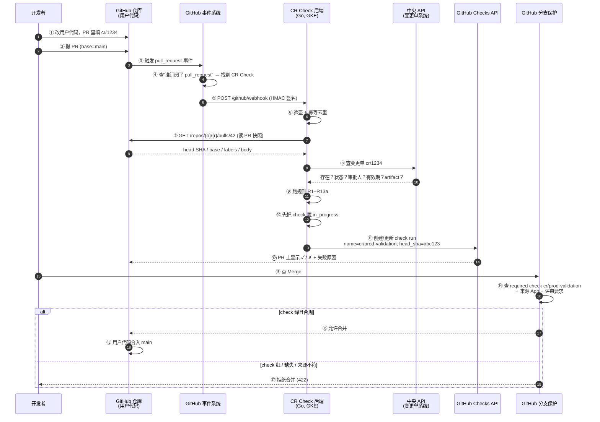

# Webhook 与后端服务 · CR Check 这个 GitHub App 到底怎么工作

> **这份文档回答四个问题**
> 1. **Webhook 到底是什么？**（GitHub App 设置里那个"Webhook URL"填的是什么）
> 2. **后端服务到底是什么？**（为什么"装个 App"不够）
> 3. **CR Check 后端（Go 代码）写完后，怎么变成一个 GitHub 能访问到的服务？**（是不是要做一次"服务发布"？）
> 4. **Webhook URL 和我部署的服务是什么关系？**（为什么填了它，GitHub 就能找到我的代码？）
>
> **贯穿全文的例子**：我们开发一个叫 **CR Check** 的 GitHub App。
> 业务开发提交【用户代码】的 PR 到生产分支 → CR Check 校验这个 PR 有没有合规的变更单（CR）
> → 不合规就**合不了**。整条链路见 [§0.2](#02-完整流程图cr-check-是怎么工作的)。

> **前置阅读**
> [`Develop-git-apps.md`](./Develop-git-apps.md)（自研 GitHub App 评估）、
> [`11-github-app-concepts.md`](./11-github-app-concepts.md)（GitHub App 概念）
>
> **本文重点：[§0.2 完整流程图](#02-完整流程图cr-check-是怎么工作的)** ——
> CR Check 这个 GitHub App 从**安装**到**拦截合并**的完整全过程（含用户代码、App、后端、中央 API、分支保护）。

---

## 目录

| 章节 | 内容 |
|---|---|
| [§0](#0-一页纸总结先看这个) | **一页纸总结**（打印版） |
| **[§0.2](#02-完整流程图cr-check-是怎么工作的)** | **★ 完整流程图：CR Check 从安装到放行的全过程** |
| [§1](#1-先用信箱打比方) | Webhook = 信箱，后端服务 = 屋里的人 |
| [§2](#2-概念一webhook) | Webhook 详解 |
| [§3](#3-概念二后端服务) | 后端服务详解 |
| [§4](#4-两者的关系你填的那个地址到底是什么) | **两者的关系**（核心） |
| [§5](#5-你的代码在-git-的-branch-上怎么才能跑起来) | **从 Git 到生效的完整 8 步**（核心） |
| [§6](#6-完整配置清单照着做就能跑通) | 从零到跑通的配置清单 |
| [§7](#7-怎么确认真的生效了) | 5 步验证 |
| [§8](#8-常见故障速查) | 现象 → 根因 → 处理 |
| [§9](#9-本地开发怎么调试) | 把 127.0.0.1 变成公网地址 |
| [§10](#10-术语表) | Pod / Deployment / Service / Ingress… |
| [§11](#11-延伸) | 相关文档 |

---

## 0. 一页纸总结（先看这个）

### 0.1 两句话

```
Webhook        = GitHub 往哪个地址"敲门"，通知你"仓库出事了"
后端服务       = 你自己写的一个程序，住在那个地址后面，负责开门、处理、回应
```

### 0.2 完整流程图：CR Check 是怎么工作的

> 先约定三个名字，下面的图全程使用：
>
> | 名字 | 是什么 | 在哪 |
> |---|---|---|
> | **用户代码** | 被管控的业务代码（K8s manifest / Helm chart / 应用代码），就是开发者改的东西 | 业务仓库（Org 下的受管仓库） |
> | **CR Check** | 我们开发的 GitHub App（应用名），装在你们的 Org 上，负责校验"PR 是否有合规的变更单" | GitHub 上的一个 App 条目 + 一个 Go 后端 |
> | **CR Check 后端** | CR Check 的 Go 代码（判定逻辑），跑在你们的 GKE 上 | 独立仓库 → 镜像 → GKE Pod |

**阶段 A · 安装（一次性，人工配置）**

```
 ① App 开发者（你们）在 GitHub 后台注册 App "CR Check"
       ├─ 声明权限：Metadata:R / Pull requests:R / Checks:Write
       ├─ 订阅事件：pull_request
       ├─ 填 Webhook URL：https://pr-gate.example.com/github/webhook
       ├─ 生成 Private Key（.pem）
       └─ 把 .pem 和 webhook secret 放进 Secret Manager → 部署到 GKE

 ② Org Owner 在 GitHub 上点击 "Install CR Check"
       ├─ 选仓库：Only select repositories → 勾选受管的生产仓库
       ├─ 勾选授予的权限
       ├─ ★ GitHub 生成 Installation（installation_id）= 这个 App 在你们 Org 的授权边界
       └─ ★ 从这一刻起：CR Check 后端可以用 AppID + PrivateKey + installation_id
                       换取 installation token（代表这个 App 去读写这些仓库）

 ③ CR Check 后端启动，向 GitHub 要 installation token
       （用 ghinstallation 自动换取并缓存，1 小时过期自动续）
```

**阶段 B · 运行时（每个 PR 都会走一遍）**

```
 ┌──────────┐
 │ 开发者   │  ① 修改【用户代码】，在 PR 里填变更单号 cr/1234
 └────┬─────┘
      │ git push / 提 PR
      ▼
 ┌──────────────────────────────────────────────────────────────┐
 │ GitHub 仓库（用户代码）                                      │
 │   PR #42  base=main  head=feature/x  head SHA=abc123       │
 └────┬─────────────────────────────────────────────────────────┘
      │  ② GitHub 事件系统：CR Check 订阅了 pull_request
      ▼
 ┌──────────────────────────────────────────────────────────────┐
 │ GitHub 服务器（公网）                                        │
 │   POST https://pr-gate.example.com/github/webhook           │
 │   Headers: X-GitHub-Event / X-GitHub-Delivery /             │
 │             X-Hub-Signature-256                              │
 │   Body:    {action, number, pull_request{...}, repository{...}}│
 └────┬─────────────────────────────────────────────────────────┘
      │  ③ 一次 "webhook 投递"
      ▼
 ┌──────────────────────────────────────────────────────────────┐
 │  CR Check 后端（你们的 Go 代码，跑在 GKE）                    │
 │                                                              │
 │   ③.1 验签  X-Hub-Signature-256  （防伪造）                  │
 │   ③.2 幂等  X-GitHub-Delivery 去重                           │
 │   ③.3 取 PR 快照：base 分支 / head SHA / labels / body       │
 │   ③.4 解析【唯一】变更单号  cr/1234                          │
 │   ③.5 调【中央 API】查变更单：存在？Approved？审批够？窗口内？│
 │   ③.6 校验变更单的配置项/artifact 与本次用户代码改动一致      │
 │   ③.7 跑规则 R1–R13a                                        │
 └────┬─────────────────────────────────────────────────────────┘
      │  ④ 出站调用（用 installation token）
      │     POST api.github.com/repos/{owner}/{repo}/check-runs
      ▼
 ┌──────────────────────────────────────────────────────────────┐
 │ GitHub 服务器                                                │
 │   写入 check run：name=cr/prod-validation, head_sha=abc123  │
 │   conclusion = success / failure                            │
 │   → PR 上直接显示 ✓ 或 ✗，并列出哪条规则不通过               │
 └────┬─────────────────────────────────────────────────────────┘
      │  ⑤ 分支保护规则（强制力在这里，不在 App 里）
      ▼
 ┌──────────────────────────────────────────────────────────────┐
 │  分支保护：main 分支要求                                     │
 │    · required status check = cr/prod-validation              │
 │    · 来源 App = CR Check（防同名 check 伪造）                 │
 │    · 其他评审要求                                             │
 │   → check 绿才能 merge；红/缺失 → 合并按钮禁用                │
 └────┬─────────────────────────────────────────────────────────┘
      │  ⑥ 开发者点 Merge（只有绿了才能合）
      ▼
 ┌──────────────────────────────────────────────────────────────┐
 │  用户代码合入 main                                            │
 └────┬─────────────────────────────────────────────────────────┘
      │  ⑦ 发布执行器对【实际发布版本】再校验 CR → 部署 → 关联记录
      ▼
 ┌──────────────────────────────────────────────────────────────┐
 │  生产集群                                                    │
 └──────────────────────────────────────────────────────────────┘
```

**阶段 C · 三方职责（记住这张表就不会混）**

| 角色 | 是谁 | 干什么 | 强制力 |
|---|---|---|---|
| **被校验对象** | 用户代码 + PR 元数据 | 提供"改了什么、往哪个分支改" | — |
| **判定者** | CR Check 后端（Go） | 查变更单、跑规则 | ❌ 无强制力（它只是报数） |
| **报告者** | GitHub Checks API | 把结论写回 PR | ❌ 无强制力 |
| **强制者** | **GitHub 分支保护** | 不绿就不让 merge | ✅ **唯一的合并强制力** |
| **部署前兜底** | Argo CD / 准入控制 | 绕过 merge 直接改集群也能拦 | ✅ |

> ★ **一句话**：**CR Check 是"哨兵 + 报数员"，GitHub 分支保护才是"狱警"。**
> 没有分支保护，CR Check 写的红叉只是装饰品。

### 0.3 代码怎么"生效"（完整链路）

```
① 你把代码 push 到 feature branch          ← 这里什么都不会发生
② 提 PR → CI 构建镜像 → merge 到 main       ← 镜像产出：ghcr.io/xxx/pr-gate:v1.2.3
③ Argo CD 检测到 main 变化 → apply 到集群    ← GitOps 自动完成
④ K8s 起 Pod（跑你的 Go 程序）              ← 这才是"你的代码"第一次真正运行
⑤ Service 把 Pod 的 8080 暴露成集群内地址
⑥ Ingress 把 Service 暴露成公网 HTTPS 地址    ← https://pr-gate.example.com
⑦ GitHub App 后台填 Webhook URL = ⑥ 的地址  ← 事件有了入口
⑧ 有人提 PR → GitHub POST 到 ⑥ → Pod 处理 → 写 check run → PR 上出现绿勾/红叉
```

**③~⑥ 就是你说的"做一次服务发布"。** 是的，必须有 —— Git 里的代码本身不会运行。

### 0.4 三个必须记住的事实

| # | 事实 | 后果 |
|---|---|---|
| 1 | **Git 里没有"运行"这个概念** | branch 只是名字。运行时只认：**镜像 tag / commit SHA + 部署清单** |
| 2 | **Webhook URL 必须是公网可访问的 HTTPS 地址** | `localhost`、`127.0.0.1`、K8s ClusterIP、Pod IP **全部不可用** |
| 3 | **一个 GitHub App 只能配一个 Webhook URL** | 多个接收端 → 要么建多个 App，要么在服务内部自己分流 |

### 0.5 一次完整交互需要"两个方向"的网络能力

| 方向 | 谁发起 | 目的 | 需要什么 | 你的服务做的事 |
|---|---|---|---|---|
| **入站** | GitHub → 你的服务 | 通知"PR 事件发生了" | **公网 HTTPS 入口** + webhook secret 验签 | 收请求、解 JSON、跑规则 |
| **出站** | 你的服务 → GitHub | 读 PR 详情、**写 check run** | **能访问 `api.github.com`** + installation token | 调 GitHub API 回写结论 |

> ★ **很多人在这里翻车**：只做了入站（Ingress 配好了），没做出站（节点没有 NAT / 出网被墙），
> 结果事件收到了，但写不回 check，PR 上永远没有结论。
> **出站不通 = 门禁静默失效。**

---

### 0.6 同一件事的时序图（Mermaid）



### 0.7 三种"代码"必须分清（最容易绕晕的地方）

你提到"源码"时，可能指三种不同的东西。它们在**不同仓库、不同生命周期、不同部署物**：

| # | 名字 | 谁写 | 内容 | 存在哪 | 怎么"生效" |
|---|---|---|---|---|---|
| **1** | **用户代码** | 业务开发 | 被管控的东西：K8s manifest / Helm chart / 应用代码 | **业务仓库** | 提 PR → review → merge → Argo CD 部署到生产 |
| **2** | **CR Check 代码** | 平台组（你们） | 判定逻辑：验签、查变更单、跑规则、写 check | **独立仓库**（不能和用户代码同仓） | CI 构建镜像 → K8s Deployment → Pod 运行 |
| **3** | **部署清单 + 规则配置** | 平台组 | Deployment/Service/Ingress + 规则数据（窗口表、例外名单） | **GitOps 仓库** | Argo CD apply → K8s 对象 |

```
┌───────────────┐   ┌───────────────┐   ┌────────────────────┐
│  用户代码      │   │ CR Check 代码 │   │ 部署清单 + 规则配置  │
│  (业务仓库)    │   │  (门禁仓库)   │   │   (GitOps 仓库)     │
└───────┬───────┘   └───────┬───────┘   └─────────┬──────────┘
        │                   │                     │
        │ ①提 PR            │ ②构建镜像            │ ③Argo CD apply
        ▼                   ▼                     ▼
   GitHub 上的 PR      GKE 上的 Pod         K8s 上的 Deployment
        │                   │                     │
        │ ④触发事件         │                     │
        └──────────────────▶│ ⑤ webhook 进来      │
                            │ ⑥读 PR + 查变更单   │
                            │ ⑦写 check run       │
                            ▼                     │
                    GitHub PR 上的 ✓ / ✗          │
                            │                     │
                            └──── ⑧ 分支保护拦截 ───┘
```

> ★ **第 2、3 项必须独立于第 1 项，且受 CODEOWNERS + 生产分支保护**。
> 否则"有人提一个 PR 把 CR Check 的判定逻辑删掉" → 门禁形同虚设。
> 这正是"为什么要自研一个 App 而不是用 Actions"的根本原因（Actions 的 workflow 和用户代码同仓）。

## 1. 先用信箱打比方

假设你开了一家公司（= 你的平台团队），要处理外部寄来的业务单（= PR / 变更单）。

| 现实 | 技术 | 说明 |
|---|---|---|
| 公司营业执照 + 门禁卡 | **GitHub App 注册配置** | 声明"这家公司可以查哪些仓库、可以写哪些 check" |
| 贴在门口的信箱编号 | **Webhook URL** | 一个公网可访问的地址，如 `https://pr-gate.example.com/github/webhook` |
| 邮递员按编号送信 | **Webhook 投递** | GitHub 服务器发起的 HTTP POST |
| 信封里的单据 | **Webhook payload** | JSON，含 PR 的标题、作者、label、改了哪些文件、head SHA… |
| 屋里有个人在拆信 | **后端服务（你的 Go 程序）** | 读 payload、查变更单系统、跑规则 |
| 处理完的回复单 | **Check Run** | 服务**回写**给 GitHub 的结论（绿/红 + 原因） |
| 公司登记的固定地址 | **公网入口（Ingress + 域名 + TLS 证书）** | 邮递员能找得到；且**不能随便换**（换了旧的信就寄不到了） |

**关键认知**：
- 光有营业执照（App 注册）→ 没人知道往哪儿寄信 → **没有 Webhook URL = 没有事件**
- 光有信箱（公网地址）→ 没人拆信 → **没有后端服务 = 门禁不生效**
- **两者都齐了才算"装好"**。

---

## 2. 概念一：Webhook

### 2.1 本质：GitHub 主动发起的一次 HTTP POST

```
GitHub 服务器  ──HTTP POST──▶  你的地址
   （公网）                        （你的服务）

POST /github/webhook HTTP/1.1
Host: pr-gate.example.com
Content-Type: application/json
X-GitHub-Event: pull_request          ← 事件类型
X-GitHub-Delivery: 72d3162e-cc78-...  ← 投递唯一 ID（幂等键）
X-Hub-Signature-256: sha256=abc...    ← HMAC 签名（防伪造）
User-Agent: GitHub-Hookshot/...

{"action":"synchronize","number":42,"pull_request":{...},"repository":{...},"installation":{...}}
```

> **关键**：这是 GitHub **主动来找你**，不是你去轮询 GitHub。
> 所以叫"Webhook"（挂钩子）：GitHub 把一个钩子挂到你的 URL 上，有事就拉一下。

### 2.2 你在 GitHub App 后台填的"Webhook URL"是什么

填的就是**你的服务对外暴露的一个 HTTP 端点**。

```
https://pr-gate.example.com/github/webhook
└──────┬───────┘ └──────┬────────┘ └───┬───┘
    域名（你的）      路径（你定的）   端点
```

- **域名**：必须能被公网 DNS 解析到你控制的入口（GKE Ingress / Cloud Run / LB）
- **路径**：随便你定，但服务里必须有对应的 handler
- **协议**：`https://`，**证书必须是被信任的**（自签证书不行）

### 2.3 保存时会先"ping"一下

GitHub 官方行为：

> "After you create a new webhook, GitHub will send you a simple ping event to let you know you've set up the webhook correctly."

所以配完之后，去 **GitHub → App → Settings → Webhooks → Recent Deliveries**，
应该能看到一条 `ping` 事件且状态 200。
**看不到 ping = 你的地址根本不可达**，后面所有事件都不会来。

### 2.4 投递失败会怎样

| 情况 | GitHub 的表现 | 你的风险 |
|---|---|---|
| 服务返回 5xx / 超时 | 这次投递标记为失败；可在 UI 里手动 **Redeliver** | ★ **不要假设会自动重试**（按"不保证"设计） |
| 服务返回 4xx | 同上 | 4xx 通常是你的 handler 逻辑问题（验签失败、路由错） |
| 服务直接连不上 | 投递失败记录 | 同上 |
| **服务整个挂了** | 所有投递都失败 | ★★ **最危险**：事件全丢 → **门禁静默失效**（没人收到通知，也没人被拦住） |

> **这条决定了两个必做项**：
> ① 后端服务必须 **≥2 副本 + 健康检查 + 存活探针**（别让它静默挂掉）
> ② 必须有**外部监控**：定时从外部访问 `/healthz`，或监控 GitHub 投递失败率，**并告警**。

### 2.5 Webhook vs 轮询

|  | Webhook（事件驱动） | 轮询（定时拉取） |
|---|---|---|
| 延迟 | 秒级 | 取决于轮询间隔 |
| 你的服务要做什么 | 暴露一个公网入口 | 只要出网（连 ingress 都不用建） |
| 负载 | 有事才跑 | 一直在跑 |
| 适合 | 实时门禁 | 后台报表、批处理 |

> **本项目的取舍**：合并门禁要"秒级"体验 → 用 Webhook；
> 但**时间窗口过期**这种"没发生任何事"的情况，Webhook 天然管不到 → 仍需定时重评
> （见 [`Develop-git-apps.md`](./Develop-git-apps.md) §7.3）。

### 2.6 一个 App 只有一个 Webhook URL（官方约束）

```
GitHub App
└── Webhook URL（唯一）
```

- 需要多个接收端时，只能：**建多个 App**（推荐，权限面也可分开）/ 前面放一个路由网关 / 服务内部自己分流
- 改 Webhook URL **随时可以改**（旧 URL 立刻失效 → 旧投递失败），但**改之前要先把新地址准备好**

---

## 3. 概念二：后端服务

### 3.1 本质：一个长期运行的 HTTP 服务

```
你的 Go 程序启动
  → 在某个端口（:8080）上监听 HTTP
  → 等待别人来请求
```

对你这个门禁服务来说，它做**四件事**：

```
① 接 webhook        POST /github/webhook → 验签 → 解 payload
② 查变更单         调中央 API：变更单存在吗？批准了吗？在窗口内吗？
③ 跑规则           逐条判定 R1–R13a
④ 回写结论         调 GitHub Checks API → 创建/更新 check run
```

### 3.2 为什么后端服务必须"在公网上"

因为 **GitHub 服务器在公网，它主动来找你**。

| 地址类型 | GitHub 能访问吗 | 原因 |
|---|---|---|
| `https://pr-gate.example.com/github/webhook` | ✅ | 公网 DNS → 公网 LB → Ingress |
| `http://pr-gate.ngrok.io/xxx` | ✅ | 隧道把本地端口暴露到公网（开发用） |
| `http://localhost:8080/webhook` | ❌ | localhost = 你自己机器 |
| `http://127.0.0.1:8080/webhook` | ❌ | 同上 |
| `http://10.0.1.5:8080/webhook`（Pod IP） | ❌ | 集群内部地址，GitHub 到不了 |
| `http://pr-gate.default.svc.cluster.local:8080` | ❌ | ClusterIP，集群内部地址 |
| `http://pr-gate.example.com`（HTTP 非 HTTPS） | ❌ | GitHub 要求有效 TLS |

### 3.3 K8s 里的形态：三个东西各管一段

| 组件 | 管什么 | 类比 | 关键字段 |
|---|---|---|---|
| **Deployment** | "要跑几个你的程序副本，用哪个镜像" | 招了几个人、干什么活 | `spec.template.spec.containers[].image` / `ports` |
| **Service** | "把 Pod 的端口暴露成一个稳定的集群内地址" | 楼内的楼层指引牌 | `selector` / `port` / `targetPort` |
| **Ingress** | "把 Service 暴露成公网 HTTPS 地址" | 门口的招牌 + 保安 | `rules[].host` / `http.paths[].backend.service` / TLS secret |

**流量路径**：

```
GitHub  ──https──▶  公网 LB（GKE Ingress 自动创建）
                       │  TLS 终结、Host/path 路由
                       ▼
                    Service: pr-gate:80
                       │  按 selector 找到 Pod
                       ▼
                    Pod: pr-gate-xxxxx  :8080  ← 你的 Go 程序监听 0.0.0.0:8080
```

> ★ **两个必踩的细节**
> ① Pod 必须监听 **`0.0.0.0`**，不能只监听 `127.0.0.1`（否则 LB 转发过来连接被拒 → 502）
> ② Ingress 的 `backend.service.port` 要对得上 Service 的 `port`，Service 的 `targetPort` 要对得上容器的 `containerPort` —— **三层端口必须一致**

### 3.4 后端服务的两套凭据

| 凭据 | 用在哪 | 怎么验证 | 存哪 |
|---|---|---|---|
| **Webhook Secret** | **入站**：验 `X-Hub-Signature-256` | HMAC-SHA256(secret, body) 与 header 比对 | Secret Manager → K8s Secret → 环境变量 |
| **Private Key** | **出站**：换 installation token | 用私钥签 JWT 给 GitHub 换 token | Secret Manager → K8s Secret → 文件 |

```go
// 入站验签（防止有人伪造 POST 触发你的判定）
mac := hmac.New(sha256.New, []byte(webhookSecret))
mac.Write(body)
expected := "sha256=" + hex.EncodeToString(mac.Sum(nil))
if !hmac.Equal([]byte(expected), []byte(r.Header.Get("X-Hub-Signature-256"))) {
    w.WriteHeader(http.StatusUnauthorized) // 必须用 hmac.Equal，避免时序攻击
    return
}
```

> ⚠️ **Webhook Secret 不一致 = 所有事件被拒（401）**，且从 GitHub 侧看是"投递失败"，很容易误判成网络问题。

---

### 3.5 Go 代码视角：webhook 进来之后，你的程序做了什么

这是"webhook 里有我的 Go 代码"最具体的落地形式。**Go 代码本身不在 webhook 里** ——
webhook 里是一个 JSON；**Go 代码是那个"接收 JSON 并处理它"的程序**。

```
GitHub POST 到达你的 Pod
        │
        ▼
┌──────────────────────────────────────────────────────────┐
│ cmd/server/main.go  —— HTTP 路由                          │
│   mux.HandleFunc("/github/webhook", srv.handleWebhook)    │
│   mux.HandleFunc("/healthz",  ...)                        │
└──────────────────────────────────────────────────────────┘
        │
        ▼
┌──────────────────────────────────────────────────────────┐
│ internal/webhook/verify.go —— 验签                        │
│   body, _ := io.ReadAll(r.Body)                          │
│   mac := hmac.New(sha256.New, []byte(secret))            │
│   mac.Write(body)                                        │
│   expected := "sha256=" + hex(mac.Sum(nil))               │
│   if !hmac.Equal(expected, sig) { return 401 }           │
└──────────────────────────────────────────────────────────┘
        │
        ▼
┌──────────────────────────────────────────────────────────┐
│ internal/webhook/router.go —— 分发                        │
│   switch r.Header.Get("X-GitHub-Event") {                │
│   case "pull_request":            go s.onPullRequest()   │
│   case "pull_request_review":     go s.onReview()        │
│   default:                        return 200 // 忽略      │
│   }                                                      │
└──────────────────────────────────────────────────────────┘
        │
        ▼
┌──────────────────────────────────────────────────────────┐
│ internal/github/client.go —— 用 installation token 调 API │
│   tr, _ := ghinstallation.NewKeyFromFile(key, appID,     │
│                                           installationID) │
│   client := github.NewClient(&http.Client{Transport: tr})│
│   // tr 内部自动处理 JWT → token → 1h 过期续期           │
└──────────────────────────────────────────────────────────┘
        │
        ▼
┌──────────────────────────────────────────────────────────┐
│ internal/cr/rules.go —— 判定（业务核心）                  │
│   v := s.evaluate(pr, time.Now())                        │
│   // R1 唯一CR → R2 存在 → R3 状态 → R4 审批             │
│   // → R5 目标环境 → R5b artifact 一致 → R6 窗口        │
└──────────────────────────────────────────────────────────┘
        │
        ▼
┌──────────────────────────────────────────────────────────┐
│ internal/github/checks.go —— 回写结论                     │
│   cl.Checks.CreateCheckRun(... Name:"cr/prod-validation",│
│                              HeadSHA: pr.Head.SHA,        │
│                              Conclusion:"failure", ...)   │
│   cl.Checks.UpdateCheckRun(...)  // 覆盖同名 check        │
└──────────────────────────────────────────────────────────┘
```

> **一句话**：**Webhook URL 是入口，Go 代码是处理逻辑，Check Run 是输出。**
> 三者缺一，CR Check 都不成立。

## 4. 两者的关系：你填的那个地址到底是什么

### 4.1 拆开看

```
你填的：https://pr-gate.example.com/github/webhook
        └──────┬─────────┘ └───┬───┘ └──┬───┘
            域名+入口      路径      端点
                                 ↓
              对应到集群里的：
              Ingress (host=pr-gate.example.com, path=/github/webhook)
                 → Service pr-gate:80
                    → Pod 监听 :8080
                       handler: mux.HandleFunc("/github/webhook", ...)
```

**所以：Webhook URL = 你的服务在公网上的"地址 + 路径"。**
它**不是**一个抽象配置项，它**就是**你部署出来的那个 HTTP 端点的公网写法。

### 4.2 关系表

| 问题 | 答案 |
|---|---|
| Webhook URL 是谁提供的？ | **你**（你的 DNS + 入口 + 路由） |
| GitHub 需要做什么？ | 按这个地址发 POST |
| 你的服务需要做什么？ | 在这个路径上挂一个 handler |
| 谁先存在？ | **服务必须先部署好、地址先能访问**，再去 GitHub 填 URL |
| 填完 URL 服务没起来会怎样？ | ping 事件失败 → 每次投递都失败 → 门禁静默失效 |
| 服务换了地址怎么办？ | 改 GitHub 里的 Webhook URL（旧的立即失效） |
| 多个服务要收同一批事件？ | 一个 App 不行 → 建多个 App，或用网关按 `X-GitHub-Event` 分流 |
| 端口/路径写错了会怎样？ | 502（连不上端口）或 404（路径不匹配） |

### 4.3 和 Argo CD 的对比（同一个心智模型）

| | Argo CD 的 GitHub App | 你的门禁 App |
|---|---|---|
| 订阅事件 | `push`（其实可以不要） | `pull_request` 等 |
| Webhook URL | `https://argocd.example.com/api/webhook/github` | `https://pr-gate.example.com/github/webhook` |
| 收到事件后 | 标记 Application 需刷新 | 查变更单 → 跑规则 → 写 check run |
| 后端服务 | **就是 Argo CD 自己**（argocd-server） | **你要新写的 Go 程序** |
| 权限 | `Contents: Read` | `Metadata:R` + `Pull requests:R` + `Checks:Write` |

> ★ 理解了这个对比就明白了：**Argo CD 之所以不需要你写代码，是因为"后端服务"那一环它自己就是。**
> 你要写门禁逻辑，就必须自己提供这个"后端服务"。

---

## 5. CR Check 后端的代码，怎么跑起来？

> ⚠️ **注意本章的对象**：这里说的是 **CR Check 后端（Go 代码）** 怎么从 Git 变成一个跑着的服务，
> **不是"用户代码"**。用户代码走的是另一条路：PR → merge → Argo CD 部署（见 §0.2 阶段 B 的 ⑥⑦）。
> 三者的区分见 [§0.7](#07-三种代码必须分清最容易绕晕的地方)。

### 5.1 先破除最大的误解

```
❌ "我把代码 commit 到 my-feature-branch，GitHub App 就开始工作了"
✅ 事实：Git 是一份"文本快照"，它不会执行任何东西。
   某个程序要想跑起来，必须有人把它编译/构建成一个可执行产物（镜像），
   再放到一个运行环境里（K8s Pod），再给它一个别人找得到的地址。
```

**branch 是什么？** 只是一个**可变的引用名**。
`git checkout my-feature-branch` 只是个指针位置，跟"运行"没有任何关系。

### 5.2 完整 8 步（GitOps 版）

```
①  本地写代码
    git commit -am "feat: 校验变更单"
    git push origin my-feature-branch
        ↓
②  提 PR → CI 构建镜像
    .github/workflows/ci.yml:
      - docker build -t ghcr.io/acme/pr-gate:${GITHUB_SHA}
      - docker push
        ↓  （产出：镜像 ghcr.io/acme/pr-gate:<sha>）
③  PR 合并到 main（或打 tag v1.2.3）
        ↓
④  Argo CD 感知：Application 的 targetRevision 变了 → 开始 sync
        ↓
⑤  apply 到集群 → K8s 创建/更新 Deployment → 新 Pod 起来跑你的程序
        ↓
⑥  Service + Ingress 已存在（通常第一次就配好，之后不用动）
        ↓
⑦  GitHub App 后台的 Webhook URL 早已指向 ⑥ 的公网地址
        ↓
⑧  有人提 PR → GitHub POST → 你的 Pod 处理 → 回写 check run
```

> **注意 ③→④**：这一步是 **GitOps 自动化**（Argo CD 盯着 Git）。
> 如果你们的 Application `targetRevision` 写的是具体 **commit SHA**（生产推荐），
> 那 ③ 之后还需要**再提一个 PR 把 SHA 改掉** —— 这正是 PR 存在的价值。

### 5.3 每一步的产物

| 步 | 产物 | 存在哪 | 谁负责 |
|---|---|---|---|
| ② | **镜像** | Container Registry（GHCR / Artifact Registry） | CI |
| ③ | **版本引用**（tag / SHA） | Git tag 或 Application 的 `targetRevision` | 人 / PR |
| ④⑤ | **Pod**（进程在跑） | K8s 集群 | Argo CD apply |
| ⑥ | **公网入口** | Ingress + DNS + 证书 | 一次性配置 |
| ⑦ | **事件路由** | GitHub App 设置 | 一次性配置 |
| ⑧ | **结论** | PR 上的 Check Run | 你的代码 |

### 5.4 两种"交付代码"的方式对比

| | **A. Argo CD GitOps**（推荐） | **B. CI 直接推镜像 + 改 Deployment** |
|---|---|---|
| 谁改 K8s | Argo CD（读 Git 的清单） | CI（`kubectl set image`） |
| 审计 | 清单改动走 PR，有 CODEOWNERS | 镜像 tag 变了就生效，**没有 PR 审批点** |
| 回滚 | 改回上一个 tag（一次 PR） | `kubectl set image` 回去 |
| 与你的门禁的关系 | 门禁服务的清单也在 Git 里 → **门禁管自己** | 门禁服务自己不在 GitOps 里 → 它的变更绕过门禁 |
| 适合 | 生产 | 快速试验 |

> ★ **强烈建议用 A**。理由和门禁本身一样：**门禁服务自己必须被门禁管住**。
> 用 B 的话，"谁能改门禁"这个问题就没有答案了。

### 5.5 "做一次服务发布"到底要交付什么

```
一次"服务发布" = 5 件东西

① 代码            → 在 Git 的某个 commit 上
② 镜像            → ② 由 CI 构建产出；有唯一 tag（建议用 commit SHA）
③ 部署清单        → Deployment / Service / Ingress（也在 Git 里）
④ 运行时配置      → ConfigMap（规则数据）+ Secret（私钥、webhook secret）
⑤ 对外入口        → 域名 + DNS + TLS 证书 + GitHub 里的 Webhook URL
```

**其中 ③④ 是"声明"，⑤ 是"接线"。**
所以"发布"不是"把代码传上去"，而是"**让这 5 件事同时对齐**"。

### 5.6 版本策略

| 引用方式 | 漂移风险 | 推荐 |
|---|---|---|
| `targetRevision: main` | ⚠️ 分支一动就变，部署内容不可预期 | ❌ 生产不用 |
| `targetRevision: v1.2.3`（tag） | ✅ 稳定，可回滚 | ✅ |
| `targetRevision: <commit SHA>` | ✅✅ 完全不可变 | ✅✅ **生产首选** |

> 镜像 tag 建议也用 SHA 或 `v1.2.3-<sha>`，避免 `latest` 这种会漂的 tag。

---

## 6. 完整配置清单（照着做就能跑通）

### 6.1 代码仓库结构

```
pr-gate/                      ← 独立仓库（★ 不要和被保护的业务代码同仓）
├── cmd/server/main.go
├── internal/
│   ├── webhook/              ← 入站：验签、分发
│   ├── github/               ← 出站：installation token、check run
│   ├── cr/                   ← 中央 API 客户端 + 规则
│   └── policy/               ← 规则配置
├── Dockerfile
├── deploy/                   ← K8s 清单（Argo CD 管理这个目录）
│   ├── deployment.yaml
│   ├── service.yaml
│   ├── ingress.yaml
│   ├── serviceaccount.yaml
│   ├── rbac.yaml
│   └── kustomization.yaml
└── .github/workflows/ci.yml  ← 构建镜像
```

### 6.2 Dockerfile（要点）

```dockerfile
FROM golang:1.23 AS build
WORKDIR /src
COPY go.mod go.sum ./
RUN go mod download
COPY . .
RUN CGO_ENABLED=0 go build -o /out/pr-gate ./cmd/server

FROM gcr.io/distroless/static-debian12
COPY --from=build /out/pr-gate /pr-gate
EXPOSE 8080
USER nonroot
ENTRYPOINT ["/pr-gate"]
```

> ★ **不要把私钥打进镜像**（镜像进 Registry = 泄露）。私钥走 Secret 挂载（见 §6.5）。

### 6.3 CI：构建并推送镜像

```yaml
name: ci
on:
  push:
    branches: [main]
    tags: ['v*']
permissions:
  contents: read
  packages: write
jobs:
  build:
    runs-on: ubuntu-latest
    steps:
      - uses: actions/checkout@v4
      - uses: docker/login-action@v3
        with:
          registry: ghcr.io
          username: ${{ github.actor }}
          password: ${{ secrets.GITHUB_TOKEN }}
      - uses: docker/build-push-action@v5
        with:
          tags: ghcr.io/acme/pr-gate:${{ github.sha }}
          push: true
```

### 6.4 K8s 清单（三个核心对象）

```yaml
# ── Deployment ──────────────────────────────────────────────
apiVersion: apps/v1
kind: Deployment
metadata:
  name: pr-gate
  namespace: pr-gate
spec:
  replicas: 2                       # ★ ≥2，避免单点
  selector:
    matchLabels: { app: pr-gate }
  template:
    metadata:
      labels: { app: pr-gate }
    spec:
      serviceAccountName: pr-gate
      containers:
        - name: pr-gate
          image: ghcr.io/acme/pr-gate:v1.0.0     # ★ 不可变 tag，不用 latest
          ports:
            - containerPort: 8080                 # ★ Pod 监听 8080
          env:
            - name: GITHUB_APP_ID
              value: "123456"
            - name: CHECK_NAME
              value: "cr/prod-validation"
            - name: WEBHOOK_SECRET
              valueFrom:
                secretKeyRef: { name: pr-gate-secret, key: webhook-secret }
            - name: APP_PRIVATE_KEY_PATH
              value: /etc/pr-gate/private-key.pem
          volumeMounts:
            - name: gh-key
              mountPath: /etc/pr-gate
              readOnly: true
          livenessProbe:
            httpGet: { path: /healthz, port: 8080 }
            initialDelaySeconds: 5
          readinessProbe:
            httpGet: { path: /readyz, port: 8080 }
            initialDelaySeconds: 3
          resources:
            requests: { cpu: 100m, memory: 128Mi }
            limits:   { cpu: 500m, memory: 256Mi }
      volumes:
        - name: gh-key
          secret:
            secretName: pr-gate-githubapp
            items:
              - key: private-key.pem
                path: private-key.pem
---
# ── Service ────────────────────────────────────────────────
apiVersion: v1
kind: Service
metadata:
  name: pr-gate
  namespace: pr-gate
spec:
  selector: { app: pr-gate }
  ports:
    - name: http
      port: 80            # ← Service 端口
      targetPort: 8080    # ← 指向容器端口
---
# ── Ingress ────────────────────────────────────────────────
apiVersion: networking.k8s.io/v1
kind: Ingress
metadata:
  name: pr-gate
  namespace: pr-gate
  annotations:
    kubernetes.io/ingress.class: gce   # GKE
spec:
  rules:
    - host: pr-gate.example.com        # ← 与 GitHub App 里填的域名一致
      http:
        paths:
          - path: /github/webhook       # ← 与 GitHub App 里填的路径一致
            pathType: Prefix
            backend:
              service:
                name: pr-gate
                port:
                  number: 80           # ← 与 Service 的 port 一致
  tls:
    - hosts: [pr-gate.example.com]
      secretName: pr-gate-tls          # ← 托管证书或 cert-manager 签发
```

### 6.5 密钥（绝不进 Git）

```bash
# 1) 在 Secret Manager 里放两份 secret
gcloud secrets create pr-gate-webhook --replication-policy=automatic
gcloud secrets create pr-gate-githubapp --replication-policy=automatic
#    ↑ 私钥内容从 GitHub App 后台下载后写入（printf '%s' "$KEY" | ... versions:add）

# 2) 用 External Secrets Operator 同步成 K8s Secret
#    （或直接 kubectl create secret generic，但那样轮换要手工）
```

```yaml
# ExternalSecret 示例
apiVersion: external-secrets.io/v1beta1
kind: ExternalSecret
metadata:
  name: pr-gate-githubapp
  namespace: pr-gate
spec:
  refreshInterval: 1h
  secretStoreRef: { name: gcp-secrets, kind: ClusterSecretStore }
  target:
    creationPolicy: Owner
    template:
      type: Opaque
      data:
        private-key.pem: "{{ .SecretManager.pr-gate-githubapp }}'"
```

### 6.6 GitHub App 后台逐项填什么

| 后台字段 | 填什么 | 说明 |
|---|---|---|
| **Webhook URL** | `https://pr-gate.example.com/github/webhook` | ★ = Ingress 的 host + path |
| **Webhook secret** | 与 K8s Secret 里 `WEBHOOK_SECRET` **完全一致** | 不一致 → 全部 401 |
| **Permissions → Repository permissions** | `Metadata: Read`、`Pull requests: Read`、`Checks: Write` | 其余不要给 |
| **Subscribe to events** | `Pull request`（必要时加 `Check run`、`Merge group`） | 少订阅 = 漏判 |
| **Homepage URL** | Argo CD 控制台地址 | 纯展示，无功能 |
| **Private key** | 点 "Generate a private key" 下载 `.pem` | 存进 Secret Manager |
| **App ID / Installation ID** | 页面顶部可见 | 记下来，需要时用 |
| **Install → Repositories** | `Only select repositories` → 勾选受管仓库 | 最小权限 |

### 6.7 联调顺序（建议严格按这个顺序，避免互相瞎猜）

```
① 先把服务跑起来（K8s 或本地）
     kubectl -n pr-gate get deploy pr-gate     → 2/2 Running
② 确认公网可达
     curl -i https://pr-gate.example.com/healthz   → 200
③ 确认路径对（应该 405/401 而不是 404）
     curl -i -X POST https://pr-gate.example.com/github/webhook   → 非 404
④ 在 GitHub App 后台填 Webhook URL + secret，保存
     → 去看 Recent Deliveries，应该收到一条 ping 且 200
⑤ 用 curl 伪造一次签名请求，验证验签逻辑
⑥ 提一个测试 PR（故意不填变更单）
     → PR 上出现 cr/prod-validation 红叉，理由是"R1 未携带变更单号"
```

---

## 7. 怎么确认真的生效了

| # | 检查 | 命令 / 位置 | 期望 |
|---|---|---|---|
| 1 | Pod 在跑 | `kubectl -n pr-gate get pods` | `2/2 Running`，`0/2 Ready` 没有 |
| 2 | 端口对得上 | `kubectl -n pr-gate get svc pr-gate -o yaml` | `port: 80` → `targetPort: 8080` |
| 3 | 公网通 | `curl -i https://pr-gate.example.com/healthz` | `HTTP/2 200` |
| 4 | 路径对 | `curl -i -X POST https://pr-gate.example.com/github/webhook` | **不是 404**（405/401 都算对） |
| 5 | GitHub 收得到 | GitHub → App → Settings → Webhooks → **Recent Deliveries** | 有 `ping` / `pull_request` 记录，状态 **200** |
| 6 | 出站通 | 日志里没有 `dial tcp ... api.github.com ... i/o timeout` | check 能写回 |
| 7 | 端到端 | 提一个测试 PR | PR 上出现 `cr/prod-validation` |
| 8 | 拦截生效 | 配好分支保护后，不合规 PR 点 Merge | 按钮禁用 / API 返回 422 |

> ★ **第 5 步和第 6 步是最容易漏的两步**：
> 第 5 步证明"入站通"，第 6 步证明"出站通"。
> 只测前者会出现"事件收到了但 check 永远不出现"的假象。

---

## 8. 常见故障速查

| 现象 | 根因 | 处理 |
|---|---|---|
| GitHub 后台**保存 URL 就报错** | 证书无效 / 非 HTTPS / 域名不通 | 证书必须被信任；先用 `curl -I` 验证 |
| Recent Deliveries **完全没有记录** | 地址根本不可达 | 查 DNS、Ingress、LB、防火墙、Cloud NAT |
| 有记录但全是 **502** | Ingress 端口对不上 / Pod 只监听 127.0.0.1 / Pod 未 Ready | 核对三层端口；确认监听 `0.0.0.0` |
| 有记录但全是 **404** | 路径不匹配（`/github/webhook` vs `/webhook`） | 对齐 Ingress path 与 handler 路径 |
| 有记录全是 **401** | webhook secret 不一致 | GitHub 后台与 K8s Secret 两边核对 |
| 有记录是 **500/timeout** | handler 超过 10 秒（同步查中央 API 太慢） | 改成"先 ACK 再异步处理"（见下） |
| 事件收到了但 **check 不出现** | 出站不通 / 没有 `Checks: Write` / head_sha 错 | 查日志里的 API 错误；核对权限与 SHA |
| check 出现了但 **merge 不拦** | 分支保护没配 required check / 名字不逐字符一致 / 来源 App 未限定 | 逐字符核对 `cr/prod-validation` |
| **服务重启期间事件全丢** | 单副本 + 无重试 | ≥2 副本 + PDB；失败投递手动 Redeliver |
| Pod 更新后**短暂不可用** | 滚动更新期间有实例未 Ready | readinessProbe + `maxUnavailable: 0` |

> **"先 ACK 再异步"的模式**（handler 慢时的标准做法）：
> ```
> 收到 POST → 验签 → 立刻返回 200 → 把 payload 丢进队列 → 后台慢慢判定 → 回写 check
> ```
> GitHub 的投递超时约 10 秒；同步调中央 API 很容易超。
> 代价：必须自己做幂等（`X-GitHub-Delivery` 去重），因为快速 ACK 后失败不会自动重投。

---

## 9. 本地开发怎么调试

开发时改代码很频繁，总不能每次都发到 K8s。有两条路：

### 9.1 隧道方案（最常用）

把本地端口临时暴露成一个公网 HTTPS 地址：

```bash
# cloudflared（推荐，域名稳定且免费）
cloudflared tunnel --url http://localhost:8080
# → 给出 https://xxxx.trycloudflare.com

# 或 ngrok
ngrok http 8080
# → 给出 https://xxxx.ngrok-free.app
```

```
┌──────────────┐   HTTPS    ┌──────────────┐   HTTP    ┌──────────────┐
│    GitHub    │ ─────────▶ │  隧道（公网） │ ─────────▶ │ 你本地的 :8080 │
└──────────────┘            └──────────────┘            └──────────────┘
```

- 把隧道地址填进 GitHub App 的 Webhook URL → 本地改代码 → 提 PR → 直接看到效果
- ⚠️ 隧道地址**每次重启都会变**（除非用固定域名）→ 正式环境必须用 Ingress
- ⚠️ 隧道相当于把本地服务暴露到公网，**只用于开发**，且要确保有验签保护

### 9.2 smee.io（GitHub 官方文档推荐的 webhook 代理）

GitHub 官方文档在讲"本地处理 webhook"时推荐了 `smee.io`：

```
GitHub → https://smee.io/<channel> → （smee 客户端跑在你本地）→ http://127.0.0.1:3000
```

- 好处：本地服务**不需要公网地址**，smee 客户端负责把请求转回本地
- GitHub App 后台填 `https://smee.io/<channel>`

### 9.3 用哪个？

| 场景 | 方案 |
|---|---|
| 本地开发、想快速迭代 | 隧道 / smee.io |
| 测试环境、CI 里验证 | 隧道（临时）或部署到测试集群 |
| 生产 | **Ingress + 固定域名 + 证书**，没有例外 |

---

## 10. 术语表

| 术语 | 一句话解释 |
|---|---|
| **镜像（image）** | 你的代码编译后的可运行快照，存放在 Container Registry 里 |
| **Pod** | K8s 里**真正在跑的进程**（一个或多个容器） |
| **Deployment** | 声明"这个 Pod 应该有几个副本、用哪个镜像"的**期望状态** |
| **ReplicaSet** | Deployment 管的副本集合（一般不直接用） |
| **Service** | 把一组 Pod 变成一个**稳定的集群内地址**（ClusterIP / LoadBalancer / NodePort） |
| **ClusterIP** | 集群内部地址（`10.x.x.x`），**公网访问不到** |
| **Ingress** | K8s 的**七层入口**，把 Service 暴露成公网域名 + TLS + 路径路由 |
| **LoadBalancer（云厂商）** | 云厂商提供的四层 LB（GKE 里 Ingress 会自动创建一个） |
| **容器端口 containerPort** | Pod 内进程监听的端口（只是声明，不开防火墙） |
| **targetPort** | Service 把流量转到 Pod 的哪个端口 |
| **Secret** | K8s 里存放敏感字符串的对象（默认只是 base64，**要配合外部密钥管理**） |
| **ConfigMap** | K8s 里存放非敏感配置的对象（规则数据放这里，改它不用重新发版） |
| **DNS** | 域名 → 公网 IP 的解析（`pr-gate.example.com` → LB 地址） |
| **TLS 证书** | 让 URL 用 `https://` 且浏览器/GitHub 信任（Google 托管证书 / cert-manager / Let's Encrypt） |
| **Outbound（出站）** | 你的服务访问外网（`api.github.com`），需要 Cloud NAT 或节点已有出网 |
| **Cloud NAT** | GKE 让节点访问公网的组件（**没配的话写不回 check**） |

---

## 11. 延伸

| 主题 | 文档 |
|---|---|
| 自研 GitHub App 评估 + 规则表 + Go 骨架 | [`Develop-git-apps.md`](./Develop-git-apps.md) |
| GitHub App 概念（URL 三兄弟、Installation、源码在哪） | [`11-github-app-concepts.md`](./11-github-app-concepts.md) |
| Repository Secret 与 Argo CD 侧的 GitHub App 用法 | [`07-repository-githubapp.md`](./07-repository-githubapp.md) |
| Git → webhook → refresh → apply 全链路 | [`../poc-argocd-git-to-apply-trigger.md`](../poc-argocd-git-to-apply-trigger.md) |
| 落地步骤清单（本文的步骤清单） | [`08-implementation-playbook.md`](./08-implementation-playbook.md) |

**官方链接**

| 主题 | 链接 |
|---|---|
| GitHub Apps 文档首页 | https://docs.github.com/en/developers/apps/building-github-apps |
| Handling webhook deliveries（含 ping 事件） | https://docs.github.com/en/webhooks/using-webhooks/handling-webhook-deliveries |
| Creating webhooks（保存时发 ping 校验） | https://docs.github.com/en/webhooks/using-webhooks/creating-webhooks |
| REST: Checks（写 check run） | https://docs.github.com/en/rest/checks/runs |
| `ghinstallation`（Go：私钥 → installation token） | https://pkg.go.dev/github.com/bradleyfalzon/ghinstallation/v2 |
| `go-github`（Go：GitHub API 客户端） | https://pkg.go.dev/github.com/google/go-github |

**标注**

| 标注 | 内容 |
|---|---|
| **官方保证** | 保存 webhook 时 GitHub 会发 **ping** 事件校验配置；installation token 1 小时过期；Checks API 需 `Checks: write`；required status check 为 `successful`/`skipped`/`neutral` **都算通过**；一个 App 一个 Webhook URL |
| **工程常识** | 投递超时约 10 秒；失败投递可在 UI 手动 Redeliver；**不要假设会自动重试**；Pod/Service/Ingress 三层端口必须一致；Pod 必须监听 `0.0.0.0` |
| **本仓库事实** | `argocd-server` 8080 容器端口、`argocd-applicationset-controller` 7000/8080（`install.yaml`） |
| **部署前验证项** | 你们的 GKE Ingress 形态与托管证书签发方式；节点出网是否需要 Cloud NAT；GitHub 投递失败是否自动重试（按"不保证"设计）；smee.io / 隧道在企业网络下的可用性 |
