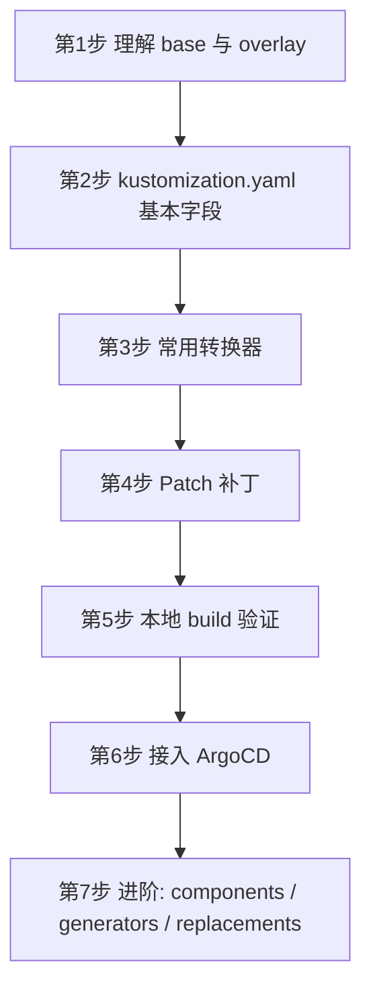
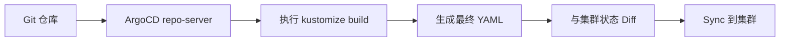
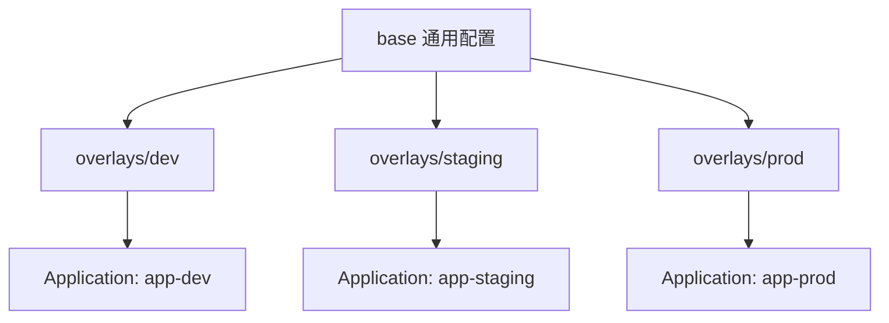
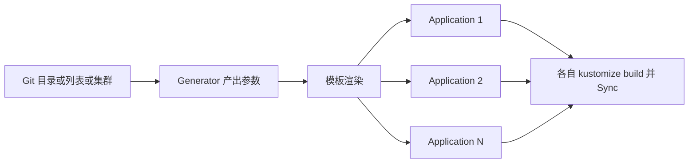
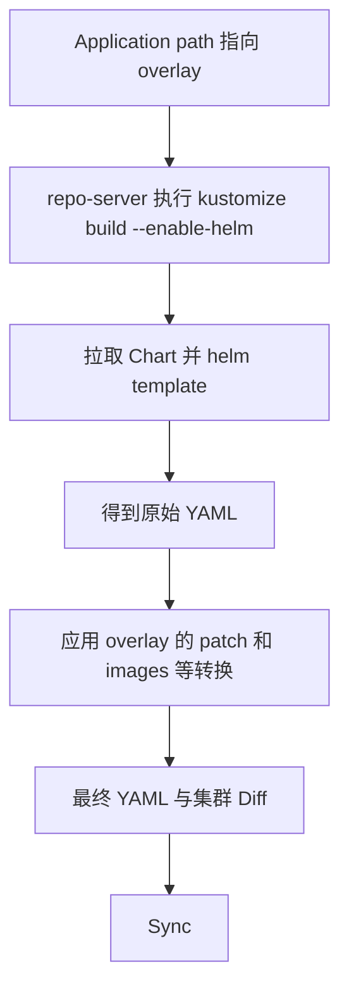
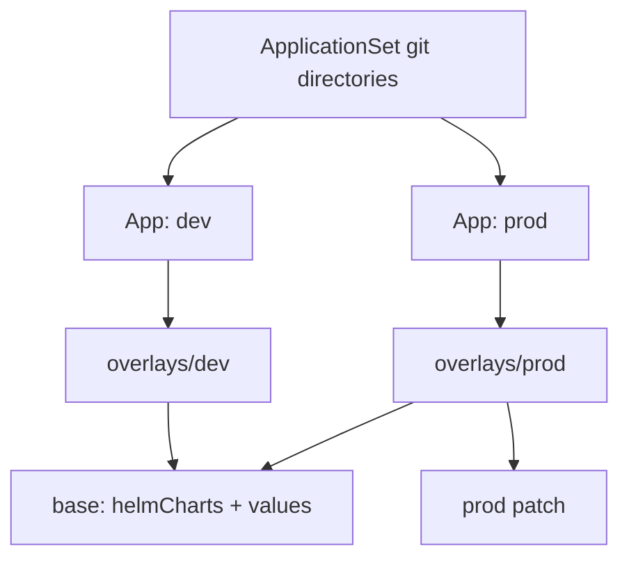

# Kustomize 入门手册（面向 ArgoCD 使用者）

## 1. 问题分析

**Kustomize 是什么？** 一句话：**不用模板，通过"基础 YAML + 补丁"来生成不同环境的 Kubernetes YAML。**

| 对比项 | Helm | Kustomize |
|--------|------|-----------|
| 思路 | 模板 + values 渲染 | 原始 YAML + Patch 叠加 |
| 学习成本 | 较高（Go template） | 较低（纯 YAML） |
| 典型场景 | 分发第三方应用 | 管理自己的多环境配置 |
| 内置于 | 需单独安装 | `kubectl -k` 已内置 |

**类比：** Kustomize 像 Docker 镜像分层。`base` 是底层镜像，`overlay` 是在上面叠加的修改层，最终合成一份完整配置。

**和 ArgoCD 的关系：** ArgoCD 本身不"理解"Kustomize，它只是在同步前，对 Git 目录执行 `kustomize build`，再把渲染出的 YAML 应用到集群。

---

## 2. 学习路线（按顺序）



| 阶段 | 要学什么 | 目标 |
|------|----------|------|
| 1 | base / overlay 概念、目录结构 | 知道配置怎么分层 |
| 2 | `resources`、`namespace`、`namePrefix` | 能写最小的 kustomization.yaml |
| 3 | `images`、`labels`、`configMapGenerator` | 能做环境差异化的常见操作 |
| 4 | `patches`（Strategic Merge / JSON6902） | 能精确修改任意字段 |
| 5 | `kustomize build` / `kubectl kustomize` | 能在本地先看到渲染结果 |
| 6 | ArgoCD Application 指向 overlay 目录 | 能用 GitOps 部署 |
| 7 | `components`、`replacements`、Helm 联用 | 复杂场景的复用 |

---

## 3. 核心概念

### 3.1 目录结构（最重要）

```text
my-app/
├── base/
│   ├── kustomization.yaml
│   ├── deployment.yaml
│   └── service.yaml
└── overlays/
    ├── dev/
    │   ├── kustomization.yaml
    │   └── replica-patch.yaml
    └── prod/
        ├── kustomization.yaml
        └── replica-patch.yaml
```

- **base**：所有环境共用的通用配置
- **overlay**：每个环境自己的差异，引用 base 再叠加修改

### 3.2 base 的 kustomization.yaml

```yaml
# base/kustomization.yaml
apiVersion: kustomize.config.k8s.io/v1beta1
kind: Kustomization

resources:
  - deployment.yaml
  - service.yaml
```

### 3.3 overlay 的 kustomization.yaml

```yaml
# overlays/prod/kustomization.yaml
apiVersion: kustomize.config.k8s.io/v1beta1
kind: Kustomization

resources:
  - ../../base            # 引用 base

namespace: prod           # 统一设置 namespace
namePrefix: prod-         # 给所有资源名加前缀

images:                   # 替换镜像 tag
  - name: my-app
    newTag: v1.2.3

patches:                  # 打补丁
  - path: replica-patch.yaml
```

```yaml
# overlays/prod/replica-patch.yaml
apiVersion: apps/v1
kind: Deployment
metadata:
  name: my-app            # 必须与 base 中的资源名一致
spec:
  replicas: 5
```

### 3.4 常用字段速查

| 字段 | 作用 |
|------|------|
| `resources` | 引入 YAML 文件或其他 kustomization 目录 |
| `namespace` | 统一覆盖所有资源的 namespace |
| `namePrefix` / `nameSuffix` | 资源名加前后缀 |
| `images` | 修改镜像名或 tag，不用改 YAML |
| `labels` / `commonAnnotations` | 统一加标签或注解 |
| `patches` | 对指定资源打补丁 |
| `configMapGenerator` / `secretGenerator` | 从文件或字面量生成 ConfigMap 和 Secret，内容变化会自动改名并触发滚动更新 |
| `components` | 可复用的功能片段 |
| `replacements` | 把某处的值复制到另一处 |

### 3.5 两种 Patch 方式

```yaml
patches:
  # 方式 1: Strategic Merge，直观，写一段"残缺的 YAML"
  - path: replica-patch.yaml

  # 方式 2: JSON6902，精确到路径，适合改数组元素
  - target:
      kind: Deployment
      name: my-app
    patch: |-
      - op: replace
        path: /spec/replicas
        value: 3
```

---

## 4. 本地验证

> 在接入 ArgoCD 之前，**一定先本地渲染确认结果**。

```bash
# 渲染但不部署，查看最终 YAML
kustomize build overlays/prod

# 没装 kustomize 时，kubectl 内置了
kubectl kustomize overlays/prod

# 与集群当前状态对比
kubectl diff -k overlays/prod

# 直接应用
kubectl apply -k overlays/prod
```

---

## 5. 接入 ArgoCD

### 5.1 Application 示例

```yaml
apiVersion: argoproj.io/v1alpha1
kind: Application
metadata:
  name: my-app-prod
  namespace: argocd
spec:
  project: default
  source:
    repoURL: https://github.com/your-org/your-repo.git
    targetRevision: main
    path: my-app/overlays/prod      # 指向 overlay 目录，而不是 base
    kustomize:                      # 可选，ArgoCD 层面的覆盖
      namePrefix: ""
      images:
        - my-app=registry.example.com/my-app:v1.2.3
  destination:
    server: https://kubernetes.default.svc
    namespace: prod
  syncPolicy:
    automated:
      prune: true
      selfHeal: true
```

ArgoCD 检测到 `path` 目录下存在 `kustomization.yaml`，就会自动判定为 Kustomize 类型应用。

### 5.2 工作流程



### 5.3 一个典型的多环境方案



---

## 6. 注意事项与最佳实践

| 事项 | 说明 |
|------|------|
| Application 的 path | 必须指向含 `kustomization.yaml` 的 **overlay** 目录 |
| Patch 匹配 | patch 中的 `kind` 和 `metadata.name` 必须与 base 中的资源一致；如果用了 `namePrefix`，匹配的是**原始名称** |
| 避免过度 patch | 差异太多时，考虑拆分 base，或用 components |
| 镜像更新 | 优先用 `images` 字段，CI 里只需改 tag |
| 版本差异 | ArgoCD 内置的 kustomize 版本可能和本地不同，渲染结果不一致时先检查版本 |
| 引用远程 base | 可以写 `github.com/org/repo//path?ref=v1.0`，但生产建议固定到 tag 或 commit |
| Helm 联用 | 需在 ArgoCD 配置中开启 `--enable-helm` 才能用 `helmCharts` |

### 常见故障排查

```bash
# 1. 先看 ArgoCD 渲染的结果
argocd app manifests my-app-prod

# 2. 本地复现
kustomize build overlays/prod | kubectl apply --dry-run=server -f -

# 3. 查看 repo-server 日志
kubectl -n argocd logs deploy/argocd-repo-server --tail=100
```

---

## 7. 推荐的实操顺序

1. 在本地建一个 `base`（一个 Deployment 加一个 Service），执行 `kustomize build base`
2. 新建 `overlays/dev` 和 `overlays/prod`，分别改 `replicas` 和 `images`，对比两个 `build` 的输出
3. 加一个 `configMapGenerator`，观察生成的 ConfigMap 名称带 hash 后缀
4. 把仓库推到 Git，在 ArgoCD 创建 Application 指向 `overlays/dev`
5. 改 Git 里的 tag，观察 ArgoCD 自动同步

需要的话，我可以接着给你一份 **Kustomize + Helm 联用** 或 **ApplicationSet 批量管理多环境** 的示例。


# ApplicationSet 与 Kustomize + Helm 联用手册

## 一、ApplicationSet 批量管理多环境

### 1. 问题分析

手写 `app-dev`、`app-staging`、`app-prod` 三份 Application 时，除了 `path` 和 `namespace`，其余内容几乎相同。ApplicationSet 是 **Application 的模板加生成器**：generator 产出一组参数，模板按参数渲染出多个 Application。

**类比：** Application 是一份合同，ApplicationSet 是合同模板加客户名单，名单每多一行就自动生成一份合同。

### 2. 常用 Generator

| Generator | 数据来源 | 典型场景 |
|-----------|----------|----------|
| `list` | 手写的列表 | 环境数量固定且很少 |
| `git` (directories) | Git 仓库里的目录 | 每个 overlay 目录对应一个 Application |
| `git` (files) | Git 里的 JSON/YAML 文件 | 参数集中放在配置文件里 |
| `clusters` | ArgoCD 已注册的集群 | 同一应用部署到多个集群 |
| `matrix` | 两个 generator 的笛卡尔积 | 多应用 × 多集群 |

### 3. 示例 A：list generator（最直观）

```yaml
apiVersion: argoproj.io/v1alpha1
kind: ApplicationSet
metadata:
  name: my-app
  namespace: argocd
spec:
  goTemplate: true
  goTemplateOptions: ["missingkey=error"]
  generators:
    - list:
        elements:
          - env: dev
            namespace: dev
          - env: staging
            namespace: staging
          - env: prod
            namespace: prod
  template:
    metadata:
      name: 'my-app-{{.env}}'
    spec:
      project: default
      source:
        repoURL: https://github.com/your-org/your-repo.git
        targetRevision: main
        path: 'my-app/overlays/{{.env}}'
      destination:
        server: https://kubernetes.default.svc
        namespace: '{{.namespace}}'
      syncPolicy:
        automated:
          prune: true
          selfHeal: true
        syncOptions:
          - CreateNamespace=true
```

### 4. 示例 B：git directories generator（推荐，自动发现）

在 Git 里新增一个 `overlays/xxx` 目录，就会自动多出一个 Application，不用改 ApplicationSet。

```yaml
apiVersion: argoproj.io/v1alpha1
kind: ApplicationSet
metadata:
  name: my-app-envs
  namespace: argocd
spec:
  goTemplate: true
  goTemplateOptions: ["missingkey=error"]
  generators:
    - git:
        repoURL: https://github.com/your-org/your-repo.git
        revision: main
        directories:
          - path: my-app/overlays/*
  template:
    metadata:
      name: 'my-app-{{.path.basename}}'   # 目录名即环境名
    spec:
      project: default
      source:
        repoURL: https://github.com/your-org/your-repo.git
        targetRevision: main
        path: '{{.path.path}}'
      destination:
        server: https://kubernetes.default.svc
        namespace: '{{.path.basename}}'
      syncPolicy:
        automated:
          prune: true
          selfHeal: true
        syncOptions:
          - CreateNamespace=true
```

### 5. 示例 C：matrix（多集群 × 多环境目录）

```yaml
generators:
  - matrix:
      generators:
        - git:
            repoURL: https://github.com/your-org/your-repo.git
            revision: main
            directories:
              - path: my-app/overlays/*
        - clusters:
            selector:
              matchLabels:
                env-type: workload
```

模板中可同时使用 `{{.path.basename}}` 和 `{{.name}}`（集群名）、`{{.server}}`（集群地址）。

### 6. 生成流程



### 7. 注意事项

| 事项 | 说明 |
|------|------|
| 删除行为 | 删除 ApplicationSet 默认会**级联删除**所生成的 Application，进而可能删掉集群资源。生产环境建议设置 `spec.syncPolicy.preserveResourcesOnDeletion: true` |
| 手动改生成的 Application | 会被 ApplicationSet 控制器覆盖回去，所有修改都应该改模板 |
| Go 模板 | 新项目建议开启 `goTemplate: true`，表达能力更强；不开启则用旧的 `{{path.basename}}` 语法 |
| 先小范围验证 | 先用 `list` 跑通，再换 `git directories` |
| 权限 | ApplicationSet 可以创建任意 Application，务必限制谁能改它，必要时配合 AppProject 限定 source 与 destination |

---

## 二、Kustomize + Helm 联用

### 1. 问题分析

Helm Chart 的 `values.yaml` 只能改作者预留的参数。如果还想改作者没暴露的字段（比如给 Deployment 加 `tolerations`），常见做法是：**用 Kustomize 先渲染 Chart，再在输出上打 patch**，不需要 fork Chart。

### 2. 两种联用方式对比

| 方式 | 做法 | 优点 | 缺点 |
|------|------|------|------|
| A. Kustomize `helmCharts` | kustomization.yaml 里声明 Chart，build 时渲染并 patch | 单一 Application，patch 能力完整 | 需要开启 `--enable-helm`，且 Kustomize 不会管理 Helm hook 和 release 状态 |
| B. ArgoCD 多源 (multi-source) | 一个 Application 里同时引用 Chart 仓库和 Git 里的 values 文件 | 原生 Helm 渲染，无需额外开关 | 无法直接对渲染结果打 patch |

下面重点讲方式 A。

### 3. 目录结构

```text
ingress-nginx/
├── base/
│   ├── kustomization.yaml
│   └── values.yaml
└── overlays/
    ├── dev/
    │   └── kustomization.yaml
    └── prod/
        ├── kustomization.yaml
        └── tolerations-patch.yaml
```

### 4. base：声明 Chart

```yaml
# base/kustomization.yaml
apiVersion: kustomize.config.k8s.io/v1beta1
kind: Kustomization

helmCharts:
  - name: ingress-nginx
    repo: https://kubernetes.github.io/ingress-nginx
    version: 4.11.3          # 一定要固定版本
    releaseName: ingress-nginx
    namespace: ingress-nginx
    valuesFile: values.yaml
    includeCRDs: true
```

```yaml
# base/values.yaml
controller:
  replicaCount: 2
  service:
    type: ClusterIP
```

### 5. overlay：用 values 加 patch 做差异化

```yaml
# overlays/prod/kustomization.yaml
apiVersion: kustomize.config.k8s.io/v1beta1
kind: Kustomization

resources:
  - ../../base

patches:
  - path: tolerations-patch.yaml
```

```yaml
# overlays/prod/tolerations-patch.yaml
# 修改 Chart 没有暴露的字段
apiVersion: apps/v1
kind: Deployment
metadata:
  name: ingress-nginx-controller
spec:
  template:
    spec:
      tolerations:
        - key: dedicated
          operator: Equal
          value: ingress
          effect: NoSchedule
```

> **说明：** `helmCharts` 写在 base 中，overlay 只负责打 patch。如果某个环境还需要不同的 values，可以在该 overlay 里另写一个 `helmCharts` 条目，并用 `valuesInline` 覆盖；但同一份 Chart 不要在 base 与 overlay 里重复声明。

### 6. 本地验证

```bash
# 必须加 --enable-helm，且本机要有 helm 命令
kustomize build --enable-helm overlays/prod

# 用 kubectl 内置的 kustomize 也行
kubectl kustomize --enable-helm overlays/prod
```

### 7. 在 ArgoCD 中启用

默认情况下，ArgoCD 的 Kustomize **不会**渲染 `helmCharts`，需要修改 `argocd-cm`：

```yaml
apiVersion: v1
kind: ConfigMap
metadata:
  name: argocd-cm
  namespace: argocd
data:
  kustomize.buildOptions: --enable-helm
```

```bash
# 修改后重启 repo-server 使其生效
kubectl -n argocd rollout restart deploy/argocd-repo-server
```

之后 Application 与普通 Kustomize 应用写法完全一致，`path` 指向 `overlays/prod` 即可。

### 8. 联用时的渲染流程



### 9. 注意事项

| 事项 | 说明 |
|------|------|
| 固定 Chart 版本 | 不要省略 `version`，否则每次渲染可能拿到不同版本 |
| 全局开关 | `--enable-helm` 对整个 ArgoCD 的所有 Kustomize 应用生效，会稍微扩大渲染时的行为面，评估后再开 |
| Helm hook 与 release | Kustomize 只做 `helm template`，没有 Helm release 概念，`helm list` 看不到，hook 会被当作普通资源渲染 |
| 外网依赖 | repo-server 需要能访问 Chart 仓库，内网环境要配代理或改用内部仓库 |
| 渲染较慢 | 每次刷新都会重新拉取和渲染 Chart，Chart 很大时注意 repo-server 的资源和超时 |
| namespace | `helmCharts.namespace` 只影响 `helm template` 时的 namespace，最终是否统一覆盖由 kustomization 顶层的 `namespace` 字段决定 |

---

## 三、两者组合的推荐实践

用 ApplicationSet 按目录发现 overlay，每个 overlay 内部用 Kustomize 引用 Helm Chart 并打 patch：



建议的上手顺序：

1. 先在本地用 `kustomize build --enable-helm` 跑通一个 Chart。
2. 再创建单个 Application 验证 ArgoCD 渲染结果一致。
3. 最后引入 ApplicationSet，从 `list` 开始，稳定后再换成 `git directories`。

如果你想针对某个具体 Chart 或你当前的 GKE 环境落一份完整示例，把目录结构和需求发给我，我可以直接按你的场景写。