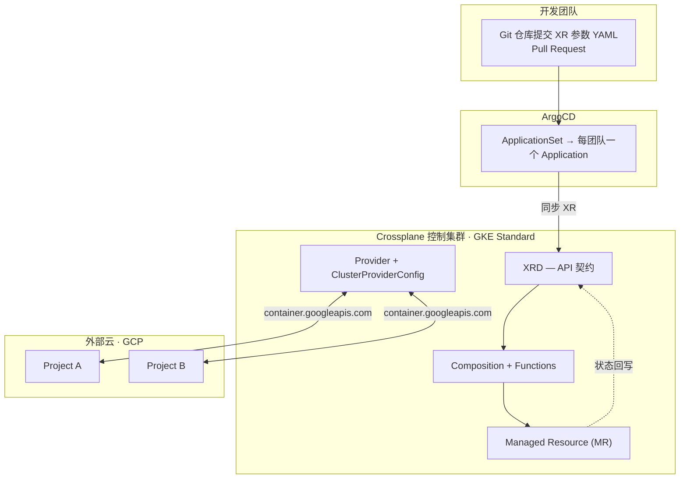
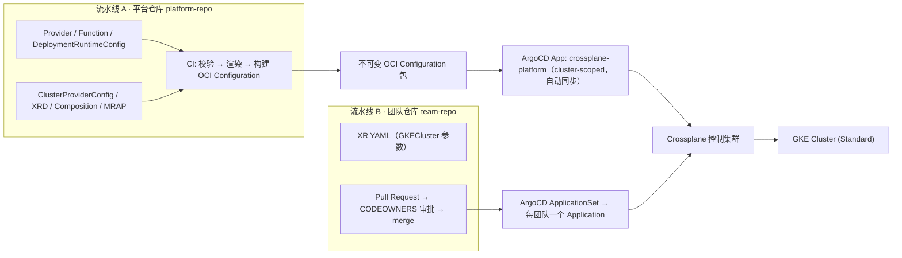
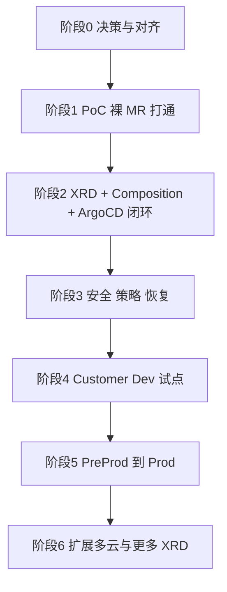

# UCP 统一云平台 (Unified Cloud Platform) — Crossplane PoC 方案

> 本文基于 `requirement.md`（需求梳理）与 `poc.md`（技术验证思路）整合，作为 PoC 执行文档。
>
> **本版吸收的已确认决策**
>
> 1. Crossplane 采用 v2 最新稳定版（版本号已在线核实，见 §2）。
> 2. 目标 GKE 为 **Standard** 集群（非 Autopilot）。
> 3. 被管集群**只创建 / 管理 Cluster 生命周期**，不向集群内安装任何组件。
> 4. 阿里云 Provider 覆盖度**本轮不做评估**，不作为阻塞项。
> 5. 控制集群**默认允许访问各云 API**，不设出口 IP 白名单约束。
> 6. XR 提交入口 = **Git PR + ArgoCD**（ArgoCD 是 PoC 交付路径的组成部分，不是后续阶段的可选项）。
>
> 标注 `【待核实】` 的项为版本相关细节，实施前须以实际安装版本的 CRD / `kubectl explain` 输出为准。

---

## 0. 一句话概括

用 **一个 GKE Standard 控制集群**跑 Crossplane，先只接管 **GCP** 一个云、**GKE 集群**一种资源，
以 **Git PR + ArgoCD** 作为唯一提交入口，跑通
"PR → ArgoCD → XR → Composition → MR → GKE API → 状态回写"的完整闭环，
再横向扩展 Provider（AWS / Azure / 阿里云）与资源类型（对象存储、数据库等）。

---

## 1. 核心 Requirements

### 1.1 业务目标

| 编号 | 需求 | 说明 |
|---|---|---|
| R1 | 统一 Kubernetes 风格资源接口 | 各团队使用不同云（GCP / AWS / 阿里云 / Azure），平台侧提供统一 API 契约，把云差异收敛到平台维护的 Composition 里 |
| R2 | 持续调谐、消除漂移 | 不只是"创建资源"，还要能检测并纠正云上的人工改动 |
| R3 | 保留各云专有能力 | 跨云抽象不等于抹平所有差异；云账号归属、治理责任仍归各云治理方 |
| R4 | 交付边界清晰 | 平台团队负责 Core / Provider / Function / XRD / Composition / 发布；开发团队只在批准的 XRD 契约内提交 XR 参数 |
| R5 | 逐环境推广 | Platform Development → Customer Development → Customer PreProduction → Customer Production |
| R6 | 状态可恢复 | Git 只存声明式定义，XR / MR 运行状态在 K8s API；必须有备份、恢复演练与外部资源身份核对 |
| R7 | 全流程 GitOps | 平台组件与业务 XR 均由 Git 声明 + ArgoCD 同步，可审计、可回滚；任何人不得绕过 Git 直接 `kubectl apply` 业务资源 |

### 1.2 非功能要求

| 维度 | 要求 | 复杂度 |
|---|---|---|
| 身份 | Workload Identity，**禁止长期 AK/SK** | 中 |
| 权限隔离 | ProviderConfig 按 **团队 × 环境 × 云** 拆分；使用者不能自选凭据 | 中 |
| 可靠性 | 删除保护 `deletionPolicy: Orphan` + `Usage` 保护；关键资源开启 deletion protection | 中 |
| 版本 | Core / Provider / Function / Configuration 全部**固定版本**，禁止 `latest` / 浮动 tag | 低 |
| 治理 | 准入策略（Kyverno / OPA）校验区域、规格、标签、必填项 | 中 |
| 可观测 | XR / MR 的 `Ready` / `Synced` condition 告警；Provider Prometheus 指标；云 API 配额与限流治理 | 中 |
| 审计 | Git 历史 + K8s 审计日志 + ArgoCD Application 历史，追溯"谁提交了什么" | 低 |

### 1.3 已确认的关键决策

| # | 决策项 | 结论 | 影响 |
|---|---|---|---|
| D1 | Crossplane 大版本 | **v2.4.3**（2026-10-22 发布，Helm chart 2.4.3） | v1.20 将于 2026-11 EOL，直接上 v2 无需再评估 v1 兼容层 |
| D2 | 目标 GKE 类型 | **Standard**（控制集群与被管集群均为 Standard） | Composition 必须显式创建 NodePool；`enableAutopilot` 保持 false |
| D3 | 被管集群范围 | **只管 Cluster 生命周期**，不装任何组件 | 不需要 provider-kubernetes / provider-helm；不需要连被管集群 API Server；只需要 `container.googleapis.com` |
| D4 | 阿里云 Provider 覆盖度 | **本轮不评估** | 从阻塞项移除，留到阶段 6 扩展时单独立项 |
| D5 | 控制集群出网 | **默认允许访问各云 API** | 不设计出口 IP 白名单 / 私有链路方案 |
| D6 | XR 提交入口 | **Git PR + ArgoCD** | ArgoCD 纳入 PoC 阶段交付链路（不再是阶段 2 的事后项） |
| D7 | Control Plane 位置 | GCP GKE，**开启 Workload Identity** | Provider 通过 WI 换取 GSA 身份 |
| D8 | 多云控制集群 | **一个控制集群**，多 ProviderConfig 跨云 | 按爆炸半径 / 合规再决定是否拆分 |
| D9 | 被管资源范围 | 其他 GCP Project 中的 **GKE 集群** | PoC 阶段控制集群本身由 Terraform / Helm 创建，不纳入 Crossplane 自管理 |

### 1.4 边界假设（PoC 期间按此推进，不阻塞）

- 目标 Project 已开通 `container.googleapis.com`；PoC 使用 default VPC / 子网，不做私网集群（Private Cluster）与 NAT 打通验证。
- 控制集群所在 VPC 允许访问 `container.googleapis.com` 与 Artifact Registry（若使用私有镜像仓库）。
- GKE 集群创建耗时约 5–10 分钟，PoC 按分钟级等待设计，不做超时优化。
- 被管集群创建后**不承载业务负载**，其节点规格最小化即可（`e2-standard-2` / 1 节点）。

### 1.5 明确不做的事（防止范围蔓延）

- 不做"全云全资源"覆盖；PoC 只做 GCP + GKE Cluster。
- 不向被管集群安装任何组件（不装 Istio / 不装 provider-kubernetes / 不装 GitOps Agent）。
- 不在 PoC 阶段把已有 Terraform 创建的云资源纳管（纳管需显式 `external-name` + `managementPolicies`）。
- 不为每个云单独建控制集群。
- 不在本轮评估阿里云 Provider 覆盖度，也不引入 `provider-terraform` 兜底。
- 不做跨云网络互联与多云统一身份联邦（PoC 只验证"同一 XRD + 多 Composition"这一抽象是否成立）。

---

## 2. 版本矩阵（已核实，2026-10-28）

| 组件 | 版本 | 核实来源 | 说明 |
|---|---|---|---|
| Crossplane Core | **v2.4.3** | GitHub Releases `crossplane/crossplane` | 2026-10-22 发布，patch release（安全 + 截断包下载缓存修复） |
| Crossplane Helm Chart | **2.4.3** | `https://charts.crossplane.io/stable/index.yaml` | appVersion 2.4.3，2026-10-22 |
| provider-gcp (Upjet) | **v3.1.0** | `crossplane-contrib/provider-upjet-gcp` | 2026-10-08；底层 TF Google Provider v7.46.1（v7.x 最后一版） |
| provider-gcp-container | **v3.1.0** | 同上（子包按 `-container` 拆分发布） | 只装 container 子包，不装全家桶【待核实：registry tag 拉取后确认】 |
| function-go-templating | **v0.13.2** | `crossplane-contrib/function-go-templating` | 2026-10-26 |
| function-auto-ready | **v0.7.3** | `crossplane-contrib/function-auto-ready` | 2026-10-26；含 CEL 健康检查（alpha） |
| CLI | `cli.crossplane.io` | v2 迁移指南 | 二进制名为 `crossplane`（不再是 `crank`） |

### 2.1 provider-gcp v3.x 的 API 版本变化（关键）

`provider-gcp` v3.0.0 **移除了所有已弃用的 `v1beta1` API 版本**，`container` 组受影响资源为
**Cluster、NodePool**。当前（v3.1.0）实际 CRD 情况：

| 资源 | 集群级 API | 命名空间级 API | Scope |
|---|---|---|---|
| GKE Cluster | `container.gcp.upbound.io/v1beta2` | `container.gcp.m.upbound.io/v1beta1` | Cluster / Namespaced |
| GKE NodePool | `container.gcp.upbound.io/v1beta2` | `container.gcp.m.upbound.io/v1beta1` | Cluster / Namespaced |
| ClusterProviderConfig | — | `gcp.m.upbound.io/v1beta1` | **Cluster** |
| ProviderConfig | `gcp.upbound.io/v1beta1`（遗留） | `gcp.m.upbound.io/v1beta1` | Cluster / Namespaced |
| ProviderConfigUsage | — | `gcp.m.upbound.io/v1beta1` | Namespaced |

**选型结论**：XRD 取 `scope: Namespaced` → 组合出的 MR 走命名空间级 API
（`container.gcp.m.upbound.io/v1beta1`），团队之间用 namespace 天然隔离。

> `spec.providerConfigRef` 省略时**默认指向名为 `default` 的 `ClusterProviderConfig`**；
> 显式指定时 `kind` 与 `name` 均为必填。

### 2.2 Crossplane v2 相对 v1 的四个关键变化（直接影响 PoC 写法）

1. **Composition 里不再有 `spec.resources`**。组合资源由 Function 的输出声明。
   go-templating 直接输出期望的 MR YAML 即可（多份用 `---` 分隔）。
2. **XRD `scope` 枚举**：`LegacyCluster`（默认）/ `Namespaced` / `Cluster`。
3. **XR 不再有原生 connection details**；MR 仍支持 `writeConnectionSecretToRef`。
4. **原生 patch & transform / ControllerConfig 已移除**，必须走 Function Pipeline 与
   `DeploymentRuntimeConfig`。

### 2.3 v2.4 的两个可利用特性

- **Safe Start**：Provider 具备 `safe-start` capability 时，其 runtime Deployment 在对应 MRD 未激活前**缩容到 0**；
  首个 MRD 被 `ManagedResourceActivationPolicy` 激活后才扩容。`ProviderRevision` 新增
  `RuntimeActive` condition，未激活时为 `False / AwaitingActivation`（`RuntimeHealthy` 仍为 True）。
- **Watching required resources**：Function 声明的 required resources 现在会被 watch，
  其变更会立即触发相关 XR 重新调谐（默认开启 realtime compositions）。

### 2.4 升级路径注意事项（PoC 直接装最新，因此不触发）

从 provider-gcp v1.x / v2.x 升到 v3.0.0 **必须**按
`v1.x → v2.0.0 → v2.6.0 → v3.0.0`（或 `v2.x → v2.6.0 → v3.0.0`）逐级走，
并应用官方的 `DeploymentRuntimeConfig` Storage Version Migrator 初始化容器。
**PoC 是全新安装，可直接从 v3.1.0 开始，不需要迁移。**

---

## 3. Follow 流程

### 3.1 分层架构



### 3.2 交付链路（GitOps 两条流水线）



**分工原则（关键）**

| 对象 | 由谁写进集群 | 理由 |
|---|---|---|
| Provider / Function / XRD / Composition / MRAP / ProviderConfig | 平台仓库 + ArgoCD App | 平台负责发布，版本必须固定可回滚 |
| **XR（业务请求）** | 团队仓库 + ArgoCD Application | 团队通过 Git PR 提交，平台不代客写业务资源 |
| **MR（Managed Resource）** | **无人直接写**，由 Composition 生成 | MR 是 Crossplane 的运行时状态，ArgoCD 同步 MR 会与 Composition 争夺所有权，导致持续 diff |

> ⚠️ **ArgoCD 只同步 XR，绝不同步 MR。** 这是本方案最容易踩的坑。

### 3.3 XR 提交入口：Git PR + ArgoCD（PoC 阶段即落地）

**仓库布局（推荐单仓库多目录，PoC 阶段最省事）**

```
ucp-platform/
├── platform/                  # 流水线 A：平台组件（ArgoCD App: crossplane-platform）
│   ├── providers/
│   ├── functions/
│   ├── xrd/
│   ├── compositions/
│   └── providerconfigs/
└── teams/
    ├── team-a/                # 流水线 B：ApplicationSet 按目录生成 Application
    │   ├── project-a/
    │   └── project-b/
    └── team-b/
```

**每个团队一个 ArgoCD Project + ApplicationSet**

```yaml
# teams/team-a/applicationset.yaml
apiVersion: argoproj.io/v1alpha1
kind: ApplicationSet
metadata:
  name: team-a-xr
  namespace: argocd
spec:
  generators:
  - git:
      repoURL: git@github.com:<org>/ucp-platform.git
      revision: main
      directories:
      - path: teams/team-a/*
  template:
    metadata:
      name: 'team-a-{{path.basename}}'
    spec:
      project: team-a
      source:
        repoURL: git@github.com:<org>/ucp-platform.git
        targetRevision: main
        path: '{{path}}'
      destination:
        server: https://kubernetes.default.svc
        namespace: '{{path.basename}}'
      syncPolicy:
        automated:
          prune: true
          selfHeal: true
        syncOptions:
        - CreateNamespace=true
        - ServerSideApply=true
```

**团队级 ArgoCD Project 隔离要点**

```yaml
apiVersion: argoproj.io/v1alpha1
kind: AppProject
metadata:
  name: team-a
  namespace: argocd
  namespaceMetadata:
    name: team-a
  sourceRepos:
  - '*'
  destinations:
  - namespace: team-a
    server: https://kubernetes.default.svc
  clusterResourceWhitelist: []          # 关键：团队不得创建集群级资源
  namespaceResourceWhitelist:
  - group: platform.example.org
    kind: GKECluster
  namespaceResourceBlacklist:
  - group: '*'
    kind: '*'                            # 白名单之外一律拒绝
```

**PR → 上云的完整链路**

1. 开发团队在 `teams/<team>/<project>/` 下新增 / 修改 XR YAML；
2. 提 PR，CODEOWNERS 指定平台团队 + 云治理方审批；
3. CI 跑 `kubeconform` / `crossplane render` 校验（渲染失败直接挡 PR）；
4. 合并 → ArgoCD ApplicationSet 检测到 commit → 同步 XR 到控制集群；
5. Crossplane 调谐 → 生成 MR → 调用 GCP API → 集群创建；
6. ArgoCD UI 显示 XR 状态（需配 health.lua，见 §3.4）；
7. 回滚 = revert PR → ArgoCD 自动同步 → Crossplane 按 diff 收敛。

### 3.4 ArgoCD 与 Crossplane 的必要配置

官方明确要求的三项，缺一不可（否则 UI 状态错误或 API Server 被压垮）：

```yaml
apiVersion: v1
kind: ConfigMap
metadata:
  name: argocd-cm
  namespace: argocd
data:
  # 1) 必须用 annotation 追踪资源，否则与 Crossplane 的 label 所有权冲突
  application.resourceTrackingMethod: annotation

  # 2) 隐藏 ProviderConfigUsage，避免 UI 卡顿（每个 MR 生成一个）
  resource.exclusions: |
    - apiGroups:
      - "*"
      kinds:
      - ProviderConfigUsage

  # 3) 为 Upbound / Crossplane CRD 定义健康检查
  resource.customizations: |
    "*.upbound.io/*":
      health.lua: |
        -- 见官方 crossplane-with-argo-cd 指南
    "*.crossplane.io/*":
      health.lua: |
        -- 见官方 crossplane-with-argo-cd 指南
```

```yaml
# Deployment 侧：CRD 多时提高 ArgoCD 的 K8s client 限流
apiVersion: apps/v1
kind: Deployment
metadata:
  name: argocd-application-controller
  namespace: argocd
spec:
  template:
    spec:
      containers:
      - name: argocd-application-controller
        env:
        - name: ARGOCD_K8S_CLIENT_QPS
          value: "300"
```

**ArgoCD 版本要求**：≥ **2.4.8**（官方推荐的下限）。

> ArgoCD health.lua 完整脚本较长，建议直接从
> `crossplane/docs` 仓库 `content/v2.4/guides/crossplane-with-argo-cd.md`
> 抄取 `*.upbound.io/*` 与 `*.crossplane.io/*` 两段，落到 `argocd-cm`。

### 3.5 阶段路线与退出标准



| 阶段 | 目标 | 退出标准 |
|---|---|---|
| 0 决策与对齐 | 定版本（§2）、定拓扑、定首批资源、定 RACI | 评审通过的一页纸设计 |
| 1 PoC-a | **裸 MR** 在目标 Project 创建 Standard GKE 集群 + NodePool | 集群 Ready、NodePool Ready；MR 状态回写正确 |
| 1 PoC-b | XRD + Composition 驱动创建；**接入 ArgoCD + Git PR** | 提一个 PR → 自动建集群；revert PR → 集群被删；全程无手工 `kubectl apply` |
| 2 交付链路 | CI 产 OCI Configuration；ArgoCD 管理平台组件与 XR | 一次提交走完流水线，可回滚；版本全部固定 |
| 3 安全 / 策略 / 恢复 | 联邦身份、ProviderConfig 隔离、RBAC、准入、备份 | **完成一次恢复演练**并有记录 |
| 4 试点 | 1~2 个友好团队在 Customer Dev 上线 | 团队能自助申请，收集反馈 |
| 5 逐级推广 | PreProd → Prod，同一 OCI 版本 | 有值班、告警、升级手册 |
| 6 扩展 | 加第二个云、更多 XRD；**单独立项评估阿里云 Provider 覆盖度** | 第二个云复用同一 XRD，仅新增 Composition |

### 3.6 RACI

| 事项 | 平台 | 各云治理方 | 开发团队 |
|---|---|---|---|
| XRD 契约定义 | A/R | C | C |
| Composition / Provider / Function 维护 | A/R | C | I |
| 云账号与配额 | C | A/R | I |
| ProviderConfig 与 IAM 授权 | R | A | I |
| ArgoCD App / ApplicationSet 运维 | A/R | I | I |
| XR 提交（Git PR）与日常使用 | C | I | A/R |
| 集群 / 云资源故障响应 | R | C | I |
| 计费与成本归属 | R | A | C |

### 3.7 恢复与风险

| 风险 | 对策 |
|---|---|
| 只靠 Git 重建不安全（外部 ID / `crossplane.io/external-name` 只在 K8s API） | Velero 或 etcd 快照备份 XR/MR（含 status 与注解）；**定期演练**并记录 RTO/RPO |
| 误删除级联到云资源 | `deletionPolicy: Orphan` + `Usage` 保护 + `deletionProtection: true` |
| 恢复后误管 / 重复创建 | 恢复前核对外部资源身份；用 `managementPolicies: ["Observe"]` 先观察再放开 |
| ArgoCD 与 Composition 争抢 MR 所有权 | ArgoCD 只同步 XR；MR 由 Composition 独占 |
| 控制集群成为高价值单点 | 限制 API Server 访问、审计日志、最小化 cluster-admin；按环境拆控制集群 |
| Provider 升级改行为 | Core/Provider 全部固定版本 + `revisionActivationPolicy: Manual` |
| Cloud API 限流 | 调 `pollInterval` / 并发，加限流告警 |
| NodePool 先于 Cluster 就绪 | 预期行为：NodePool 用 `clusterRef` 解析，解析不到时调谐报错并自动重试，Cluster Ready 后自愈 |
| MRAP 配错导致 MRD 未激活 | 用 `kubectl get mrd` 确认 `state: Active`；未激活的 Provider runtime 处于 `RuntimeActive=False / AwaitingActivation`（不是故障） |

---

## 4. POC 所需资源梳理

### 4.1 云资源

| 类别 | 内容 | 说明 |
|---|---|---|
| 控制 Project | 1 个，存放控制集群 + GSA | 需启用 `container.googleapis.com`、`iam.googleapis.com` |
| 控制 GKE 集群 | 1 个 **Standard**（Workload Identity 开启） | 节点规格不需要大；**不装任何组件** |
| 目标 Project | 2 个测试 Project（A、B） | A 为主、B 验证多 Project 授权 |
| GCP 服务账号 GSA | 建于控制 Project，如 `crossplane-sa` | Provider 使用的唯一身份 |
| 节点 GSA（被管集群） | 每个目标 Project 一个，如 `gke-node-sa` | 被管集群的节点服务账号 |
| IAM：控制 Project | GSA ↔ KSA `crossplane-system/provider-gcp` 绑定 `roles/iam.workloadIdentityUser`；GSA 授 `roles/iam.serviceAccountTokenCreator`（给节点 GSA） | Workload Identity 联邦 |
| IAM：目标 Project | GSA 授 `roles/container.admin`（可按最小权限用自定义角色替代） | 权限不足会 403 |
| IAM：节点 GSA | 授 `roles/iam.serviceAccountUser`（对 GSA） | 节点拉取 WI 令牌所需 |
| API 启用 | 目标 Project：`container.googleapis.com`、`compute.googleapis.com` | 不开会持续 403 |
| 网络 | 目标 Project 的 VPC / 子网（PoC 用 default 网络） | Crossplane 只调控制面 API，**不需访问被管集群 API Server** |
| 预算 | 目标 Project 设预算告警 | 单次集群创建成本可控但需上限 |

### 4.2 Kubernetes / Crossplane 侧资源

| 类别 | 内容 |
|---|---|
| 集群 | 控制 GKE Standard（Workload Identity 开启） |
| 命名空间 | `crossplane-system`（Core/Provider 自动创建）、`argocd`、`team-a`（XR 使用方）、`team-b` |
| Crossplane Core | **v2.4.3**，Helm 安装，固定 chart 版本 |
| Function | `function-go-templating:v0.13.2`、`function-auto-ready:v0.7.3` |
| Provider | `provider-gcp-container:v3.1.0`（**不装 provider-gcp 全家桶**） |
| DeploymentRuntimeConfig | `gcp-wi`，固定 KSA 名 `provider-gcp`（保证 IAM 绑定名稳定） |
| ClusterProviderConfig | `gcp-target-a`、`gcp-target-b`，`credentials.source: InjectedIdentity` |
| MRAP | `gcp-container-only`，只激活 `*.container.gcp.m.upbound.io`（配合 Safe Start 缩容） |
| XRD | `gkeclusters.platform.example.org`，`scope: Namespaced`，`v1alpha1` |
| Composition | `gkecluster-gcp`，Pipeline 模式，标签 `provider: gcp` |
| RBAC | ClusterRole 带 `rbac.crossplane.io/aggregate-to-crossplane: "true"`（默认 RBAC Manager 已能创建 MR；禁用它才必须手工补） |
| ArgoCD | ≥ 2.4.8；`argocd-cm` 三项配置；每团队 1 个 AppProject + 1 个 ApplicationSet |

### 4.3 人员

| 角色 | 职责 | 人数 |
|---|---|---|
| 平台工程师 | Crossplane 安装、Composition/Function 开发、CI 流水线、ArgoCD 运维 | 1~2 |
| GCP 治理联络人 | 目标 Project IAM 授权、API 启用、额度审批 | 1 |
| 安全评审人 | 身份方案、权限边界、准入策略评审 | 1 |
| 试点团队代表 | XR 试用与反馈（走 Git PR 流程） | 1~2 |

### 4.4 仓库与工具（PoC 阶段最小集）

| 类别 | 内容 | PoC 阶段 |
|---|---|---|
| 工具 | `gcloud`、`kubectl`、`helm`、`crossplane` CLI（`cli.crossplane.io`） | 必需；CLI 用于 `crossplane render` 本地预览 |
| 代码仓库 | 1 个 Git 仓库（平台 + 团队目录） | **必需，PoC 一开始就上 Git + ArgoCD** |
| OCI Registry | 存放 Configuration 包 | 阶段 2 建，需访问控制与保留策略 |
| CI | GitHub Actions：`kubeconform` → `crossplane render` → 构建 → 签名 → 发布 | 阶段 1 先做前两步做 PR 校验 |
| 策略 | Kyverno 或 OPA | 阶段 3 |
| 备份 | Velero | 阶段 3，**推广前必须完成一次恢复演练** |
| 监控 | Prometheus 规则 + 告警通道 | 阶段 3 |

### 4.5 关键配置模板

> 所有 `apiVersion` 已按 §2.1 核实；仍建议安装后用 `kubectl get crd` / `kubectl explain` 二次确认。

#### 4.5.1 Provider / Function / DeploymentRuntimeConfig

```yaml
apiVersion: pkg.crossplane.io/v1
kind: Provider
metadata:
  name: provider-gcp-container
spec:
  package: xpkg.upbound.io/upbound/provider-gcp-container:v3.1.0
  packagePullPolicy: IfNotPresent
  revisionActivationPolicy: Manual
  runtimeConfigRef:
    name: gcp-wi
---
apiVersion: pkg.crossplane.io/v1
kind: Function
metadata:
  name: function-go-templating
spec:
  package: xpkg.crossplane.io/crossplane-contrib/function-go-templating:v0.13.2
---
apiVersion: pkg.crossplane.io/v1
kind: Function
metadata:
  name: function-auto-ready
spec:
  package: xpkg.crossplane.io/crossplane-contrib/function-auto-ready:v0.7.3
---
apiVersion: pkg.crossplane.io/v1beta1
kind: DeploymentRuntimeConfig
metadata:
  name: gcp-wi
spec:
  serviceAccountTemplate:
    metadata:
      # 固定名字，IAM 绑定才能稳定（否则 Provider 每次升级 SA 名都变）
      name: provider-gcp
      annotations:
        iam.gke.io/gcp-service-account: crossplane-sa@<control-project>.iam.gserviceaccount.com
  deploymentTemplate:
    spec:
      selector: {}
      template:
        spec:
          serviceAccountName: provider-gcp
```

#### 4.5.2 ClusterProviderConfig（每个目标 Project 一个）

```yaml
apiVersion: gcp.m.upbound.io/v1beta1
kind: ClusterProviderConfig
metadata:
  name: gcp-target-a
spec:
  credentials:
    source: InjectedIdentity      # Workload Identity 注入，无静态密钥
```

> 若目标 Project 使用不同 GSA，通过 `credentials.impersonateServiceAccount` 切换；
> 跨 Project 场景更推荐"每 Project 一个 ClusterProviderConfig + 各自 GSA"。

#### 4.5.3 Standard GKE Cluster MR

```yaml
apiVersion: container.gcp.m.upbound.io/v1beta1   # 命名空间级（Namespaced XRD）
kind: Cluster
metadata:
  name: gke-cluster
  labels:
    platform.example.org/team: team-a
spec:
  forProvider:
    project: <target-project-a>
    location: asia-southeast1
    network: projects/<target-project-a>/global/networks/default
    subnetwork: projects/<target-project-a>/regions/asia-southeast1/subnetworks/default
    enableAutopilot: false                        # Standard 集群
    # Standard 必须自建节点池 → 删掉默认节点池，同时 initialNodeCount 至少为 1
    removeDefaultNodePool: true
    initialNodeCount: 1
    deletionProtection: true
    releaseChannel:
      channel: REGULAR
    resourceLabels:
      managed-by: crossplane
      platform-ucp: "true"
    nodeConfig:
      machineType: e2-standard-2
      diskSizeGb: 50
      diskType: pd-balanced
      oauthScopes:
      - https://www.googleapis.com/auth/cloud-platform
      serviceAccount: gke-node-sa@<target-project-a>.iam.gserviceaccount.com
      labels:
        pool: primary
      workloadMetadataConfig:
        mode: GKE_METADATA
  providerConfigRef:
    kind: ClusterProviderConfig
    name: gcp-target-a
```

#### 4.5.4 Standard GKE NodePool MR

```yaml
apiVersion: container.gcp.m.upbound.io/v1beta1
kind: NodePool
metadata:
  name: gke-nodepool
spec:
  forProvider:
    project: <target-project-a>
    location: asia-southeast1
    # 用 clusterRef 引用同一 Composition 产出的 Cluster MR，
    # 由 Upjet resolver 解析出真实的 projects/*/locations/*/clusters/*
    clusterRef:
      name: gke-cluster
      policy:
        resolution: Required
    initialNodeCount: 1
    nodeConfig:
      machineType: e2-standard-2
      diskSizeGb: 50
      diskType: pd-balanced
      oauthScopes:
      - https://www.googleapis.com/auth/cloud-platform
      serviceAccount: gke-node-sa@<target-project-a>.iam.gserviceaccount.com
      labels:
        pool: primary
      workloadMetadataConfig:
        mode: GKE_METADATA
    management:                                  # 节点池管理策略
      autoRepair: true
      autoUpgrade: true
  providerConfigRef:
    kind: ClusterProviderConfig
    name: gcp-target-a
```

> `clusterRef` 的 `resolution: Required` 依赖 Cluster MR 的外部名。Cluster 尚未创建完成时，
> NodePool 调谐会报错并自动重试，Cluster Ready 后自愈——**这是预期行为**。
> 若 resolver 在该 provider 版本上解析异常，降级方案是用 go-templating 从
> `status.atProvider.id` 提取集群全路径填入 `cluster`【待核实】。

#### 4.5.5 XRD

```yaml
apiVersion: apiextensions.crossplane.io/v1
kind: CompositeResourceDefinition
metadata:
  name: gkeclusters.platform.example.org
spec:
  group: platform.example.org
  scope: Namespaced                  # → 组合出命名空间级 MR
  names:
    kind: GKECluster
    plural: gkeclusters
  versions:
  - name: v1alpha1
    served: true
    storage: true
    schema:
      openAPIV3Schema:
        type: object
        properties:
          spec:
            type: object
            required: [projectID, region]
            properties:
              projectID:
                type: string
                pattern: '^[a-z][a-z0-9-]{4,28}[a-z0-9]$'
              region:
                type: string
              providerConfigRef:
                type: object
                required: [name]
                properties:
                  name:
                    type: string
              nodePool:
                type: object
                properties:
                  machineType:
                    type: string
                    default: e2-standard-2
                  nodeCount:
                    type: integer
                    default: 1
              deletionProtection:
                type: boolean
                default: true
    additionalPrinterColumns:
    - name: Ready
      type: string
      jsonPath: .status.conditions[?(@.type=='Ready')].status
```

#### 4.5.6 Composition（Cluster + NodePool 两份组合资源）

```yaml
apiVersion: apiextensions.crossplane.io/v1
kind: Composition
metadata:
  name: gkecluster-gcp
  labels:
    provider: gcp
spec:
  compositeTypeRef:
    apiVersion: platform.example.org/v1alpha1
    kind: GKECluster
  mode: Pipeline
  pipeline:
  - step: render-cluster-and-nodepool
    functionRef:
      name: function-go-templating
    input:
      apiVersion: gotemplating.fn.crossplane.io/v1beta1
      kind: GoTemplate
      source: Inline
      inline:
        options:
        - missingkey=error
        template: |
          apiVersion: container.gcp.m.upbound.io/v1beta1
          kind: Cluster
          metadata:
            annotations:
              gotemplating.fn.crossplane.io/composition-resource-name: gke-cluster
            labels:
              platform.example.org/xr-name: "{{ .observed.composite.resource.metadata.name }}"
          spec:
            forProvider:
              project: {{ .observed.composite.resource.spec.projectID }}
              location: {{ .observed.composite.resource.spec.region }}
              network: projects/{{ .observed.composite.resource.spec.projectID }}/global/networks/default
              subnetwork: projects/{{ .observed.composite.resource.spec.projectID }}/regions/{{ .observed.composite.resource.spec.region }}/subnetworks/default
              enableAutopilot: false
              removeDefaultNodePool: true
              initialNodeCount: 1
              deletionProtection: {{ .observed.composite.resource.spec.deletionProtection }}
              releaseChannel:
                channel: REGULAR
              resourceLabels:
                managed-by: crossplane
                platform-ucp: "true"
              nodeConfig:
                machineType: e2-standard-2
                diskSizeGb: 50
                diskType: pd-balanced
                oauthScopes:
                - https://www.googleapis.com/auth/cloud-platform
                labels:
                  pool: primary
                workloadMetadataConfig:
                  mode: GKE_METADATA
            providerConfigRef:
              kind: ClusterProviderConfig
              name: {{ .observed.composite.resource.spec.providerConfigRef.name }}
          ---
          apiVersion: container.gcp.m.upbound.io/v1beta1
          kind: NodePool
          metadata:
            annotations:
              gotemplating.fn.crossplane.io/composition-resource-name: gke-nodepool
            labels:
              platform.example.org/xr-name: "{{ .observed.composite.resource.metadata.name }}"
          spec:
            forProvider:
              project: {{ .observed.composite.resource.spec.projectID }}
              location: {{ .observed.composite.resource.spec.region }}
              clusterRef:
                name: gke-cluster
                policy:
                  resolution: Required
              initialNodeCount: {{ .observed.composite.resource.spec.nodePool.nodeCount }}
              nodeConfig:
                machineType: {{ .observed.composite.resource.spec.nodePool.machineType }}
                diskSizeGb: 50
                diskType: pd-balanced
                oauthScopes:
                - https://www.googleapis.com/auth/cloud-platform
                labels:
                  pool: primary
                workloadMetadataConfig:
                  mode: GKE_METADATA
              management:
                autoRepair: true
                autoUpgrade: true
            providerConfigRef:
              kind: ClusterProviderConfig
              name: {{ .observed.composite.resource.spec.providerConfigRef.name }}
  - step: detect-ready
    functionRef:
      name: function-auto-ready
```

> **注意**：`Composition.spec.resources` 在 v2 已不存在，组合资源由上一步 Function 的输出声明；
> 多份资源用 `---` 分隔，每份必须带
> `gotemplating.fn.crossplane.io/composition-resource-name` 注解指定组合资源名。

#### 4.5.7 XR（团队提交物，ArgoCD 同步的就是它）

```yaml
apiVersion: platform.example.org/v1alpha1
kind: GKECluster
metadata:
  name: team-a-proj-a
  namespace: team-a
spec:
  projectID: <target-project-a>
  region: asia-southeast1
  providerConfigRef:
    name: gcp-target-a
  nodePool:
    machineType: e2-standard-2
    nodeCount: 1
  deletionProtection: true
```

#### 4.5.8 MRAP（只激活需要的 MRD，配合 Safe Start）

```yaml
apiVersion: apiextensions.crossplane.io/v1alpha1
kind: ManagedResourceActivationPolicy
metadata:
  name: gcp-container-only
spec:
  activate:
  - clusters.container.gcp.m.upbound.io
  - nodepools.container.gcp.m.upbound.io
```

> v2 默认存在一个激活全部 MR 的 `default` MRAP。要收敛到只激活 container 资源，
> 需按官方文档调整该默认策略；具体删除 / 改写方式以 `kubectl get mrap` 实际输出为准【待核实】。

#### 4.5.9 安装 Crossplane Core

```bash
helm repo add crossplane-stable https://charts.crossplane.io/stable
helm repo update
helm install crossplane crossplane-stable/crossplane \
  --version 2.4.3 \
  --namespace crossplane-system --create-namespace
kubectl get pods -n crossplane-system
```

### 4.6 PoC 实施顺序（9 步）

| # | 步骤 | 产出 / 验证 |
|---|---|---|
| 1 | 建控制集群（**Standard**）+ GSA，启用 Workload Identity | 控制集群可用 WI |
| 2 | Helm 安装 Crossplane Core **2.4.3** | `crossplane-system` 就绪 |
| 3 | 装 Function + Provider + DeploymentRuntimeConfig，绑定 KSA ↔ GSA | Provider `HEALTHY=True`；`RuntimeActive=True` |
| 4 | 目标 Project 授权 GSA，建 `ClusterProviderConfig` | 2 套 ProviderConfig |
| 5 | **裸 MR 创建 Standard GKE Cluster + NodePool** | 云上集群 Ready、节点池 Ready |
| 6 | 引入 XRD + Composition + XR，平台抽象生效 | 一个 XR 建出集群 + 节点池 |
| 7 | **接入 ArgoCD + Git PR**：配 `argocd-cm`、AppProject、ApplicationSet | 提 PR → 集群自动创建 |
| 8 | 漂移修复验证（云上手改 → 被纠正）+ 回滚验证（revert PR → 集群删除） | 闭环与回滚都确认 |
| 9 | 记录耗时、报错、步骤，形成后续文档输入 | PoC 报告 |

> **步骤 5 必须在步骤 6 之前**：先用裸 MR 打通 Provider 与 IAM，再叠加 Function 层，
> 避免把链路问题误判成模板问题。
>
> **步骤 7 紧跟步骤 6**：GitOps 不是"以后再补"的阶段 2 工作，而是本轮要交付的核心路径之一。

### 4.7 验收标准

| # | 验收项 | 验证方式 |
|---|---|---|
| 1 | Crossplane 与 Provider 均 Healthy | `kubectl get providers,functions` |
| 2 | 通过裸 MR 在 Project A 创建 **Standard** GKE 集群且 Ready | `kubectl get clusters.container.gcp.m.upbound.io -n team-a` |
| 3 | NodePool 已创建并 Ready | `kubectl get nodepools.container.gcp.m.upbound.io -n team-a` |
| 4 | 改一个字段（标签）云上同步更新 | 修改 MR 参数 |
| 5 | **云上手改字段被自动纠正** | 手工改标签，等待调谐周期 |
| 6 | 通过 XR（Composition 驱动）创建成功 | 提交一个 XR |
| 7 | **通过 Git PR + ArgoCD 提交 XR 自动建集群** | 提 PR → 观察集群出现 |
| 8 | **revert PR 后集群被清理** | revert → 观察集群删除 |
| 9 | 团队无法创建集群级资源 | 用团队 ServiceAccount 尝试创建 ClusterRole → 应被拒 |
| 10 | 第二个 ProviderConfig 生效 | 在 Project B 提交 XR |
| 11 | XRD 参数校验生效 | 填非法 `projectID`，API Server 拒绝（PR 应被 CI 挡住） |
| 12 | ArgoCD UI 状态正确 | `argocd-cm` health.lua 生效，XR 显示 Healthy |
| 13 | 步骤耗时与报错记录成档 | 形成后续文档输入 |

### 4.8 常见坑

| 现象 | 可能原因与处理 |
|---|---|
| Provider 一直 Unhealthy | Workload Identity 未开启，或 KSA 名与 IAM 绑定不一致（`serviceAccountTemplate.metadata.name` 必须固定） |
| 403 | 目标 Project 未授权 GSA，或 `container.googleapis.com` 未启用 |
| 节点 SA 报 Service Account 相关错误 | 节点 GSA 缺 `roles/iam.serviceAccountUser`；或节点 GSA 未在控制 Project 拿 `iam.serviceAccountTokenCreator` |
| 集群建出来没有节点 | Standard 集群忘了 `removeDefaultNodePool: true` + `initialNodeCount: 1`，或 NodePool MR 未创建 |
| `initialNodeCount` 报错 | `removeDefaultNodePool: true` 时 `initialNodeCount` 必须 ≥ 1 |
| 删除卡住 | `deletionProtection: true` 未关；或 ProviderConfig 被 `Usage` 保护 |
| 装全家桶 Provider | CRD 过多拖慢 API Server；用子 Provider + MRAP 收敛 |
| Provider `RuntimeActive=False / AwaitingActivation` | MRAP 没激活对应 MRD，**不是故障**；检查 `kubectl get mrd` |
| 版本漂移 | 示例里的 `:v2` 浮动 tag，PoC 外一律固定具体版本 |
| Composition 渲染后找不到类型 | apiGroup / 版本不对（见 §2.1）；以 `kubectl get crd` 为准 |
| XR `forbidden` | 缺 aggregate-to-crossplane 的 ClusterRole，或禁用了 RBAC Manager |
| ArgoCD 持续 OutOfSync | ArgoCD 在同步 MR（应由 Composition 管）；只同步 XR |
| ArgoCD UI 卡顿 / API Server 压力大 | 未配 `resource.exclusions` 隐藏 ProviderConfigUsage；未提高 `ARGOCD_K8S_CLIENT_QPS` |
| ArgoCD 报资源归属冲突 | `application.resourceTrackingMethod` 未设为 `annotation` |
| NodePool 报找不到集群 | Cluster 还没建好，预期重试；Cluster Ready 后自愈 |
| Provider v3 升级后资源读不出来 | v3.0.0 移除 `v1beta1`，需按 §2.4 逐级升级 + Storage Version Migrator |

---

## 5. PoC 之后

1. Provider、Function、ProviderConfig、XRD、Composition、MRAP 全量迁入 ArgoCD（PoC 已完成大部分）；
2. CI 产出不可变 OCI Configuration，逐环境推广（**同一版本逐级提升，不重新构建**）；
3. 补齐 Kyverno / OPA 准入、RBAC 隔离、成本标签规范；
4. 完成一次**备份与恢复演练**（推广前置条件）；
5. Terraform + Helm 管 Core 的流程固化；
6. 接入 AWS EKS：复用同一 XRD，仅新增一套 Composition（`provider: aws`）+ ProviderConfig，
   验证多云抽象是否成立；
7. 逐步扩展 XRD：对象存储、数据库、网络（网络 / IAM 差异大，容易退化为"最小公分母"）；
8. **单独立项评估阿里云 Provider 覆盖度**，决定是否需要 `provider-terraform` 兜底（本轮不做）。

---

## 6. 待确认问题

| # | 问题 | 影响 | 建议动作 |
|---|---|---|---|
| 1 | 被管集群用**公有**还是**私有**（Private Cluster）？ | 决定 `privateClusterConfig`、master authorized networks、是否需要 VPC 原生路由 | PoC 先用公有集群；私有集群放到阶段 5 之前再定 |
| 2 | `provider-gcp-container:v3.1.0` 的 OCI tag 与子包实际内容 | 决定 MRD 名称与 §2.1 的 API 版本是否完全一致 | 安装后 `kubectl get crd \| grep container` + `kubectl get mrd` 核对 |
| 3 | MRAP 默认 `default`（激活全部 MR）的收敛方式 | 决定 Provider runtime 能否真正缩容到 0 | 按官方 `disabling-unused-managed-resources` 指南操作 |
| 4 | NodePool `clusterRef` 在该 provider 版本上的解析行为 | 决定 Cluster → NodePool 依赖是否需要额外编排 | 先用 `clusterRef`，异常时降级为模板提取 `status.atProvider.id` |
| 5 | XR → MR 的 RBAC 是否需要手工补 aggregate ClusterRole | 决定默认 RBAC Manager 是否够用 | 默认 RBAC Manager 开启；禁用才需手工补 |
| 6 | 被管集群是否需要 `releaseChannel` / 自动升级策略基线 | 影响版本升级与兼容性窗口 | PoC 用 `REGULAR`，后续按环境分级 |
| 7 | 团队 XR 的审批规则（CODEOWNERS、必需 reviewer） | 影响 Git PR 流程落地 | 与治理方确认后写入仓库 |

---

## 附录 A. 版本与 API 核实来源

| 核实项 | 来源 |
|---|---|
| Crossplane v2.4.3（2026-10-22） | `api.github.com/repos/crossplane/crossplane/releases/tags/v2.4.3` |
| Helm chart 2.4.3 | `charts.crossplane.io/stable/index.yaml` |
| provider-gcp v3.1.0 / v3.0.0 | `api.github.com/repos/crossplane-contrib/provider-upjet-gcp/releases` |
| GKE CRD 的 apiVersion 与 scope | `provider-upjet-gcp` v3.1.0 `package/crds/container.gcp.*.yaml` |
| Cluster `forProvider` 字段全集 | 同上 CRD `spec.versions[0].schema...forProvider.properties` |
| ProviderConfig / ProviderConfigUsage 结构 | `package/crds/gcp.m.upbound.io_*.yaml` |
| XRD `scope` 枚举 | `crossplane/crossplane` v2.4.3 `cluster/crds/apiextensions.crossplane.io_compositeresourcedefinitions.yaml` |
| Composition 无 `resources` 字段 | 同上 `apiextensions.crossplane.io_compositions.yaml` |
| MRAP 语法（`spec.activate`） | `crossplane/docs` v2.4 `managed-resources/managed-resource-activation-policies.md` |
| ArgoCD 三项必需配置 | `crossplane/docs` v2.4 `guides/crossplane-with-argo-cd.md` |
| v1→v2 移除项与升级路径 | `crossplane/docs` v2.4 `guides/upgrade-to-crossplane-v2.md` |
| Composition v2 写法（Function 直出 MR） | `function-go-templating` v0.13.2 README、`function-auto-ready` v0.7.3 README |
| Safe Start / `RuntimeActive` | `crossplane/crossplane` v2.4.0 release notes |
