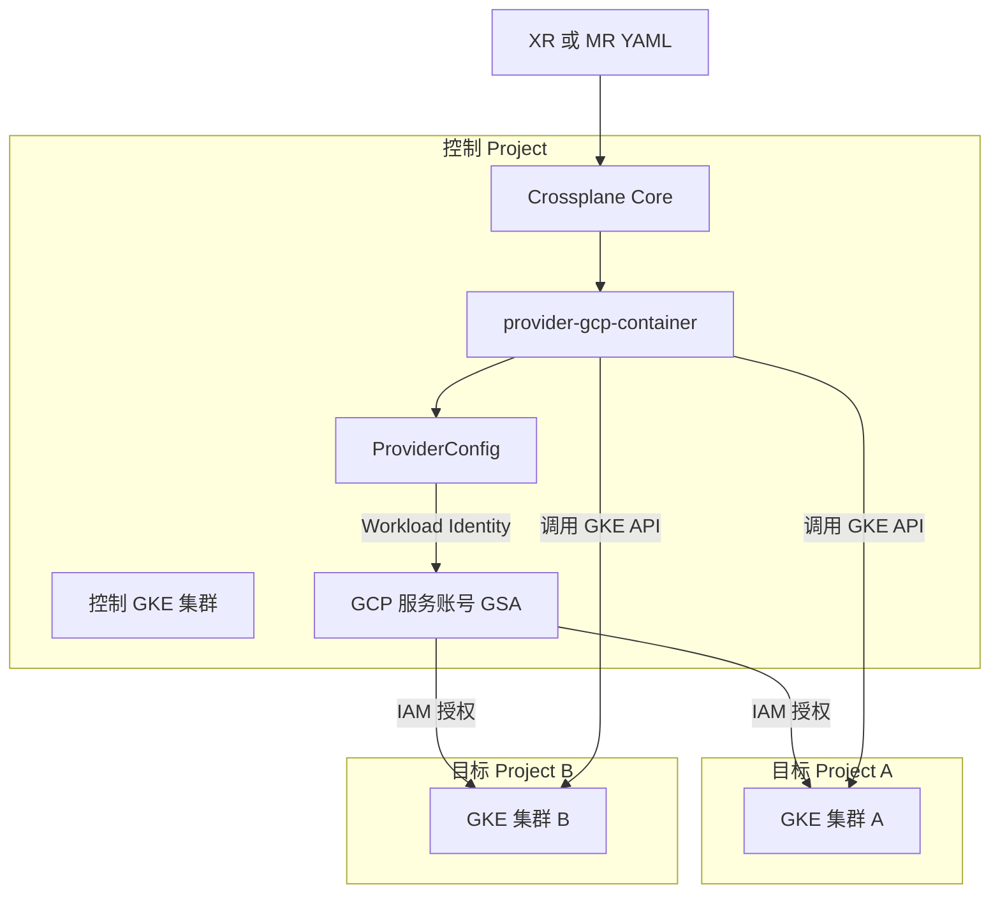
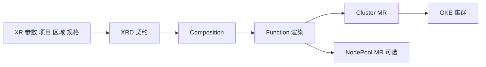
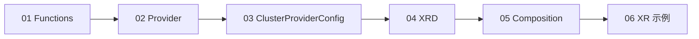

我先核实一下 Crossplane 和 GCP Provider 当前的版本与认证方式，避免按旧资料给你建议。

## 1. 结论：这个思路合理，建议这样做

"一个控制集群管理其他 GCP Project 里的 GKE"是很好的最小 PoC，原因有三点：

- **只有一个云、一个 Provider、一种资源**，认证只需要一套 GCP Workload Identity，不涉及多云身份差异。
- **已经覆盖多 Project 授权**，这是将来多账号、多云场景最关键的模式（一个 ProviderConfig 对应一个目标账号）。
- 验证成功后，扩展到其他云只需新增 Provider、ProviderConfig 和 Composition，**架构不用改**。

有两点要先说明：

1. **"管理 GKE"指的是管理 GKE 集群本身的生命周期**（创建、变更、删除），而不是管理集群内部的 Deployment 等对象。这个 PoC 属于前者。
2. **控制集群不要自己管理自己**，PoC 阶段它由你手工或 Terraform 创建，被管理的是**另一个 Project 里的新集群**。

## 2. PoC 架构



## 3. 版本选择

据我检索到的信息，目前最新的是 **Crossplane 2.4.x**，v1.20 将在 2026 年 11 月结束维护。所以**直接用 v2.x，不要从 v1 起步**，否则很快要迁移。

v2 对你的设计有几处影响：

| 变化 | 影响 |
|---|---|
| 旧的 `ControllerConfig` 已移除 | 给 Provider 指定 ServiceAccount 要用 `DeploymentRuntimeConfig` |
| Managed Resource 支持命名空间级 | ProviderConfig 和 MR 的 apiGroup 可能带 `.m.`，写 YAML 前先用 `kubectl api-resources` 确认 |
| Claim 机制调整，XR 可直接在命名空间使用 | 设计 XRD 时按 v2 的方式来 |

> 以上 v2 细节请以官方文档和你实际安装版本的 CRD 为准，我没有逐条核实。

## 4. 需要准备的资源

| 类别 | 内容 | 说明 |
|---|---|---|
| **控制 Project** | 1 个 GKE 集群（Standard 或 Autopilot 都可） | 必须**开启 Workload Identity**；节点规格不用大 |
| **目标 Project** | 1~2 个测试 Project | 只用于创建测试 GKE，用完即删 |
| **GCP 服务账号 GSA** | 建在控制 Project，如 `crossplane-sa` | Provider 使用的身份 |
| **IAM 授权** | GSA 在每个目标 Project 的角色 | `roles/container.admin`，若节点使用自定义服务账号，还需对该账号的 `roles/iam.serviceAccountUser` |
| **API 启用** | 目标 Project 开启 `container.googleapis.com`，按需开启 `compute.googleapis.com` | 不开会一直报错 |
| **网络** | 目标 Project 的 VPC 和子网（或使用 default 网络） | PoC 用 default 最简单 |
| **工具** | `gcloud`、`kubectl`、`helm`，可选 Crossplane CLI | CLI 现在有独立发布渠道 |
| **仓库** | 一个 Git 仓库放 YAML | PoC 先手工 `kubectl apply`，不必立刻上 ArgoCD |

## 5. 实施步骤

### 步骤 1：准备控制集群与 GSA

```bash
# 执行前请确认当前 gcloud 项目和账号，替换所有大写变量
export CTRL_PROJECT=ctrl-project-id
export TARGET_PROJECT=target-project-a
export GSA=crossplane-sa

# 控制集群需已开启 Workload Identity，已有集群可检查：
gcloud container clusters describe CLUSTER_NAME --location=LOCATION \
  --project=$CTRL_PROJECT --format="value(workloadIdentityConfig.workloadPool)"

# 创建 GSA
gcloud iam service-accounts create $GSA --project=$CTRL_PROJECT
```

### 步骤 2：安装 Crossplane Core

```bash
helm repo add crossplane-stable https://charts.crossplane.io/stable
helm repo update

# 版本号替换为你确认过的 2.x 版本，务必固定
helm install crossplane crossplane-stable/crossplane \
  --namespace crossplane-system --create-namespace \
  --version 2.4.2

kubectl get pods -n crossplane-system
```

> 正式环境这一步归 Terraform + Helm，PoC 手工执行即可。

### 步骤 3：配置 Workload Identity 与 Provider

```yaml
# runtime-config.yaml
apiVersion: pkg.crossplane.io/v1beta1
kind: DeploymentRuntimeConfig
metadata:
  name: gcp-wi
spec:
  serviceAccountTemplate:
    metadata:
      name: provider-gcp          # 固定 KSA 名称，便于绑定
      annotations:
        iam.gke.io/gcp-service-account: crossplane-sa@CTRL_PROJECT.iam.gserviceaccount.com
---
apiVersion: pkg.crossplane.io/v1
kind: Provider
metadata:
  name: provider-gcp-container
spec:
  package: xpkg.upbound.io/upbound/provider-gcp-container:v2.x.y   # 固定为具体版本
  runtimeConfigRef:
    name: gcp-wi
```

```bash
kubectl apply -f runtime-config.yaml
kubectl get providers   # 等待 INSTALLED 和 HEALTHY 为 True

# 绑定 KSA 与 GSA
gcloud iam service-accounts add-iam-policy-binding \
  $GSA@$CTRL_PROJECT.iam.gserviceaccount.com \
  --role roles/iam.workloadIdentityUser \
  --member "serviceAccount:$CTRL_PROJECT.svc.id.goog[crossplane-system/provider-gcp]"

# 授权 GSA 管理目标 Project 的 GKE
gcloud projects add-iam-policy-binding $TARGET_PROJECT \
  --member "serviceAccount:$GSA@$CTRL_PROJECT.iam.gserviceaccount.com" \
  --role roles/container.admin
```

据 Upbound 官方文档，GCP Provider 支持 OIDC、服务账号密钥、访问令牌、Workload Identity 和服务账号模拟等多种认证方式。GKE 上推荐 Workload Identity，**不要用 JSON 密钥**。

### 步骤 4：为每个目标 Project 建一个 ProviderConfig

```yaml
apiVersion: gcp.upbound.io/v1beta1     # v2 下可能是 gcp.m.upbound.io 的命名空间版本，请以 CRD 为准
kind: ProviderConfig
metadata:
  name: target-project-a
spec:
  projectID: target-project-a
  credentials:
    source: InjectedIdentity
```

**一个 ProviderConfig 对应一个目标 Project**，这就是将来"按团队、环境、云拆分权限"的雏形。

### 步骤 5：先用 MR 直接创建一个 GKE（验证链路）

```bash
# 先确认实际的 apiVersion 和字段
kubectl get crd | grep container.gcp
kubectl explain clusters.container.gcp.upbound.io.spec.forProvider
```

```yaml
# 示例骨架，apiVersion 与字段以 kubectl explain 的输出为准
apiVersion: container.gcp.upbound.io/v1beta2
kind: Cluster
metadata:
  name: poc-gke-a
spec:
  forProvider:
    location: asia-northeast1
    enableAutopilot: true
    deletionProtection: false      # PoC 必须关，否则删除 MR 时会被拒绝
  providerConfigRef:
    name: target-project-a
```

```bash
kubectl apply -f cluster.yaml
kubectl get cluster.container -w      # 创建通常需要 10 分钟左右，看 SYNCED 和 READY
kubectl describe cluster.container poc-gke-a   # 看 Events 和 Conditions 排错
```

### 步骤 6：再封装成 XRD 与 Composition

MR 跑通后，才引入平台抽象：



XRD 只暴露**业务参数**（目标 Project、区域、环境、规格档位），ProviderConfig 的选择在 Composition 里按 Project 映射，不让使用者自选。

## 6. PoC 验收标准

| # | 验收项 |
|---|---|
| 1 | 控制集群里 Crossplane 和 Provider 均为 Healthy |
| 2 | 通过 MR 在目标 Project A 创建出 GKE，状态 Ready |
| 3 | 修改一个字段（如标签），云上同步更新 |
| 4 | **手工在云上改一个字段，Crossplane 能纠正回来**（验证漂移修复） |
| 5 | 删除 MR，云上集群被删除 |
| 6 | 用同一个 Provider 加第二个 ProviderConfig，管理 Project B |
| 7 | 通过 XRD + Composition 完成同样的创建，由 XR 驱动 |
| 8 | 记录各步骤耗时、遇到的权限和 API 报错，作为后续文档 |

## 7. 常见坑

| 坑 | 说明 |
|---|---|
| Provider 一直 Unhealthy | 多半是 Workload Identity 未开启，或 KSA 名称与绑定不一致 |
| 创建报 403 | 目标 Project 没授权 GSA，或没开启 API |
| 创建报 Service Account 相关错误 | 节点使用的服务账号没有授予 `iam.serviceAccountUser` |
| 删除卡住 | `deletionProtection` 没关；或 Project 级策略阻止 |
| 安装整个 `provider-gcp` 全家桶 | CRD 非常多，拖慢 API Server。只装 `provider-gcp-container` 这类子 Provider 即可 |
| Provider 版本漂移 | 示例里常用浮动的 `:v2` 标签，PoC 之外要固定为具体版本 |
| 把控制集群自己纳入管理 | 先不要，避免循环依赖 |

## 8. PoC 之后的路径

1. 加入 ArgoCD，把 Provider、ProviderConfig、XRD、Composition 迁入 GitOps。
2. 增加 Kyverno 等准入策略，限制 XR 参数。
3. 做一次**备份与恢复演练**（这是你们目标里的关键项）。
4. 把 Terraform + Helm 管 Core 的流程固化。
5. 增加第二个云（比如 AWS 的 EKS），沿用同一个 XRD，仅新增一套 Composition 和 ProviderConfig。

## 9. 还需要你确认的两点

- 你的控制集群和目标 Project 在同一个组织下吗？跨组织会有组织策略和授权方面的额外限制。
- 目标 GKE 是私有集群吗？Crossplane 调用的是 GCP 控制面 API，**不需要访问集群 API Server**，所以通常没有网络问题，但如果后续要往这些集群里装东西（`provider-kubernetes` 或 `provider-helm`），就需要考虑网络连通。

如果需要，下一步我可以直接帮你写出一套完整的 PoC YAML：包含 XRD、Composition 和 XR 示例，用 `function-patch-and-transform` 或 `function-go-templating` 实现"提交一个 XR 就创建一个 GKE"。


你的控制集群和目标 Project 在同一个组织下吗==> 是的 在一个下面 
你的控制集群和目标 Project 在同一个组织下吗 ==> 是的
写出一套完整的 PoC YAML：包含 XRD、Composition 和 XR 示例，用 function-patch-and-transform 或 function-go-templating 实现"提交一个 XR 就创建一个 GKE"。


我先核实 v2 的 XRD 与 Composition 写法，以及 GCP Provider 在 v2 下的 Cluster 实际 apiVersion。

先说明一处修正：上一轮我给的 `gcp.upbound.io` 的 ProviderConfig 是 v1 风格（集群级 MR）。你选 Crossplane v2，所以这一轮统一用**命名空间级**写法。

据 v2 官方文档，XRD 现在有 `scope` 字段，默认 Namespaced，并且命名空间级 XR 不再支持 Claim。v2 同时移除了原生的 patch-and-transform 组合方式和 ControllerConfig。Upbound GCP Provider 的命名空间级 ProviderConfig 在 `gcp.m.upbound.io` 组下，类型是 ClusterProviderConfig。

## 1. 选型：用 function-go-templating

`function-patch-and-transform` 仍可作为 Function 使用，但这里选 `function-go-templating`，原因有两点：

- 需要一张"项目到 ProviderConfig"的映射表，使用者只能选项目，不能自选凭据，用模板写最直接。
- 将来加 AWS、Azure 时，同一个 XRD 只需再加一个带 `provider: aws` 标签的 Composition。

## 2. 文件清单与应用顺序



前提：上一轮的 GSA 创建、Workload Identity 绑定、目标 Project 的 `roles/container.admin` 授权和 API 启用都已完成，且 Crossplane Core（v2.x）已安装。

### 01-functions.yaml

```yaml
apiVersion: pkg.crossplane.io/v1
kind: Function
metadata:
  name: function-go-templating
spec:
  # 版本为示例，请到 crossplane-contrib 发布页确认后固定
  package: xpkg.crossplane.io/crossplane-contrib/function-go-templating:v0.11.2
---
apiVersion: pkg.crossplane.io/v1
kind: Function
metadata:
  name: function-auto-ready
spec:
  package: xpkg.crossplane.io/crossplane-contrib/function-auto-ready:v0.6.5
```

### 02-provider.yaml

```yaml
apiVersion: pkg.crossplane.io/v1beta1
kind: DeploymentRuntimeConfig
metadata:
  name: gcp-wi
spec:
  serviceAccountTemplate:
    metadata:
      name: provider-gcp   # 固定 KSA 名，须与 IAM 绑定中的名称一致
      annotations:
        iam.gke.io/gcp-service-account: crossplane-sa@CTRL_PROJECT.iam.gserviceaccount.com
---
apiVersion: pkg.crossplane.io/v1
kind: Provider
metadata:
  name: provider-gcp-container
spec:
  package: xpkg.upbound.io/upbound/provider-gcp-container:v2.x.y   # 固定为 Marketplace 上确认过的具体版本
  runtimeConfigRef:
    name: gcp-wi
```

> 不要再单独声明 `provider-family-gcp`，子 Provider 会自动拉取它。

### 03-providerconfigs.yaml

```yaml
apiVersion: gcp.m.upbound.io/v1beta1
kind: ClusterProviderConfig
metadata:
  name: gcp-target-a
spec:
  projectID: target-project-a
  credentials:
    source: InjectedIdentity
---
apiVersion: gcp.m.upbound.io/v1beta1
kind: ClusterProviderConfig
metadata:
  name: gcp-target-b        # 只测一个 Project 时可删掉
spec:
  projectID: target-project-b
  credentials:
    source: InjectedIdentity
```

### 04-xrd.yaml

```yaml
apiVersion: apiextensions.crossplane.io/v2
kind: CompositeResourceDefinition
metadata:
  name: gkeclusters.platform.example.org
spec:
  scope: Namespaced
  group: platform.example.org
  names:
    kind: GKECluster
    plural: gkeclusters
  versions:
    - name: v1alpha1
      served: true
      referenceable: true
      schema:
        openAPIV3Schema:
          type: object
          properties:
            spec:
              type: object
              properties:
                parameters:
                  type: object
                  properties:
                    projectID:
                      type: string
                      description: 目标 GCP Project，只能从平台批准的列表中选择
                      enum:
                        - target-project-a
                        - target-project-b
                    region:
                      type: string
                      description: GKE 所在区域
                      default: asia-northeast1
                      enum:
                        - asia-northeast1
                        - us-central1
                    environment:
                      type: string
                      description: 环境标签
                      default: dev
                      enum:
                        - dev
                        - preprod
                        - prod
                  required:
                    - projectID
              required:
                - parameters
```

### 05-composition.yaml

```yaml
apiVersion: apiextensions.crossplane.io/v1
kind: Composition
metadata:
  name: gkecluster-gcp
  labels:
    provider: gcp          # 将来 AWS 用 provider: aws 的另一个 Composition
spec:
  compositeTypeRef:
    apiVersion: platform.example.org/v1alpha1
    kind: GKECluster
  mode: Pipeline
  pipeline:
    - step: render-gke
      functionRef:
        name: function-go-templating
      input:
        apiVersion: gotemplating.fn.crossplane.io/v1beta1
        kind: GoTemplate
        source: Inline
        inline:
          template: |
            {{- $xr := .observed.composite.resource }}
            {{- $p := $xr.spec.parameters }}
            {{- /* 项目到 ProviderConfig 的固定映射，使用者不能自选 */}}
            {{- $pcMap := dict "target-project-a" "gcp-target-a" "target-project-b" "gcp-target-b" }}
            ---
            apiVersion: container.gcp.m.upbound.io/v1beta1
            kind: Cluster
            metadata:
              name: {{ $xr.metadata.name }}
              namespace: {{ $xr.metadata.namespace }}
              annotations:
                gotemplating.fn.crossplane.io/composition-resource-name: cluster
            spec:
              forProvider:
                project: {{ $p.projectID }}
                location: {{ $p.region }}
                enableAutopilot: true
                deletionProtection: false   # 仅 PoC；正式环境改为 true 并由 XRD 控制
                resourceLabels:
                  environment: {{ $p.environment }}
                  managed-by: crossplane
              providerConfigRef:
                kind: ClusterProviderConfig
                name: {{ index $pcMap $p.projectID }}
    - step: auto-ready
      functionRef:
        name: function-auto-ready
```

### 06-xr-example.yaml

```yaml
apiVersion: v1
kind: Namespace
metadata:
  name: team-a
---
apiVersion: platform.example.org/v1alpha1
kind: GKECluster
metadata:
  name: poc-gke-a           # 同时作为 GKE 集群名：小写字母、数字、连字符，不超过 40 字符
  namespace: team-a
spec:
  crossplane:
    compositionSelector:
      matchLabels:
        provider: gcp
  parameters:
    projectID: target-project-a
    region: asia-northeast1
    environment: dev
```

## 3. 执行与验证

```bash
# 应用前建议先做客户端校验，并确认当前 kubectl 上下文是控制集群
kubectl config current-context
kubectl apply --dry-run=server -f 01-functions.yaml

kubectl apply -f 01-functions.yaml
kubectl apply -f 02-provider.yaml
kubectl get providers,functions          # 等到全部 HEALTHY=True

# 先确认实际 CRD 名称，避免 apiVersion 与你安装的版本不符
kubectl get crd | grep -E "container.gcp.m|clusterproviderconfigs"

kubectl apply -f 03-providerconfigs.yaml
kubectl apply -f 04-xrd.yaml
kubectl get xrd                          # ESTABLISHED=True 后再继续
kubectl apply -f 05-composition.yaml
kubectl apply -f 06-xr-example.yaml

# 观察
kubectl get gkecluster -n team-a -w
kubectl get cluster.container.gcp.m.upbound.io -n team-a
kubectl describe gkecluster poc-gke-a -n team-a
```

删除测试：`kubectl delete gkecluster poc-gke-a -n team-a`，XR 删除后会级联删除 MR，云上集群随之删除。

## 4. 对应的验收项

| 验收项 | 操作 |
|---|---|
| 创建 | 应用 XR，约 10 分钟后 XR 和 MR 均 `READY=True`，云上出现集群 |
| 参数校验 | 把 `projectID` 改成不在枚举里的值，API Server 应直接拒绝 |
| 更新 | 修改 `environment`，云上标签同步变化 |
| 漂移修复 | 在云上手工改标签，等待调谐周期后被纠正回来 |
| 多 Project | 改 `projectID` 为 B 新建一个 XR，验证两个 ProviderConfig 的授权都生效 |
| 删除 | 删 XR，云上集群消失 |

## 5. 容易出错的地方

| 现象 | 可能原因与处理 |
|---|---|
| Composition 渲染后 MR 创建失败，提示找不到类型 | `container.gcp.m.upbound.io` 是我按 v2 命名规则推断的，请以 `kubectl get crd` 的实际结果为准，必要时改 apiVersion |
| XR 报 `forbidden`，Crossplane 无权创建 MR | 补一个带标签 `rbac.crossplane.io/aggregate-to-crossplane: "true"` 的 ClusterRole，授权对应资源 |
| Autopilot 创建报网络或 IP 分配相关错误 | 尝试在 `forProvider` 加 `ipAllocationPolicy: [{}]`，或显式指定 `network` 和 `subnetwork` |
| MR 报 403 或 API 未启用 | 目标 Project 缺少 `roles/container.admin` 授权，或未启用 `container.googleapis.com` |
| Autopilot 节点相关报错 | 默认 Compute 服务账号被删除，或需要对其授予 `iam.serviceAccountUser` |
| XR 一直 `Synced=False` | 先看 `kubectl describe` 的 Events，再看 Provider 和 Function Pod 日志 |
| 引用不存在的 ProviderConfig | 映射表里的名字必须与 `03` 中的 `metadata.name` 一致 |
| 修改了 XRD 枚举但 XR 没变化 | 枚举只在提交时校验，已有 XR 不受影响 |

## 6. 这套结构和你们长期目标的对应

| PoC 里的元素 | 将来对应的平台能力 |
|---|---|
| XRD 枚举限制项目和区域 | 平台批准清单、准入策略 |
| 模板里的 `$pcMap` | 按团队、环境、云拆分的 ProviderConfig 隔离 |
| Composition 的 `provider: gcp` 标签 | 同一个 XRD 对应多云实现，XR 里切换标签即可 |
| 固定 `deletionProtection: false` | 正式环境改为参数化并默认开启 |
| 手工 `kubectl apply` | 换成 CI 打包 OCI Configuration，再由 ArgoCD 同步 |

下一步我可以帮你做以下任意一项：把这套文件打包成 Configuration 包（`crossplane.yaml` 加目录结构和 GitHub Actions 构建流水线）、加上 XR 的 `status.endpoint` 回写，或者补一个 AWS EKS 的 Composition 验证多云复用。